# Page: Overview

# Overview

<details>
<summary>Relevant source files</summary>

The following files were used as context for generating this wiki page:

- [README.md](README.md)
- [app/src/main/AndroidManifest.xml](app/src/main/AndroidManifest.xml)
- [app/src/main/res/layout/main_activity.xml](app/src/main/res/layout/main_activity.xml)
- [termux-x11](termux-x11)

</details>


Termux-X11 is a fully-featured X11 server implementation for Android that enables graphical applications to run within the Termux environment. It serves as a bridge between Linux graphical applications and the Android UI system, allowing X11 client applications to display their interface on Android devices.

The system consists of an Android application (`com.termux.x11`) responsible for displaying content and handling input, a native X11 server component that implements the X11 protocol, and a shell loader that bootstraps the environment from the Termux terminal.

For information about installing and using Termux-X11, see [User Guide](#6). For details on contributing to the project, see [Developer's Guide](#7).

## System Architecture

### High-Level Architecture

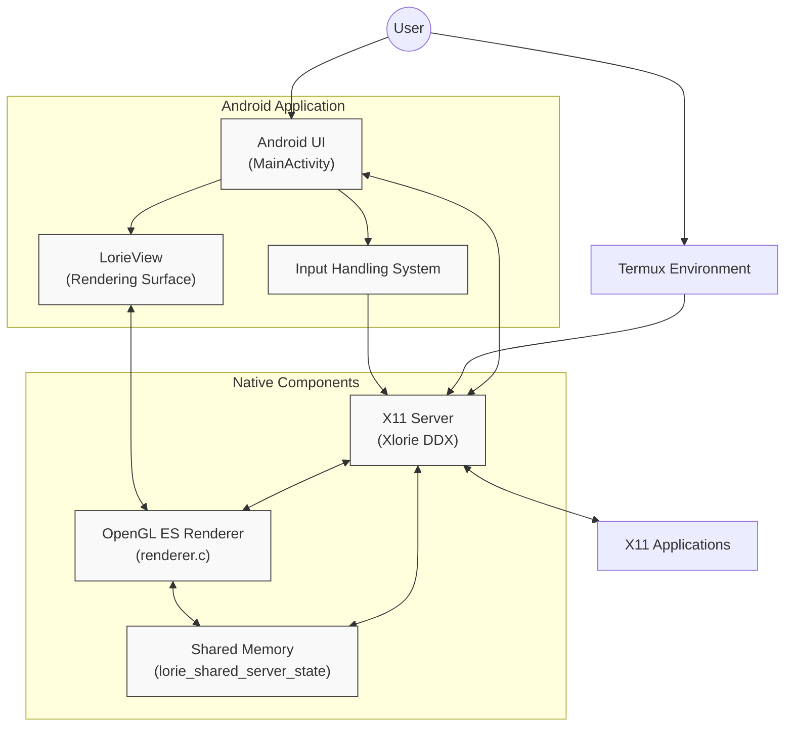

Sources: 
- [README.md:8-25]()
- [app/src/main/res/layout/main_activity.xml:21-26]()
- [app/src/main/AndroidManifest.xml:20-37]()

### Component Structure and Code Entities

The following diagram maps high-level system responsibilities to specific code entities within the repository.

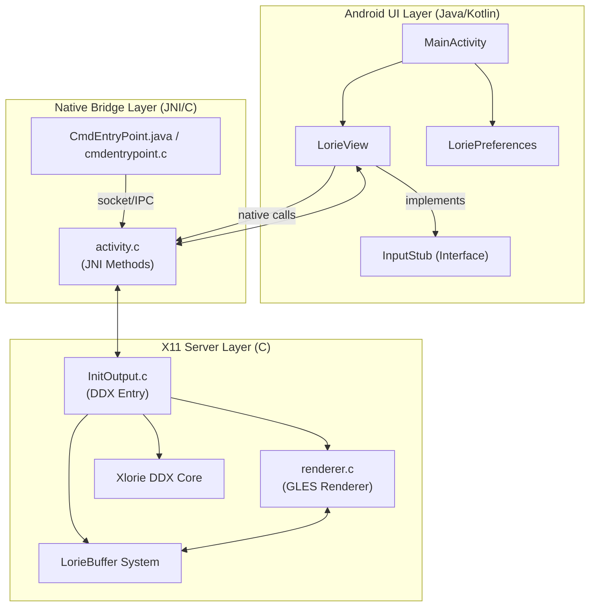

Sources:
- [app/src/main/res/layout/main_activity.xml:21-26]()
- [app/src/main/AndroidManifest.xml:38-50]()
- [termux-x11:7-7]()

## How It Works

Termux-X11 operates through a client-server model where the X11 server runs as a native process on the Android device, and X11 clients (graphical applications) connect to it via Unix domain sockets.

1.  **Shell Bootstrap**: The `termux-x11` shell script uses `app_process` to launch `com.termux.x11.Loader`, which initializes the environment [termux-x11:7-7]().
2.  **Command Entry**: `CmdEntryPoint` handles the IPC between the Termux terminal and the Android application, often starting the X server process.
3.  **MainActivity & LorieView**: The `MainActivity` hosts the `LorieView` [app/src/main/res/layout/main_activity.xml:21-26](), which acts as the visual output for the X server.
4.  **Xlorie DDX**: The Device Dependent X (DDX) layer specifically written for Android, managing the rendering pipeline and input translation.
5.  **Input Pipeline**: Android touch and key events are captured by `LorieView` and forwarded to the native X server.

### Execution Flow from Terminal

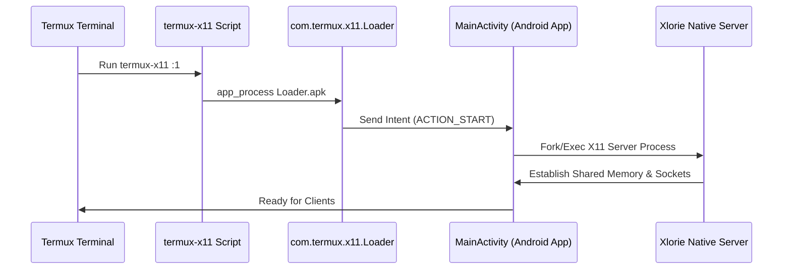

Sources:
- [termux-x11:1-8]()
- [app/src/main/AndroidManifest.xml:20-37]()

## Key Components in Detail

### MainActivity and UI
The `MainActivity` is the primary container for the X11 session. It is configured as a `singleInstance` activity to ensure only one X11 display session is active at a time [app/src/main/AndroidManifest.xml:23-23](). It manages the `LorieView` and various UI overlays like the preference button and exit button [app/src/main/res/layout/main_activity.xml:65-91]().

### LorieView
A custom view that serves as the rendering surface. It is responsible for:
- Displaying the framebuffers provided by the X server.
- Capturing touch events for conversion into X11 pointer events.
- Providing the `InputStub` implementation for the input subsystem.

### Shell Loader (`termux-x11` script)
The shell script located in the Termux environment bootstraps the process. It sets up the `CLASSPATH` to point to the `loader.apk` and uses `/system/bin/app_process` to start the Java-based loader [termux-x11:5-7]().

### Preferences System
The application includes a comprehensive preference system (`LoriePreferences`) that allows users to toggle features like legacy drawing, force BGRA color modes, and input behavior [app/src/main/AndroidManifest.xml:38-50](). These can also be triggered via broadcasts like `com.termux.x11.CHANGE_PREFERENCE` [app/src/main/AndroidManifest.xml:69-69]().

## Summary of Architecture Components

| Component | Language | Role |
| :--- | :--- | :--- |
| **Android App** | Java/Kotlin | UI Container, Lifecycle Management, Input Capture |
| **Xlorie DDX** | C | Native X11 Server implementation for Android |
| **Loader** | Java/Shell | CLI bridge to start the app from Termux |
| **Renderer** | C (GLES) | Efficiently draws X11 buffers to Android Surfaces |
| **Companion Pkg** | Deb/Script | The `termux-x11` script and `loader.apk` in Termux |

Sources:
- [README.md:28-34]()
- [termux-x11:1-8]()
- [app/src/main/res/layout/main_activity.xml:21-26]()

---

# Page: System Architecture

# System Architecture

<details>
<summary>Relevant source files</summary>

The following files were used as context for generating this wiki page:

- [app/src/main/aidl/com/termux/x11/ICmdEntryInterface.aidl](app/src/main/aidl/com/termux/x11/ICmdEntryInterface.aidl)
- [app/src/main/cpp/lorie/InitOutput.c](app/src/main/cpp/lorie/InitOutput.c)
- [app/src/main/cpp/lorie/activity.c](app/src/main/cpp/lorie/activity.c)
- [app/src/main/cpp/lorie/cmdentrypoint.c](app/src/main/cpp/lorie/cmdentrypoint.c)
- [app/src/main/cpp/lorie/lorie.h](app/src/main/cpp/lorie/lorie.h)
- [app/src/main/cpp/lorie/renderer.c](app/src/main/cpp/lorie/renderer.c)
- [app/src/main/cpp/recipes/xserver.cmake](app/src/main/cpp/recipes/xserver.cmake)
- [app/src/main/java/com/termux/x11/LoriePreferences.java](app/src/main/java/com/termux/x11/LoriePreferences.java)
- [app/src/main/java/com/termux/x11/LorieView.java](app/src/main/java/com/termux/x11/LorieView.java)
- [app/src/main/java/com/termux/x11/MainActivity.java](app/src/main/java/com/termux/x11/MainActivity.java)
- [app/src/main/java/com/termux/x11/input/TouchInputHandler.java](app/src/main/java/com/termux/x11/input/TouchInputHandler.java)
- [app/src/main/res/values/arrays.xml](app/src/main/res/values/arrays.xml)
- [app/src/main/res/values/strings.xml](app/src/main/res/values/strings.xml)
- [app/src/main/res/xml/keep.xml](app/src/main/res/xml/keep.xml)
- [app/src/main/res/xml/preferences.xml](app/src/main/res/xml/preferences.xml)

</details>


This document describes the overall architecture of Termux-X11, detailing how its various components interact to enable X11 applications to run on Android.

## Overview

Termux-X11 consists of two main components:
1. **Android Application** - The Java-based Android UI that hosts the X11 server and handles user input.
2. **X11 Server (Xlorie)** - A native C/C++ implementation of an X11 server (DDX) that processes X protocol messages and manages window rendering.

These components interact through JNI (Java Native Interface), shared memory, and socket-based IPC mechanisms. The system allows X11 applications launched from Termux to connect to the server and display their graphical interfaces on the Android device.

## High-Level Architecture

The following diagram maps the high-level components to their respective code entities.

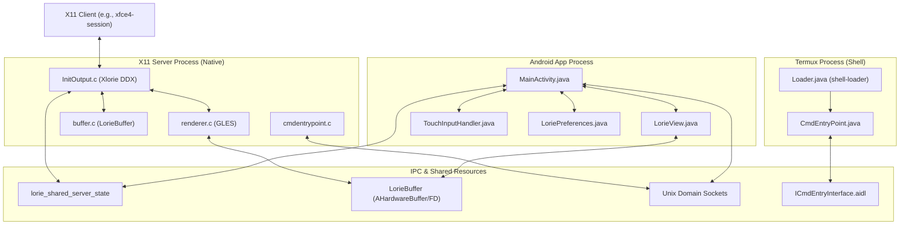

Sources:
- [app/src/main/java/com/termux/x11/MainActivity.java:76-148]()
- [app/src/main/cpp/lorie/InitOutput.c:85-133]()
- [app/src/main/cpp/lorie/renderer.c:111-135]()
- [app/src/main/cpp/lorie/lorie.h:159-180]()
- [app/src/main/cpp/lorie/cmdentrypoint.c:72-88]()

## Core Component Interaction

The interaction between the Android UI and the native X server is bridged by JNI methods defined in `activity.c` and `cmdentrypoint.c`.

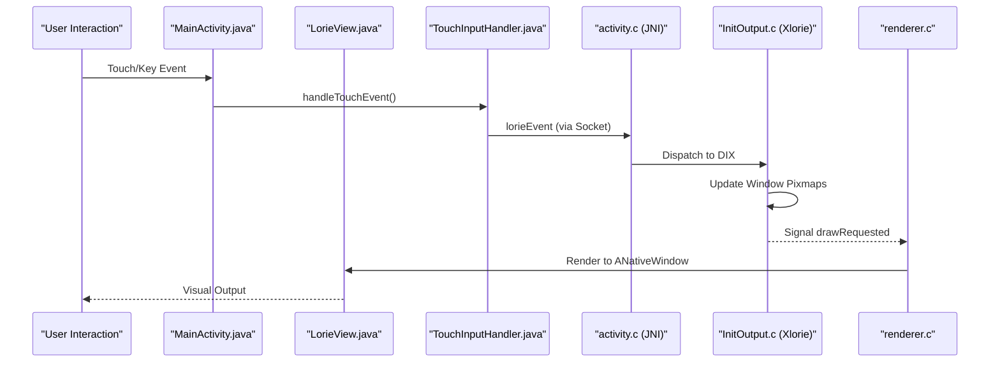

Sources:
- [app/src/main/java/com/termux/x11/MainActivity.java:152-175]()
- [app/src/main/cpp/lorie/activity.c:108-129]()
- [app/src/main/cpp/lorie/renderer.c:580-600]()
- [app/src/main/java/com/termux/x11/input/TouchInputHandler.java:169-198]()

## Subsystem Overviews

### X11 Server Architecture
The X11 server is a custom DDX (Device Dependent X) implementation named **Xlorie**. It initializes the X server core (DIX) and provides the rendering and input backend for Android. It uses the **EXA** acceleration architecture for 2D operations and the **Present** extension for frame synchronization.
For details, see [X11 Server Architecture](#2.1).

### Android UI Architecture
The Android layer is centered around `MainActivity` and `LorieView`. `LorieView` provides the `ANativeWindow` surface that the native GLES renderer draws onto. `LorieService` (or `LorieView`'s lifecycle) manages the connection to the native X server process.
For details, see [Android UI Architecture](#2.2).

### Input System Architecture
Input flows from Android's `MotionEvent` and `KeyEvent` through `TouchInputHandler`. Depending on the selected `InputMode` (Trackpad, Simulated Touch, or Direct Touch), events are transformed and sent to the X server as `lorieEvent` structures via a local socket.
For details, see [Input System Architecture](#2.3).

### Shared Memory and IPC
Because the X server and the Android UI may run in different contexts (especially when launched via the shell loader), they communicate using:
- **Shared Memory**: A `lorie_shared_server_state` struct mapped in both processes for high-frequency data like cursor position and synchronization primitives (`pthread_mutex_t`, `pthread_cond_t`).
- **File Descriptor Passing**: SCM_RIGHTS is used to pass `AHardwareBuffer` or `memfd` FDs between the server and the renderer.
- **AIDL**: `ICmdEntryInterface` allows the UI to communicate with the background X server process.

For details, see [Shared Memory and IPC](#2.4).

## Startup and Connection Flow

1. **Bootstrap**: The `termux-x11` script invokes the shell-loader, which uses `app_process` to start `CmdEntryPoint`.
2. **Native Init**: `CmdEntryPoint.start()` calls into `cmdentrypoint.c`, which sets up the `TMPDIR` and `XKB_CONFIG_ROOT` environments before calling `dix_main`. [app/src/main/cpp/lorie/cmdentrypoint.c:119-191]()
3. **UI Connection**: `MainActivity` receives an `ACTION_START` intent, retrieves the binder for `ICmdEntryInterface`, and triggers the JNI connection via `nativeInit`. [app/src/main/java/com/termux/x11/MainActivity.java:106-112]()
4. **State Sync**: The native layer maps the `lorie_shared_server_state` created in `OsVendorInit`. [app/src/main/cpp/lorie/InitOutput.c:107-133]()

Sources:
- [app/src/main/cpp/lorie/cmdentrypoint.c:73-106]()
- [app/src/main/java/com/termux/x11/MainActivity.java:152-168]()
- [app/src/main/cpp/lorie/activity.c:108-129]()

## Rendering Pipeline

The rendering pipeline is a "pull" model where the Android UI's `Choreographer` or a dedicated renderer thread triggers frames based on the `drawRequested` flag in shared memory.

| Component | Role | Code Reference |
|-----------|------|----------------|
| **X Server** | Draws to `LorieBuffer` | [app/src/main/cpp/lorie/InitOutput.c:207-217]() |
| **Shared State** | Coordinates vsync/dirty flags | [app/src/main/cpp/lorie/lorie.h:159-198]() |
| **GLES Renderer** | Composites buffers to screen | [app/src/main/cpp/lorie/renderer.c:602-660]() |
| **LorieView** | Provides `ANativeWindow` | [app/src/main/java/com/termux/x11/LorieView.java:27-40]() |

Sources:
- [app/src/main/cpp/lorie/lorie.h:175-182]()
- [app/src/main/cpp/lorie/renderer.c:164-195]()
- [app/src/main/cpp/lorie/InitOutput.c:56-83]()

---

# Page: X11 Server Architecture

# X11 Server Architecture

<details>
<summary>Relevant source files</summary>

The following files were used as context for generating this wiki page:

- [app/src/main/aidl/com/termux/x11/ICmdEntryInterface.aidl](app/src/main/aidl/com/termux/x11/ICmdEntryInterface.aidl)
- [app/src/main/cpp/lorie/InitOutput.c](app/src/main/cpp/lorie/InitOutput.c)
- [app/src/main/cpp/lorie/InputXKB.c](app/src/main/cpp/lorie/InputXKB.c)
- [app/src/main/cpp/lorie/activity.c](app/src/main/cpp/lorie/activity.c)
- [app/src/main/cpp/lorie/buffer.c](app/src/main/cpp/lorie/buffer.c)
- [app/src/main/cpp/lorie/buffer.h](app/src/main/cpp/lorie/buffer.h)
- [app/src/main/cpp/lorie/cmdentrypoint.c](app/src/main/cpp/lorie/cmdentrypoint.c)
- [app/src/main/cpp/lorie/fbconfigs.h](app/src/main/cpp/lorie/fbconfigs.h)
- [app/src/main/cpp/lorie/lorie.h](app/src/main/cpp/lorie/lorie.h)
- [app/src/main/cpp/lorie/renderer.c](app/src/main/cpp/lorie/renderer.c)
- [app/src/main/cpp/lorie/shm/shmem.c](app/src/main/cpp/lorie/shm/shmem.c)
- [app/src/main/cpp/patches/Xtrans.patch](app/src/main/cpp/patches/Xtrans.patch)
- [app/src/main/cpp/patches/xserver.patch](app/src/main/cpp/patches/xserver.patch)
- [app/src/main/cpp/recipes/xserver.cmake](app/src/main/cpp/recipes/xserver.cmake)
- [app/src/main/java/com/termux/x11/EditText.java](app/src/main/java/com/termux/x11/EditText.java)
- [app/src/main/res/layout/view_terminal_toolbar_text_input.xml](app/src/main/res/layout/view_terminal_toolbar_text_input.xml)

</details>


This page details the architecture of the X11 server implementation in Termux-X11, focusing on the Lorie X11 server (Xlorie DDX). It covers DDX initialization, the rendering pipeline, buffer management, EXA acceleration, and the implementation of X11 protocols on Android.

## Overview

Termux-X11 uses a custom X11 server implementation called **Xlorie** (Lorie DDX) that bridges standard X11 applications and the Android graphics system. The server handles rendering X windows, manages shared buffers, processes input events, and coordinates communication with the Android UI surface via a dedicated GLES2 renderer.

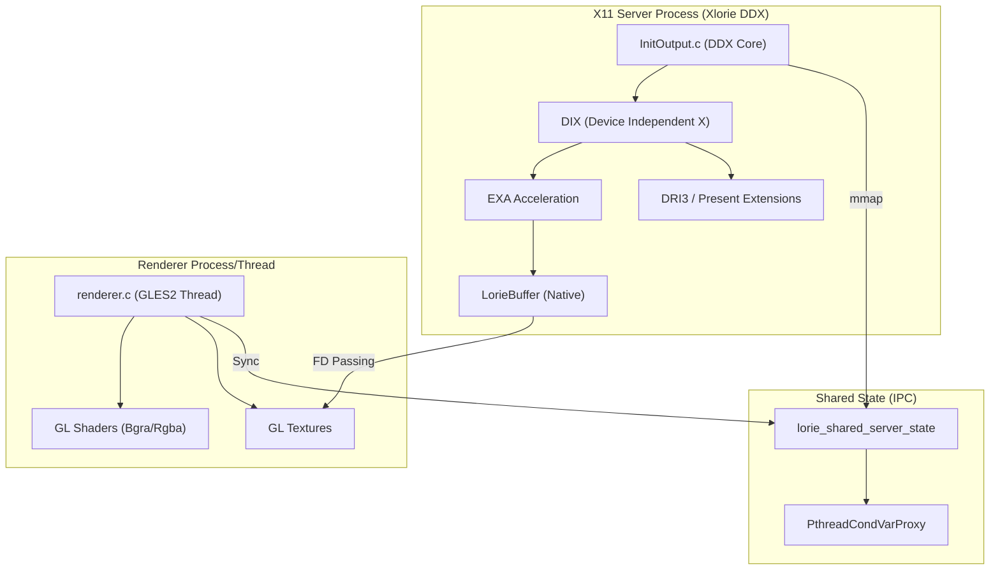

Sources: [app/src/main/cpp/lorie/InitOutput.c:60-83](), [app/src/main/cpp/lorie/renderer.c:111-135](), [app/src/main/cpp/lorie/lorie.h:159-212]().

## DDX Initialization

The Device Dependent X (DDX) layer initializes via `InitOutput` and `OsVendorInit`. Unlike standard X servers, Xlorie must prepare shared memory regions for process-shared synchronization primitives before the server starts.

### Key Initialization Steps:
1.  **`OsVendorInit`**: Allocates the `lorie_shared_server_state` using `LorieBuffer_createRegion` and initializes process-shared mutexes and condition variables [app/src/main/cpp/lorie/InitOutput.c:107-133]().
2.  **`InitOutput`**: Sets up the screen, visual formats (supporting 24-bit and 32-bit depths), and initializes the EXA driver [app/src/main/cpp/lorie/InitOutput.c:631-670]().
3.  **`ddxReady`**: A patched hook in `dix/main.c` [app/src/main/cpp/patches/xserver.patch:29-37]() that triggers `ddxReadyThread`. This thread handles executing the `xstartup` script once the server is ready to accept connections [app/src/main/cpp/lorie/InitOutput.c:157-200]().

Sources: [app/src/main/cpp/lorie/InitOutput.c:107-133](), [app/src/main/cpp/lorie/InitOutput.c:631-670](), [app/src/main/cpp/lorie/InitOutput.c:157-200]().

## Graphics Buffer System (LorieBuffer)

The `LorieBuffer` system manages graphics memory across the X server and Android UI. It abstracts different memory backends to support various Android versions and performance requirements.

### Buffer Backends:
| Type | Identifier | Implementation |
| :--- | :--- | :--- |
| **Regular** | `LORIEBUFFER_REGULAR` | Standard `calloc` heap memory [app/src/main/cpp/lorie/buffer.c:115-119](). |
| **Shared FD** | `LORIEBUFFER_FD` | `ASharedMemory_create` or `memfd_create` for IPC [app/src/main/cpp/lorie/buffer.c:71-100](). |
| **Hardware** | `LORIEBUFFER_AHARDWAREBUFFER` | Native Android `AHardwareBuffer` for GPU zero-copy [app/src/main/cpp/lorie/buffer.c:130-140](). |

### Buffer Management Logic:
- **Reference Counting**: Uses `__sync_fetch_and_add` for thread-safe lifecycle management [app/src/main/cpp/lorie/buffer.h:88-105]().
- **IPC Transfer**: Buffers are sent over Unix sockets using `ancil_send_fd` (SCM_RIGHTS) to pass the underlying file descriptors between the server and the Android app [app/src/main/cpp/lorie/buffer.c:286-309]().

Sources: [app/src/main/cpp/lorie/buffer.h:10-23](), [app/src/main/cpp/lorie/buffer.c:103-166](), [app/src/main/cpp/lorie/buffer.c:286-309]().

## Rendering Pipeline

The rendering pipeline is decoupled from the X server's main loop. A dedicated `LorieRendererThread` in `renderer.c` consumes the framebuffers produced by the X server.

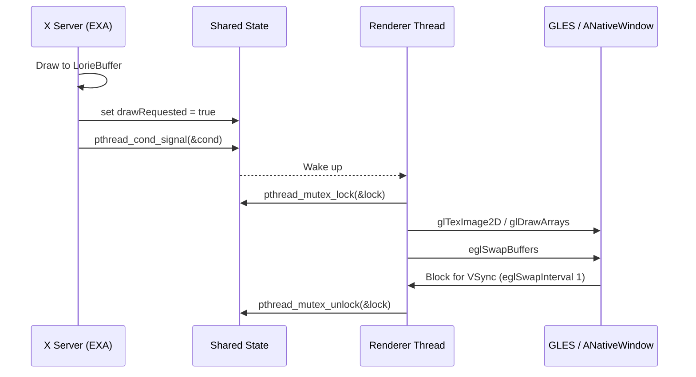

### Rendering Features:
- **Shader Selection**: Uses `fragmentShaderBgraSrc` or `fragmentShaderSrc` based on the `-force-bgra` flag to handle endianness/format mismatches [app/src/main/cpp/lorie/renderer.c:100-110]().
- **Synchronization**: The `lorie_shared_server_state` uses a recursive `PTHREAD_PROCESS_SHARED` mutex to prevent the X server from writing to a buffer while the renderer is reading it [app/src/main/cpp/lorie/lorie.h:160-172]().
- **VSync Handling**: Uses `waitForNextFrame` flag and `AChoreographer` callbacks to throttle rendering to the device refresh rate [app/src/main/cpp/lorie/lorie.h:184-197]().

Sources: [app/src/main/cpp/lorie/renderer.c:514-605](), [app/src/main/cpp/lorie/lorie.h:159-212](), [app/src/main/cpp/lorie/renderer.c:100-110]().

## EXA Acceleration

The EXA (Encoder/X-Acceleration) architecture is used to accelerate 2D operations. Xlorie implements a custom EXA driver (`ExaDriverRec`) where pixmaps are backed by `LorieBuffer` objects.

### Implementation Details:
- **Pixmap Privacy**: Every pixmap has a `LoriePixmapPriv` structure containing the `LorieBuffer` [app/src/main/cpp/lorie/InitOutput.c:97-102]().
- **`loriePrepareAccess`**: Locks the underlying `LorieBuffer` (via `ASharedMemory` or `AHardwareBuffer_lock`) so the DIX layer can perform CPU-based drawing [app/src/main/cpp/lorie/InitOutput.c:861-893]().
- **`lorieCreatePixmap`**: Intercepts pixmap creation to allocate shareable memory instead of standard server memory [app/src/main/cpp/lorie/InitOutput.c:840-859]().

Sources: [app/src/main/cpp/lorie/InitOutput.c:840-913](), [app/src/main/cpp/lorie/InitOutput.c:58-58]().

## Present and DRI3 Extensions

Xlorie implements the **Present** extension to allow clients (like XWayland or compositors) to synchronize window updates with the display's VSync.

- **VBlank Simulation**: Since Android doesn't expose standard X11 VBlank interrupts, `loriePresentQueueVblank` manages a `vblank_queue` and uses `OsTimer` to simulate refresh intervals [app/src/main/cpp/lorie/InitOutput.c:780-820]().
- **DRI3 Support**: The `lorieDri3Info` structure facilitates Direct Rendering Infrastructure 3, allowing clients to pass buffers to the server via file descriptors [app/src/main/cpp/lorie/InitOutput.c:57-57]().

Sources: [app/src/main/cpp/lorie/InitOutput.c:730-836](), [app/src/main/cpp/lorie/InitOutput.c:51-57]().

## Protocol and OS Integration

### XKB (Keyboard) Integration:
The server is patched to bypass the external `xkbcomp` binary, which is typically missing or incompatible on Android. Instead, it calls `xkbcomp_main` internally via a patched `Popen` implementation [app/src/main/cpp/patches/xserver.patch:148-166]().

### Socket Paths:
Standard X11 sockets in `/tmp/.X11-unix/` are redirected to the environment's `$TMPDIR` via the `Xtrans.patch` to comply with Android's filesystem restrictions [app/src/main/cpp/patches/Xtrans.patch:1-12]().

Sources: [app/src/main/cpp/patches/xserver.patch:148-166](), [app/src/main/cpp/patches/Xtrans.patch:1-12](), [app/src/main/cpp/lorie/cmdentrypoint.c:133-144]().

---

# Page: Android UI Architecture

# Android UI Architecture

<details>
<summary>Relevant source files</summary>

The following files were used as context for generating this wiki page:

- [app/src/main/AndroidManifest.xml](app/src/main/AndroidManifest.xml)
- [app/src/main/java/com/termux/x11/LoriePreferences.java](app/src/main/java/com/termux/x11/LoriePreferences.java)
- [app/src/main/java/com/termux/x11/LorieView.java](app/src/main/java/com/termux/x11/LorieView.java)
- [app/src/main/java/com/termux/x11/MainActivity.java](app/src/main/java/com/termux/x11/MainActivity.java)
- [app/src/main/java/com/termux/x11/input/TouchInputHandler.java](app/src/main/java/com/termux/x11/input/TouchInputHandler.java)
- [app/src/main/res/drawable/ic_settings.xml](app/src/main/res/drawable/ic_settings.xml)
- [app/src/main/res/layout/main_activity.xml](app/src/main/res/layout/main_activity.xml)
- [app/src/main/res/values/arrays.xml](app/src/main/res/values/arrays.xml)
- [app/src/main/res/values/strings.xml](app/src/main/res/values/strings.xml)
- [app/src/main/res/values/styles.xml](app/src/main/res/values/styles.xml)
- [app/src/main/res/xml/keep.xml](app/src/main/res/xml/keep.xml)
- [app/src/main/res/xml/preferences.xml](app/src/main/res/xml/preferences.xml)

</details>


This page details the structure and interaction of the Android UI components in Termux-X11. The Android layer acts as the primary interface, managing the rendering surface, input dispatch, and the lifecycle of the connection to the native X11 server.

## Architectural Overview

The UI architecture is centered around `MainActivity`, which coordinates between the Android system lifecycle, the `LorieView` rendering surface, and the `LorieService` (via `ICmdEntryInterface`).

### Code Entity Map: UI Components

The following diagram maps high-level UI concepts to their specific class implementations and layout identifiers.

**UI Component Mapping**
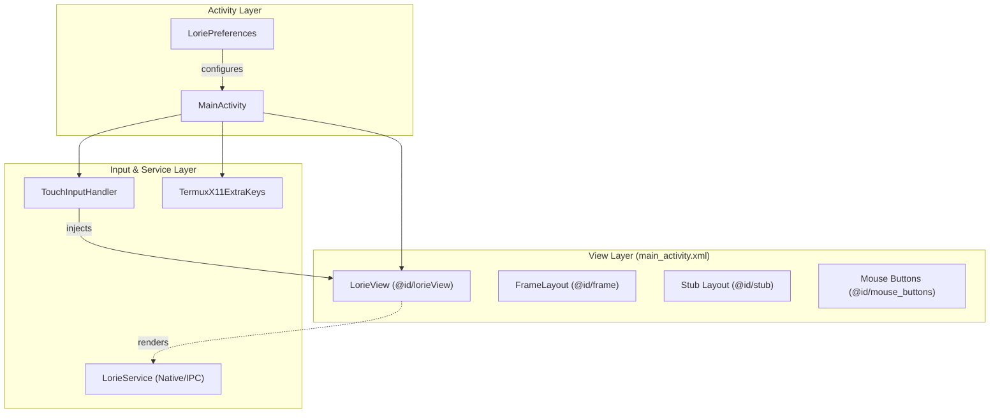
Sources:
- [app/src/main/java/com/termux/x11/MainActivity.java:76-84]()
- [app/src/main/res/layout/main_activity.xml:9-26]()
- [app/src/main/java/com/termux/x11/LorieView.java:29-40]()

---

## MainActivity Lifecycle and Connection Flow

`MainActivity` manages the transition from a "Not Connected" state to an active X11 session. It uses a `BroadcastReceiver` to listen for `ACTION_START` intents, which carry the connection details from the native bootstrap.

### Connection Sequence

1.  **Initialization**: `onCreate` sets up the `Prefs` object and window flags (e.g., `FLAG_KEEP_SCREEN_ON`) [app/src/main/java/com/termux/x11/MainActivity.java:152-165]().
2.  **Broadcast Receipt**: The `receiver` handles `ACTION_START`. It extracts connection details and triggers `onReceiveConnection(intent)` [app/src/main/java/com/termux/x11/MainActivity.java:101-112]().
3.  **Surface Binding**: Once the `LorieView` surface is created, the activity attempts to bind the native X11 output to the `Surface` via JNI.

**Connection Flow Diagram**
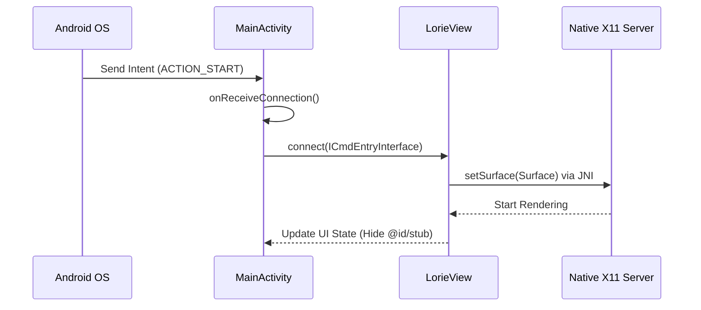
Sources:
- [app/src/main/java/com/termux/x11/MainActivity.java:106-112]()
- [app/src/main/java/com/termux/x11/LorieView.java:1126-1140]()

---

## LorieView Rendering Surface

`LorieView` extends `SurfaceView` and serves as the bridge for both graphics output and input injection.

### Key Responsibilities
-   **Surface Management**: Implements `SurfaceHolder.Callback` to notify the native layer when the drawing surface is created, changed, or destroyed [app/src/main/java/com/termux/x11/LorieView.java:28-29]().
-   **Input Connection**: Overrides `onCreateInputConnection` to provide an `InputConnectionWrapper`, allowing software keyboards (IMEs) to send text events to the X server [app/src/main/java/com/termux/x11/LorieView.java:65-170]().
-   **Native Dispatch**: Contains `@CriticalNative` and `@FastNative` methods for high-performance event dispatching to the C++ DDX layer [app/src/main/java/com/termux/x11/LorieView.java:62-63]().

### Graphics Pipeline
The native X server renders to a buffer that is swapped onto the `Surface` provided by `LorieView`. This bypasses the standard Android View hierarchy for the X11 content itself, ensuring low-latency updates.

Sources:
- [app/src/main/java/com/termux/x11/LorieView.java:29-40]()
- [app/src/main/java/com/termux/x11/LorieView.java:1126-1140]()

---

## Input Handling Architecture

Input is processed by `TouchInputHandler`, which delegates to specific strategies based on user preferences.

### Touch Strategies
-   **Trackpad Mode**: (Value `1`) Relative pointer movement [app/src/main/java/com/termux/x11/input/TouchInputHandler.java:64]().
-   **Simulated Touch**: (Value `2`) Absolute coordinates with touch-to-click logic [app/src/main/java/com/termux/x11/input/TouchInputHandler.java:65]().
-   **Direct Touch**: (Value `3`) Direct 1:1 mapping [app/src/main/java/com/termux/x11/input/TouchInputHandler.java:66]().

### Event Pipeline
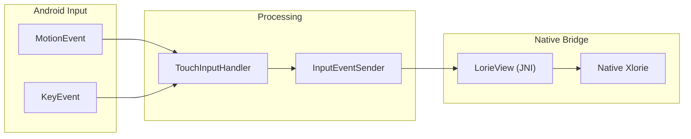
Sources:
- [app/src/main/java/com/termux/x11/input/TouchInputHandler.java:53-92]()
- [app/src/main/java/com/termux/x11/MainActivity.java:177-198]()

---

## AndroidManifest and Configuration

The `AndroidManifest.xml` defines critical behaviors for the UI, especially regarding performance and multi-window support.

| Attribute | Value | Purpose |
| :--- | :--- | :--- |
| `android:launchMode` | `singleInstance` | Ensures only one X11 session UI is active [app/src/main/AndroidManifest.xml:23](). |
| `android:configChanges` | `orientation\|screenSize\|...` | Prevents Activity recreation on resize/rotation to maintain X11 session [app/src/main/AndroidManifest.xml:25](). |
| `hardwareAccelerated` | `true` | Enables GPU acceleration for the UI layer [app/src/main/AndroidManifest.xml:18](). |
| `supportsPictureInPicture` | `true` | Allows the X11 display to persist in PiP mode [app/src/main/AndroidManifest.xml:24](). |

### Permissions
-   `WRITE_SECURE_SETTINGS`: Used for advanced input interception (e.g., accessibility service automation) [app/src/main/AndroidManifest.xml:8]().
-   `FOREGROUND_SERVICE`: Ensures the X11 server process remains active when the UI is backgrounded [app/src/main/AndroidManifest.xml:6]().

Sources:
- [app/src/main/AndroidManifest.xml:1-76]()

---

## Preferences and Customization

The preference system uses `LoriePreferences` (an `AppCompatActivity` implementing `PreferenceFragmentCompat.OnPreferenceStartFragmentCallback`) to manage user settings defined in `preferences.xml`.

### Data Flow
1.  User modifies a setting in `LoriePreferences`.
2.  `Prefs` (a wrapper around `SharedPreferences`) stores the value.
3.  An `ACTION_PREFERENCES_CHANGED` broadcast is sent [app/src/main/java/com/termux/x11/LoriePreferences.java:82]().
4.  `MainActivity` receives the broadcast and updates components like `TouchInputHandler` or `LorieView` resolution [app/src/main/java/com/termux/x11/MainActivity.java:115-118]().

Sources:
- [app/src/main/java/com/termux/x11/LoriePreferences.java:81-123]()
- [app/src/main/res/xml/preferences.xml:1-77]()

---

# Page: Input System Architecture

# Input System Architecture

<details>
<summary>Relevant source files</summary>

The following files were used as context for generating this wiki page:

- [app/src/main/cpp/lorie/InputXKB.c](app/src/main/cpp/lorie/InputXKB.c)
- [app/src/main/cpp/patches/Xtrans.patch](app/src/main/cpp/patches/Xtrans.patch)
- [app/src/main/cpp/patches/xserver.patch](app/src/main/cpp/patches/xserver.patch)
- [app/src/main/java/com/termux/x11/EditText.java](app/src/main/java/com/termux/x11/EditText.java)
- [app/src/main/java/com/termux/x11/LoriePreferences.java](app/src/main/java/com/termux/x11/LoriePreferences.java)
- [app/src/main/java/com/termux/x11/LorieView.java](app/src/main/java/com/termux/x11/LorieView.java)
- [app/src/main/java/com/termux/x11/MainActivity.java](app/src/main/java/com/termux/x11/MainActivity.java)
- [app/src/main/java/com/termux/x11/input/InputEventSender.java](app/src/main/java/com/termux/x11/input/InputEventSender.java)
- [app/src/main/java/com/termux/x11/input/InputStrategyInterface.java](app/src/main/java/com/termux/x11/input/InputStrategyInterface.java)
- [app/src/main/java/com/termux/x11/input/InputStub.java](app/src/main/java/com/termux/x11/input/InputStub.java)
- [app/src/main/java/com/termux/x11/input/RenderData.java](app/src/main/java/com/termux/x11/input/RenderData.java)
- [app/src/main/java/com/termux/x11/input/TouchInputHandler.java](app/src/main/java/com/termux/x11/input/TouchInputHandler.java)
- [app/src/main/java/com/termux/x11/utils/KeyInterceptor.java](app/src/main/java/com/termux/x11/utils/KeyInterceptor.java)
- [app/src/main/java/com/termux/x11/utils/SamsungDexUtils.java](app/src/main/java/com/termux/x11/utils/SamsungDexUtils.java)
- [app/src/main/res/layout/view_terminal_toolbar_text_input.xml](app/src/main/res/layout/view_terminal_toolbar_text_input.xml)
- [app/src/main/res/values/arrays.xml](app/src/main/res/values/arrays.xml)
- [app/src/main/res/values/strings.xml](app/src/main/res/values/strings.xml)
- [app/src/main/res/xml/accessibility_service_config.xml](app/src/main/res/xml/accessibility_service_config.xml)
- [app/src/main/res/xml/keep.xml](app/src/main/res/xml/keep.xml)
- [app/src/main/res/xml/preferences.xml](app/src/main/res/xml/preferences.xml)

</details>


## Purpose and Scope

This document describes the architecture of the input system in Termux-X11, which is responsible for capturing, processing, and transmitting user input (touch, keyboard, stylus, mouse) from the Android device to the X11 server. The input system serves as the bridge between Android's input events and the X11 protocol, enabling users to interact with X applications through various input methods.

This document focuses specifically on input handling and does not cover the rendering pipeline or X11 protocol implementation. For information about how the Android UI components are structured, see [2.2 Android UI Architecture](), and for details on IPC mechanisms, see [2.4 Shared Memory and IPC]().

## Input System Overview

The input pipeline begins with Android `MotionEvent` and `KeyEvent` objects captured by the UI layer and ends with X11 protocol events dispatched within the native X server.

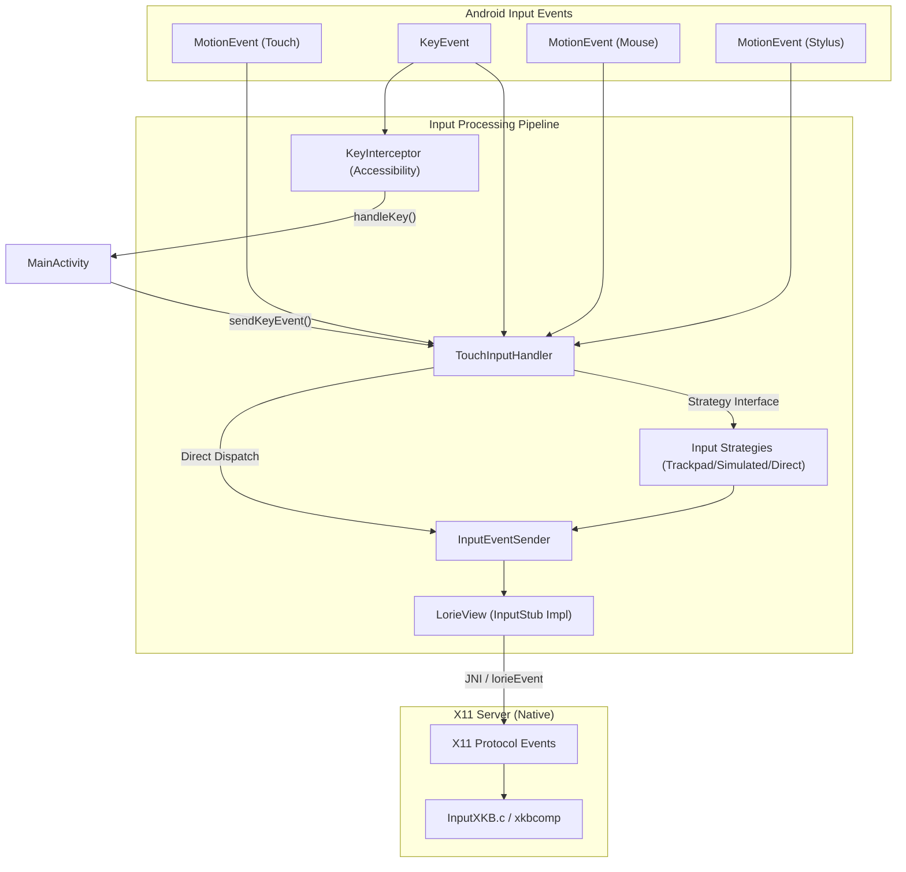

Sources: [app/src/main/java/com/termux/x11/input/TouchInputHandler.java:53-95](), [app/src/main/java/com/termux/x11/input/InputEventSender.java:26-53](), [app/src/main/java/com/termux/x11/MainActivity.java:175-201](), [app/src/main/java/com/termux/x11/utils/KeyInterceptor.java:93-116]()

## Input Processing Components

### TouchInputHandler
The `TouchInputHandler` is the primary entry point for pointer-based events. It maintains the state of the current `InputStrategyInterface` and routes events to specialized listeners.

- **StylusListener**: Handles pressure, tilt, and button modifiers [app/src/main/java/com/termux/x11/input/TouchInputHandler.java:83]().
- **HardwareMouseListener**: Manages relative movement and physical mouse buttons [app/src/main/java/com/termux/x11/input/TouchInputHandler.java:84]().
- **DexListener**: Handles Samsung DeX specific desktop-style interactions [app/src/main/java/com/termux/x11/input/TouchInputHandler.java:85]().

Sources: [app/src/main/java/com/termux/x11/input/TouchInputHandler.java:53-150]()

### InputEventSender
This class acts as a high-level injector. It converts Android-specific objects into primitive types (floats, ints, byte arrays) required by the `InputStub` interface. It also tracks the state of pressed keys in a `TreeSet` to ensure proper release events are sent [app/src/main/java/com/termux/x11/input/InputEventSender.java:44-45]().

Sources: [app/src/main/java/com/termux/x11/input/InputEventSender.java:26-53]()

### Input Strategies
The system uses an implementation of `InputStrategyInterface` to determine how touch coordinates are mapped to the X11 screen.

| Strategy | Mode Value | Description |
| :--- | :--- | :--- |
| **Trackpad** | `1` | Relative movement. The screen acts as a laptop touchpad [app/src/main/java/com/termux/x11/input/TouchInputHandler.java:64](). |
| **Simulated Touch** | `2` | Absolute positioning. Taps are converted to mouse clicks at specific coordinates [app/src/main/java/com/termux/x11/input/TouchInputHandler.java:65](). |
| **Direct Touch** | `3` | Raw touch events (XI_TouchBegin/Update/End) are sent to the X server [app/src/main/java/com/termux/x11/input/TouchInputHandler.java:66](). |

Sources: [app/src/main/java/com/termux/x11/input/TouchInputHandler.java:58-67](), [app/src/main/res/values/arrays.xml:3-12]()

### LorieView (InputStub Implementation)
`LorieView` implements the `InputStub` interface, providing the JNI bridge to the native C layer. It handles the final conversion of events into the `lorieEvent` union used by the X server's event loop.

Sources: [app/src/main/java/com/termux/x11/LorieView.java:330-332](), [app/src/main/java/com/termux/x11/input/InputStub.java:14-45]()

## Keyboard and XKB Architecture

Termux-X11 supports complex keyboard mapping through XKB. It can either send Unicode text events or raw scancodes.

### Key Event Pipeline
1. **Capture**: Events are captured via `onKeyDown` in `MainActivity` or intercepted globally by `KeyInterceptor` [app/src/main/java/com/termux/x11/utils/KeyInterceptor.java:93-116]().
2. **Filtering**: The system can filter out specific keys like the "Win" (Meta) key to allow Android system gestures [app/src/main/res/xml/preferences.xml:51]().
3. **Scancode Workaround**: A hardware keyboard scancode workaround exists to fix mapping on certain Android devices [app/src/main/res/xml/preferences.xml:44]().
4. **XKB Processing**: In the native layer, `xkbcomp` is used to compile keymaps. The `xserver.patch` modifies the X server to call `xkbcomp_main` internally rather than forking a process [app/src/main/cpp/patches/xserver.patch:148-166]().

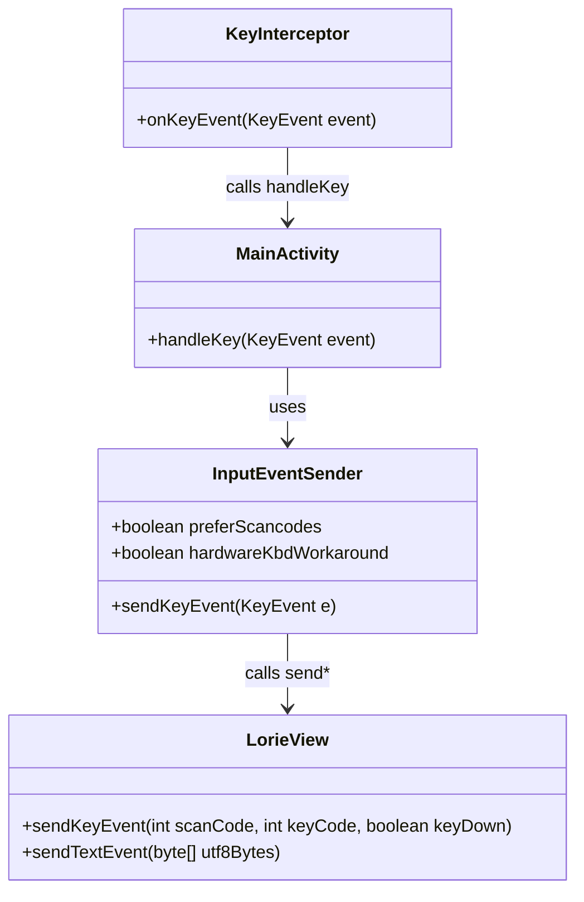

Sources: [app/src/main/java/com/termux/x11/input/InputEventSender.java:147-236](), [app/src/main/java/com/termux/x11/utils/KeyInterceptor.java:93-116](), [app/src/main/cpp/patches/xserver.patch:148-166]()

## Stylus and Advanced Input

The system provides deep integration for active styluses (e.g., S-Pen).

- **Pressure & Tilt**: `InputEventSender.sendStylusEvent` transmits pressure, tilt (X/Y), and orientation [app/src/main/java/com/termux/x11/input/InputEventSender.java:62-65]().
- **Button Modifiers**: Users can enable "Stylus button contact modifier mode" where right/middle clicks are only sent if the stylus is touching the screen while the button is pressed [app/src/main/res/xml/preferences.xml:31]().
- **Mouse Emulation**: The `stylusIsMouse` preference forces the stylus to act as a standard pointer, ignoring pressure and tilt [app/src/main/res/xml/preferences.xml:30]().

Sources: [app/src/main/java/com/termux/x11/input/InputEventSender.java:62-65](), [app/src/main/res/xml/preferences.xml:29-31]()

## User-Configurable Actions

`TouchInputHandler` maps specific physical or gesture triggers to software actions defined in preferences.

| Trigger | Default Action | Preference Key |
| :--- | :--- | :--- |
| **Swipe Up** | No Action | `swipeUpAction` |
| **Swipe Down** | Toggle Additional Key Bar | `swipeDownAction` |
| **Volume Up** | No Action | `volumeUpAction` |
| **Volume Down** | No Action | `volumeDownAction` |
| **Back Button** | Toggle Soft Keyboard | `backButtonAction` |

Sources: [app/src/main/java/com/termux/x11/input/TouchInputHandler.java:97-99](), [app/src/main/res/xml/preferences.xml:66-76]()

## Pointer Capture

When `pointerCapture` is enabled [app/src/main/res/xml/preferences.xml:33](), the Android app requests exclusive control over the mouse pointer.
- **Transformation**: Captured pointer movements can be transformed (rotated) to match screen orientation [app/src/main/java/com/termux/x11/input/TouchInputHandler.java:69-78]().
- **Speed Factor**: A `capturedPointerSpeedFactor` is applied to the raw movement delta [app/src/main/java/com/termux/x11/input/InputEventSender.java:37]().
- **Release**: The capture is typically released when the `Escape` key is pressed if `pauseKeyInterceptingWithEsc` is enabled [app/src/main/java/com/termux/x11/input/InputEventSender.java:39]().

Sources: [app/src/main/java/com/termux/x11/input/TouchInputHandler.java:69-78](), [app/src/main/res/xml/preferences.xml:33-35](), [app/src/main/java/com/termux/x11/input/InputEventSender.java:33-42]()

---

# Page: Shared Memory and IPC

# Shared Memory and IPC

<details>
<summary>Relevant source files</summary>

The following files were used as context for generating this wiki page:

- [app/src/main/aidl/com/termux/x11/ICmdEntryInterface.aidl](app/src/main/aidl/com/termux/x11/ICmdEntryInterface.aidl)
- [app/src/main/aidl/com/termux/x11/IRemoteCmdImterface.aidl](app/src/main/aidl/com/termux/x11/IRemoteCmdImterface.aidl)
- [app/src/main/cpp/lorie/InitInput.c](app/src/main/cpp/lorie/InitInput.c)
- [app/src/main/cpp/lorie/InitOutput.c](app/src/main/cpp/lorie/InitOutput.c)
- [app/src/main/cpp/lorie/activity.c](app/src/main/cpp/lorie/activity.c)
- [app/src/main/cpp/lorie/buffer.c](app/src/main/cpp/lorie/buffer.c)
- [app/src/main/cpp/lorie/buffer.h](app/src/main/cpp/lorie/buffer.h)
- [app/src/main/cpp/lorie/cmdentrypoint.c](app/src/main/cpp/lorie/cmdentrypoint.c)
- [app/src/main/cpp/lorie/lorie.h](app/src/main/cpp/lorie/lorie.h)
- [app/src/main/cpp/lorie/renderer.c](app/src/main/cpp/lorie/renderer.c)
- [app/src/main/cpp/recipes/xserver.cmake](app/src/main/cpp/recipes/xserver.cmake)
- [termux-x11-preference](termux-x11-preference)

</details>


This document describes the shared memory and inter-process communication (IPC) mechanisms used in Termux-X11. These systems enable efficient communication between the Android UI components and the X11 server running in different processes. Understanding these mechanisms is essential for developing or debugging features that require cross-process data sharing, particularly for graphics rendering and synchronization.

## Overview of Shared Memory and IPC Components

Termux-X11 uses a sophisticated system of shared memory and IPC to facilitate communication between the Android UI layer and the X11 server. This system consists of several interrelated components that work together to enable efficient data sharing.

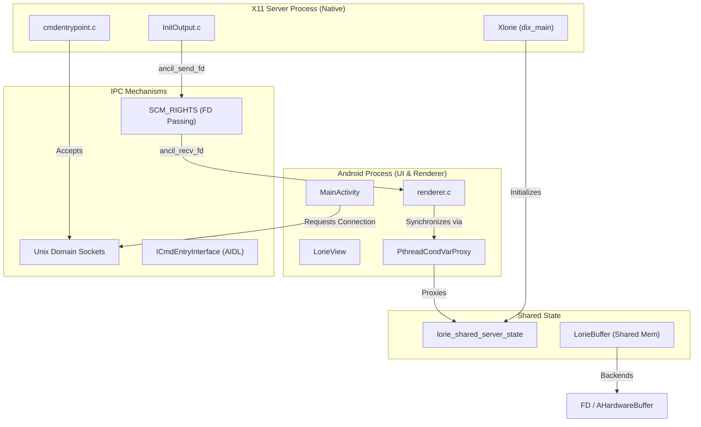

Sources: [app/src/main/cpp/lorie/lorie.h:159-204](), [app/src/main/cpp/lorie/renderer.c:138-140](), [app/src/main/cpp/lorie/buffer.c:25-40](), [app/src/main/cpp/lorie/InitOutput.c:107-133]()

## lorie_shared_server_state

The `lorie_shared_server_state` struct is the heart of the synchronization between the X11 server process and the Android renderer thread. It is allocated as a shared memory region using `LorieBuffer_createRegion` in the X server and mapped into the renderer process.

### Structure Definition
The state includes mutexes and condition variables for process-shared synchronization, along with flags to control the rendering pipeline:

| Field | Type | Description |
|-------|------|-------------|
| `lock` | `pthread_mutex_t` | Process-shared mutex to prevent tearing during root window updates. [app/src/main/cpp/lorie/lorie.h:166]() |
| `cond` | `pthread_cond_t` | Used to wake the renderer thread when a new frame is ready. [app/src/main/cpp/lorie/lorie.h:172]() |
| `rootWindowTextureID` | `uint64_t` | ID of the current LorieBuffer being used as the root window. [app/src/main/cpp/lorie/lorie.h:175]() |
| `drawRequested` | `uint8_t` | Signal from X server to renderer to update texture content. [app/src/main/cpp/lorie/lorie.h:178]() |
| `waitForNextFrame` | `uint8_t` | Flag to prevent GPU over-scheduling; cleared by Choreographer. [app/src/main/cpp/lorie/lorie.h:197]() |

Sources: [app/src/main/cpp/lorie/lorie.h:159-204](), [app/src/main/cpp/lorie/InitOutput.c:114-132]()

## LorieBuffer System

`LorieBuffer` is the primary abstraction for managing shared memory buffers. It supports different backends to balance compatibility and performance.

### Buffer Backends
1.  **Regular** (`LORIEBUFFER_REGULAR`): Allocated via `calloc`. Used for internal processing. [app/src/main/cpp/lorie/buffer.c:115-119]()
2.  **File Descriptor** (`LORIEBUFFER_FD`): Backed by `ashmem` or `memfd`. Created via `LorieBuffer_createRegion`. [app/src/main/cpp/lorie/buffer.c:120-129]()
3.  **Hardware Buffer** (`LORIEBUFFER_AHARDWAREBUFFER`): Uses Android's `AHardwareBuffer` for zero-copy GPU access. [app/src/main/cpp/lorie/buffer.c:130-140]()

### FD Passing with SCM_RIGHTS
To share buffers between the X server and the Android UI, Termux-X11 uses `ancil_send_fd` and `ancil_recv_fd`. These functions wrap `sendmsg` and `recvmsg` using the `SCM_RIGHTS` control message type to pass file descriptors across Unix domain sockets.

*   **`ancil_send_fd(int sock, int fd)`**: Packages the FD into a `cmsghdr`. [app/src/main/cpp/lorie/buffer.c:466-494]()
*   **`ancil_recv_fd(int sock)`**: Extracts the FD from the received message. [app/src/main/cpp/lorie/buffer.c:496-528]()

Sources: [app/src/main/cpp/lorie/buffer.h:10-23](), [app/src/main/cpp/lorie/buffer.c:71-101](), [app/src/main/cpp/lorie/buffer.c:466-528]()

## Synchronization Mechanisms

### PthreadCondVarProxy
Because the X server and the Android UI run in different processes, standard condition variables can be problematic if one process dies. `renderer.c` implements a proxy mechanism:

1.  `pthreadCondVarProxyInit`: Initializes a local `stateLock` and `stateCond`. [app/src/main/cpp/lorie/renderer.c:438-444]()
2.  `pthreadCondVarProxyThread`: A dedicated thread that waits on the local proxy condition and signals the remote shared condition variable in `lorie_shared_server_state`. [app/src/main/cpp/lorie/renderer.c:454-463]()

### Robust Mutex Handling
Termux-X11 implements a custom `lorie_mutex_lock` to handle cases where a process dies while holding a process-shared mutex. It uses `pthread_mutex_timedlock` with a 33ms timeout. If it times out and the owner process is dead, it reinitializes the mutex. [app/src/main/cpp/lorie/lorie.h:47-82]()

Sources: [app/src/main/cpp/lorie/renderer.c:438-471](), [app/src/main/cpp/lorie/lorie.h:47-82]()

## AIDL and Command Interfaces

The project uses Android Interface Definition Language (AIDL) for high-level IPC between the Termux app and the X11 loader/service.

### ICmdEntryInterface
Used by the shell-side utility to interact with the running X11 session.
*   `getXConnection()`: Returns a `ParcelFileDescriptor` for the X11 socket. [app/src/main/aidl/com/termux/x11/ICmdEntryInterface.aidl:5]()
*   `getLogcatOutput()`: Streams logs to the caller. [app/src/main/aidl/com/termux/x11/ICmdEntryInterface.aidl:6]()

### IRemoteCmdImterface
Allows the native side to report exit status back to the Android UI.
*   `exit(int code, String output)`: Reports process termination. [app/src/main/aidl/com/termux/x11/IRemoteCmdImterface.aidl:4]()

Sources: [app/src/main/aidl/com/termux/x11/ICmdEntryInterface.aidl](), [app/src/main/aidl/com/termux/x11/IRemoteCmdImterface.aidl]()

## Data Flow: Shared State Initialization

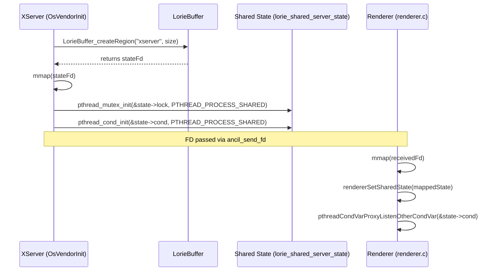

Sources: [app/src/main/cpp/lorie/InitOutput.c:107-133](), [app/src/main/cpp/lorie/renderer.c:425-436](), [app/src/main/cpp/lorie/lorie.h:34]()

---

# Page: Build System

# Build System

<details>
<summary>Relevant source files</summary>

The following files were used as context for generating this wiki page:

- [app/build.gradle](app/build.gradle)
- [app/proguard-rules.pro](app/proguard-rules.pro)
- [app/src/main/java/com/termux/x11/CmdEntryPoint.java](app/src/main/java/com/termux/x11/CmdEntryPoint.java)
- [build.gradle](build.gradle)
- [gradle/wrapper/gradle-wrapper.jar](gradle/wrapper/gradle-wrapper.jar)
- [gradle/wrapper/gradle-wrapper.properties](gradle/wrapper/gradle-wrapper.properties)
- [gradlew](gradlew)
- [gradlew.bat](gradlew.bat)
- [shell-loader/build.gradle](shell-loader/build.gradle)
- [shell-loader/proguard-rules.pro](shell-loader/proguard-rules.pro)
- [shell-loader/src/main/AndroidManifest.xml](shell-loader/src/main/AndroidManifest.xml)
- [shell-loader/src/main/java/com/termux/x11/Loader.java](shell-loader/src/main/java/com/termux/x11/Loader.java)
- [shell-loader/stub/build.gradle](shell-loader/stub/build.gradle)
- [shell-loader/stub/src/main/java/android/app/ActivityThread.java](shell-loader/stub/src/main/java/android/app/ActivityThread.java)
- [shell-loader/stub/src/main/java/android/content/pm/IPackageManager.java](shell-loader/stub/src/main/java/android/content/pm/IPackageManager.java)

</details>


This page documents the build system for Termux-X11, explaining how the application is built, packaged, and distributed. It covers the Gradle build configuration, native component compilation, Termux package creation, and CI/CD workflows.

## Overview

The Termux-X11 build system manages the compilation of both Android Java/Kotlin code and native C/C++ components (the X11 server). It automates the generation of architecture-specific APKs and Termux-compatible packages (`.deb` and `.pkg.tar.xz`).

Title: Build System Overview
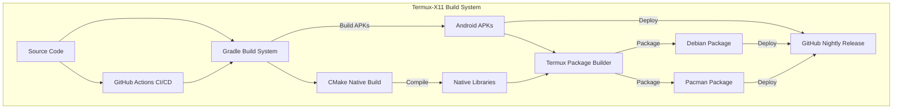
Sources: [build.gradle:1-26](), [app/build.gradle:1-110](), [shell-loader/build.gradle:1-41]()

## Gradle Build Configuration

Termux-X11 uses Gradle as its primary build system. The project is structured with a top-level build configuration and module-specific configurations for the main app, the shell loader, and stubs.

### Root Project Configuration
The root `build.gradle` defines global repositories (Google, MavenCentral, JitPack) and the Gradle Android build tools version.
Sources: [build.gradle:3-21]()

### App Module Configuration
The `app` module manages the core Android application. Key features include:
*   **ABI Splits**: Generates separate APKs for `x86`, `x86_64`, `armeabi-v7a`, and `arm64-v8a` [app/build.gradle:25-31]().
*   **Preference Generation**: A custom Groovy task `generatePrefs` parses `preferences.xml` to dynamically create the `com.termux.x11.Prefs` Java class [app/build.gradle:56-107]().
*   **Version Logic**: Computes `versionName` using a combination of a base version string, the current git commit hash, and the build date [app/build.gradle:12-14]().

### Shell Loader Module
The `shell-loader` module is a specialized component that can act as either a library or an application depending on the build context [shell-loader/build.gradle:4-8](). It is used to bootstrap the X11 server from the Termux command line.
Sources: [shell-loader/build.gradle:1-41](), [shell-loader/src/main/java/com/termux/x11/Loader.java:4-39]()

## Native Component Build

Native C/C++ components, including the X11 server (`libXlorie.so`), are built using the Android NDK and CMake.

Title: Native Build Integration
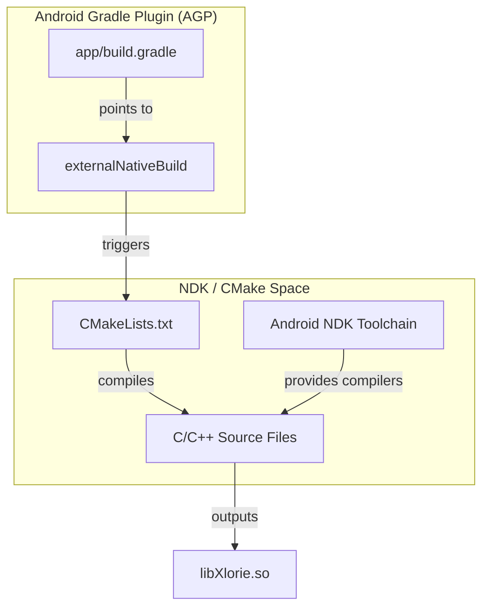
The link between Gradle and the native build is defined in the `app` module's configuration [app/build.gradle:35](). For deep technical details on CMake recipes, third-party library patches, and NDK configuration, see [Native Component Build](#3.1).

Sources: [app/build.gradle:35-36]()

## Termux Package Creation

Beyond the standard Android APKs, the build system produces companion packages for the Termux environment. These packages contain the `termux-x11` executable and the `shell-loader` APK.

The process involves:
1.  Building the `shell-loader` module.
2.  Packaging the resulting binary into `.deb` (Debian) and `.pkg.tar.xz` (Pacman) formats.
3.  Configuring the `CmdEntryPoint` to handle IPC between the Termux shell and the Android UI [app/src/main/java/com/termux/x11/CmdEntryPoint.java:31-54]().

For details on the scripts and artifacts involved, see [Termux Package Creation](#3.2).

Sources: [app/src/main/java/com/termux/x11/CmdEntryPoint.java:31-54](), [shell-loader/build.gradle:22-40]()

## CI/CD Workflows

Termux-X11 uses GitHub Actions to automate testing, building, and deployment.

*   **`debug_build.yml`**: Triggered on pushes to the master branch. It sets up the JDK, validates the Gradle wrapper, runs `assembleDebug`, and generates the companion Termux packages.
*   **Gradle Wrapper**: The project uses the Gradle Wrapper (`gradlew`) to ensure build reproducibility [gradlew:1-202](). The version and distribution SHA-256 are locked in `gradle-wrapper.properties` [gradle/wrapper/gradle-wrapper.properties:1-4]().

For a full breakdown of the automation pipeline and nightly release logic, see [CI/CD Workflows](#3.3).

Sources: [gradlew:1-202](), [gradle/wrapper/gradle-wrapper.properties:1-9]()

## Build Artifacts Summary

| Artifact | Purpose | Module |
| :--- | :--- | :--- |
| `app-*-debug.apk` | Main Android application (per ABI) | `app` |
| `app-universal-debug.apk` | Multi-architecture Android application | `app` |
| `shell-loader-debug.apk` | CLI bootstrap loader | `shell-loader` |
| `termux-x11-*.deb` | Termux companion package (Debian) | External Script |
| `termux-x11-*.pkg.tar.xz` | Termux companion package (Pacman) | External Script |

Sources: [app/build.gradle:25-31](), [shell-loader/build.gradle:22]()

---

# Page: Native Component Build

# Native Component Build

<details>
<summary>Relevant source files</summary>

The following files were used as context for generating this wiki page:

- [.gitmodules](.gitmodules)
- [app/src/main/cpp/CMakeLists.txt](app/src/main/cpp/CMakeLists.txt)
- [app/src/main/cpp/patches/dix-config.h.in](app/src/main/cpp/patches/dix-config.h.in)
- [app/src/main/cpp/patches/libepoxy.patch](app/src/main/cpp/patches/libepoxy.patch)
- [app/src/main/cpp/patches/xkbcomp.patch](app/src/main/cpp/patches/xkbcomp.patch)
- [app/src/main/cpp/recipes/Xfont2.cmake](app/src/main/cpp/recipes/Xfont2.cmake)
- [app/src/main/cpp/recipes/pixman.cmake](app/src/main/cpp/recipes/pixman.cmake)
- [app/src/main/cpp/recipes/tirpc.cmake](app/src/main/cpp/recipes/tirpc.cmake)
- [app/src/main/cpp/recipes/xkbcomp.cmake](app/src/main/cpp/recipes/xkbcomp.cmake)

</details>


This page documents the native component build system of Termux-X11, which is responsible for compiling the C/C++ components of the project including the X11 server and its dependencies. For information about how the built components are packaged for deployment, see [3.2 Termux Package Creation]().

## Overview

Termux-X11 relies on a complex native build system to compile the X server and numerous X11 libraries, optimizing them for the Android environment. The system uses CMake with custom recipes and patch applications to build components that were originally designed for desktop Linux systems.

### Build System Architecture

The build process is orchestrated by a central `CMakeLists.txt` that detects the environment and iterates through specific library recipes.

Title: Native Build Orchestration Flow
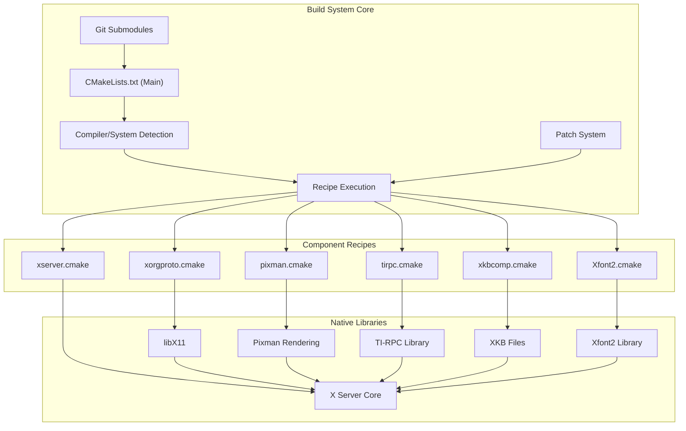
Sources: [app/src/main/cpp/CMakeLists.txt:1-83](), [app/src/main/cpp/recipes/pixman.cmake:90-93](), [app/src/main/cpp/recipes/xkbcomp.cmake:14-71]()

## Submodules Management

Termux-X11 includes numerous X11-related libraries as Git submodules. These are the foundation of the X server and are built as part of the native component build process.

| Submodule | Purpose | Source Repository |
|-----------|---------|-------------------|
| `libtirpc` | RPC implementation | https://github.com/alisw/libtirpc |
| `pixman` | Low-level pixel manipulation | https://gitlab.freedesktop.org/pixman/pixman.git |
| `libfontenc` | Font encoding library | https://gitlab.freedesktop.org/xorg/lib/libfontenc.git |
| `libxau` | X Authorization Database Library | https://gitlab.freedesktop.org/xorg/lib/libxau.git |
| `libxdmcp` | X Display Manager Control Protocol | https://gitlab.freedesktop.org/xorg/lib/libxdmcp.git |
| `libxfont` | X font handling | https://gitlab.freedesktop.org/xorg/lib/libxfont.git |
| `libxkbfile` | XKB file handling library | https://gitlab.freedesktop.org/xorg/lib/libxkbfile.git |
| `libxshmfence` | Shared memory fences | https://gitlab.freedesktop.org/xorg/lib/libxshmfence.git |
| `libxtrans` | Network transport abstraction | https://gitlab.freedesktop.org/xorg/lib/libxtrans.git |
| `libepoxy` | OpenGL function pointer management | https://github.com/anholt/libepoxy |
| `libxcvt` | VESA CVT timing modelines generator | https://gitlab.freedesktop.org/xorg/lib/libxcvt.git |
| `libx11` | Core X11 protocol client library | https://gitlab.freedesktop.org/xorg/lib/libx11.git |
| `xorgproto` | X.Org protocol headers | https://gitlab.freedesktop.org/xorg/proto/xorgproto.git |
| `xkbcomp` | XKB keyboard description compiler | https://gitlab.freedesktop.org/xorg/app/xkbcomp.git |
| `xserver` | X Window System display server | https://gitlab.freedesktop.org/xorg/xserver.git |
| `bzip2` | Compression library | https://gitlab.com/bzip2/bzip2.git |

Sources: [.gitmodules:1-64]()

## CMake Configuration

The build system is initialized in the main `CMakeLists.txt` file, which configures the build environment, sets up compiler flags, and includes component-specific recipes.

### Compiler Flags

The build system tests and applies a comprehensive set of compiler flags to ensure code quality and compatibility. It uses `check_c_compiler_flag` to test if flags are supported before applying them to `common_compile_options`.

Key compiler flags include:
- Warning flags: `-Wall`, `-Wpointer-arith`, `-Wformat=2`.
- Error prevention: `-Werror=implicit`, `-Werror=nonnull`, `-Werror=return-type`.
- Optimization/Compatibility: `-fno-strict-aliasing`.

Sources: [app/src/main/cpp/CMakeLists.txt:26-77]()

## Component Recipes

Each X11 component has a dedicated recipe file in `app/src/main/cpp/recipes/`. These define source files, compiler definitions, and architecture-specific optimizations.

### Pixman Recipe

The Pixman recipe applies architecture-specific optimizations based on `CMAKE_ANDROID_ARCH_ABI`.

Title: Pixman Architecture Optimization Logic
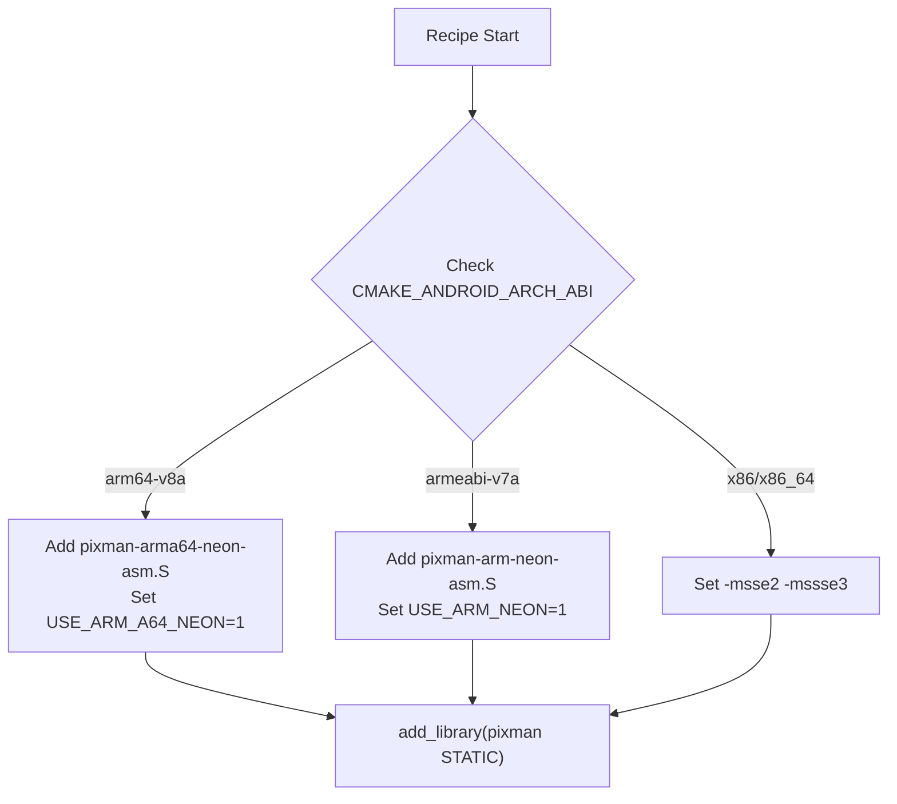
Sources: [app/src/main/cpp/recipes/pixman.cmake:68-88]()

### XKB Components and xkbcomp

The `xkbcomp.cmake` recipe is unique because it embeds `xkbcomp` as a library rather than a standalone executable. It involves a multi-stage process:
1. **Key Generation**: Uses a host-compiled `makekeys` tool to generate `ks_tables.h` from `xorgproto` headers.
2. **Parser Generation**: Uses `BISON_TARGET` to process `xkbcomp/xkbparse.y`.
3. **Library Assembly**: Combines sources from `libx11`, `libxkbfile`, and `xkbcomp`.

Sources: [app/src/main/cpp/recipes/xkbcomp.cmake:1-54]()

### TI-RPC Library

The `tirpc.cmake` recipe adapts the Trusted IT Remote Procedure Call library for Android. It explicitly defines `quad_t` and `u_quad_t` as `long long` types to maintain compatibility with Android's Bionic libc.

Sources: [app/src/main/cpp/recipes/tirpc.cmake:48-49]()

### Xfont2 Library

The `Xfont2.cmake` recipe configures font handling. It disables `XFONT_FREETYPE` and `X_BZIP2_FONT_COMPRESSION` while enabling `X_GZIP_FONT_COMPRESSION` and `XFONT_BITMAP`.

Sources: [app/src/main/cpp/recipes/Xfont2.cmake:55-61]()

## Patch System

Termux-X11 uses a custom `target_apply_patch` function to apply fixes to upstream sources. This function uses `patch --dry-run` to ensure idempotency.

Sources: [app/src/main/cpp/CMakeLists.txt:22-24]()

### Key Patches and Configs

| Patch/Config File | Target | Key Implementation / Changes |
|-------------------|--------|------------------------------|
| `dix-config.h.in` | `xserver` | Defines `LISTEN_UNIX`, `XTRANS_SEND_FDS`, and provides a fallback `memfd_create` for older Android versions. |
| `xkbcomp.patch` | `xkbcomp` | Adds `XkbComputeEffectiveMap` and renames `groupNames` to `xkbcomp_groupNames` to avoid symbol collisions. |
| `libepoxy.patch` | `libepoxy` | Modifies `gen_dispatch.py` to remove `APIENTRY` and `GLAPIENTRY` from generated headers, and provides local Khronos typedefs. |

Sources: [app/src/main/cpp/patches/dix-config.h.in:98-199](), [app/src/main/cpp/patches/xkbcomp.patch:10-80](), [app/src/main/cpp/patches/libepoxy.patch:1-118]()

## Android-Specific Adaptations

The `dix-config.h.in` file contains several macros that redefine standard Unix behavior for the Android environment:
- **Security Bypasses**: `CHECK_EUID` is set to `0`, and `setuid`/`setgid` are stubbed out as `0` to prevent permission errors in the Android sandbox.
- **XKB Integration**: Defines `execl_xkbcomp` to allow the server to call the internal XKB compiler.
- **Socket Paths**: Configuration for `UNIXCONN` and `TCPCONN` to facilitate IPC.

Title: Code-to-System Mapping (Adaptations)
```mermaid
graph LR
    subgraph "Code Entity Space"
        MFD["memfd_create()"]
        XKB["execl_xkbcomp()"]
        EUID["#define CHECK_EUID 0"]
        UID["#define setuid(a) 0"]
    end
    
    subgraph "Natural Language Space"
        MFD -- "Implements" --> "Shared Memory Support"
        XKB -- "Enables" --> "In-process Keyboard Compiling"
        EUID -- "Bypasses" --> "Android UID Restrictions"
        UID -- "Disables" --> "Privilege Escalation Checks"
    end
```
Sources: [app/src/main/cpp/patches/dix-config.h.in:179-207]()

---

# Page: Termux Package Creation

# Termux Package Creation

<details>
<summary>Relevant source files</summary>

The following files were used as context for generating this wiki page:

- [app/build.gradle](app/build.gradle)
- [app/proguard-rules.pro](app/proguard-rules.pro)
- [app/src/main/java/com/termux/x11/CmdEntryPoint.java](app/src/main/java/com/termux/x11/CmdEntryPoint.java)
- [build_termux_package](build_termux_package)
- [gradle.properties](gradle.properties)
- [settings.gradle](settings.gradle)
- [shell-loader/build.gradle](shell-loader/build.gradle)
- [shell-loader/proguard-rules.pro](shell-loader/proguard-rules.pro)
- [shell-loader/src/main/AndroidManifest.xml](shell-loader/src/main/AndroidManifest.xml)
- [shell-loader/src/main/java/com/termux/x11/Loader.java](shell-loader/src/main/java/com/termux/x11/Loader.java)
- [shell-loader/stub/build.gradle](shell-loader/stub/build.gradle)
- [shell-loader/stub/src/main/java/android/app/ActivityThread.java](shell-loader/stub/src/main/java/android/app/ActivityThread.java)
- [shell-loader/stub/src/main/java/android/content/pm/IPackageManager.java](shell-loader/stub/src/main/java/android/content/pm/IPackageManager.java)

</details>


## Purpose and Scope

This document details the process of building and managing the Termux companion package for the Termux:X11 project. The Termux package (`termux-x11-nightly`) contains the command-line tools, the bootstrap `loader.apk`, and the shell scripts necessary to launch and control the X11 server from the Termux environment.

## Package Overview

The Termux:X11 system consists of two main installable components:
1. The Android APK application (e.g., `termux-x11-arm64-v8a-debug.apk`).
2. The Termux companion package (installed via `pkg` or `apt` within Termux).

The Termux package provides the bridge between the command-line environment and the Android UI application, enabling users to launch X11 sessions from the terminal using the `termux-x11` command.

### Component Relationship Diagram

The following diagram bridges the "Natural Language Space" of the package components to the "Code Entity Space" by showing how scripts and APKs interact.

```mermaid
flowchart TB
    subgraph "Termux Environment ($PREFIX)"
        direction TB
        [termux-x11_bin]:::code --> |executes| [app_process]
        [termux-x11-preference_bin]:::code --> |manages| [LoriePreferences]
        
        subgraph "Package Artifacts"
            [termux-x11_bin]("[bin/termux-x11]")
            [termux-x11-preference_bin]("[bin/termux-x11-preference]")
            [loader_apk]("[libexec/termux-x11/loader.apk]")
        end
    end
    
    subgraph "Android Runtime"
        [app_process] --> |loads| [Loader_class]:::code
        [Loader_class] --> |reflectively_calls| [CmdEntryPoint]:::code
        [CmdEntryPoint] --> |starts| [Xlorie_Native]:::code
    end

    classDef code font-family:monospace,font-weight:bold;
```

Sources: [build_termux_package:28-35](), [shell-loader/src/main/java/com/termux/x11/Loader.java:16-29](), [app/src/main/java/com/termux/x11/CmdEntryPoint.java:42-46]()

## Package Building Process

The Termux package is created using the `build_termux_package` shell script. This script automates the creation of both Debian (`.deb`) and Pacman (`.pkg.tar.xz`) packages.

### Build Workflow

```mermaid
flowchart TD
    [Start] --> [Metadata]
    [Metadata] --> [Dirs]
    [Dirs] --> [Copy_Assets]
    
    subgraph "Asset Collection"
        [Copy_Assets] --> [cp_scripts]
        [Copy_Assets] --> [cp_loader_apk]
    end
    
    [cp_loader_apk] --> [Debian_Flow]
    [cp_loader_apk] --> [Pacman_Flow]

    subgraph "Debian Packaging"
        [Debian_Flow] --> [control_file]
        [control_file] --> [postinst_script]
        [postinst_script] --> [ar_archive]
    end

    subgraph "Pacman Packaging"
        [Pacman_Flow] --> [PKGINFO]
        [PKGINFO] --> [MTREE_Gen]
        [MTREE_Gen] --> [tar_xz]
    end

    [ar_archive] --> [Artifact_Deb]
    [tar_xz] --> [Artifact_Pkg]
```

Sources: [build_termux_package:1-146]()

### Key Implementation Details

1.  **Version Extraction**: The script dynamically pulls the version from the Android build configuration: `TERMUX_PKG_VERSION=$(grep "version =" app/build.gradle | cut -d '"' -f 2)` [build_termux_package:10]().
2.  **Shell Loader Integration**: The `shell-loader` module's output (`shell-loader-debug.apk`) is renamed to `loader.apk` and placed in a private `libexec` directory [build_termux_package:34-35]().
3.  **Permissions**: Both package formats include a post-installation step to set `chmod 400` on the `loader.apk`, ensuring it is read-only for security [build_termux_package:48-51](), [build_termux_package:95-102]().
4.  **Pacman MTREE**: Since `bsdtar` is often missing in CI environments, the script manually generates the `.MTREE` file using `md5sum` and `sha256sum` to provide file integrity metadata for the Pacman archive [build_termux_package:116-143]().

Sources: [build_termux_package:10-143]()

## Shell Loader Module

The `shell-loader` is a specialized Android application module that acts as a secure bootstrap. It is compiled as an APK but intended to be run via `app_process` from the command line.

### Execution Logic (`Loader.java`)

The `Loader` class performs three critical steps:
1.  **Identity Check**: It verifies that the main `com.termux.x11` package is installed using the system `PackageManager` [shell-loader/src/main/java/com/termux/x11/Loader.java:20-23]().
2.  **Signature Validation**: It compares the installed APK's signature hash against a hardcoded constant (`SIGNATURE`) defined during the Gradle build to prevent loading malicious/tempered versions of the app [shell-loader/src/main/java/com/termux/x11/Loader.java:24]().
3.  **Dynamic Loading**: It uses `dalvik.system.PathClassLoader` to load the `CmdEntryPoint` class from the main Termux:X11 APK and invokes its `main` method [shell-loader/src/main/java/com/termux/x11/Loader.java:27-29]().

### Build Configuration

The `shell-loader/build.gradle` file dynamically extracts the signing key's hash from the `app` module's debug keystore to populate the `SIGNATURE` field [shell-loader/build.gradle:26-32](). It also marks the `shell-loader` with `android:sharedUserId="android.uid.system"` in its manifest, although it is not meant to be installed [shell-loader/src/main/AndroidManifest.xml:3]().

Sources: [shell-loader/src/main/java/com/termux/x11/Loader.java:16-38](), [shell-loader/build.gradle:26-33](), [shell-loader/src/main/AndroidManifest.xml:1-4]()

## Starter and Stub Modules

To facilitate the interaction between the shell environment and Android internal APIs, the project uses a "stub" pattern.

1.  **shell-loader:stub**: This module contains skeletal implementations of Android framework classes like `ActivityThread` and `IPackageManager` [shell-loader/stub/src/main/java/android/app/ActivityThread.java:1-17]().
2.  **Compile-only Dependency**: The `app` and `shell-loader` modules use `compileOnly project(':shell-loader:stub')` [app/build.gradle:53](), [shell-loader/build.gradle:19](). This allows the code to reference hidden or internal Android APIs (like `ActivityThread.systemMain()`) during compilation without including the stubbed code in the final APK, as these classes exist in the Android runtime (`framework.jar`).

Sources: [shell-loader/stub/src/main/java/android/app/ActivityThread.java:1-17](), [app/build.gradle:53](), [shell-loader/build.gradle:19]()

## Resulting Artifacts

The build process produces two primary companion artifacts:

| Artifact | Path (Relative to `app/build/outputs/apk/debug/`) | Format |
| :--- | :--- | :--- |
| **Debian Package** | `termux-x11-nightly-[version]-all.deb` | Standard `.deb` |
| **Pacman Package** | `termux-x11-nightly-[version]-any.pkg.tar.xz` | Arch Linux / Pacman |

### Package Internal Structure

The internal structure of the generated `data.tar.xz` mirrors the Termux filesystem:
*   `/data/data/com.termux/files/usr/bin/termux-x11`: The launcher script.
*   `/data/data/com.termux/files/usr/bin/termux-x11-preference`: The preference CLI.
*   `/data/data/com.termux/files/usr/libexec/termux-x11/loader.apk`: The bootstrap APK.

Sources: [build_termux_package:17-35](), [build_termux_package:58-61]()

## Proguard and Optimization

The `app` module uses R8 in full mode (`android.enableR8.fullMode=true`) [gradle.properties:3](). To prevent the removal of classes called reflectively by the `shell-loader` or JNI, specific keep rules are defined:
*   `com.termux.x11.CmdEntryPoint`: Its `main` method is kept because it is the target of the `shell-loader`'s reflection [app/proguard-rules.pro:16-18]().
*   `com.termux.x11.Loader`: Its `main` method is kept to ensure `app_process` can find the entry point [shell-loader/proguard-rules.pro:5-7]().

Sources: [gradle.properties:3](), [app/proguard-rules.pro:16-18](), [shell-loader/proguard-rules.pro:5-7]()

---

# Page: CI/CD Workflows

# CI/CD Workflows

<details>
<summary>Relevant source files</summary>

The following files were used as context for generating this wiki page:

- [.github/workflows/debug_build.yml](.github/workflows/debug_build.yml)
- [.github/workflows/update-wrapper.yml](.github/workflows/update-wrapper.yml)
- [build.gradle](build.gradle)
- [gradle/wrapper/gradle-wrapper.jar](gradle/wrapper/gradle-wrapper.jar)
- [gradle/wrapper/gradle-wrapper.properties](gradle/wrapper/gradle-wrapper.properties)
- [gradlew](gradlew)
- [gradlew.bat](gradlew.bat)

</details>


This page details the Continuous Integration and Continuous Delivery (CI/CD) workflows implemented for Termux-X11. These automated processes ensure code quality, build the application across multiple architectures, and deliver regular releases to users. For information about the native component build process, see [Native Component Build](3.1), and for details on Termux package creation, see [Termux Package Creation](3.2).

## Workflow Overview

The Termux-X11 project uses GitHub Actions for its CI/CD pipelines. These workflows automate the building, testing, and releasing of the application, ensuring consistent and reliable deliverables.

### CI/CD System to Code Entity Mapping
This diagram associates the high-level CI/CD stages with the specific scripts and configuration files that execute them.

```mermaid
flowchart TD
    subgraph "GitHub Actions Space"
        direction TB
        Workflow[".github/workflows/debug_build.yml"]
        WrapperWorkflow[".github/workflows/update-wrapper.yml"]
    end

    subgraph "Code Execution Space"
        direction TB
        Validate["gradle/actions/wrapper-validation"]
        Assemble["./gradlew assembleDebug"]
        Companion["./build_termux_package"]
        Nightly["andelf/nightly-release"]
    end

    Workflow -->|"uses"| Validate
    Workflow -->|"runs"| Assemble
    Workflow -->|"runs"| Companion
    Workflow -->|"triggers"| Nightly
    WrapperWorkflow -->|"updates"| WrapperProps["gradle/wrapper/gradle-wrapper.properties"]
```

Sources: [.github/workflows/debug_build.yml:1-116](), [.github/workflows/update-wrapper.yml:1-23](), [gradle/wrapper/gradle-wrapper.properties:1-9]()

## Main Build Workflow

The primary workflow is the `Build` workflow defined in `debug_build.yml`, which compiles the application and creates all necessary artifacts for distribution.

### Triggers
The workflow is triggered on:
- `workflow_dispatch`: Manual execution from the GitHub Actions tab [[.github/workflows/debug_build.yml:4-4]]().
- `push` to the `master` branch [[.github/workflows/debug_build.yml:5-7]]().
- `pull_request` targeting the `master` branch [[.github/workflows/debug_build.yml:11-13]]().

Both automated triggers ignore changes to documentation (`**.md`) and images (`img/**`) to optimize runner usage [[.github/workflows/debug_build.yml:8-10,14-16]]().

### Build Steps and Data Flow
The workflow executes on `ubuntu-latest` and follows a strict sequence to ensure a clean build environment.

```mermaid
sequenceDiagram
    participant GHA as "GitHub Actions Runner"
    participant FS as "Local Filesystem"
    participant Gradle as "Gradle Wrapper (gradlew)"
    participant Script as "build_termux_package"
    participant Artifacts as "GitHub Artifact Storage"

    GHA->>FS: actions/checkout (submodules: recursive)
    GHA->>GHA: actions/setup-java (Java 17, Temurin)
    GHA->>FS: actions/cache (Restore ~/.gradle/caches)
    GHA->>Gradle: Run ./gradlew assembleDebug
    Gradle->>FS: Generate APKs in app/build/outputs/apk/debug/
    GHA->>Script: Run ./build_termux_package
    Script->>FS: Generate .deb and .pkg.tar.xz
    GHA->>Artifacts: actions/upload-artifact (APKs, Packages, Symbols)
```

Sources: [.github/workflows/debug_build.yml:21-97](), [gradlew:1-203]()

### Build Process Details
1. **Validation**: Uses `gradle/actions/wrapper-validation` to verify the checksum of the Gradle Wrapper JAR [[.github/workflows/debug_build.yml:31-32]]().
2. **Caching**: Caches `~/.gradle/caches` and `~/.gradle/wrapper` using a key based on the hash of all `.gradle` files [[.github/workflows/debug_build.yml:40-50]]().
3. **Compilation**: Executes `./gradlew assembleDebug` [[.github/workflows/debug_build.yml:51-52]](). This triggers the top-level `build.gradle` which configures repositories (Google, MavenCentral, JitPack) [[build.gradle:1-21]]().
4. **Companion Packaging**: Runs the `./build_termux_package` script to generate the Termux-specific distribution files [[.github/workflows/debug_build.yml:53-54]]().

## Artifact Generation and Storage

The workflow produces several distinct types of artifacts, categorized by architecture and purpose.

| Artifact Category | Target Architecture | File Path |
|:---|:---|:---|
| **Android APKs** | ARM64 (v8a) | `./app/build/outputs/apk/debug/app-arm64-v8a-debug.apk` |
| | ARMv7 (eabi) | `./app/build/outputs/apk/debug/app-armeabi-v7a-debug.apk` |
| | x86_64 | `./app/build/outputs/apk/debug/app-x86_64-debug.apk` |
| | x86 | `./app/build/outputs/apk/debug/app-x86-debug.apk` |
| | Universal | `./app/build/outputs/apk/debug/app-universal-debug.apk` |
| **Companion Packages** | All/Any | `./app/build/outputs/apk/debug/termux-x11-*-all.deb` |
| | All/Any | `./app/build/outputs/apk/debug/termux-x11-*-any.pkg.tar.xz` |
| **Debug Info** | N/A | `./app/build/intermediates/cxx/Debug/*` |

Sources: [.github/workflows/debug_build.yml:55-97]()

## Nightly Release Process

For the main repository (`termux/termux-x11`), successful builds on the `master` branch trigger an automatic update to the "Nightly Release" [[.github/workflows/debug_build.yml:99-101]]().

- **Tool**: Uses `andelf/nightly-release@main` [[.github/workflows/debug_build.yml:100-100]]().
- **Tag**: The release is always tagged as `nightly` [[.github/workflows/debug_build.yml:105-105]]().
- **Content**: Includes all debug APKs, the `.deb` package, and the `.pkg.tar.xz` package [[.github/workflows/debug_build.yml:112-115]]().
- **Metadata**: The release body is automatically updated to reference the specific commit SHA (`${{ github.sha }}`) that triggered the build [[.github/workflows/debug_build.yml:109-111]]().

## Maintenance Workflows

### Gradle Wrapper Validation
Integrated into the main `debug_build.yml`, this step ensures that the `gradle-wrapper.jar` [[gradle/wrapper/gradle-wrapper.jar:1-25]]() has not been tampered with by checking its hash against known Gradle releases [[.github/workflows/debug_build.yml:31-32]]().

### Update Wrapper Workflow
A dedicated workflow `update-wrapper.yml` automates the upgrade of the Gradle build system.
- **Schedule**: Runs every Saturday at 06:30 UTC [[.github/workflows/update-wrapper.yml:3-5]]().
- **Implementation**: Uses `gradle-update/update-gradle-wrapper-action@v2` [[.github/workflows/update-wrapper.yml:21-22]]().
- **Effect**: Updates `gradle-wrapper.properties` [[gradle/wrapper/gradle-wrapper.properties:1-9]()] to point to the latest `distributionUrl` and updates the `distributionSha256Sum`.

## Build Infrastructure Summary

The following diagram maps the relationship between the build environment and the resulting binary components.

```mermaid
graph LR
    subgraph "Build Environment"
        JDK["JDK 17 (Temurin)"]
        Gradle["Gradle 9.3.1"]
    end

    subgraph "Build Logic"
        AGP["Android Gradle Plugin 9.0.1"]
        Cmake["CMake (via NDK)"]
    end

    subgraph "Output Components"
        APK["Android APKs"]
        DEB["Termux .deb"]
        PKG["Arch .pkg.tar.xz"]
        SYM["Unstripped .so"]
    end

    JDK --> Gradle
    Gradle --> AGP
    AGP --> Cmake
    Cmake --> SYM
    AGP --> APK
    Gradle --> DEB
    Gradle --> PKG
```

Sources: [.github/workflows/debug_build.yml:34-54](), [build.gradle:11-12](), [gradle/wrapper/gradle-wrapper.properties:4-4]()

---

# Page: Shell Loader and Command-line Interface

# Shell Loader and Command-line Interface

<details>
<summary>Relevant source files</summary>

The following files were used as context for generating this wiki page:

- [README.md](README.md)
- [app/build.gradle](app/build.gradle)
- [app/proguard-rules.pro](app/proguard-rules.pro)
- [app/src/main/java/com/termux/x11/CmdEntryPoint.java](app/src/main/java/com/termux/x11/CmdEntryPoint.java)
- [build_termux_package](build_termux_package)
- [gradle.properties](gradle.properties)
- [shell-loader/build.gradle](shell-loader/build.gradle)
- [shell-loader/proguard-rules.pro](shell-loader/proguard-rules.pro)
- [shell-loader/src/main/AndroidManifest.xml](shell-loader/src/main/AndroidManifest.xml)
- [shell-loader/src/main/java/com/termux/x11/Loader.java](shell-loader/src/main/java/com/termux/x11/Loader.java)
- [shell-loader/stub/build.gradle](shell-loader/stub/build.gradle)
- [shell-loader/stub/src/main/java/android/app/ActivityThread.java](shell-loader/stub/src/main/java/android/app/ActivityThread.java)
- [shell-loader/stub/src/main/java/android/content/pm/IPackageManager.java](shell-loader/stub/src/main/java/android/content/pm/IPackageManager.java)
- [termux-x11](termux-x11)

</details>


This page documents the Shell Loader and Command-line Interface components of Termux-X11, which serve as the bridge between the Termux command-line environment and the X11 server functionality. These components enable users to launch and control the X11 server from the Termux terminal and facilitate communication between the X11 server and Android UI components.

## System Architecture Overview

The Shell Loader and Command-line Interface system consists of several interconnected components that work together to securely launch the X11 server and establish the necessary communication channels.

Title: Shell Loader to CmdEntryPoint Flow
```mermaid
flowchart TD
    User["User"] -->|"executes"| TermuxScript["termux-x11 script"]
    TermuxScript -->|"launches"| AppProcess["/system/bin/app_process"]
    AppProcess -->|"loads"| ShellLoader["com.termux.x11.Loader (shell-loader)"]
    ShellLoader -->|"verifies signature"| ShellLoader
    ShellLoader -->|"loads class via PathClassLoader"| CmdEntryPoint["com.termux.x11.CmdEntryPoint"]
    
    CmdEntryPoint -->|"starts native X server"| NativeX11["libXlorie.so (X11 Server)"]
    CmdEntryPoint -->|"broadcasts intent"| MainActivity["com.termux.x11.MainActivity (Android UI)"]
    
    MainActivity <-->|"connects via ICmdEntryInterface"| CmdEntryPoint
    
    CmdEntryPoint -->|"if -xstartup provided"| UserApplication["User's X11 Application"]
```

Sources: [termux-x11:1-7](), [shell-loader/src/main/java/com/termux/x11/Loader.java:16-38](), [app/src/main/java/com/termux/x11/CmdEntryPoint.java:42-54]()

## Command-Line Tools

Termux-X11 provides primary command-line tools that users interact with, distributed via the companion package.

### termux-x11 Script

The `termux-x11` script is the main entry point. It sets the `CLASSPATH` to the `loader.apk` and uses `app_process` to bootstrap the Java environment [termux-x11:5-7]().

```bash
termux-x11 :1 -xstartup "xfce4-session"
```

| Parameter | Description |
|-----------|-------------|
| `:N` | Display number (e.g., `:1`) [README.md:39]() |
| `-xstartup "command"` | Command to execute after X server starts [README.md:39]() |
| `-legacy-drawing` | Use legacy drawing mode for compatibility [README.md:64-66]() |
| `-force-bgra` | Force BGRA color format [README.md:69-71]() |

### termux-x11-preference Tool

The `termux-x11-preference` tool (packaged in `$PREFIX/bin/` [build_termux_package:33]()) allows users to view and modify preferences from the command line.

Sources: [termux-x11:1-7](), [build_termux_package:32-35](), [README.md:37-72]()

## Shell Loader

The Shell Loader (`com.termux.x11.Loader`) is a standalone bootstrap APK (`loader.apk`) responsible for verifying and loading the main application code [shell-loader/src/main/java/com/termux/x11/Loader.java:4-38]().

Title: Loader Security and Bootstrap Sequence
```mermaid
sequenceDiagram
    participant User as "User"
    participant Script as "termux-x11 script"
    participant Loader as "com.termux.x11.Loader"
    participant PM as "IPackageManager"
    participant CmdEntry as "com.termux.x11.CmdEntryPoint"
    
    User->>Script: Execute termux-x11
    Script->>Loader: app_process ... com.termux.x11.Loader
    Loader->>PM: getPackageInfo("com.termux.x11", GET_SIGNATURES)
    
    alt Package exists
        PM-->>Loader: Return PackageInfo
        Loader->>Loader: Check hashCode(signatures[0]) == BuildConfig.SIGNATURE
        
        alt Signature valid
            Loader->>Loader: New PathClassLoader(sourceDir)
            Loader->>CmdEntry: invoke main(args)
        else Signature invalid
            Loader->>User: Print packageSignatureMismatchErrorText
        end
    else Package not found
        Loader->>User: Print packageNotInstalledErrorText
    end
```

The Shell Loader performs three critical security functions:
1. **Verification of Installation**: Uses `ActivityThread.getPackageManager().getPackageInfo` to locate the installed APK [shell-loader/src/main/java/com/termux/x11/Loader.java:20-22]().
2. **Signature Validation**: Compares the target APK's signature hash against a hardcoded `SIGNATURE` value defined during the build process [shell-loader/src/main/java/com/termux/x11/Loader.java:24](), [shell-loader/build.gradle:32]().
3. **Secure Loading**: Uses a `dalvik.system.PathClassLoader` to load the `CmdEntryPoint` from the verified APK's `sourceDir` [shell-loader/src/main/java/com/termux/x11/Loader.java:27-28]().

Sources: [shell-loader/src/main/java/com/termux/x11/Loader.java:16-38](), [shell-loader/build.gradle:30-40](), [build_termux_package:34-35]()

## Command Entry Point

`CmdEntryPoint` extends `ICmdEntryInterface.Stub` and serves as the primary IPC hub [app/src/main/java/com/termux/x11/CmdEntryPoint.java:31]().

### Context Bootstrapping
Because `CmdEntryPoint` runs via `app_process` outside a standard Android Activity context, it must bootstrap a system context using reflection. It uses `sun.misc.Unsafe.allocateInstance` to create an `ActivityThread` and retrieve the system context [app/src/main/java/com/termux/x11/CmdEntryPoint.java:142-168]().

### IPC and Broadcast Flow
1. **ACTION_START**: Upon startup, `CmdEntryPoint` creates an `Intent` with action `com.termux.x11.CmdEntryPoint.ACTION_START` [app/src/main/java/com/termux/x11/CmdEntryPoint.java:32, 66]().
2. **Binder Attachment**: It attaches itself (as a Binder object) to the intent's extras using `bundle.putBinder(null, this)` [app/src/main/java/com/termux/x11/CmdEntryPoint.java:63-64]().
3. **Manual Broadcasting**: If standard `Context.sendBroadcast` fails, it falls back to manual broadcasting by invoking `IActivityManager.getIntentSender` via reflection to ensure the `MainActivity` receives the token even in restricted shell environments [app/src/main/java/com/termux/x11/CmdEntryPoint.java:81-124]().

Title: CmdEntryPoint IPC Architecture
```mermaid
classDiagram
    class ICmdEntryInterface {
        <<interface>>
        +getXConnection() : ParcelFileDescriptor
        +getLogcatOutput() : ParcelFileDescriptor
    }
    
    class CmdEntryPoint {
        +static Context ctx
        +static main(String[] args)
        +createIntent() : Intent
        +sendBroadcast() : void
        +spawnListeningThread() : void
        +static createContext() : Context
        +static start(String[] args) : boolean
        +getXConnection() : ParcelFileDescriptor
    }
    
    CmdEntryPoint --|> ICmdEntryInterface : implements
```

Sources: [app/src/main/java/com/termux/x11/CmdEntryPoint.java:31-168](), [app/build.gradle:53]()

## Native X11 Server Integration

The `CmdEntryPoint` triggers the native server lifecycle via JNI. It loads `libXlorie.so` using the first supported ABI [app/src/main/java/com/termux/x11/CmdEntryPoint.java:186-187]().

The `start(args)` native method initializes the X server logic, while `listenForConnections()` handles the socket lifecycle [app/src/main/java/com/termux/x11/CmdEntryPoint.java:170-174]().

Sources: [app/src/main/java/com/termux/x11/CmdEntryPoint.java:170-187](), [app/proguard-rules.pro:16-18]()

## Environment Variables

The shell loader and command-line interface behavior can be tuned using environment variables:

| Variable | Description |
|----------|-------------|
| `TERMUX_X11_DEBUG` | If set to `1`, enables verbose logging [README.md:113-114](). |
| `TERMUX_X11_OVERRIDE_PACKAGE` | Overrides the target package name for the broadcast (defaults to `com.termux.x11`) [app/src/main/java/com/termux/x11/CmdEntryPoint.java:58-60](). |
| `TERMUX_X11_LOADER_OVERRIDE_CMDENTRYPOINT_CLASS` | Allows the loader to boot a different entry class [shell-loader/src/main/java/com/termux/x11/Loader.java:17-18](). |
| `XKB_CONFIG_ROOT` | Required in chroot environments to point to XKB data [README.md:86-87](). |
| `TMPDIR` | Sets the path for X11 unix sockets [README.md:75-82](). |

Sources: [app/src/main/java/com/termux/x11/CmdEntryPoint.java:58-60](), [shell-loader/src/main/java/com/termux/x11/Loader.java:17-18](), [README.md:75-114]()

---

# Page: Preferences and Customization

# Preferences and Customization

<details>
<summary>Relevant source files</summary>

The following files were used as context for generating this wiki page:

- [app/build.gradle](app/build.gradle)
- [app/proguard-rules.pro](app/proguard-rules.pro)
- [app/src/main/java/com/termux/x11/CmdEntryPoint.java](app/src/main/java/com/termux/x11/CmdEntryPoint.java)
- [app/src/main/java/com/termux/x11/LoriePreferences.java](app/src/main/java/com/termux/x11/LoriePreferences.java)
- [app/src/main/java/com/termux/x11/LorieView.java](app/src/main/java/com/termux/x11/LorieView.java)
- [app/src/main/java/com/termux/x11/MainActivity.java](app/src/main/java/com/termux/x11/MainActivity.java)
- [app/src/main/java/com/termux/x11/input/TouchInputHandler.java](app/src/main/java/com/termux/x11/input/TouchInputHandler.java)
- [app/src/main/res/values/arrays.xml](app/src/main/res/values/arrays.xml)
- [app/src/main/res/values/strings.xml](app/src/main/res/values/strings.xml)
- [app/src/main/res/xml/keep.xml](app/src/main/res/xml/keep.xml)
- [app/src/main/res/xml/preferences.xml](app/src/main/res/xml/preferences.xml)
- [shell-loader/build.gradle](shell-loader/build.gradle)
- [shell-loader/proguard-rules.pro](shell-loader/proguard-rules.pro)
- [shell-loader/src/main/AndroidManifest.xml](shell-loader/src/main/AndroidManifest.xml)
- [shell-loader/src/main/java/com/termux/x11/Loader.java](shell-loader/src/main/java/com/termux/x11/Loader.java)
- [shell-loader/stub/build.gradle](shell-loader/stub/build.gradle)
- [shell-loader/stub/src/main/java/android/app/ActivityThread.java](shell-loader/stub/src/main/java/android/app/ActivityThread.java)
- [shell-loader/stub/src/main/java/android/content/pm/IPackageManager.java](shell-loader/stub/src/main/java/android/content/pm/IPackageManager.java)

</details>


This document explains the preferences and customization options available in Termux-X11. It covers how the preferences system is organized, the available settings, and how they affect application behavior.

## Preferences System Architecture

Termux-X11 uses a comprehensive preferences system built on Android's `SharedPreferences` framework. It employs a custom code generation step during the build process to provide type-safe access to settings.

### Preferences Structure

The preferences are defined in an XML resource file which serves as the source of truth for the UI and the generated accessors.

```mermaid
flowchart TD
    subgraph "Preferences Hierarchy"
        Main["Main Preferences Screen (main)"]
        Output["Output Settings (output)"]
        Pointer["Pointer Settings (pointer)"]
        Keyboard["Keyboard Settings (kbd)"]
        Other["Other Settings (other)"]
        EkBar["Extra Key Bar (ekbar)"]
        UserActions["User Actions (userActions)"]
        
        Main --> Output
        Main --> Pointer
        Main --> Keyboard
        Main --> Other
        Other --> UserActions
        Keyboard --> EkBar
    end
```

Sources: [app/src/main/res/xml/preferences.xml:5-11](), [app/src/main/res/xml/preferences.xml:57-57](), [app/src/main/res/xml/preferences.xml:60-60]()

### Prefs Code Generation

To ensure type safety and minimize boilerplate, the `app/build.gradle` file contains a `generatePrefs` task. This task parses `preferences.xml` and generates `Prefs.java`, which contains inner classes like `BooleanPreference`, `IntPreference`, and `StringPreference`.

```mermaid
flowchart LR
    XML["preferences.xml"]
    Gradle["Gradle generatePrefs Task"]
    Generated["build/generated/java/.../Prefs.java"]
    Code["MainActivity / LorieView"]

    XML --> Gradle
    Gradle --> Generated
    Generated --> Code
    Code -->|"Type-safe get()/put()"| SharedPrefs["SharedPreferences"]
```

Sources: [app/build.gradle:56-107](), [app/src/main/java/com/termux/x11/MainActivity.java:155-155]()

## Core Preferences Classes

| Class | Role |
|-------|------|
| `Prefs` | **Generated** class providing fields for every preference key defined in XML. [app/build.gradle:83-106]() |
| `LoriePreferences` | The `AppCompatActivity` that hosts the settings UI. [app/src/main/java/com/termux/x11/LoriePreferences.java:81-81]() |
| `LoriePreferenceFragment` | Handles the rendering of `PreferenceScreen` and individual preference logic. [app/src/main/java/com/termux/x11/LoriePreferences.java:189-189]() |
| `PreferenceDataStore` | Used by `LoriePreferenceFragment` to redirect UI changes to the `Prefs` object. [app/src/main/java/com/termux/x11/LoriePreferences.java:400-446]() |

Sources: [app/src/main/java/com/termux/x11/LoriePreferences.java:81-446]()

## Display Customization Options

Display preferences reside under the "Output" section and control the X11 screen rendering pipeline.

| Preference | Description | Values |
|------------|-------------|--------|
| `displayResolutionMode` | Strategy for screen sizing | `native`, `scaled`, `exact`, `custom` |
| `displayScale` | Global UI scaling factor | 30% to 300% |
| `displayResolutionExact` | Predefined resolutions | e.g., 1280x1024, 1920x1080 |
| `adjustResolution` | Swaps W/H based on device orientation | Boolean |
| `PIP` | Enables Picture-in-Picture mode | Boolean |
| `fullscreen` | Toggles Android Immersive Mode | Boolean |

Sources: [app/src/main/res/xml/preferences.xml:13-25](), [app/src/main/res/values/arrays.xml:27-58]()

## Input Customization Options

The "Pointer" section configures how Android `MotionEvent` data is transformed into X11 input events.

| Preference | Description | Implementation Class |
|------------|-------------|----------------------|
| `touchMode` | Input strategy selection | `TouchInputHandler` |
| `pointerCapture` | Intercepts hardware mouse | `MainActivity.onPointerCaptureChange` |
| `stylusIsMouse` | Treats stylus as a standard mouse | `TouchInputHandler` |
| `tapToMove` | Enables relative motion for touchpads | `TouchInputHandler` |

The `touchMode` values correspond to specific strategies:
1. **Trackpad**: Relative cursor movement.
2. **Simulated touchscreen**: Absolute positioning with simulated clicks.
3. **Direct touch**: Direct coordinate mapping.

Sources: [app/src/main/res/xml/preferences.xml:27-37](), [app/src/main/java/com/termux/x11/input/TouchInputHandler.java:60-67](), [app/src/main/res/values/arrays.xml:3-12]()

## Keyboard and Clipboard Sync

Keyboard settings manage the bridge between Android IMEs and the X11 server's XKB state.

- **Clipboard Sync**: Controlled by `clipboardEnable`. When active, `LorieView` uses `ClipboardManager.OnPrimaryClipChangedListener` to synchronize data between the Android clipboard and the X11 selection. [app/src/main/java/com/termux/x11/LorieView.java:737-768]()
- **Scancodes**: `preferScancodes` determines if the app sends raw Linux scancodes to the X server, allowing the X server to handle layouts. [app/src/main/res/xml/preferences.xml:43-43]()
- **IME Handling**: `enforceCharBasedInput` suppresses predictive text for terminal-like environments. [app/src/main/res/xml/preferences.xml:52-52]()

Sources: [app/src/main/res/xml/preferences.xml:38-53](), [app/src/main/java/com/termux/x11/LorieView.java:737-768]()

## Extra Keys System

The Extra Keys system provides a customizable toolbar for keys not typically found on mobile keyboards (e.g., CTRL, ALT, ESC).

- **Configuration**: Uses a JSON-like syntax stored in the `extra_keys_config` preference.
- **Implementation**: Managed by `TermuxX11ExtraKeys` which coordinates the `X11ToolbarViewPager` and `ExtraKeysView`.

For implementation details, syntax, and dynamic configuration, see [Extra Keys System](#5.1).

Sources: [app/src/main/res/xml/preferences.xml:60-65](), [app/src/main/java/com/termux/x11/utils/TermuxX11ExtraKeys.java:28-43]()

## Preference Change Propagation

When a preference is changed in the UI, a broadcast is sent to notify the running X11 session.

```mermaid
sequenceDiagram
    participant UI as LoriePreferenceFragment
    participant P as Prefs (Generated)
    participant MA as MainActivity
    participant TIH as TouchInputHandler

    UI->>P: put(newValue)
    P->>MA: ACTION_PREFERENCES_CHANGED (Broadcast)
    MA->>MA: onPreferencesChanged(key)
    MA->>TIH: reload preferences
    MA->>LorieView: update display/PIP state
```

Sources: [app/src/main/java/com/termux/x11/LoriePreferences.java:82-93](), [app/src/main/java/com/termux/x11/MainActivity.java:101-124](), [app/src/main/java/com/termux/x11/MainActivity.java:569-615]()

---

# Page: Extra Keys System

# Extra Keys System

<details>
<summary>Relevant source files</summary>

The following files were used as context for generating this wiki page:

- [app/src/main/java/com/termux/shared/termux/extrakeys/ExtraKeyButton.java](app/src/main/java/com/termux/shared/termux/extrakeys/ExtraKeyButton.java)
- [app/src/main/java/com/termux/shared/termux/extrakeys/ExtraKeysConstants.java](app/src/main/java/com/termux/shared/termux/extrakeys/ExtraKeysConstants.java)
- [app/src/main/java/com/termux/shared/termux/extrakeys/ExtraKeysInfo.java](app/src/main/java/com/termux/shared/termux/extrakeys/ExtraKeysInfo.java)
- [app/src/main/java/com/termux/shared/termux/extrakeys/ExtraKeysView.java](app/src/main/java/com/termux/shared/termux/extrakeys/ExtraKeysView.java)
- [app/src/main/java/com/termux/shared/termux/extrakeys/SpecialButton.java](app/src/main/java/com/termux/shared/termux/extrakeys/SpecialButton.java)
- [app/src/main/java/com/termux/shared/termux/extrakeys/SpecialButtonState.java](app/src/main/java/com/termux/shared/termux/extrakeys/SpecialButtonState.java)
- [app/src/main/java/com/termux/x11/utils/FullscreenWorkaround.java](app/src/main/java/com/termux/x11/utils/FullscreenWorkaround.java)
- [app/src/main/java/com/termux/x11/utils/TermuxX11ExtraKeys.java](app/src/main/java/com/termux/x11/utils/TermuxX11ExtraKeys.java)
- [app/src/main/java/com/termux/x11/utils/X11ToolbarViewPager.java](app/src/main/java/com/termux/x11/utils/X11ToolbarViewPager.java)

</details>


The Extra Keys System in Termux-X11 provides a customizable on-screen keyboard bar with specialized keys not typically available on standard Android soft keyboards. This system is essential for X11 applications that require access to special keys like Ctrl, Alt, Esc, function keys, and other terminal-specific keys.

## Architecture Overview

The Extra Keys System is implemented as a customizable view that appears as a toolbar at the bottom of the Termux-X11 interface. It integrates with the input handling system to send key events to the X11 server.

### System Entity Mapping
The following diagram maps the logical components of the Extra Keys system to their corresponding classes in the codebase.

```mermaid
flowchart TB
    classDef viewComponents fill:#eee,stroke:#333
    classDef modelComponents fill:#eee,stroke:#333
    classDef controllerComponents fill:#eee,stroke:#333

    subgraph "View Components [UI Layer]"
        ExtraKeysView["ExtraKeysView"]:::viewComponents
        ToolbarViewPager["X11ToolbarViewPager"]:::viewComponents
    end

    subgraph "Model Components [Data/State]"
        ExtraKeysInfo["ExtraKeysInfo"]:::modelComponents
        ExtraKeyButton["ExtraKeyButton"]:::modelComponents
        SpecialButton["SpecialButton"]:::modelComponents
        SpecialButtonState["SpecialButtonState"]:::modelComponents
        ExtraKeysConstants["ExtraKeysConstants"]:::modelComponents
    end

    subgraph "Controller Components [Logic]"
        TermuxX11ExtraKeys["TermuxX11ExtraKeys"]:::controllerComponents
    end

    subgraph "External Systems"
        MainActivity["MainActivity"]:::controllerComponents
        LorieView["LorieView"]:::viewComponents
    end

    MainActivity --> |"instantiates"| ToolbarViewPager
    ToolbarViewPager --> |"inflates"| ExtraKeysView
    ToolbarViewPager --> |"creates"| TermuxX11ExtraKeys
    TermuxX11ExtraKeys --> |"client for"| ExtraKeysView
    ExtraKeysView --> |"configured by"| ExtraKeysInfo
    ExtraKeysInfo --> |"composed of"| ExtraKeyButton
    ExtraKeysView --> |"tracks state via"| SpecialButtonState
    SpecialButtonState --> |"references"| SpecialButton
    TermuxX11ExtraKeys --> |"dispatches to"| LorieView
```

Sources:
- [app/src/main/java/com/termux/x11/utils/TermuxX11ExtraKeys.java:28-43]()
- [app/src/main/java/com/termux/x11/utils/X11ToolbarViewPager.java:51-59]()
- [app/src/main/java/com/termux/shared/termux/extrakeys/ExtraKeysView.java:76-138]()

## Key Components

### TermuxX11ExtraKeys
The central controller that handles actions when extra keys are pressed. It implements the `ExtraKeysView.IExtraKeysView` interface and translates button presses into appropriate key events or actions. It handles both standard keys and "macros" (sequences of keys).

Sources:
- [app/src/main/java/com/termux/x11/utils/TermuxX11ExtraKeys.java:28-90]()
- [app/src/main/java/com/termux/x11/utils/TermuxX11ExtraKeys.java:112-122]()

### ExtraKeysView
A custom view extending `GridLayout` that displays buttons. It manages the lifecycle of `SpecialButtonState` (for keys like Ctrl/Alt) and handles long-press repetitions or swipe-up "popup" buttons.

Sources:
- [app/src/main/java/com/termux/shared/termux/extrakeys/ExtraKeysView.java:76-106]()
- [app/src/main/java/com/termux/shared/termux/extrakeys/ExtraKeysView.java:136-142]()

### ExtraKeysInfo & ExtraKeyButton
`ExtraKeysInfo` parses the JSON configuration string into a matrix of `ExtraKeyButton` objects. Each `ExtraKeyButton` can represent a single key, a macro, or a key with a "popup" (swipe-up) alternative.

Sources:
- [app/src/main/java/com/termux/shared/termux/extrakeys/ExtraKeysInfo.java:86-109]()
- [app/src/main/java/com/termux/shared/termux/extrakeys/ExtraKeyButton.java:14-49]()

### X11ToolbarViewPager
A `PagerAdapter` implementation that manages two pages:
1. The `ExtraKeysView` for specialized input.
2. A text input field (`EditText`) for sending strings directly to the X server.

Sources:
- [app/src/main/java/com/termux/x11/utils/X11ToolbarViewPager.java:25-60]()

## Configuration Syntax

The `extra_keys_config` preference uses a JSON array-of-arrays syntax.

### Syntax Rules
- **Simple String**: ` "ESC" ` maps to `KeyEvent.KEYCODE_ESCAPE`.
- **Object with Popup**: `{key: "-", popup: "|"}` defines a button that sends `-` on click and `|` on swipe up.
- **Macros**: `{macro: "CTRL f d", display: "exit"}` sends a sequence of keys.
- **Display Aliases**: The system uses `ExtraKeyDisplayMap` to turn strings like "LEFT" into "←" automatically.

Sources:
- [app/src/main/java/com/termux/shared/termux/extrakeys/ExtraKeysInfo.java:13-62]()
- [app/src/main/java/com/termux/shared/termux/extrakeys/ExtraKeyButton.java:82-113]()
- [app/src/main/java/com/termux/shared/termux/extrakeys/ExtraKeysConstants.java:73-112]()

## Data Flow: From Touch to X11 Event

The following diagram traces the execution path when a user interacts with the Extra Keys toolbar.

```mermaid
sequenceDiagram
    participant U as User
    participant V as ExtraKeysView
    participant C as TermuxX11ExtraKeys
    participant L as LorieView
    
    U->>V: Touch/Swipe Button
    V->>C: onExtraKeyButtonClick(view, buttonInfo, button)
    
    alt is Macro
        C->>C: Split buttonInfo.key by space
        loop for each key in macro
            C->>L: sendKeyEvent() or sendTextEvent()
        end
    else is SpecialButton (CTRL/ALT/etc)
        C->>V: readSpecialButton(SpecialButton, true)
        V-->>C: Returns active state
        C->>L: sendKeyEvent(0, KEYCODE_CTRL_LEFT, state)
    else is Standard Key
        C->>L: sendKeyEvent(0, keyCode, true/false)
    end
```

Sources:
- [app/src/main/java/com/termux/x11/utils/TermuxX11ExtraKeys.java:56-89]()
- [app/src/main/java/com/termux/x11/utils/TermuxX11ExtraKeys.java:91-122]()
- [app/src/main/java/com/termux/shared/termux/extrakeys/ExtraKeysView.java:78-91]()

## Special Button Management

Special buttons (CTRL, ALT, SHIFT, META, FN) are managed via `SpecialButtonState`. They support:
- **Toggle**: Tap to activate.
- **Lock**: Long-press to lock the key in the active state.
- **Visual Feedback**: Text color changes based on `mButtonActiveTextColor`.

Sources:
- [app/src/main/shared/termux/extrakeys/SpecialButton.java:12-16]()
- [app/src/main/shared/termux/extrakeys/SpecialButtonState.java:12-17]()
- [app/src/main/shared/termux/extrakeys/SpecialButtonState.java:40-44]()

## Fullscreen and Layout Handling

Because the Extra Keys toolbar occupies screen space, the system includes `FullscreenWorkaround` to resize the `LorieView` when the software keyboard or toolbar visibility changes, ensuring the X11 display remains visible.

Sources:
- [app/src/main/java/com/termux/x11/utils/FullscreenWorkaround.java:30-56]()

---

# Page: User Guide

# User Guide

<details>
<summary>Relevant source files</summary>

The following files were used as context for generating this wiki page:

- [README.md](README.md)
- [termux-x11](termux-x11)

</details>


This guide provides comprehensive instructions for installing, configuring, and using Termux:X11, which allows graphical Linux applications to run on Android devices through Termux. It serves as the primary entry point for users.

## Installation

Termux:X11 requires Android 8.0 or later [README.md:28-28](). It consists of two mandatory components: an Android APK and a Termux companion package.

### Android App Installation
1. Download the APK from the [nightly release tag](https://github.com/termux/termux-x11/releases/tag/nightly) [README.md:30-30]().
2. Select the architecture matching your device (e.g., `app-arm64-v8a-debug.apk`) or use `app-universal-debug.apk` [README.md:30-30]().
3. **Android 13+ Note**: You must explicitly allow notifications in system settings for the app to function correctly [README.md:120-121]().

### Termux Package Installation
In the Termux terminal, enable the graphical repository and install the package:
```bash
pkg install x11-repo
pkg install termux-x11-nightly
```
Sources: [README.md:27-32]()

For detailed installation steps, including building from source and submodule management, see **[Installation](#6.1)**.

## Usage and Common Tasks

### Starting a Session
The most common way to start a session is using the `termux-x11` executable [termux-x11:1-7]().
```bash
termux-x11 :1 -xstartup "dbus-launch --exit-with-session xfce4-session"
```
Sources: [README.md:39-40]()

### Key Features
*   **Desktop Environments**: Most users install XFCE (`pkg i xfce`) for a full desktop experience [README.md:34-34]().
*   **Input Modes**: Switch between "Touchpad emulation" and "Simulated touchscreen" in preferences [README.md:150-168]().
*   **Samsung DeX**: Termux:X11 is optimized for DeX mode desktop usage.
*   **Clipboard**: Bidirectional sync between Android and X11 is supported [app/src/main/cpp/lorie/activity.c:260-283]().

For details on DPI scaling, pointer capture, and the `termux-x11-preference` CLI tool, see **[Usage and Common Tasks](#6.2)**.

## Troubleshooting

Common issues often relate to device-specific rendering quirks or environment variables.

| Issue | Solution / Flag |
|-------|-----------------|
| Black screen with cursor | Use `-legacy-drawing` [README.md:64-67]() |
| Swapped/Incorrect colors | Use `-force-bgra` [README.md:69-72]() |
| PRoot/Chroot errors | Set `TMPDIR` and `XKB_CONFIG_ROOT` [README.md:74-87]() |
| Server won't stop | Run `pkill termux-x11` [README.md:100-103]() |

For a full list of error codes, log collection via `TERMUX_X11_DEBUG=1`, and intent-based controls, see **[Troubleshooting](#6.3)**.

## System Interaction Map

The following diagram bridges the user-facing command-line tools to the internal code entities that handle the requests.

### Command to Entity Mapping
```mermaid
graph TD
    subgraph "User Space (Shell)"
        CMD["termux-x11 script"]
        PREF_CMD["termux-x11-preference"]
    end

    subgraph "Native Layer (C/C++)"
        ENTRY["com.termux.x11.CmdEntryPoint"]
        XSERVER["Xlorie / InitOutput.c"]
    end

    subgraph "Android Layer (Java)"
        MAIN["MainActivity.java"]
        PREFS["LoriePreferences.java"]
    end

    CMD -- "exec app_process" --> ENTRY
    ENTRY -- "Initialize X11" --> XSERVER
    XSERVER -- "Update UI" --> MAIN
    PREF_CMD -- "Modify XML" --> PREFS
    PREFS -- "Apply Settings" --> XSERVER
```
Sources: [termux-x11:1-7](), [app/src/main/cpp/lorie/InitOutput.c:252-287](), [README.md:186-200]()

### Input Pipeline Overview
```mermaid
flowchart LR
    subgraph "Android Input"
        ME["MotionEvent"]
        KE["KeyEvent"]
    end

    subgraph "Processing Logic"
        TIH["TouchInputHandler.java"]
        IES["InputEventSender.java"]
    end

    subgraph "X11 Protocol"
        EV["lorieEvent (activity.c)"]
    end

    ME --> TIH
    KE --> IES
    TIH --> EV
    IES --> EV
```
Sources: [app/src/main/java/com/termux/x11/input/TouchInputHandler.java:59-77](), [app/src/main/java/com/termux/x11/input/InputEventSender.java:33-45](), [app/src/main/cpp/lorie/activity.c:453-510]()

---

# Page: Installation

# Installation

<details>
<summary>Relevant source files</summary>

The following files were used as context for generating this wiki page:

- [.github/workflows/debug_build.yml](.github/workflows/debug_build.yml)
- [.github/workflows/update-wrapper.yml](.github/workflows/update-wrapper.yml)
- [README.md](README.md)
- [termux-x11](termux-x11)

</details>


This page details the installation process for Termux:X11, a fully-fledged X server for Android built with the Android NDK and optimized for use with Termux.

## System Requirements

Before installing Termux:X11, ensure your device meets the following requirements:

- **Android version**: Android 8.0 (Oreo) or later is required. [README.md:28-29]()
- **Termux Environment**: The main Termux application must be installed (available via F-Droid or GitHub).
- **Architecture**: You must know your device's CPU architecture (arm64-v8a, armeabi-v7a, x86, or x86_64) or use the universal build. [README.md:30-31]()

## Installation Components

Termux:X11 consists of two mandatory components that must both be installed to function:

1.  **Android App (APK)**: The frontend application providing the X11 display surface, Android UI, and input handling.
2.  **Companion Termux Package**: The command-line utility and loader that bridges the Termux shell environment to the Android application process. [README.md:28-29]()

### Component Relationship Diagram
This diagram shows how the installed components interact at a code level, specifically focusing on the `Loader` and `CmdEntryPoint` entities.

```mermaid
graph TD
    subgraph "Android System Space"
        APK["app-debug.apk"]
        Activity["com.termux.x11.MainActivity"]
        Service["com.termux.x11.LorieService"]
    end

    subgraph "Termux User Space"
        Script["/usr/bin/termux-x11"]
        LoaderAPK["/usr/libexec/termux-x11/loader.apk"]
        Pkg["termux-x11-nightly package"]
    end

    subgraph "Execution Flow (Code Entities)"
        Start["User runs 'termux-x11 :1'"]
        AppProc["/system/bin/app_process"]
        LoaderClass["com.termux.x11.Loader"]
        CmdEntry["com.termux.x11.CmdEntryPoint"]
    end

    Pkg -- "installs" --> Script
    Pkg -- "installs" --> LoaderAPK
    Start --> Script
    Script -- "sets CLASSPATH to" --> LoaderAPK
    Script -- "execs" --> AppProc
    AppProc -- "invokes" --> LoaderClass
    LoaderClass -- "reflects/calls" --> CmdEntry
    CmdEntry -- "connects to" --> Activity
    CmdEntry -- "starts" --> Service
```
Sources: [termux-x11:1-7](), [README.md:28-33](), [README.md:93-96]()

## Installation Steps

### 1. Install the Android APK
Download the `app-$ARCHITECTURE-debug.apk` matching your device from the [nightly release tag](https://github.com/termux/termux-x11/releases/tag/nightly). [README.md:30-31]()

The build pipeline produces the following artifacts:
*   `app-arm64-v8a-debug.apk` [.github/workflows/debug_build.yml:58-59]()
*   `app-armeabi-v7a-debug.apk` [.github/workflows/debug_build.yml:64-65]()
*   `app-universal-debug.apk` (Contains all architectures) [.github/workflows/debug_build.yml:70-71]()
*   `app-x86_64-debug.apk` [.github/workflows/debug_build.yml:76-77]()
*   `app-x86-debug.apk` [.github/workflows/debug_build.yml:82-83]()

### 2. Install the Companion Package
The companion package provides the `termux-x11` executable and the `loader.apk` required for the `app_process` bootstrap. [termux-x11:5-7]()

**Via pkg (Recommended):**
```bash
pkg install x11-repo
pkg install termux-x11-nightly
```
Sources: [README.md:32-33]()

**Via Manual Download:**
If installing manually from the nightly release, download the `.deb` (for Debian-based Termux) or `.pkg.tar.xz` (for Arch-based Termux). [.github/workflows/debug_build.yml:88-91]()

### 3. Install a Desktop Environment
To have a functional GUI, install a desktop environment like XFCE:
```bash
pkg install xfce4
```
Sources: [README.md:34-35]()

## Developer Installation (Building from Source)

If you are building Termux:X11 from source, you must handle the git submodules correctly, as the project depends on external X.org components and libraries.

### Submodule Setup
The repository uses recursive submodules for the X server and native libraries.
```bash
git clone --recurse-submodules https://github.com/termux/termux-x11
```
Or if already cloned:
```bash
git submodule update --init --recursive
```
Sources: [README.md:11-22](), [.github/workflows/debug_build.yml:26-29]()

### Build Process Architecture
The build system uses Gradle to orchestrate the Android build and the companion package creation.

```mermaid
graph LR
    subgraph "Build System (CI/Local)"
        Gradle["./gradlew assembleDebug"]
        BuildPkg["./build_termux_package"]
        NDK["Android NDK (CMake)"]
    end

    subgraph "Build Artifacts"
        APK_Out["app/build/outputs/apk/debug/*.apk"]
        DEB_Out["termux-x11-*-all.deb"]
        TAR_Out["termux-x11-*-any.pkg.tar.xz"]
    end

    Gradle -- "triggers" --> NDK
    NDK -- "compiles" --> Native["Native X11 Server Binaries"]
    Native -- "packaged into" --> APK_Out
    BuildPkg -- "packages loader & scripts" --> DEB_Out
    BuildPkg -- "packages loader & scripts" --> TAR_Out
```
Sources: [.github/workflows/debug_build.yml:51-54](), [.github/workflows/debug_build.yml:88-91]()

## Verification and Logs

To verify the installation, check the version of the `termux-x11` script and attempt to start the server with debug logging enabled.

### Enabling Debug Logs
If the server fails to start, set `TERMUX_X11_DEBUG=1` to see verbose output from the `com.termux.x11` application and the native DDX.
```bash
TERMUX_X11_DEBUG=1 termux-x11 :0
```
Sources: [README.md:111-115]()

### Force Stopping
If the server hangs or needs a clean restart:
1.  **Kill X Server process**: `pkill termux-x11` [README.md:100-103]()
2.  **Stop Android Activity**: `am broadcast -a com.termux.x11.ACTION_STOP -p com.termux.x11` [README.md:107-109]()

---

# Page: Usage and Common Tasks

# Usage and Common Tasks

<details>
<summary>Relevant source files</summary>

The following files were used as context for generating this wiki page:

- [README.md](README.md)
- [app/src/main/java/com/termux/x11/LoriePreferences.java](app/src/main/java/com/termux/x11/LoriePreferences.java)
- [app/src/main/java/com/termux/x11/LorieView.java](app/src/main/java/com/termux/x11/LorieView.java)
- [app/src/main/java/com/termux/x11/MainActivity.java](app/src/main/java/com/termux/x11/MainActivity.java)
- [app/src/main/java/com/termux/x11/input/TouchInputHandler.java](app/src/main/java/com/termux/x11/input/TouchInputHandler.java)
- [app/src/main/java/com/termux/x11/utils/KeyInterceptor.java](app/src/main/java/com/termux/x11/utils/KeyInterceptor.java)
- [app/src/main/java/com/termux/x11/utils/SamsungDexUtils.java](app/src/main/java/com/termux/x11/utils/SamsungDexUtils.java)
- [app/src/main/res/values/arrays.xml](app/src/main/res/values/arrays.xml)
- [app/src/main/res/values/strings.xml](app/src/main/res/values/strings.xml)
- [app/src/main/res/xml/accessibility_service_config.xml](app/src/main/res/xml/accessibility_service_config.xml)
- [app/src/main/res/xml/keep.xml](app/src/main/res/xml/keep.xml)
- [app/src/main/res/xml/preferences.xml](app/src/main/res/xml/preferences.xml)
- [termux-x11](termux-x11)

</details>


This page covers the practical aspects of using Termux-X11 once it has been installed. You'll learn how to launch X11 sessions, interact with them using various input methods, customize display behavior, and configure the system for optimal performance.

## Starting Termux-X11 and Running Applications

Termux-X11 consists of an Android app and a Termux command-line utility. The standard workflow involves starting the X11 server from the Termux terminal and then launching X11 applications that connect to this server via the `:1` display identifier.

### Basic Usage

The most common way to start Termux-X11 is with the following command:

```bash
termux-x11 :1 -xstartup "dbus-launch --exit-with-session xfce4-session"
```

This starts the X11 server on display `:1` and launches the XFCE desktop environment. Alternatively, you can separate the server launch and application execution:

```bash
termux-x11 :1 &
env DISPLAY=:1 dbus-launch --exit-with-session xfce4-session
```

For convenience, you can set a startup environment variable in your `.bashrc`:

```bash
export TERMUX_X11_XSTARTUP="xfce4-session"
termux-x11 :1
```

Sources: [README.md:37-58](), [termux-x11:1-8]().

### Command-Line Options

The `termux-x11` command supports several options to customize its behavior:

| Option | Description |
|--------|-------------|
| `-legacy-drawing` | Alternative drawing mode for devices showing a black screen |
| `-force-bgra` | Fix for devices with swapped colors (Red/Blue) |
| `-dpi` | Set custom DPI value (e.g., `-dpi 120`) |
| `-xstartup "command"` | Command to run after the server starts |

For debugging, enable verbose logging by setting `TERMUX_X11_DEBUG=1`:

```bash
TERMUX_X11_DEBUG=1 termux-x11 :1 > logfile.txt
```

Sources: [README.md:64-73](), [README.md:111-117]().

## User Interface and Navigation

When Termux-X11 is running, `MainActivity` manages the rendering surface (`LorieView`) and various overlays.

```mermaid
flowchart TB
    subgraph "Android UI Layer (MainActivity)"
        mainView["LorieView (X11 Display)"]
        extraKeys["TermuxX11ExtraKeys Bar"]
        mouseHelper["Mouse Click Helper Overlay"]
        stylusHelper["Stylus Click Override"]
        notification["Notification (NotificationManager)"]
        
        mainView --- extraKeys
        mainView --- mouseHelper
        mainView --- stylusHelper
    end
    
    subgraph "Input Processing (TouchInputHandler)"
        touch["Touch Input"]
        keyboard["Keyboard Input"]
        stylus["Stylus Input"]
        
        touch --> |"Trackpad/Simulated"| mainView
        keyboard --> |"InputConnection"| mainView
        stylus --> |"StylusListener"| mainView
    end
    
    subgraph "System Actions"
        backButton["Back Button"]
        volButtons["Volume Buttons"]
        
        backButton --> |"toggle soft keyboard"| mainView
        volButtons --> |"Configurable Actions"| mainView
    end
```

Sources: [app/src/main/java/com/termux/x11/MainActivity.java:152-180](), [app/src/main/java/com/termux/x11/input/TouchInputHandler.java:80-93](), [app/src/main/res/values/strings.xml:20-27]().

### Extra Keys Bar

The Extra Keys bar provides access to special keys (Ctrl, Alt, Esc) not typically present on Android software keyboards. It is managed by `TermuxX11ExtraKeys` and can be toggled via a three-finger swipe down.

Default configuration:
```
[ESC][/][-][HOME][UP][END][PGUP][PREFERENCES]
[TAB][CTRL][ALT][LEFT][DOWN][RIGHT][PGDN][KEYBOARD]
```

Sources: [app/src/main/java/com/termux/x11/MainActivity.java:84-93](), [README.md:158-168]().

## Input Methods and Touch Gestures

Termux-X11 offers three touch input modes, selectable in `LoriePreferences`.

### Touchpad Emulation Mode (Mode 1)
Your finger controls a relative cursor.
- **Tap:** Left click.
- **Two-finger tap:** Right click.
- **Three-finger tap:** Middle click.
- **Two-finger swipe:** Scroll (Vertical/Horizontal).

### Simulated Touchscreen Mode (Mode 2)
Maps touch directly to coordinates but simulates mouse behavior.
- **Single tap:** Left click.
- **Long tap:** Mouse button hold (Drag).
- **Two-finger tap:** Right click.

### Direct Touch Mode (Mode 3)
Passes raw touch events to the X server. Best for touch-native X11 apps.

Sources: [app/src/main/res/values/arrays.xml:3-12](), [README.md:150-168](), [app/src/main/java/com/termux/x11/input/TouchInputHandler.java:60-67]().

## Display and DPI Configuration

Display settings are managed in the "Output" section of preferences and applied during `LorieView` initialization.

| Mode | Implementation |
|------|----------------|
| **Native** | Matches Android display metrics exactly. |
| **Scaled** | Applies a percentage factor (30-300%) via `displayScale`. |
| **Exact** | Forces a specific resolution (e.g., 1920x1080). |
| **Custom** | User-defined string (e.g., `1600x900`). |

Sources: [app/src/main/res/xml/preferences.xml:12-25](), [app/src/main/java/com/termux/x11/LorieView.java:616-650]().

## Advanced Features

### Samsung DeX Usage
When in DeX mode, Termux-X11 can intercept system-level meta-key shortcuts (like `Alt+Tab` or `Meta+D`) that Android usually consumes. This requires the `dexMetaKeyCapture` preference.

Sources: [app/src/main/java/com/termux/x11/utils/SamsungDexUtils.java:33-43](), [app/src/main/res/xml/preferences.xml:45-45]().

### Pointer Capture
Enabling `pointerCapture` allows Termux-X11 to take exclusive control of a hardware mouse. The cursor is restricted to the app window until `Escape` is pressed.

Sources: [app/src/main/res/xml/preferences.xml:33-33](), [app/src/main/java/com/termux/x11/MainActivity.java:557-565]().

### Clipboard Sync
Controlled by `clipboardEnable`. It synchronizes the Android `ClipboardManager` with the X11 `CLIPBOARD` selection.

Sources: [app/src/main/res/xml/preferences.xml:55-55](), [app/src/main/java/com/termux/x11/LorieView.java:7-14]().

## The termux-x11-preference Tool

Preferences can be modified from the command line using `termux-x11-preference`. This tool interacts with the app's `SharedPreferences` via the `CmdEntryPoint` IPC mechanism.

```bash
# List all preferences
termux-x11-preference list

# Set a preference
termux-x11-preference "touchMode"="2"
```

Sources: [README.md:186-200](), [app/src/main/java/com/termux/x11/LoriePreferences.java:81-93]().

## Usage with Containers (proot/chroot)

### proot / proot-distro
Launch with `--shared-tmp` to ensure the X11 socket in `/tmp` is accessible to both the Android app and the containerized process.

### chroot
Must run as root. Set `TMPDIR` to the container's `/tmp` and `XKB_CONFIG_ROOT` to the container's XKB path.

```bash
export TMPDIR=/path/to/chroot/tmp
export XKB_CONFIG_ROOT=/usr/share/X11/xkb
```

Sources: [README.md:74-87]().

---

# Page: Troubleshooting

# Troubleshooting

<details>
<summary>Relevant source files</summary>

The following files were used as context for generating this wiki page:

- [.github/ISSUE_TEMPLATE/bug_report.yml](.github/ISSUE_TEMPLATE/bug_report.yml)
- [README.md](README.md)
- [termux-x11](termux-x11)

</details>


This page addresses common issues encountered when using Termux:X11, providing technical solutions, diagnostic procedures, and architectural context for why these issues occur.

## Common Issues and Solutions

### Display and Rendering Issues

#### Black Screen with Cursor
On some devices, the screen remains black, showing only the X11 cursor instead of the window manager or applications.

**Solution**: Use the `-legacy-drawing` flag.
```bash
termux-x11 :1 -legacy-drawing -xstartup "xfce4-session"
```
**Technical Implementation**: This flag affects how `LorieView` interacts with the native rendering pipeline. When omitted, the server attempts to use modern Android hardware buffer paths. The legacy flag forces a fallback to more compatible drawing methods.
Sources: [README.md:64-67](), [app/src/main/cpp/lorie/renderer.c:262-368]()

#### Incorrect Colors (Red/Blue Swapped)
If the display appears with swapped color channels (e.g., skin tones appearing blue), the device's native buffer format likely defaults to a different byte order than expected by the X server.

**Solution**: Use the `-force-bgra` flag.
```bash
termux-x11 :1 -force-bgra -xstartup "xfce4-session"
```
**Technical Implementation**: This forces the `Xlorie` DDX to use `PIXMAN_bgra` or `PIXMAN_b8g8r8a8` formats during surface configuration in `InitOutput.c`.
Sources: [README.md:69-72](), [app/src/main/cpp/lorie/InitOutput.c:267-286]()

### Environment and Path Issues

#### Proot/Chroot Socket Issues
X11 communicates via Unix Domain Sockets. In containerized environments, the server and client must agree on the socket location.

*   **proot**: Launch with `--shared-tmp` to ensure the container can see the Termux `/tmp` directory.
*   **chroot/unshare**: You must run as root and manually set `TMPDIR` to point to the container's `/tmp`.

**Example for chroot**:
```bash
export TMPDIR=/path/to/chroot/container/tmp
# Ensure SELinux does not block the socket access
setenforce 0
```
Sources: [README.md:74-85](), [README.md:91-93]()

#### XKB_CONFIG_ROOT Errors
If keyboard mapping fails or `xkbcomp` throws errors in a chroot, the server cannot find its keyboard definitions.

**Solution**: Set `XKB_CONFIG_ROOT` to the container's X11 library path.
```bash
export XKB_CONFIG_ROOT=/usr/share/X11/xkb
```
Sources: [README.md:86-87]()

## Diagnostic Tools and Logging

### Enabling Debug Logging
To see detailed internal state transitions and JNI calls, use the `TERMUX_X11_DEBUG` environment variable.

```bash
TERMUX_X11_DEBUG=1 termux-x11 :0
```
**Implementation**: This variable is checked during the bootstrap process. When set to `1`, the native layer increases verbosity, and the Java layer logs detailed `MotionEvent` and `KeyEvent` data to logcat.
Sources: [README.md:111-118](), [app/src/main/cpp/lorie/cmdentrypoint.c:116-186]()

### System State Overview
The following diagram maps the troubleshooting points to specific code entities and data flows.

**Diagram: Error Path Mapping**
```mermaid
graph TD
    subgraph "Shell/CLI Space"
        TX11_SH["termux-x11 script"]
        LD_APK["loader.apk"]
    end

    subgraph "Process: termux-x11 (Native)"
        CEP["CmdEntryPoint.java"]
        XSRV["X Server (native)"]
        XKB["XKB Logic"]
    end

    subgraph "Process: com.termux.x11 (Android UI)"
        LView["LorieView"]
        LServ["LorieService"]
        RNDR["renderer.c"]
    end

    TX11_SH -- "exec app_process" --> LD_APK
    LD_APK -- "calls" --> CEP
    CEP -- "Environment Check" --> ENV_ERR{"TMPDIR/XKB set?"}
    ENV_ERR -- "No" --> XKB_FAIL["XKB_CONFIG_ROOT Error"]
    
    XSRV -- "Frame Data" --> RNDR
    RNDR -- "Hardware Buffer" --> LView
    LView -- "Incompatibility" --> BLK_SCR["Black Screen Issue"]
    
    XSRV -- "Pixel Format" --> PIX_ERR{"Color Swap?"}
    PIX_ERR -- "Yes" --> BGRA_FLAG["-force-bgra fix"]
    
    BLK_SCR -- "Fix" --> LEGACY_FLAG["-legacy-drawing flag"]
```
Sources: [termux-x11:1-7](), [app/src/main/cpp/lorie/renderer.c:24-164](), [app/src/main/cpp/lorie/InitOutput.c:46-145]()

## Process Management

### Stopping the Server
The Termux:X11 architecture separates the X server process from the Android Activity. Closing the app window does not necessarily stop the server.

| Component | Method | Command |
| :--- | :--- | :--- |
| **X Server Process** | Process Kill | `pkill termux-x11` |
| **Android Activity** | Broadcast Intent | `am broadcast -a com.termux.x11.ACTION_STOP -p com.termux.x11` |

**Technical Detail**: The `ACTION_STOP` intent is handled in `MainActivity.java`. It triggers the lifecycle teardown, which stops `LorieService` and releases the `LorieView` surface.
Sources: [README.md:98-109](), [app/src/main/java/com/termux/x11/MainActivity.java:114-116]()

### Lifecycle and State Synchronization
Troubleshooting often requires understanding how the UI and Server stay in sync via shared memory.

**Diagram: IPC Synchronization Flow**
```mermaid
sequenceDiagram
    participant CLI as "termux-x11 (CLI)"
    participant JNI as "activity.c (JNI)"
    participant SHM as "lorie_shared_server_state"
    participant UI as "MainActivity / LorieView"

    CLI->>JNI: requestConnection()
    JNI->>SHM: Set state to LORIE_STATE_WAITING
    UI->>JNI: onSurfaceCreated()
    JNI->>SHM: Update surface FD
    Note over JNI,SHM: If sync fails, check PthreadCondVarProxy
    SHM-->>CLI: Connection acknowledged
```
Sources: [app/src/main/cpp/lorie/activity.c:74-104](), [app/src/main/java/com/termux/x11/MainActivity.java:76-204](), [app/src/main/cpp/lorie/lorie.h:24-60]()

## Preference Troubleshooting
If the application enters an unusable state due to misconfiguration (e.g., unsupported resolution), preferences can be reset or modified via the command line.

**Tool**: `termux-x11-preference`
*   **List settings**: `termux-x11-preference list`
*   **Reset setting**: `termux-x11-preference "display_mode"="native"`

**Technical Detail**: This tool communicates with `LoriePreferences.java` using the `CmdEntryPoint` IPC mechanism, allowing modification of the `SharedPreferences` XML without manual file editing.
Sources: [README.md:186-200](), [app/src/main/java/com/termux/x11/LoriePreferences.java:521-596]()

---

# Page: Developer's Guide

# Developer's Guide

<details>
<summary>Relevant source files</summary>

The following files were used as context for generating this wiki page:

- [app/build.gradle](app/build.gradle)
- [app/proguard-rules.pro](app/proguard-rules.pro)
- [app/src/main/cpp/CMakeLists.txt](app/src/main/cpp/CMakeLists.txt)
- [app/src/main/cpp/patches/dix-config.h.in](app/src/main/cpp/patches/dix-config.h.in)
- [app/src/main/cpp/patches/xkbcomp.patch](app/src/main/cpp/patches/xkbcomp.patch)
- [app/src/main/cpp/recipes/Xfont2.cmake](app/src/main/cpp/recipes/Xfont2.cmake)
- [app/src/main/cpp/recipes/tirpc.cmake](app/src/main/cpp/recipes/tirpc.cmake)
- [app/src/main/cpp/recipes/xkbcomp.cmake](app/src/main/cpp/recipes/xkbcomp.cmake)
- [app/src/main/java/com/termux/x11/CmdEntryPoint.java](app/src/main/java/com/termux/x11/CmdEntryPoint.java)
- [shell-loader/build.gradle](shell-loader/build.gradle)
- [shell-loader/proguard-rules.pro](shell-loader/proguard-rules.pro)
- [shell-loader/src/main/AndroidManifest.xml](shell-loader/src/main/AndroidManifest.xml)
- [shell-loader/src/main/java/com/termux/x11/Loader.java](shell-loader/src/main/java/com/termux/x11/Loader.java)
- [shell-loader/stub/build.gradle](shell-loader/stub/build.gradle)
- [shell-loader/stub/src/main/java/android/app/ActivityThread.java](shell-loader/stub/src/main/java/android/app/ActivityThread.java)
- [shell-loader/stub/src/main/java/android/content/pm/IPackageManager.java](shell-loader/stub/src/main/java/android/content/pm/IPackageManager.java)

</details>


This guide provides technical guidance for developers who want to contribute to or extend Termux X11. It covers the development environment, project module structure, JNI integration patterns, and the contribution workflow.

## 1. Development Environment Setup

### 1.1 Prerequisites
*   **JDK 17+**: Required for the Gradle build process [app/build.gradle:33-34]().
*   **Android SDK & NDK**: The project targets SDK 34 [app/build.gradle:10]().
*   **Build Tools**: `cmake` (3.22+), `python3`, and `bison` are required for native component compilation [app/src/main/cpp/CMakeLists.txt:1-20]().
*   **Git Submodules**: The project relies extensively on upstream X.org sources. Initialize them with:
    ```bash
    git submodule update --init --recursive
    ```

## 2. Project Module Structure

The codebase is split into several functional modules to separate the Android UI, the native X server, and the shell integration.

| Module | Role | Key Entities |
| :--- | :--- | :--- |
| `:app` | Main Android application and native X11 server (Xlorie). | `MainActivity`, `LorieView`, `libXlorie.so` |
| `:shell-loader` | Bootstrap APK for launching the server from the Termux command line. | `Loader.java` |
| `:shell-loader:stub` | Compile-time stubs for Android internal APIs used by the loader. | `ActivityThread`, `IPackageManager` |

### 2.1 Component Interop Map
The following diagram maps the relationship between the command-line loader and the main application entry point.

**Loader to CmdEntryPoint Flow**
```mermaid
graph LR
    subgraph "Termux Shell"
        TS["termux-x11 script"]
    end

    subgraph "shell-loader.apk"
        L["Loader.main"]
        PCL["dalvik.system.PathClassLoader"]
    end

    subgraph "com.termux.x11 (Main App)"
        CEP["CmdEntryPoint.main"]
        X["libXlorie.so"]
    end

    TS -->|app_process| L
    L -->|finds sourceDir| PCL
    PCL -->|reflectively invokes| CEP
    CEP -->|System.load| X
```
Sources: [shell-loader/src/main/java/com/termux/x11/Loader.java:16-29](), [app/src/main/java/com/termux/x11/CmdEntryPoint.java:42-46](), [app/src/main/java/com/termux/x11/CmdEntryPoint.java:186-187]()

## 3. Native Integration and JNI

The core X server logic is implemented in C and integrated via JNI. 

*   **Xlorie DDX**: The native X server is built as a shared library `libXlorie.so` [app/src/main/java/com/termux/x11/CmdEntryPoint.java:186]().
*   **Entry Point**: The server is initialized via `CmdEntryPoint.start(String[] args)` which maps to native code [app/src/main/java/com/termux/x11/CmdEntryPoint.java:170]().
*   **Lifecycle**: Proguard rules ensure that JNI-referenced methods in `LorieView` and `MainActivity` are preserved [app/proguard-rules.pro:5-18]().

For a deep dive into the JNI bridge, input dispatching via `lorieEvent`, and the `CmdEntryPoint` bootstrap, see **[JNI Bridge and Native Integration](#7.1)**.

## 4. Build System & Patching

The build system uses a combination of Gradle and CMake.

### 4.1 Native Recipes
The `app/src/main/cpp/CMakeLists.txt` orchestrates the build of various X11 components using modular recipe files [app/src/main/cpp/CMakeLists.txt:80-82]().
*   **Upstream Sources**: Projects like `xserver`, `pixman`, and `xkbcomp` are pulled from submodules.
*   **Patching**: A custom CMake function `target_apply_patch` is used to apply Android-specific fixes to upstream code during the build [app/src/main/cpp/CMakeLists.txt:22-24]().

### 4.2 Configuration
The server configuration is defined in `dix-config.h.in`, which enables features like `PRESENT`, `DRI3`, and `XSHMFENCE` for the Android environment [app/src/main/cpp/patches/dix-config.h.in:107-118]().

For details on specific patches and the rationale for porting choices, see **[X Server Patches and Porting Notes](#7.2)**.

## 5. Adding New Preferences

Preferences are managed through a code-generation task in Gradle to ensure type safety between the XML definitions and the Java code.

1.  **Define in XML**: Add the new preference to `app/src/main/res/xml/preferences.xml`.
2.  **Generate Prefs**: The `generatePrefs` Gradle task parses this XML and generates `com.termux.x11.Prefs.java` [app/build.gradle:56-107]().
3.  **Access in Code**: Use the generated fields in the `Prefs` class to access the values.

**Preference Generation Logic**
```mermaid
graph TD
    XML["preferences.xml"]
    GT["Gradle generatePrefs Task"]
    PJ["Prefs.java (Generated)"]
    LP["LoriePreferences.java"]

    XML -->|DOM Parsing| GT
    GT -->|Template Generation| PJ
    PJ -->|Extends| LP
```
Sources: [app/build.gradle:56-107](), [app/build.gradle:109]()

## 6. Contribution Workflow

1.  **Fork and Branch**: Create a feature branch from `master`.
2.  **Native Changes**: If modifying the X server, ensure you create or update the relevant patch in `app/src/main/cpp/patches/`.
3.  **Build Verification**: Run `./gradlew assembleDebug` to ensure both Java and Native components compile correctly [app/build.gradle:39-44]().
4.  **CI/CD**: Pull Requests trigger the `debug_build.yml` workflow which verifies the build on all supported ABIs (`arm64-v8a`, `armeabi-v7a`, `x86`, `x86_64`) [app/build.gradle:25-31]().

Sources: [app/build.gradle:25-31](), [app/build.gradle:39-44]()

---

# Page: JNI Bridge and Native Integration

# JNI Bridge and Native Integration

<details>
<summary>Relevant source files</summary>

The following files were used as context for generating this wiki page:

- [app/build.gradle](app/build.gradle)
- [app/proguard-rules.pro](app/proguard-rules.pro)
- [app/src/main/aidl/com/termux/x11/ICmdEntryInterface.aidl](app/src/main/aidl/com/termux/x11/ICmdEntryInterface.aidl)
- [app/src/main/cpp/lorie/InitOutput.c](app/src/main/cpp/lorie/InitOutput.c)
- [app/src/main/cpp/lorie/activity.c](app/src/main/cpp/lorie/activity.c)
- [app/src/main/cpp/lorie/cmdentrypoint.c](app/src/main/cpp/lorie/cmdentrypoint.c)
- [app/src/main/cpp/lorie/lorie.h](app/src/main/cpp/lorie/lorie.h)
- [app/src/main/cpp/lorie/renderer.c](app/src/main/cpp/lorie/renderer.c)
- [app/src/main/cpp/recipes/xserver.cmake](app/src/main/cpp/recipes/xserver.cmake)
- [app/src/main/java/com/termux/x11/CmdEntryPoint.java](app/src/main/java/com/termux/x11/CmdEntryPoint.java)
- [app/src/main/java/com/termux/x11/input/InputEventSender.java](app/src/main/java/com/termux/x11/input/InputEventSender.java)
- [app/src/main/java/com/termux/x11/input/InputStub.java](app/src/main/java/com/termux/x11/input/InputStub.java)
- [shell-loader/build.gradle](shell-loader/build.gradle)
- [shell-loader/proguard-rules.pro](shell-loader/proguard-rules.pro)
- [shell-loader/src/main/AndroidManifest.xml](shell-loader/src/main/AndroidManifest.xml)
- [shell-loader/src/main/java/com/termux/x11/Loader.java](shell-loader/src/main/java/com/termux/x11/Loader.java)
- [shell-loader/stub/build.gradle](shell-loader/stub/build.gradle)
- [shell-loader/stub/src/main/java/android/app/ActivityThread.java](shell-loader/stub/src/main/java/android/app/ActivityThread.java)
- [shell-loader/stub/src/main/java/android/content/pm/IPackageManager.java](shell-loader/stub/src/main/java/android/content/pm/IPackageManager.java)

</details>


The JNI (Java Native Interface) bridge in Termux:X11 facilitates high-performance communication between the Android Java/Kotlin application layer and the native C/C++ X11 server (`Xlorie`). This integration is critical for dispatching user input, managing the rendering lifecycle, and bootstrapping the X server from a shell environment.

## Overview of JNI Architecture

The JNI layer is split across several functional areas:
1.  **Bootstrap (cmdentrypoint.c):** Handles the initialization of the X server process when started from the command line.
2.  **Activity Bridge (activity.c):** Manages the connection between the `MainActivity` and the running X server.
3.  **Input Dispatch (lorieEvent):** A unified structure for passing touch, mouse, and keyboard events from Java to the native X11 input subsystem.
4.  **Renderer Integration (renderer.c):** Bridges the `LorieView` surface to the native GLES renderer.

### Data Flow Diagram
The following diagram illustrates how an input event travels from the Android UI to the native X server.

**Input Event Propagation Path**
```mermaid
graph TD
    subgraph "Java Space"
        A["InputEventSender.java"] -- "calls" --> B["InputStub.java (native methods)"]
    end

    subgraph "JNI Bridge (activity.c)"
        B -- "JNI Call" --> C["Java_com_termux_x11_InputStub_send..."]
        C -- "write()" --> D["conn_fd (Socket)"]
    end

    subgraph "Native X Server (Xlorie)"
        D -- "read()" --> E["xcallback()"]
        E -- "switch(lorieEvent.type)" --> F["lorieEvent (Union)"]
        F -- "Inject" --> G["dix (Device Independent X)"]
    end
```
**Sources:** [app/src/main/java/com/termux/x11/input/InputEventSender.java:56-60](), [app/src/main/cpp/lorie/activity.c:149-160](), [app/src/main/cpp/lorie/lorie.h:108-157]()

---

## Native Bootstrap and `CmdEntryPoint`

The X server is not a standard Android Service; it is a native executable bootstrapped via `CmdEntryPoint`. When the `termux-x11` executable is run in the terminal, it invokes `com.termux.x11.CmdEntryPoint.main`.

### Key Bootstrap Functions
-   **`Java_com_termux_x11_CmdEntryPoint_start`**: This function initializes the X server environment. It sets up `TMPDIR` for X11 sockets, configures `XKB_CONFIG_ROOT` for keyboard layouts, and sets process affinity to performance cores [app/src/main/cpp/lorie/cmdentrypoint.c:73-98]().
-   **`dix_main`**: The entry point of the standard X.org server, called within a dedicated thread spawned by the bootstrap [app/src/main/cpp/lorie/cmdentrypoint.c:43-46]().
-   **Environment Setup**: The native layer automatically detects if it is running under `proot` or standard Termux to set the correct font and XKB paths [app/src/main/cpp/lorie/cmdentrypoint.c:164-184]().

**Sources:** [app/src/main/java/com/termux/x11/CmdEntryPoint.java:42-46](), [app/src/main/cpp/lorie/cmdentrypoint.c:72-141]()

---

## Input Dispatch via `lorieEvent`

Input events are serialized into a `lorieEvent` union. This union ensures a fixed-size memory layout for efficient transmission over the local socket (`conn_fd`).

### The `lorieEvent` Union
The union supports various event types defined in `eventType` [app/src/main/cpp/lorie/lorie.h:89-106]():

| Event Type | Struct Members | Description |
| :--- | :--- | :--- |
| `EVENT_TOUCH` | `type, id, x, y` | Multi-touch coordinates and pointer IDs. |
| `EVENT_MOUSE` | `x, y, detail, down, relative` | Mouse movement and button states. |
| `EVENT_KEY` | `key, state` | X11 keysyms and up/down state. |
| `EVENT_STYLUS`| `x, y, pressure, tilt, eraser` | Advanced pen input data. |

### Input Implementation
When `InputStub.java` calls a native method like `sendMouseEvent`, the JNI implementation in `activity.c` populates a `lorieEvent` and writes it to `conn_fd` [app/src/main/cpp/lorie/activity.c:266-276](). On the server side, the `xcallback` function in the X server's event loop reads these structures and injects them into the X11 input subsystem [app/src/main/cpp/lorie/activity.c:153-170]().

**Sources:** [app/src/main/cpp/lorie/lorie.h:108-157](), [app/src/main/cpp/lorie/activity.c:131-150]()

---

## Activity and UI Integration

The `activity.c` file acts as the primary bridge for UI-related tasks, such as clipboard synchronization and IME (Input Method Editor) resets.

### JNI Callbacks and Lifecycle
-   **`nativeInit`**: Initializes global references to Java classes like `MainActivity` and `Charset` to allow the native thread to call back into Java [app/src/main/cpp/lorie/activity.c:108-129]().
-   **`xcallback`**: Monitors the connection state. If the socket hangs up, it triggers `clientConnectedStateChanged` in `MainActivity` to update the UI [app/src/main/cpp/lorie/activity.c:135-146]().
-   **Clipboard Sync**: When the X server receives new clipboard data, it sends an `EVENT_CLIPBOARD_SEND`. The native layer then calls `setClipboardText` on the Java side using a `DirectByteBuffer` for zero-copy data transfer [app/src/main/cpp/lorie/activity.c:155-167]().

**Sources:** [app/src/main/cpp/lorie/activity.c:108-146](), [app/src/main/cpp/lorie/activity.c:155-170]()

---

## Native Rendering Integration

The rendering pipeline bridges the X11 `ScreenPtr` to an Android `ANativeWindow`.

### Rendering Components
```mermaid
graph LR
    subgraph "X Server Process"
        X["Xlorie DDX"] -- "Updates" --> SHM["lorie_shared_server_state"]
        SHM -- "Signal" --> COND["pthread_cond_t"]
    end

    subgraph "Renderer Thread (renderer.c)"
        COND -- "Wake" --> RT["rendererThread"]
        RT -- "glDrawArrays" --> GLES["GLES2 Context"]
        GLES -- "eglSwapBuffers" --> NW["ANativeWindow"]
    end
```

-   **`lorie_shared_server_state`**: A shared memory structure containing the `rootWindowTextureID`, synchronization primitives (`pthread_mutex_t`, `pthread_cond_t`), and flags like `drawRequested` [app/src/main/cpp/lorie/lorie.h:159-182]().
-   **`rendererSetWindow`**: Associates a `Surface` from `LorieView` with the native GLES context via `ANativeWindow_fromSurface` [app/src/main/cpp/lorie/renderer.c:115-121]().
-   **`PthreadCondVarProxy`**: A mechanism used to synchronize the X server (running in its own process) with the rendering thread in the app process, ensuring frames are drawn only when the server has updated the buffer [app/src/main/cpp/lorie/renderer.c:138-140]().

**Sources:** [app/src/main/cpp/lorie/lorie.h:159-205](), [app/src/main/cpp/lorie/renderer.c:111-135]()

---

## Adding New JNI Functions

To extend the JNI bridge, follow these patterns:

1.  **Define the Java Native Method**: Add the `native` declaration in the appropriate Java class (e.g., `InputStub.java`).
2.  **Implement in C**:
    -   If it's an input/control function, implement it in `activity.c` and use `write(conn_fd, ...)` to send a `lorieEvent` to the server.
    -   If it's a server-side initialization function, implement it in `cmdentrypoint.c`.
3.  **Update `lorieEvent`**: If adding a new event type, add it to the `eventType` enum and the `lorieEvent` union in `lorie.h` [app/src/main/cpp/lorie/lorie.h:89-157]().
4.  **Handle in `xcallback`**: Update the switch statement in `activity.c` or the X server's input handler to process the new event type [app/src/main/cpp/lorie/activity.c:154-170]().

**Sources:** [app/src/main/cpp/lorie/lorie.h:108-157](), [app/src/main/cpp/lorie/activity.c:266-280]()

---

# Page: X Server Patches and Porting Notes

# X Server Patches and Porting Notes

<details>
<summary>Relevant source files</summary>

The following files were used as context for generating this wiki page:

- [app/src/main/cpp/CMakeLists.txt](app/src/main/cpp/CMakeLists.txt)
- [app/src/main/cpp/lorie/InputXKB.c](app/src/main/cpp/lorie/InputXKB.c)
- [app/src/main/cpp/patches/Xtrans.patch](app/src/main/cpp/patches/Xtrans.patch)
- [app/src/main/cpp/patches/dix-config.h.in](app/src/main/cpp/patches/dix-config.h.in)
- [app/src/main/cpp/patches/xkbcomp.patch](app/src/main/cpp/patches/xkbcomp.patch)
- [app/src/main/cpp/patches/xserver.patch](app/src/main/cpp/patches/xserver.patch)
- [app/src/main/cpp/recipes/Xfont2.cmake](app/src/main/cpp/recipes/Xfont2.cmake)
- [app/src/main/cpp/recipes/pixman.cmake](app/src/main/cpp/recipes/pixman.cmake)
- [app/src/main/cpp/recipes/tirpc.cmake](app/src/main/cpp/recipes/tirpc.cmake)
- [app/src/main/cpp/recipes/xkbcomp.cmake](app/src/main/cpp/recipes/xkbcomp.cmake)
- [app/src/main/java/com/termux/x11/EditText.java](app/src/main/java/com/termux/x11/EditText.java)
- [app/src/main/res/layout/view_terminal_toolbar_text_input.xml](app/src/main/res/layout/view_terminal_toolbar_text_input.xml)

</details>


This page documents the modifications applied to the upstream X.org server and related libraries to enable execution within the Android environment. These patches address signal handling incompatibilities, filesystem path differences, and thread-safety requirements for the Termux X11 environment.

## Overview of Patching Strategy

The build system utilizes a custom CMake function `target_apply_patch` to apply `.patch` files to submodules during the configuration phase [app/src/main/cpp/CMakeLists.txt:22-24](). The primary targets for these patches are the X server core (`xserver`), the transport layer (`Xtrans`), and keyboard component utilities (`xkbcomp`, `libxkbfile`).

### Patch Application Logic
The `target_apply_patch` function ensures patches are applied only once by performing a dry run with reverse logic before applying the actual diff [app/src/main/cpp/CMakeLists.txt:23]().

Sources: [app/src/main/cpp/CMakeLists.txt:1-83](), [app/src/main/cpp/patches/xserver.patch:1-246]()

---

## X Server Core Patches (xserver.patch)

The `xserver.patch` contains the most critical modifications for Android compatibility, focusing on lifecycle hooks, signal management, and internal thread safety.

### 1. ddxReady Hook
A new hook, `ddxReady()`, is injected into the `dix_main` function [app/src/main/cpp/patches/xserver.patch:29-38](). This hook is called immediately after the parent process is notified but before the input thread initialization. It allows the Android-specific DDX (Xlorie) to signal the Java layer that the server is ready to accept connections.

### 2. Signal Handling and OsSignal Bypass
Android's `libc` (Bionic) and the Android runtime environment have specific restrictions on signal handling.
*   **OsInit:** The patch modifies `OsInit` to skip setting up signal handlers for `SIGSEGV`, `SIGBUS`, `SIGABRT`, and `SIGSYS` when running on Android [app/src/main/cpp/patches/xserver.patch:102-113](). This prevents the X server from interfering with Android's crash reporting (Debuggerd).
*   **OsSignal:** On Android, `OsSignal` is patched to always return `SIG_DFL` instead of attempting to wrap `sigaction`, effectively disabling custom X server signal management [app/src/main/cpp/patches/xserver.patch:121-122]().

### 3. Work Queue Thread Safety
The X server's work queue (`WorkQueuePtr`) is not natively thread-safe. Because Termux X11 interacts with the queue from multiple contexts, a `pthread_spinlock_t` named `workQueueLock` is introduced [app/src/main/cpp/patches/xserver.patch:210-218]().
*   **Initialization:** Initialized via a C constructor `workQueueLockInit` [app/src/main/cpp/patches/xserver.patch:216-218]().
*   **Critical Sections:** `ClearWorkQueue` and other queue manipulation functions are wrapped in `pthread_spin_lock` and `pthread_spin_unlock` [app/src/main/cpp/patches/xserver.patch:225-232]().

### 4. XKBComp Bypass and Internalization
Standard X servers invoke the `xkbcomp` binary via `Popen` to compile keymaps. In Termux X11, `xkbcomp` is linked as a static library to avoid external process overhead and path issues.
*   **Popen Redirection:** `Popen` is modified to detect calls intended for shell execution and instead fork/execute the internal `xkbcomp_main` [app/src/main/cpp/patches/xserver.patch:148-166]().
*   **Argument Passing:** `RunXkbComp` populates a global `xkbcomp_argv` array and `xkbcomp_argc` count which are then consumed by the internalized `xkbcomp` [app/src/main/cpp/patches/xserver.patch:177-205]().

### Signal and Process Flow Diagram

X Server Initialization and XKB Processing
```mermaid
graph TD
    subgraph "DIX Main Loop"
        A["dix_main()"] --> B["OsInit()"]
        B --> C["ddxReady() Hook"]
        C --> D["InputThreadInit()"]
    end

    subgraph "Signal Management"
        B -- "Android Check" --> E{"is Android?"}
        E -- "Yes" --> F["Skip SIGSEGV/SIGBUS handlers"]
        E -- "No" --> G["Standard X11 Handlers"]
    end

    subgraph "XKB Compilation"
        H["RunXkbComp()"] --> I["Populate xkbcomp_argv"]
        I --> J["Popen('/bin/sh')"]
        J -- "Patched Bypass" --> K["xkbcomp_main()"]
    end
```
Sources: [app/src/main/cpp/patches/xserver.patch:29-232](), [app/src/main/cpp/recipes/xkbcomp.cmake:1-72]()

---

## Transport Layer Patches (Xtrans.patch)

The `Xtrans` library handles the creation of Unix Domain Sockets and TCP connections. On Android, the standard `/tmp` directory is not writable by non-root applications.

### TMPDIR-based Socket Paths
The patch replaces hardcoded `/tmp` paths with dynamically resolved paths based on the `TMPDIR` environment variable [app/src/main/cpp/patches/Xtrans.patch:6-36]().
*   Variables like `UNIX_PATH` and `UNIX_DIR` for X11, XIM, FONT, and ICE are redirected to external character pointers (`xtrans_unix_path_x11`, etc.) which are initialized at runtime using the application's internal cache/files directory [app/src/main/cpp/patches/Xtrans.patch:8-36]().

### Permission and Ownership Bypass
Since Termux X11 runs as a standard Android user without root privileges, `trans_mkdir` is patched to skip `geteuid() != 0` checks and disable `fchown` attempts (`updateOwner = updateMode = 0`) [app/src/main/cpp/patches/Xtrans.patch:44-54]().

Sources: [app/src/main/cpp/patches/Xtrans.patch:1-57]()

---

## Configuration and Porting (dix-config.h.in)

The `dix-config.h.in` file defines the build-time features of the X server. It is heavily customized for the Android NDK environment.

| Feature | Status | Rationale |
| :--- | :--- | :--- |
| `INPUTTHREAD` | Enabled | Required for responsive input handling on Android [app/src/main/cpp/patches/dix-config.h.in:10](). |
| `HAVE_MEMFD_CREATE` | Manual | Android versions < 26 lack `memfd_create`. A fallback implementation using `syscall(__NR_memfd_create)` is provided [app/src/main/cpp/patches/dix-config.h.in:180-199](). |
| `TCPCONN` / `UNIXCONN` | Enabled | Supports both local and network connections [app/src/main/cpp/patches/dix-config.h.in:103-104](). |
| `XKB_DFLT_RULES` | "evdev" | Standardizes keyboard rules for the Android input bridge [app/src/main/cpp/patches/dix-config.h.in:160](). |
| `CHECK_EUID` | 0 | Disables root-only checks within the server core [app/src/main/cpp/patches/dix-config.h.in:203](). |

### Bionic Compatibility
The configuration includes specific overrides for types missing or differently defined in Bionic, such as `quad_t` and `u_quad_t` [app/src/main/cpp/patches/dix-config.h.in:174-175]().

Sources: [app/src/main/cpp/patches/dix-config.h.in:1-208]()

---

## Keyboard and Input Patches (InputXKB.c)

The input system requires a bridge between Android `KeySyms` and the X server's internal `KeyCode` mapping.

### KeySym to KeyCode Mapping
The file `InputXKB.c` implements a Least Recently Used (LRU) list `addedKeysyms` to dynamically map Android-provided KeySyms to unused KeyCodes when a direct mapping does not exist in the current keymap [app/src/main/cpp/lorie/InputXKB.c:74]().

### Alternative KeySym Table
An `altKeysym` table provides mappings for equivalent keys (e.g., mapping `XK_KP_Enter` to `XK_Return`) to ensure compatibility with various X11 clients [app/src/main/cpp/lorie/InputXKB.c:81-126]().

### Code Entity Association

Mapping Logic and Data Structures
```mermaid
classDiagram
    class AddedKeySym {
        +KeySym keysym
        +KeyCode keycode
        +struct xorg_list entry
    }
    class InputXKB {
        +lorieKeysymKeyboardEvent(KeySym, int)
        +lorieKeysymToKeycode(KeySym, unsigned, unsigned*)
        +XkbTranslateKeyCode(XkbDescPtr, KeyCode, ...)
    }
    class AltKeysymTable {
        +KeySym a
        +KeySym b
    }
    InputXKB --|> AddedKeySym : "Manages LRU List"
    InputXKB --|> AltKeysymTable : "Consults for Aliases"
```

Sources: [app/src/main/cpp/lorie/InputXKB.c:53-246]()

---

# Page: Glossary

# Glossary

<details>
<summary>Relevant source files</summary>

The following files were used as context for generating this wiki page:

- [README.md](README.md)
- [app/build.gradle](app/build.gradle)
- [app/proguard-rules.pro](app/proguard-rules.pro)
- [app/src/main/aidl/com/termux/x11/ICmdEntryInterface.aidl](app/src/main/aidl/com/termux/x11/ICmdEntryInterface.aidl)
- [app/src/main/cpp/lorie/InitOutput.c](app/src/main/cpp/lorie/InitOutput.c)
- [app/src/main/cpp/lorie/InputXKB.c](app/src/main/cpp/lorie/InputXKB.c)
- [app/src/main/cpp/lorie/activity.c](app/src/main/cpp/lorie/activity.c)
- [app/src/main/cpp/lorie/buffer.c](app/src/main/cpp/lorie/buffer.c)
- [app/src/main/cpp/lorie/buffer.h](app/src/main/cpp/lorie/buffer.h)
- [app/src/main/cpp/lorie/cmdentrypoint.c](app/src/main/cpp/lorie/cmdentrypoint.c)
- [app/src/main/cpp/lorie/lorie.h](app/src/main/cpp/lorie/lorie.h)
- [app/src/main/cpp/lorie/renderer.c](app/src/main/cpp/lorie/renderer.c)
- [app/src/main/cpp/patches/Xtrans.patch](app/src/main/cpp/patches/Xtrans.patch)
- [app/src/main/cpp/patches/xserver.patch](app/src/main/cpp/patches/xserver.patch)
- [app/src/main/cpp/recipes/xserver.cmake](app/src/main/cpp/recipes/xserver.cmake)
- [app/src/main/java/com/termux/x11/CmdEntryPoint.java](app/src/main/java/com/termux/x11/CmdEntryPoint.java)
- [app/src/main/java/com/termux/x11/EditText.java](app/src/main/java/com/termux/x11/EditText.java)
- [app/src/main/java/com/termux/x11/LoriePreferences.java](app/src/main/java/com/termux/x11/LoriePreferences.java)
- [app/src/main/java/com/termux/x11/LorieView.java](app/src/main/java/com/termux/x11/LorieView.java)
- [app/src/main/java/com/termux/x11/MainActivity.java](app/src/main/java/com/termux/x11/MainActivity.java)
- [app/src/main/java/com/termux/x11/input/TouchInputHandler.java](app/src/main/java/com/termux/x11/input/TouchInputHandler.java)
- [app/src/main/res/layout/view_terminal_toolbar_text_input.xml](app/src/main/res/layout/view_terminal_toolbar_text_input.xml)
- [app/src/main/res/values/arrays.xml](app/src/main/res/values/arrays.xml)
- [app/src/main/res/values/strings.xml](app/src/main/res/values/strings.xml)
- [app/src/main/res/xml/keep.xml](app/src/main/res/xml/keep.xml)
- [app/src/main/res/xml/preferences.xml](app/src/main/res/xml/preferences.xml)
- [shell-loader/build.gradle](shell-loader/build.gradle)
- [shell-loader/proguard-rules.pro](shell-loader/proguard-rules.pro)
- [shell-loader/src/main/AndroidManifest.xml](shell-loader/src/main/AndroidManifest.xml)
- [shell-loader/src/main/java/com/termux/x11/Loader.java](shell-loader/src/main/java/com/termux/x11/Loader.java)
- [shell-loader/stub/build.gradle](shell-loader/stub/build.gradle)
- [shell-loader/stub/src/main/java/android/app/ActivityThread.java](shell-loader/stub/src/main/java/android/app/ActivityThread.java)
- [shell-loader/stub/src/main/java/android/content/pm/IPackageManager.java](shell-loader/stub/src/main/java/android/content/pm/IPackageManager.java)
- [termux-x11](termux-x11)

</details>


This glossary defines technical terms, architectural concepts, and domain-specific jargon used within the Termux:X11 codebase.

## Core Concepts

### Xlorie (DDX)
The **Xlorie** (Lorie X11) is the Device Dependent X (DDX) implementation created for this project. It bridges the standard X.org Server `dix` (Device Independent X) layer with Android's rendering and input systems.
*   **Implementation**: Defined primarily in `app/src/main/cpp/lorie/InitOutput.c`.
*   **Entry Point**: The server starts via `dix_main` called from the native `startServer` function [app/src/main/cpp/lorie/cmdentrypoint.c:43-46]().

### LorieView
A custom `SurfaceView` subclass that serves as the primary rendering surface for the X11 display on the Android side. It manages the `Surface` lifecycle and provides the `InputConnection` for software keyboard interaction.
*   **Code Pointer**: [app/src/main/java/com/termux/x11/LorieView.java:1-64]().

### CmdEntryPoint
The bootstrap mechanism used to start the X server process from the Android shell. It allows the server to run as a separate process from the main Android UI activity, often initiated via `app_process`.
*   **Java implementation**: [app/src/main/java/com/termux/x11/CmdEntryPoint.java:1-30]().
*   **Native implementation**: [app/src/main/cpp/lorie/cmdentrypoint.c:72-87]().

## Architectural Components

### Shared Server State (`lorie_shared_server_state`)
A structure residing in shared memory (`mmap`) that synchronizes state between the X server process and the Android UI/Renderer process. It includes mutexes and condition variables for cross-process synchronization.
*   **Definition**: [app/src/main/cpp/lorie/lorie.h:159-200]().
*   **Fields**:
    *   `lock`: A `pthread_mutex_t` used to prevent the X server from writing to the root window while the renderer is reading it [app/src/main/cpp/lorie/lorie.h:166]().
    *   `rootWindowTextureID`: The ID of the current buffer being displayed [app/src/main/cpp/lorie/lorie.h:175]().
    *   `drawRequested`: A volatile flag signaling the renderer to update [app/src/main/cpp/lorie/lorie.h:178]().

### LorieBuffer
An abstraction for pixel buffers that can be shared across processes. It supports multiple backends, including standard shared memory and `AHardwareBuffer`.
*   **Implementation**: [app/src/main/cpp/lorie/buffer.c:1-30]().
*   **X11 Integration**: Used in `LoriePixmapPriv` to back X11 pixmaps [app/src/main/cpp/lorie/InitOutput.c:97-102]().

### Prefs (Generated)
A generated Java class that provides type-safe access to Android `SharedPreferences`. It is created at build time from `preferences.xml`.
*   **Generator**: Defined in the `generatePrefs` task in `app/build.gradle` [app/build.gradle:56-107]().
*   **Usage**: Accessed via `MainActivity.getPrefs()` [app/src/main/java/com/termux/x11/MainActivity.java:142-144]().

## Data Flow & IPC

### Event Dispatch (lorieEvent)
Input events (Touch, Mouse, Key) are serialized into a `lorieEvent` union and sent over a socket (`conn_fd`) from the Android Activity to the X server process.
*   **Structure**: [app/src/main/cpp/lorie/lorie.h:108-157]().
*   **Receiver**: The X server handles these in a loop using `read(conn_fd, ...)` [app/src/main/cpp/lorie/activity.c:153-162]().

### PthreadCondVarProxy
A mechanism to bridge `pthread_cond_wait` calls between the X server and the Android Renderer, ensuring that the renderer thread can be woken up efficiently across process boundaries.
*   **Implementation**: [app/src/main/cpp/lorie/renderer.c:138-141]().

## Diagrams

### System Entity Mapping
This diagram maps high-level system concepts to their specific code entities and files.

Title: System Entity Mapping
```mermaid
graph TD
    subgraph "Android UI Space"
        MA["MainActivity [MainActivity.java]"]
        LV["LorieView [LorieView.java]"]
        TIH["TouchInputHandler [TouchInputHandler.java]"]
    end

    subgraph "Native X Server Space (Xlorie)"
        CEP["CmdEntryPoint [cmdentrypoint.c]"]
        IO["InitOutput [InitOutput.c]"]
        RND["Renderer [renderer.c]"]
    end

    subgraph "Shared Space (IPC)"
        SSS["lorie_shared_server_state [lorie.h]"]
        LB["LorieBuffer [buffer.c]"]
        CFD["conn_fd (Socket)"]
    end

    MA -- "starts" --> CEP
    TIH -- "sends lorieEvent" --> CFD
    CFD -- "received by" --> IO
    LV -- "renders via" --> RND
    RND -- "syncs with" --> SSS
    IO -- "backs Pixmaps with" --> LB
    RND -- "reads from" --> LB
```
**Sources**: [app/src/main/java/com/termux/x11/MainActivity.java:76-150](), [app/src/main/cpp/lorie/cmdentrypoint.c:72-87](), [app/src/main/cpp/lorie/lorie.h:159-200](), [app/src/main/cpp/lorie/renderer.c:111-136]().

### Input Pipeline Flow
The following diagram traces a user touch event from the Android framework through the X11 server.

Title: Input Event Data Flow
```mermaid
sequenceDiagram
    participant AF as Android Framework
    participant TIH as TouchInputHandler.java
    participant IES as InputEventSender.java
    participant JNI as activity.c (JNI)
    participant XS as InitOutput.c (X Server)

    AF->>TIH: onTouchEvent(MotionEvent)
    TIH->>TIH: handleTouchEvent()
    TIH->>IES: sendMouseEvent() / sendTouchEvent()
    IES->>JNI: write(conn_fd, lorieEvent)
    Note over JNI, XS: Socket Communication (conn_fd)
    XS->>XS: xcallback(fd, events)
    XS->>XS: read(conn_fd, &lorieEvent)
    XS->>XS: QueuePointerEvent / QueueKeyboardEvent
```
**Sources**: [app/src/main/java/com/termux/x11/input/TouchInputHandler.java:53-170](), [app/src/main/cpp/lorie/activity.c:131-162](), [app/src/main/cpp/lorie/lorie.h:89-157]().

## Technical Terms Table

| Term | Definition | Code Pointer |
| :--- | :--- | :--- |
| **DDX** | Device Dependent X; the hardware-specific part of the X server. | [app/src/main/cpp/lorie/InitOutput.c:1-60]() |
| **DIX** | Device Independent X; the core logic of the X server. | [app/src/main/cpp/lorie/cmdentrypoint.c:43-46]() |
| **EXA** | An X.org acceleration architecture for 2D operations. | [app/src/main/cpp/lorie/InitOutput.c:58-60]() |
| **AHardwareBuffer** | Android native buffer type for zero-copy memory sharing. | [app/src/main/cpp/lorie/buffer.c:1-30]() |
| **XKB** | X Keyboard Extension; handles keymaps and layouts. | [app/src/main/cpp/lorie/InputXKB.c:1-10]() |
| **Present** | X11 extension for efficient frame synchronization/flipping. | [app/src/main/cpp/lorie/InitOutput.c:56-57]() |
| **SCM_RIGHTS** | Socket control message used to pass File Descriptors (FDs). | [app/src/main/cpp/lorie/activity.c:153-162]() |

**Sources**: [app/src/main/cpp/lorie/InitOutput.c:1-100](), [app/src/main/cpp/lorie/buffer.c:1-30](), [app/src/main/cpp/lorie/activity.c:131-162]().