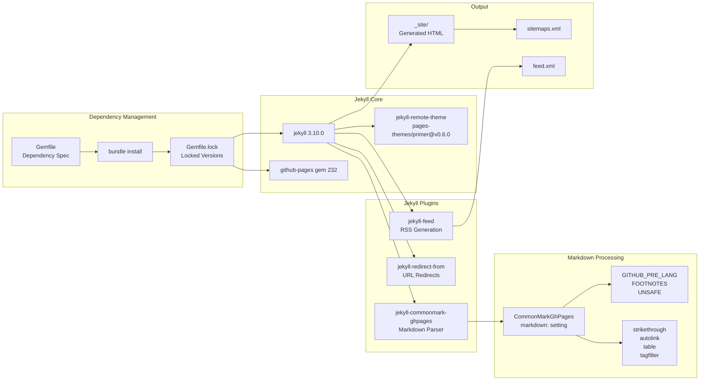
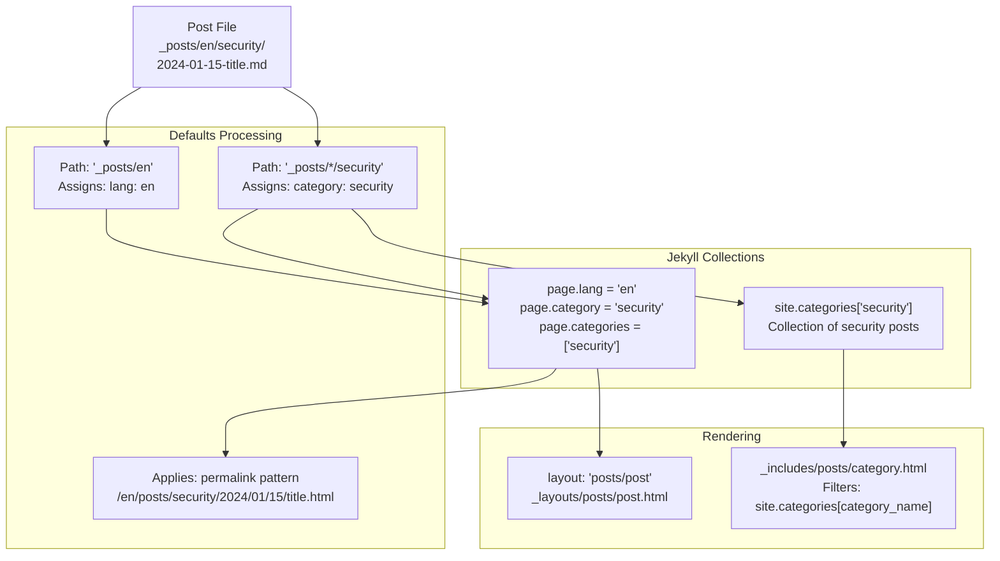
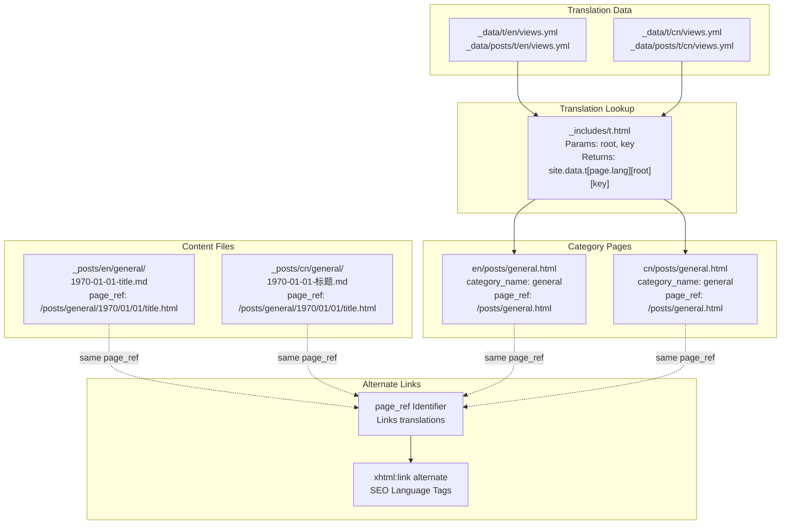
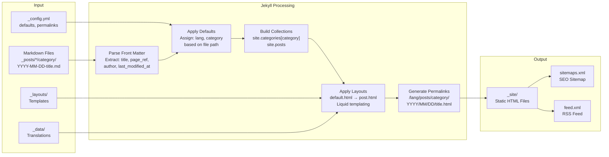

<!-- source: DeepWiki mcp.deepwiki.com · repo termux/termux.github.io · page 1 Introduction · fetched 2026-10-26 -->

# Introduction

<details>
<summary>Relevant source files</summary>

The following files were used as context for generating this wiki page:

- [CNAME](CNAME)
- [Gemfile](Gemfile)
- [Gemfile.lock](Gemfile.lock)
- [README.md](README.md)
- [_config.yml](_config.yml)
- [_data/posts/t/en/views.yml](_data/posts/t/en/views.yml)
- [_layouts/posts/index.md](_layouts/posts/index.md)

</details>


## Purpose and Scope

The `termux.github.io` repository is the source codebase for the Termux project's official website, hosted at [termux.dev](https://termux.dev). This repository implements a Jekyll-based static site generator that produces documentation, blog posts, donation information, and policy documents for the Termux terminal emulator project.

This document provides a technical overview of the repository's architecture, content organization, and build system. For details on specific subsystems:
- Build infrastructure and local development: see [Build and Deployment System](#2)
- Jekyll configuration and settings: see [Site Configuration](#3)
- Creating and managing blog posts: see [Content Management](#4)
- UI templates and styling: see [User Interface Components](#5)
- External service documentation: see [External Service Integrations](#6)

**Sources:** [README.md:1-3](), [_config.yml:16-21](), [CNAME:1]()

## Repository Architecture

The repository follows a standard Jekyll static site structure with custom multilingual and category organization systems. The site is deployed to GitHub Pages and served via the custom domain `termux.dev`, with `termux.org` redirecting to this domain.

### File System Structure

```mermaid
graph TD
    Root["Repository Root"]
    
    Config["_config.yml<br/>Site Configuration"]
    Gemfile["Gemfile + Gemfile.lock<br/>Ruby Dependencies"]
    
    Posts["_posts/<br/>Blog Content"]
    PostsEN["_posts/en/<br/>English Posts"]
    PostsCN["_posts/cn/<br/>Chinese Posts"]
    PostsCat["_posts/*/category/<br/>apps, general, packages, security"]
    
    Data["_data/<br/>Translation Data"]
    DataT["_data/t/en/, _data/t/cn/<br/>Localized Strings"]
    DataPosts["_data/posts/t/*/views.yml<br/>Category Translations"]
    
    Layouts["_layouts/<br/>Page Templates"]
    DefaultLayout["_layouts/default.html<br/>Base Template"]
    PostLayout["_layouts/posts/post.html<br/>Post Template"]
    PostIndex["_layouts/posts/index.md<br/>Category Navigation"]
    
    Includes["_includes/<br/>Reusable Components"]
    IncludesT["_includes/t.html<br/>Translation Lookup"]
    IncludesCat["_includes/posts/category.html<br/>Post List Generator"]
    
    Pages["en/, cn/<br/>Static Pages"]
    PagesPosts["*/posts/*.html<br/>Category Pages"]
    
    Assets["assets/<br/>Media and Styles"]
    
    Root --> Config
    Root --> Gemfile
    Root --> Posts
    Root --> Data
    Root --> Layouts
    Root --> Includes
    Root --> Pages
    Root --> Assets
    
    Posts --> PostsEN
    Posts --> PostsCN
    PostsEN --> PostsCat
    PostsCN --> PostsCat
    
    Data --> DataT
    Data --> DataPosts
    
    Layouts --> DefaultLayout
    Layouts --> PostLayout
    Layouts --> PostIndex
    
    Includes --> IncludesT
    Includes --> IncludesCat
    
    Pages --> PagesPosts
```



**Sources:** [README.md:8-24](), [_config.yml:55-127]()

### Technology Stack Components



The site uses **Jekyll 3.10.0** via the `github-pages` gem bundle (version 232), ensuring compatibility with GitHub Pages hosting. The markdown parser is set to `CommonMarkGhPages` with GitHub-flavored markdown extensions including strikethrough, autolink, tables, and footnotes.

**Sources:** [Gemfile:1-38](), [Gemfile.lock:52-97](), [_config.yml:31-42]()

## Content Organization System

### Post File Naming and Routing

Posts follow a strict naming convention that determines their URL structure through Jekyll's permalink system:

| File Path Pattern | Example File | Generated URL |
|-------------------|--------------|---------------|
| `_posts/<lang>/<category>/YYYY-MM-DD-<title>.md` | `_posts/en/general/1970-01-01-post-title.md` | `/en/posts/general/1970/01/01/post-title.html` |
| `_posts/en/<category>/*` | `_posts/en/security/2024-01-15-disclosure.md` | `/en/posts/security/2024/01/15/disclosure.html` |
| `_posts/cn/<category>/*` | `_posts/cn/general/2024-01-15-announcement.md` | `/cn/posts/general/2024/01/15/announcement.html` |

The permalink pattern is defined via `defaults` in `_config.yml`:

```yaml
permalink: /<language>/:collection/:categories/:year/:month/:day/:title:output_ext
```

**Sources:** [README.md:73-77](), [_config.yml:119-126]()

### Category and Language Assignment



The `defaults` system in `_config.yml` automatically assigns `lang` and `category` front matter based on file path, eliminating manual repetition. This ensures posts are added to `site.categories` collections used by category pages.

**Sources:** [_config.yml:55-127](), [README.md:48]()

## Multilingual Architecture

The site supports multiple languages (currently English and Chinese) through a structured directory and translation system:



The `page_ref` front matter key serves as a language-agnostic identifier, allowing all translations of a page to reference the same canonical path. This enables language switching and search engine indexing across translations.

**Sources:** [README.md:92](), [_config.yml:18](), [_config.yml:72-84]()

## Build Pipeline Overview



The build process transforms markdown content through Jekyll's processing pipeline, applying configuration defaults, building category collections, rendering Liquid templates, and generating static HTML with appropriate URL structures. The output includes HTML pages, an SEO-optimized sitemap, and RSS feeds for specified categories.

**Sources:** [README.md:16-22](), [_config.yml:44-52]()

## Supported Languages and Categories

The site currently supports two languages defined in `_config.yml`:

```yaml
supported_langs: [en,cn]
```

And four blog post categories, each requiring configuration in multiple locations:

| Category | Path Scope | Translation Key | Category Page |
|----------|-----------|----------------|---------------|
| `apps` | `_posts/*/apps` | `posts.views.index.apps` | `*/posts/apps.html` |
| `general` | `_posts/*/general` | `posts.views.index.general` | `*/posts/general.html` |
| `packages` | `_posts/*/packages` | `posts.views.index.packages` | `*/posts/packages.html` |
| `security` | `_posts/*/security` | `posts.views.index.security` | `*/posts/security.html` |

Each category requires:
1. A path scope default in `_config.yml` to assign the `category` front matter
2. Translation entries in `_data/posts/t/<lang>/views.yml` for the category name and page title
3. A category page at `<lang>/posts/<category>.html` that includes `category.html`
4. A link in `_layouts/posts/index.md` using the translation include

**Sources:** [_config.yml:18](), [_config.yml:87-111](), [_data/posts/t/en/views.yml:1-12](), [_layouts/posts/index.md:1-16](), [README.md:29-57]()

## Deployment Configuration

The site deploys to GitHub Pages with a custom domain configuration:

- **Primary Domain**: `termux.dev` (configured via `CNAME` file)
- **GitHub Pages URL**: `termux.github.io`
- **Redirect**: `termux.org` → `termux.dev`
- **Mirror**: `termux.com` (separate repository, synced via CI/CD)

The `url` setting in `_config.yml` specifies the canonical domain:

```yaml
url: "https://termux.dev"
```

**Sources:** [CNAME:1](), [_config.yml:20](), [README.md:3]()

---

