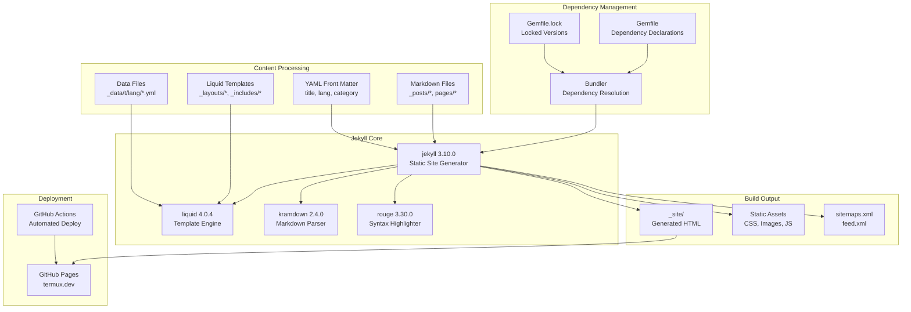
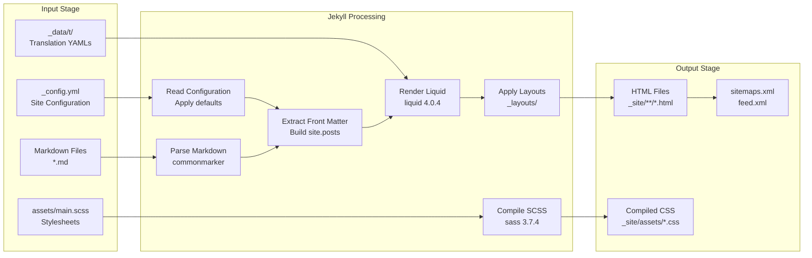
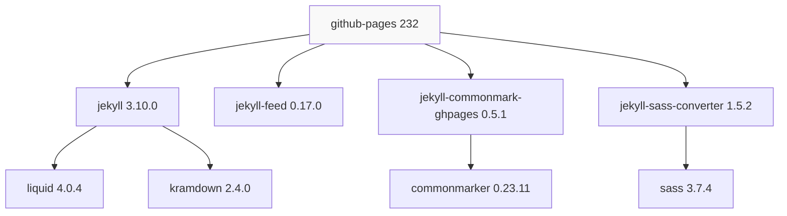
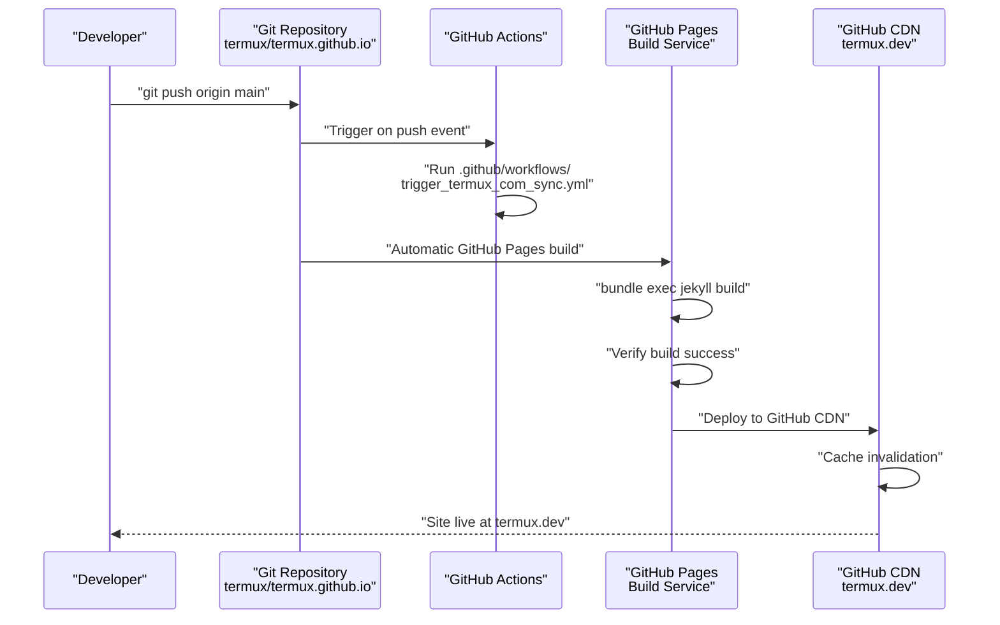

<!-- source: DeepWiki mcp.deepwiki.com · repo termux/termux.github.io · page 2 Build and Deployment System · fetched 2026-10-26 -->

# Build and Deployment System

<details>
<summary>Relevant source files</summary>

The following files were used as context for generating this wiki page:

- [Gemfile](Gemfile)
- [Gemfile.lock](Gemfile.lock)

</details>


## Purpose and Scope

This document provides an overview of the build and deployment infrastructure for the termux.github.io repository. It covers the static site generation pipeline using Jekyll, dependency management through Bundler, and automated deployment to GitHub Pages at the termux.dev domain.

For detailed information about specific aspects of the build system:
- Jekyll configuration, plugins, and their usage: see [Jekyll and Dependencies](#2.1)
- Local development workflow and testing: see [Local Development](#2.2)
- GitHub Pages hosting and CI/CD workflows: see [GitHub Pages Deployment](#2.3)

---

## System Architecture Overview

The termux.github.io repository uses a **static site generation** approach, transforming Markdown content and Liquid templates into deployable HTML files. The build system is centered around Jekyll 3.10.0, managed through the `github-pages` gem bundle to ensure compatibility with GitHub Pages hosting.



**Sources:** [Gemfile:1-38](), [Gemfile.lock:1-292]()

---

## Dependency Stack

The build system relies on a carefully curated set of Ruby gems managed through Bundler. The primary dependency is the `github-pages` gem, which bundles Jekyll and all plugins supported by GitHub Pages hosting.

### Core Dependencies

| Gem | Version | Purpose |
|-----|---------|---------|
| `github-pages` | 232 | Meta-package bundling Jekyll and GitHub Pages-compatible plugins |
| `jekyll` | 3.10.0 | Static site generator core |
| `jekyll-feed` | 0.17.0 | Generates RSS/Atom feeds |
| `jekyll-commonmark-ghpages` | 0.5.1 | CommonMark markdown parser with GitHub-flavored extensions |
| `minima` | 2.5.1 | Default Jekyll theme (not actively used but included) |
| `webrick` | 1.9.1 | Ruby HTTP server for local development |

### Jekyll Plugin Ecosystem

The `github-pages` gem (version 232) bundles 25+ Jekyll plugins. Key plugins include:

- **`jekyll-commonmark-ghpages`**: Uses `commonmarker` for GitHub-flavored markdown parsing
- **`jekyll-feed`**: Auto-generates `feed.xml` for RSS subscriptions
- **`jekyll-sitemap`**: Creates `sitemaps.xml` for search engine indexing
- **`jekyll-seo-tag`**: Adds SEO meta tags to page headers
- **`jekyll-redirect-from`**: Enables redirect pages via front matter
- **`jekyll-sass-converter`**: Compiles SCSS to CSS

**Sources:** [Gemfile:1-38](), [Gemfile.lock:52-97]()

---

## Build Pipeline Flow

The following diagram illustrates the complete build pipeline from source files to deployed website, showing the transformation stages and key Jekyll components involved.



**Sources:** [Gemfile.lock:110-124](), [Gemfile.lock:165-166](), [Gemfile.lock:221-224]()

---

## Jekyll Build Configuration

Jekyll's build behavior is controlled through the `_config.yml` file and Bundler's environment. The build process operates in two distinct modes:

### Development Mode

```bash
bundle exec jekyll serve
```

- Enables file watching and auto-regeneration
- Uses `webrick` server on `http://localhost:4000`
- Incremental builds for faster iteration
- Detailed error reporting

### Production Mode

```bash
bundle exec jekyll build
```

- Generates optimized static files to `_site/`
- No file watching or server
- Used by GitHub Pages for deployment
- Minification and optimization applied

**Sources:** [Gemfile:6-8](), [Gemfile.lock:275]()

---

## Gem Version Locking

The `Gemfile.lock` file pins all dependencies to specific versions, ensuring reproducible builds across environments. This is critical for maintaining consistency between local development and GitHub Pages production environments.

### Dependency Resolution



### Bundler Platform Specificity

The lock file includes platform-specific gem versions:

```
ffi (1.17.2-x86_64-linux-gnu)
nokogiri (1.18.9-x86_64-linux-gnu)
```

These native extensions are compiled for specific platforms, ensuring optimal performance.

**Sources:** [Gemfile.lock:49-97](), [Gemfile.lock:277-279]()

---

## Platform Compatibility

The `Gemfile` includes conditional dependencies for cross-platform development:

| Platform | Gems | Purpose |
|----------|------|---------|
| Windows (mingw, mswin, java) | `tzinfo`, `tzinfo-data` | Timezone database not included in Windows Ruby |
| Windows | `wdm` | Optimized file system watching |

These dependencies are automatically installed only when running on their target platforms using Bundler's `install_if` directive.

**Sources:** [Gemfile:23-31]()

---

## GitHub Pages Compatibility

The entire dependency stack is constrained by the `github-pages` gem, which enforces version compatibility with GitHub's build environment. This ensures that:

1. **Local builds match production**: Same Jekyll version, same plugins, same behavior
2. **No unsupported plugins**: Only plugins in the `github-pages` bundle can be used
3. **Consistent behavior**: Markdown rendering, Liquid processing, and plugin functionality identical locally and on GitHub Pages

The `github-pages` gem currently specifies Jekyll 3.10.0, which is several major versions behind the latest Jekyll 4.x releases. This is intentional to maintain stability in GitHub's production environment.

**Sources:** [Gemfile:14-15](), [Gemfile.lock:52-97]()

---

## Build Artifact Structure

When Jekyll completes the build process, it generates the `_site/` directory containing the complete static website:

```
_site/
├── index.html                 # Homepage
├── en/                        # English content
│   ├── posts/                # Blog posts by category
│   │   ├── donate/
│   │   ├── funding/
│   │   ├── privacy/
│   │   └── security/
│   └── ...
├── cn/                        # Chinese content
├── assets/                    # Compiled CSS, images, JS
│   ├── main.css
│   └── images/
├── feed.xml                   # RSS feed
└── sitemaps.xml              # SEO sitemap
```

This structure is directly served by GitHub Pages at `https://termux.dev/`.

**Sources:** [Gemfile.lock:139-140](), [Gemfile.lock:169-170]()

---

## Deployment Workflow

The deployment process is fully automated through GitHub Pages:



### Build Trigger Events

GitHub Pages automatically rebuilds the site when:
- Commits are pushed to the `main` branch
- Repository settings are changed
- Manual rebuild is triggered from repository settings

### Build Success Criteria

A successful build requires:
- Valid `_config.yml` syntax
- No Liquid template errors
- No file permission issues
- All referenced includes and layouts exist
- No plugin errors

**Sources:** [Gemfile:14-15](), [Gemfile.lock:52-97]()

---

## Summary

The build and deployment system for termux.github.io is designed around three principles:

1. **Reproducibility**: `Gemfile.lock` ensures identical builds across all environments
2. **GitHub Pages Compatibility**: Using the `github-pages` gem guarantees production parity
3. **Automation**: GitHub Pages handles building and deployment without manual intervention

The system transforms Markdown content and Liquid templates into a static website through Jekyll 3.10.0, leveraging 25+ plugins for features like RSS feeds, SEO optimization, and multilingual support. All dependencies are managed through Bundler, with platform-specific optimizations for Windows and Linux development environments.

For implementation details, see the child pages:
- [Jekyll and Dependencies](#2.1) - Plugin configuration and usage
- [Local Development](#2.2) - Development workflow and testing
- [GitHub Pages Deployment](#2.3) - Hosting and CI/CD workflows

**Sources:** [Gemfile:1-38](), [Gemfile.lock:1-292]()

---

