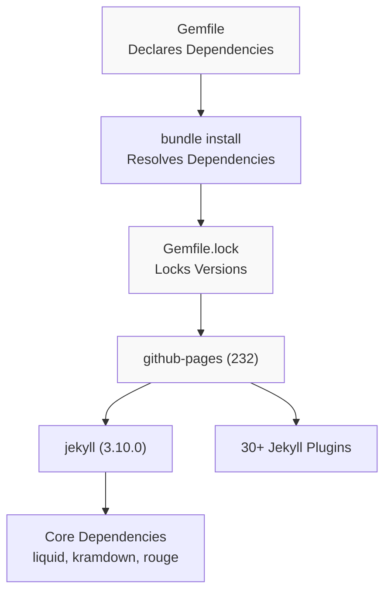
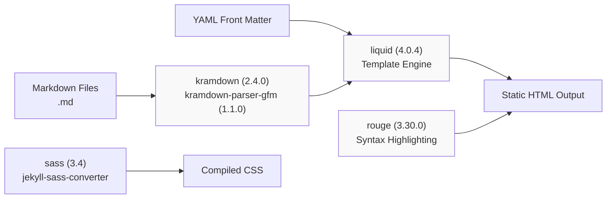
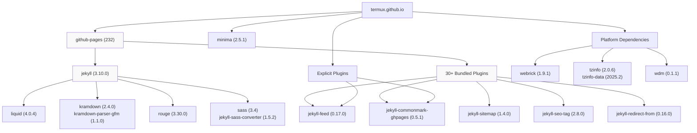

<!-- source: DeepWiki mcp.deepwiki.com · repo termux/termux.github.io · page 2.1 Jekyll and Dependencies · fetched 2026-10-26 -->

# Jekyll and Dependencies

<details>
<summary>Relevant source files</summary>

The following files were used as context for generating this wiki page:

- [Gemfile](Gemfile)
- [Gemfile.lock](Gemfile.lock)

</details>


## Purpose and Scope

This document explains the Jekyll static site generator setup for the termux.github.io repository, including the dependency management strategy using the `github-pages` gem bundle, the specific Jekyll version in use, and all Jekyll plugins configured for the site. For information about local development commands and workflows, see [Local Development](#2.2). For deployment configuration, see [GitHub Pages Deployment](#2.3).

## Overview

The termux.github.io site uses Jekyll 3.10.0 as its static site generator, managed through the `github-pages` gem bundle. This approach ensures compatibility with GitHub Pages hosting while providing access to a comprehensive set of Jekyll plugins and features.

Sources: [Gemfile:1-38](), [Gemfile.lock:1-293]()

## Dependency Management Strategy

### The github-pages Gem Bundle

The project uses the `github-pages` gem as its primary dependency, which bundles Jekyll and all GitHub Pages-compatible plugins into a single versioned package. This is declared in [Gemfile:15]():

```ruby
gem "github-pages", group: :jekyll_plugins
```

The current version is `github-pages` 232, which locks Jekyll to version 3.10.0 and includes 30+ pre-configured plugins. This approach provides:

- **Version Consistency**: Ensures local development matches GitHub Pages production environment
- **Plugin Compatibility**: Only includes plugins that GitHub Pages supports
- **Simplified Updates**: Single gem update covers all dependencies
- **Automatic Plugin Loading**: Plugins are loaded without explicit configuration

Sources: [Gemfile:14-15](), [Gemfile.lock:52-97]()

### Dependency Resolution Flow



**Diagram: Dependency Resolution Process**

Sources: [Gemfile:15](), [Gemfile.lock:52-97](), [Gemfile.lock:110-124]()

## Core Jekyll Dependencies

### Jekyll Engine

Jekyll 3.10.0 is the core static site generator, specified by the `github-pages` bundle at [Gemfile.lock:110-124](). Key dependencies include:

| Dependency | Version | Purpose |
|------------|---------|---------|
| `liquid` | 4.0.4 | Template engine for layouts and includes |
| `kramdown` | 2.4.0 | Markdown parser |
| `kramdown-parser-gfm` | 1.1.0 | GitHub Flavored Markdown support |
| `rouge` | 3.30.0 | Syntax highlighting |
| `sass` | 3.4 (via jekyll-sass-converter) | SCSS/Sass compilation |
| `webrick` | 1.9.1 | HTTP server for local development |

Sources: [Gemfile.lock:110-124](), [Gemfile.lock:119](), [Gemfile.lock:221-224](), [Gemfile.lock:251]()

### Template and Markup Processing



**Diagram: Content Processing Pipeline Components**

Sources: [Gemfile.lock:221-224](), [Gemfile.lock:225](), [Gemfile.lock:251](), [Gemfile.lock:165-166](), [Gemfile.lock:254-258]()

## Jekyll Plugins from github-pages

The `github-pages` gem (version 232) bundles the following Jekyll plugins at [Gemfile.lock:52-97]():

### Content Processing Plugins

| Plugin | Version | Purpose |
|--------|---------|---------|
| `jekyll-commonmark-ghpages` | 0.5.1 | CommonMark markdown parser with GFM support |
| `jekyll-feed` | 0.17.0 | RSS/Atom feed generation |
| `jekyll-sitemap` | 1.4.0 | XML sitemap generation |
| `jekyll-seo-tag` | 2.8.0 | SEO meta tags and structured data |
| `jekyll-mentions` | 1.6.0 | GitHub-style @mentions support |
| `jemoji` | 0.13.0 | Emoji support (`:emoji_name:` syntax) |

Sources: [Gemfile.lock:57](), [Gemfile.lock:59](), [Gemfile.lock:72](), [Gemfile.lock:71](), [Gemfile.lock:63](), [Gemfile.lock:88]()

### Layout and Structure Plugins

| Plugin | Version | Purpose |
|--------|---------|---------|
| `jekyll-default-layout` | 0.1.5 | Automatically assign default layouts |
| `jekyll-optional-front-matter` | 0.3.2 | Allow pages without front matter |
| `jekyll-titles-from-headings` | 0.5.3 | Extract page titles from first heading |
| `jekyll-readme-index` | 0.3.0 | Use README.md as index page |
| `jekyll-relative-links` | 0.6.1 | Convert relative links to .md files |

Sources: [Gemfile.lock:58](), [Gemfile.lock:64](), [Gemfile.lock:87](), [Gemfile.lock:66](), [Gemfile.lock:68]()

### Navigation and Linking Plugins

| Plugin | Version | Purpose |
|--------|---------|---------|
| `jekyll-redirect-from` | 0.16.0 | Create redirect pages |
| `jekyll-paginate` | 1.1.0 | Pagination for collections |
| `jekyll-include-cache` | 0.2.1 | Cache included files for performance |

Sources: [Gemfile.lock:67](), [Gemfile.lock:65](), [Gemfile.lock:62]()

### Integration Plugins

| Plugin | Version | Purpose |
|--------|---------|---------|
| `jekyll-avatar` | 0.8.0 | GitHub avatar images |
| `jekyll-gist` | 1.5.0 | Embed GitHub Gists |
| `jekyll-github-metadata` | 2.16.1 | Access GitHub repository metadata |
| `jekyll-remote-theme` | 0.4.3 | Use remote themes from GitHub |

Sources: [Gemfile.lock:55](), [Gemfile.lock:60](), [Gemfile.lock:61](), [Gemfile.lock:69]()

### Theme Plugins

The `github-pages` bundle includes 13 official Jekyll themes (versions 0.2.0 to 0.6.0), though the Termux site uses a custom theme. These are listed at [Gemfile.lock:74-86]().

Sources: [Gemfile.lock:74-86](), [Gemfile.lock:93]()

## Additional Explicit Dependencies

Beyond the `github-pages` bundle, the project explicitly declares additional dependencies in the Gemfile:

### Core Plugins

```ruby
gem "jekyll-feed", "~> 0.6"
gem "jekyll-commonmark-ghpages", "~> 0.2"
```

These are explicitly specified at [Gemfile:19-20]() even though they're included in `github-pages`, likely to ensure minimum version requirements or document their importance.

### Parser Dependencies

```ruby
gem "kramdown-parser-gfm"
```

Required for GitHub Flavored Markdown support with Kramdown v2, declared at [Gemfile:35]().

Sources: [Gemfile:18-21](), [Gemfile:35]()

### Theme Dependency

```ruby
gem "minima", "~> 2.0"
```

The Minima theme (version 2.5.1) is declared at [Gemfile:11]() but not actively used, as the site implements custom layouts and styling.

Sources: [Gemfile:11](), [Gemfile.lock:231-234]()

## Platform-Specific Dependencies

The Gemfile includes conditional dependencies for different operating systems:

### Windows Platform Support

```ruby
install_if -> { RUBY_PLATFORM =~ %r!mingw|mswin|java! } do
  gem "tzinfo", "~> 2.0"
  gem "tzinfo-data"
end

gem "wdm", "~> 0.1.0", :install_if => Gem.win_platform?
```

| Gem | Version | Purpose | Platform |
|-----|---------|---------|----------|
| `tzinfo` | 2.0.6 | Timezone information | Windows/Java |
| `tzinfo-data` | 2025.2 | Timezone database | Windows/Java |
| `wdm` | 0.1.1 | Windows Directory Monitor | Windows only |

These dependencies handle platform-specific limitations:
- Windows lacks native zoneinfo files, requiring `tzinfo-data`
- `wdm` provides efficient file watching on Windows

Sources: [Gemfile:23-31](), [Gemfile.lock:268-272](), [Gemfile.lock:274]()

### Web Server Dependency

```ruby
gem "webrick", "~> 1.8"
```

`webrick` (version 1.9.1) is required for local development servers in Ruby 3.0+, as it was removed from the standard library. Declared at [Gemfile:37](), resolved at [Gemfile.lock:275]().

Sources: [Gemfile:37](), [Gemfile.lock:275]()

## Complete Dependency Hierarchy



**Diagram: Complete Dependency Tree Structure**

Sources: [Gemfile:1-38](), [Gemfile.lock:52-97](), [Gemfile.lock:110-124]()

## Dependency Lock and Version Control

### Gemfile.lock Structure

The [Gemfile.lock:1-293]() file contains the complete resolved dependency tree with exact versions:

| Section | Lines | Purpose |
|---------|-------|---------|
| `GEM` block | 1-276 | All resolved gems with versions and dependencies |
| `PLATFORMS` | 277-278 | Target platforms (ruby, platform-specific) |
| `DEPENDENCIES` | 280-289 | Top-level dependencies from Gemfile |
| `BUNDLED WITH` | 291-292 | Bundler version used (2.5.23) |

The lock file ensures reproducible builds by pinning all transitive dependencies. For example, while Gemfile only specifies `github-pages`, the lock file resolves this to 232 exact gem versions including `activesupport` (8.0.2), `nokogiri` (1.18.9), and many others.

### Platform-Specific Binaries

Some gems include platform-specific native extensions:

- `ffi (1.17.2-x86_64-linux-gnu)` at [Gemfile.lock:49]()
- `nokogiri (1.18.9-x86_64-linux-gnu)` at [Gemfile.lock:238-239]()

These are compiled binaries optimized for specific platforms, automatically selected by Bundler during installation.

Sources: [Gemfile.lock:1-293](), [Gemfile.lock:49](), [Gemfile.lock:238-239](), [Gemfile.lock:291-292]()

## Supporting Infrastructure Gems

Beyond Jekyll and its plugins, the dependency tree includes supporting infrastructure:

### HTTP and Network

| Gem | Version | Purpose |
|-----|---------|---------|
| `faraday` | 2.13.3 | HTTP client library |
| `octokit` | 4.25.1 | GitHub API client |
| `typhoeus` | 1.4.1 | Parallel HTTP library (health checks) |
| `dnsruby` | 1.72.4 | DNS resolver for health checks |

Sources: [Gemfile.lock:43-47](), [Gemfile.lock:240-242](), [Gemfile.lock:266-267](), [Gemfile.lock:31-34]()

### Utilities and Helpers

| Gem | Version | Purpose |
|-----|---------|---------|
| `activesupport` | 8.0.2 | Rails utility library |
| `i18n` | 1.14.7 | Internationalization support |
| `addressable` | 2.8.7 | URI parsing and templates |
| `concurrent-ruby` | 1.3.5 | Concurrency abstractions |

Sources: [Gemfile.lock:4-16](), [Gemfile.lock:108-109](), [Gemfile.lock:17-18](), [Gemfile.lock:28]()

### File Watching and Build

| Gem | Version | Purpose |
|-----|---------|---------|
| `listen` | 3.9.0 | File change detection |
| `rb-fsevent` | 0.11.2 | macOS file system events |
| `rb-inotify` | 0.11.1 | Linux file system events |
| `em-websocket` | 0.5.3 | WebSocket support for live reload |

Sources: [Gemfile.lock:226-228](), [Gemfile.lock:247](), [Gemfile.lock:248-249](), [Gemfile.lock:36-38]()

## Summary

The termux.github.io site's dependency management leverages the `github-pages` gem bundle approach, which provides:

- **Jekyll 3.10.0** as the static site generator
- **30+ plugins** for content processing, SEO, and GitHub integration
- **Platform-specific dependencies** for Windows, macOS, and Linux
- **Locked versions** via Gemfile.lock ensuring reproducible builds
- **GitHub Pages compatibility** guaranteeing local development matches production

This dependency structure is managed through Bundler, with [Gemfile:1-38]() declaring top-level requirements and [Gemfile.lock:1-293]() locking the entire transitive dependency tree.

Sources: [Gemfile:1-38](), [Gemfile.lock:1-293]()

---

