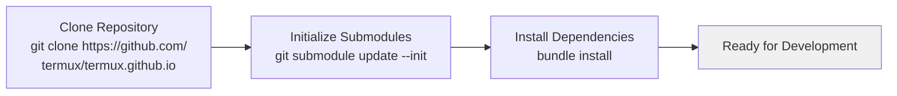
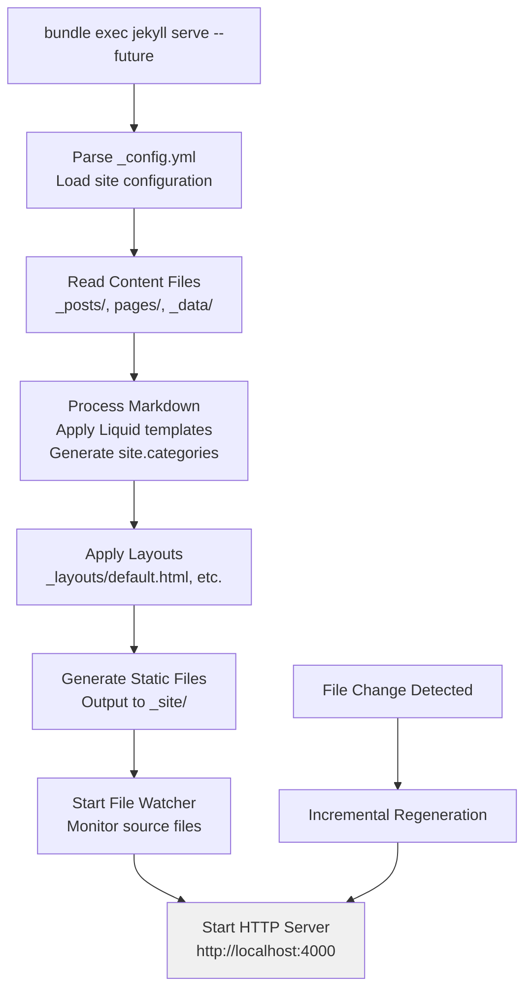
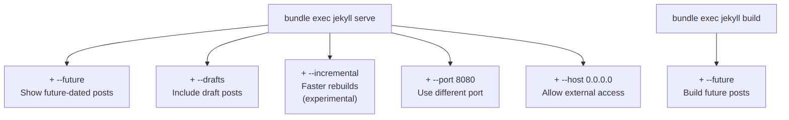
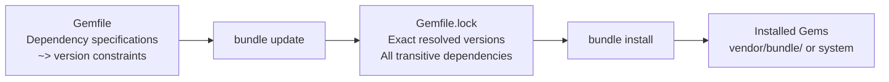
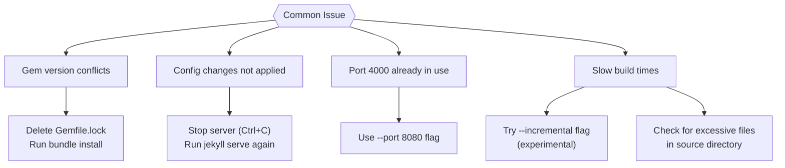

<!-- source: DeepWiki mcp.deepwiki.com · repo termux/termux.github.io · page 2.2 Local Development · fetched 2026-10-26 -->

# Local Development

<details>
<summary>Relevant source files</summary>

The following files were used as context for generating this wiki page:

- [CNAME](CNAME)
- [Gemfile](Gemfile)
- [Gemfile.lock](Gemfile.lock)
- [README.md](README.md)

</details>


This document explains how to set up and run the termux.github.io website locally for development purposes. It covers prerequisite software installation, initial repository setup, running the Jekyll development server, and the local development workflow. For information about Jekyll's configuration and plugins, see [Jekyll and Dependencies](#2.1). For deployment to GitHub Pages, see [GitHub Pages Deployment](#2.3).

---

## Prerequisites

Before setting up the local development environment, the following software must be installed on the development machine:

| Requirement | Purpose | Version Notes |
|------------|---------|---------------|
| Ruby | Runtime environment for Jekyll and gems | Jekyll 3.10.0 requires Ruby >= 2.5.0 |
| Bundler | Dependency management for Ruby gems | Installed via `gem install bundler` |
| Git | Version control and submodule management | Required for cloning repository and submodules |

The project uses the `github-pages` gem bundle [Gemfile:15](), which locks Jekyll and all plugins to versions compatible with GitHub Pages production environment. This ensures local development matches the deployed site behavior.

**Sources:** [Gemfile:1-38](), [Gemfile.lock:52-97]()

---

## Initial Setup Process

### Repository Cloning and Submodule Initialization

The repository contains git submodules that must be initialized before the site can be built. The setup process follows this sequence:



**1. Clone the Repository**

Clone the repository to the local development machine:

```bash
git clone https://github.com/termux/termux.github.io
cd termux.github.io
```

**2. Initialize Git Submodules**

The repository contains submodules that must be fetched before building:

```bash
git submodule update --init
```

This command initializes and clones all submodules defined in `.gitmodules` [README.md:10-14]().

**3. Install Ruby Dependencies**

Install all required gems specified in the `Gemfile`:

```bash
bundle install
```

Bundler reads the `Gemfile` [Gemfile:1-38]() and installs exact versions specified in `Gemfile.lock` [Gemfile.lock:1-293](), ensuring reproducible builds. The installation includes Jekyll, all GitHub Pages plugins, and their transitive dependencies.

**Sources:** [README.md:8-14](), [README.md:16](), [Gemfile:1-38]()

---

## Running the Development Server

### Basic Server Command

The Jekyll development server is started using the `bundle exec` wrapper to ensure the correct gem versions are used:

```bash
bundle exec jekyll serve --future
```

This command performs the following operations:



**Command Components:**

- **`bundle exec`**: Executes Jekyll using the gems specified in `Gemfile.lock`, not system-wide installations
- **`jekyll serve`**: Starts the development server with file watching and auto-regeneration
- **`--future`**: Shows posts with dates in the future [README.md:22]()

The server becomes accessible at `http://localhost:4000` after startup.

**Sources:** [README.md:18-22]()

---

## Development Workflow Considerations

### File Watching and Auto-Regeneration

The Jekyll development server includes the `jekyll-watch` plugin [Gemfile.lock:214-215](), which monitors source files for changes and automatically regenerates affected pages. This enables a rapid development cycle:

| File Type | Auto-Regeneration Behavior |
|-----------|---------------------------|
| Markdown files (`*.md`) | Automatically regenerated on save |
| Layout files (`_layouts/*.html`) | Automatically regenerated, all pages using the layout rebuild |
| Include files (`_includes/*.html`) | Automatically regenerated, all pages using the include rebuild |
| Assets (CSS, JS, images) | Automatically copied to `_site/` |
| Data files (`_data/*.yml`) | Automatically regenerated, pages using the data rebuild |

### Configuration Changes Requiring Server Restart

Changes to `_config.yml` are **not** automatically detected by the file watcher. The server must be manually restarted for configuration changes to take effect:

1. Stop the server with `Ctrl+C`
2. Restart with `bundle exec jekyll serve --future`

This limitation exists because `_config.yml` is loaded once at startup and affects global site behavior [README.md:24]().

**Sources:** [README.md:24-25](), [Gemfile.lock:214-215]()

---

## Common Development Commands

### Server Command Variations



| Command | Purpose | Use Case |
|---------|---------|----------|
| `bundle exec jekyll serve --future` | Standard development server | Daily development work |
| `bundle exec jekyll serve --drafts` | Include draft posts from `_drafts/` | Previewing unpublished content |
| `bundle exec jekyll serve --incremental` | Faster rebuilds (experimental) | Large sites with slow build times |
| `bundle exec jekyll serve --port 8080` | Use alternative port | Port 4000 already in use |
| `bundle exec jekyll serve --host 0.0.0.0` | Allow external network access | Testing on mobile devices |
| `bundle exec jekyll build --future` | Build site without serving | CI/CD or static file generation |

**Sources:** [README.md:18-22]()

---

## Dependency Management

### Updating Dependencies

The project uses two files for dependency management:



**Key Dependency Files:**

- **`Gemfile`** [Gemfile:1-38](): Specifies direct dependencies with version constraints
  - `github-pages` gem bundle provides Jekyll and all GitHub Pages plugins
  - `jekyll-feed` and `jekyll-commonmark-ghpages` explicitly specified
  - Platform-specific gems for Windows development

- **`Gemfile.lock`** [Gemfile.lock:1-293](): Contains exact versions of all gems, including transitive dependencies
  - 232 is the `github-pages` gem version [Gemfile.lock:52]()
  - Jekyll 3.10.0 is locked [Gemfile.lock:110]()
  - All plugin versions match GitHub Pages production environment

### Common Bundler Commands

| Command | Purpose |
|---------|---------|
| `bundle install` | Install exact versions from `Gemfile.lock` |
| `bundle update` | Update gems within `Gemfile` constraints and regenerate `Gemfile.lock` |
| `bundle update github-pages` | Update only the `github-pages` bundle |
| `bundle exec <command>` | Execute command with gems from `Gemfile.lock` |
| `bundle clean` | Remove unused gems from vendor/bundle |

**Sources:** [Gemfile:1-38](), [Gemfile.lock:1-293]()

---

## Local vs. Production Environment

### Environment Parity

The local development environment closely mirrors the GitHub Pages production environment due to the `github-pages` gem bundle [Gemfile:15]():

| Aspect | Local Development | Production (GitHub Pages) |
|--------|-------------------|---------------------------|
| Jekyll version | 3.10.0 [Gemfile.lock:110]() | 3.10.0 (locked by github-pages) |
| Plugins | Identical set from github-pages bundle | Same plugins, same versions |
| Markdown processor | CommonMark via jekyll-commonmark-ghpages | Same processor |
| Configuration | Uses `_config.yml` directly | Uses `_config.yml` with GitHub Pages overrides |
| Domain | `localhost:4000` | `termux.dev` via CNAME [CNAME:1]() |

### Key Differences

**Build Differences:**
- Local: `--future` flag required to show future-dated posts [README.md:22]()
- Production: GitHub Pages may have different settings for future posts

**Environment Variables:**
- Local: `jekyll.environment` defaults to `development`
- Production: GitHub Pages sets `jekyll.environment` to `production`

**URL Generation:**
- Local: URLs generated relative to `http://localhost:4000`
- Production: URLs generated relative to `https://termux.dev`

**Sources:** [README.md:18-22](), [Gemfile:15](), [Gemfile.lock:52-97](), [CNAME:1]()

---

## Troubleshooting Common Issues

### Issue Resolution Matrix



**Common Issues and Solutions:**

| Issue | Symptom | Solution |
|-------|---------|----------|
| Gem version conflicts | `bundle install` fails or dependency errors | Delete `Gemfile.lock` and run `bundle install` |
| Configuration not loading | Changes to `_config.yml` not reflected | Restart server - config only loaded at startup [README.md:24]() |
| Port already in use | Error: "Address already in use - bind(2)" | Use `--port 8080` flag or kill process on port 4000 |
| Posts not showing | Future-dated posts invisible | Add `--future` flag [README.md:22]() |
| Submodule errors | Missing files or build errors | Run `git submodule update --init` [README.md:10-14]() |
| Slow incremental builds | Changes take long to regenerate | File watcher may be monitoring too many files |

**Sources:** [README.md:10-14](), [README.md:22](), [README.md:24-25]()

---

