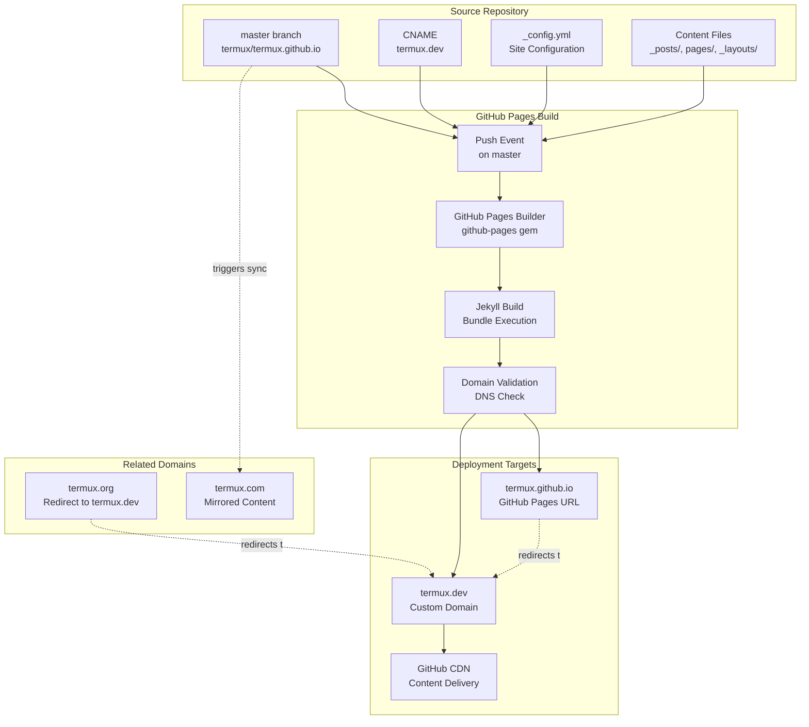
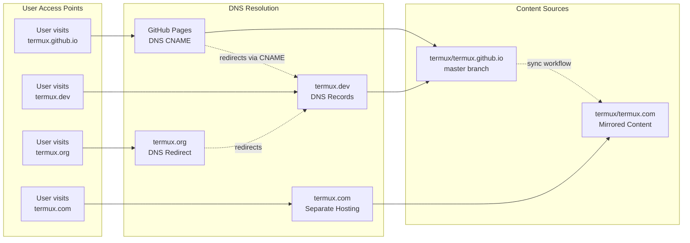
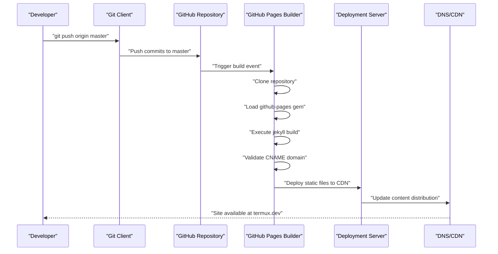
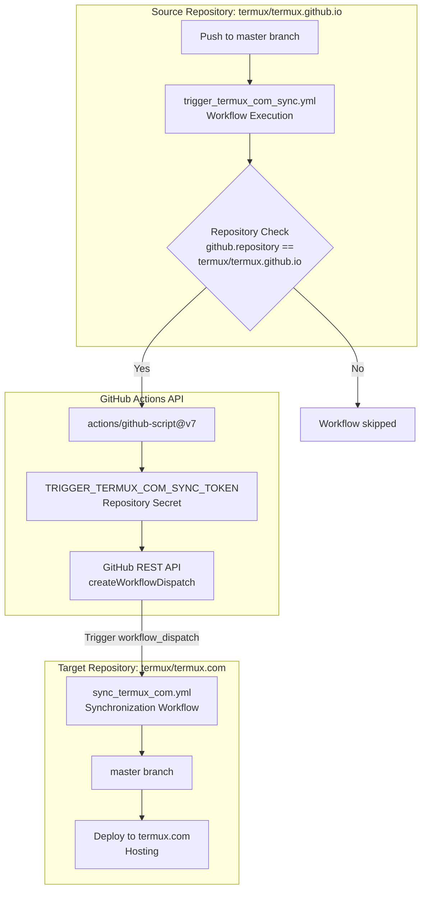

<!-- source: DeepWiki mcp.deepwiki.com · repo termux/termux.github.io · page 2.3 GitHub Pages Deployment · fetched 2026-10-26 -->

# GitHub Pages Deployment

Relevant source files

The following files were used as context for generating this wiki page:

- [.github/workflows/trigger_termux_com_sync.yml](.github/workflows/trigger_termux_com_sync.yml)
- [CNAME](CNAME)
- [Gemfile](Gemfile)
- [Gemfile.lock](Gemfile.lock)
- [README.md](README.md)

This document describes the GitHub Pages hosting configuration for the termux.github.io repository, including custom domain setup, domain routing architecture, and the automated synchronization workflow to the termux.com mirror site. For information about the Jekyll build system and dependencies, see [Jekyll and Dependencies](#2.1). For local development procedures, see [Local Development](#2.2).

---

## Purpose and Scope

The Termux website is hosted on GitHub Pages, which automatically builds and serves the Jekyll static site from the repository. This deployment system includes:

- GitHub Pages hosting configuration and build process
- Custom domain configuration for `termux.dev`
- Domain routing relationships between `termux.github.io`, `termux.dev`, `termux.org`, and `termux.com`
- Automated CI/CD workflow for synchronizing content to `termux.com`

---

## GitHub Pages Hosting Architecture

### Overview

GitHub Pages automatically builds and deploys the site when changes are pushed to the `master` branch. The hosting infrastructure relies on the `github-pages` gem bundle, which provides a consistent build environment matching GitHub's production servers.

**Sources:** [README.md:1-3](), [CNAME:1](), [Gemfile:15]()

---

## Custom Domain Configuration

### CNAME File

The custom domain is configured through the `CNAME` file in the repository root, which contains the target domain name:

[CNAME:1]()

This file instructs GitHub Pages to serve the site at `termux.dev` instead of the default `termux.github.io` subdomain. When GitHub Pages detects this file, it:

1. Validates the DNS configuration for the specified domain
2. Automatically redirects `termux.github.io` to `termux.dev`
3. Provisions SSL/TLS certificates for the custom domain
4. Configures CDN routing to serve content through the custom domain

**Sources:** [CNAME:1]()

### Domain Routing Architecture

The Termux project uses multiple domains with specific routing relationships:

| Domain | Type | Status | Purpose |
|--------|------|--------|---------|
| `termux.github.io` | GitHub Pages URL | Active, Redirects | Canonical GitHub Pages address, redirects to `termux.dev` |
| `termux.dev` | Custom Domain | Primary | Main website hosted via GitHub Pages |
| `termux.org` | Redirect | Redirected | Legacy domain, redirects to `termux.dev` |
| `termux.com` | Mirror | Mirrored | Separate repository mirroring content from `termux.github.io` |

**Sources:** [README.md:3](), [CNAME:1]()

---

## The github-pages Gem

### Dependency Management

The site uses the `github-pages` gem to ensure local builds match GitHub's production environment exactly. This meta-gem bundles all Jekyll plugins and dependencies used by GitHub Pages.

[Gemfile:15]()

The `github-pages` gem is specified in the `jekyll_plugins` group, which automatically loads all included plugins during Jekyll builds. This approach ensures:

- **Dependency Consistency:** Local and production environments use identical gem versions
- **Automatic Updates:** Gem versions are managed by GitHub and updated in lockstep
- **Plugin Compatibility:** All included plugins are tested together for compatibility

### Included Dependencies

The [Gemfile.lock:52-97]() shows the full dependency tree for the `github-pages` gem (version 232), which includes:

| Component | Version | Purpose |
|-----------|---------|---------|
| `jekyll` | 3.10.0 | Core static site generator |
| `jekyll-feed` | 0.17.0 | RSS feed generation |
| `jekyll-sitemap` | 1.4.0 | XML sitemap generation |
| `jekyll-seo-tag` | 2.8.0 | SEO metadata generation |
| `jekyll-redirect-from` | 0.16.0 | Client-side redirects |
| `jekyll-commonmark-ghpages` | 0.5.1 | CommonMark markdown parser |
| `kramdown` | 2.4.0 | Default markdown parser |
| `liquid` | 4.0.4 | Template engine |
| `rouge` | 3.30.0 | Syntax highlighting |

**Sources:** [Gemfile:15](), [Gemfile.lock:52-97]()

---

## Automated Build Process

### Build Trigger Flow

GitHub Pages automatically triggers builds when changes are pushed to the configured source branch:

### Build Configuration

The build process uses configuration from `_config.yml` to determine:

- Source files to include/exclude
- Permalink structures for generated URLs
- Plugin configurations and settings
- Default front matter values

GitHub Pages automatically excludes certain files from the build output:

- Git-related files (`.git/`, `.gitignore`, `.gitmodules`)
- Development files (`Gemfile`, `Gemfile.lock`)
- Jekyll working directories (`_site/`, `.sass-cache/`)
- CI/CD configuration (`.github/`)

**Sources:** [README.md:16-22](), [Gemfile:15]()

---

## CI/CD: termux.com Synchronization Workflow

### Workflow Purpose

The `trigger_termux_com_sync.yml` workflow provides automated synchronization between the primary `termux.github.io` repository and the `termux.com` mirror repository. This allows `termux.com` to serve identical content while maintaining a separate deployment infrastructure.

[.github/workflows/trigger_termux_com_sync.yml:1-23]()

### Workflow Architecture

**Sources:** [.github/workflows/trigger_termux_com_sync.yml:1-23]()

### Workflow Steps

The workflow executes the following sequence:

1. **Trigger Condition:** Activates on push events to the `master` branch ([.github/workflows/trigger_termux_com_sync.yml:4-6]())

2. **Repository Validation:** Checks that the workflow is running in the official `termux/termux.github.io` repository to prevent execution in forks ([.github/workflows/trigger_termux_com_sync.yml:13]())

3. **API Authentication:** Uses the `TRIGGER_TERMUX_COM_SYNC_TOKEN` secret to authenticate with the GitHub API ([.github/workflows/trigger_termux_com_sync.yml:16]())

4. **Workflow Dispatch:** Calls `github.rest.actions.createWorkflowDispatch` to trigger the `sync_termux_com.yml` workflow in the `termux/termux.com` repository ([.github/workflows/trigger_termux_com_sync.yml:18-23]())

### API Call Parameters

The workflow dispatch API call specifies:

| Parameter | Value | Purpose |
|-----------|-------|---------|
| `owner` | `termux` | GitHub organization |
| `repo` | `termux.com` | Target repository name |
| `workflow_id` | `sync_termux_com.yml` | Workflow file to trigger |
| `ref` | `master` | Branch to execute workflow on |

**Sources:** [.github/workflows/trigger_termux_com_sync.yml:18-22]()

---

## Domain Migration Status

### Historical Context

The Termux project uses multiple domains in different states:

[README.md:3]()

This configuration reflects an ongoing migration strategy:

- **termux.dev** is the current primary domain configured via the `CNAME` file
- **termux.org** redirects to `termux.dev`, serving as a legacy domain pointer
- **termux.com** is currently mirrored from a separate repository but planned for eventual redirect to `termux.dev`

The synchronization workflow maintains the `termux.com` mirror during the transition period until DNS-level redirects can be configured.

**Sources:** [README.md:3](), [CNAME:1]()

---

## DNS and SSL/TLS Configuration

### Automatic SSL/TLS Provisioning

GitHub Pages automatically provisions and renews SSL/TLS certificates for custom domains through Let's Encrypt. When the `CNAME` file is detected:

1. GitHub validates domain ownership via DNS
2. Provisions a certificate for the custom domain
3. Automatically renews certificates before expiration
4. Enforces HTTPS redirects for all traffic

### DNS Requirements

For the custom domain to function correctly, DNS records must be configured:

- **A Records:** Point to GitHub Pages IP addresses
- **CNAME Record:** `www.termux.dev` points to `termux.github.io`
- **CAA Record (Optional):** Authorize Let's Encrypt for certificate issuance

The GitHub Pages system validates these DNS configurations before activating the custom domain and serving traffic.

**Sources:** [CNAME:1]()

---

## Deployment Verification

### Build Status Monitoring

Developers can verify successful deployments through:

1. **GitHub Pages Settings:** Repository Settings → Pages shows build status
2. **Commit Status Checks:** Each commit displays a deployment status badge
3. **Site Availability:** Accessing `termux.dev` confirms content is live

### Troubleshooting Build Failures

Common issues that prevent successful GitHub Pages deployments:

| Issue | Symptom | Solution |
|-------|---------|----------|
| Invalid CNAME | Build fails with DNS error | Verify DNS records point to GitHub Pages |
| Plugin incompatibility | Build succeeds but features missing | Ensure plugins are in `github-pages` gem |
| Liquid syntax errors | Build fails with template error | Validate Liquid syntax in layouts/includes |
| Front matter errors | Posts don't appear | Check YAML front matter formatting |

**Sources:** [README.md:16-24](), [Gemfile:15]()

---

## Integration with Build System

The GitHub Pages deployment system integrates with other build components:

- **Jekyll Configuration:** Reads settings from `_config.yml` (see [Main Configuration File](#3.1))
- **Content Processing:** Processes posts and pages per category system (see [Category System](#4.2))
- **Multilingual Support:** Generates language-specific URLs (see [Multilingual Content System](#4.3))
- **Layout Application:** Applies layouts to generate final HTML (see [Layout System](#5.1))

GitHub Pages executes the same `bundle exec jekyll build` command used in local development, ensuring consistency between development and production environments.

**Sources:** [README.md:19](), [Gemfile:15]()

---

