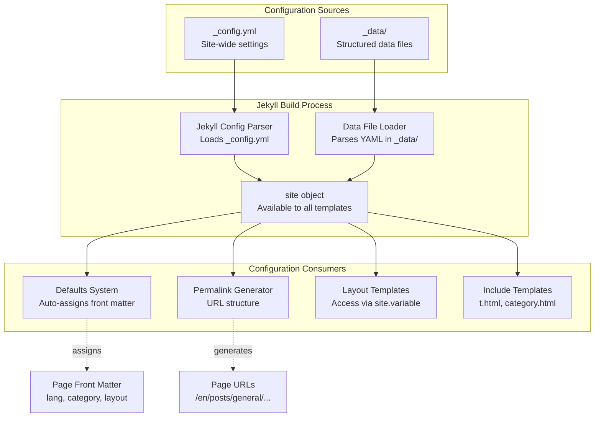
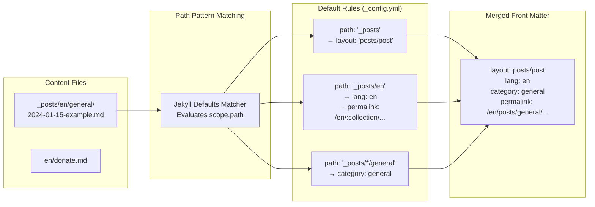
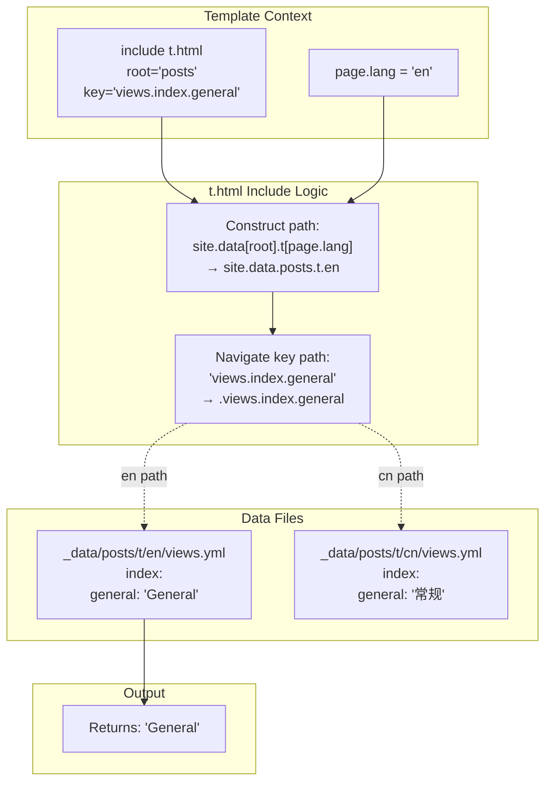

<!-- source: DeepWiki mcp.deepwiki.com · repo termux/termux.github.io · page 3 Site Configuration · fetched 2026-10-26 -->

# Site Configuration

<details>
<summary>Relevant source files</summary>

The following files were used as context for generating this wiki page:

- [_config.yml](_config.yml)
- [_data/posts/t/en/views.yml](_data/posts/t/en/views.yml)
- [_layouts/posts/index.md](_layouts/posts/index.md)

</details>


## Purpose and Scope

This document describes the site-wide configuration system for the termux.github.io Jekyll site. It covers the two primary configuration mechanisms: the `_config.yml` file that defines global site settings, build parameters, and content routing rules, and the `_data/` directory structure that stores translation and localization data.

For details on specific configuration subsystems, see:
- Main Configuration File structure and options ([3.1](#3.1))
- Translation and Localization Data organization ([3.2](#3.2))

For information about content creation workflows that use this configuration, see Creating and Organizing Posts ([4.1](#4.1)) and the Multilingual Content System ([4.3](#4.3)).

---

## Configuration System Architecture

The site configuration is split between two complementary systems that Jekyll processes during the build:

**Configuration Layer** (`_config.yml`):
- Site metadata (title, URL, social accounts)
- Build settings (theme, plugins, markdown processor)
- Content routing rules (defaults, permalinks, collections)
- Feed generation parameters

**Data Layer** (`_data/` directory):
- Translation strings organized by language (`_data/t/lang/`)
- Content metadata and categorization (`_data/posts/`)
- Accessible to templates via `site.data` object

### Configuration Processing Model



**Sources:** [_config.yml:1-140]()

---

## _config.yml Structure Overview

The `_config.yml` file is organized into several functional sections:

| Section | Lines | Purpose |
|---------|-------|---------|
| Site Metadata | 16-27 | Title, URL, language settings, social media accounts |
| GitHub Pages | 29 | GitHub metadata integration |
| Build Settings | 31-42 | Theme, plugins, markdown processor configuration |
| Collections | 44-46 | Posts collection configuration |
| Feed | 48-51 | RSS feed category filtering |
| Display Options | 53 | Post excerpt display setting |
| Defaults | 55-127 | Path-based auto-assignment of front matter |

### Core Site Settings

The site metadata section defines variables accessible throughout templates:

```yaml
title: Termux
lang: en
supported_langs: [en,cn]
baseurl: ""
url: "https://termux.dev"
```

Key variables:
- `site.title`: Used in page titles and headers
- `site.lang`: Default language (English)
- `site.supported_langs`: Array of supported languages for navigation
- `site.url`: Base URL for absolute links and canonical URLs

**Sources:** [_config.yml:16-21]()

### Plugin Configuration

Three Jekyll plugins are enabled:

| Plugin | Purpose |
|--------|---------|
| `jekyll-feed` | Generates RSS/Atom feeds for posts |
| `jekyll-remote-theme` | Loads `pages-themes/primer@v0.6.0` theme |
| `jekyll-redirect-from` | Creates redirect pages from front matter |

The markdown processor is configured as `CommonMarkGhPages` with GitHub-flavored extensions:

```yaml
markdown: CommonMarkGhPages
commonmark:
  options: ["GITHUB_PRE_LANG", "FOOTNOTES", "UNSAFE"]
  extensions: ["strikethrough", "autolink", "table", "tagfilter"]
```

**Sources:** [_config.yml:34-42]()

---

## Defaults System

The defaults system is the most critical configuration component. It automatically assigns front matter values to content files based on their filesystem path, eliminating the need for repetitive front matter in every file.

### Defaults Processing Flow



**Sources:** [_config.yml:55-127]()

### Default Rule Categories

**Layout Assignment** ([_config.yml:64-68]()):
- All files under `_posts` automatically receive `layout: "posts/post"`
- Ensures consistent post formatting without explicit front matter

**Language Assignment** ([_config.yml:72-84](), [_config.yml:114-126]()):
- Files under `en/` path receive `lang: en`
- Files under `cn/` path receive `lang: cn`
- Language-specific permalink patterns include language prefix

**Category Assignment** ([_config.yml:88-110]()):
- Files under `_posts/*/apps` receive `category: apps`
- Files under `_posts/*/general` receive `category: general`
- Files under `_posts/*/packages` receive `category: packages`
- Files under `_posts/*/security` receive `category: security`

The wildcard pattern `_posts/*/<category>` matches any language subdirectory.

### Permalink Patterns

Permalink patterns define the URL structure for generated pages. Language-specific patterns ensure proper URL namespacing:

```yaml
# For English posts (_posts/en/)
permalink: /en/:collection/:categories/:year/:month/:day/:title:output_ext
# Example output: /en/posts/general/2024/01/15/example-post.html

# For Chinese posts (_posts/cn/)
permalink: /cn/:collection/:categories/:year/:month/:day/:title:output_ext
# Example output: /cn/posts/general/2024/01/15/example-post.html
```

Permalink variables:
- `:collection` - Always "posts" for the posts collection
- `:categories` - The category value from front matter or defaults
- `:year/:month/:day` - Extracted from filename date
- `:title` - Extracted from filename slug

**Sources:** [_config.yml:119](), [_config.yml:126]()

---

## Translation Data Architecture

Translation strings are stored in YAML files under `_data/t/<lang>/` and accessed via the `t.html` include file. This provides a centralized localization system separate from content files.

### Directory Structure

```
_data/
└── t/                      # Translation root
    ├── en/                 # English translations
    │   └── views.yml
    ├── cn/                 # Chinese translations
    │   └── views.yml
    └── posts/              # Post-related translations
        └── t/
            ├── en/
            │   └── views.yml
            └── cn/
                └── views.yml
```

### Translation Data Format

Translation files use nested YAML structure. Example from `_data/posts/t/en/views.yml`:

```yaml
index:
  apps: Apps
  general: General
  packages: Packages
  security: Security
  apps_posts: Apps Posts
  general_posts: General Posts
  packages_posts: Packages Posts
  security_posts: Security Posts
  subscribe_to_rss_feed: Subscribe to RSS feed
```

**Sources:** [_data/posts/t/en/views.yml:1-12]()

### Translation Access Pattern

Templates access translations using the `t.html` include with two parameters:

| Parameter | Purpose | Example |
|-----------|---------|---------|
| `root` | Top-level namespace | `"posts"` |
| `key` | Dot-notation path to string | `"views.index.general"` |

Example usage from post index page:

```liquid

```

This resolves to:
1. Look up `site.data.posts.t[page.lang].views.index.general`
2. Returns "General" for English, or translated equivalent for other languages

**Sources:** [_layouts/posts/index.md:7]()

### Translation Resolution Diagram



**Sources:** [_layouts/posts/index.md:7-12](), [_data/posts/t/en/views.yml:1-12]()

---

## Configuration Loading and Precedence

Jekyll processes configuration in a specific order, with later sources overriding earlier ones:

### Loading Sequence

1. **Jekyll Defaults**: Built-in Jekyll configuration values
2. **_config.yml**: Site-wide configuration loaded at build start
3. **Defaults System**: Auto-assigned front matter based on path rules
4. **File Front Matter**: Explicit YAML front matter in content files
5. **Command Line**: Parameters passed to `jekyll serve` or `jekyll build`

### Precedence Rules

When multiple defaults rules match a file, all matching rules are applied with later rules taking precedence for conflicting keys. For example, a post at `_posts/en/general/2024-01-15-post.md` matches:

1. `path: "_posts"` → `layout: "posts/post"`
2. `path: "_posts/en"` → `lang: en`, `permalink: /en/...`
3. `path: "_posts/*/general"` → `category: general`

All three rules apply, merging their values into the final front matter.

### Configuration Immutability

The `_config.yml` file is **not** reloaded during development mode (`jekyll serve`). Changes to `_config.yml` require restarting the Jekyll server. This is a technical limitation of Jekyll's architecture, as documented in [_config.yml:8-9]():

```yaml
# For technical reasons, this file is *NOT* reloaded automatically when you use
# 'bundle exec jekyll serve'. If you change this file, please restart the server process.
```

Data files under `_data/`, however, are reloaded automatically during development.

**Sources:** [_config.yml:8-9]()

---

## Collections Configuration

The posts collection is explicitly configured to ensure proper output generation:

```yaml
collections:
  posts:
    output: true
```

This instructs Jekyll to:
- Process all files under `_posts/` as collection items
- Generate individual HTML pages for each post
- Make posts available via `site.posts` array
- Apply collection-specific permalink patterns

Without `output: true`, posts would be processed but not rendered to individual pages.

**Sources:** [_config.yml:44-46]()

---

## Feed Configuration

The RSS feed is configured to include specific post categories:

```yaml
feed:
  categories:
    - general
    - security
```

This limits the feed to posts in the "general" and "security" categories, excluding "apps" and "packages" posts. The feed is generated by the `jekyll-feed` plugin and accessible at `/feed.xml`.

The `show_excerpts: true` setting enables display of post excerpts in feed entries and on listing pages.

**Sources:** [_config.yml:48-53]()

---

## Configuration Integration Example

This complete example demonstrates how configuration systems work together for a post file:

**File**: `_posts/en/general/2024-01-15-welcome.md`

**Applied Defaults** (from `_config.yml`):
```yaml
# From path: "_posts"
layout: "posts/post"

# From path: "_posts/en"  
lang: en
permalink: /en/:collection/:categories/:year/:month/:day/:title:output_ext

# From path: "_posts/*/general"
category: general
```

**Final Permalink**: `/en/posts/general/2024/01/15/welcome.html`

**Template Access**:
- `site.title` → "Termux" ([_config.yml:16]())
- `page.lang` → "en" (auto-assigned)
- `page.category` → "general" (auto-assigned)
- `site.data.posts.t.en.views.index.general` → "General" ([_data/posts/t/en/views.yml:4]())

---

## Summary

The site configuration system provides:

1. **Centralized Settings**: `_config.yml` defines global parameters accessible throughout the site
2. **Automatic Metadata**: The defaults system eliminates repetitive front matter by assigning values based on file paths
3. **Flexible Routing**: Permalink patterns generate consistent, predictable URLs for all content
4. **Localization Support**: The `_data/t/` structure enables language-specific UI strings accessed via the `t.html` include
5. **Build Control**: Plugin and markdown configuration ensures consistent content processing

This configuration architecture enables maintainers to add new content with minimal boilerplate while maintaining strict organizational structure and multilingual support.

---

