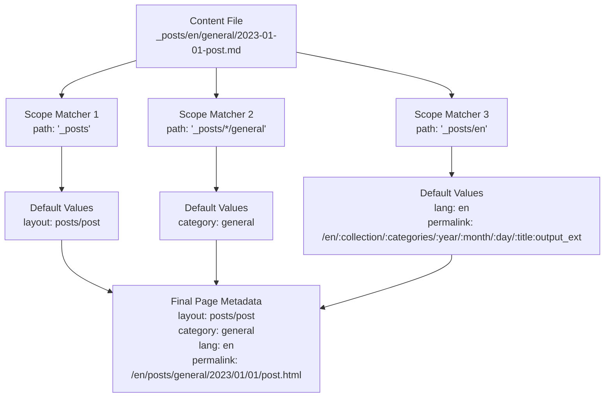
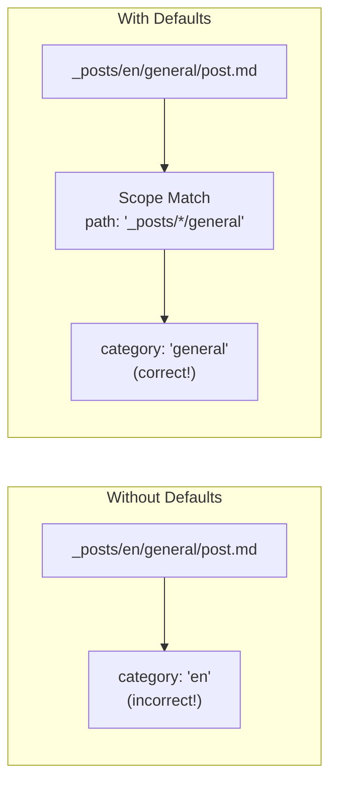
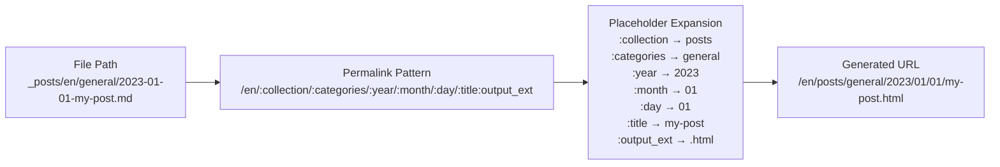
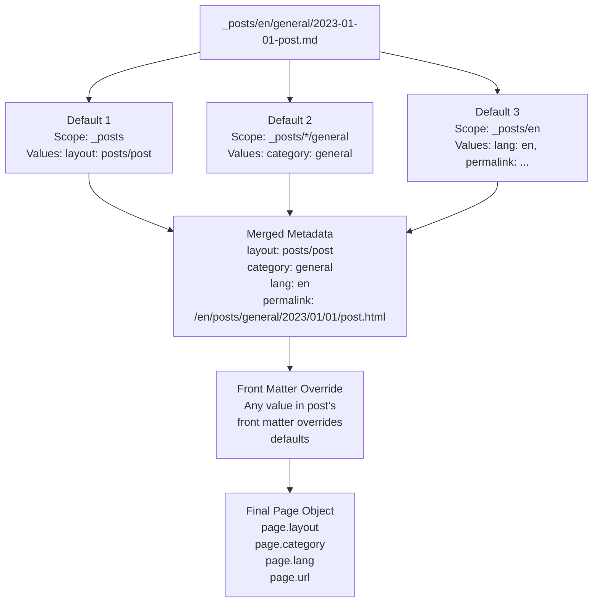
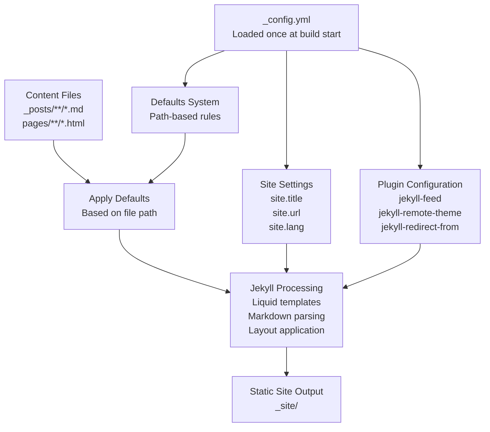

<!-- source: DeepWiki mcp.deepwiki.com · repo termux/termux.github.io · page 3.1 Main Configuration File · fetched 2026-10-26 -->

# Main Configuration File

<details>
<summary>Relevant source files</summary>

The following files were used as context for generating this wiki page:

- [CNAME](CNAME)
- [README.md](README.md)
- [_config.yml](_config.yml)
- [_data/posts/t/en/views.yml](_data/posts/t/en/views.yml)
- [_layouts/posts/index.md](_layouts/posts/index.md)

</details>


## Purpose and Scope

This page documents the [`_config.yml`]() file, which serves as the central configuration file for the entire termux.github.io site. This file controls Jekyll's behavior, defines site-wide settings, configures the multilingual system, establishes the defaults cascade that auto-assigns metadata to content files, and sets up permalink patterns.

For information about local development and Jekyll setup, see [Jekyll and Dependencies](#2.1). For details on translation data organization, see [Translation and Localization Data](#3.2).

## Overview

The [`_config.yml`]() file is Jekyll's primary configuration file that controls all aspects of the static site generation process. Unlike other Jekyll files, changes to this file require a server restart (`ctrl + c` and re-run `bundle exec jekyll serve`) to take effect [_config.yml:8-9]().

The configuration is organized into five major sections:
- **Site Settings**: Global variables accessible via `site.*` in templates
- **Build Settings**: Jekyll processing configuration, themes, and plugins
- **Collections**: Content collection definitions
- **Feed**: RSS feed configuration
- **Defaults**: Path-based automatic metadata assignment

Sources: [_config.yml:1-140](), [README.md:24]()

## Site Settings

### Basic Site Metadata

The site settings section defines global variables accessible throughout the Jekyll templates via Liquid syntax (e.g., `{{ site.title }}`):

| Variable | Value | Purpose |
|----------|-------|---------|
| `title` | "Termux" | Site title displayed in headers and metadata |
| `lang` | "en" | Default language for site |
| `supported_langs` | `[en,cn]` | Array of supported language codes |
| `baseurl` | "" | Subpath for site (empty = site root) |
| `url` | "https://termux.dev" | Base hostname and protocol |
| `site_source` | GitHub URL | Link to source repository |

Sources: [_config.yml:16-21]()

### Social Media Configuration

Social media account information is configured for use in templates, particularly the footer:

```yaml
twitter_username: termuxdevs
mastodon:
  -
    username: termux
    instance: fosstodon.org
github_username: termux
```

The `mastodon` variable uses array syntax to support multiple Mastodon accounts, each with `username` and `instance` properties. These values are referenced in [`_includes/social.html`]() for generating social media links.

Sources: [_config.yml:22-27]()

### GitHub Metadata Plugin

```yaml
github: [metadata]
```

This enables the `jekyll-github-metadata` plugin, which provides access to repository information via the `site.github` namespace [_config.yml:29]().

Sources: [_config.yml:29]()

## Build Settings

### Theme and Plugin Configuration

```yaml
remote_theme: pages-themes/primer@v0.6.0

plugins:
  - jekyll-feed
  - jekyll-remote-theme
  - jekyll-redirect-from
```

| Plugin | Purpose |
|--------|---------|
| `jekyll-remote-theme` | Enables loading themes from remote GitHub repositories |
| `jekyll-feed` | Generates RSS/Atom feeds at `/feed.xml` |
| `jekyll-redirect-from` | Allows pages to redirect from alternative URLs |

The `remote_theme` directive loads the Primer theme from GitHub Pages themes. For more on these plugins, see [Jekyll and Dependencies](#2.1).

Sources: [_config.yml:32-37]()

### Markdown Processing

```yaml
markdown: CommonMarkGhPages
commonmark:
  options: ["GITHUB_PRE_LANG", "FOOTNOTES", "UNSAFE"]
  extensions: ["strikethrough", "autolink", "table", "tagfilter"]
```

The site uses the `CommonMarkGhPages` markdown processor with GitHub-flavored extensions:
- **GITHUB_PRE_LANG**: Adds language class to code blocks
- **FOOTNOTES**: Enables footnote syntax
- **UNSAFE**: Allows raw HTML in markdown (required for complex layouts)
- Extensions enable strikethrough, automatic link detection, tables, and tag filtering

Sources: [_config.yml:39-42]()

### Post Excerpts

```yaml
show_excerpts: true
```

When enabled, this displays the first paragraph of posts in category listing pages via [`_includes/posts/category.html`](). The excerpt is automatically extracted from the post content [_config.yml:53]().

Sources: [_config.yml:53](), [README.md:90]()

## Collections Configuration

```yaml
collections:
  posts:
    output: true
```

The `_posts` collection is explicitly configured with `output: true`, meaning Jekyll will generate individual HTML pages for each post. Posts are the primary content type for the site [_config.yml:44-46]().

Sources: [_config.yml:44-46]()

## Feed Configuration

```yaml
feed:
  categories:
    - general
    - security
```

The `jekyll-feed` plugin generates RSS feeds only for posts in the `general` and `security` categories. Posts in other categories (like `apps` and `packages`) are excluded from the feed [_config.yml:48-51]().

Sources: [_config.yml:48-51]()

## Defaults System Architecture

The defaults system is the most sophisticated part of `_config.yml`. It uses Jekyll's front matter defaults feature to automatically assign metadata to content files based on their file path, eliminating the need for repetitive front matter in individual files.

### How Defaults Work



**Defaults Processing Flow Diagram**

Sources: [_config.yml:55-127](), [README.md:48]()

### Layout Assignment Defaults

The first two defaults assign layouts based on content type:

```yaml
defaults:
  - scope:
      path: "*/docs"
    values:
      layout: "doc"
  - scope:
      path: "_posts"
    values:
      layout: "posts/post"
```

- All files under any `docs/` directory receive `layout: "doc"`
- All files under `_posts/` receive `layout: "posts/post"`

This ensures consistent layout usage without explicit front matter [_config.yml:55-68]().

Sources: [_config.yml:55-68]()

### Language-Based Defaults for Pages

```yaml
defaults:
  - scope:
      path: "en"
    values:
      lang: en
      permalink: /:path/:basename:output_ext
  - scope:
      path: "cn"
    values:
      lang: cn
      permalink: /:path/:basename:output_ext
```

These defaults automatically assign the `lang` variable to pages based on their directory:
- Files in `en/` directory receive `lang: en`
- Files in `cn/` directory receive `lang: cn`

The permalink pattern preserves the directory structure in URLs (e.g., `en/posts/general.html`) [_config.yml:71-84]().

Sources: [_config.yml:71-84]()

### Category Assignment Defaults

The category defaults solve a critical architectural challenge: Jekyll only auto-assigns categories from directory names that appear **above** `_posts/` in the path. Since the site structure is `_posts/<language>/<category>/`, the language would incorrectly become the category.



**Category Assignment Problem and Solution**

The solution uses wildcard path matching:

```yaml
defaults:
  - scope:
      path: "_posts/*/apps"
    values:
      category: apps
  - scope:
      path: "_posts/*/general"
    values:
      category: general
  - scope:
      path: "_posts/*/packages"
    values:
      category: packages
  - scope:
      path: "_posts/*/security"
    values:
      category: security
```

The `*` wildcard matches any language directory, ensuring correct category assignment regardless of language. This is essential because Jekyll's `site.categories` collection depends on the `category` variable being set [_config.yml:87-111]().

Sources: [_config.yml:87-111](), [README.md:48]()

### Language-Based Defaults for Posts

The final defaults assign language and permalink patterns to posts:

```yaml
defaults:
  - scope:
      path: "_posts/en"
    values:
      lang: en
      permalink: /en/:collection/:categories/:year/:month/:day/:title:output_ext
  - scope:
      path: "_posts/cn"
    values:
      lang: cn
      permalink: /cn/:collection/:categories/:year/:month/:day/:title:output_ext
```

Sources: [_config.yml:113-127]()

### Permalink Pattern Expansion

The permalink patterns use Jekyll's placeholder syntax to generate URLs:



**Permalink Pattern Expansion Process**

| Placeholder | Source | Example |
|-------------|--------|---------|
| `:collection` | Collection name (`posts`) | `posts` |
| `:categories` | Category variable (from defaults) | `general` |
| `:year` | Date from filename | `2023` |
| `:month` | Date from filename | `01` |
| `:day` | Date from filename | `01` |
| `:title` | Slug from filename | `my-post` |
| `:output_ext` | Output extension | `.html` |

Sources: [_config.yml:119, 126]()

## Defaults Precedence and Interaction

Multiple defaults can apply to the same file. Jekyll processes them in order and merges the values:



**Defaults Precedence and Merge Process**

- Defaults are applied in the order they appear in `_config.yml`
- Multiple matching scopes have their values merged
- Front matter in individual files always overrides defaults
- The final page object (`page.*`) contains the merged result

Sources: [_config.yml:55-127]()

## Configuration Flow in Build Process



**Configuration Flow in Jekyll Build Process**

The configuration is loaded once when Jekyll starts. It provides:
1. Defaults applied to content files based on their paths
2. Site-wide settings accessible in templates
3. Plugin configuration that affects processing

Note that `_config.yml` is NOT reloaded on file changes during `jekyll serve` - the server must be restarted [_config.yml:8-9]().

Sources: [_config.yml:1-140](), [README.md:24]()

## Adding New Categories

When adding a new category to the site, the defaults system must be updated. The process requires three synchronized changes:

1. **Add category default** in `_config.yml`:
   ```yaml
   - scope:
       path: "_posts/*/<category_name>"
     values:
       category: <category_name>
   ```

2. **Create category page** at `<lang>/posts/<category_name>.html`

3. **Add translations** to `_data/posts/t/<lang>/views.yml`

Without the default configuration, posts will not be added to `site.categories.<category_name>` and will not appear on the category page, even if the post file is placed in the correct directory [README.md:48]().

Sources: [README.md:29-57](), [_config.yml:87-111]()

## Configuration Dependencies

The configuration file is referenced and depended upon by multiple parts of the system:

| Component | Configuration Used |
|-----------|-------------------|
| [`_includes/header.html`]() | `site.title`, `site.supported_langs` |
| [`_includes/footer.html`]() | `site.twitter_username`, `site.mastodon`, `site.github_username` |
| [`_layouts/default.html`]() | `site.url`, `site.baseurl` |
| [`_includes/posts/category.html`]() | `site.categories` (populated via defaults) |
| [`feed.xml`]() | `feed.categories` configuration |
| [`sitemap.xml`]() | `site.url` for absolute URLs |

Sources: [_config.yml:1-140]()

## Excluded Processing Paths

The configuration file contains commented-out `exclude` directives that show which paths Jekyll would normally ignore:

```yaml
# exclude:
#   - Gemfile
#   - Gemfile.lock
#   - node_modules
#   - vendor/bundle/
#   - vendor/cache/
#   - vendor/gems/
#   - vendor/ruby/
```

These paths are excluded by default in Jekyll, so they don't need to be explicitly configured. They prevent development files and dependencies from being included in the generated `_site/` output [_config.yml:129-139]().

Sources: [_config.yml:129-139]()

---

