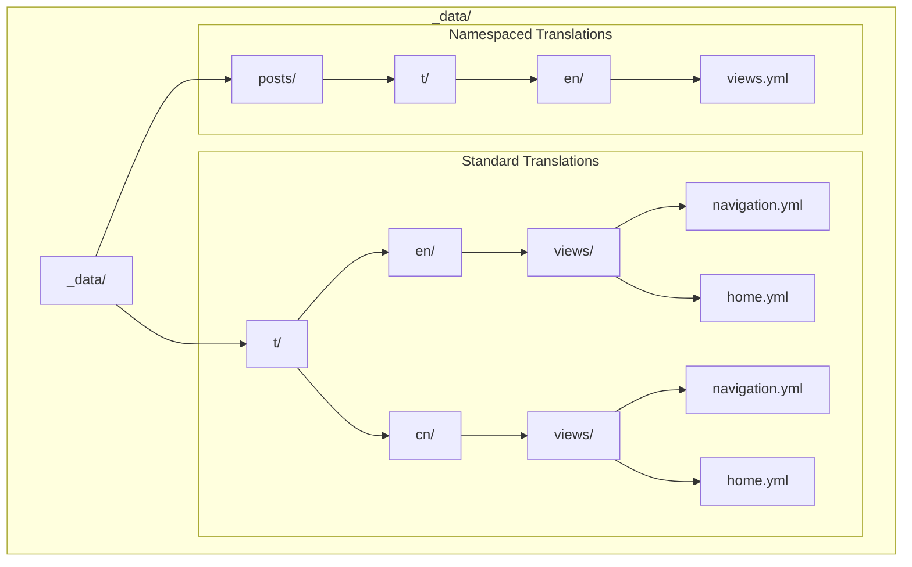
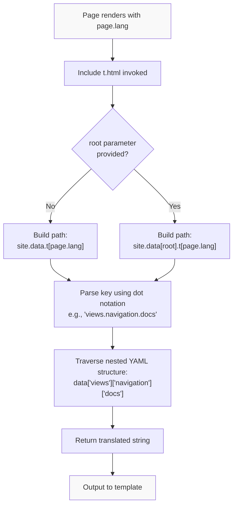
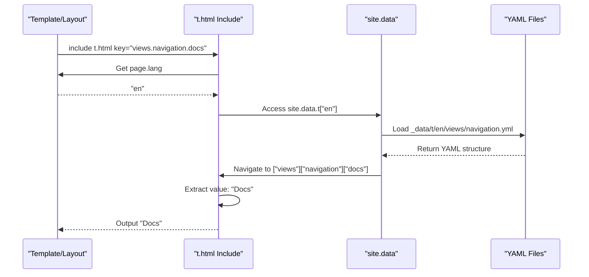
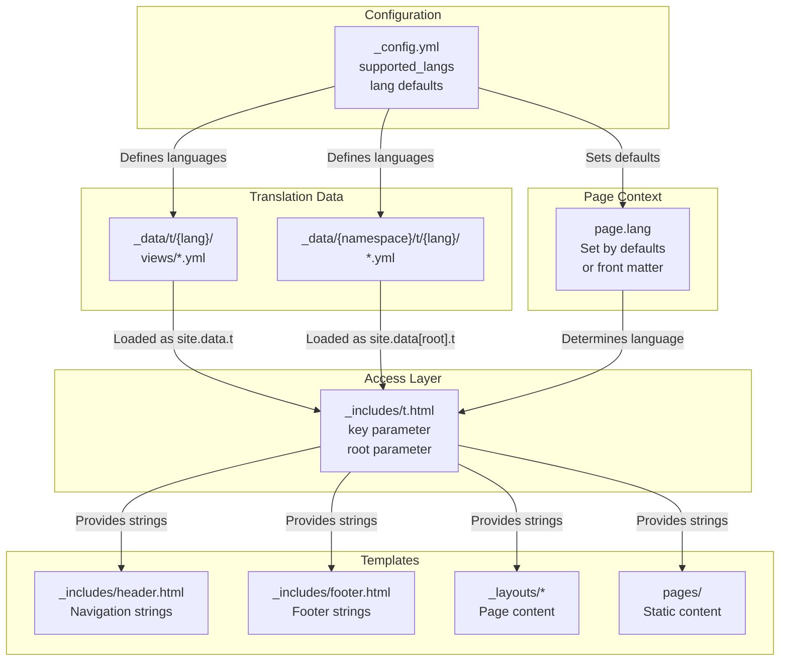

<!-- source: DeepWiki mcp.deepwiki.com · repo termux/termux.github.io · page 3.2 Translation and Localization Data · fetched 2026-10-26 -->

# Translation and Localization Data

<details>
<summary>Relevant source files</summary>

The following files were used as context for generating this wiki page:

- [_config.yml](_config.yml)
- [_data/posts/t/en/views.yml](_data/posts/t/en/views.yml)
- [_data/t/cn/views/home.yml](_data/t/cn/views/home.yml)
- [_data/t/cn/views/navigation.yml](_data/t/cn/views/navigation.yml)
- [_data/t/en/views/navigation.yml](_data/t/en/views/navigation.yml)
- [_includes/header.html](_includes/header.html)
- [_layouts/posts/index.md](_layouts/posts/index.md)
- [index.md](index.md)

</details>


## Purpose and Scope

This document describes the translation and localization data system used in the Termux website. The system enables multilingual support through YAML-based translation files stored in the `_data/t/` directory structure. It covers the organization of translation files, the key hierarchy system, and the `t.html` include mechanism for accessing localized strings throughout the site.

For information about the multilingual content structure and `page_ref` linking system, see [Multilingual Content System](#4.3). For the language selector UI component, see [Header and Navigation](#5.2).

## Translation Directory Structure

Translation data files are organized in a hierarchical directory structure under `_data/t/`, with separate directories for each supported language:

```
_data/
  t/
    en/                    # English translations
      views/
        navigation.yml     # Navigation menu strings
        home.yml          # Homepage strings
    cn/                    # Chinese translations
      views/
        navigation.yml
        home.yml
    {lang}/               # Additional languages
  posts/
    t/
      en/
        views.yml         # Post-related translations
```

### Language Configuration

Supported languages are defined in [`_config.yml:18`]():

```yaml
supported_langs: [en,cn]
```

The default site language is set at [`_config.yml:17`]():

```yaml
lang: en
```

**Sources:** [_config.yml:17-18]()

## Translation File Organization

### Standard Translation Files

Translation files use YAML format with nested key-value pairs. Each file represents a namespace within the translation system.

#### Navigation Translations

The `views/navigation.yml` file contains strings for the site header and footer navigation:

**English** [`_data/t/en/views/navigation.yml:1-12`]():
```yaml
---
# Header
docs: Docs
posts: Posts
packages: Packages
donate: Donate
security: Security
privacy_policy: Privacy Policy

# Footer
description: Terminal emulator and Linux environment for Android.
site_source: Site Source
```

**Chinese** [`_data/t/cn/views/navigation.yml:1-13`]():
```yaml
---
# Header
docs: 文档
posts: 文章
packages: 软件包
donate: 捐赠
security: 安全
privacy_policy: 隐私政策

# Footer
description: 适用于 Android 的终端模拟器和 Linux 环境。
site_source: 站点源码
```

#### Homepage Feature Translations

The `views/home.yml` file contains marketing copy for the homepage features. Example from [`_data/t/cn/views/home.yml:1-50`]():

```yaml
---
intro: >-
  Termux是一个<strong>适用于 Android 的终端模拟器，其环境类似于 Linux 环境</strong>。
  无需Root或设置即可使用。

features:
  secure:
    title: 安全性
    description: >-
      使用来自 OpenSSH 的 ssh 客户端访问远程服务器。
  feature_packed:
    title: 功能丰富
    description: >-
      你可以在 bash、fish 或 zsh 和 nano、Emacs 或 Vim 之间选择。
  # ... additional features
```

**Sources:** [_data/t/en/views/navigation.yml:1-12](), [_data/t/cn/views/navigation.yml:1-13](), [_data/t/cn/views/home.yml:1-50]()

### Namespaced Translation Files

Some translation data uses additional namespace directories beyond the language. For example, post-related translations are organized under `_data/posts/t/{lang}/`:

[`_data/posts/t/en/views.yml:1-12`]():
```yaml
---
index:
  apps: Apps
  general: General
  packages: Packages
  security: Security
  apps_posts: Apps Posts
  general_posts: General Posts
  packages_posts: Packages Posts
  security_posts: Security Posts
  subscribe_to_rss_feed: Subscribe to RSS feed
```

This namespacing allows different sections of the site to maintain separate translation files, reducing conflicts and improving organization.

**Sources:** [_data/posts/t/en/views.yml:1-12]()

## Translation Data Structure



**Sources:** [_data/t/en/views/navigation.yml](), [_data/t/cn/views/navigation.yml](), [_data/posts/t/en/views.yml]()

## The t.html Include System

### Basic Usage

The `t.html` include provides a centralized mechanism for accessing translation strings. It is invoked using Liquid template syntax:

```liquid

```

This retrieves the translation for the key `views.navigation.docs` in the current page's language.

### Usage Examples from Header

The header navigation demonstrates standard translation usage [`_includes/header.html:24`]():

```liquid
<a class="page-link" href="/{{- page.lang -}}/docs/index.html">
  
</a>
```

For the English version, this resolves to "Docs". For Chinese, it resolves to "文档".

Additional examples from [`_includes/header.html:32-58`]():

| Include Call | English Output | Chinese Output |
|--------------|----------------|----------------|
| `` | Posts | 文章 |
| `` | Packages | 软件包 |
| `` | Donate | 捐赠 |
| `` | Security | 安全 |
| `` | Privacy Policy | 隐私政策 |

**Sources:** [_includes/header.html:24-61]()

### Namespaced Translation Access

When accessing translations from namespaced directories (like `_data/posts/t/{lang}/`), the `root` parameter specifies the namespace:

[`_layouts/posts/index.md:7`]():
```liquid

```

This accesses the key `views.index.general` from `_data/posts/t/{lang}/views.yml` instead of the standard `_data/t/{lang}/` location.

Additional examples from the posts index [`_layouts/posts/index.md:7-12`]():

```liquid
[](/{{- page.lang -}}/posts/general.html)
[](/{{- page.lang -}}/posts/apps.html)
[](/{{- page.lang -}}/posts/packages.html)
[](/{{- page.lang -}}/posts/security.html)
```

**Sources:** [_layouts/posts/index.md:7-12]()

## Translation Key Resolution



### Key Resolution Examples

| Key | Root | Resolves To |
|-----|------|-------------|
| `views.navigation.docs` | (none) | `site.data.t[lang].views.navigation.docs` |
| `views.navigation.posts` | (none) | `site.data.t[lang].views.navigation.posts` |
| `views.index.general` | `posts` | `site.data.posts.t[lang].views.index.general` |
| `views.index.apps` | `posts` | `site.data.posts.t[lang].views.index.apps` |

**Sources:** [_includes/header.html:24-58](), [_layouts/posts/index.md:7-12]()

## Translation Integration with Page Language

### Page Language Context

Every page has a `page.lang` attribute that determines which translation set to use. This is set through:

1. **File path defaults** [`_config.yml:72-84`](): Pages under `en/` get `lang: en`, pages under `cn/` get `lang: cn`
2. **Post path defaults** [`_config.yml:114-127`](): Posts under `_posts/en/` get `lang: en`, posts under `_posts/cn/` get `lang: cn`
3. **Front matter override**: Individual pages can specify `lang` in their front matter

### Translation Resolution Flow



**Sources:** [_config.yml:72-127](), [_includes/header.html:24]()

## Language Fallback Mechanism

### Header Language Detection

The header component includes logic to check if a page exists in the current language before rendering links [`_includes/header.html:21-27`]():

```liquid



  <a class="page-link" href="/{{- page.lang -}}/docs/index.html">
    
  </a>

  <a class="page-link" href="/{{- site.lang -}}/docs/index.html">
    
  </a>

```

This pattern:
1. Checks if a page exists in the current `page.lang`
2. If it exists, links to that language version
3. If not, falls back to the site default language (`site.lang`)

The same pattern is applied for all major navigation items: posts, donate, security, and privacy policy pages.

**Sources:** [_includes/header.html:21-61]()

## Adding New Languages

### Required Steps

To add a new language to the translation system:

1. **Update configuration** in [`_config.yml:18`](): Add the language code to `supported_langs` array
   ```yaml
   supported_langs: [en,cn,ru]  # Adding Russian
   ```

2. **Create translation directory structure**:
   ```
   _data/t/ru/
     views/
       navigation.yml
       home.yml
   ```

3. **Create translation files**: Copy and translate content from an existing language
   ```yaml
   # _data/t/ru/views/navigation.yml
   ---
   docs: Документация
   posts: Посты
   packages: Пакеты
   # ... etc
   ```

4. **Create content pages**: Add pages under `ru/` directory with `lang: ru` set via defaults or front matter

5. **Add page path defaults** in [`_config.yml`]():
   ```yaml
   -
     scope:
       path: "ru"
     values:
       lang: ru
       permalink: /:path/:basename:output_ext
   ```

6. **Add post path defaults** for blog content:
   ```yaml
   -
     scope:
       path: "_posts/ru"
     values:
       lang: ru
       permalink: /ru/:collection/:categories/:year/:month/:day/:title:output_ext
   ```

**Sources:** [_config.yml:18](), [_config.yml:72-127]()

## Translation File Maintenance

### Consistency Requirements

All translation files for a given namespace must maintain the same key structure across languages. For example, if `_data/t/en/views/navigation.yml` contains:

```yaml
docs: Docs
posts: Posts
packages: Packages
```

Then `_data/t/cn/views/navigation.yml` must contain the same keys:

```yaml
docs: 文档
posts: 文章
packages: 软件包
```

Missing keys will result in blank output when the `t.html` include attempts to access them.

### Nested Structure Example

Translation files can use nested YAML structures for organization. From [`_data/posts/t/en/views.yml:1-12`]():

```yaml
---
index:
  apps: Apps
  general: General
  packages: Packages
  security: Security
  apps_posts: Apps Posts
  general_posts: General Posts
  packages_posts: Packages Posts
  security_posts: Security Posts
  subscribe_to_rss_feed: Subscribe to RSS feed
```

These nested keys are accessed using dot notation: `views.index.apps`, `views.index.general`, etc.

**Sources:** [_data/posts/t/en/views.yml:1-12](), [_data/t/en/views/navigation.yml:1-12](), [_data/t/cn/views/navigation.yml:1-13]()

## System Architecture Summary



**Sources:** [_config.yml:17-18](), [_config.yml:72-127](), [_data/t/en/views/navigation.yml](), [_data/t/cn/views/navigation.yml](), [_data/posts/t/en/views.yml](), [_includes/header.html:24-58](), [_layouts/posts/index.md:7-12]()

---

