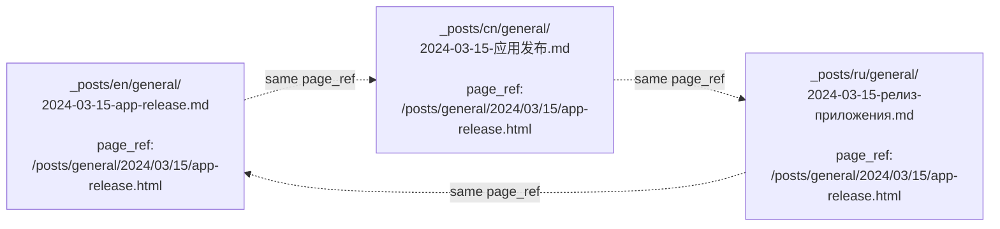
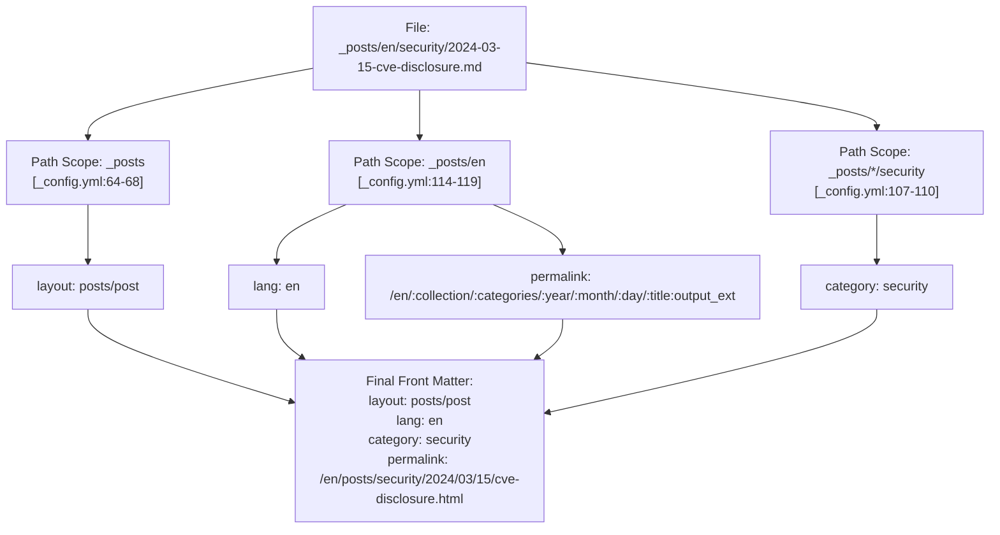
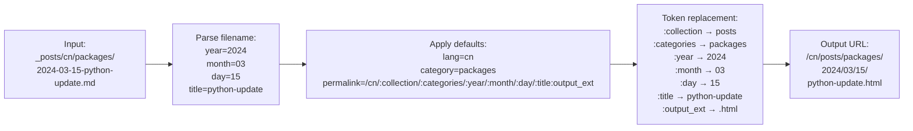
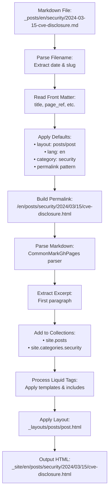

<!-- source: DeepWiki mcp.deepwiki.com · repo termux/termux.github.io · page 4 Content Management · fetched 2026-10-26 -->

# Content Management

<details>
<summary>Relevant source files</summary>

The following files were used as context for generating this wiki page:

- [CNAME](CNAME)
- [README.md](README.md)
- [_config.yml](_config.yml)
- [_data/posts/t/en/views.yml](_data/posts/t/en/views.yml)
- [_layouts/posts/index.md](_layouts/posts/index.md)

</details>


This document covers the content creation and organization system for the Termux website, including how posts are structured, categorized, and processed through Jekyll's build pipeline. This includes the file organization conventions, front matter requirements, default metadata assignment, permalink generation, and asset management for blog posts and pages.

For information about category-specific functionality and filtering, see [Category System](#4.2). For details on multilingual content architecture and translation linking, see [Multilingual Content System](#4.3). For static pages and redirect mechanisms, see [Pages and Redirects](#4.4). For the overall Jekyll configuration that enables these systems, see [Main Configuration File](#3.1).

---

## Content Organization Structure

The content in the termux.github.io repository is organized using a hierarchical directory structure that combines language separation with category organization. All blog posts reside under the `_posts/` directory, which is a Jekyll convention for blog content.

### Directory Hierarchy

```
_posts/
├── en/                          # English language posts
│   ├── general/                 # General category
│   │   └── YYYY-MM-DD-title.md
│   ├── apps/                    # Apps category
│   │   └── YYYY-MM-DD-title.md
│   ├── packages/                # Packages category
│   │   └── YYYY-MM-DD-title.md
│   └── security/                # Security category
│       └── YYYY-MM-DD-title.md
└── cn/                          # Chinese language posts
    ├── general/
    ├── apps/
    ├── packages/
    └── security/
```

The structure follows a two-level nesting pattern: **language first, then category**. This organization ensures clear separation between language-specific content while maintaining consistent categorization across all languages.

**File Naming Convention**: `YYYY-MM-DD-POST_TITLE.md`

| Component | Description | Example |
|-----------|-------------|---------|
| `YYYY` | 4-digit year | `2024` |
| `MM` | 2-digit month | `03` |
| `DD` | 2-digit day | `15` |
| `POST_TITLE` | URL-friendly slug | `termux-app-v0.119.0-release` |

The date components are mandatory and determine the post's chronological ordering and URL structure. Jekyll automatically parses these dates from the filename.

**Sources**: [_config.yml:87-126](), [README.md:29-93]()

---

## Front Matter Requirements

Every post file must begin with YAML front matter enclosed in triple dashes. The front matter contains metadata that Jekyll uses to process and render the content.

### Required Front Matter Fields

```yaml
---
title: "Post Title"
page_ref: /posts/<category>/YYYY/MM/DD/<post_basename>.html
---
```

| Field | Type | Purpose | Example |
|-------|------|---------|---------|
| `title` | String | Display title (language-specific) | `"Termux App v0.119.0 Released"` |
| `page_ref` | String | Language-agnostic path identifier | `/posts/general/2024/03/15/app-release.html` |

### Optional Front Matter Fields

```yaml
---
title: "Post Title"
page_ref: /posts/<category>/YYYY/MM/DD/<post_basename>.html
last_modified_at: YYYY-MM-DD HH:MM:SS +ZONE
author: Author Name
---
```

| Field | Purpose |
|-------|---------|
| `last_modified_at` | Update timestamp for the post |
| `author` | Author attribution |

### Auto-Assigned Fields

The following fields are **automatically assigned** by Jekyll based on file path and do not need to be included in front matter:

- `lang` - Assigned based on `_posts/<lang>/` directory
- `category` - Assigned based on `_posts/*/<category>/` directory
- `layout` - Defaults to `posts/post` for all `_posts` files

**Sources**: [README.md:77-93](), [_config.yml:55-127]()

---

## The `page_ref` System

The `page_ref` field is critical for the multilingual architecture. It serves as a **language-agnostic identifier** that links all translations of the same post together.

### Purpose



**Key Characteristics**:

1. **Language-independent**: Uses English filename structure regardless of actual filename
2. **Absolute path**: Always starts with `/posts/`
3. **Consistent across translations**: All language versions share the same `page_ref`
4. **URL structure**: `/posts/<category>/YYYY/MM/DD/<post_basename>.html`

This system enables:
- Language switcher functionality in the header
- SEO optimization with `xhtml:link` alternate tags
- Sitemap generation with translation links

**Note**: The actual rendered URLs include the language prefix (e.g., `/en/posts/...`), but `page_ref` omits it to maintain language-agnosticism.

**Sources**: [README.md:92-93]()

---

## Defaults System

Jekyll's defaults system automatically assigns front matter values based on file path patterns, eliminating repetitive manual configuration. This is configured in `_config.yml` under the `defaults` key.

### Default Assignment Flow



### Configuration Breakdown

#### 1. Layout Assignment

All files under `_posts` receive the `posts/post` layout automatically:

```yaml
defaults:
  - scope:
      path: "_posts"
    values:
      layout: "posts/post"
```

**Source**: [_config.yml:64-68]()

#### 2. Language and Permalink Assignment

Language-specific defaults apply based on the first directory under `_posts/`:

| Scope Path | Assigned Values |
|------------|-----------------|
| `_posts/en` | `lang: en`<br/>`permalink: /en/:collection/:categories/:year/:month/:day/:title:output_ext` |
| `_posts/cn` | `lang: cn`<br/>`permalink: /cn/:collection/:categories/:year/:month/:day/:title:output_ext` |

**Source**: [_config.yml:114-127]()

**Permalink Token Expansion**:
- `:collection` → `posts`
- `:categories` → The assigned category (e.g., `security`)
- `:year/:month/:day` → Parsed from filename
- `:title` → Post slug from filename
- `:output_ext` → `.html`

**Example**: File `_posts/en/security/2024-03-15-cve-disclosure.md` generates permalink:
`/en/posts/security/2024/03/15/cve-disclosure.html`

#### 3. Category Assignment

Category defaults are critical because they populate the `site.categories` collection used for filtering:

```yaml
defaults:
  - scope:
      path: "_posts/*/apps"
    values:
      category: apps
  - scope:
      path: "_posts/*/general"
    values:
      category: general
  - scope:
      path: "_posts/*/packages"
    values:
      category: packages
  - scope:
      path: "_posts/*/security"
    values:
      category: security
```

**Why This Is Required**: Jekyll's `site.categories` collection only includes posts with an assigned `category` value. Without these defaults, posts would not appear in category listings even if placed in the correct directory.

The `*/` wildcard pattern matches any language directory, ensuring categories work across all languages.

**Source**: [_config.yml:87-111]()

---

## Permalink Generation

Permalinks define the final URL structure for each post. The generation process combines Jekyll's permalink tokens with the defaults system.

### Permalink Structure

```
/{lang}/posts/{category}/{year}/{month}/{day}/{title}.html
```

### Token Replacement Table

| Token | Source | Example Value |
|-------|--------|---------------|
| `{lang}` | Front matter or defaults | `en`, `cn` |
| `posts` | Literal from `:collection` | `posts` |
| `{category}` | Front matter or defaults | `security`, `general` |
| `{year}` | Filename | `2024` |
| `{month}` | Filename | `03` |
| `{day}` | Filename | `15` |
| `{title}` | Filename slug | `app-release` |

### Processing Example



### Alternative Permalink Patterns

For non-post pages (static pages under `en/` and `cn/` directories), a simpler permalink pattern is used:

```yaml
defaults:
  - scope:
      path: "en"
    values:
      lang: en
      permalink: /:path/:basename:output_ext
```

This preserves the directory structure without date-based segmentation.

**Source**: [_config.yml:72-85]()

---

## Asset Management

Posts can reference external assets such as images, PDFs, or other files. These assets should be organized alongside the post content but in a separate directory structure.

### Asset Directory Structure

```
assets/
└── posts/
    ├── globals/              # Language-agnostic assets
    │   └── {category}/
    │       └── YYYY-MM-DD-post-title/
    │           ├── image.png
    │           └── document.pdf
    └── {lang}/               # Language-specific assets
        └── {category}/
            └── YYYY-MM-DD-post-title/
                └── localized-image.png
```

### Asset Path Conventions

| Asset Type | Location | Example |
|------------|----------|---------|
| Global (shared across languages) | `assets/posts/globals/{category}/YYYY-MM-DD-post-title/` | `assets/posts/globals/general/2024-03-15-app-release/screenshot.png` |
| Language-specific | `assets/posts/{lang}/{category}/YYYY-MM-DD-post-title/` | `assets/posts/cn/general/2024-03-15-app-release/本地化图片.png` |

### Linking to Assets in Posts

**Markdown image syntax**:
```markdown

```

**Markdown link syntax**:
```markdown
[Download PDF](/assets/posts/globals/security/2024-03-15-security-advisory/advisory.pdf)
```

The leading `/` ensures the path is resolved from the site root, regardless of the post's permalink depth.

**Sources**: [README.md:88-89]()

---

## Post Excerpts

Jekyll automatically generates excerpts from posts, which are displayed in category listing pages. The excerpt system is controlled by two mechanisms:

### Configuration

In `_config.yml`:
```yaml
show_excerpts: true
```

This enables excerpt display throughout the site.

**Source**: [_config.yml:53]()

### Excerpt Behavior

**Default behavior**: Jekyll treats the **first paragraph** of the post (content before the first blank line) as the excerpt.

**Best practice**: Ensure the first paragraph is a concise, standalone summary of the post content, as this text will appear in:
- Category listing pages (via `category.html` include)
- RSS feeds
- Search engine descriptions (if meta tags are generated from excerpts)

**Example post structure**:
```markdown
---
title: "Termux App v0.119.0 Released"
page_ref: /posts/general/2024/03/15/app-release.html
---

This release includes major UI improvements, bug fixes, and performance optimizations.

## Download

The app is available on F-Droid...

## Changes

- Fixed crash on Android 14
- Improved terminal rendering
...
```

The excerpt would be: "This release includes major UI improvements, bug fixes, and performance optimizations."

**Sources**: [README.md:90-91](), [_config.yml:53]()

---

## Content Processing Pipeline

This section describes the complete flow from markdown file to rendered HTML output, integrating all the systems described above.



### Pipeline Stages

#### Stage 1: Filename Parsing
Jekyll extracts the date and title slug from the filename following the `YYYY-MM-DD-title` pattern.

#### Stage 2: Front Matter Processing
The YAML front matter is parsed and merged with applicable defaults from `_config.yml`.

#### Stage 3: Defaults Application
Path-based scopes in `_config.yml` match the file location and assign:
- `layout`
- `lang`
- `category`
- `permalink` pattern

#### Stage 4: Permalink Construction
Jekyll replaces permalink tokens (`:collection`, `:categories`, `:year`, etc.) with actual values to generate the final URL.

#### Stage 5: Markdown Parsing
Content is parsed using the CommonMarkGhPages renderer with these options:
- `GITHUB_PRE_LANG`: GitHub-flavored code blocks
- `FOOTNOTES`: Footnote syntax support
- `UNSAFE`: Allow raw HTML
- Extensions: `strikethrough`, `autolink`, `table`, `tagfilter`

**Source**: [_config.yml:39-42]()

#### Stage 6: Excerpt Extraction
The first paragraph becomes the post excerpt if `show_excerpts: true`.

#### Stage 7: Collections Population
The post is added to:
- `site.posts`: All posts chronologically
- `site.categories.{category}`: Category-specific collection

#### Stage 8: Liquid Processing
Liquid template tags and includes are processed, enabling dynamic content insertion.

#### Stage 9: Layout Application
The `posts/post.html` layout wraps the content, which itself inherits from `default.html`.

#### Stage 10: HTML Output
The final HTML file is written to `_site/{lang}/posts/{category}/{year}/{month}/{day}/{title}.html`.

**Sources**: [_config.yml:39-127](), [README.md:75-93]()

---

## Integration with Other Systems

The content management system interfaces with several other site components:

### Category System Integration
Posts with assigned categories populate `site.categories.{category}` collections, which are consumed by the `category.html` include to generate category listing pages. See [Category System](#4.2) for details.

### Multilingual System Integration
The `lang` front matter and `page_ref` system enable language switching and alternate language linking. See [Multilingual Content System](#4.3) for implementation details.

### Feed Generation
Posts in specific categories are included in RSS feeds:
```yaml
feed:
  categories:
    - general
    - security
```
**Source**: [_config.yml:48-51]()

### Layout System Integration
All posts use the `posts/post.html` layout, which inherits from `default.html` and includes header/footer components. See [Layout System](#5.1) for details.

**Sources**: [_config.yml:48-51](), [_config.yml:64-68]()

---

