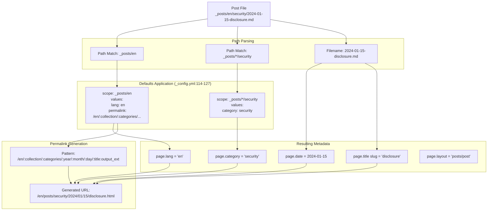
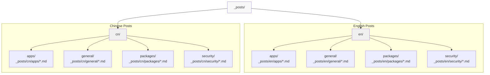
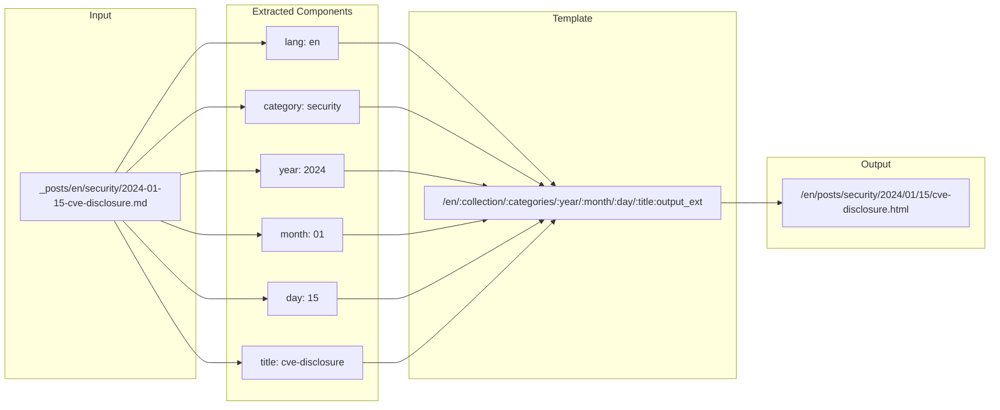
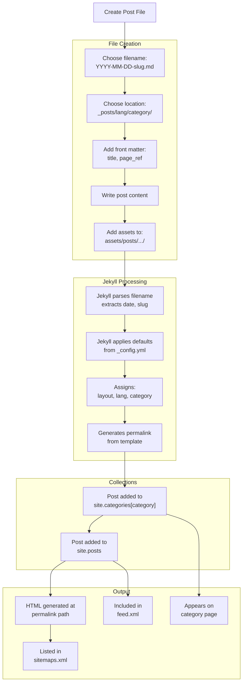

<!-- source: DeepWiki mcp.deepwiki.com · repo termux/termux.github.io · page 4.1 Creating and Organizing Posts · fetched 2026-10-26 -->

# Creating and Organizing Posts

<details>
<summary>Relevant source files</summary>

The following files were used as context for generating this wiki page:

- [CNAME](CNAME)
- [README.md](README.md)
- [_config.yml](_config.yml)
- [_data/posts/t/en/views.yml](_data/posts/t/en/views.yml)
- [_layouts/posts/index.md](_layouts/posts/index.md)

</details>


## Purpose and Scope

This document explains how to create and organize blog posts in the termux.github.io repository. It covers the file naming conventions, directory structure, front matter requirements, and the automatic metadata assignment system through Jekyll defaults. Posts in this system are organized by language and category, with Jekyll automatically deriving metadata from file paths.

For information about the category system and how posts are displayed on category pages, see [Category System](#4.2). For details on the multilingual architecture and language-specific features, see [Multilingual Content System](#4.3). For the complete configuration of the defaults system, see [Main Configuration File](#3.1).

---

## Post File Structure and Naming Convention

Posts must follow a strict file naming pattern: `YYYY-MM-DD-title.md`, where:
- `YYYY` is the 4-digit year
- `MM` is the 2-digit month (01-12)
- `DD` is the 2-digit day (01-31)
- `title` is the URL slug for the post

The date components in the filename determine the post's publication date and are used in the generated permalink. Jekyll will not process files that don't follow this naming pattern as posts.

### Directory Path Pattern

Posts are organized in a hierarchical directory structure that encodes both language and category information:

```
_posts/<language>/<category>/YYYY-MM-DD-title.md
```

For example:
- `_posts/en/general/2024-01-15-welcome.md`
- `_posts/cn/security/2024-02-20-vulnerability-disclosure.md`
- `_posts/en/packages/2024-03-10-new-package-release.md`

This directory structure is not arbitrary; it drives the automatic metadata assignment system described in later sections.

**Sources:** [README.md:77-78](), [_config.yml:88-127]()

---

## Front Matter Requirements

Every post must include front matter at the beginning of the file. The minimum required front matter is:

```yaml
---
title: "Post Title"
page_ref: /posts/<category>/YYYY/MM/DD/<post_basename>.html
---
```

### Required Front Matter Fields

#### `title`
The human-readable title of the post. This should be language-specific for translations.

#### `page_ref`
A language-agnostic identifier that uniquely identifies this post across all translations. All translations of a post must share the same `page_ref` value. The format is:

```
/posts/<category>/YYYY/MM/DD/<post_basename>.html
```

For example, both `_posts/en/general/2024-01-15-welcome.md` and `_posts/cn/general/2024-01-15-welcome.md` would have:

```yaml
page_ref: /posts/general/2024/01/15/welcome.html
```

This field enables the language selector in the header to find alternate translations and allows search engines to index translations correctly through `xhtml:link` alternate tags.

### Optional Front Matter Fields

#### `last_modified_at`
Timestamp indicating when the post was last updated:

```yaml
last_modified_at: 2024-01-20 10:30:00 +0000
```

#### `author`
The author of the post:

```yaml
author: "Author Name"
```

### Auto-Assigned Fields

The following fields are automatically assigned by Jekyll's defaults system and should NOT be included in the front matter:
- `layout` - automatically set to `posts/post`
- `lang` - automatically derived from the directory path
- `category` - automatically derived from the directory path
- `permalink` - automatically generated from the permalink pattern

**Sources:** [README.md:79-86](), [README.md:91-92](), [_config.yml:64-68]()

---

## Post File Location to Metadata Mapping

The following diagram illustrates how Jekyll's defaults system maps file paths to metadata values:



**Sources:** [_config.yml:55-127](), [README.md:48-68]()

---

## Directory Structure Overview

The complete post organization structure with all supported languages and categories:



**Sources:** [_config.yml:88-127](), [README.md:29-48]()

---

## Defaults System Configuration

Jekyll's defaults system in `_config.yml` automatically assigns metadata based on file path patterns. This eliminates the need to repeat common metadata in every post's front matter.

### Post Layout Assignment

All files under the `_posts` directory automatically receive the `posts/post` layout:

[_config.yml:64-68]()

```yaml
defaults:
  -
    scope:
      path: "_posts"
    values:
      layout: "posts/post"
```

### Language Assignment

Language-specific defaults assign the `lang` variable and configure the permalink pattern:

[_config.yml:114-127]()

```yaml
defaults:
  -
    scope:
      path: "_posts/en"
    values:
      lang: en
      permalink: /en/:collection/:categories/:year/:month/:day/:title:output_ext
  -
    scope:
      path: "_posts/cn"
    values:
      lang: cn
      permalink: /cn/:collection/:categories/:year/:month/:day/:title:output_ext
```

### Category Assignment

Category-specific defaults assign the `category` variable, which is critical for:
1. Populating the `site.categories` collection
2. Including the category in the permalink
3. Filtering posts on category pages

[_config.yml:88-111]()

```yaml
defaults:
  -
    scope:
      path: "_posts/*/apps"
    values:
      category: apps
  -
    scope:
      path: "_posts/*/general"
    values:
      category: general
  -
    scope:
      path: "_posts/*/packages"
    values:
      category: packages
  -
    scope:
      path: "_posts/*/security"
    values:
      category: security
```

### Why Category Defaults Are Required

The README explains the rationale for explicit category defaults:

> This is required because otherwise jekyll will not assign the `category` automatically to the posts and posts will not be added to the `site.categories` used by [`category.html`](_includes/category.html) and so posts won't show for the category.

An alternative approach would place posts at `<category>/_posts/` so Jekyll automatically assigns the category, but this conflicts with the required `_posts/<language>` structure.

**Sources:** [_config.yml:55-127](), [README.md:48-49]()

---

## Permalink Generation Pattern

The permalink pattern defined in the defaults system determines the final URL structure for posts. 

### Permalink Template Tokens

The permalink pattern uses Jekyll's built-in tokens:

```
/<language>/:collection/:categories/:year/:month/:day/:title:output_ext
```

Token resolution:
- `<language>` - literal language code (en, cn)
- `:collection` - resolves to "posts" for the `_posts` collection
- `:categories` - resolves to the post's category (apps, general, packages, security)
- `:year` - 4-digit year from filename
- `:month` - 2-digit month from filename
- `:day` - 2-digit day from filename
- `:title` - URL slug from filename
- `:output_ext` - resolves to ".html"

### Example Permalink Generation



**Sources:** [_config.yml:119-126](), [README.md:77-78]()

---

## Asset Organization

Assets (images, files, attachments) used by posts should be organized in language-specific or global directories.

### Asset Directory Structure

Assets can be placed in two locations:

1. **Global assets** (shared across language translations):
   ```
   assets/posts/globals/<category>/YYYY-MM-DD-title/
   ```

2. **Language-specific assets**:
   ```
   assets/posts/<language>/<category>/YYYY-MM-DD-title/
   ```

The directory name should match the post filename (without the `.md` extension).

### Linking to Assets

Reference assets in post markdown using relative or absolute paths:

```markdown
[Download File](/assets/posts/globals/general/2024-01-15-release/release-notes.txt)


```

**Sources:** [README.md:88]()

---

## Post Excerpts

The first paragraph of each post is automatically used as an excerpt in post listings. This is controlled by the `show_excerpts` configuration:

[_config.yml:53]()

```yaml
show_excerpts: true
```

When writing posts, ensure the first paragraph provides a concise summary of the post content. This excerpt appears on:
- Category listing pages
- The main posts index
- RSS feed entries

The excerpt is extracted by Jekyll automatically and made available as `post.excerpt` in templates. The `category.html` include uses this to display post summaries on category pages.

**Sources:** [_config.yml:53](), [README.md:90]()

---

## Complete Post Creation Workflow

The following diagram shows the complete workflow from creating a post file to its appearance on the site:



**Sources:** [README.md:73-93](), [_config.yml:44-127]()

---

## Validation Checklist

Before committing a new post, verify:

| Check | Requirement | Why |
|-------|------------|-----|
| Filename format | `YYYY-MM-DD-slug.md` | Jekyll post detection |
| Directory path | `_posts/<lang>/<category>/` | Automatic metadata assignment |
| `title` in front matter | Present and descriptive | Display on pages |
| `page_ref` in front matter | Present, matches pattern | Translation linking, SEO |
| `page_ref` consistency | Same across all translations | Language switcher functionality |
| First paragraph | Concise summary | Used as excerpt |
| Asset placement | In appropriate directory | Organization, maintenance |
| No manual `layout` | Omitted from front matter | Applied by defaults |
| No manual `lang` | Omitted from front matter | Applied by defaults |
| No manual `category` | Omitted from front matter | Applied by defaults |

**Sources:** [README.md:73-93](), [_config.yml:55-127]()

---

## Supported Categories

Currently supported categories as defined in the defaults configuration:

| Category | Path Pattern | Purpose |
|----------|-------------|---------|
| `apps` | `_posts/*/apps` | Posts about Termux applications |
| `general` | `_posts/*/general` | General announcements and updates |
| `packages` | `_posts/*/packages` | Package-related posts |
| `security` | `_posts/*/security` | Security advisories and updates |

Each category must have:
1. A defaults entry in `_config.yml` for automatic category assignment
2. A category page file at `<language>/posts/<category>.html`
3. Translation entries in `_data/posts/t/<language>/views.yml`

For information on adding new categories, see [Category System](#4.2).

**Sources:** [_config.yml:88-111](), [_data/posts/t/en/views.yml:1-12](), [README.md:29-68]()

---

## Supported Languages

Currently supported languages as defined in the site configuration:

[_config.yml:18]()
```yaml
supported_langs: [en,cn]
```

Each language requires:
1. A defaults entry in `_config.yml` for language and permalink assignment
2. A directory at `_posts/<language>/`
3. Translation data files at `_data/t/<language>/`
4. Category pages at `<language>/posts/`

For details on the multilingual system, see [Multilingual Content System](#4.3).

**Sources:** [_config.yml:18](), [_config.yml:114-127]()

---

