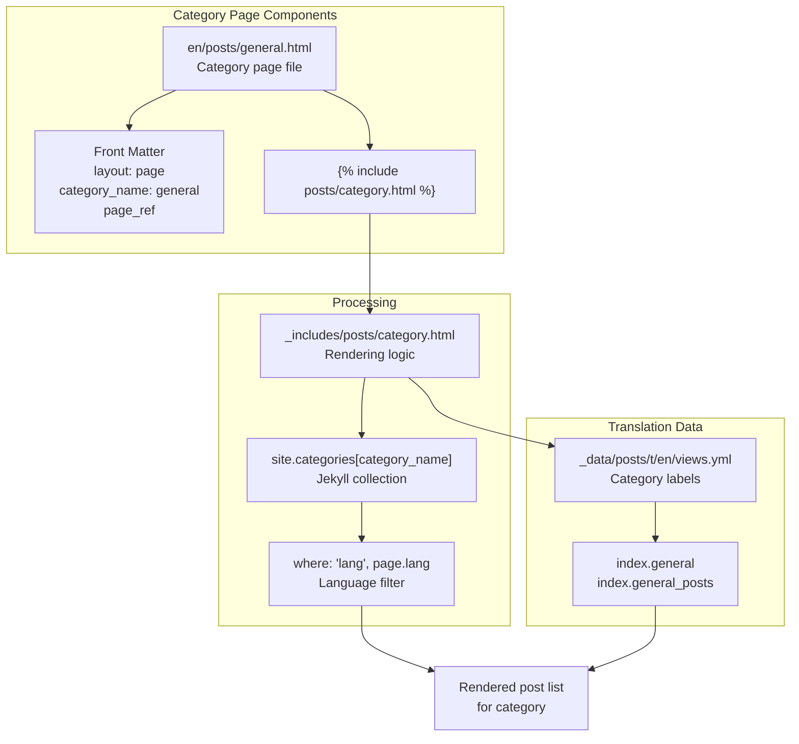
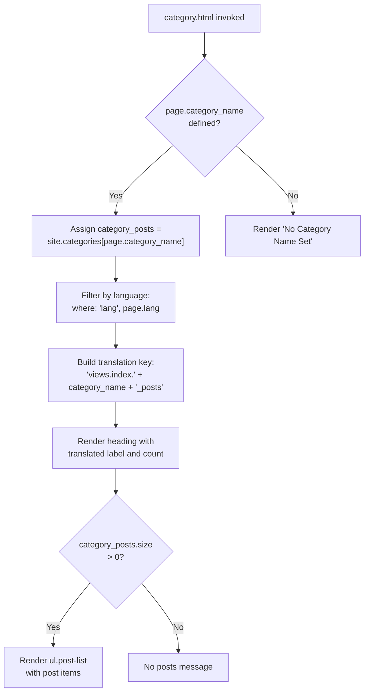
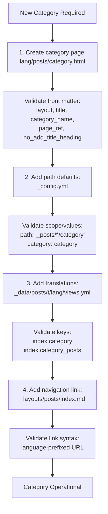
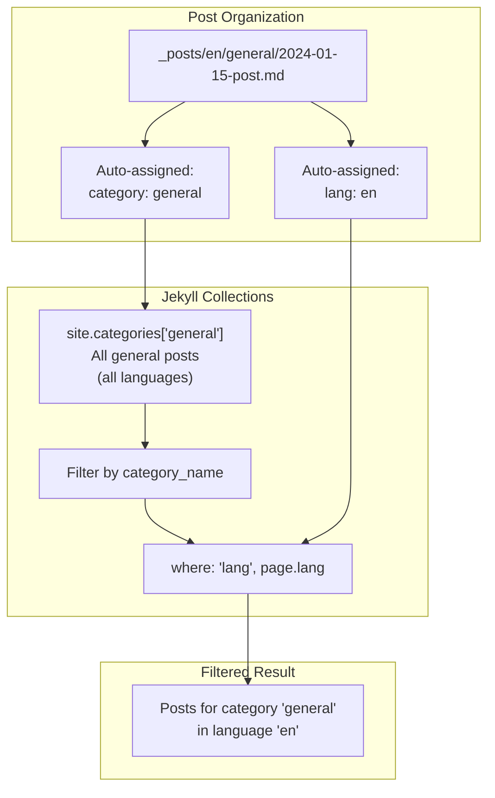

<!-- source: DeepWiki mcp.deepwiki.com · repo termux/termux.github.io · page 4.2 Category System · fetched 2026-10-26 -->

# Category System

<details>
<summary>Relevant source files</summary>

The following files were used as context for generating this wiki page:

- [CNAME](CNAME)
- [README.md](README.md)
- [_config.yml](_config.yml)
- [_data/posts/t/en/views.yml](_data/posts/t/en/views.yml)
- [_includes/posts/category.html](_includes/posts/category.html)
- [_includes/utils/datetime/format.html](_includes/utils/datetime/format.html)
- [_layouts/posts/index.md](_layouts/posts/index.md)
- [_layouts/posts/post.html](_layouts/posts/post.html)
- [en/posts/apps.html](en/posts/apps.html)
- [en/posts/general.html](en/posts/general.html)
- [en/posts/packages.html](en/posts/packages.html)

</details>


## Purpose and Scope

This document explains how the category system organizes blog posts in the Termux website. Categories group related posts (e.g., `general`, `apps`, `packages`, `security`) and provide dedicated pages that list all posts within each category. The system integrates with Jekyll's built-in `site.categories` collection and the multilingual architecture to provide language-specific category pages.

For information about creating and organizing individual posts, see [Creating and Organizing Posts](#4.1). For the multilingual architecture that works alongside the category system, see [Multilingual Content System](#4.3).

---

## Category Definition and Auto-Assignment

Categories are defined and auto-assigned through Jekyll's defaults system in `_config.yml`. Posts are not required to manually specify their category in front matter; instead, Jekyll automatically assigns categories based on the directory path where posts are located.

### Category Path-Based Assignment

The configuration defines four categories with automatic assignment rules:

| Category | Path Pattern | Purpose |
|----------|-------------|---------|
| `apps` | `_posts/*/apps` | Posts about Termux applications |
| `general` | `_posts/*/general` | General announcements and news |
| `packages` | `_posts/*/packages` | Package-related updates |
| `security` | `_posts/*/security` | Security advisories and updates |

The wildcard `*` in path patterns matches any language directory (e.g., `en`, `cn`, `ru`), ensuring categories work across all languages.

**Configuration Structure:**

```yaml
defaults:
  - scope:
      path: "_posts/*/apps"
    values:
      category: apps
  - scope:
      path: "_posts/*/general"
    values:
      category: general
```

This pattern is repeated for each category. When a post file is placed in `_posts/en/general/2024-01-15-announcement.md`, Jekyll automatically assigns `category: general` to the post's metadata, adding it to `site.categories['general']`.

**Sources:** [_config.yml:87-111]()

### Why Path-Based Assignment is Required

Without these defaults, Jekyll would not automatically populate `site.categories` from the directory structure. The README explains: "This is required because otherwise jekyll will not assign the `category` automatically to the posts and posts will not be added to the `site.categories` used by `category.html` and so posts won't show for the category."

The alternative directory structure `<category_name>/_posts/` would auto-assign categories, but conflicts with the requirement for language-based organization (`_posts/<language>/`).

**Sources:** [README.md:48](), [_config.yml:87-111]()

---

## Category Page Architecture

Each category requires a dedicated page file that renders the list of posts for that category. These pages follow a consistent structure across all languages and categories.

### Category Page File Structure



**Sources:** [en/posts/general.html:1-10](), [_includes/posts/category.html:1-35]()

### Required Front Matter Fields

Each category page file requires these front matter fields:

| Field | Purpose | Example Value |
|-------|---------|---------------|
| `layout` | Specifies the layout template | `page` |
| `title` | Page title (language-specific) | `"General Posts"` |
| `no_add_title_heading` | Prevents duplicate heading | `true` |
| `category_name` | Category identifier for filtering | `general` |
| `page_ref` | Language-agnostic reference | `/posts/general.html` |

The `category_name` field is critical—it's used by `category.html` to query `site.categories[page.category_name]` for posts.

**Sources:** [en/posts/general.html:1-10](), [en/posts/apps.html:1-10](), [en/posts/packages.html:1-10]()

---

## Category Display Implementation

The `_includes/posts/category.html` include handles the rendering logic for category pages. It filters posts by category and language, then displays them in a formatted list.

### Category Filtering Logic



**Sources:** [_includes/posts/category.html:1-35]()

### Post List Rendering

For each post in the filtered list, the template displays:

1. **Post Title** - Linked to the post URL
2. **Creation Date** - Formatted using `utils/datetime/format.html`
3. **Last Modified Date** - If `post.last_modified_at` is set
4. **Author** - If `post.author` is set
5. **Excerpt** - If `site.show_excerpts` is enabled

The rendering code at [_includes/posts/category.html:9-27]() iterates through `category_posts` and constructs each list item with metadata and optional excerpt.

### Translation Key Structure

Category labels require two translation keys per category:

| Key Pattern | Purpose | Example |
|------------|---------|---------|
| `views.index.<category>` | Category link label | `views.index.general` → "General" |
| `views.index.<category>_posts` | Category page heading | `views.index.general_posts` → "General Posts" |

These translations are defined in `_data/posts/t/<lang>/views.yml` for each language.

**Sources:** [_includes/posts/category.html:5-6](), [_data/posts/t/en/views.yml:1-12]()

---

## Category Integration with Site Navigation

Categories are exposed to users through the posts index page, which lists all available categories as navigation links.

### Posts Index Structure

The `_layouts/posts/index.md` file generates a navigation menu linking to each category page:

```markdown
- [](/{{- page.lang -}}/posts/general.html)
- [](/{{- page.lang -}}/posts/apps.html)
- [](/{{- page.lang -}}/posts/packages.html)
- [](/{{- page.lang -}}/posts/security.html)
```

Each link uses the `t.html` include to fetch the localized category name and constructs a language-prefixed URL (e.g., `/en/posts/general.html`).

**Sources:** [_layouts/posts/index.md:5-10]()

### Category URL Structure

Category page URLs follow this pattern:

```
/<language>/posts/<category>.html
```

Examples:
- `/en/posts/general.html` - English general category
- `/cn/posts/packages.html` - Chinese packages category

The `page_ref` field in category page front matter uses a language-agnostic path (`/posts/general.html`) that enables language switching (see [Multilingual Content System](#4.3)).

**Sources:** [en/posts/general.html:6](), [_layouts/posts/index.md:7]()

---

## Adding New Categories

Adding a new category requires four coordinated steps across multiple files. The README provides detailed instructions for this workflow.

### Step-by-Step Category Addition Process



**Sources:** [README.md:29-68]()

### 1. Category Page Creation

Create `<language>/posts/<category_name>.html` with this structure:

```yaml
---
layout: page
title: <Category Title> Posts
no_add_title_heading: true
category_name: <category_name>
page_ref: /posts/<category_name>.html
---


```

The `category_name` value must match exactly what will be used in `_config.yml` and post directory paths.

**Sources:** [README.md:31-44]()

### 2. Configuration Defaults

Add to `_config.yml`:

```yaml
defaults:
  - scope:
      path: "_posts/*/<category_name>"
    values:
      category: <category_name>
```

This ensures posts in `_posts/en/<category_name>/` and `_posts/cn/<category_name>/` automatically receive the correct category assignment.

**Sources:** [README.md:49-57](), [_config.yml:87-111]()

### 3. Translation Entries

Add two keys to `_data/posts/t/<language>/views.yml`:

```yaml
index:
  <category_name>: <Category Label>
  <category_name>_posts: <Category Label> Posts
```

The `<category_name>` key provides the navigation link label, while `<category_name>_posts` provides the page heading.

**Sources:** [README.md:46](), [_data/posts/t/en/views.yml:1-12]()

### 4. Navigation Link Addition

Add to `_layouts/posts/index.md`:

```markdown
- [](/{{- page.lang -}}/posts/<category_name>.html)
```

This link must use the translation include system to ensure proper localization across all supported languages.

**Sources:** [README.md:46](), [_layouts/posts/index.md:7-10]()

---

## Category-Language Interaction

The category system operates in conjunction with the multilingual architecture, requiring careful coordination between category filtering and language filtering.

### Dual-Filter Architecture



**Sources:** [_includes/posts/category.html:4](), [_config.yml:114-127]()

### Language-Specific Category Pages

Each language maintains its own set of category pages:

| Language | Category Page Path | Filtered Posts |
|----------|-------------------|----------------|
| English | `en/posts/general.html` | Posts in `_posts/en/general/` |
| Chinese | `cn/posts/general.html` | Posts in `_posts/cn/general/` |

Both pages share the same `page_ref: /posts/general.html`, enabling the language switcher to navigate between them while maintaining category context.

The filtering logic at [_includes/posts/category.html:4]() uses `site.categories[page.category_name] | where: "lang", page.lang` to achieve this dual filtering—first by category name, then by the current page's language.

**Sources:** [_includes/posts/category.html:4](), [en/posts/general.html:6]()

### Feed Configuration

The RSS feed system in `_config.yml` specifies which categories to include:

```yaml
feed:
  categories:
    - general
    - security
```

This configuration at [_config.yml:48-51]() limits the RSS feed to specific categories, excluding `apps` and `packages` from syndication.

**Sources:** [_config.yml:48-51]()

---

## Category System Data Flow

The complete data flow from post file to rendered category page involves multiple Jekyll processing stages:

```mermaid
flowchart LR
    subgraph "Input"
        PostMD["Post markdown file<br/>_posts/en/general/<br/>2024-01-15-post.md"]
    end
    
    subgraph "Config Processing"
        DefaultsEval["Evaluate defaults<br/>from _config.yml"]
        AssignLang["Assign lang: en<br/>from path scope"]
        AssignCat["Assign category: general<br/>from path scope"]
    end
    
    subgraph "Jekyll Build"
        ParsePost["Parse post content<br/>and front matter"]
        AddToCollection["Add to<br/>site.categories['general']"]
        BuildPermalink["Generate permalink:<br/>/en/posts/general/<br/>2024/01/15/post.html"]
    end
    
    subgraph "Category Page Render"
        LoadCategoryPage["Load category page:<br/>en/posts/general.html"]
        ExecuteInclude["Execute category.html<br/>include"]
        FilterPosts["Filter posts by<br/>category & language"]
        RenderList["Render post list<br/>with metadata"]
    end
    
    PostMD --> DefaultsEval
    DefaultsEval --> AssignLang
    DefaultsEval --> AssignCat
    
    AssignLang --> ParsePost
    AssignCat --> ParsePost
    ParsePost --> AddToCollection
    ParsePost --> BuildPermalink
    
    AddToCollection --> LoadCategoryPage
    LoadCategoryPage --> ExecuteInclude
    ExecuteInclude --> FilterPosts
    FilterPosts --> RenderList
```



**Sources:** [_config.yml:87-127](), [_includes/posts/category.html:1-35](), [README.md:48]()

---

## Post Metadata Display

The category page renders post metadata using several helper includes and conditional logic.

### Date Formatting

Dates are formatted using `_includes/utils/datetime/format.html`, which provides language-specific date formats:

| Language | Format Pattern | Example Output |
|----------|---------------|----------------|
| English (`en`) | `%Y/%m/%d %H:%M` | `2024/01/15 14:30` |
| Russian (`ru`) | `%d/%m/%Y %H:%M` | `15/01/2024 14:30` |
| Default | `%Y/%m/%d %H:%M` | `2024/01/15 14:30` |

The `strip_midnight` parameter removes `00:00` from timestamps that occur at midnight.

**Sources:** [_includes/utils/datetime/format.html:1-16](), [_includes/posts/category.html:14-16]()

### Conditional Metadata Fields

The template at [_includes/posts/category.html:13-21]() conditionally displays:

- **Creation Date** - Always shown
- **Last Modified Date** - Shown if `post.last_modified_at` exists
- **Author** - Shown if `post.author` exists

This same metadata rendering logic is reused in the individual post layout at [_layouts/posts/post.html:9-23]().

### Excerpt Display

When `show_excerpts: true` is set in `_config.yml`, the first paragraph of each post is displayed as an excerpt in the category list. Jekyll automatically extracts this using the `post.excerpt` variable.

**Sources:** [_includes/posts/category.html:22-24](), [_config.yml:53](), [README.md:90]()

---

