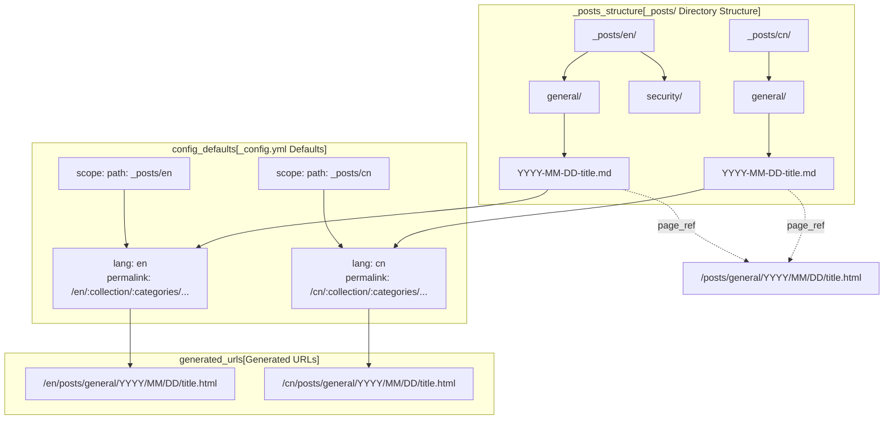
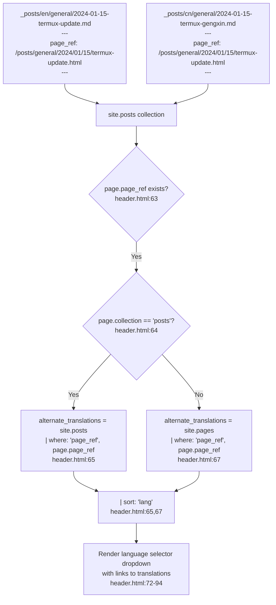
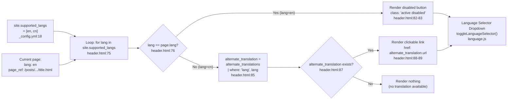
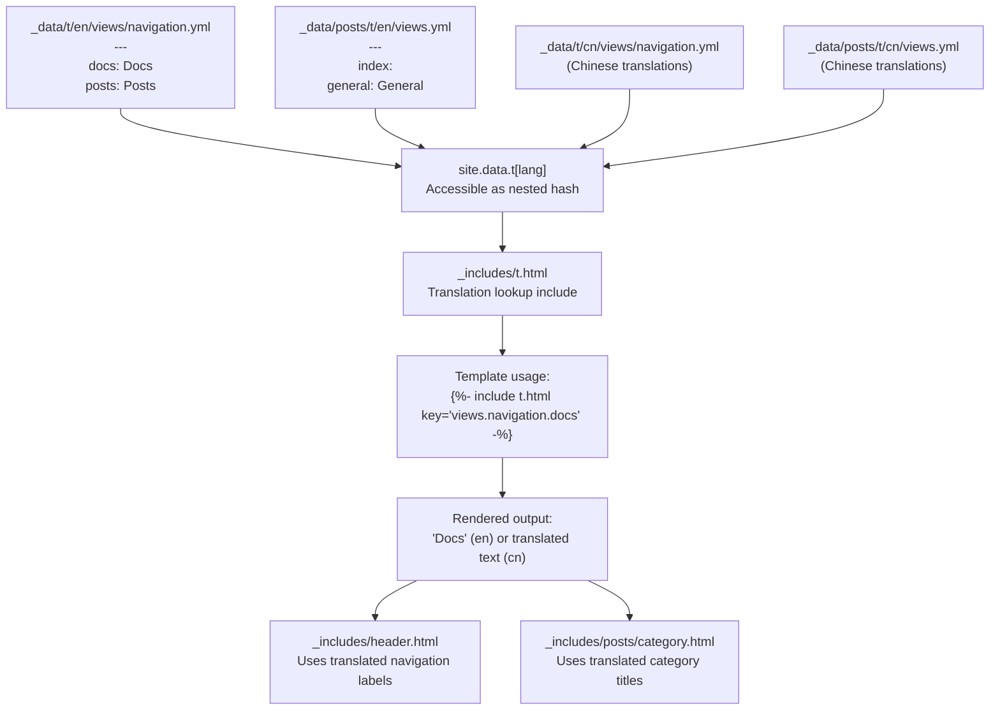

<!-- source: DeepWiki mcp.deepwiki.com · repo termux/termux.github.io · page 4.3 Multilingual Content System · fetched 2026-10-26 -->

# Multilingual Content System

<details>
<summary>Relevant source files</summary>

The following files were used as context for generating this wiki page:

- [CNAME](CNAME)
- [README.md](README.md)
- [_config.yml](_config.yml)
- [_data/posts/t/en/views.yml](_data/posts/t/en/views.yml)
- [_data/t/en/views/navigation.yml](_data/t/en/views/navigation.yml)
- [_includes/header.html](_includes/header.html)
- [_layouts/posts/index.md](_layouts/posts/index.md)
- [index.md](index.md)

</details>


## Purpose and Scope

This document explains the multilingual architecture that enables the Termux website to serve content in multiple languages (currently English and Chinese). The system handles language-specific content organization, translation linking, URL generation, and user interface localization. This page covers content organization, the `page_ref` linking mechanism, language-specific permalinks, and the language selector interface.

For information about creating individual posts, see [Creating and Organizing Posts](#4.1). For translation data management and UI string localization, see [Translation and Localization Data](#3.2).

## Language Configuration

The site's language support is configured in [`_config.yml:16-18`](), which defines the default language and supported languages:

```yaml
lang: en
supported_langs: [en,cn]
```

The `site.lang` variable (`en`) serves as the fallback when a page-specific language is not defined, while `site.supported_langs` contains the complete list of languages available for the language selector.

**Sources:** [`_config.yml:16-18`]()

## Content Organization Structure

### Directory Structure

Content files are organized by language at the top level of their respective directory hierarchies:

| Content Type | English Path | Chinese Path | Purpose |
|-------------|--------------|--------------|---------|
| Blog Posts | `_posts/en/<category>/` | `_posts/cn/<category>/` | Language-specific posts |
| Static Pages | `en/*.md` | `cn/*.md` | Language-specific pages |
| Post Assets | `assets/posts/globals/` or `assets/posts/en/` | `assets/posts/cn/` | Language-specific or shared assets |

### Language-Specific Defaults

The defaults system in [`_config.yml:72-127`]() automatically assigns the `lang` front matter variable and generates language-prefixed permalinks based on file path:

```yaml
defaults:
  - scope:
      path: "en"
    values:
      lang: en
      permalink: /:path/:basename:output_ext
  
  - scope:
      path: "_posts/en"
    values:
      lang: en
      permalink: /en/:collection/:categories/:year/:month/:day/:title:output_ext
```

This configuration ensures that:
- Any file under `en/` automatically receives `lang: en` in its front matter
- Static pages generate URLs like `/en/docs/index.html`
- Posts generate URLs like `/en/posts/general/2024/01/15/post-title.html`

The same pattern repeats for Chinese content under the `cn` path scope at [`_config.yml:79-127`]().

### Content Organization Diagram



**Sources:** [`_config.yml:72-127`](), [`README.md:59-68`]()

## Page Reference System

### Purpose and Implementation

The `page_ref` front matter variable serves as a language-agnostic identifier that links all translations of the same content. This system enables:
- Language switching while staying on the same conceptual page
- SEO optimization through alternate language declarations
- Consistent cross-referencing between translations

### Page Reference Format

The `page_ref` value must be:
- **Unique** across all pages on the site
- **Language-agnostic** (no language prefix)
- **Identical** across all translations of the same content
- **Equal to the English filename's URL path**

For example, a post at `_posts/en/general/2024-01-15-termux-update.md` and its Chinese translation at `_posts/cn/general/2024-01-15-termux-gengxin.md` must both have:

```yaml
page_ref: /posts/general/2024/01/15/termux-update.html
```

This allows the translations to have different language-specific filenames while maintaining a common reference.

### Translation Lookup Mechanism

The language selector in [`_includes/header.html:63-95`]() uses `page_ref` to find alternate translations:

```liquid

  
    
  
    
  
```

This code:
1. Checks if the current page has a `page_ref` and `lang` defined
2. Determines if the page is a post or static page using `page.collection`
3. Queries `site.posts` or `site.pages` collections for matching `page_ref` values
4. Sorts results by language code

### Page Reference Flow Diagram



**Sources:** [`_includes/header.html:63-95`](), [`README.md:92-93`]()

## Language Selector Interface

### Dropdown Implementation

The language selector appears in the site header as a dropdown button displaying the current language code. The implementation in [`_includes/header.html:72-94`]() consists of:

1. **Language Selector Button** ([`header.html:73`]()): Displays current `page.lang` and toggles the dropdown via JavaScript
2. **Dropdown Content Container** ([`header.html:74`]()): Contains links to available language versions
3. **Language Loop** ([`header.html:75-92`]()): Iterates through `site.supported_langs` to generate links

### Link Generation Logic

For each supported language, the selector:

**Current Language** ([`header.html:76-83`]()):
```liquid

  <a class="btn btn-secondary nav-link active disabled" role="button"
    aria-pressed="true">{{- lang -}}</a>
```
Renders as a disabled button to indicate the active language.

**Alternate Language** ([`header.html:84-90`]()):
```liquid

  
  
    <a class="btn btn-secondary nav-link" role="button"
      href="{{- alternate_translation.url -}}">{{- lang -}}</a>
  
```
Finds the translation matching the language code and renders a clickable link to its URL. If no translation exists for that language, no link is rendered.

### JavaScript Toggle

The dropdown toggle function is loaded from [`assets/js/language.js`]() (referenced at [`header.html:71`]()) and called by the `toggleLanguageSelector()` function on button click.

### Language Selector Flow Diagram



**Sources:** [`_includes/header.html:63-95`](), [`_config.yml:18`]()

## Navigation Links

### Language-Aware Navigation

The header navigation links at [`_includes/header.html:21-61`]() implement language-aware fallback logic to handle cases where a page doesn't exist in the current language:

```liquid



  <a class="page-link" href="/{{- page.lang -}}/docs/index.html">...</a>

  <a class="page-link" href="/{{- site.lang -}}/docs/index.html">...</a>

```

This pattern:
1. Constructs the expected path for the current language (`page.lang`)
2. Checks if the file exists in `site.html_pages`
3. Links to the current language version if it exists
4. Falls back to the default language (`site.lang`, which is `en`) if not

This ensures navigation always works even for pages not yet translated to all languages.

**Sources:** [`_includes/header.html:21-61`](), [`_config.yml:17`]()

## SEO and Alternate Language Links

### Sitemap Generation

The sitemap generation logic (referenced in the high-level diagrams) uses `page_ref` to group translations and generate proper `xhtml:link` alternate elements for search engines. This helps search engines understand the relationship between different language versions of the same content.

### Root Redirect

The root `index.md` file at [`index.md:1-5`]() redirects to the default English homepage:

```yaml
---
layout: redirect
sitemap: false
redirect_to: /en/
---
```

This ensures visitors landing on the root domain are automatically directed to the localized content, while the `sitemap: false` prevents the redirect page from appearing in search results.

**Sources:** [`index.md:1-5`]()

## Creating Multilingual Content

### Creating a New Language Version

To add a translation of existing content:

1. **Create the translated file** in the corresponding language directory with the same category and date structure
2. **Set identical page_ref** to match the original content
3. **Translate the front matter** `title` and content body
4. **Keep the same category** structure for proper organization

Example for translating an English post:

**Original:** `_posts/en/general/2024-01-15-termux-update.md`
```yaml
---
title: "Termux Update"
page_ref: /posts/general/2024/01/15/termux-update.html
---
```

**Translation:** `_posts/cn/general/2024-01-15-termux-gengxin.md`
```yaml
---
title: "Termux 更新"
page_ref: /posts/general/2024/01/15/termux-update.html
---
```

### Adding a New Language

To add support for a new language (e.g., Russian `ru`):

1. **Update supported languages** in [`_config.yml:18`]():
   ```yaml
   supported_langs: [en,cn,ru]
   ```

2. **Add defaults scope** for static pages in [`_config.yml`]():
   ```yaml
   - scope:
       path: "ru"
     values:
       lang: ru
       permalink: /:path/:basename:output_ext
   ```

3. **Add defaults scope** for posts in [`_config.yml`]():
   ```yaml
   - scope:
       path: "_posts/ru"
     values:
       lang: ru
       permalink: /ru/:collection/:categories/:year/:month/:day/:title:output_ext
   ```

4. **Create translation data** files under `_data/t/ru/` for UI strings (see [Translation and Localization Data](#3.2))

5. **Create content directories** at `ru/` and `_posts/ru/` with appropriate category subdirectories

The language selector will automatically detect and display the new language for any pages that have matching `page_ref` values.

**Sources:** [`_config.yml:18`](), [`_config.yml:72-127`](), [`README.md:59-68`]()

## Translation Data System

### Directory Structure

UI strings and labels are stored in YAML files under `_data/t/<lang>/` with a nested structure:

```
_data/
  t/
    en/
      views/
        navigation.yml
    posts/
      t/
        en/
          views.yml
        cn/
          views.yml
```

### Translation Data Lookup

The `_includes/t.html` include (referenced throughout templates) provides a translation lookup mechanism. Templates call it using:

```liquid

```

or with a specific root:

```liquid

```

This system separates content translation (in markdown files) from UI translation (in YAML data files), allowing translators to work independently on each type.

### Translation Data Flow



**Sources:** [`_data/t/en/views/navigation.yml:1-9`](), [`_data/posts/t/en/views.yml:1-12`](), [`_includes/header.html:24`]()

## Summary

The multilingual content system achieves language support through:

- **Directory-based organization** with language codes as top-level separators
- **Automatic configuration** via Jekyll defaults that assign `lang` and generate language-prefixed URLs
- **Page reference linking** that connects translations through a shared language-agnostic identifier
- **Dynamic language selector** that discovers and links to available translations
- **Fallback mechanisms** for navigation when translations don't exist
- **Separate translation data** for UI strings accessed via the `t.html` include

This architecture allows content creators to add new languages or translations by following consistent file organization patterns, while the language selector and navigation system automatically adapts to available content.

---

