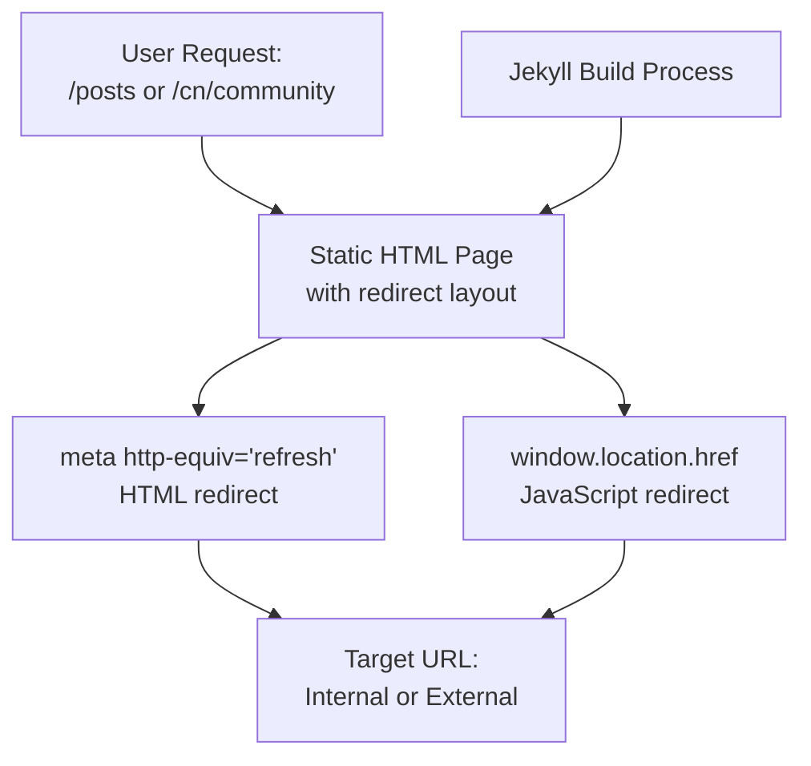
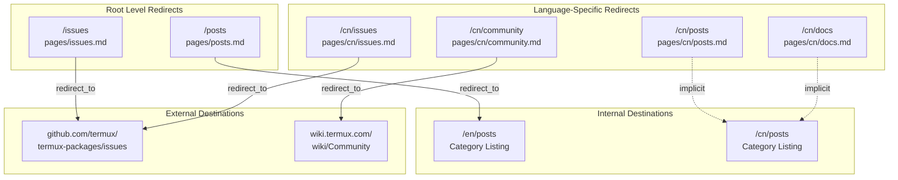
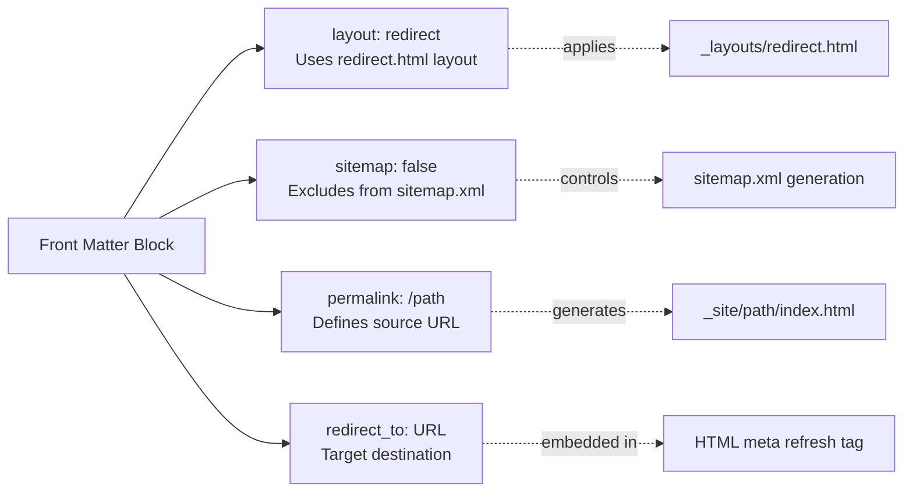
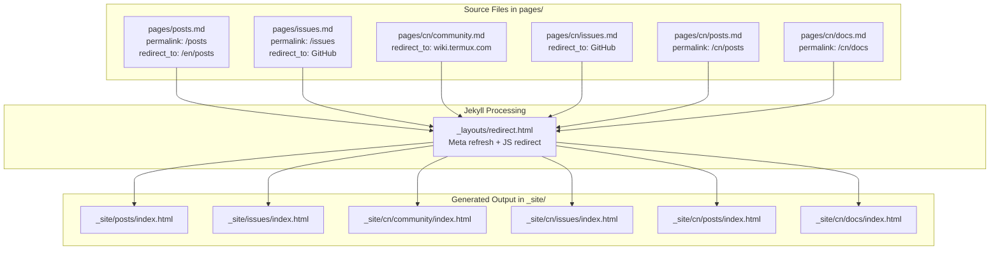
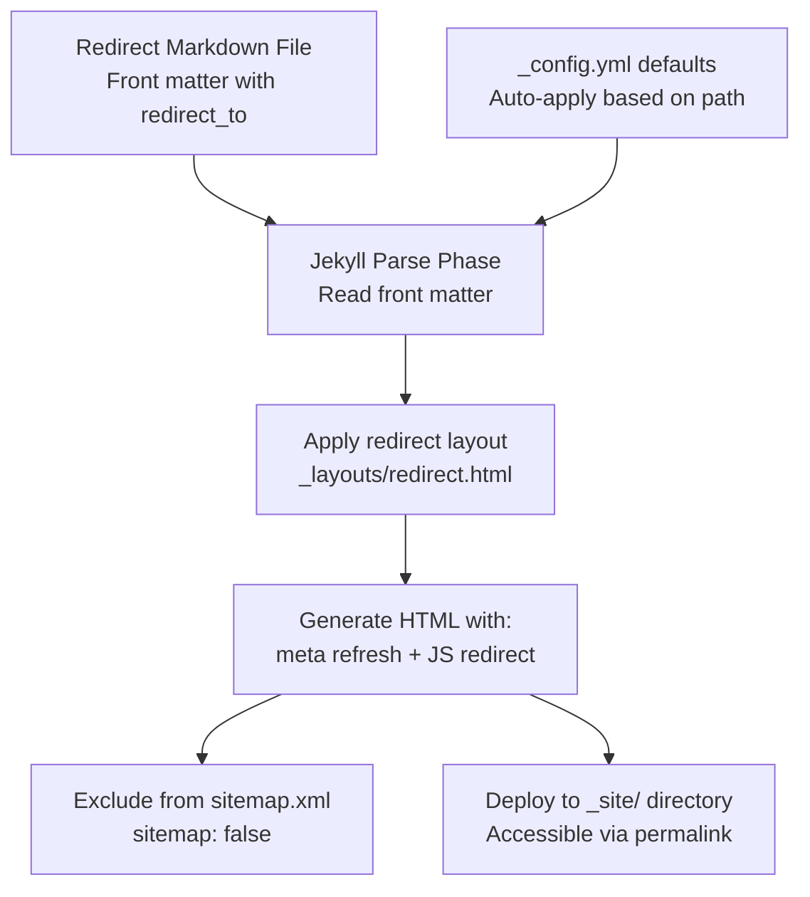

<!-- source: DeepWiki mcp.deepwiki.com · repo termux/termux.github.io · page 4.4 Pages and Redirects · fetched 2026-10-26 -->

# Pages and Redirects

<details>
<summary>Relevant source files</summary>

The following files were used as context for generating this wiki page:

- [pages/cn/community.md](pages/cn/community.md)
- [pages/cn/docs.md](pages/cn/docs.md)
- [pages/cn/issues.md](pages/cn/issues.md)
- [pages/cn/posts.md](pages/cn/posts.md)
- [pages/issues.md](pages/issues.md)
- [pages/posts.md](pages/posts.md)

</details>


## Purpose and Scope

This document describes the static page and redirect system in the termux.github.io repository. It covers the creation and organization of standalone pages in the `pages/` directory, the redirect layout mechanism for creating HTTP redirects, and the various redirect patterns used for language defaults and external resource links.

For information about blog posts and the post organization system, see [Creating and Organizing Posts](#4.1). For details on multilingual page linking, see [Multilingual Content System](#4.3).

---

## Static Page System

Static pages in the repository are stored in the `pages/` directory and serve as standalone content pages that are not part of the blog post chronological structure. These pages use various layouts (typically `page` or `redirect`) and define their permalinks explicitly in front matter.

### Directory Structure

The `pages/` directory is organized by language to support multilingual static pages:

```
pages/
├── posts.md                    # Root language redirect
├── issues.md                   # Root external redirect
├── cn/
│   ├── community.md           # Chinese external redirect
│   ├── issues.md              # Chinese external redirect
│   ├── docs.md                # Chinese category page redirect
│   └── posts.md               # Chinese category page redirect
└── en/
    └── (additional English pages)
```

This structure mirrors the multilingual organization used in the `_posts/` directory, enabling consistent URL patterns across both static pages and blog posts.

**Sources:** [pages/posts.md:1-7](), [pages/cn/community.md:1-6](), [pages/cn/issues.md:1-6](), [pages/cn/docs.md:1-6](), [pages/cn/posts.md:1-6](), [pages/issues.md:1-7]()

---

## Redirect Layout System

### Redirect Mechanism

The redirect system uses a dedicated `redirect` layout that generates HTML pages with meta refresh and JavaScript-based redirects. Pages using this layout specify their redirect destination in the `redirect_to` front matter variable.

#### Redirect Page Diagram



**Sources:** [pages/posts.md:1-7](), [pages/cn/community.md:1-6]()

### Front Matter Configuration

Redirect pages use a standardized front matter structure:

| Front Matter Key | Purpose | Example Value |
|-----------------|---------|---------------|
| `layout` | Specifies the redirect layout | `redirect` |
| `sitemap` | Controls sitemap inclusion | `false` (always) |
| `permalink` | Defines the source URL | `/posts` or `/cn/community` |
| `redirect_to` | Target destination URL | `/en/posts` or external URL |

The `sitemap: false` setting is consistently applied to all redirect pages to prevent search engines from indexing intermediate redirect URLs rather than the final destinations.

**Sources:** [pages/posts.md:1-7](), [pages/issues.md:1-7](), [pages/cn/community.md:1-6]()

---

## Types of Redirects

### Internal Language Redirects

Internal redirects handle language-neutral URLs by redirecting to a default language version. These ensure users accessing bare URLs like `/posts` are directed to the English version.

#### Internal Redirect Example

```yaml
---
layout: redirect
sitemap: false
permalink: /posts
redirect_to: /en/posts
---
```

This pattern creates a redirect from `/posts` → `/en/posts`, establishing English as the default language for language-agnostic URLs.

**Sources:** [pages/posts.md:1-7]()

### External Resource Redirects

External redirects provide user-friendly short URLs for external resources like GitHub issues, community wikis, and documentation repositories.

#### External Redirect Examples

```yaml
---
layout: redirect
sitemap: false
permalink: /issues
redirect_to: https://github.com/termux/termux-packages/issues
---
```

```yaml
---
layout: redirect
sitemap: false
redirect_to: https://wiki.termux.com/wiki/Community
---
```

These redirects create memorable short URLs like `termux.dev/issues` that redirect to the full GitHub issues URL.

**Sources:** [pages/issues.md:1-7](), [pages/cn/community.md:1-6](), [pages/cn/issues.md:1-6]()

### Implicit Category Redirects

Some redirect pages omit the `redirect_to` field, relying on Jekyll's default behavior or custom logic to determine the destination:

```yaml
---
layout: redirect
sitemap: false
permalink: /cn/posts
---
```

These pages are located in language-specific directories and typically redirect to category listing pages within that language.

**Sources:** [pages/cn/docs.md:1-6](), [pages/cn/posts.md:1-6]()

---

## Redirect Patterns and Use Cases

### Redirect Pattern Architecture



**Sources:** [pages/posts.md:1-7](), [pages/issues.md:1-7](), [pages/cn/posts.md:1-6](), [pages/cn/docs.md:1-6](), [pages/cn/community.md:1-6](), [pages/cn/issues.md:1-6]()

### Common Redirect Use Cases

| Use Case | Pattern | Example |
|----------|---------|---------|
| Language Default | Root URL → English version | `/posts` → `/en/posts` |
| External Link Shortcut | Short URL → External resource | `/issues` → GitHub Issues |
| Community Resources | Language-specific → External wiki | `/cn/community` → Termux Wiki |
| Category Landing | Language path → Category page | `/cn/posts` → Chinese posts listing |

---

## Creating a Redirect Page

### Step-by-Step Process

To create a new redirect page:

1. **Choose the source URL path** - Determine the desired short URL (e.g., `/downloads`)

2. **Create the markdown file** in the appropriate `pages/` subdirectory:
   - For root-level redirects: `pages/filename.md`
   - For language-specific: `pages/lang/filename.md`

3. **Add front matter** with required fields:

```yaml
---
layout: redirect
sitemap: false
permalink: /your-path
redirect_to: https://destination.url
---
```

4. **Commit and deploy** - Jekyll will generate the redirect HTML during build

### Front Matter Field Reference



**Sources:** [pages/posts.md:1-7](), [pages/issues.md:1-7]()

---

## Redirect Page File Structure

### Complete File Structure Map



**Sources:** [pages/posts.md:1-7](), [pages/issues.md:1-7](), [pages/cn/community.md:1-6](), [pages/cn/issues.md:1-6](), [pages/cn/posts.md:1-6](), [pages/cn/docs.md:1-6]()

---

## Redirect Behavior and Implementation

### Redirect Execution Flow

When a user accesses a redirect page URL, the following sequence occurs:

1. **Request received** - User navigates to the short URL (e.g., `termux.dev/issues`)
2. **Static HTML served** - GitHub Pages serves the pre-generated HTML file
3. **Meta refresh executes** - Browser reads `<meta http-equiv="refresh">` tag
4. **JavaScript fallback** - If meta refresh fails, `window.location.href` executes
5. **Navigation complete** - User arrives at the target URL

This dual-mechanism approach ensures maximum compatibility across browsers and configurations.

### Integration with Jekyll Build



**Sources:** [pages/posts.md:1-7](), [pages/issues.md:1-7]()

---

## Best Practices

### When to Use Redirects

Redirects are appropriate for:

- **Language defaults** - Redirecting bare URLs to a default language version
- **External shortcuts** - Creating memorable short URLs for frequently accessed external resources
- **Deprecated URLs** - Maintaining compatibility with old URL structures
- **Cross-domain navigation** - Linking to community resources like wikis and issue trackers

### Redirect Configuration Guidelines

| Guideline | Rationale |
|-----------|-----------|
| Always set `sitemap: false` | Prevents search engines from indexing redirect pages |
| Use `redirect` layout exclusively | Ensures consistent redirect behavior |
| Specify explicit `permalink` | Makes source URL clear and predictable |
| Document external redirects | Helps maintainers understand where redirects point |
| Use HTTPS for external URLs | Ensures secure redirections |

### Avoiding Redirect Chains

Redirect chains (redirect → redirect → destination) should be avoided as they:
- Increase page load time
- Complicate debugging
- May cause search engine penalties
- Create maintenance complexity

Instead, always redirect directly to the final destination URL.

**Sources:** [pages/posts.md:1-7](), [pages/cn/community.md:1-6](), [pages/cn/issues.md:1-6]()

---

## Sitemap Exclusion Strategy

All redirect pages consistently use `sitemap: false` to prevent their inclusion in the generated `sitemap.xml` file. This is critical because:

1. **Search engines should index the destination**, not the redirect
2. **Prevents duplicate content issues** in search results
3. **Reduces sitemap clutter** by excluding non-content pages
4. **Improves crawl efficiency** by directing search engines to final URLs

The sitemap exclusion is enforced at the individual page level through front matter rather than through global configuration, providing explicit control over each redirect page.

**Sources:** [pages/posts.md:2](), [pages/issues.md:3](), [pages/cn/community.md:3](), [pages/cn/issues.md:3]()

---

