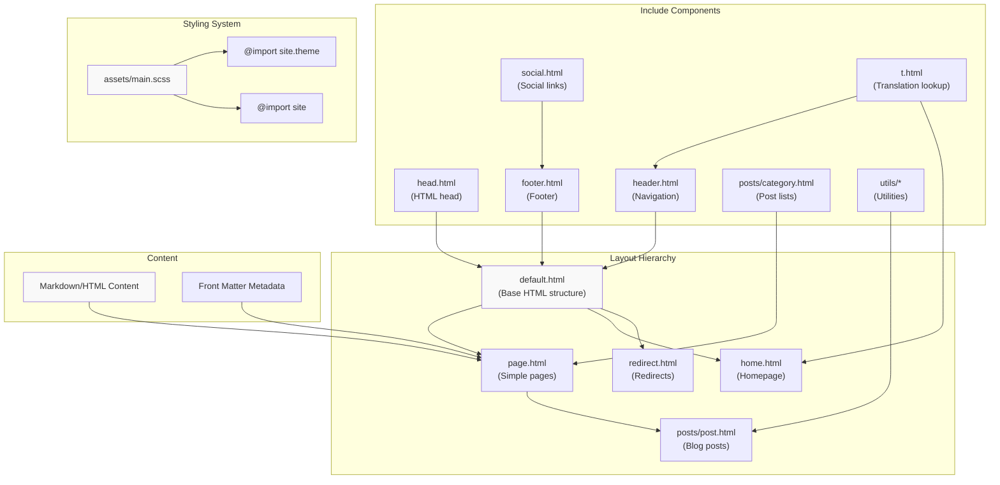
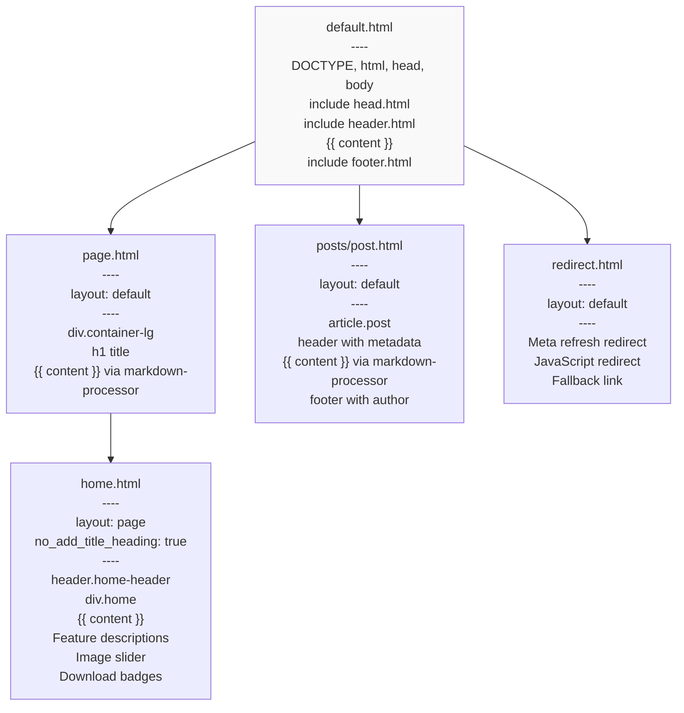
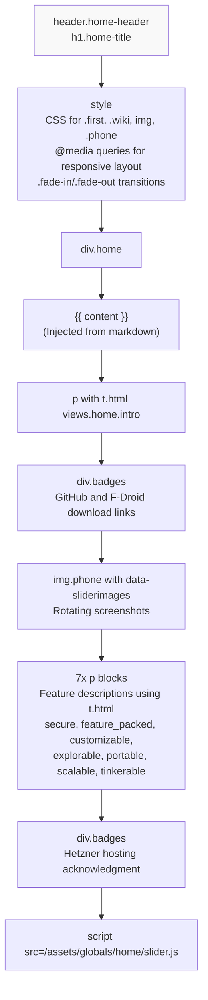
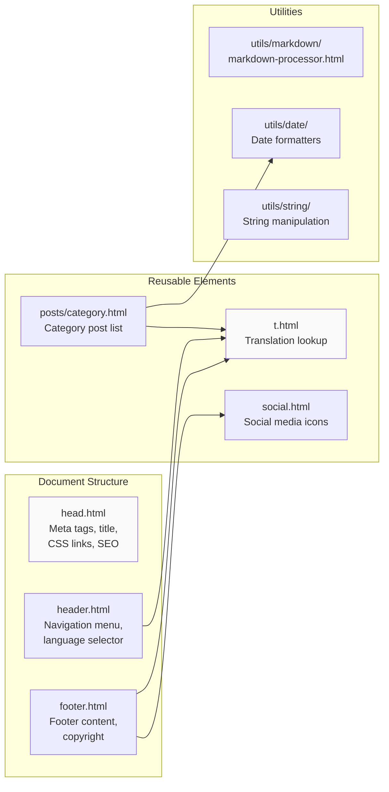
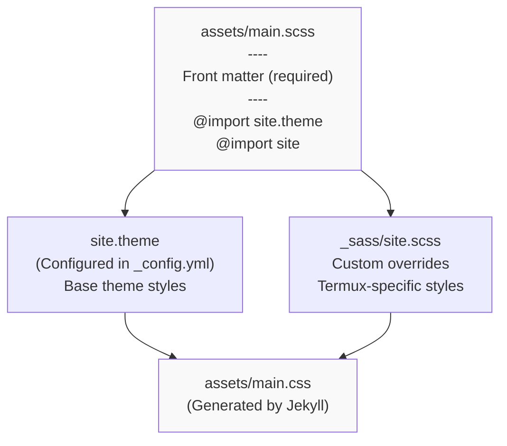
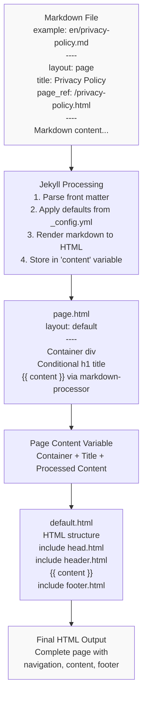

<!-- source: DeepWiki mcp.deepwiki.com · repo termux/termux.github.io · page 5 User Interface Components · fetched 2026-10-26 -->

# User Interface Components

<details>
<summary>Relevant source files</summary>

The following files were used as context for generating this wiki page:

- [_layouts/default.html](_layouts/default.html)
- [_layouts/home.html](_layouts/home.html)
- [_layouts/page.html](_layouts/page.html)
- [assets/globals/hosts/hosted-by-hetzner.png](assets/globals/hosts/hosted-by-hetzner.png)
- [assets/main.scss](assets/main.scss)
- [en/docs/index.md](en/docs/index.md)
- [en/privacy-policy.md](en/privacy-policy.md)

</details>


## Purpose and Scope

This document describes the user interface architecture of the termux.github.io Jekyll site, including the layout hierarchy, reusable includes, and styling system. The UI components define the visual structure and presentation of all pages on termux.dev, from the homepage to blog posts to documentation pages.

For information about creating and organizing content (posts and pages), see [Content Management](#4). For details on translation and localization of UI strings, see [Translation and Localization Data](#3.2).

---

## UI Component Architecture Overview

The termux.github.io site uses Jekyll's template system to separate content from presentation. The architecture consists of three main layers:

1. **Layouts** - Page templates that define overall page structure ([`_layouts/`]())
2. **Includes** - Reusable UI components that are embedded in layouts ([`_includes/`]())
3. **Styling** - SCSS/CSS files that control visual appearance ([`assets/`]() and [`_sass/`]())



**Key Design Principles:**

- **Inheritance:** Layouts extend other layouts using Jekyll's `layout:` front matter
- **Composition:** Includes are embedded using `` tags
- **Content Injection:** Child layouts/content replace the `{{ content }}` variable in parent layouts
- **Localization:** UI strings are externalized using the `t.html` include with translation keys

Sources: [_layouts/default.html:1-19](), [_layouts/page.html:1-12](), [_layouts/home.html:1-69](), [assets/main.scss:1-8]()

---

## Layout System

### Layout Hierarchy and Inheritance

Jekyll layouts define the overall structure of pages. Each layout can specify a parent layout in its front matter, creating an inheritance hierarchy. The `{{ content }}` variable in a parent layout is replaced by the child layout's content.



**Layout Descriptions:**

| Layout | Path | Purpose | Parent | Key Features |
|--------|------|---------|--------|--------------|
| `default.html` | `_layouts/` | Base template | None | HTML structure, includes `head.html`, `header.html`, `footer.html` |
| `page.html` | `_layouts/` | Simple pages | `default` | Container div, optional title heading, markdown processing |
| `home.html` | `_layouts/` | Homepage | `page` | Feature showcase, image slider, download badges |
| `posts/post.html` | `_layouts/posts/` | Blog posts | `default` | Article element, post metadata, author info |
| `redirect.html` | `_layouts/` | Redirect pages | `default` | Meta refresh, JavaScript redirect, fallback link |

### default.html - Base Layout

The `default.html` layout provides the foundational HTML structure for all pages. It sets the document language based on page/site configuration and includes three core components:

```
<!DOCTYPE html>
<html lang="{{- page.lang | default: site.lang | default: 'en' -}}">
  
  <body>
    
    <main class="page-content" aria-label="Content">
      {{ content }}
    </main>
    
  </body>
</html>
```

The layout uses Liquid template filters to determine the page language: first checking `page.lang`, then `site.lang`, and finally defaulting to `'en'`. This language value is used for the HTML `lang` attribute and impacts how translation includes behave.

Sources: [_layouts/default.html:1-19]()

### page.html - Simple Page Layout

The `page.html` layout extends `default.html` and adds a Bootstrap-styled container for content. It conditionally renders a page title as an `<h1>` heading unless `no_add_title_heading: true` is set in the page's front matter:

```
layout: default
---
<div class="container-lg px-3 my-5 markdown-body">
  
    <h1 class="post-title">{{- page.title | escape -}}</h1>
  
  
</div>
```

The content is processed through the `markdown-processor.html` include, which handles markdown rendering. The classes `container-lg`, `px-3`, `my-5`, and `markdown-body` provide responsive layout and GitHub-flavored markdown styling.

Sources: [_layouts/page.html:1-12]()

### home.html - Homepage Layout

The `home.html` layout extends `page.html` and implements the Termux homepage with several custom features:

**Structure:**
1. **Header section** with conditional title display
2. **Inline styles** for layout, typography, and fade animations
3. **Main content** with localized introduction text
4. **Download badges** for GitHub and F-Droid
5. **Image slider** showcasing Termux screenshots
6. **Feature descriptions** with localized content
7. **Hosting acknowledgment** badge for Hetzner
8. **JavaScript** for image slider functionality



The image slider uses a custom `data-sliderimages` attribute containing comma-separated image paths. The slider JavaScript ([`/assets/globals/home/slider.js`]()) cycles through these images with fade transitions.

Each feature description follows this pattern:
```liquid
<p><strong class="first"></strong> 
</p>
```

This enables complete localization of feature titles and descriptions through translation data files (see [Translation and Localization Data](#3.2)).

Sources: [_layouts/home.html:1-69]()

---

## Include Components

Jekyll includes are reusable template fragments that can be embedded into layouts and other includes. They promote DRY (Don't Repeat Yourself) principles and enable modular UI design.

### Include Usage Pattern

Includes are embedded using Liquid syntax with optional parameters:

```liquid
           <!-- Basic include -->
 <!-- Include with parameter -->
```

The hyphen syntax `{%-` strips whitespace, while `{%` preserves it.

### Core Include Components



### Translation Include (t.html)

The `t.html` include is a fundamental component that looks up localized strings from translation data files. It accepts a `key` parameter specifying the translation path:

```liquid

```

This include:
1. Determines the current page language from `page.lang` or `site.lang`
2. Loads the corresponding translation data from `_data/t/{lang}/`
3. Traverses the nested YAML structure using the dot-separated key
4. Returns the localized string

The translation data is organized hierarchically. For example, the key `views.home.features.secure.title` corresponds to:

```yaml
# _data/t/en/views/home.yml
features:
  secure:
    title: "Secure"
    description: "Access remote servers using ssh client from OpenSSH..."
```

This system enables complete UI localization without hardcoding strings in templates. See [Translation and Localization Data](#3.2) for more details.

Sources: Based on [_layouts/home.html:29](), [_layouts/home.html:42-61]()

### Header and Navigation Component

The `header.html` include provides the site-wide navigation bar with:
- Site logo/title with link to homepage
- Main navigation menu
- Language selector dropdown
- Responsive mobile menu trigger

The header uses the `t.html` include to display localized menu items and checks for alternate language versions using the `page_ref` front matter attribute to build language switching links.

For detailed information on the header implementation and language selector, see [Header and Navigation](#5.2).

Sources: Referenced in [_layouts/default.html:8]()

### Footer and Social Media Components

The `footer.html` include provides the site-wide footer with:
- Copyright information
- Links to important pages (privacy, security, donate)
- Social media links via the `social.html` include
- Localized text using `t.html`

The `social.html` include generates social media icon links based on configuration in `_config.yml`:

```yaml
# _config.yml
social:
  - name: GitHub
    icon: github
    link: https://github.com/termux
  # ... additional social accounts
```

For detailed information on footer and social media implementation, see [Footer and Social Media](#5.3).

Sources: Referenced in [_layouts/default.html:14]()

### Category Post List Include

The `posts/category.html` include generates filtered lists of blog posts for a specific category. It accepts a `category` parameter:

```liquid

```

The include:
1. Filters `site.categories[category]` to get posts in the specified category
2. Further filters by language (`page.lang`) if applicable
3. Iterates through posts in reverse chronological order
4. Renders each post with date, title, and excerpt
5. Uses date formatting utilities and translation includes

This component is typically used on category landing pages to display all posts within that category.

Sources: Referenced in system documentation

### Utility Includes

Utility includes provide reusable functionality for common tasks:

| Include | Purpose | Used By |
|---------|---------|---------|
| `utils/markdown/markdown-processor.html` | Process markdown content | `page.html`, `posts/post.html` |
| `utils/date/*` | Format dates in various styles | `posts/category.html`, `posts/post.html` |
| `utils/string/*` | String manipulation (truncate, etc.) | Various templates |

These utilities abstract common operations and ensure consistent behavior across the site.

Sources: [_layouts/page.html:10]()

---

## Styling System

### SCSS Architecture

The site uses SCSS (Sassy CSS) for styling, with a two-layer import structure:



### Main SCSS Entry Point

The `assets/main.scss` file serves as the entry point for all styles. The front matter (three dashes) is required for Jekyll to process the file:

```scss
---
# Front matter required for Jekyll processing
---

@import "{{- site.theme -}}";
@import "site";
```

Jekyll processes this file and:
1. Replaces `{{- site.theme -}}` with the theme name from `_config.yml`
2. Imports the base theme styles from the gem-based theme
3. Imports custom site-specific styles from `_sass/site.scss`
4. Compiles everything to `assets/main.css`

The double-import pattern allows the site to leverage a base theme while customizing specific aspects through the `site.scss` file.

Sources: [assets/main.scss:1-8]()

### Theme System

The site's theme is configured in `_config.yml`:

```yaml
# _config.yml
theme: jekyll-theme-primer
```

The theme is provided as a Ruby gem and includes:
- Base typography and layout styles
- GitHub-flavored markdown styling (`.markdown-body` class)
- Responsive grid system (`.container-lg`, etc.)
- UI components (buttons, badges, alerts)

The Primer theme provides GitHub-style aesthetics, appropriate for a developer-focused project.

### Custom Site Styles

Custom styles in `_sass/site.scss` override or extend the base theme. Common customizations include:
- Custom color schemes for Termux branding
- Responsive layout adjustments
- Component-specific styles not provided by the theme
- Mobile menu behavior
- Language selector styling

The specificity cascade ensures custom styles take precedence over theme defaults.

Sources: [assets/main.scss:7]()

### Inline Styles in Layouts

Some layouts include inline `<style>` blocks for component-specific styling. For example, `home.html` includes styles for:

```css
.first { font-weight: bold; }
.wiki { text-align: center; }
img { margin: 18px auto; max-width:100%; height:auto; }
img.phone:first-of-type { /* Float logic with media query */ }
.badges { text-align: center; /* Badge positioning */ }
.fade-out { opacity: 0; transition: opacity 1s; }
.fade-in { opacity: 1; transition: opacity 1s; }
```

These inline styles are used when:
- Styles are specific to a single layout
- Styles involve layout-specific responsive behavior
- Quick prototyping or one-off adjustments are needed

However, reusable styles should be extracted to `_sass/site.scss` for better maintainability.

Sources: [_layouts/home.html:10-23]()

---

## Content Injection Flow

Understanding how content flows through the layout hierarchy is crucial for creating and debugging pages:



**Step-by-Step Flow:**

1. **Markdown File:** Content author creates a markdown file with front matter specifying `layout: page`
2. **Jekyll Processing:** Jekyll parses the file, applies configuration defaults, and renders markdown to HTML
3. **page.html Layout:** The HTML content is injected into `{{ content }}` in `page.html`, which wraps it with a container and optional title
4. **Content Variable Update:** The entire `page.html` output becomes the new `{{ content }}` value
5. **default.html Layout:** This content is injected into `{{ content }}` in `default.html`, adding header and footer
6. **Final Output:** The complete HTML page is written to `_site/`

This multi-layer approach enables:
- **DRY Templates:** Common elements (header, footer) are defined once
- **Flexible Content:** Different layouts can wrap content differently
- **Progressive Enhancement:** Each layer adds structure without duplicating code

Sources: [_layouts/default.html:11](), [_layouts/page.html:10]()

---

## Responsive Design Implementation

The site implements responsive design through several mechanisms:

### Bootstrap Grid Classes

The base theme provides Bootstrap-compatible responsive classes:

```html
<div class="container-lg px-3 my-5 markdown-body">
  <!-- Content -->
</div>
```

| Class | Purpose |
|-------|---------|
| `container-lg` | Responsive container with max-width for large screens |
| `px-3` | Horizontal padding (responsive) |
| `my-5` | Vertical margin (responsive) |
| `markdown-body` | GitHub-flavored markdown styling |

### Media Queries in Layouts

The `home.html` layout includes custom media queries for the screenshot slider:

```css
img.phone:first-of-type { 
  margin-top: 3em; 
  display: block; 
}

@media only screen and (min-width: 500px) {
  img.phone:first-of-type { 
    margin-top: 0; 
    margin-bottom: 0; 
    margin-left: 1em; 
    margin-right: 1em; 
    float: right; 
  }
}
```

On screens wider than 500px, the phone image floats to the right of the feature descriptions. On smaller screens, it displays as a centered block element.

### Mobile Navigation

The header component includes a responsive navigation system:
- **Desktop:** Horizontal navigation menu with full text labels
- **Mobile:** Hamburger menu trigger that expands/collapses navigation
- **Implementation:** Uses CSS classes and JavaScript for the toggle behavior

Sources: [_layouts/home.html:14-18](), [_layouts/page.html:5]()

---

## Static Assets Organization

Static assets (images, JavaScript, fonts) are organized in the `assets/` directory:

```
assets/
├── main.scss              # SCSS entry point
└── globals/
    ├── home/
    │   ├── slider.js     # Image slider JavaScript
    │   └── *.png         # Homepage screenshots
    └── hosts/
        ├── get-it-on-github.png
        ├── get-it-on-fdroid.png
        └── hosted-by-hetzner.png
```

### Asset Usage in Templates

Assets are referenced using absolute paths from the site root:

```liquid

```

```liquid
<script src="/assets/globals/home/slider.js"></script>
```

The leading `/` ensures paths work correctly regardless of the page's location in the site hierarchy.

### Image Slider Implementation

The homepage uses a custom JavaScript image slider:

**HTML Structure:**
```html

```

**JavaScript Behavior:**
- Located at `/assets/globals/home/slider.js`
- Parses `data-sliderimages` attribute to get image list
- Cycles through images with fade-in/fade-out transitions
- Uses CSS classes `.fade-in` and `.fade-out` for animations

This provides a visually engaging showcase of Termux's interface without requiring complex frameworks.

Sources: [_layouts/home.html:40](), [_layouts/home.html:68]()

---

## Page-Specific UI Variations

Different page types use different UI configurations:

### Privacy Policy Page

```
---
layout: page
title: Privacy Policy
redirect_from: /privacy-policy
page_ref: /privacy-policy.html
---
```

- Uses basic `page` layout
- Displays title as `<h1>`
- Includes redirect from old URL
- Simple, readable content presentation

Sources: [en/privacy-policy.md:1-6]()

### Documentation Index

```
---
page_ref: /docs/index.html
---
```

- Uses default `page` layout (inherited via front matter defaults)
- No explicit layout specified (relies on `_config.yml` defaults)
- Structured with markdown headings and lists
- Links to sub-documentation pages

Sources: [en/docs/index.md:1-17]()

### Homepage

```
---
layout: home
no_add_title_heading: true
---
```

- Uses specialized `home` layout
- Suppresses automatic title heading (`no_add_title_heading`)
- Custom header styling and content structure
- Feature showcase and download badges
- Image slider integration

Sources: [_layouts/home.html:1-4]()

---

## Best Practices for UI Components

When working with the UI component system:

### Layout Selection

| Use Case | Layout | Rationale |
|----------|--------|-----------|
| Simple text page | `page` | Clean container, optional title, markdown support |
| Blog post | `posts/post` | Article semantics, metadata display, author info |
| Landing page | `home` | Custom styling, feature showcase |
| External redirect | `redirect` | Meta refresh + JavaScript fallback |

### Include Usage

- **Always use `t.html` for user-facing strings** to ensure localization support
- **Pass parameters explicitly** to includes for clarity: ``
- **Avoid deep nesting** of includes (max 2-3 levels) to prevent maintenance issues
- **Document include parameters** in comments at the top of the include file

### Styling Guidelines

- **Prefer theme classes** over custom CSS when possible
- **Use `_sass/site.scss`** for reusable styles, not inline `<style>` blocks
- **Test responsive behavior** at mobile, tablet, and desktop widths
- **Maintain semantic HTML** (proper heading hierarchy, ARIA labels)

### Asset Management

- **Optimize images** before committing (compress PNGs/JPGs)
- **Use descriptive filenames** that indicate purpose and dimensions
- **Organize by feature** in `assets/globals/` subdirectories
- **Use absolute paths** (`/assets/...`) for reliability

---

## Summary

The termux.github.io UI component system provides a modular, maintainable architecture for the Termux website. Key aspects include:

- **Hierarchical layouts** (`default.html` → `page.html` → `home.html`) enable code reuse
- **Reusable includes** (header, footer, social, translation) promote DRY principles  
- **SCSS architecture** layers theme styles with custom overrides
- **Content injection** through `{{ content }}` variable creates flexible template chains
- **Responsive design** uses Bootstrap classes and custom media queries
- **Localization** via `t.html` include supports multilingual UI

This architecture supports the creation of new pages, modification of existing layouts, and addition of new UI components while maintaining consistency across the site.

For implementing specific UI features, refer to:
- Layout implementation details: [Layout System](#5.1)
- Navigation and language switching: [Header and Navigation](#5.2)  
- Footer and social links: [Footer and Social Media](#5.3)
- Homepage customization: [Homepage Design](#5.4)
- Style customization: [Styling System](#5.5)

---

