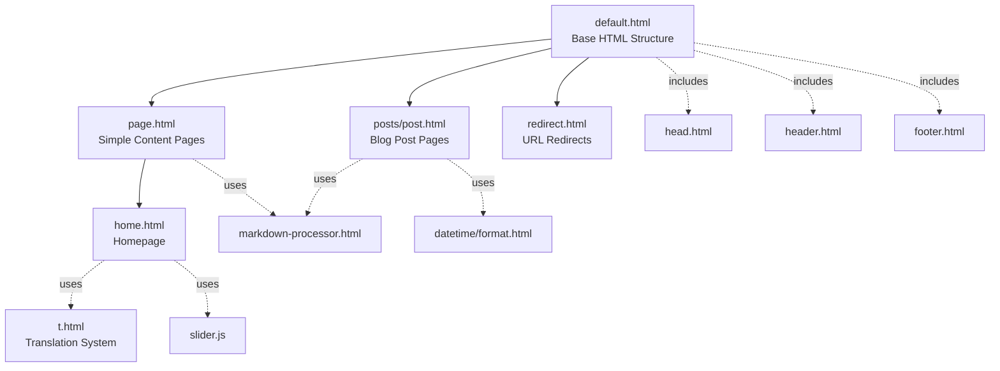
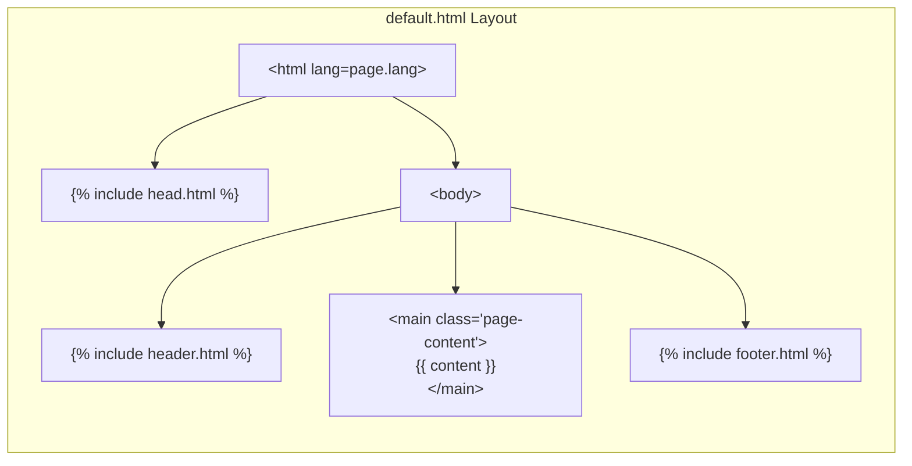
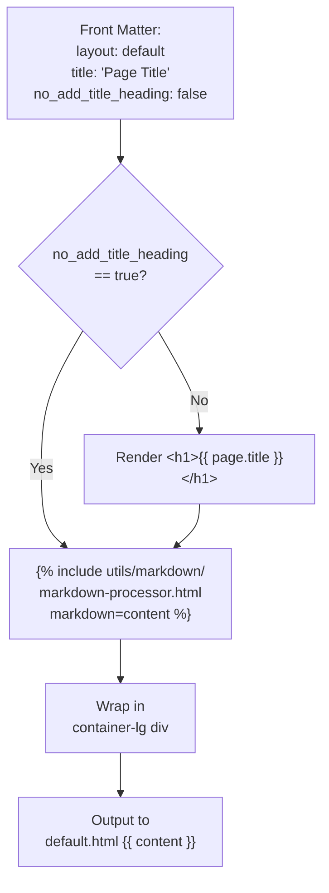
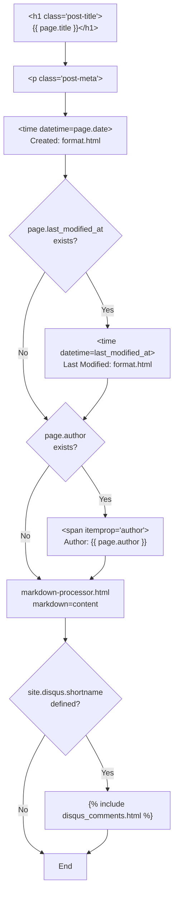
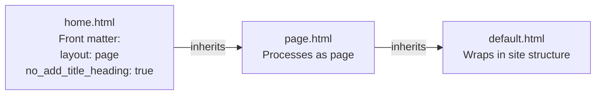
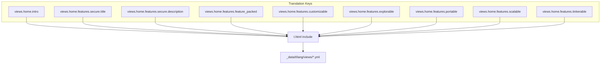
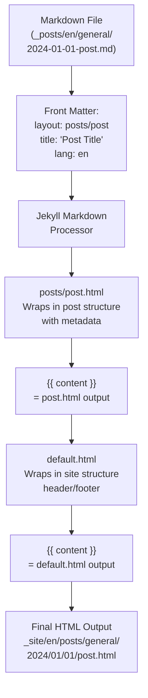
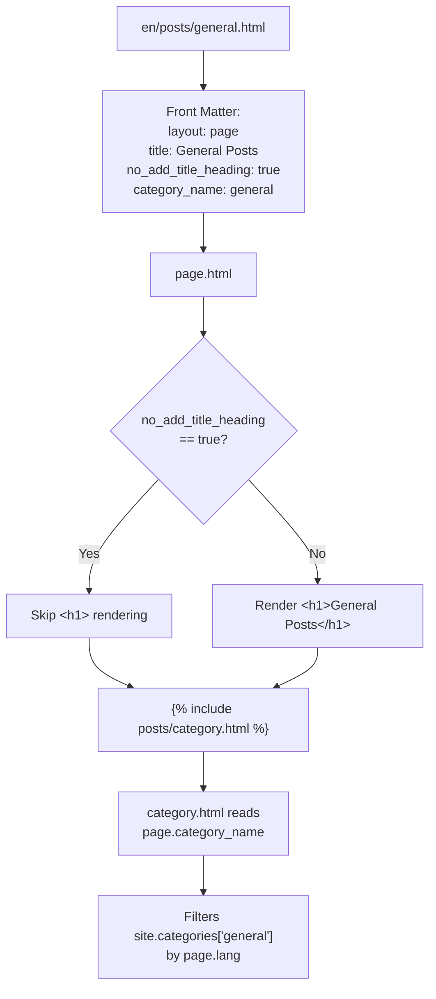
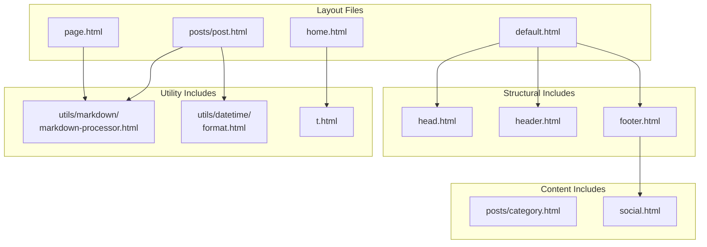

<!-- source: DeepWiki mcp.deepwiki.com · repo termux/termux.github.io · page 5.1 Layout System · fetched 2026-10-26 -->

# Layout System

<details>
<summary>Relevant source files</summary>

The following files were used as context for generating this wiki page:

- [_includes/posts/category.html](_includes/posts/category.html)
- [_includes/utils/datetime/format.html](_includes/utils/datetime/format.html)
- [_layouts/default.html](_layouts/default.html)
- [_layouts/home.html](_layouts/home.html)
- [_layouts/page.html](_layouts/page.html)
- [_layouts/posts/post.html](_layouts/posts/post.html)
- [assets/globals/hosts/hosted-by-hetzner.png](assets/globals/hosts/hosted-by-hetzner.png)
- [assets/main.scss](assets/main.scss)
- [en/docs/index.md](en/docs/index.md)
- [en/posts/apps.html](en/posts/apps.html)
- [en/posts/general.html](en/posts/general.html)
- [en/posts/packages.html](en/posts/packages.html)
- [en/privacy-policy.md](en/privacy-policy.md)

</details>


## Purpose and Scope

This document explains the Jekyll layout system used in the termux.github.io website. It covers the layout hierarchy, how layouts inherit from each other, the content injection mechanism, and how front matter controls layout behavior. Layouts define the HTML structure and presentation logic that wraps content pages.

For information about reusable UI components that layouts incorporate, see [Header and Navigation](#5.2), [Footer and Social Media](#5.3), and [Homepage Design](#5.4). For styling applied to layouts, see [Styling System](#5.5).

---

## Layout Hierarchy Overview

The site uses a hierarchical layout system where child layouts inherit and extend functionality from parent layouts. The inheritance chain follows Jekyll's standard pattern where a layout specifies its parent via `layout:` in its front matter.



**Sources:** [_layouts/default.html:1-18](), [_layouts/page.html:1-11](), [_layouts/posts/post.html:1-32](), [_layouts/home.html:1-68]()

---

## Base Layout: default.html

The `default.html` layout serves as the foundation for all pages on the site. It defines the complete HTML document structure and includes site-wide components.

### Structure

| Component | Purpose |
|-----------|---------|
| HTML doctype and root element | Sets language from `page.lang`, falling back to `site.lang` or `en` |
| Head section | Includes `head.html` for metadata, stylesheets, and scripts |
| Header | Includes `header.html` for navigation and language selector |
| Main content area | Injects child layout content via `{{ content }}` |
| Footer | Includes `footer.html` for site footer and social links |

### Implementation



The language attribute is set using a fallback chain: [_layouts/default.html:2]()
```
page.lang | default: site.lang | default: 'en'
```

The `{{ content }}` variable at [_layouts/default.html:11]() is where child layouts inject their processed output.

**Sources:** [_layouts/default.html:1-18]()

---

## Page Layout: page.html

The `page.html` layout inherits from `default.html` and provides structure for simple content pages like documentation, privacy policy, and category listing pages.

### Features

1. **Container Wrapper**: Wraps content in `<div class="container-lg px-3 my-5 markdown-body">` for consistent spacing and styling
2. **Conditional Title**: Renders an `<h1>` element only if:
   - `page.title` is defined and non-empty
   - `page.no_add_title_heading` is not `true`
3. **Markdown Processing**: Passes content through `markdown-processor.html` include

### Front Matter Controls

| Variable | Type | Effect |
|----------|------|--------|
| `layout` | string | Must be `page` or inherit from it |
| `title` | string | Displayed as `<h1>` unless suppressed |
| `no_add_title_heading` | boolean | When `true`, suppresses automatic title heading |

### Content Flow



### Example Usage

The category pages demonstrate typical `page.html` usage:
- [en/posts/general.html:1-9]() sets `layout: page`, `no_add_title_heading: true`, and `category_name`
- The category include then handles the actual title rendering
- Similar pattern in [en/posts/packages.html:1-9]() and [en/posts/apps.html:1-9]()

**Sources:** [_layouts/page.html:1-11](), [en/posts/general.html:1-9](), [en/posts/packages.html:1-9](), [en/posts/apps.html:1-9]()

---

## Post Layout: posts/post.html

The `posts/post.html` layout inherits directly from `default.html` (not `page.html`) and provides specialized structure for blog posts with metadata display.

### Metadata Display

The layout automatically renders:

| Metadata Field | Source | Format |
|----------------|--------|--------|
| Creation Date | `page.date` | Formatted via `datetime/format.html` with `strip_midnight=true` |
| Last Modified Date | `page.last_modified_at` | Same formatting, conditionally displayed |
| Author | `page.author` | Plain text with schema.org microdata |

### Implementation Details



### Date Formatting

The layout uses [_includes/utils/datetime/format.html:1-15]() to format dates according to language:
- English (`en`): `%Y/%m/%d %H:%M` format
- Russian (`ru`): `%d/%m/%Y %H:%M` format
- Default: `%Y/%m/%d %H:%M`

The `strip_midnight=true` parameter removes "00:00" from dates that have no time component.

### Schema.org Microdata

The layout includes structured data attributes:
- `itemprop="datePublished"` on creation date [_layouts/posts/post.html:10]()
- `itemprop="dateModified"` on modification date [_layouts/posts/post.html:14]()
- `itemprop="author"` with `itemtype="http://schema.org/Person"` on author [_layouts/posts/post.html:19]()

**Sources:** [_layouts/posts/post.html:1-32](), [_includes/utils/datetime/format.html:1-15]()

---

## Home Layout: home.html

The `home.html` layout inherits from `page.html` and provides the specialized structure for the site's homepage. It is the most complex layout with custom styling, image sliders, and feature presentation.

### Layout Chain



### Custom Components

| Component | Location | Purpose |
|-----------|----------|---------|
| Home header | Lines 6-24 | Custom header with title and embedded styles |
| Download badges | Lines 31-38 | GitHub and F-Droid download buttons |
| Image slider | Line 40 | Phone screenshot with data-sliderimages attribute |
| Feature list | Lines 42-61 | Seven feature descriptions using translation keys |
| Hosting acknowledgment | Lines 63-66 | Hetzner Cloud badge |
| Slider script | Line 68 | JavaScript for image rotation |

### Translation Integration

The home layout extensively uses the translation system via ``:



Each feature section follows this pattern at [_layouts/home.html:42-61]():
```html
<p><strong class="first"></strong> 
</p>
```

### Image Slider Implementation

The slider mechanism at [_layouts/home.html:40]() uses:
- `src` attribute for initial image
- `data-sliderimages` attribute containing comma-separated list of alternate images
- External JavaScript at `/assets/globals/home/slider.js` for rotation logic

### Styling Approach

The layout embeds CSS directly in the header [_layouts/home.html:10-23]() rather than using external stylesheets, including:
- `.first` class for bold feature titles
- `.wiki` class for centered text
- Responsive image sizing with media queries
- Fade-in/fade-out transitions for slider

**Sources:** [_layouts/home.html:1-68]()

---

## Redirect Layout

The redirect layout is mentioned in the table of contents [redirect.html] but no source file was provided. Based on the reference at [en/privacy-policy.md:4]() which uses `redirect_from: /privacy-policy`, this layout handles URL redirects for backward compatibility and URL restructuring.

Expected functionality:
- Meta refresh tags for client-side redirects
- Possible JavaScript fallback
- Message to users during redirect

---

## Content Injection Mechanism

Jekyll's layout system uses the `{{ content }}` Liquid variable to inject child content into parent layouts. This creates a nested rendering pipeline.

### Rendering Pipeline



### Variable Scope

Each layout has access to:

| Variable | Scope | Contents |
|----------|-------|----------|
| `content` | Current layout | Rendered output of child layout or markdown |
| `page` | All layouts | Front matter and metadata of current page |
| `site` | All layouts | Global site configuration from `_config.yml` |
| `layout` | All layouts | Metadata from layout's own front matter |

### Inheritance Chain Example

For a page with `layout: home`:

1. **home.html** processes content → outputs to `{{ content }}`
2. **page.html** receives home.html output as `{{ content }}` → wraps in container → outputs to `{{ content }}`
3. **default.html** receives page.html output as `{{ content }}` → wraps in HTML structure with header/footer → outputs final HTML

This is verified by the front matter chain:
- [_layouts/home.html:2]() declares `layout: page`
- [_layouts/page.html:2]() declares `layout: default`
- [_layouts/default.html:1-18]() has no layout declaration (it's the root)

**Sources:** [_layouts/default.html:1-18](), [_layouts/page.html:1-11](), [_layouts/home.html:1-68](), [_layouts/posts/post.html:1-32]()

---

## Front Matter Control Variables

Layouts respond to various front matter variables to control behavior. This enables flexible page customization without creating new layouts.

### Common Control Variables

| Variable | Used By | Type | Purpose |
|----------|---------|------|---------|
| `layout` | All | string | Specifies parent layout |
| `title` | page.html, post.html, home.html | string | Page title for display |
| `no_add_title_heading` | page.html, home.html | boolean | Suppresses automatic `<h1>` title |
| `lang` | All (via default.html) | string | Language code for HTML lang attribute |
| `category_name` | category.html include | string | Category to filter posts |
| `page_ref` | All | string | Language-agnostic page identifier |
| `author` | post.html | string | Post author name |
| `last_modified_at` | post.html | date | Last modification timestamp |

### Control Flow Example



The category pages at [en/posts/general.html:1-9]() demonstrate this pattern:
- Set `no_add_title_heading: true` to prevent page.html from adding a title
- Set `category_name: general` for the category include to use
- The category include ([_includes/posts/category.html:2-6]()) reads `page.category_name` and renders its own title with post count

**Sources:** [_layouts/page.html:6-7](), [_layouts/home.html:1-3](), [en/posts/general.html:1-9](), [_includes/posts/category.html:1-34]()

---

## Integration with Includes

Layouts frequently delegate functionality to reusable includes. This separation enables maintainable, DRY code.

### Include Usage Patterns



### Include Parameters

Includes receive parameters via the `include` object:

**markdown-processor.html** receives:
```liquid

```
- Parameter: `include.markdown` = the content to process

**datetime/format.html** receives:
```liquid

```
- Parameters: `include.date`, `include.lang`, `include.strip_midnight`

**t.html** receives:
```liquid

```
- Parameter: `include.key` = translation key path

### Category Include Integration

The [_includes/posts/category.html:1-34]() include demonstrates advanced integration with layouts:

1. Reads `page.category_name` from layout's page context
2. Constructs translation key: `"views.index." | append: page.category_name | append: "_posts"`
3. Filters `site.categories[page.category_name]` by `page.lang`
4. Renders its own heading with post count
5. Iterates posts, using `datetime/format.html` for dates

This allows category pages to use `page.html` layout while delegating list rendering to the include.

**Sources:** [_layouts/default.html:4-14](), [_layouts/page.html:10](), [_layouts/posts/post.html:11-25](), [_layouts/home.html:29-61](), [_includes/posts/category.html:1-34]()

---

