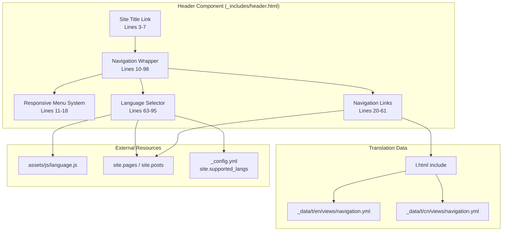
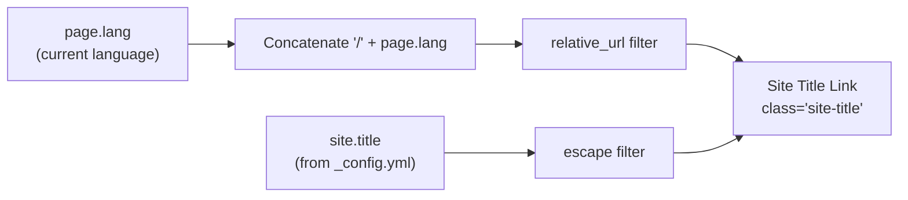
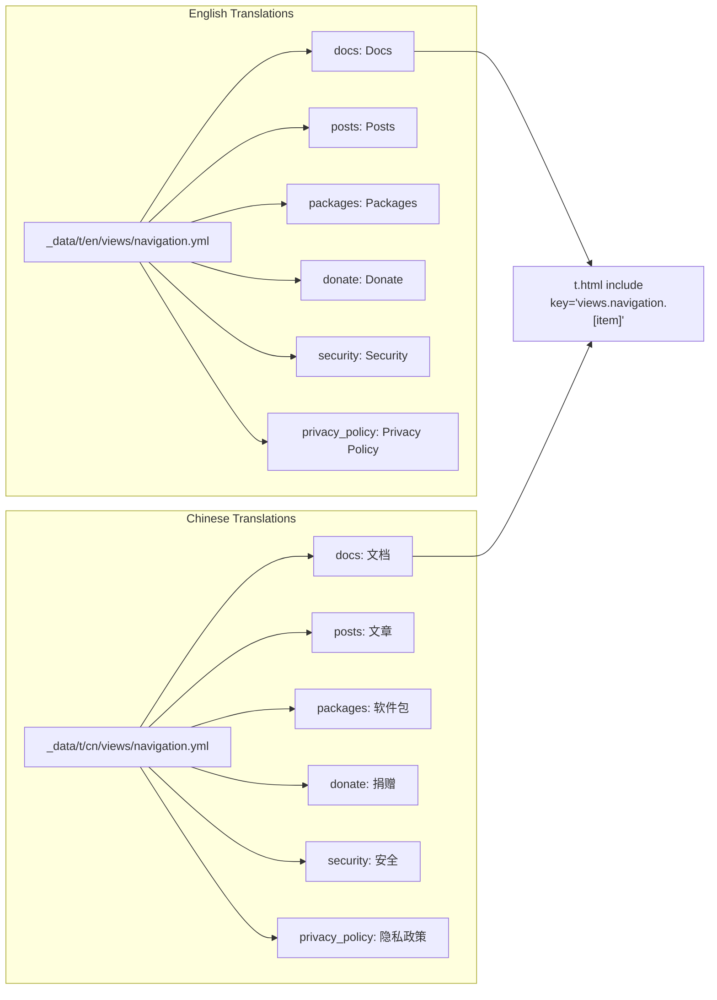
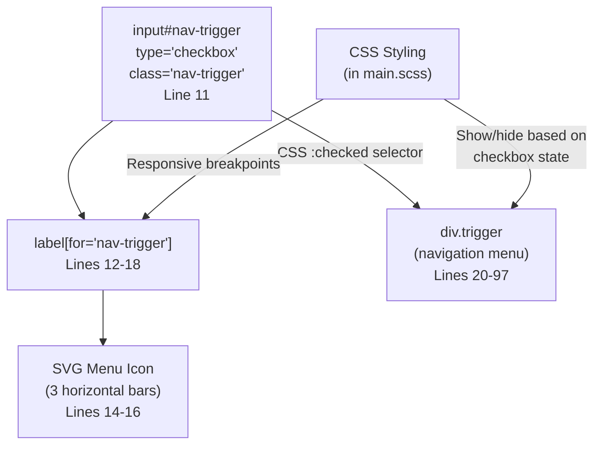
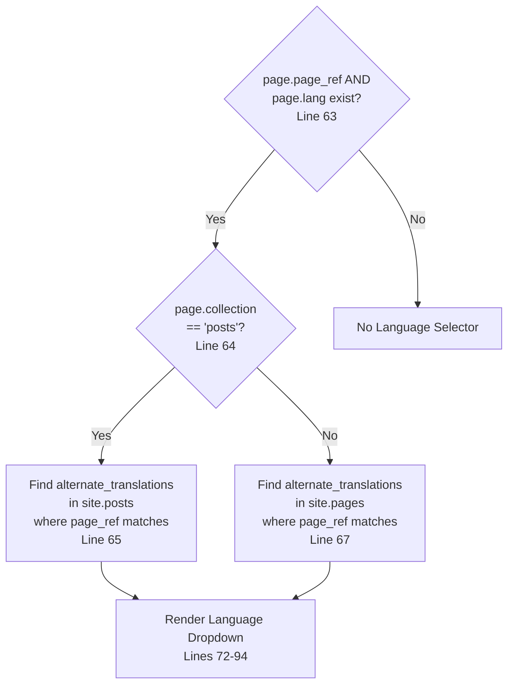
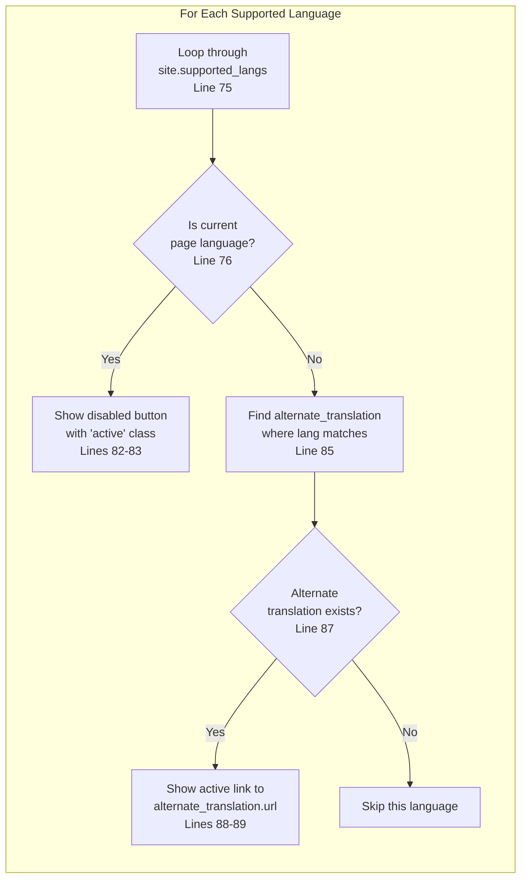
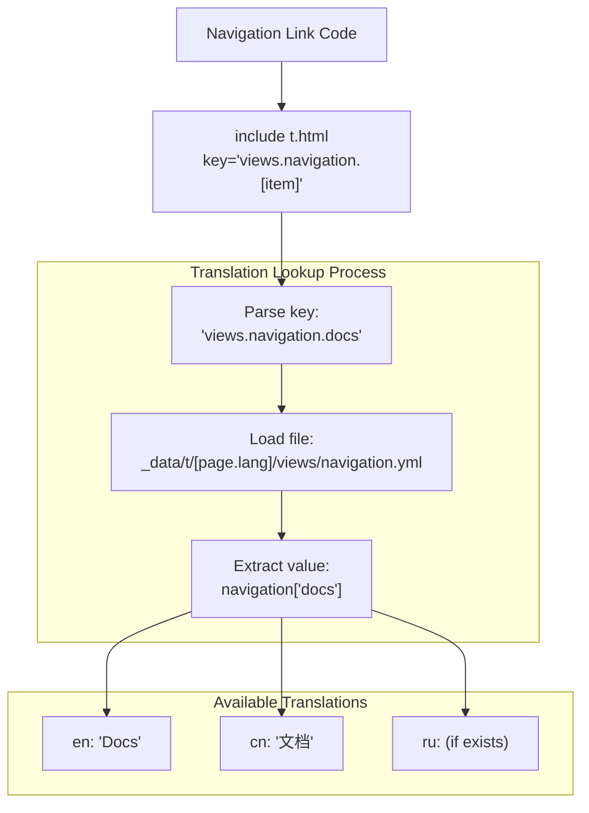
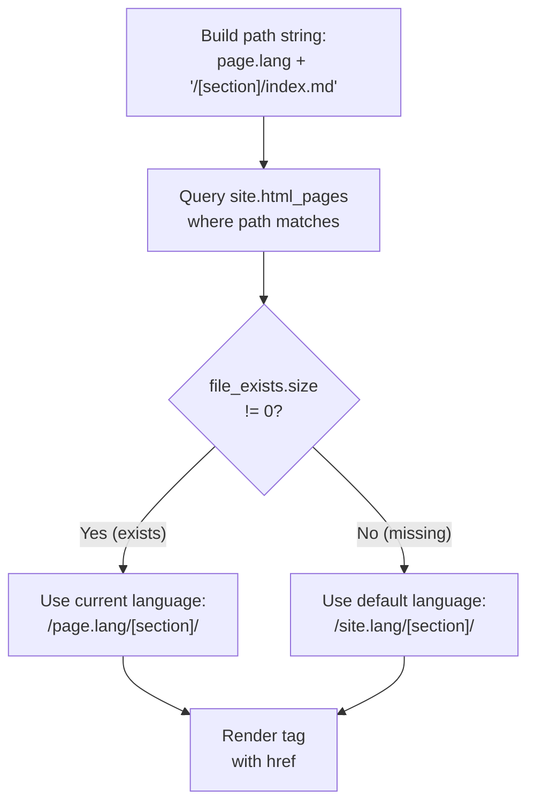
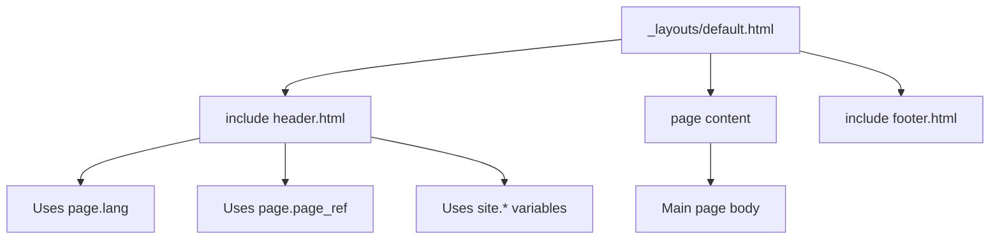

<!-- source: DeepWiki mcp.deepwiki.com · repo termux/termux.github.io · page 5.2 Header and Navigation · fetched 2026-10-26 -->

# Header and Navigation

<details>
<summary>Relevant source files</summary>

The following files were used as context for generating this wiki page:

- [_data/t/cn/views/home.yml](_data/t/cn/views/home.yml)
- [_data/t/cn/views/navigation.yml](_data/t/cn/views/navigation.yml)
- [_data/t/en/views/navigation.yml](_data/t/en/views/navigation.yml)
- [_includes/header.html](_includes/header.html)
- [index.md](index.md)

</details>


## Purpose and Scope

This document describes the header component and navigation system used across the Termux website. The header provides site-wide navigation, branding, and language selection functionality. For information about the overall layout hierarchy, see [Layout System](#5.1). For footer and social media components, see [Footer and Social Media](#5.3).

The header component is implemented in `_includes/header.html` and is included in the base layout template. It provides:
- Site branding with language-aware homepage links
- Main navigation menu with responsive design
- Language selector dropdown for multilingual content
- Fallback logic for missing translations

**Sources:** [_includes/header.html:1-101]()

---

## Component Architecture

The header component consists of four primary subsystems that work together to provide navigation functionality:



**Sources:** [_includes/header.html:1-101]()

---

## Site Title and Branding

The site title appears in the top-left corner of the header and serves as a link to the language-specific homepage.

### Title Link Construction

The site title link is constructed dynamically based on the current page's language:



**Implementation Details:**

| Line | Code Element | Purpose |
|------|-------------|---------|
| [_includes/header.html:6]() | `` | Constructs language-specific path |
| [_includes/header.html:7]() | `<a class="site-title" rel="author" href="{{- path \| relative_url -}}">` | Creates link with proper URL |
| [_includes/header.html:7]() | `{{- site.title \| escape -}}` | Displays site title from config |

**Sources:** [_includes/header.html:3-7]()

---

## Navigation Menu Structure

The main navigation menu provides links to key sections of the site. Each link uses a consistent pattern with language-aware paths and translation lookups.

### Navigation Links

The header includes six primary navigation items:

| Navigation Item | Translation Key | Target | Line Reference |
|----------------|----------------|--------|----------------|
| Docs | `views.navigation.docs` | `/[lang]/docs/index.html` | [_includes/header.html:21-27]() |
| Posts | `views.navigation.posts` | `/[lang]/posts/index.html` | [_includes/header.html:29-35]() |
| Packages | `views.navigation.packages` | `https://packages.termux.dev` | [_includes/header.html:37]() |
| Donate | `views.navigation.donate` | `/[lang]/donate` | [_includes/header.html:39-45]() |
| Security | `views.navigation.security` | `/[lang]/security` | [_includes/header.html:47-53]() |
| Privacy Policy | `views.navigation.privacy_policy` | `/[lang]/privacy-policy` | [_includes/header.html:55-61]() |

### Translation Data Structure

Navigation labels are stored in language-specific YAML files:



**Sources:** [_data/t/en/views/navigation.yml:1-13](), [_data/t/cn/views/navigation.yml:1-13]()

---

## Responsive Design Implementation

The header uses a checkbox-based hamburger menu system for mobile devices, implementing responsive navigation without JavaScript.

### Hamburger Menu Mechanism



**Component Breakdown:**

| Element | Type | Purpose | Line Reference |
|---------|------|---------|----------------|
| `#nav-trigger` | `<input type="checkbox">` | Controls menu visibility state | [_includes/header.html:11]() |
| `.nav-trigger` (class) | CSS class | Hidden checkbox for state management | [_includes/header.html:11]() |
| `label[for="nav-trigger"]` | `<label>` | Clickable area for toggling menu | [_includes/header.html:12-18]() |
| `.menu-icon` | SVG container | Displays hamburger icon | [_includes/header.html:13-17]() |
| `.trigger` | `<div>` | Contains all navigation links | [_includes/header.html:20]() |

**SVG Icon Path:**

The hamburger menu icon consists of three horizontal bars defined by SVG paths at [_includes/header.html:15]():
- Top bar: `M18,1.484...`
- Middle bar: `M18,7.516...`
- Bottom bar: `M18,13.516...`

**Sources:** [_includes/header.html:11-18]()

---

## Language Selector Dropdown

The language selector allows users to switch between available translations of the current page. It appears only when a page has alternate language versions.

### Language Selector Logic Flow



### Dropdown Implementation

The dropdown consists of three key components:

| Component | Element | Purpose | Line Reference |
|-----------|---------|---------|----------------|
| JavaScript | `<script src="/assets/js/language.js">` | Toggle dropdown visibility | [_includes/header.html:71]() |
| Button | `<button onclick="toggleLanguageSelector()" class="dropbtn">` | Display current language | [_includes/header.html:73]() |
| Dropdown Content | `<div id="languageDropdown" class="dropdown-content">` | List of available languages | [_includes/header.html:74-93]() |

### Language Link Generation



**Key Variables:**

- `alternate_translations`: Array of all pages/posts with matching `page_ref`, sorted by language ([_includes/header.html:65-67]())
- `site.supported_langs`: List of languages configured in `_config.yml` ([_includes/header.html:75]())
- `alternate_translation`: Single page matching the current loop language ([_includes/header.html:85]())

**Sources:** [_includes/header.html:63-95]()

---

## Translation System Integration

The header component integrates with the site's translation system to display localized navigation labels.

### Translation Include Usage

Every navigation link uses the `t.html` include to fetch localized text:



**Example Pattern (Docs Link):**

```
Line 24: 
```

This references:
- English: `_data/t/en/views/navigation.yml` → `docs: Docs`
- Chinese: `_data/t/cn/views/navigation.yml` → `docs: 文档`

**Sources:** [_includes/header.html:24](), [_data/t/en/views/navigation.yml:3](), [_data/t/cn/views/navigation.yml:3]()

---

## Link Fallback Logic

The header implements intelligent fallback logic to handle missing translations. When a page doesn't exist in the current language, it falls back to the site's default language.

### Fallback Pattern

Each internal navigation link follows this pattern:



### Implementation Example (Docs Link)

| Step | Code | Line Reference |
|------|------|----------------|
| 1. Build path | `` | [_includes/header.html:21]() |
| 2. Check existence | `` | [_includes/header.html:22]() |
| 3. Test condition | `` | [_includes/header.html:23]() |
| 4a. Use current lang | `<a class="page-link" href="/{{- page.lang -}}/docs/index.html">` | [_includes/header.html:24]() |
| 4b. Use default lang | `<a class="page-link" href="/{{- site.lang -}}/docs/index.html">` | [_includes/header.html:26]() |

### Fallback Pattern Coverage

All internal navigation links implement this fallback pattern:

| Link | Path Pattern | Fallback Lines |
|------|-------------|----------------|
| Docs | `[lang]/docs/index.md` | [_includes/header.html:21-27]() |
| Posts | `[lang]/posts/index.md` | [_includes/header.html:29-35]() |
| Donate | `[lang]/donate.md` | [_includes/header.html:39-45]() |
| Security | `[lang]/security.md` | [_includes/header.html:47-53]() |
| Privacy Policy | `[lang]/privacy-policy.md` | [_includes/header.html:55-61]() |

**Note:** The Packages link ([_includes/header.html:37]()) does not use fallback logic as it links to an external URL (`https://packages.termux.dev`).

**Sources:** [_includes/header.html:21-61]()

---

## CSS Classes and Styling

The header component uses specific CSS classes for styling and functionality:

### Class Reference Table

| Class Name | Element | Purpose | Usage Context |
|------------|---------|---------|---------------|
| `.site-header` | `<header>` | Main header container styling | [_includes/header.html:1]() |
| `.wrapper` | `<div>` | Content width constraint | [_includes/header.html:3]() |
| `.site-title` | `<a>` | Site branding link styling | [_includes/header.html:7]() |
| `.site-nav` | `<nav>` | Navigation container | [_includes/header.html:10]() |
| `.nav-trigger` | `<input>` | Hidden checkbox for responsive menu | [_includes/header.html:11]() |
| `.menu-icon` | `<span>` | Hamburger icon container | [_includes/header.html:13]() |
| `.trigger` | `<div>` | Navigation links wrapper | [_includes/header.html:20]() |
| `.page-link` | `<a>` | Individual navigation link | [_includes/header.html:24]() and others |
| `.dropdown` | `<div>` | Language selector container | [_includes/header.html:72]() |
| `.dropbtn` | `<button>` | Language selector button | [_includes/header.html:73]() |
| `.dropdown-content` | `<div>` | Language options list | [_includes/header.html:74]() |
| `.btn.btn-secondary.nav-link` | `<a>` | Language option buttons | [_includes/header.html:82](), [_includes/header.html:88]() |
| `.active.disabled` | `<a>` | Current language indicator | [_includes/header.html:82]() |

**Sources:** [_includes/header.html:1-101]()

---

## Integration with Page Layout

The header component is included in the default layout template and appears on every page:



**Required Page Variables:**

For full header functionality, pages should define:

| Variable | Type | Purpose | Used In |
|----------|------|---------|---------|
| `page.lang` | String | Current page language | Site title link, navigation fallbacks, language selector |
| `page.page_ref` | String | Language-agnostic page identifier | Language selector alternate translations |
| `page.collection` | String | Jekyll collection name | Determines whether to search posts or pages for translations |

**Required Site Variables:**

From `_config.yml`:

| Variable | Type | Purpose | Used In |
|----------|------|---------|---------|
| `site.title` | String | Site name | Site title display |
| `site.lang` | String | Default site language | Fallback navigation links |
| `site.supported_langs` | Array | List of supported languages | Language selector dropdown |
| `site.header_pages` | Array | Pages to include in navigation (optional) | Page path filtering |

**Sources:** [_includes/header.html:4-7](), [_includes/header.html:63-95]()

---

