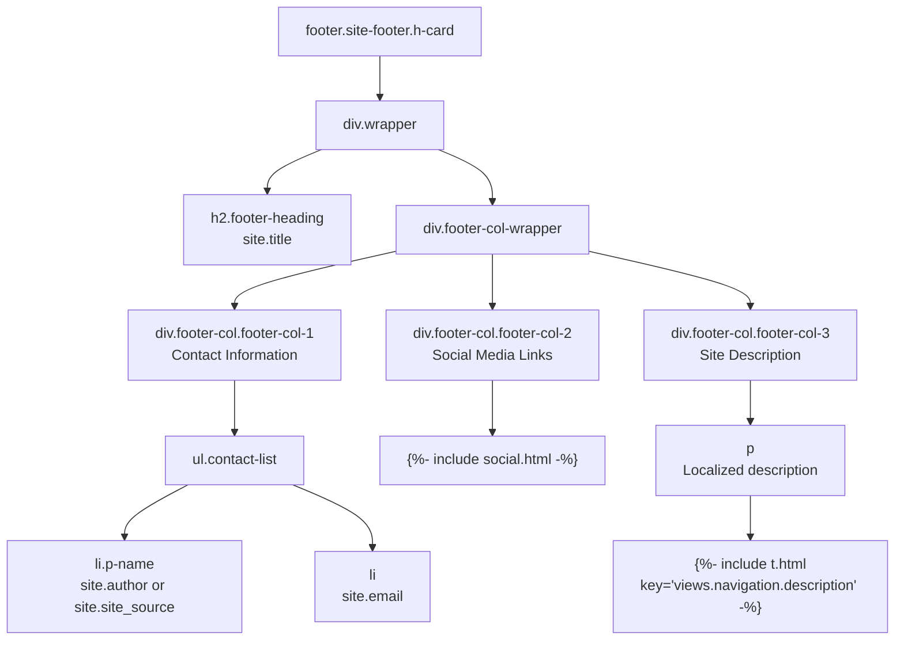
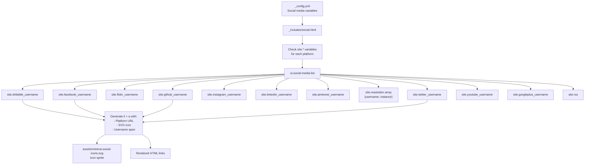
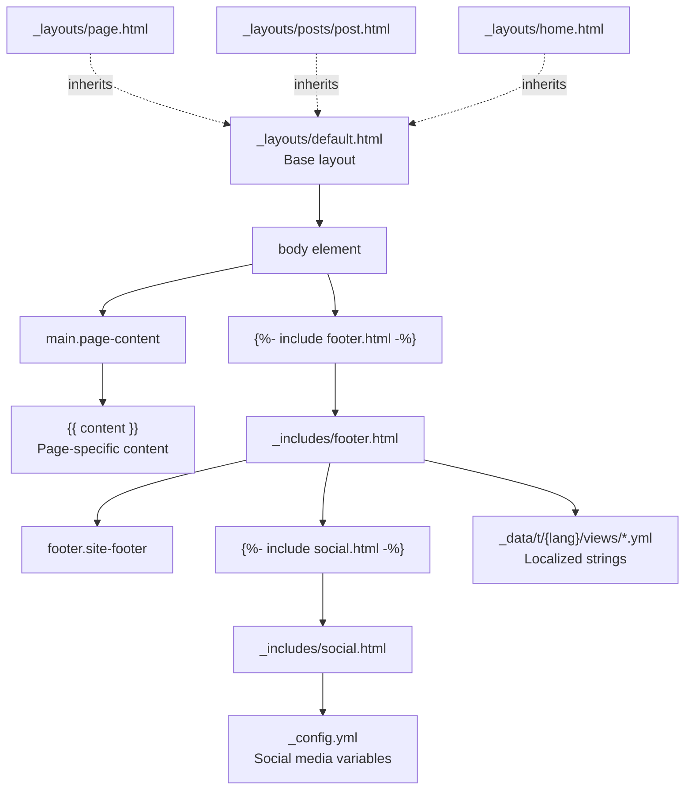

<!-- source: DeepWiki mcp.deepwiki.com · repo termux/termux.github.io · page 5.3 Footer and Social Media · fetched 2026-10-26 -->

# Footer and Social Media

<details>
<summary>Relevant source files</summary>

The following files were used as context for generating this wiki page:

- [_includes/disqus_comments.html](_includes/disqus_comments.html)
- [_includes/footer.html](_includes/footer.html)
- [_includes/head.html](_includes/head.html)
- [_includes/social.html](_includes/social.html)

</details>


## Purpose and Scope

This document describes the footer component and social media link system used throughout the termux.dev website. The footer appears on all pages via the `default.html` layout (see [Layout System](#5.1)) and provides consistent site-wide information including contact details, social media links, and a site description. The social media component is a reusable include that generates platform links based on site configuration.

For information about the header and navigation system, see [Header and Navigation](#5.2). For overall styling of these components, see [Styling System](#5.5).

---

## Footer Component Structure

The footer is implemented in [_includes/footer.html:1-36]() and follows a three-column responsive layout pattern. The component is structured as a semantic HTML5 `<footer>` element with microformats markup (`h-card` class) for enhanced machine readability.

### Three-Column Layout

The footer divides content into three distinct columns using a flexbox-based wrapper system:



**Sources:** [_includes/footer.html:1-36]()

### Column 1: Contact Information

The first column displays contact details through a `contact-list` unordered list [_includes/footer.html:10-22](). This column conditionally renders two types of information:

| Element | Condition | Content |
|---------|-----------|---------|
| Author/Source Link | `site.author` or `site.site_source` | Either displays the author name or a link to the site source repository with localized text from `views.navigation.site_source` |
| Email Address | `site.email` | Displays a `mailto:` link with the configured email address |

The author name element uses the `p-name` microformat class for structured data [_includes/footer.html:11]().

**Sources:** [_includes/footer.html:10-22]()

### Column 2: Social Media Links

The second column contains the social media component by including `social.html` [_includes/footer.html:24-26](). This is the only content in this column, allowing the social media list to expand as needed based on configured platforms.

**Sources:** [_includes/footer.html:24-26]()

### Column 3: Site Description

The third column displays a localized site description [_includes/footer.html:28-30](). The description text is retrieved using the `t.html` translation include with the key `views.navigation.description`, ensuring the description appears in the appropriate language for each page.

**Sources:** [_includes/footer.html:28-30]()

---

## Social Media Component

The social media component [_includes/social.html:1-14]() is a standalone include that generates a list of social media links based on site configuration variables. It supports multiple platforms and uses SVG icons for visual presentation.

### Architecture and Flow



**Sources:** [_includes/social.html:1-14]()

### Supported Platforms

The component supports 12 different social media platforms and services. Each platform follows a consistent pattern with minor variations:

| Platform | Variable Name | URL Pattern | Special Handling |
|----------|--------------|-------------|------------------|
| Dribbble | `site.dribbble_username` | `https://dribbble.com/{username}` | Standard |
| Facebook | `site.facebook_username` | `https://www.facebook.com/{username}` | Standard |
| Flickr | `site.flickr_username` | `https://www.flickr.com/photos/{username}` | Standard |
| GitHub | `site.github_username` | `https://github.com/{username}` | Standard |
| Instagram | `site.instagram_username` | `https://instagram.com/{username}` | Standard |
| LinkedIn | `site.linkedin_username` | `https://www.linkedin.com/in/{username}` | Standard |
| Pinterest | `site.pinterest_username` | `https://www.pinterest.com/{username}` | Standard |
| Mastodon | `site.mastodon` array | `https://{instance}/@{username}` | Array with `username` and `instance` keys, includes `rel="me"` attribute |
| Twitter | `site.twitter_username` | `https://www.twitter.com/{username}` | Standard |
| YouTube | `site.youtube_username` | `https://youtube.com/{username}` | Standard |
| Google+ | `site.googleplus_username` | `https://plus.google.com/{username}` | Standard (deprecated platform) |
| RSS | `site.rss` | `{site.baseurl}/feed.xml` | Uses relative URL, displays custom text instead of username |

**Sources:** [_includes/social.html:2-13]()

### Link Generation Pattern

Each platform link follows a consistent structure using Liquid conditionals [_includes/social.html:2-12]():

1. **Conditional Rendering**: Links are only rendered if the corresponding configuration variable is set using ``
2. **URL Construction**: Platform URL is built using the username with security filters applied
3. **Security Filters**: All usernames pass through `cgi_escape` and `escape` filters to prevent XSS attacks
4. **Icon System**: SVG icons are referenced using `<use xlink:href>` pointing to specific fragments in `assets/minima-social-icons.svg`
5. **Username Display**: The username is displayed in a `<span class="username">` element alongside the icon

Example structure for GitHub [_includes/social.html:5]():
```
<li>
  <a href="https://github.com/{escaped_username}">
    <svg class="svg-icon">
      <use xlink:href="/assets/minima-social-icons.svg#github"></use>
    </svg>
    <span class="username">{escaped_username}</span>
  </a>
</li>
```

**Sources:** [_includes/social.html:2-12]()

### Mastodon Special Handling

Mastodon integration differs from other platforms due to its federated nature [_includes/social.html:9]():

1. **Array Structure**: Configuration uses `site.mastodon` as an array rather than a single string
2. **Dual Components**: Each Mastodon account requires both `username` and `instance` keys
3. **Iteration**: Uses `` to support multiple Mastodon accounts
4. **Verification Attribute**: Includes `rel="me"` attribute for identity verification per Mastodon standards
5. **URL Construction**: Builds URL as `https://{instance}/@{username}`

This design allows a single site to link to multiple Mastodon accounts across different instances.

**Sources:** [_includes/social.html:9]()

### RSS Feed Integration

The RSS link provides access to the site's feed.xml [_includes/social.html:13]():

1. **Link Text**: Uses `site.rss` variable as display text instead of a username
2. **Relative URL**: Uses `relative_url` filter to generate proper path to `feed.xml`
3. **Feed Generation**: The actual feed is generated by Jekyll's feed plugin (see [Jekyll and Dependencies](#2.1))

**Sources:** [_includes/social.html:13]()

---

## Configuration

Social media links are configured through site-wide variables in `_config.yml`. The footer component reads these variables at build time to determine which links to display.

### Configuration Variables

To add social media links to the footer, define the corresponding variables in `_config.yml`:

```yaml
# Standard platforms (username only)
github_username: termux
twitter_username: termux_app

# Mastodon (requires instance and username)
mastodon:
  - username: termux
    instance: fosstodon.org

# RSS feed (custom text)
rss: Subscribe via RSS
```

### Adding or Removing Platforms

| Action | Steps |
|--------|-------|
| **Add Link** | Define the platform's username variable in `_config.yml` |
| **Remove Link** | Delete or comment out the variable in `_config.yml` |
| **Add New Platform** | Requires modifying [_includes/social.html]() to add new conditional block and ensure corresponding icon exists in SVG sprite |

The component automatically includes or excludes links based on variable presence—no changes to template files are needed for standard operations.

**Sources:** [_includes/social.html:1-14](), [_includes/footer.html:24-26]()

---

## Integration with Layout System

The footer component integrates into the overall site structure through the layout hierarchy:



**Sources:** [_includes/footer.html:1-36](), [_includes/social.html:1-14]()

### Inheritance Pattern

1. **Default Layout**: The `default.html` layout includes the footer after the main content area
2. **Child Layouts**: All page layouts (page, post, home, redirect) inherit from `default.html` and automatically include the footer
3. **Consistent Placement**: The footer appears in the same position across all pages regardless of layout type

This ensures footer consistency across the entire site while requiring maintenance in only one location.

**Sources:** [_includes/footer.html:1-36]()

---

## Localization Support

The footer component integrates with the site's translation system (see [Translation and Localization Data](#3.2)):

### Localized Elements

| Element | Translation Key | Location |
|---------|----------------|----------|
| Site Source Link | `views.navigation.site_source` | [_includes/footer.html:15]() |
| Site Description | `views.navigation.description` | [_includes/footer.html:29]() |

### Translation Mechanism

The footer uses the `t.html` include to retrieve localized strings:

```liquid

```

This include:
1. Reads the current page's `lang` variable
2. Looks up the corresponding translation file in `_data/t/{lang}/views/`
3. Returns the appropriate translated string
4. Falls back to a default if translation is missing

The social media component itself does not require translation as platform names and usernames are language-agnostic.

**Sources:** [_includes/footer.html:15](), [_includes/footer.html:29]()

---

## Styling and Responsive Design

While detailed styling is covered in [Styling System](#5.5), the footer uses several CSS classes that control its appearance:

| Class | Purpose |
|-------|---------|
| `site-footer` | Main footer container styling |
| `h-card` | Microformat for contact information |
| `footer-heading` | Styles the footer title |
| `footer-col-wrapper` | Flexbox container for columns |
| `footer-col-1`, `footer-col-2`, `footer-col-3` | Individual column sizing and responsive breakpoints |
| `contact-list` | Removes default list styling from contact information |
| `social-media-list` | Removes default list styling and provides horizontal layout for social links |
| `svg-icon` | Sizes and colors social media icons |

The footer columns stack vertically on narrow screens and display side-by-side on wider viewports, following a mobile-first responsive design pattern.

**Sources:** [_includes/footer.html:1-36](), [_includes/social.html:1]()

---

