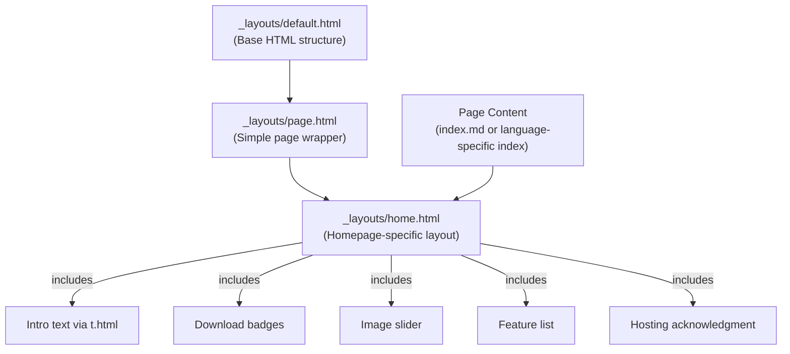
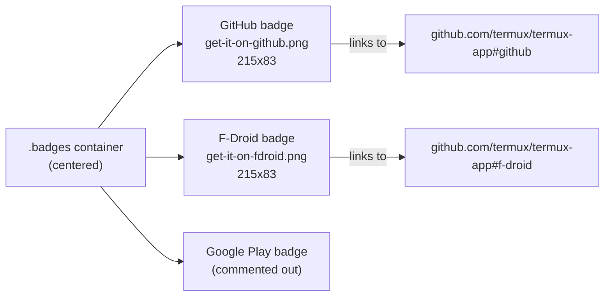
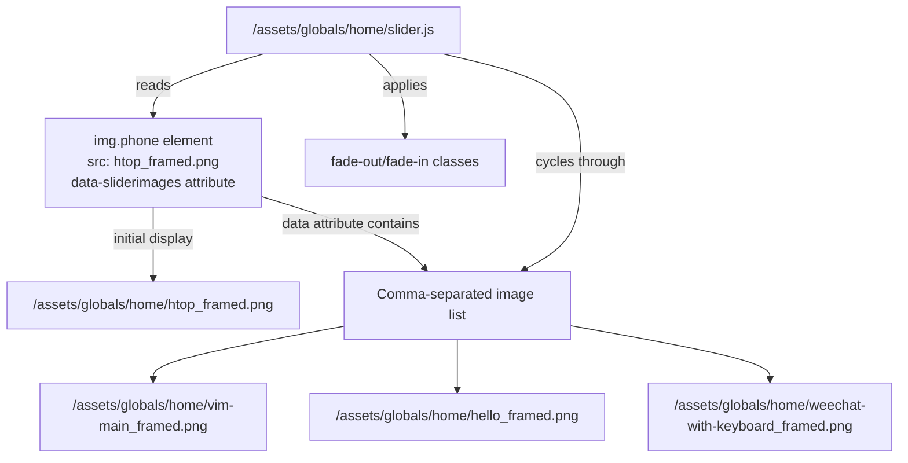
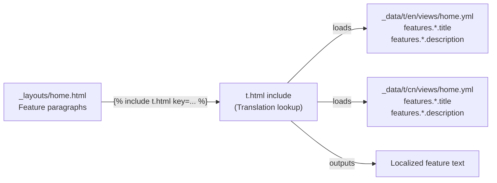
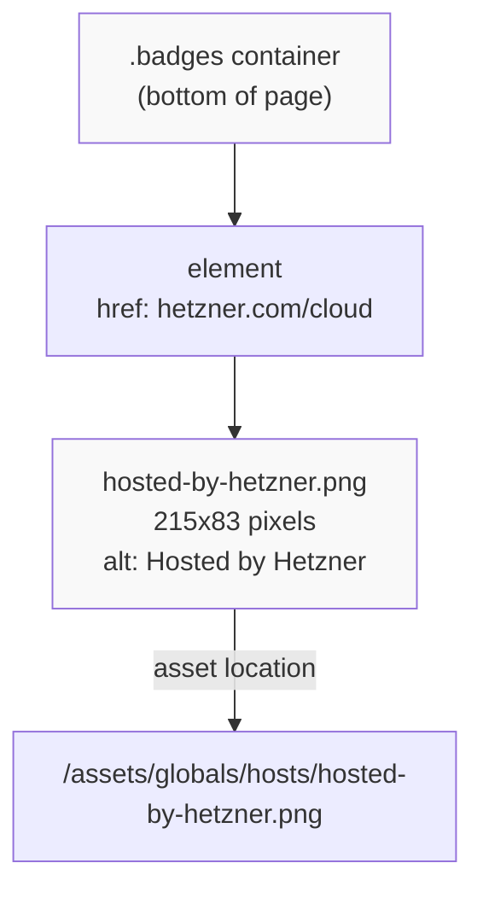
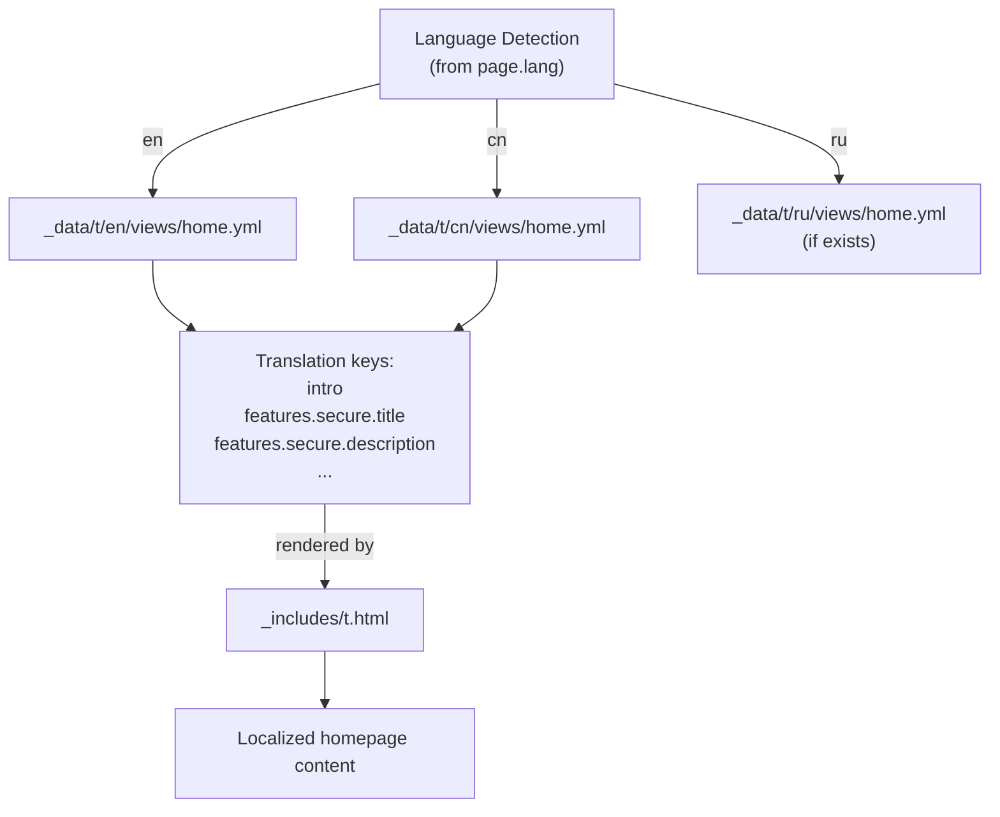
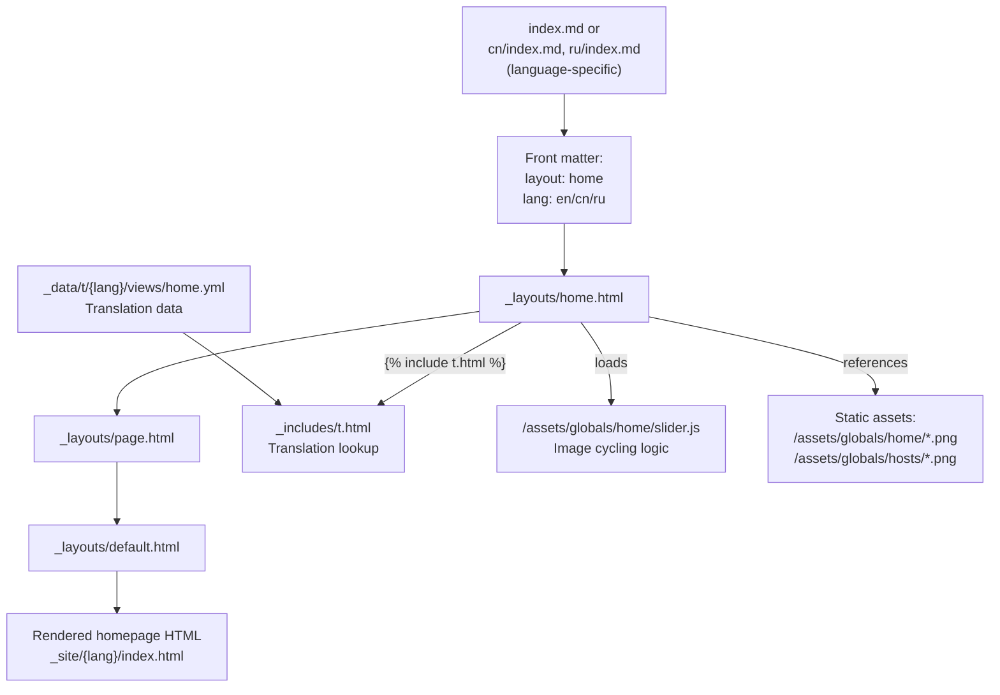

<!-- source: DeepWiki mcp.deepwiki.com · repo termux/termux.github.io · page 5.4 Homepage Design · fetched 2026-10-26 -->

# Homepage Design

<details>
<summary>Relevant source files</summary>

The following files were used as context for generating this wiki page:

- [_data/t/cn/views/home.yml](_data/t/cn/views/home.yml)
- [_data/t/cn/views/navigation.yml](_data/t/cn/views/navigation.yml)
- [_layouts/home.html](_layouts/home.html)
- [assets/globals/hosts/hosted-by-hetzner.png](assets/globals/hosts/hosted-by-hetzner.png)
- [en/docs/index.md](en/docs/index.md)
- [en/privacy-policy.md](en/privacy-policy.md)

</details>


## Purpose and Scope

This document describes the homepage layout implementation, including its structure, custom styling, download badge system, image slider functionality, feature presentation system, and hosting acknowledgments. The homepage serves as the landing page for termux.dev and presents key information about the Termux project to visitors.

For information about the overall layout system hierarchy, see [Layout System](#5.1). For details on the translation system used throughout the homepage, see [Translation and Localization Data](#3.2).

---

## Layout Structure

The homepage is implemented in [`_layouts/home.html`]() and inherits from the `page` layout. The inheritance chain is: `home.html` → `page.html` → `default.html`.

The homepage uses the `no_add_title_heading: true` front matter variable to prevent automatic title heading generation, allowing for custom title styling through the `.home-title` class.

**Layout Hierarchy:**



Sources: [_layouts/home.html:1-4]()

---

## Custom Styling

The homepage defines inline CSS for layout-specific styling within the `<header class="home-header">` section. This approach keeps homepage-specific styles self-contained.

### Key Style Classes

| Class | Purpose | Responsive Behavior |
|-------|---------|---------------------|
| `.first` | Bold formatting for feature titles | None |
| `.wiki` | Center-aligned text | None |
| `img` | General image styling with auto margins | Max-width: 100%, auto height |
| `img.phone:first-of-type` | Phone screenshot positioning | Desktop: floats right; Mobile: block display |
| `.badges` | Centers download and hosting badges | None |
| `.fade-out` / `.fade-in` | Opacity transitions for image slider | 1-second transition |

### Responsive Layout Breakpoint

The phone screenshot image uses a media query at 500px to switch between mobile and desktop layouts:

- **Mobile (< 500px)**: Image displayed as block element with top margin
- **Desktop (≥ 500px)**: Image floated to the right with side margins

Sources: [_layouts/home.html:10-23]()

---

## Download Badges System

The homepage displays download badges that link to installation sources for the Termux app.

### Badge Implementation



### Badge Configuration

Each badge is implemented as an anchor-wrapped image:

- **Image dimensions**: 215×83 pixels (consistent sizing)
- **Image location**: `/assets/globals/hosts/` directory
- **Link targets**: Point to specific sections in termux-app repository README

The Google Play badge is commented out, reflecting the deprecation of the Play Store version as noted in the link text.

Sources: [_layouts/home.html:31-38]()

---

## Image Slider System

The homepage features an automatic image slider that cycles through screenshots of Termux in action.

### Slider Architecture



### Technical Implementation

The slider uses a custom data attribute approach:

| Attribute | Value | Purpose |
|-----------|-------|---------|
| `src` | `/assets/globals/home/htop_framed.png` | Initial image displayed |
| `data-sliderimages` | Comma-separated list of image paths | Additional images to cycle through |
| `width` | 305 | Fixed width for phone screenshots |
| `height` | 600 | Fixed height for phone screenshots |

The JavaScript file `/assets/globals/home/slider.js` handles the automatic cycling logic using the `.fade-out` and `.fade-in` CSS classes for smooth transitions.

Sources: [_layouts/home.html:40](), [_layouts/home.html:68](), [_layouts/home.html:21-22]()

---

## Feature Presentation System

The homepage presents seven key features of Termux, each with a title and description loaded from translation data files.

### Feature Data Flow



### Feature List

Each feature follows the same structural pattern:

```
<p><strong class="first"></strong> 
</p>
```

**Seven Features:**

1. **secure** - SSH client access and open-source security
2. **feature_packed** - Shell and editor choices (bash, fish, zsh; nano, Emacs, Vim)
3. **customizable** - APT package manager integration
4. **explorable** - Manual pages and experimentation
5. **portable** - Scripting language availability (Python, Ruby, Node.js, Perl)
6. **scalable** - External keyboard and display support
7. **tinkerable** - Development tools (Clang, Go, Rust, Swift, CMake)

### Translation Key Structure

Translation keys follow the pattern: `views.home.features.<feature_name>.<property>`

Example from Chinese translation file:

```yaml
features:
  secure:
    title: 安全性
    description: >-
      使用来自 OpenSSH 的 ssh 客户端访问远程服务器。
      Termux 将标准的软件包与仿真终端结合在一个完美的开源解决方案中。
```

Sources: [_layouts/home.html:42-61](), [_data/t/cn/views/home.yml:8-49]()

---

## Hosting Acknowledgments

The homepage includes a badge acknowledging Hetzner's hosting of the primary package repository.

### Acknowledgment Implementation



The badge uses the same `.badges` container class as the download badges for consistent center alignment. The badge links to `https://www.hetzner.com/cloud` and uses a PNG image with the same 215×83 dimensions as the download badges.

This acknowledgment is important as Hetzner hosts the primary package repository at `packages.termux.dev`, as documented in the privacy policy and package distribution infrastructure.

Sources: [_layouts/home.html:63-66](), [assets/globals/hosts/hosted-by-hetzner.png:1-10]()

---

## Translation Integration

The homepage is fully localized through the translation system, loading all user-facing text from language-specific YAML files.

### Translation Points

| Content Type | Translation Key | Located In |
|--------------|-----------------|------------|
| Introduction paragraph | `views.home.intro` | After `{{ content }}` |
| Feature titles | `views.home.features.<feature>.title` | Seven feature paragraphs |
| Feature descriptions | `views.home.features.<feature>.description` | Seven feature paragraphs |

### Example Translation Usage

```liquid
<p></p>
```

This pattern is repeated throughout the page, using the `t.html` include to look up and render localized strings based on the page's language context.

### Translation File Structure



The Chinese translation file demonstrates the complete localization, including formatted HTML within YAML multiline strings (using the `>-` syntax for proper string handling).

Sources: [_layouts/home.html:29](), [_layouts/home.html:42-61](), [_data/t/cn/views/home.yml:1-49]()

---

## Complete Homepage Rendering Pipeline



Sources: [_layouts/home.html:1-69](), [_data/t/cn/views/home.yml:1-49]()

---

