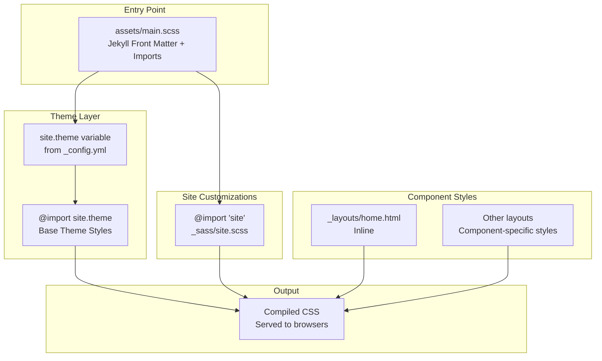
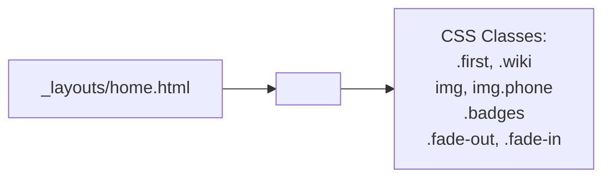
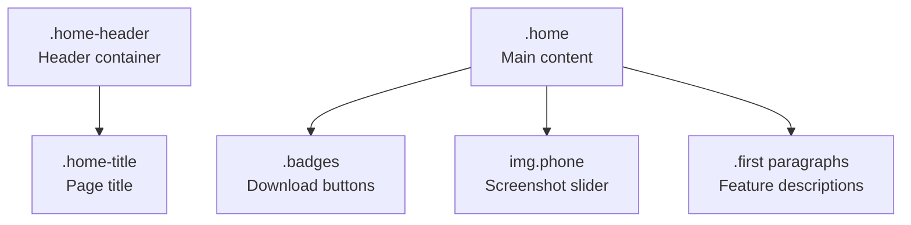
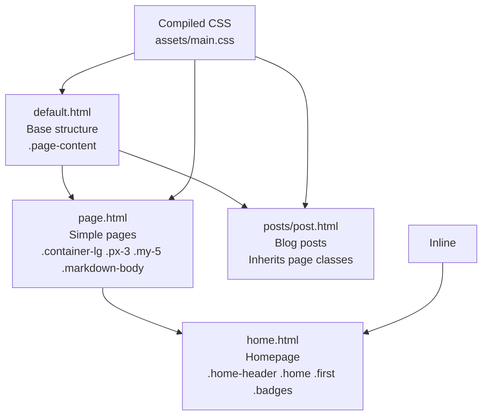

<!-- source: DeepWiki mcp.deepwiki.com · repo termux/termux.github.io · page 5.5 Styling System · fetched 2026-10-26 -->

# Styling System

<details>
<summary>Relevant source files</summary>

The following files were used as context for generating this wiki page:

- [_layouts/default.html](_layouts/default.html)
- [_layouts/home.html](_layouts/home.html)
- [_layouts/page.html](_layouts/page.html)
- [assets/globals/hosts/hosted-by-hetzner.png](assets/globals/hosts/hosted-by-hetzner.png)
- [assets/main.scss](assets/main.scss)
- [en/docs/index.md](en/docs/index.md)
- [en/privacy-policy.md](en/privacy-policy.md)

</details>


## Purpose and Scope

This document describes the SCSS/CSS architecture used to style the termux.github.io website. It covers the main stylesheet entry point, theme imports, site-specific customizations, and styling patterns used across layouts and components.

For information about the layout templates that these styles are applied to, see [Layout System](#5.1). For specific component styling implementations, see [Header and Navigation](#5.2), [Footer and Social Media](#5.3), and [Homepage Design](#5.4).

---

## SCSS Architecture Overview

The styling system follows a layered architecture where Jekyll processes SCSS files to generate CSS. The system consists of three main layers: a base theme import, site-specific customizations, and component-level inline styles.



**Diagram: SCSS Processing Flow**

Sources: [assets/main.scss:1-8]()

---

## Main Entry Point

### File Structure

The primary stylesheet entry point is [`assets/main.scss`](). This file uses Jekyll front matter to trigger SCSS processing and imports the necessary stylesheets.

[assets/main.scss:1-8]()

```scss
---
# Only the main Sass file needs front matter (the dashes are enough)
---

@import "{{- site.theme -}}";

@import "site";
```

### Front Matter Requirement

The empty front matter (lines 1-3) is required to tell Jekyll to process this file through the SCSS compiler. Without this front matter, Jekyll would treat the file as a static asset and not process the SCSS syntax or Liquid variables.

### Import Order

The import order is significant:

1. **Theme Import** (line 5): `@import "{{- site.theme -}}";` dynamically imports the base theme specified in `_config.yml`. The Liquid template syntax `{{- site.theme -}}` is evaluated at build time.

2. **Site Overrides** (line 7): `@import "site";` imports the `_sass/site.scss` partial, which contains site-specific customizations that override or extend the base theme.

Sources: [assets/main.scss:1-8]()

---

## Theme System

### Theme Import Mechanism

The theme import uses Jekyll's SCSS processing with Liquid templating:

```
@import "{{- site.theme -}}";
```

This line:
- Evaluates the `site.theme` variable from `_config.yml` at build time
- The `{{- -}}` syntax strips whitespace
- Imports the corresponding SCSS/CSS from the theme gem or `_sass` directory

### Jekyll Theme Integration

Jekyll themes are typically distributed as Ruby gems that include:
- Layout templates (`_layouts/`)
- Include files (`_includes/`)
- SCSS partials (`_sass/`)
- Assets (`assets/`)

When a theme is specified in `_config.yml`, Jekyll automatically includes its `_sass` directory in the SCSS load path, making theme partials available for import.

Sources: [assets/main.scss:5]()

---

## Site-Specific Customizations

### Site Partial Import

The `@import "site";` statement loads site-specific CSS customizations from `_sass/site.scss`. This partial contains:
- Overrides for theme defaults
- Custom component styles not provided by the theme
- Site-specific spacing, colors, and typography adjustments

### Customization Pattern

This two-layer approach (theme + site overrides) provides:
- **Theme consistency**: Base styling from a maintained theme
- **Flexibility**: Ability to customize without modifying theme files
- **Maintainability**: Theme updates don't overwrite customizations
- **Clarity**: Clear separation between inherited and custom styles

Sources: [assets/main.scss:7]()

---

## CSS Class Conventions

### Framework Classes

The layouts use a consistent set of CSS classes that appear to come from a CSS framework (likely GitHub Primer or similar):

| Class | Purpose | Usage Example |
|-------|---------|---------------|
| `container-lg` | Large container with max-width | Page content wrapper |
| `px-3` | Horizontal padding (level 3) | Content spacing |
| `my-5` | Vertical margin (level 5) | Section spacing |
| `markdown-body` | Markdown content styling | Rendered markdown areas |
| `post-title` | Post title styling | Heading elements |
| `page-content` | Main content area | Content wrapper |

### Usage in Layouts

**Page Layout** [_layouts/page.html:5-11]():
```html
<div class="container-lg px-3 my-5 markdown-body">
  
    <h1 class="post-title">{{- page.title | escape -}}</h1>
  
  
  
</div>
```

**Default Layout** [_layouts/default.html:10-12]():
```html
<main class="page-content" aria-label="Content">
  {{ content }}
</main>
```

### Naming Convention

The class names follow a utility-first pattern:
- **Spacing classes**: `px-3` (padding-x), `my-5` (margin-y)
- **Size classes**: `container-lg` (large container)
- **Semantic classes**: `markdown-body`, `post-title`, `page-content`

Sources: [_layouts/page.html:5-11](), [_layouts/default.html:10-12]()

---

## Inline Styles in Layouts

### Homepage Inline Styles

The homepage layout includes inline `<style>` tags for component-specific styling that is only used on the homepage:



**Diagram: Homepage Inline Styles Structure**

[_layouts/home.html:10-23]():

| Selector | Purpose | Key Properties |
|----------|---------|----------------|
| `.first` | Bold feature headings | `font-weight: bold` |
| `.wiki` | Centered wiki section | `text-align: center` |
| `img` | Image spacing and sizing | `margin: 18px auto; max-width:100%; height:auto` |
| `img.phone:first-of-type` | Phone screenshot positioning | Responsive float/block with media query |
| `.badges` | Download badge container | `text-align: center; margin: auto` |
| `.fade-out`, `.fade-in` | Image slider transitions | `opacity` with 1s transition |

### Responsive Design Pattern

The homepage implements responsive design for the phone screenshot image:

[_layouts/home.html:14-18]():
```css
img.phone:first-of-type { margin-top: 3em; display: block; }
@media only screen and (min-width: 500px) {
  img.phone:first-of-type { margin-top: 0; margin-bottom: 0; margin-left: 1em; margin-right: 1em; float: right; }
}
```

**Behavior**:
- **Mobile** (< 500px): Image displays as a centered block with top margin
- **Desktop** (≥ 500px): Image floats right with horizontal margins, allowing text to wrap

### Rationale for Inline Styles

Inline styles are used in the homepage layout because:
1. **Scope**: These styles are unique to the homepage and not reused elsewhere
2. **Simplicity**: Avoids creating separate CSS files for single-use components
3. **Cohesion**: Keeps layout structure and styling together for easier maintenance
4. **Performance**: Eliminates additional HTTP requests for small style blocks

Sources: [_layouts/home.html:10-23](), [_layouts/home.html:14-18]()

---

## Component-Specific Styling

### Homepage Components

The homepage uses several styled components:



**Diagram: Homepage Component Hierarchy**

[_layouts/home.html:6-27]():
- `.home-header`: Wraps the page title
- `.home-title`: Styled page heading
- `.home`: Main content container containing all homepage elements

### Image Slider Integration

The phone screenshot uses a custom image slider with fade transitions:

[_layouts/home.html:40]():
```html

```

The `.fade-out` and `.fade-in` classes support JavaScript-driven transitions controlled by [`/assets/globals/home/slider.js`]() [_layouts/home.html:68]().

### Badge Containers

Download badges and hosting acknowledgments use the `.badges` class for centered layout:

[_layouts/home.html:31-38]():
- GitHub and F-Droid download buttons
- Centered with auto margins
- Responsive image sizing

[_layouts/home.html:63-66]():
- Hetzner hosting badge
- Same `.badges` styling for consistency

Sources: [_layouts/home.html:6-68](), [_layouts/home.html:40](), [_layouts/home.html:31-38](), [_layouts/home.html:63-66]()

---

## Styling Integration with Layouts

### Layout Hierarchy and Styles

The styling system integrates with the layout inheritance hierarchy:



**Diagram: Styling Application Across Layout Hierarchy**

### Style Cascade

1. **Base theme styles** apply to all layouts through `default.html`
2. **Site customizations** override theme defaults globally
3. **Framework utility classes** provide consistent spacing and structure
4. **Component inline styles** add specific styling where needed
5. **Layout-specific classes** organize content semantically

Sources: [_layouts/default.html:1-18](), [_layouts/page.html:1-12](), [_layouts/home.html:1-69]()

---

## Summary

The termux.github.io styling system uses a modular, layered approach:

| Layer | File/Location | Purpose |
|-------|---------------|---------|
| **Entry Point** | `assets/main.scss` | Triggers SCSS processing, imports theme and site styles |
| **Theme** | `@import "{{- site.theme -}}"` | Provides base styling from Jekyll theme gem |
| **Site Overrides** | `@import "site"` (from `_sass/site.scss`) | Site-specific customizations and extensions |
| **Utility Classes** | Various layouts | Framework classes for consistent spacing and layout |
| **Component Styles** | Inline `<style>` tags | Layout-specific styling for unique components |

This architecture provides:
- **Maintainability**: Clear separation of concerns
- **Flexibility**: Easy customization without theme modifications
- **Performance**: Compiled into a single CSS file with minimal inline additions
- **Consistency**: Framework classes ensure uniform spacing and typography
- **Responsiveness**: Media queries enable mobile-friendly layouts

Sources: [assets/main.scss:1-8](), [_layouts/home.html:1-69](), [_layouts/page.html:1-12](), [_layouts/default.html:1-18]()

---

