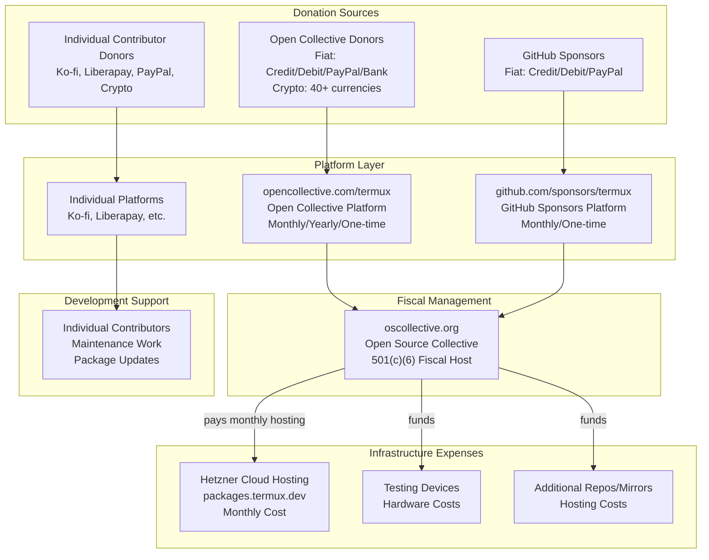
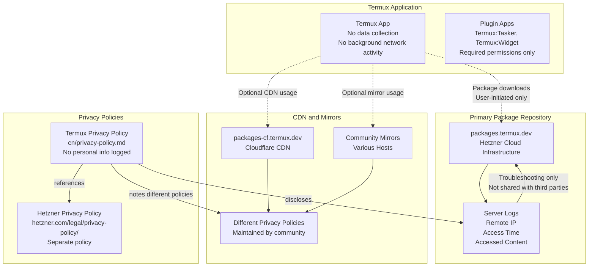

<!-- source: DeepWiki mcp.deepwiki.com · repo termux/termux.github.io · page 6 External Service Integrations · fetched 2026-10-26 -->

# External Service Integrations

Relevant source files

The following files were used as context for generating this wiki page:

- [cn/docs/index.md](cn/docs/index.md)
- [cn/donate.md](cn/donate.md)
- [cn/privacy-policy.md](cn/privacy-policy.md)
- [en/donate.md](en/donate.md)

This document describes the external services that the Termux project integrates with, depends on, or references. These services fall into three main categories: package distribution infrastructure, funding and financial services, and development/support platforms. Understanding these integrations is crucial for comprehending how the Termux ecosystem operates beyond the core application and packages.

For detailed information about specific subsystems, see:
- Package distribution technical details: [Package Distribution Infrastructure](#6.1)
- Funding mechanisms and donation channels: [Funding and Donation System](#6.2)
- Privacy practices and data collection policies: [Privacy Policy](#6.3)

## External Service Ecosystem

The Termux project depends on and integrates with multiple external services to provide package distribution, accept donations, manage development, and support the community. These services are documented across multiple content files and referenced throughout the site.

```mermaid
graph TB
    subgraph "Termux Website Content"
        DonatePage["en/donate.md<br/>cn/donate.md<br/>Donation Information"]
        PrivacyPage["cn/privacy-policy.md<br/>Privacy Disclosures"]
        DocsPage["cn/docs/index.md<br/>Documentation Links"]
    end
    
    subgraph "Package Distribution Services"
        Hetzner["packages.termux.dev<br/>Hetzner Cloud<br/>Primary Repository"]
        CloudflareCDN["packages-cf.termux.dev<br/>Cloudflare CDN<br/>CDN Mirror"]
        CommunityMirrors["Community Mirrors<br/>Various Hosts<br/>Third-party Infrastructure"]
    end
    
    subgraph "Financial Platform Services"
        OpenCollective["opencollective.com/termux<br/>Open Collective<br/>Recurring & One-time"]
        GitHubSponsors["github.com/sponsors/termux<br/>GitHub Sponsors<br/>Recurring & One-time"]
        OSCollective["oscollective.org<br/>Open Source Collective<br/>Fiscal Host"]
    end
    
    subgraph "Individual Contributor Channels"
        ApolloChannels["@agnostic-apollo<br/>Donations.md<br/>Multiple Methods"]
        GrimlerChannels["@grimler91<br/>ETH, Liberapay"]
        LandfillChannels["@landfillbaby<br/>Ko-fi, Liberapay, PayPal"]
        SylirreChannels["@sylirre<br/>Tron Crypto"]
        ThunderChannels["@thunder-coding<br/>Website"]
        MaxythonChannels["@maxython<br/>Ko-fi"]
        FornwallChannels["@fornwall<br/>PayPal, Patreon"]
    end
    
    subgraph "Development & Support Services"
        GitHubIssues["github.com/termux/*<br/>GitHub Issues<br/>Bug Tracking"]
        TermuxWiki["wiki.termux.com<br/>Termux Wiki<br/>Documentation"]
        FDroid["F-Droid<br/>App Distribution<br/>Alternative Store"]
        TermuxPacman["termux-pacman.dev<br/>Termux Pacman<br/>Third-party Packages"]
    end
    
    DonatePage -->|"documents"| OpenCollective
    DonatePage -->|"documents"| GitHubSponsors
    DonatePage -->|"documents"| ApolloChannels
    DonatePage -->|"documents"| GrimlerChannels
    DonatePage -->|"documents"| LandfillChannels
    DonatePage -->|"documents"| SylirreChannels
    DonatePage -->|"documents"| ThunderChannels
    DonatePage -->|"documents"| MaxythonChannels
    DonatePage -->|"documents"| FornwallChannels
    DonatePage -->|"documents"| TermuxPacman
    DonatePage -->|"references"| Hetzner
    
    PrivacyPage -->|"discloses data collection"| Hetzner
    PrivacyPage -->|"notes different policies"| CloudflareCDN
    PrivacyPage -->|"notes different policies"| CommunityMirrors
    
    DocsPage -->|"redirects to"| TermuxWiki
    
    OpenCollective --> OSCollective
    GitHubSponsors --> OSCollective
    OSCollective -->|"pays hosting costs"| Hetzner
```

**External Service Ecosystem Architecture**

This diagram maps the content files that document external services to the actual external platforms and services they reference.

Sources: [en/donate.md:1-68](), [cn/donate.md:1-69](), [cn/privacy-policy.md:1-13](), [cn/docs/index.md:1-18]()

## Service Categories and URLs

The following table catalogs all external services referenced in the Termux website content, organized by category:

| Category | Service | URL/Identifier | Documented In | Purpose |
|----------|---------|----------------|---------------|---------|
| **Package Distribution** |
| Primary Repository | Hetzner Cloud | `packages.termux.dev` | [en/donate.md:10](), [cn/privacy-policy.md:10]() | Main package hosting |
| CDN Mirror | Cloudflare CDN | `packages-cf.termux.dev` | [cn/privacy-policy.md:12]() | Content delivery network |
| Community | Various Mirrors | Various URLs | [cn/privacy-policy.md:12]() | Third-party mirrors |
| **Organizational Funding** |
| Crowdfunding | Open Collective | `opencollective.com/termux` | [en/donate.md:17](), [cn/donate.md:17]() | Recurring/one-time donations |
| Sponsorship | GitHub Sponsors | `github.com/sponsors/termux` | [en/donate.md:22](), [cn/donate.md:22]() | Recurring/one-time sponsorship |
| Fiscal Host | Open Source Collective | `oscollective.org` | [en/donate.md:17,22]() | Financial management |
| **Individual Contributors** |
| @agnostic-apollo | Multiple | See Donations.md | [en/donate.md:27](), [cn/donate.md:27]() | Main developer donations |
| @grimler91 | Liberapay, ETH | Address: `0x09D42e7518f5bF6eF173c536Ad8e87c973615A9D` | [en/donate.md:32](), [cn/donate.md:32]() | Repository maintainer |
| @landfillbaby | Ko-fi, Liberapay, PayPal | `ko-fi.com/landfillbaby` | [en/donate.md:37](), [cn/donate.md:37]() | Package maintainer |
| @sylirre | Tron | Address: `TEJiwRMMGV1JXvRYDRVJ1qw7kFgskEk3sJ` | [en/donate.md:42-44](), [cn/donate.md:42-44]() | PRoot-Distro author |
| @thunder-coding | Website | `thunder-coding.github.io/sponsor/` | [en/donate.md:49](), [cn/donate.md:49]() | nodejs maintainer |
| @maxython | Ko-fi | `ko-fi.com/maxython` | [en/donate.md:54](), [cn/donate.md:54]() | pacman maintainer |
| @fornwall | PayPal, Patreon | `paypal.me/fornwall`, `patreon.com/fornwall` | [en/donate.md:59](), [cn/donate.md:59]() | Project creator |
| **Third-party Organizations** |
| Package Distribution | Termux Pacman | `termux-pacman.dev` | [en/donate.md:64](), [cn/donate.md:64]() | Alternative package system |
| **Development Tools** |
| Issue Tracking | GitHub | `github.com/termux/*` | Referenced throughout | Bug tracking, development |
| Documentation | Termux Wiki | `wiki.termux.com` | [cn/docs/index.md:10]() | Community documentation |
| Distribution | F-Droid | `f-droid.org` | Referenced in codebase | Alternative app store |

Sources: [en/donate.md:1-68](), [cn/donate.md:1-69](), [cn/privacy-policy.md:1-13](), [cn/docs/index.md:1-18]()

## Financial Flow Architecture

**Financial Service Integration and Fund Flow**

This diagram shows how donations flow from users through various platforms to either the fiscal host (Open Source Collective) which pays infrastructure costs, or directly to individual contributors.

Sources: [en/donate.md:8-13](), [en/donate.md:15-23](), [cn/donate.md:8-13]()

## Data Collection and Privacy Boundaries

The Termux project's privacy policy explicitly discloses what data is collected by external services and establishes clear boundaries between the Termux application and external infrastructure.

**Privacy and Data Collection Boundaries**

This diagram illustrates the privacy boundaries between the Termux application (which collects no personal data) and external infrastructure services (which may collect access logs).

Sources: [cn/privacy-policy.md:1-13]()

## Content File Structure for External Services

The documentation of external services is organized across multiple content files with multilingual support:

### Donation Documentation Structure

- **Primary donation page**: [en/donate.md:1-68]()
- **Chinese translation**: [cn/donate.md:1-69]()
- **Front matter configuration**:
  - `layout: page` - Uses standard page layout
  - `page_ref: /donate.html` - Language-agnostic identifier for translations
  - `redirect_from: /donate` - Legacy URL support (English only)

### Privacy Policy Structure

- **Chinese privacy policy**: [cn/privacy-policy.md:1-13]()
- **Front matter configuration**:
  - `layout: page`
  - `page_ref: /privacy-policy.html` - Links translations
  - `lang: cn` - Specifies language

### Documentation Index Structure

- **Chinese documentation index**: [cn/docs/index.md:1-18]()
- References external Termux Wiki as primary documentation location
- Notes that wiki content will eventually migrate to the site

Sources: [en/donate.md:1-6](), [cn/donate.md:1-6](), [cn/privacy-policy.md:1-6](), [cn/docs/index.md:1-4]()

## External Service Categories

### Package Distribution Infrastructure

The package distribution system relies on three tiers of external services:

1. **Primary Repository** (`packages.termux.dev`): Hosted on Hetzner Cloud, funded by donations collected through Open Collective and GitHub Sponsors [en/donate.md:10]()

2. **CDN Mirror** (`packages-cf.termux.dev`): Cloudflare CDN node for content delivery [cn/privacy-policy.md:12]()

3. **Community Mirrors**: Various third-party mirrors hosted by community members or their maintainers, each with potentially different privacy policies [cn/privacy-policy.md:12]()

For detailed technical information about repository configuration and mirror management, see [Package Distribution Infrastructure](#6.1).

### Funding Platforms

The Termux project accepts donations through two primary organizational platforms:

1. **Open Collective** (`opencollective.com/termux`):
   - Supports recurring (monthly/yearly) and one-time contributions [en/donate.md:17]()
   - Accepts fiat currencies via credit/debit card, PayPal, bank transfer
   - Accepts 40+ cryptocurrencies including BTC and ETH [en/donate.md:17]()
   - Fiscal hosting by Open Source Collective [en/donate.md:17]()

2. **GitHub Sponsors** (`github.com/sponsors/termux`):
   - Supports recurring monthly and one-time contributions [en/donate.md:22]()
   - Accepts fiat currencies via credit/debit card or PayPal [en/donate.md:22]()
   - Fiscal hosting by Open Source Collective [en/donate.md:22]()

### Individual Contributor Channels

Individual maintainers and contributors have their own donation channels documented in [en/donate.md:25-64]() and [cn/donate.md:25-64](). These include:

- **@agnostic-apollo**: Main developer and maintainer, multiple donation methods documented in separate file
- **@grimler91**: Ethereum address and Liberapay
- **@landfillbaby**: Ko-fi, Liberapay, PayPal
- **@sylirre**: Tron cryptocurrency
- **@thunder-coding**: Personal sponsor website
- **@maxython**: Ko-fi
- **@fornwall**: PayPal and Patreon

### Third-party Package Systems

**Termux Pacman** (`termux-pacman.dev`): Third-party GitHub organization distributing packages using the `pacman` package manager from separate repositories [en/donate.md:64]()

### Development and Support Platforms

1. **GitHub**: Issue tracking and source code hosting for all Termux repositories
2. **Termux Wiki** (`wiki.termux.com`): Primary documentation location, planned for eventual migration [cn/docs/index.md:10]()
3. **F-Droid**: Alternative Android app distribution platform

For detailed information about funding flows and allocation, see [Funding and Donation System](#6.2).

## Integration Patterns

### URL References in Content

External service URLs are hardcoded in markdown content files rather than centralized in configuration. This pattern allows for:

- Multilingual content with language-specific explanations
- Maintainer control over individual donation links via pull requests
- Clear documentation of what each service provides

### Privacy Disclosure Pattern

The privacy policy establishes a clear pattern for disclosing external service data collection:

1. **App behavior**: Explicitly states that Termux app collects no personal information [cn/privacy-policy.md:8]()
2. **Infrastructure disclosure**: Documents what the primary repository logs (remote IP, access time, content) [cn/privacy-policy.md:10]()
3. **Third-party notice**: Notes that CDN and mirrors have different privacy policies [cn/privacy-policy.md:12]()
4. **External policy links**: Provides links to external services' privacy policies [cn/privacy-policy.md:10]()

### Maintainer Attribution Pattern

The donation page explicitly attributes work to individual contributors with links to repository statistics:

- Git history and contribution graphs [en/donate.md:12]()
- `CODEOWNERS` file for package maintenance attribution [en/donate.md:12]()
- Individual maintainer sections with specific responsibilities [en/donate.md:25-64]()

This pattern ensures transparency about who maintains what and provides a clear path for users to support specific maintainers.

Sources: [en/donate.md:1-68](), [cn/donate.md:1-69](), [cn/privacy-policy.md:1-13](), [cn/docs/index.md:1-18]()

---

