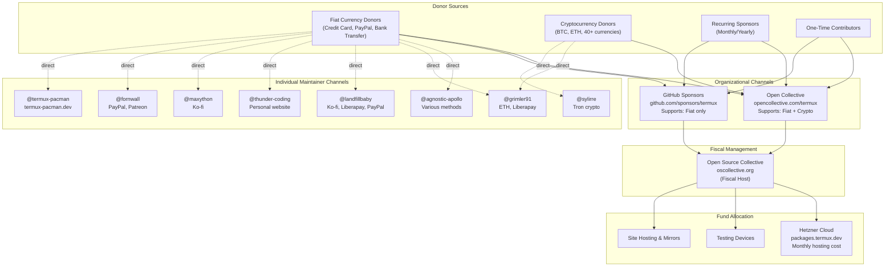
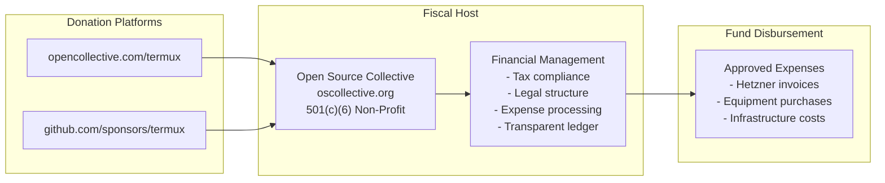
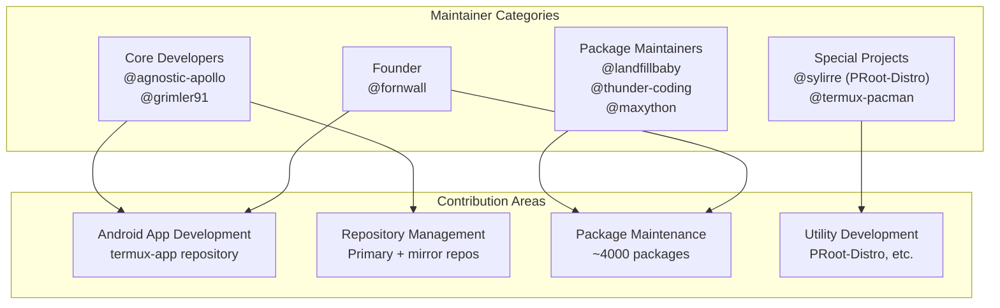
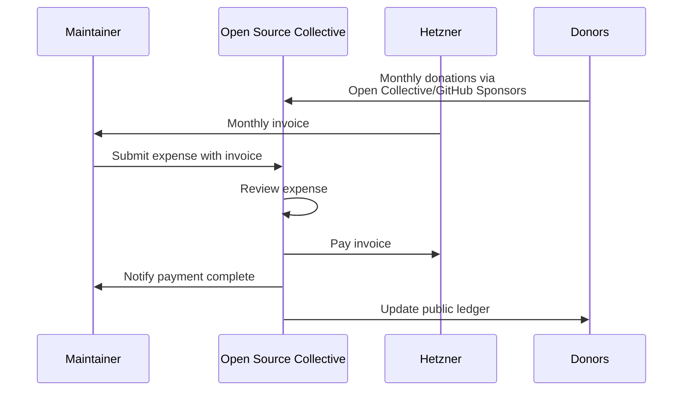
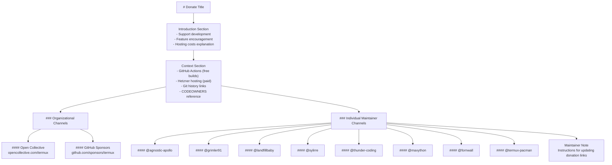
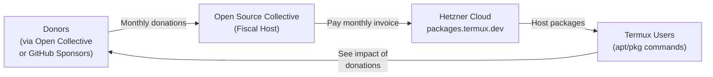

<!-- source: DeepWiki mcp.deepwiki.com · repo termux/termux.github.io · page 6.2 Funding and Donation System · fetched 2026-10-26 -->

# Funding and Donation System

<details>
<summary>Relevant source files</summary>

The following files were used as context for generating this wiki page:

- [cn/donate.md](cn/donate.md)
- [en/donate.md](en/donate.md)

</details>


## Purpose and Scope

This document describes the comprehensive funding and donation system that supports the Termux project. It covers the organizational donation channels (Open Collective and GitHub Sponsors), individual maintainer donation options, fiscal hosting arrangements, fund allocation to infrastructure costs, and the technical implementation of the donation pages on the website.

For information about how donated funds are used to pay for package hosting infrastructure, see [Package Distribution Infrastructure](#6.1). For details on the multilingual implementation of donation pages, see [Multilingual Content System](#4.3).

---

## Funding Model Overview

The Termux project operates on a transparent, community-funded model with multiple donation channels to support both the organization and individual contributors. All organizational donations flow through Open Source Collective as a fiscal host, providing financial management and transparency.

### Primary Use Cases

The funding system supports three main objectives:

1. **Infrastructure Costs**: Primary package repository hosting on Hetzner Cloud (~€50-€100/month)
2. **Testing Devices**: Android devices for testing compatibility across different versions and manufacturers
3. **Development Support**: Encouraging maintainers and contributors through financial appreciation

**Sources:** [en/donate.md:8-10]()

---

## Donation Flow Architecture



**Sources:** [en/donate.md:8-64](), [cn/donate.md:8-64]()

---

## Organizational Donation Channels

### Open Collective

The primary organizational donation channel is hosted at `https://opencollective.com/termux`. This platform provides comprehensive donation options and transparent financial reporting.

**Key Features:**
- **Payment Methods**: Credit/debit card, PayPal, bank transfer
- **Cryptocurrency Support**: 40+ currencies including BTC and ETH
- **Contribution Types**: Recurring (monthly/yearly) and one-time donations
- **Fiscal Host**: Open Source Collective (oscollective.org)
- **Transparency**: Public financial ledger showing all income and expenses

The Open Collective account is managed by the [@opencollective](https://github.com/opencollective) organization and provides donors with receipts and expense tracking.

**Sources:** [en/donate.md:15-17](), [cn/donate.md:15-17]()

### GitHub Sponsors

The GitHub Sponsors channel is accessible at `https://github.com/sponsors/termux`. This platform integrates with GitHub's ecosystem and is ideal for developers already active on GitHub.

**Key Features:**
- **Payment Methods**: Credit/debit card, PayPal
- **Contribution Types**: Custom monthly recurring and one-time donations
- **Fiscal Host**: Open Source Collective (oscollective.org)
- **Integration**: Native GitHub integration with sponsor badges and visibility

GitHub Sponsors supports fiat currencies only (no cryptocurrency option) and automatically handles payment processing and receipt generation.

**Sources:** [en/donate.md:20-22](), [cn/donate.md:20-22]()

---

## Fiscal Hosting Architecture



Both Open Collective and GitHub Sponsors use **Open Source Collective** as their fiscal host. This arrangement provides:

1. **Legal Entity**: Acts as the legal and financial umbrella for Termux donations
2. **Tax Compliance**: Handles tax reporting and compliance requirements
3. **Expense Processing**: Reviews and approves expense submissions (e.g., Hetzner invoices)
4. **Transparency**: Maintains public financial records
5. **Credibility**: Establishes Termux as a legitimate open-source project with proper financial governance

The fiscal host charges a small percentage fee for these services, which is automatically deducted from donations.

**Sources:** [en/donate.md:17](), [en/donate.md:22](), [cn/donate.md:17](), [cn/donate.md:22]()

---

## Individual Maintainer Donation Channels

Individual Termux maintainers and contributors can receive direct donations to support their specific work. The donation page lists eight primary maintainer profiles:

| Maintainer | GitHub Handle | Primary Contributions | Donation Methods |
|------------|--------------|----------------------|------------------|
| Agnostic Apollo | @agnostic-apollo | Main developer/maintainer of Android apps, termux site | See Donations.md in personal repo |
| Grimler | @grimler91 | All repositories, manages primary and grimler repos | ETH: `0x09D42e7518f5bF6eF173c536Ad8e87c973615A9D`, Liberapay |
| Landfillbaby | @landfillbaby | All repositories, focuses on package updates | Ko-fi, Liberapay, PayPal.Me |
| Sylirre | @sylirre | All repositories, author of PRoot-Distro | Tron: `TEJiwRMMGV1JXvRYDRVJ1qw7kFgskEk3sJ` |
| Yaksh Bariya | @thunder-coding | Maintains nodejs, updates critical dependencies | Personal website: thunder-coding.github.io/sponsor/ |
| Max Ivan | @maxython | Maintains pacman package manager and glibc packages | Ko-fi |
| Fornwall | @fornwall | Creator of Termux, maintains Play Store fork and packages | PayPal, Patreon |
| Termux Pacman | @termux-pacman | Third-party organization distributing pacman packages | termux-pacman.dev/donate |

**Sources:** [en/donate.md:25-64](), [cn/donate.md:25-64]()

### Maintainer Donation Structure



**Sources:** [en/donate.md:25-64]()

---

## Fund Allocation and Usage

### Current Infrastructure Costs

The primary expense covered by organizational donations is the **Hetzner Cloud** hosting for `packages.termux.dev`, the main package repository. Key financial details:

- **Cost Range**: Approximately €50-€100 per month (varies with traffic and storage)
- **Payment Source**: Open Collective and GitHub Sponsors donations via Open Source Collective
- **Zero-Cost Build**: GitHub Actions provides free CI/CD for package building, eliminating build infrastructure costs
- **Hosting Provider**: Hetzner (https://www.hetzner.com/cloud)

### Infrastructure Components Supported

| Component | Funding Source | Cost Structure |
|-----------|---------------|----------------|
| GitHub Actions (package builds) | GitHub (free tier) | $0/month |
| Primary repository (packages.termux.dev) | Donations via OSC | ~€50-€100/month |
| Cloudflare CDN (packages-cf.termux.dev) | Cloudflare (free tier) | $0/month |
| Community mirrors | Independent hosting | $0 to Termux |
| GitHub Pages (termux.dev site) | GitHub (free for public repos) | $0/month |
| Testing devices | Donations (as needed) | Variable |

The donation model ensures that the critical infrastructure (primary package repository) remains operational while minimizing unnecessary costs through strategic use of free-tier services.

**Sources:** [en/donate.md:10](), [cn/donate.md:10]()

### Expense Processing Flow



**Sources:** [en/donate.md:8-10]()

---

## Donation Page Implementation

### File Structure

The donation page is implemented as a multilingual static page with the following structure:

```
en/donate.md          # English donation page (primary)
cn/donate.md          # Chinese translation
```

### Page Configuration

Both donation pages use consistent front matter configuration:

**English Page Front Matter** [en/donate.md:1-6]():
```yaml
layout: page
title: Donate
redirect_from: /donate
page_ref: /donate.html
```

**Chinese Page Front Matter** [cn/donate.md:1-6]():
```yaml
layout: page
title: Donate
lang: cn
page_ref: /donate.html
```

Key configuration elements:
- **layout**: Uses the `page` layout from `_layouts/page.html`
- **page_ref**: Links translations together using `/donate.html` identifier
- **redirect_from**: English page includes a redirect from `/donate` for backward compatibility
- **lang**: Chinese page specifies language code for proper routing

**Sources:** [en/donate.md:1-6](), [cn/donate.md:1-6]()

### Content Structure

The donation page follows a consistent hierarchical structure across languages:



**Sources:** [en/donate.md:8-68](), [cn/donate.md:8-69]()

### Maintainer Self-Service System

The donation page includes a self-service note at the bottom allowing maintainers to update their own donation information:

[en/donate.md:67-68]():
```markdown
*Note for [@termux](https://github.com/termux) maintainers: Feel free to add/update/delete your donation links on [page source(s)](@SITE__URL@/blob/master/@PAGE__LANG@/donate.md) (of all languages).*
```

This note uses Liquid template variables:
- `@SITE__URL@`: Expands to the GitHub repository URL
- `@PAGE__LANG@`: Expands to the current page language code (en, cn, etc.)

These variables are processed during Jekyll build to generate proper GitHub edit links.

**Sources:** [en/donate.md:67-68](), [cn/donate.md:68-69]()

### External Link References

The donation pages extensively reference external services and GitHub profiles:

| Reference Type | Example | Purpose |
|---------------|---------|---------|
| GitHub Organizations | `[@termux](https://github.com/termux)` | Link to main organization |
| GitHub Users | `[@agnostic-apollo](https://github.com/agnostic-apollo)` | Link to maintainer profiles |
| Repository Statistics | `termux-packages/graphs/contributors` | Show contribution history |
| CODEOWNERS File | `termux-packages/blob/master/CODEOWNERS` | Identify package maintainers |
| Donation Platforms | `opencollective.com/termux` | Direct donation links |
| Fiscal Host | `oscollective.org` | Explain financial management |
| Personal Sites | `thunder-coding.github.io/sponsor/` | Individual donation pages |

**Sources:** [en/donate.md:8-64]()

---

## Translation Consistency

The donation page maintains content parity across languages. Both English and Chinese versions include:

1. **Same organizational structure**: Introduction → Context → Organizational Channels → Individual Channels → Maintainer Note
2. **Identical donation URLs**: All external links (Open Collective, GitHub Sponsors, personal pages) use the same URLs
3. **Consistent maintainer list**: Both versions list the same eight maintainer profiles in the same order
4. **Equivalent financial information**: Hetzner hosting costs and GitHub Actions usage are explained identically

The Chinese translation [cn/donate.md]() provides culturally appropriate language while maintaining factual accuracy and link integrity.

**Sources:** [en/donate.md:1-68](), [cn/donate.md:1-69]()

---

## Integration with Site Architecture

### Navigation Integration

The donation page is accessible through multiple routes:

1. **Direct URL**: `/en/donate.html` (English), `/cn/donate.html` (Chinese)
2. **Legacy Redirect**: `/donate` redirects to `/en/donate.html` [en/donate.md:4]()
3. **Language Selector**: Header language switcher uses `page_ref: /donate.html` to link translations

### Relationship to Package Distribution

The donation page explicitly connects funding to infrastructure by explaining how donations pay for the Hetzner-hosted primary repository at `packages.termux.dev`. This creates a direct link between the donation system and the package distribution system documented in [Package Distribution Infrastructure](#6.1).



**Sources:** [en/donate.md:8-10](), [cn/donate.md:8-10]()

---

## Community Recognition

The donation page emphasizes community contribution through several mechanisms:

1. **Git History Links**: Direct links to contributor graphs on `termux-packages` and `termux-app` repositories [en/donate.md:12]()
2. **CODEOWNERS Reference**: Suggests checking `CODEOWNERS` file to support specific package maintainers [en/donate.md:12]()
3. **Outside Contributors**: Explicitly mentions that many contributors are not part of the @termux team but should be supported [en/donate.md:12]()
4. **Individual Recognition**: Dedicated sections for eight key maintainers with their specific contributions detailed [en/donate.md:25-64]()

This approach recognizes both organizational and individual efforts, encouraging donations at multiple levels.

**Sources:** [en/donate.md:12-13](), [cn/donate.md:12-13]()

---

