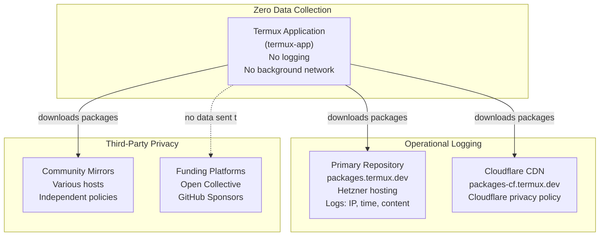
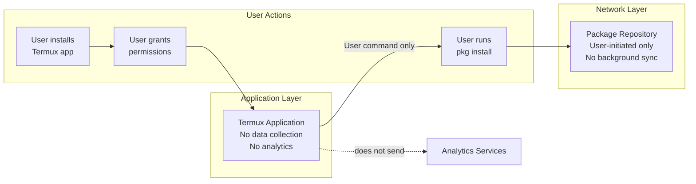
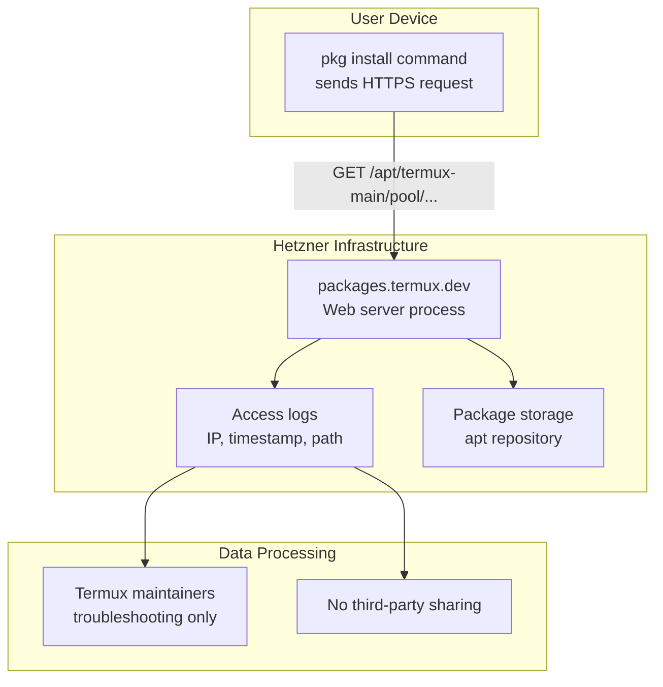
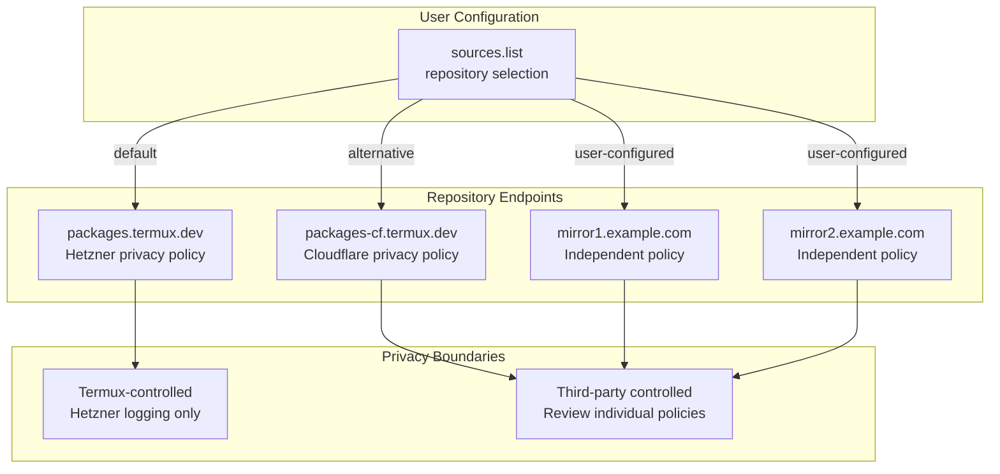
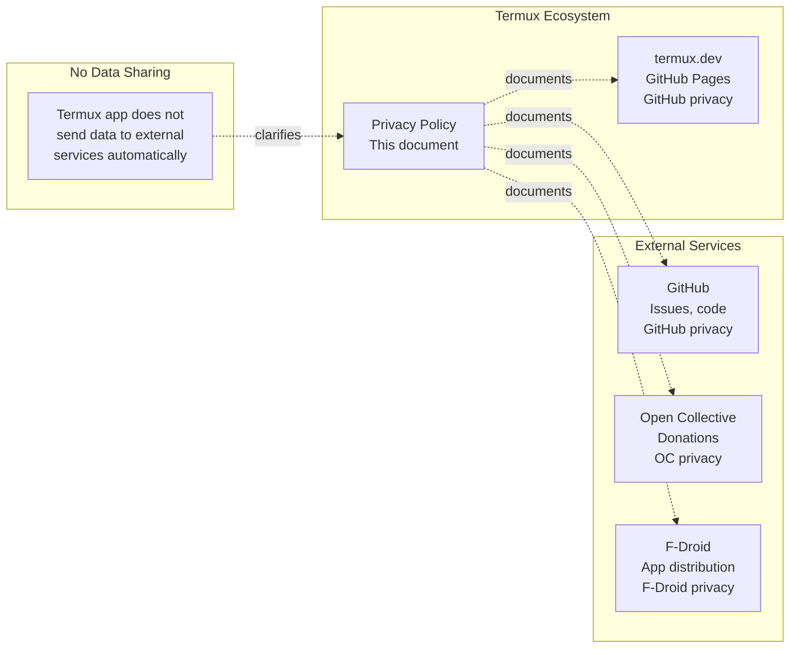
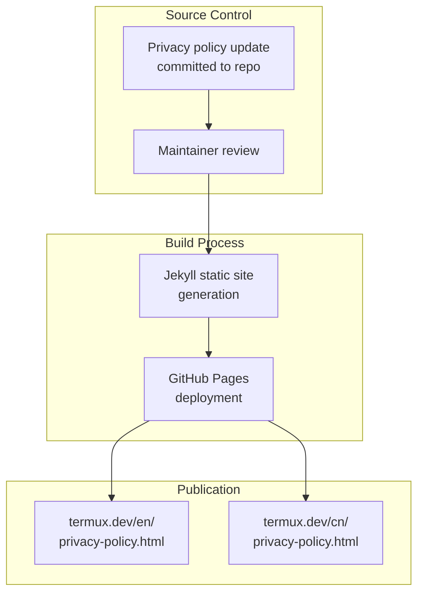

<!-- source: DeepWiki mcp.deepwiki.com · repo termux/termux.github.io · page 6.3 Privacy Policy · fetched 2026-10-26 -->

# Privacy Policy

<details>
<summary>Relevant source files</summary>

The following files were used as context for generating this wiki page:

- [cn/docs/index.md](cn/docs/index.md)
- [cn/privacy-policy.md](cn/privacy-policy.md)

</details>


This document explains Termux's privacy practices across all components of the Termux ecosystem, including the mobile application, package distribution infrastructure, and third-party services. It clarifies what data is collected by each service, how it is used, and the boundaries between different privacy domains.

For information about the technical infrastructure behind package distribution, see [Package Distribution Infrastructure](#6.1). For details on external funding services and their data handling, see [Funding and Donation System](#6.2).

---

## Overview and Privacy Philosophy

The Termux privacy policy follows a compartmentalized model where different components of the ecosystem have distinct privacy practices. The core principle is that **the Termux application itself collects no personal information**, while external infrastructure services (package repositories, CDN, mirrors) may log standard server access data for operational purposes.

### Privacy Domains



**Diagram: Privacy Domains in Termux Ecosystem**

Sources: [cn/privacy-policy.md:1-13]()

---

## Termux Application Privacy

The Termux Android application implements a strict no-data-collection policy.

### Application Behavior

| Aspect | Privacy Practice |
|--------|------------------|
| **Personal Information** | No logging of personal information |
| **Permissions** | Requests only permissions necessary for application functionality |
| **Network Activity** | No automatic background data transmission |
| **Analytics** | No analytics or telemetry collection |
| **Third-Party SDKs** | No advertising or tracking SDKs |

### Permission Model

The Termux application requests only essential Android permissions required for its terminal emulator functionality. These permissions are not used to collect user data but solely to enable core features such as:

- Storage access (for file operations)
- Wake lock (for background processes)
- Internet access (for user-initiated package downloads only)



**Diagram: Termux Application Data Flow**

Sources: [cn/privacy-policy.md:8-8]()

---

## Package Repository Privacy

When users download packages from Termux repositories, different privacy policies apply depending on which infrastructure endpoint is accessed.

### Primary Repository (packages.termux.dev)

The primary package server implements operational logging for troubleshooting purposes.

**Hosted by:** Hetzner Cloud  
**Endpoint:** `https://packages.termux.dev/`

#### Data Collected

| Data Type | Purpose | Retention |
|-----------|---------|-----------|
| Remote IP address | Troubleshooting, abuse prevention | Operational retention |
| Access timestamp | Request tracking, debugging | Operational retention |
| Requested content | Access patterns, cache optimization | Operational retention |

#### Data Usage

- **Primary purpose:** Troubleshooting infrastructure issues
- **Sharing:** Not shared with third parties
- **Processing:** Processed solely by Termux infrastructure maintainers
- **Legal basis:** Legitimate interest in service operation

#### External Privacy Policy

Hetzner, as the hosting provider, maintains its own privacy policy covering data center operations and hosting services. Users should review:
- **Hetzner Privacy Policy:** `https://www.hetzner.com/legal/privacy-policy/`



**Diagram: Primary Repository Data Handling**

Sources: [cn/privacy-policy.md:10-10]()

---

## CDN and Mirror Privacy

### Cloudflare CDN (packages-cf.termux.dev)

The Cloudflare CDN endpoint serves as an alternative package download source with global edge caching.

**Endpoint:** `https://packages-cf.termux.dev/`  
**Privacy Policy:** Governed by Cloudflare's privacy practices

#### Cloudflare Data Collection

Cloudflare operates as an independent service provider with its own data collection practices:

- **Request logging:** IP addresses, request paths, timing information
- **DDoS protection:** Request pattern analysis
- **CDN analytics:** Cache hit rates, geographic distribution
- **Privacy policy:** Users should review Cloudflare's privacy policy

### Community Mirrors

Community-operated mirrors have independent privacy policies determined by their respective maintainers and hosting providers.

**Mirror list:** `https://github.com/termux/termux-packages/wiki/Mirrors`

| Mirror Characteristic | Privacy Implication |
|-----------------------|---------------------|
| **Hosting Provider** | Each mirror uses different infrastructure |
| **Privacy Policy** | Varies by mirror operator |
| **Data Practices** | Not controlled by Termux project |
| **User Responsibility** | Users should review individual mirror policies |



**Diagram: Privacy Policy Boundaries Across Infrastructure**

Sources: [cn/privacy-policy.md:12-12]()

---

## Website and Documentation Privacy

The Termux website (termux.dev) is hosted on GitHub Pages and follows GitHub's privacy practices.

### GitHub Pages Hosting

**Hosting:** GitHub Pages  
**Domain:** `termux.dev`  
**Privacy Policy:** GitHub Privacy Statement

#### Data Collection by GitHub

- **Access logs:** IP addresses, user agents, referer headers
- **Analytics:** GitHub may collect usage statistics
- **Cookies:** GitHub Pages may set cookies
- **Privacy control:** Governed by GitHub's privacy policy

### Website Content Files

The privacy policy is published in multiple language versions:

**File Structure:**
```
cn/privacy-policy.md     # Chinese version
en/privacy-policy.md     # English version (implied)
```

**Front Matter Configuration:**
- `layout: page` - Uses standard page layout
- `page_ref: /privacy-policy.html` - Language-agnostic identifier
- `lang: cn` - Language code for localization

Sources: [cn/privacy-policy.md:1-6]()

---

## Third-Party Service Integration

Termux integrates with various third-party services, each with independent privacy policies.

### Funding Platforms

| Service | Purpose | Privacy Policy Location |
|---------|---------|-------------------------|
| **Open Collective** | Donation processing | `opencollective.com` privacy policy |
| **GitHub Sponsors** | Developer sponsorship | GitHub privacy statement |
| **Individual Platforms** | Direct donations | Ko-fi, Liberapay, cryptocurrency |

**Important:** Donation platforms collect payment information and donor details according to their own privacy policies. Termux does not control or have access to this data beyond what the platforms choose to share (typically donor names and amounts for transparency).

### Development Platforms

| Service | Usage | Data Implications |
|---------|-------|-------------------|
| **GitHub** | Issue tracking, code hosting | GitHub privacy policy applies |
| **F-Droid** | App distribution | F-Droid privacy policy applies |
| **Termux Wiki** | Community documentation | Wiki hosting provider policy |



**Diagram: External Service Privacy Boundaries**

Sources: [cn/privacy-policy.md:8-13]()

---

## Data Usage and Retention

### Termux-Controlled Infrastructure

**Data Category:** Server access logs (packages.termux.dev only)

| Aspect | Policy |
|--------|--------|
| **Purpose** | Troubleshooting, abuse prevention, service optimization |
| **Access** | Limited to Termux infrastructure maintainers |
| **Sharing** | Not shared with third parties |
| **Retention** | Operational retention period (not publicly specified) |
| **User Rights** | Contact maintainers for data inquiries |

### Third-Party Services

**Data handling:** Governed by respective service provider privacy policies

Users exercising their rights under privacy regulations (GDPR, CCPA, etc.) should contact the relevant service provider directly:

- **Hetzner:** For package server access logs
- **Cloudflare:** For CDN access logs
- **GitHub:** For website/repository interactions
- **Donation platforms:** For financial transaction records

---

## Privacy Policy Updates

### Document Location

**File Path:** `cn/privacy-policy.md`, `en/privacy-policy.md` (and other language versions)  
**Web URL:** `https://termux.dev/privacy-policy.html`  
**Repository:** `https://github.com/termux/termux.github.io`

### Update Mechanism

Privacy policy updates follow the standard Jekyll site deployment process:

1. Policy changes committed to repository
2. Jekyll rebuilds static site
3. GitHub Pages automatically deploys updates
4. All language versions updated simultaneously



**Diagram: Privacy Policy Update Process**

Sources: [cn/privacy-policy.md:1-13]()

---

## Contact and Questions

### Privacy Inquiries

For questions about Termux's privacy practices:

- **General questions:** GitHub issues in termux repositories
- **Data access requests (Hetzner):** Contact Termux maintainers
- **Third-party services:** Contact respective service providers directly

### Service-Specific Contacts

| Service | Contact Method |
|---------|----------------|
| **Package server data** | Termux maintainer email addresses |
| **Hetzner hosting** | Hetzner privacy contact |
| **Cloudflare CDN** | Cloudflare privacy contact |
| **GitHub Pages** | GitHub privacy contact |
| **Donation platforms** | Platform-specific support |

---

## Summary

The Termux privacy model implements clear boundaries between different ecosystem components:

1. **Termux Application:** Zero data collection, no personal information logging
2. **Primary Repository:** Minimal operational logging for troubleshooting only
3. **CDN and Mirrors:** Independent privacy policies, user should review individually
4. **Third-Party Services:** External privacy policies govern their respective domains
5. **No Cross-Service Sharing:** Data is not shared between services or with third parties

Users concerned about privacy should:
- Understand that the Termux app itself collects no data
- Review Hetzner's privacy policy for package server interactions
- Consider using community mirrors with privacy policies aligned with their preferences
- Review individual service privacy policies before using donation or community platforms

Sources: [cn/privacy-policy.md:1-13]()

---

