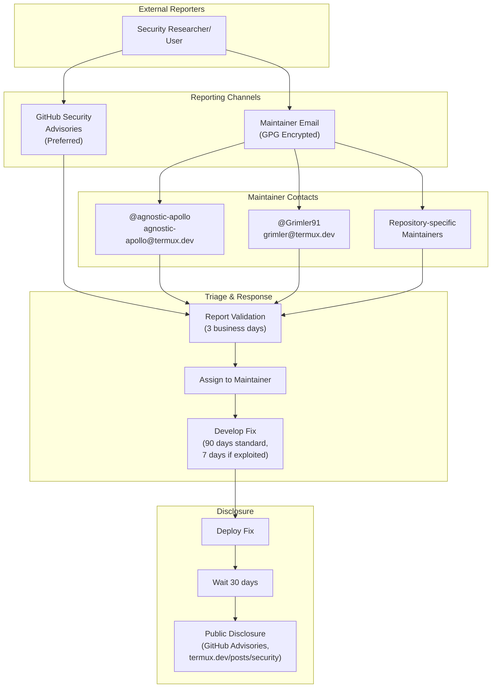
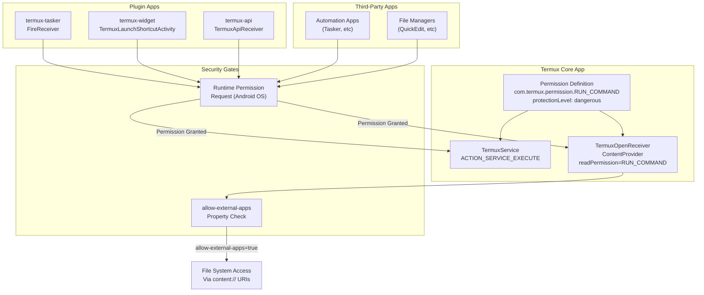
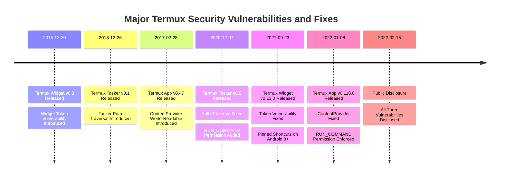

<!-- source: DeepWiki mcp.deepwiki.com · repo termux/termux.github.io · page 7 Security Policy and Practices · fetched 2026-10-26 -->

# Security Policy and Practices

<details>
<summary>Relevant source files</summary>

The following files were used as context for generating this wiki page:

- [_posts/en/apps/2022-02-25-termux-tasker-v0.6.0-release.md](_posts/en/apps/2022-02-25-termux-tasker-v0.6.0-release.md)
- [_posts/en/general/2024-11-11-termux-selected-for-nlnet-ngi-mobifree-grant.md](_posts/en/general/2024-11-11-termux-selected-for-nlnet-ngi-mobifree-grant.md)
- [_posts/en/security/2022-02-15-termux-apps-vulnerability-disclosures.md](_posts/en/security/2022-02-15-termux-apps-vulnerability-disclosures.md)
- [en/security-incident-response-checklist.md](en/security-incident-response-checklist.md)
- [en/security.md](en/security.md)

</details>


This document describes Termux's security policy, vulnerability disclosure procedures, and incident response practices. It covers how security issues are reported, triaged, and disclosed, as well as the architectural security measures implemented across Termux applications.

For information about past architectural security improvements and future enhancements via the NLnet grant, see [Future Architecture and Development](#8).

---

## Overview

Termux takes security vulnerabilities seriously and operates under a principle of security-through-transparency. All vulnerabilities discovered by the team or reported by external parties are publicly disclosed following responsible disclosure timelines. The security program encompasses vulnerability reporting, incident response procedures, and continuous architectural improvements.

**Sources:** [en/security.md:1-14]()

---

## Reporting and Disclosure Framework

### Reporting Channels

Termux accepts security vulnerability reports through two primary channels:

1. **GitHub Security Advisories** (preferred) - Allows private collaboration on fixes and automatic notification of dependents
2. **Email to maintainers** - For cases where Security Advisories cannot be used, with optional GPG encryption

The reporting mechanism is implemented through repository-specific Security tabs and maintainer email addresses documented in the security policy.



**Diagram: Security Vulnerability Reporting and Response Flow**

The maintainer contact system is organized by repository and component responsibility:

| Repository/Component | Primary Maintainer(s) | Security Contact |
|---------------------|----------------------|------------------|
| `termux-app` | @agnostic-apollo | [GitHub Security](https://github.com/termux/termux-app/security) |
| `termux-tasker` | @agnostic-apollo | [GitHub Security](https://github.com/termux/termux-tasker/security) |
| `termux-widget` | @agnostic-apollo | [GitHub Security](https://github.com/termux/termux-widget/security) |
| `termux-packages` | Termux team (see CODEOWNERS) | [GitHub Security](https://github.com/termux/termux-packages/security) |
| `termux.github.io` | @agnostic-apollo | [GitHub Security](https://github.com/termux/termux.github.io/security) |
| `proot` | @michalbednarski | [GitHub Security](https://github.com/termux/proot/security) |

**Sources:** [en/security.md:62-110]()

---

### Disclosure Timeline

The disclosure policy follows a structured timeline balancing security and transparency:

1. **Acknowledgement:** Valid reports acknowledged within 3 business days
2. **Fix Development:** 90-day standard timeline, or 7 days for actively exploited vulnerabilities
3. **Deployment:** Fixes deployed to users via releases
4. **Public Disclosure:** 30 days after fix deployment via GitHub Security Advisories and site posts

This timeline is implemented through coordination between maintainers and the reporter, as documented in [en/security.md:14-21]().

**Sources:** [en/security.md:14-21]()

---

### Report Quality Requirements

Accepted security reports must include specific technical details:

| Requirement Category | Details |
|---------------------|---------|
| **Component Identification** | Repository, exact component, affected versions (not "latest") |
| **Proof-of-Concept** | Step-by-step reproduction, test code/output (text preferred) |
| **Impact Analysis** | Demonstration of actual exploitability with valid attack scenario |
| **Technical Context** | OS version, hardware device, relevant version numbers |

Reports not meeting these criteria, particularly those lacking valid attack scenarios, are rejected. The quality bar prevents resource waste on theoretical vulnerabilities without practical impact.

**Sources:** [en/security.md:40-57]()

---

## Permission-Based Security Architecture

Following the 2022 vulnerability disclosures, Termux implemented a permission-based security model centered on the `com.termux.permission.RUN_COMMAND` custom permission. This permission gates access to command execution and file system operations across plugin apps.



**Diagram: RUN_COMMAND Permission Security Model**

### Implementation Details

The permission model is enforced through multiple layers:

**Permission Declaration** - [termux-app/AndroidManifest.xml:16]()
```xml
<permission android:name="com.termux.permission.RUN_COMMAND"
    android:protectionLevel="dangerous" />
```

**FireReceiver Protection** - [termux-tasker v0.5+]
- Requires `RUN_COMMAND` permission in AndroidManifest
- Validates canonical path of executables before execution
- Respects `allow-external-apps` property for absolute paths

**ContentProvider Protection** - [termux-app v0.118.0+]
- Changed from dummy `android.permission.permRead` to `RUN_COMMAND`
- Enforces `allow-external-apps=true` property check
- Supports both read and write operations with proper permissions

**Sources:** [en/security.md:51-58](), [_posts/en/security/2022-02-15-termux-apps-vulnerability-disclosures.md:51-65](), [_posts/en/security/2022-02-15-termux-apps-vulnerability-disclosures.md:177-181]()

---

## Past Vulnerability Case Studies

Termux maintains transparency by publicly documenting past vulnerabilities. These serve as learning resources and demonstrate the evolution of security practices. The subsection [Past Vulnerability Disclosures](#7.2) provides detailed technical analysis of major vulnerabilities.

### Vulnerability Timeline



**Diagram: Security Vulnerability Timeline**

### Vulnerability Summary

| Vulnerability | Component | Existed | Fixed | Impact |
|--------------|-----------|---------|-------|--------|
| **Path Traversal** | `FireReceiver` (termux-tasker) | v0.1-v0.4 (2016-2020) | v0.5 (2020-12-07) | Arbitrary command execution in termux/root context |
| **Token Bypass** | `TermuxLaunchShortcutActivity` (termux-widget) | v0.3-v0.12 (2015-2021) | v0.13.0 (2021-09-23) | Arbitrary script execution by launcher apps |
| **ContentProvider World-Readable** | `TermuxOpenReceiver$ContentProvider` (termux-app) | v0.47-v0.117 (2017-2022) | v0.118.0 (2022-01-08) | All files under `/data/data/com.termux/files` readable by any app |

**Sources:** [_posts/en/security/2022-02-15-termux-apps-vulnerability-disclosures.md:1-263]()

---

## Incident Response Process

Termux follows a structured 5-phase incident response process documented in [en/security-incident-response-checklist.md](). This checklist ensures consistent handling of security issues. The subsection [Security Incident Response](#7.3) provides detailed procedures.

```mermaid
graph LR
    subgraph Phase1["Phase 1:<br/>Initial Assessment"]
        Validate["Reproduce<br/>Vulnerability"]
        CVSS["Assess CVSS<br/>Score"]
        RootCause["Document<br/>Root Cause"]
    end
    
    subgraph Phase2["Phase 2:<br/>Immediate Response"]
        Workaround["Implement<br/>Workaround"]
        Patch["Develop<br/>Patch"]
        Advisory["Draft GitHub<br/>Advisory"]
    end
    
    subgraph Phase3["Phase 3:<br/>Impact Assessment"]
        Estimate["Estimate Affected<br/>Installations"]
        Exploitation["Check for Active<br/>Exploitation"]
        DataRisk["Assess Data<br/>Compromise Risk"]
    end
    
    subgraph Phase4["Phase 4:<br/>Communication"]
        Release["Publish Security<br/>Release"]
        Disclose["Public Disclosure<br/>(GitHub/Website)"]
        CVE["Submit CVE<br/>(if warranted)"]
    end
    
    subgraph Phase5["Phase 5:<br/>Post-Incident"]
        Review["Document Lessons<br/>Learned"]
        Improve["Process<br/>Improvements"]
        Monitor["Track Update<br/>Adoption"]
    end
    
    Validate --> CVSS
    CVSS --> RootCause
    RootCause --> Workaround
    Workaround --> Patch
    Patch --> Advisory
    Advisory --> Estimate
    Estimate --> Exploitation
    Exploitation --> DataRisk
    DataRisk --> Release
    Release --> Disclose
    Disclose --> CVE
    CVE --> Review
    Review --> Improve
    Improve --> Monitor
```



**Diagram: Five-Phase Security Incident Response Process**

### Emergency Contact Protocol

For critical security issues requiring immediate attention:

- **Primary Contacts:**
  - [@Grimler91](https://github.com/Grimler91): grimler@termux.dev
  - [@agnostic-apollo](https://github.com/agnostic-apollo): agnostic-apollo@termux.dev

- **GPG Keys Available:** Via [termux-keyring package](https://github.com/termux/termux-packages/tree/master/packages/termux-keyring) or `https://github.com/<username>.gpg`

**Sources:** [en/security-incident-response-checklist.md:1-240]()

---

## Rewards and Acknowledgements

Termux does not currently operate a formal bug bounty program due to limited donation funding. However:

- **Acknowledgement:** First reporters receive public acknowledgement in disclosures and advisories (optional, with preferred name/link)
- **Token Rewards:** Severe vulnerabilities may receive token payments from [Open Collective](https://opencollective.com/termux) budget
- **Duplicate Reports:** Reports of already-fixed or previously-reported issues do not receive acknowledgement

**Reward Criteria:**
- Must demonstrate actual exploitability with valid attack scenario
- Severity judged on reported impact, not theoretical potential
- Must be reproducible in current/recent releases

**Sources:** [en/security.md:26-35]()

---

## Community Rules and Standards

Security reporting and collaboration must follow Termux community standards:

- **Response Expectations:** Reporters must be responsive to maintainer questions
- **Verification:** Preferably verify issues are reproducible in official Termux releases (not forks)
- **Professional Conduct:** Follow [Termux community rules](https://github.com/termux/termux-community/blob/site/site/pages/en/rules/index.md)
- **Offensive Behavior:** Deliberate disrespect toward team members results in ban

These standards ensure productive collaboration while maintaining team morale and project sustainability.

**Sources:** [en/security.md:51-57]()

---

## Security Policy Enforcement

The security policy is enforced through technical, procedural, and community mechanisms:

| Mechanism | Implementation |
|-----------|---------------|
| **Technical** | Runtime permissions, property checks, path validation, code signing |
| **Procedural** | Incident response checklist, disclosure timelines, maintainer coordination |
| **Community** | Transparent disclosures, public advisories, documentation |
| **Educational** | Past vulnerability documentation, security best practices |

This multi-layered approach balances security with transparency and ensures continuous improvement of security practices across the Termux ecosystem.

**Sources:** [en/security.md:1-114](), [en/security-incident-response-checklist.md:1-240]()

---

