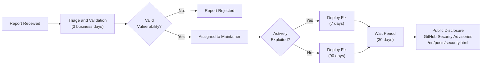
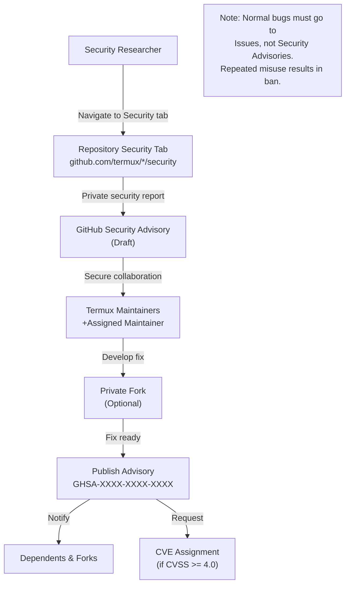
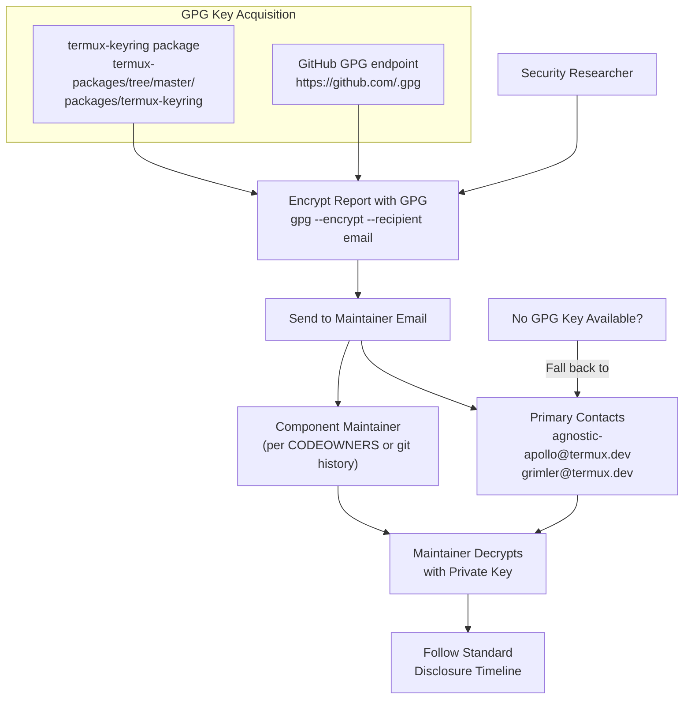
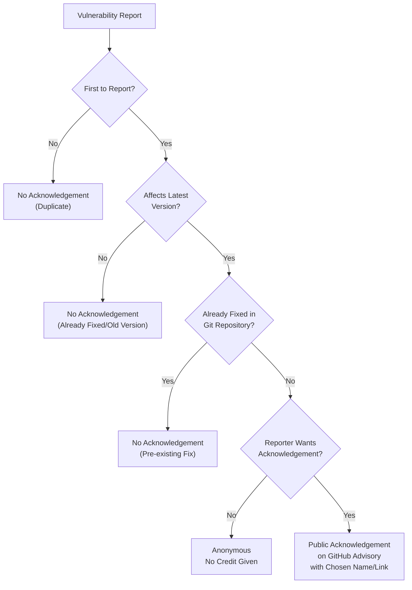

<!-- source: DeepWiki mcp.deepwiki.com · repo termux/termux.github.io · page 7.1 Vulnerability Disclosure Policy · fetched 2026-10-26 -->

# Vulnerability Disclosure Policy

<details>
<summary>Relevant source files</summary>

The following files were used as context for generating this wiki page:

- [_posts/en/apps/2022-02-25-termux-tasker-v0.6.0-release.md](_posts/en/apps/2022-02-25-termux-tasker-v0.6.0-release.md)
- [_posts/en/general/2024-11-11-termux-selected-for-nlnet-ngi-mobifree-grant.md](_posts/en/general/2024-11-11-termux-selected-for-nlnet-ngi-mobifree-grant.md)
- [_posts/en/security/2022-02-15-termux-apps-vulnerability-disclosures.md](_posts/en/security/2022-02-15-termux-apps-vulnerability-disclosures.md)
- [en/security-incident-response-checklist.md](en/security-incident-response-checklist.md)
- [en/security.md](en/security.md)

</details>


## Purpose and Scope

This document describes the Termux project's vulnerability disclosure policy, including the responsible disclosure timeline, reporting channels, severity assessment process, and incident response procedures. The policy applies to all Termux repositories and components listed in the [Repository Coverage](#repository-coverage) section.

For information about past vulnerability disclosures with technical details and fixes, see [7.2](#7.2). For the operational incident response checklist used by maintainers, see [7.3](#7.3).

**Sources:** [en/security.md:1-114]()

---

## Disclosure Timeline and Policy

### Standard Disclosure Timeline

The Termux team follows a structured responsible disclosure timeline that balances security with transparency:



**Timeline Parameters:**

| Phase | Standard Vulnerabilities | Actively Exploited |
|-------|-------------------------|-------------------|
| Triage & Acknowledgement | 3 business days | 3 business days |
| Fix Development & Deployment | 90 days | 7 days |
| Public Disclosure After Fix | 30 days | 30 days |
| Total Timeline | ~120 days | ~37 days |

The policy explicitly handles edge cases:

- **Pre-existing Fixes:** If the vulnerability was already fixed in the public/private git repository before the report, acknowledgement may not be given
- **Older Versions:** If the vulnerability only affects versions older than the current latest version, acknowledgement may not be given
- **Duplicate Reports:** Only the first entity to report receives acknowledgement

**Sources:** [en/security.md:14-20](), [en/security.md:26-36]()

---

## Reporting Channels

### Channel 1: GitHub Security Advisories (Preferred)

GitHub Security Advisories is the preferred reporting mechanism as it provides:
- Secure private collaboration on fixes
- Automatic notification to dependents and forks upon publication
- Integration with GitHub's vulnerability ecosystem



**Abuse Prevention:** Sending non-security bugs to GitHub Security Advisories or sending spam results in a ban.

**Sources:** [en/security.md:62-71]()

### Channel 2: Email (GPG Encrypted)

For cases where GitHub Security Advisories cannot be used, reports can be emailed to maintainers:



**Key Locations:**
- Maintainer GPG keys: [`termux-packages/tree/master/packages/termux-keyring`]()
- GitHub GPG endpoint format: `https://github.com/<username>.gpg`

**Common Maintainer Contacts:**
- `@agnostic-apollo`: [agnostic-apollo@termux.dev](mailto:agnostic-apollo@termux.dev)
- `@Grimler91`: [grimler@termux.dev](mailto:grimler@termux.dev)

**Sources:** [en/security.md:72-76]()

---

## Report Requirements

### Required Elements

A high-quality vulnerability report must include the following elements to be processed efficiently:

| Element | Description | Example |
|---------|-------------|---------|
| **Repository & Component** | Exact affected component with detailed description | `termux-app`, `FireReceiver` class in `termux-tasker` |
| **Version Numbers** | Specific version names, not "latest version" | `termux-app v0.117`, Android 11, Pixel 4a |
| **Proof-of-Concept** | Step-by-step reproduction with test code/output | Java code snippet, Tasker task XML, or shell commands |
| **Impact Analysis** | Demonstrated impact with valid attack scenario | Privilege escalation from unprivileged app to termux context |
| **Output Format** | Text preferred; screenshots/video only if visual | Terminal output as text, not blurred screenshots |

### Optional but Helpful

- **Proposed Patch:** If the reporter has coding experience and wants to contribute a fix
- **Responsiveness:** Availability to answer follow-up questions accurately
- **Fork Verification:** For fork users, verify issue exists in official Termux releases

**Anti-Patterns to Avoid:**
- Using "latest version" instead of specific version numbers like `v0.117`
- Reporting theoretical impacts without a valid attack scenario
- Being unresponsive to maintainer questions
- Violating [Termux community rules](https://github.com/termux/termux-community/blob/site/site/pages/en/rules/index.md) during collaboration

**Sources:** [en/security.md:40-57]()

---

## Acknowledgement and Rewards

### Acknowledgement Policy



**Acknowledgement Criteria:**
- Must be the **first** entity to report (internal team or external)
- Vulnerability must exist in the **currently latest version**
- Must not be already fixed in public/private git repository before report submission
- Reporter must want to be acknowledged

**Sources:** [en/security.md:26-31]()

### Rewards Structure

The Termux project currently **does not have a formal bug bounty program** due to budget constraints:

```
Current Financial Model:
┌─────────────────────────────────────────────────┐
│ Donations (Open Collective/GitHub Sponsors)     │
│              ↓                                   │
│ Insufficient to cover development costs         │
│              ↓                                   │
│ All services provided free (beer) to users      │
└─────────────────────────────────────────────────┘

Exception for Severe Vulnerabilities:
- Token rewards may be paid from Open Collective budget
- Case-by-case basis depending on severity and budget
- No guaranteed amounts or structured bounty tiers
```

**Severity Judgment:**
- Based on **actual demonstrated impact**, not theoretical potential impact
- Vulnerabilities without a valid attack scenario are rejected
- CVSS scoring used as assessment guideline

**Sources:** [en/security.md:32-35]()

---

## Repository Coverage

The following table lists all Termux repositories covered by this policy along with their primary maintainers for vulnerability reports:

### Termux Apps

| Repository | Component | Maintainer(s) |
|-----------|-----------|--------------|
| [`termux-app`](https://github.com/termux/termux-app/security) | Main Termux terminal app | `@agnostic-apollo` |
| [`termux-api`](https://github.com/termux/termux-api/security) | Termux:API app | `@agnostic-apollo` |
| [`termux-api-package`](https://github.com/termux/termux-api-package/security) | termux-api CLI package | `@agnostic-apollo` |
| [`termux-boot`](https://github.com/termux/termux-boot/security) | Termux:Boot app | `@agnostic-apollo` |
| [`termux-float`](https://github.com/termux/termux-float/security) | Termux:Float app | `@agnostic-apollo` |
| [`termux-gui`](https://github.com/termux/termux-gui/security) | Termux:GUI app + packages | `@tareksander` |
| [`termux-keychain-app`](https://github.com/termux/termux-keychain-app/security) | Termux:Keychain app | `@agnostic-apollo` |
| [`termux-keychain-package`](https://github.com/termux/termux-keychain-package/security) | termux-keychain CLI package | `@agnostic-apollo` |
| [`termux-styling`](https://github.com/termux/termux-styling/security) | Termux:Styling app | `@agnostic-apollo` |
| [`termux-tasker`](https://github.com/termux/termux-tasker/security) | Termux:Tasker plugin | `@agnostic-apollo` |
| [`termux-widget`](https://github.com/termux/termux-widget/security) | Termux:Widget app | `@agnostic-apollo` |
| [`termux-x11`](https://github.com/termux/termux-x11/security) | Termux:X11 app + package | `@twaik` |

**Sources:** [en/security.md:78-90]()

### Termux Packages Infrastructure

| Repository | Component | Maintainer(s) |
|-----------|-----------|--------------|
| [`termux-packages`](https://github.com/termux/termux-packages/security) | Package build system | Termux team (see [`CODEOWNERS`](https://github.com/termux/termux-packages/blob/master/CODEOWNERS)) |
| [`repology-metadata`](https://github.com/termux/repology-metadata/security) | Package metadata | `@Grimler91`, `@thunder-coding` |

**Note on External Packages:** If a vulnerability exists in an external package (e.g., `openssh`) and is reproducible in non-Termux installations, report to **upstream maintainers** as well as Termux.

**Sources:** [en/security.md:91-97]()

### Termux Internal Packages

| Repository | Component | Maintainer(s) |
|-----------|-----------|--------------|
| [`termux-core-package`](https://github.com/termux/termux-core-package/security) | termux-core package | `@agnostic-apollo` |
| [`termux-elf-cleaner`](https://github.com/termux/termux-elf-cleaner/security) | ELF cleaner utility | `@Grimler91`, `@thunder-coding` |
| [`termux-exec-package`](https://github.com/termux/termux-exec-package/security) | termux-exec package | `@agnostic-apollo` |
| [`proot`](https://github.com/termux/proot/security) | PRoot utility | `@michalbednarski` |
| [`proot-distro`](https://github.com/termux/proot-distro/security) | Linux distro manager | `@sylirre` |
| [`termux-tools`](https://github.com/termux/termux-tools/security) | Core Termux utilities | Termux team |

**Sources:** [en/security.md:98-106]()

### Termux Website

| Repository | Component | Maintainer(s) |
|-----------|-----------|--------------|
| [`termux.github.io`](https://github.com/termux/termux.github.io/security) | Official website | `@agnostic-apollo` |

**Sources:** [en/security.md:108-110]()

---

## Incident Response Workflow

When a vulnerability report is received, the Termux team follows a structured five-phase response process defined in [`en/security-incident-response-checklist.md`]():

### Phase Diagram

```mermaid
graph TB
    Report["Vulnerability Report"] --> Phase1["Phase 1: Initial Assessment<br/>and Validation"]
    
    Phase1 --> Assessment["- Reproduce in test environment<br/>- Calculate CVSS score<br/>- Determine severity level<br/>- Document root cause<br/>- Estimate fix timeline"]
    
    Assessment --> Phase2["Phase 2: Immediate Response<br/>and Mitigation"]
    
    Phase2 --> Mitigation["- Implement workaround if possible<br/>- Prepare patch/hotfix<br/>- Test fix thoroughly<br/>- Draft GitHub Security Advisory<br/>- Update Docker images/binaries"]
    
    Mitigation --> Phase3["Phase 3: Impact Assessment<br/>and User Analysis"]
    
    Phase3 --> Impact["- Estimate vulnerable installations<br/>- Check if default config vulnerable<br/>- Review for active exploitation<br/>- Assess compromised user data<br/>- Check F-Droid/VPS statistics"]
    
    Impact --> Phase4["Phase 4: Communication<br/>and Release"]
    
    Phase4 --> Release["- Publish patched version<br/>- Publish GitHub Security Advisory<br/>- Post to community channels<br/>- Update website/documentation<br/>- Submit CVE request (if CVSS >= 4.0)"]
    
    Release --> Phase5["Phase 5: Post-Incident Review"]
    
    Phase5 --> Review["- Document lessons learned<br/>- Track update adoption<br/>- Identify process improvements<br/>- Update response procedures"]
```



**Sources:** [en/security-incident-response-checklist.md:8-14]()

### Phase Details

#### Phase 1: Initial Assessment and Validation

Key tasks performed during triage:

```
Assessment Tasks:
├── Reproduce vulnerability in test environment
├── Calculate CVSS score (using https://nvd.nist.gov/vuln-metrics/cvss/v3-calculator)
├── Check if affects current stable release
├── Check if affects current beta release
├── Determine if requires immediate action (7-day timeline)
├── Document technical details and root cause
└── Identify commit/version where vulnerability was introduced

Output: Assessment Summary with:
- Severity Level: Critical|High|Medium|Low
- CVSS Score: X.X
- Affects versions: X.Y.Z to X.Y.Z
- Root cause: Brief technical explanation
- Attack vector: Description
- Estimated timeline for fix: X days/weeks
```

**Sources:** [en/security-incident-response-checklist.md:26-70]()

#### Phase 2: Immediate Response and Mitigation

```
Mitigation Tasks:
├── Implement immediate workaround (if possible)
├── Update security advisory draft
├── Prepare and test patch/hotfix
├── Prepare updated Docker images and binaries
├── Draft GitHub Security Advisory (GHSA-XXXX-XXXX-XXXX)
└── Adjust coordinated disclosure timeline if needed

Output: Mitigation Details with:
- Workaround available: Yes|No
- Fix implemented on: YYYY-MM-DD
- Patch/hotfix version: vX.Y.Z
- GitHub Security Advisory ID: GHSA-XXXX-XXXX-XXXX
```

**Sources:** [en/security-incident-response-checklist.md:79-105]()

#### Phase 3: Impact Assessment and User Analysis

```
Analysis Tasks:
├── Estimate number of vulnerable installations
│   └── Review F-Droid app download statistics
│   └── Review VPS package download statistics
├── Assess if default configurations are vulnerable
├── Review logs for evidence of exploitation (if possible)
├── Determine if user data may have been compromised
└── Check for indicators of active exploitation in the wild

Output: Impact Summary with:
- Estimated vulnerable installations: ~X out of Y
- Default configuration vulnerable: Yes|No
- Evidence of exploitation: Found|Not found|Unknown
- User data potentially at risk: [Types]
- Confidence in assessment: High|Medium|Low
```

**Sources:** [en/security-incident-response-checklist.md:114-141]()

#### Phase 4: Communication and Release

```
Pre-release Preparation:
├── Finalize security patch
├── Prepare release notes with security details
├── Update documentation if needed
├── Test automated update mechanisms
└── Prepare GitHub Security Advisory

Communication Channels:
├── Draft announcement for Termux community (website, reddit, matrix/discord)
├── Prepare release announcement for GitHub
├── Draft security advisory content
└── Consider notification to major distributors/packagers

Release Execution:
├── Update bootstraps for termux-app (if applicable)
├── Publish patched version to GitHub releases
├── Publish GitHub Security Advisory
├── Post to community channels (reddit/matrix/discord)
├── Update project website (/en/posts/security.html)
└── Submit CVE request (if CVSS >= 4.0)

Post-release:
├── Monitor community channels for questions
├── Track adoption of security update
├── Follow up on additional reports
└── Document lessons learned
```

**Sources:** [en/security-incident-response-checklist.md:150-198]()

#### Phase 5: Post-Incident Review

The final phase captures lessons learned and process improvements:

```
Review Areas:
├── What went well?
│   └── Document successful practices
├── What could be improved?
│   └── Identify bottlenecks or issues
├── Action items for future incidents
│   └── Concrete steps to prevent similar issues
└── Process improvements
    └── Updates to incident response checklist
```

**Sources:** [en/security-incident-response-checklist.md:207-223]()

---

## Historical Context and Evolution

The Termux security policy has evolved significantly in response to past vulnerabilities. Major milestones include:

### Pre-2020: Insufficient Protection Mechanisms

Prior to 2020, several Termux components lacked adequate security controls:

- **Termux:Tasker** (v0.1-v0.4): `FireReceiver` did not validate canonical paths, allowing path traversal attacks
- **Termux:Widget** (v0.3-v0.12): Token-based security with insufficient path validation
- **Termux App** (v0.47-v0.117): `ContentProvider` used dummy `android.permission.permRead` permission

**Sources:** [_posts/en/security/2022-02-15-termux-apps-vulnerability-disclosures.md:24-30](), [_posts/en/security/2022-02-15-termux-apps-vulnerability-disclosures.md:69-75](), [_posts/en/security/2022-02-15-termux-apps-vulnerability-disclosures.md:117-126]()

### 2020-2022: Security Hardening

Major security improvements implemented:

```
2020-12-07: Termux:Tasker v0.5
├── Added com.termux.permission.RUN_COMMAND requirement
├── Implemented canonical path validation
└── Added allow-external-apps setting

2021-09-23: Termux:Widget v0.13.0
├── Migrated to ShortcutManager APIs (Android >=8)
├── Invalidated old tokens
├── Added canonical path checks
└── Restricted execution to ~/.shortcuts and ~/.termux

2022-01-08: Termux App v0.118.0
├── Fixed ContentProvider readPermission
├── Required com.termux.permission.RUN_COMMAND
├── Added allow-external-apps enforcement
└── Enabled read/write modes for ContentProvider
```

**Sources:** [_posts/en/apps/2022-02-25-termux-tasker-v0.6.0-release.md:7-9](), [_posts/en/security/2022-02-15-termux-apps-vulnerability-disclosures.md:50-58](), [_posts/en/security/2022-02-15-termux-apps-vulnerability-disclosures.md:103-112](), [_posts/en/security/2022-02-15-termux-apps-vulnerability-disclosures.md:176-181]()

### Future Architecture (NLnet Grant)

The NLnet NGI Mobifree grant aims to address fundamental architectural security challenges:

```
Security-Relevant Projects:
├── APK Library File (APKLF)
│   └── Complies with Android 10+ execution restrictions
│   └── Enables targetSdkVersion >= 29
│   └── Prevents future breakage of execution workarounds
│
├── Dynamic Variables
│   └── Eliminates ~4000 hardcoded paths
│   └── Prevents path-based security issues
│   └── Enables secure multi-user support
│
└── termux-core Library (MIT License)
    └── Enables commercial integration
    └── Increases security review surface
    └── Improves economic sustainability
```

For detailed information about these architectural improvements, see [8.1](#8.1), [8.3](#8.3), and [8.4](#8.4).

**Sources:** [_posts/en/general/2024-11-11-termux-selected-for-nlnet-ngi-mobifree-grant.md:10-14](), [_posts/en/general/2024-11-11-termux-selected-for-nlnet-ngi-mobifree-grant.md:38-56]()

---

## Policy Enforcement and Community Standards

### Behavioral Requirements

All vulnerability reporters and collaborators must follow the [Termux community rules](https://github.com/termux/termux-community/blob/site/site/pages/en/rules/index.md) and [reporting best practices](https://github.com/termux/termux-community/blob/site/site/pages/en/rules/how-to-ask-report-and-request.md):

**Prohibited Behavior:**
- Being deliberately offensive or disrespectful to Termux team members
- Submitting non-security bugs to GitHub Security Advisories
- Sending spam to security reporting channels
- Providing inaccurate information or refusing to answer maintainer questions

**Consequence:** Violations result in a ban from security reporting channels.

**Sources:** [en/security.md:54-57](), [en/security.md:70-71]()

### Fork Verification

If reporting a vulnerability while using a Termux fork:

1. Verify the issue is reproducible in official Termux releases before reporting
2. This helps determine whether the vulnerability originates from fork-specific changes or core Termux code
3. Include both fork version and official Termux version in the report

**Sources:** [en/security.md:54-55]()

---

## Emergency Contacts

For urgent security matters or if primary reporting channels are unavailable:

| Name | GitHub | Email |
|------|--------|-------|
| Henrik Grimler | `@Grimler91` | grimler@termux.dev |
| agnostic-apollo | `@agnostic-apollo` | agnostic-apollo@termux.dev |

**GPG Keys Available At:**
- [`termux-packages/tree/master/packages/termux-keyring`]()
- `https://github.com/Grimler91.gpg`
- `https://github.com/agnostic-apollo.gpg`

**Sources:** [en/security-incident-response-checklist.md:232-236](), [en/security.md:72-76]()

---

