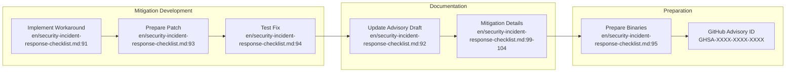
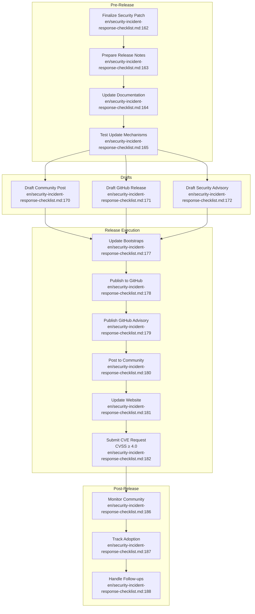
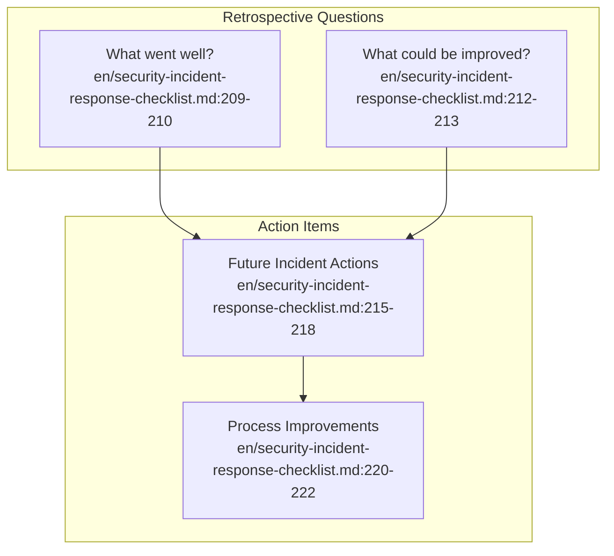
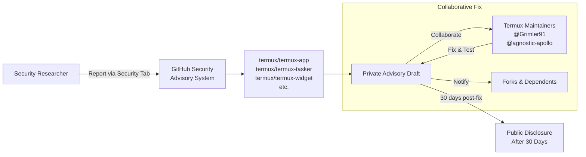
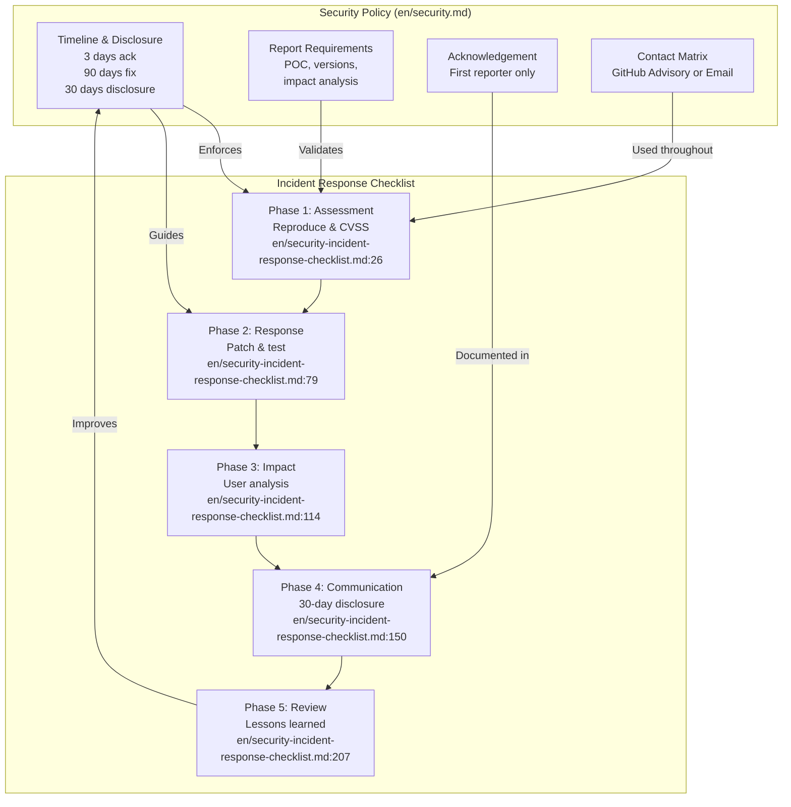

<!-- source: DeepWiki mcp.deepwiki.com · repo termux/termux.github.io · page 7.3 Security Incident Response · fetched 2026-10-26 -->

# Security Incident Response

<details>
<summary>Relevant source files</summary>

The following files were used as context for generating this wiki page:

- [_posts/en/apps/2022-02-25-termux-tasker-v0.6.0-release.md](_posts/en/apps/2022-02-25-termux-tasker-v0.6.0-release.md)
- [_posts/en/general/2024-11-11-termux-selected-for-nlnet-ngi-mobifree-grant.md](_posts/en/general/2024-11-11-termux-selected-for-nlnet-ngi-mobifree-grant.md)
- [_posts/en/security/2022-02-15-termux-apps-vulnerability-disclosures.md](_posts/en/security/2022-02-15-termux-apps-vulnerability-disclosures.md)
- [en/security-incident-response-checklist.md](en/security-incident-response-checklist.md)
- [en/security.md](en/security.md)

</details>


This document describes the structured incident response process that Termux maintainers follow when handling reported security vulnerabilities. The process consists of five phases from initial validation through post-incident review.

For information about how to report vulnerabilities and the disclosure policy, see [Vulnerability Disclosure Policy](#7.1). For historical vulnerability cases, see [Past Vulnerability Disclosures](#7.2).

## Overview

The Security Incident Response process is documented in the checklist at [en/security-incident-response-checklist.md](), which is linked from the main security policy page [en/security.md:20](). The checklist provides a structured template that maintainers follow when a vulnerability report is received, ensuring consistent handling and minimizing response time.

The process follows the disclosure timeline specified in the security policy:
- Acknowledgement within 3 business days for valid reports [en/security.md:16]()
- Fix deployment within 90 days for standard vulnerabilities, 7 days for active exploits [en/security.md:17]()
- Public disclosure 30 days after fix deployment [en/security.md:18]()

**Emergency Contacts:**
- [@Grimler91](https://github.com/Grimler91) ([grimler@termux.dev](mailto:grimler@termux.dev)) [en/security-incident-response-checklist.md:234]()
- [@agnostic-apollo](https://github.com/agnostic-apollo) ([agnostic-apollo@termux.dev](mailto:agnostic-apollo@termux.dev)) [en/security-incident-response-checklist.md:235]()

Sources: [en/security.md](), [en/security-incident-response-checklist.md]()

---

## Five-Phase Response Structure

```mermaid
graph TB
    Report["Security Report Received<br/>(GitHub Advisory or Email)"]
    
    subgraph Phase1["Phase 1: Initial Assessment"]
        Validate["Reproduce Vulnerability<br/>en/security-incident-response-checklist.md:54"]
        CVSS["Assess CVSS Score<br/>en/security-incident-response-checklist.md:55"]
        Timeline["Determine Timeline<br/>en/security-incident-response-checklist.md:58"]
        Summary["Assessment Summary<br/>en/security-incident-response-checklist.md:62-69"]
    end
    
    subgraph Phase2["Phase 2: Immediate Response"]
        Workaround["Implement Workaround<br/>en/security-incident-response-checklist.md:91"]
        Patch["Prepare Patch/Hotfix<br/>en/security-incident-response-checklist.md:93"]
        Advisory["Draft GitHub Advisory<br/>en/security-incident-response-checklist.md:96"]
        Test["Test Fix Thoroughly<br/>en/security-incident-response-checklist.md:94"]
    end
    
    subgraph Phase3["Phase 3: Impact Assessment"]
        Estimate["Estimate Affected Users<br/>en/security-incident-response-checklist.md:124"]
        Default["Check Default Config<br/>en/security-incident-response-checklist.md:125"]
        Exploit["Check for Exploitation<br/>en/security-incident-response-checklist.md:126"]
        Data["Assess Data at Risk<br/>en/security-incident-response-checklist.md:127"]
    end
    
    subgraph Phase4["Phase 4: Communication"]
        Release["Publish Security Release<br/>en/security-incident-response-checklist.md:177"]
        GHAdvisory["Publish GitHub Advisory<br/>en/security-incident-response-checklist.md:179"]
        Community["Notify Community<br/>en/security-incident-response-checklist.md:180"]
        CVE["Submit CVE if warranted<br/>en/security-incident-response-checklist.md:182"]
    end
    
    subgraph Phase5["Phase 5: Post-Incident"]
        Review["Document Lessons<br/>en/security-incident-response-checklist.md:189"]
        Monitor["Monitor Adoption<br/>en/security-incident-response-checklist.md:187"]
        Improve["Process Improvements<br/>en/security-incident-response-checklist.md:220-222"]
    end
    
    Report --> Validate
    Validate --> CVSS
    CVSS --> Timeline
    Timeline --> Summary
    
    Summary --> Workaround
    Workaround --> Patch
    Patch --> Test
    Test --> Advisory
    
    Advisory --> Estimate
    Estimate --> Default
    Default --> Exploit
    Exploit --> Data
    
    Data --> Release
    Release --> GHAdvisory
    GHAdvisory --> Community
    Community --> CVE
    
    CVE --> Review
    Review --> Monitor
    Monitor --> Improve
```



**Five-Phase Incident Response Workflow**

Sources: [en/security-incident-response-checklist.md]()

---

## Phase 1: Initial Assessment and Validation

The first phase focuses on validating the reported vulnerability and determining its severity and scope.

### Key Activities

| Task | Description | Checklist Location |
|------|-------------|-------------------|
| **Reproduce** | Reproduce vulnerability in test environment | [en/security-incident-response-checklist.md:54]() |
| **CVSS Scoring** | Assess severity using CVSS calculator | [en/security-incident-response-checklist.md:55]() |
| **Version Check** | Determine affected stable and beta versions | [en/security-incident-response-checklist.md:56-57]() |
| **Timeline** | Decide if immediate action needed (7-day) or standard (90-day) | [en/security-incident-response-checklist.md:58]() |
| **Root Cause** | Document technical details and root cause | [en/security-incident-response-checklist.md:59]() |

### Assessment Summary Template

The checklist includes a structured summary template [en/security-incident-response-checklist.md:62-69]() that captures:

```
- Severity Level: Critical|High|Medium|Low
- CVSS Score: X.X
- Affects versions: X.Y.Z to X.Y.Z
- Root cause: Brief technical explanation
- Introduced in commit/version: commit-hash or vX.Y.Z
- Attack vector: Malicious termux package|another installed app|...
- Estimated timeline for fix: X days/weeks
```

### Attack Complexity Analysis

For each vulnerability, maintainers assess [en/security-incident-response-checklist.md:36-42]():
- **Attack complexity:** High/Medium/Low
- **Prerequisites:** Authentication required, network access, specific configuration
- **User interaction required:** Yes/No
- **Potential impact areas:** User data confidentiality, Termux VPS integrity, estimated affected installations

### Example: Termux:Tasker Privilege Escalation

The 2022 Termux:Tasker vulnerability [_posts/en/security/2022-02-15-termux-apps-vulnerability-disclosures.md:24-65]() demonstrates Phase 1 activities:
- **Severity:** High (privilege escalation)
- **Attack vector:** Any app could execute arbitrary commands in Termux context
- **Root cause:** Missing canonical path validation in `FireReceiver`
- **Versions affected:** v0.1 (2016-12-26) through v0.4

Sources: [en/security-incident-response-checklist.md:26-69](), [_posts/en/security/2022-02-15-termux-apps-vulnerability-disclosures.md]()

---

## Phase 2: Immediate Response and Mitigation

Phase 2 focuses on developing and testing fixes, with special urgency for actively exploited vulnerabilities.

### Implementation Tasks



**Immediate Response Workflow**

### Mitigation Details Template

The checklist tracks mitigation progress [en/security-incident-response-checklist.md:99-104]():

```
- Workaround available: Yes|No - If yes, describe briefly
- Fix implemented on: YYYY-MM-DD
- Patch/hotfix version: vX.Y.Z
- GitHub Security Advisory ID: GHSA-XXXX-XXXX-XXXX
```

### Timeline Adjustment

The checklist includes a task to consider if coordinated disclosure timeline needs adjustment [en/security-incident-response-checklist.md:97](). This is critical for:
- **Active exploits:** 7-day timeline per policy [en/security.md:17]()
- **Standard vulnerabilities:** 90-day timeline [en/security.md:17]()

### Example: Termux:Widget Token Fix

The Termux:Widget vulnerability fix [_posts/en/security/2022-02-15-termux-apps-vulnerability-disclosures.md:103-111]() shows multi-layered mitigation:

1. **Use `ShortcutManager` APIs** for Android ≥8 [_posts/en/security/2022-02-15-termux-apps-vulnerability-disclosures.md:104]()
2. **Invalidate existing tokens** to force shortcut recreation [_posts/en/security/2022-02-15-termux-apps-vulnerability-disclosures.md:106]()
3. **Canonical path validation** before execution [_posts/en/security/2022-02-15-termux-apps-vulnerability-disclosures.md:108]()

Sources: [en/security-incident-response-checklist.md:79-105](), [_posts/en/security/2022-02-15-termux-apps-vulnerability-disclosures.md]()

---

## Phase 3: Impact Assessment and User Analysis

Phase 3 analyzes the real-world impact on Termux installations and users.

### Analysis Tasks

| Analysis Type | Source | Purpose |
|---------------|--------|---------|
| **Installation Count** | F-Droid download stats or VPS package downloads | Estimate vulnerable population |
| **Default Configuration** | Check if out-of-box setup is vulnerable | Assess automatic impact |
| **Exploitation Evidence** | Review logs and indicators | Determine if actively exploited |
| **Data Compromise** | Analyze what data may be at risk | Inform user communication |

These tasks are documented in [en/security-incident-response-checklist.md:124-128]().

### Impact Summary Template

The checklist provides a structured summary [en/security-incident-response-checklist.md:135-140]():

```
- Estimated vulnerable installations: ~X out of Y
- Default configuration vulnerable: Yes|No
- Evidence of exploitation: Found|Not found|Unknown
- User data potentially at risk: Email content|Credentials|Keys|Configuration|None
- Confidence in assessment: High|Medium|Low
```

### Data Risk Categories

The checklist identifies potential data at risk [en/security-incident-response-checklist.md:139]():
- Email content
- Credentials
- Keys (SSH, encryption)
- Configuration files
- None

### Example: Termux Files World Readable Impact

The ContentProvider vulnerability assessment [_posts/en/security/2022-02-15-termux-apps-vulnerability-disclosures.md:254-257]() demonstrates comprehensive impact analysis:

> **All private files like security keys for `ssh` or encryption keys should be assumed to be compromised for users who were using termux app version `<= v0.117`**

The analysis specifically noted:
- All files under `/data/data/com.termux/files` readable by any app [_posts/en/security/2022-02-15-termux-apps-vulnerability-disclosures.md:119]()
- Affected Google Play Store users (v0.101) and F-Droid users through v0.117
- Recommended immediate key replacement for SSH and encryption keys

Sources: [en/security-incident-response-checklist.md:114-141](), [_posts/en/security/2022-02-15-termux-apps-vulnerability-disclosures.md]()

---

## Phase 4: Communication and Release

Phase 4 coordinates the public disclosure and distribution of security fixes across multiple channels.

### Communication Flow



**Security Release Communication Workflow**

### Release Execution Checklist

The checklist breaks down release into specific tasks [en/security-incident-response-checklist.md:177-182]():

1. **Update bootstraps for termux-app** (if applicable)
2. **Publish patched version** to GitHub releases
3. **Publish GitHub Security Advisory**
4. **Post to community channels** (reddit/matrix/discord)
5. **Update project website/documentation**
6. **Submit CVE request** if warranted (CVSS ≥ 4.0)

### Communication Channels

The checklist identifies specific communication channels [en/security-incident-response-checklist.md:169-173]():

| Channel | Purpose | Audience |
|---------|---------|----------|
| **Termux website** | Official announcement | All users |
| **Reddit** | Community discussion | r/termux subscribers |
| **Matrix/Discord** | Real-time support | Active community members |
| **GitHub Releases** | Version-specific details | Developers and packagers |
| **GitHub Security Advisory** | Formal disclosure | Security researchers, CVE database |
| **Major distributors** | Coordinated updates | F-Droid, package maintainers |

### CVE Submission Criteria

CVE requests are submitted for vulnerabilities with CVSS ≥ 4.0 [en/security-incident-response-checklist.md:182](). This aligns with the security policy's severity assessment [en/security.md:34]() that judges security impact based on actual reported impact with valid attack scenarios.

### Example: 2022 Multi-App Disclosure

The 2022 vulnerability disclosure [_posts/en/security/2022-02-15-termux-apps-vulnerability-disclosures.md:1-13]() demonstrates coordinated communication:

- **Timing:** Released 30 days after termux-app v0.118.0 and ~150 days after Playstore deprecation
- **Multiple releases:** Termux v0.118.0, Termux:Tasker v0.5, Termux:Widget v0.13.0
- **Disclosure post:** Published on termux.dev website with detailed technical analysis
- **Community channels:** Posted to relevant forums with update instructions
- **Clear action items:** "Users are advised to immediately update..."

Sources: [en/security-incident-response-checklist.md:150-198](), [_posts/en/security/2022-02-15-termux-apps-vulnerability-disclosures.md]()

---

## Phase 5: Post-Incident Review

The final phase captures lessons learned and identifies process improvements.

### Review Structure

The checklist provides a structured retrospective template [en/security-incident-response-checklist.md:207-222]():



**Post-Incident Review Structure**

### Review Questions

The template prompts maintainers to answer [en/security-incident-response-checklist.md:209-213]():

**What went well?**
- Identify successful aspects of the response
- Document effective procedures

**What could be improved?**
- Identify bottlenecks or challenges
- Note communication gaps
- Highlight resource constraints

### Action Items Categories

The checklist separates action items into two categories:

1. **Future incident actions** [en/security-incident-response-checklist.md:215-218](): Specific steps to take in next incident
2. **Process improvements** [en/security-incident-response-checklist.md:220-222](): Changes to the response process itself

### Adoption Tracking

Post-release monitoring includes tracking security update adoption [en/security-incident-response-checklist.md:187](), with an estimated time to 50% adoption metric [en/security-incident-response-checklist.md:197]().

### Example: Plugin Security Model Evolution

The 2022 vulnerabilities led to process improvements visible in subsequent communications:

**From Termux:Tasker vulnerability discussion** [_posts/en/security/2022-02-15-termux-apps-vulnerability-disclosures.md:60-64]():
> Possibly some kind of token generation and validation mechanism needs to be designed, possibly as core part `locale` library. Hopefully, more thought can be given to this and termux, automation and `locale` lib devs can collaborate to implement something in (near) future

This reflects the "What could be improved?" retrospective thinking that leads to broader ecosystem improvements.

Sources: [en/security-incident-response-checklist.md:207-222](), [_posts/en/security/2022-02-15-termux-apps-vulnerability-disclosures.md]()

---

## Reporting Channels Integration

The incident response process begins when a vulnerability is reported through one of two channels specified in the security policy [en/security.md:64-72]():

### GitHub Security Advisories (Preferred)



**GitHub Security Advisory Workflow**

**Advantages** [en/security.md:66]():
- Standard open source practice
- Multiple collaborators can work securely
- Dependents and forks get notifications
- Integrated with GitHub ecosystem

### Email to Maintainers

For components without active GitHub monitoring or when GPG encryption is needed:

| Component | Maintainer | Email | GPG Key |
|-----------|-----------|-------|---------|
| **termux-app** | @agnostic-apollo | agnostic-apollo@termux.dev | Available in termux-keyring |
| **termux-packages** | Termux team | See CODEOWNERS | Various |
| **termux-gui** | @tareksander | (via GitHub) | Check termux-keyring |
| **proot** | @michalbednarski | (via GitHub) | Check termux-keyring |

Email reports should be GPG encrypted [en/security.md:72](). Public keys are available:
- In the `termux-keyring` package
- At `https://github.com/<username>.gpg`

### Report Quality Requirements

The security policy specifies what makes a good vulnerability report [en/security.md:44-50]():

```
- Repository and exact affected component(s)
- Affected version(s) (not "latest version")
- Step-by-step POC that reliably reproduces the issue
- Impact analysis and demonstration
- Text output preferred over screenshots/videos
```

Reports must include valid attack scenarios; theoretical vulnerabilities without demonstrated impact are not accepted [en/security.md:34]().

Sources: [en/security.md:62-110]()

---

## Acknowledgement and Rewards

The security policy defines how reporters are acknowledged and potentially rewarded [en/security.md:26-34]().

### Acknowledgement Rules

| Condition | Acknowledgement |
|-----------|----------------|
| First reporter | Acknowledged with chosen name and link |
| Already fixed in git | May not be acknowledged |
| Only in old versions | May not be acknowledged |
| Already reported/discovered | No acknowledgement |

The first entity to report—whether internal Termux team or external party—receives acknowledgement [en/security.md:28](), provided they want to be acknowledged and specify how.

### Rewards Program

**Current status:** No formal rewards program [en/security.md:32]()

**Rationale:**
- Termux services are provided free to users
- Limited donation budget that doesn't cover full development costs
- Donations primarily fund infrastructure via Open Collective (see [Funding and Donation System](#6.2))

**Exceptions:** For severe vulnerabilities, token rewards may be paid from Open Collective funds depending on budget [en/security.md:32]().

### Security Impact Assessment

Rewards and severity are judged based on actual reported impact, not potential impact [en/security.md:34](). This requires:
- Valid attack scenario
- Demonstration of exploitability
- Analysis of real-world impact

Sources: [en/security.md:26-36]()

---

## Disclosure Timeline Enforcement

The security policy establishes specific timelines that guide Phase 1 decisions [en/security.md:14-20]().

### Timeline Structure

```mermaid
gantt
    title Security Vulnerability Response Timeline
    dateFormat X
    axisFormat %d
    
    section Report Processing
    Report Received           :milestone, 0, 0d
    Triage & Acknowledge     :active, 0, 3d
    
    section Standard Track (90 days)
    Fix Development          :90d
    Deploy Fixes            :milestone, 90, 0d
    Wait Period             :30d
    Public Disclosure       :milestone, 120, 0d
    
    section Active Exploit Track (7 days)
    Emergency Fix           :crit, 0, 7d
    Deploy Emergency        :milestone, 7, 0d
    Wait Period             :crit, 30d
    Public Disclosure       :milestone, 37, 0d
```



**Security Response Timeline Tracks**

### Acknowledgement Phase

**Requirement:** Acknowledge valid reports within 3 business days [en/security.md:16]()

**Actions during acknowledgement:**
- Triage report validity
- Assess impact
- Assign to maintainer for coordination

### Fix Deployment Timeline

**Standard vulnerabilities:** 90 days [en/security.md:17]()
- Most security issues follow this track
- Allows thorough fix development and testing
- Aligns with industry responsible disclosure practices

**Active exploits:** 7 days [en/security.md:17]()
- For vulnerabilities being actively exploited in the wild
- Requires emergency response procedures
- Prioritizes rapid mitigation over comprehensive testing

### Public Disclosure

**Requirement:** 30 days after fix deployment [en/security.md:18]()

**Publication channels:**
- GitHub Security Advisories
- Termux website security posts at `/{{lang}}/posts/security.html`

**Example:** The 2022 multi-app disclosure [_posts/en/security/2022-02-15-termux-apps-vulnerability-disclosures.md:11]() was released "after `30` days of `termux-app` [`v0.118.0`] release" demonstrating compliance with the 30-day policy.

Sources: [en/security.md:14-20]()

---

## Repository-Specific Contact Matrix

The security policy lists maintainer contacts for major Termux components [en/security.md:76-109]().

### Termux Apps

| Application | Repository | Maintainer |
|-------------|-----------|-----------|
| Termux | [termux/termux-app](https://github.com/termux/termux-app/security) | @agnostic-apollo |
| Termux:API | [termux/termux-api](https://github.com/termux/termux-api/security) | @agnostic-apollo |
| Termux:Boot | [termux/termux-boot](https://github.com/termux/termux-boot/security) | @agnostic-apollo |
| Termux:Float | [termux/termux-float](https://github.com/termux/termux-float/security) | @agnostic-apollo |
| Termux:GUI | [termux/termux-gui](https://github.com/termux/termux-gui/security) | @tareksander |
| Termux:Keychain | [termux/termux-keychain-app](https://github.com/termux/termux-keychain-app/security) | @agnostic-apollo |
| Termux:Styling | [termux/termux-styling](https://github.com/termux/termux-styling/security) | @agnostic-apollo |
| Termux:Tasker | [termux/termux-tasker](https://github.com/termux/termux-tasker/security) | @agnostic-apollo |
| Termux:Widget | [termux/termux-widget](https://github.com/termux/termux-widget/security) | @agnostic-apollo |
| Termux:X11 | [termux/termux-x11](https://github.com/termux/termux-x11/security) | @twaik |

[en/security.md:79-89]()

### Package Infrastructure

| Component | Repository | Maintainer |
|-----------|-----------|-----------|
| termux-packages | [termux/termux-packages](https://github.com/termux/termux-packages/security) | Termux team (see CODEOWNERS) |
| repology-metadata | [termux/repology-metadata](https://github.com/termux/repology-metadata/security) | @Grimler91, @thunder-coding |

[en/security.md:93-94]()

**Note:** For external package vulnerabilities (e.g., `openssh`) reproducible outside Termux, report to upstream maintainers as well [en/security.md:96]().

### Internal Packages

| Package | Repository | Maintainer |
|---------|-----------|-----------|
| termux-core | [termux/termux-core-package](https://github.com/termux/termux-core-package/security) | @agnostic-apollo |
| termux-elf-cleaner | [termux/termux-elf-cleaner](https://github.com/termux/termux-elf-cleaner/security) | @Grimler91, @thunder-coding |
| termux-exec | [termux/termux-exec-package](https://github.com/termux/termux-exec-package/security) | @agnostic-apollo |
| proot | [termux/proot](https://github.com/termux/proot/security) | @michalbednarski |
| proot-distro | [termux/proot-distro](https://github.com/termux/proot-distro/security) | @sylirre |
| termux-tools | [termux/termux-tools](https://github.com/termux/termux-tools/security) | Termux team |

[en/security.md:100-105]()

### Website

| Component | Repository | Maintainer |
|-----------|-----------|-----------|
| termux.github.io | [termux/termux.github.io](https://github.com/termux/termux.github.io/security) | @agnostic-apollo |

[en/security.md:109]()

Sources: [en/security.md:76-110]()

---

## Integration with Security Policy

The incident response checklist directly implements the security policy commitments documented in [en/security.md]().

### Policy-to-Process Mapping



**Security Policy Implementation Through Incident Response**

### Cross-References

The security policy directly links to the checklist:
> Check the <a href="/{{- page.lang -}}/security-incident-response-checklist.html">Termux Security Incident Response Checklist</a> for more info on the actions that will taken when a security vulnerability is reported.

[en/security.md:20]()

### Historical Compliance

Past vulnerability disclosures demonstrate adherence to the process:

**Termux Apps Disclosures (2022)** [_posts/en/security/2022-02-15-termux-apps-vulnerability-disclosures.md]():
- Published 30 days after fix release (v0.118.0)
- ~150 days after deprecation notice (allowing user migration)
- Detailed technical analysis with POCs
- Clear update instructions
- Multiple communication channels

**Termux:Tasker v0.6.0 Release** [_posts/en/apps/2022-02-25-termux-tasker-v0.6.0-release.md:9]():
> **It is highly recommended that you update to `v0.5.0` or higher for fixes for vulnerabilities disclosed in the [Termux Apps Vulnerability Disclosures] post.**

Sources: [en/security.md](), [en/security-incident-response-checklist.md](), [_posts/en/security/2022-02-15-termux-apps-vulnerability-disclosures.md]()

---

## Emergency Contact Protocol

For urgent security issues requiring immediate attention, the checklist maintains emergency contact information [en/security-incident-response-checklist.md:232-236]().

### Primary Emergency Contacts

**Henrik Grimler (@Grimler91)**
- Email: grimler@termux.dev
- Role: Core maintainer, package infrastructure
- GPG key: Available in termux-keyring package

**agnostic-apollo (@agnostic-apollo)**
- Email: agnostic-apollo@termux.dev  
- Role: Core maintainer, app infrastructure
- GPG key: Available in termux-keyring package

### When to Use Emergency Contacts

Emergency contacts should be used for:
- **Active exploits:** Vulnerabilities being exploited in the wild
- **Critical infrastructure risks:** Threats to package distribution or build systems
- **Time-sensitive coordination:** When immediate response is required

For standard vulnerability reports, use:
1. GitHub Security Advisories (preferred) [en/security.md:66]()
2. Component-specific maintainer emails [en/security.md:76-109]()

### GPG Encryption

Emails to emergency contacts should be GPG encrypted [en/security.md:72]():
- Keys available in `termux-keyring` package
- Keys available at `https://github.com/<username>.gpg`
- Maintains confidentiality through email routing

If emergency contact GPG keys are unavailable, email encrypted reports to @agnostic-apollo or @Grimler91 whose keys are always available [en/security.md:72]().

Sources: [en/security-incident-response-checklist.md:232-236](), [en/security.md:72]()

---

## Relationship to Future Architecture

The NLnet NGI Mobifree grant projects (see [NLnet Grant Overview](#8.1)) aim to improve Termux's security posture, which will affect future incident response:

### APKLF Security Benefits

The APK Library File design (see [APK Library File (APKLF) Design](#8.3)) addresses the `targetSdkVersion=28` backward compatibility mode [_posts/en/general/2024-11-11-termux-selected-for-nlnet-ngi-mobifree-grant.md:40]():

- **Current risk:** Android may end exemption for apps using old `targetSdkVersion`
- **Security impact:** Termux could become non-functional on future Android versions
- **APKLF solution:** Compliance with Android 10+ security restrictions
- **Incident response benefit:** Reduces architectural vulnerability exposure

### termux-core Library Implications

The termux-core library (see [termux-core Library](#8.2)) under MIT license [_posts/en/general/2024-11-11-termux-selected-for-nlnet-ngi-mobifree-grant.md:28]() will:

- Enable external integration without full Termux app forks
- Require security coordination with external projects using the library
- Expand the scope of security incident response to library-dependent projects
- Need additional communication channels for library-based vulnerabilities

These architectural improvements will require updates to the incident response checklist to handle:
- Multi-repository coordination for library vulnerabilities
- External project notification procedures
- APKLF-specific security considerations

Sources: [_posts/en/general/2024-11-11-termux-selected-for-nlnet-ngi-mobifree-grant.md]()

---

