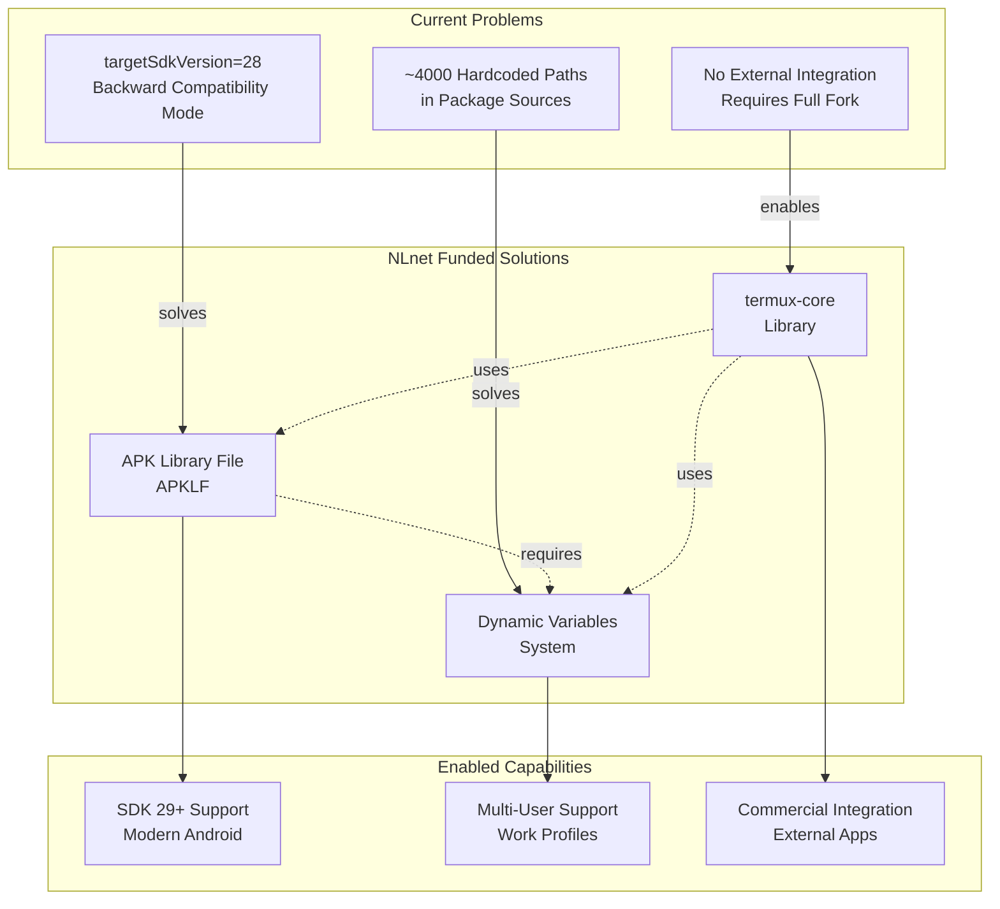
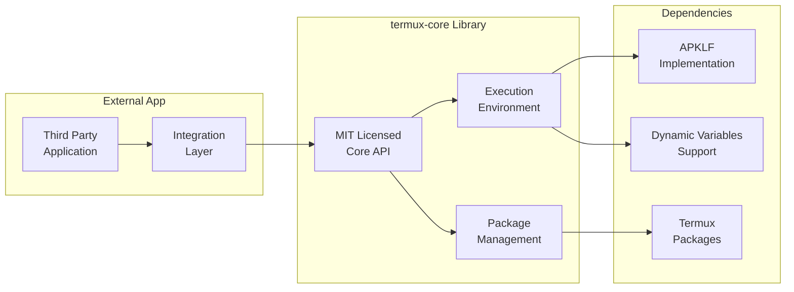
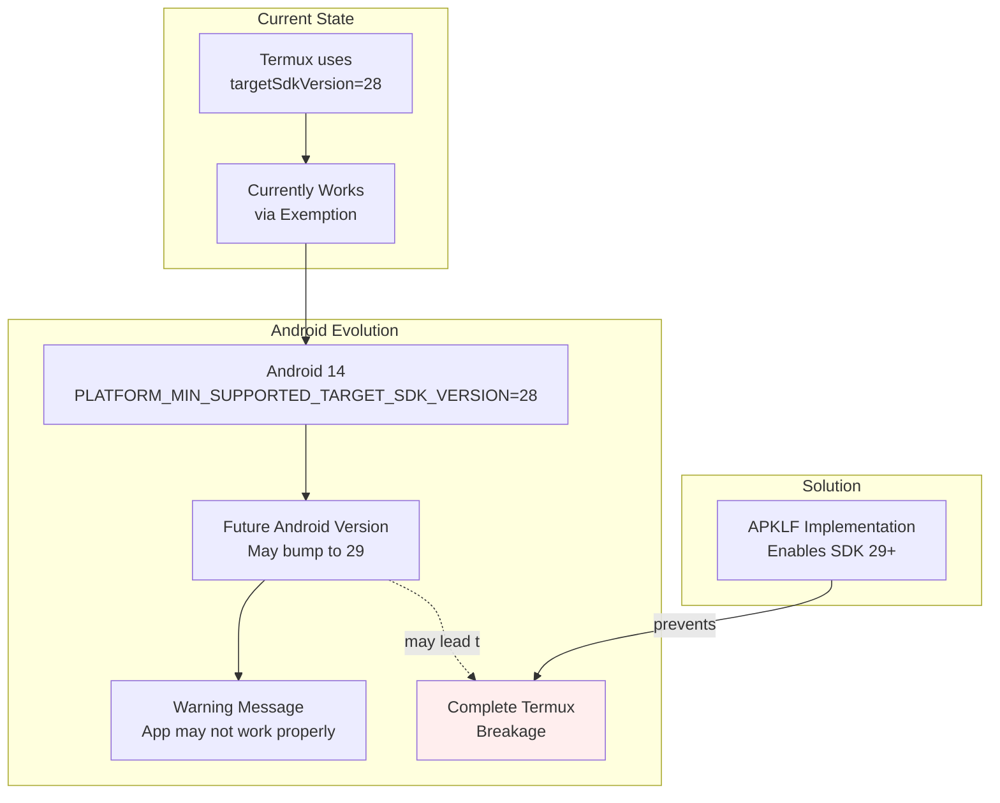
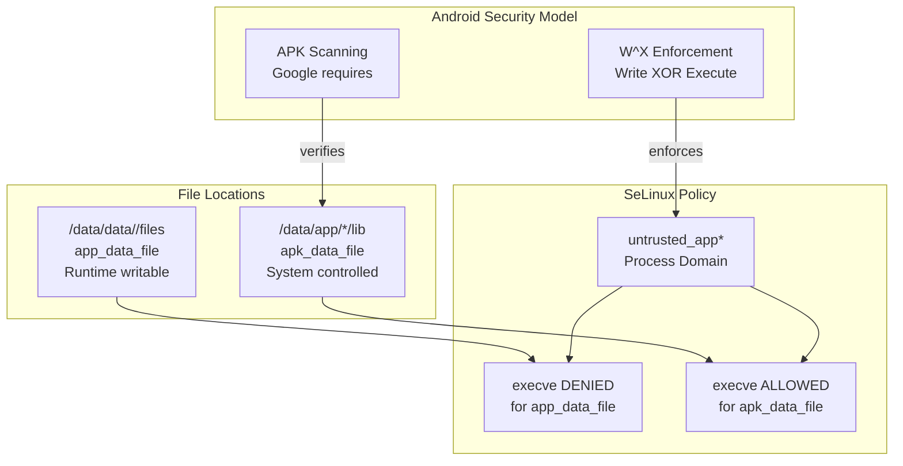
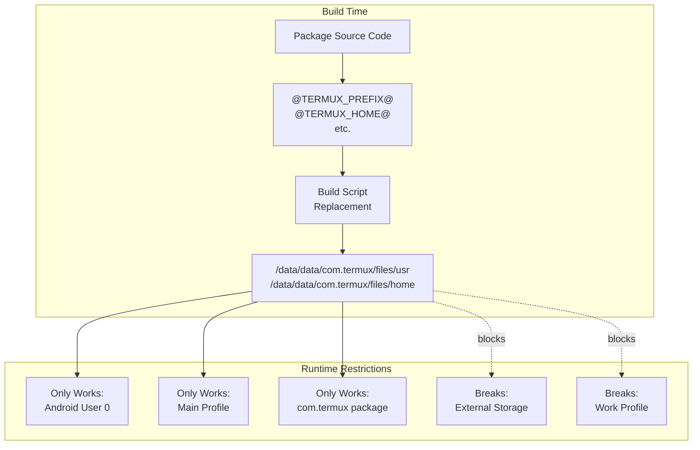
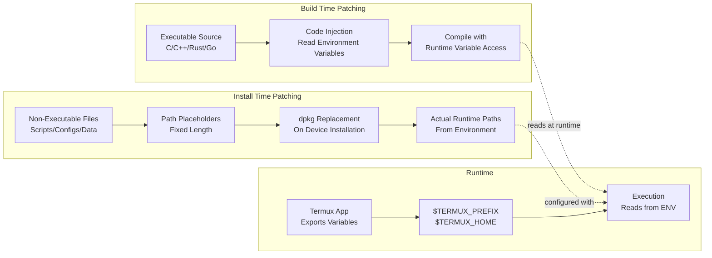
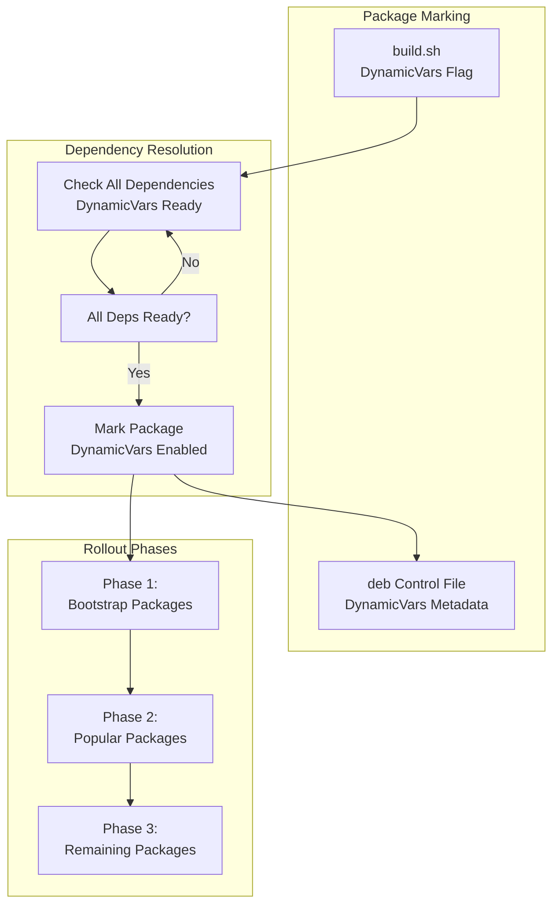
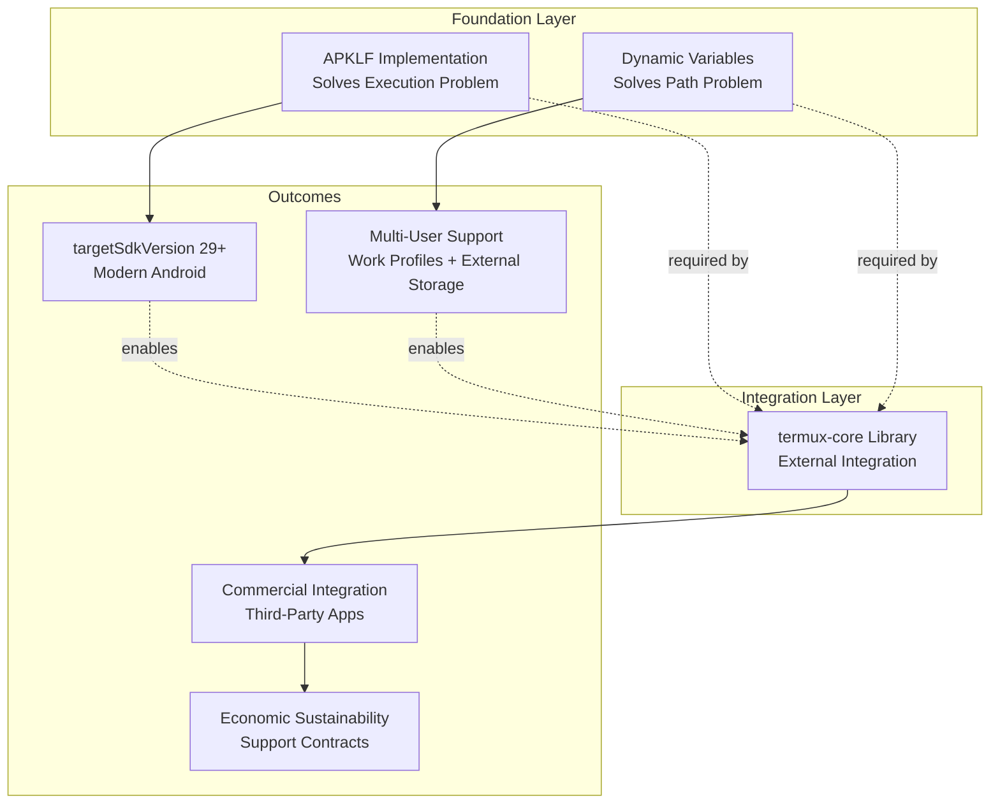
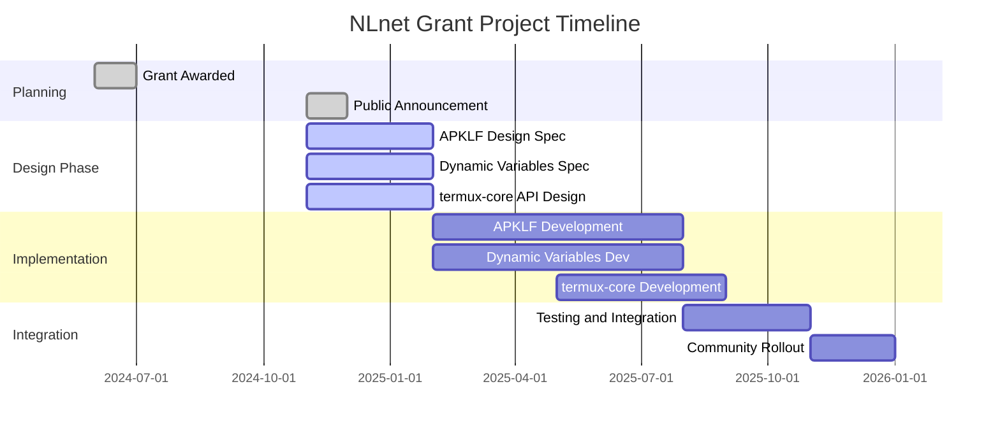

<!-- source: DeepWiki mcp.deepwiki.com · repo termux/termux.github.io · page 8 Future Architecture and Development · fetched 2026-10-26 -->

# Future Architecture and Development

<details>
<summary>Relevant source files</summary>

The following files were used as context for generating this wiki page:

- [_posts/en/apps/2022-02-25-termux-tasker-v0.6.0-release.md](_posts/en/apps/2022-02-25-termux-tasker-v0.6.0-release.md)
- [_posts/en/general/2024-11-11-termux-selected-for-nlnet-ngi-mobifree-grant.md](_posts/en/general/2024-11-11-termux-selected-for-nlnet-ngi-mobifree-grant.md)
- [_posts/en/security/2022-02-15-termux-apps-vulnerability-disclosures.md](_posts/en/security/2022-02-15-termux-apps-vulnerability-disclosures.md)
- [en/security-incident-response-checklist.md](en/security-incident-response-checklist.md)
- [en/security.md](en/security.md)

</details>


This page documents the architectural improvements and development roadmap for Termux funded by the NLnet Foundation NGI Mobifree grant. These improvements address critical challenges in Termux's current architecture related to Android 10+ restrictions, hardcoded paths, and external integration capabilities. The three main projects—termux-core library, APK Library File (APKLF) design, and Dynamic Variables—are interconnected solutions aimed at ensuring Termux's long-term viability and sustainability.

For information about current security practices and vulnerability reporting, see [Security Policy and Practices](#7).

---

## NLnet NGI Mobifree Grant

### Grant Overview

Termux was selected for funding by the [NLnet Foundation](https://nlnet.nl) under the NGI Mobifree program in the June 2024 call. NGI Mobifree is a pilot within the European Commission's Next Generation Internet (NGI) initiative focused on mobile freedom and open source alternatives.

**Grant Recipients:**
- [Henrik Grimler](https://github.com/Grimler91) ([@Grimler91](https://github.com/Grimler91))
- [agnostic-apollo](https://github.com/agnostic-apollo) ([@agnostic-apollo](https://github.com/agnostic-apollo))

**Official Announcements:**
- NLnet announcement: https://nlnet.nl/news/2024/20241111-NGI-Mobifree-grants.html
- Termux project page: https://nlnet.nl/project/Termux

### Three Interconnected Projects

The grant funds three major architectural improvements that work together to solve fundamental limitations in Termux's current design:



**Sources:** [_posts/en/general/2024-11-11-termux-selected-for-nlnet-ngi-mobifree-grant.md:1-16]()

---

## termux-core Library

### Purpose and Licensing

The `termux-core` library will provide a reusable Termux execution environment that external projects can integrate into their applications without requiring a full fork of the Termux app. This library is strategically licensed under the MIT license to maximize adoption and enable commercial integration.

**Key Characteristics:**

| Aspect | Details |
|--------|---------|
| **License** | MIT License |
| **Purpose** | Enable external apps to use Termux environment |
| **Target Users** | Third-party apps, commercial entities |
| **Current Alternative** | Full Termux app fork + manual integration |
| **Repository** | [`termux-core-package`](https://github.com/termux/termux-core-package) |

### Design Goals



### Economic Sustainability Model

The MIT license combined with proof-of-concept demonstrations aims to help Termux secure support contracts from commercial entities. This approach addresses the current funding gap where donations do not cover development costs.

**Sustainability Strategy:**

1. **MIT License Adoption**: Removes licensing barriers for commercial use
2. **Support Contracts**: Enable commercial entities to pay for integration assistance
3. **Economic Model**: Generate revenue while maintaining open source core
4. **Community Impact**: Increased funding supports free (beer) services for all users

**Current Funding Context:**

According to [en/security.md:32](), Termux currently has limited donation funding through [Open Collective](https://opencollective.com/termux) that does not cover full development costs. The termux-core library represents a strategic approach to economic sustainability.

**Sources:** [_posts/en/general/2024-11-11-termux-selected-for-nlnet-ngi-mobifree-grant.md:24-28](), [en/security.md:32](), [en/security.md:100]()

---

## APK Library File (APKLF) Design

### The Android 10 Execution Problem

Android 10 introduced security restrictions that prevent apps from executing downloaded files when using `targetSdkVersion >= 29`. Termux currently uses `targetSdkVersion = 28` (Android 9) to operate in backward compatibility mode, bypassing these restrictions.

**Critical Timeline Risk:**



**Sources:** [_posts/en/general/2024-11-11-termux-selected-for-nlnet-ngi-mobifree-grant.md:38-46]()

### SeLinux Security Model

Android enforces execution restrictions through SeLinux policies and file contexts. Understanding these is critical to the APKLF design.

**SeLinux Context Enforcement:**

| Location | SeLinux Context | Process Context | Execution Allowed (SDK 29+) |
|----------|----------------|-----------------|---------------------------|
| `/data/data/com.termux/files` | `app_data_file` | `untrusted_app*` | ❌ No |
| `/data/app/*com.termux*/lib/<arch>` | `apk_data_file` | `untrusted_app*` | ✅ Yes |
| `/system/bin` | `system_file` | `untrusted_app*` | ✅ Yes (W^X bypass) |

**The W^X Restriction:**



**Sources:** [_posts/en/general/2024-11-11-termux-selected-for-nlnet-ngi-mobifree-grant.md:48-56]()

### APKLF Architecture

The APKLF design leverages Android's approved method: storing executables in the APK native library directory which gets extracted to `/data/app/*<package>/lib/<arch>` with `apk_data_file` context.

**Technical Implementation:**

```mermaid
graph TB
    subgraph "Package Distribution"
        PkgAPK["Package APK<br/>termux-pkg-bash.apk"]
        NativeLib["Native Library Dir<br/>lib/aarch64/"]
        Executables["Executable Files<br/>libbash.so etc"]
    end
    
    subgraph "System Extraction"
        Install["APK Installation"]
        SystemDir["/data/app/*com.termux.pkg.bash*/lib/aarch64<br/>apk_data_file context"]
        ReadOnly["Read-Only<br/>System Controlled"]
    end
    
    subgraph "Runtime Structure"
        Rootfs["/data/data/com.termux/files<br/>Termux Rootfs"]
        Symlinks["Symlink Tree<br/>$PREFIX/bin/bash → lib dir"]
        Execute["Execute via Symlink<br/>SeLinux Allows"]
    end
    
    PkgAPK --> NativeLib
    NativeLib --> Executables
    Executables --> Install
    Install --> SystemDir
    SystemDir --> ReadOnly
    
    SystemDir -.symlinked from.-> Symlinks
    Rootfs --> Symlinks
    Symlinks --> Execute
```



**Design Constraints:**

1. **Single-Level Directory**: Native library directory is flat, no nested directories
2. **Distributed APKs**: Each package needs its own APK (cannot bundle 1000s of packages)
3. **Symlink Strategy**: Create nested rootfs structure via symlinks to flat library directory
4. **Update Model**: Individual package updates require full APK installation
5. **Read-Only Files**: Libraries under `apk_data_file` cannot be modified at runtime

**Related Documentation:**

External technical documentation referenced in the grant announcement:
- [App Data File Execute Restrictions](https://github.com/agnostic-apollo/Android-Docs/blob/master/site/pages/en/projects/docs/apps/processes/app-data-file-execute-restrictions.md)
- [APK Native Library](https://github.com/agnostic-apollo/Android-Docs/blob/master/site/pages/en/projects/docs/apps/processes/app-data-file-execute-restrictions.md#apk-native-library)
- [Termux Execution Environment](https://github.com/termux/termux-packages/wiki/Termux-execution-environment)

**Sources:** [_posts/en/general/2024-11-11-termux-selected-for-nlnet-ngi-mobifree-grant.md:38-57]()

### Alternative Solutions Considered

Several alternative approaches were evaluated before settling on APKLF:

**system_linker_exec Hack:**

The `system_linker_exec` approach involves hooking `exec()` functions to pass executables to `/system/bin/linker` for execution. This tricks SeLinux into allowing execution since it appears to come from a trusted system path.

**Rejection Reasons:**
- Security risk likely to be patched by Android
- Not compliant with Google PlayStore policies  
- Cannot be relied upon as long-term solution

**Related Code:** [termux-exec technical docs](https://github.com/termux/termux-exec/blob/bb75f48d646aa0478527196f1878df53cd1a257c/site/pages/en/projects/docs/technical/index.md)

**untrusted_dev_app Process Context:**

Proposal to request a special SeLinux process domain for developer apps granted special permissions via `adb`.

**Rejection Reasons:**
- No guarantee of Google approval
- Would not work on Android 10-X (only future version X+)
- Requires special permission grant, not suitable for general users

**Sources:** [_posts/en/general/2024-11-11-termux-selected-for-nlnet-ngi-mobifree-grant.md:54-56]()

---

## Dynamic Variables System

### The Hardcoded Path Problem

Termux packages currently contain approximately **~4000 hardcoded path placeholders** that are replaced at build time. These hardcoded paths assume Termux's rootfs is at `/data/data/com.termux/files` for Android user 0.

**Current Limitations:**



**Path Examples:**

| Variable Type | Current Hardcoded Value | Issue |
|--------------|-------------------------|-------|
| `@TERMUX_PREFIX@` | `/data/data/com.termux/files/usr` | Fixed package name |
| `@TERMUX_HOME@` | `/data/data/com.termux/files/home` | Fixed user directory |
| `@TERMUX_CACHE@` | `/data/data/com.termux/files/usr/var/cache` | Fixed cache location |
| Build configs | Package-specific paths | Cannot relocate rootfs |

**Sources:** [_posts/en/general/2024-11-11-termux-selected-for-nlnet-ngi-mobifree-grant.md:66-82]()

### Two-Tier Dynamic Variable Architecture

The solution uses different strategies for executable vs non-executable files, addressing the constraints of the APKLF design.

**Strategy Overview:**



**Implementation Details:**

**Tier 1: Executable Files (Build-Time)**

Executable source code is patched at build time to include language-specific code that reads environment variables at runtime.

```
// Example conceptual patch for C code
// Instead of:
#define TERMUX_PREFIX "/data/data/com.termux/files/usr"

// Dynamic approach:
const char* termux_prefix = getenv("TERMUX_PREFIX");
if (!termux_prefix) termux_prefix = DEFAULT_FALLBACK_PATH;
```

**Rationale for Build-Time:** Executables will be in read-only APKLF directories (`apk_data_file` context), so cannot be patched at install time.

**Tier 2: Non-Executable Files (Install-Time)**

Non-executable files (scripts, configs, data files) use fixed-length placeholders that `dpkg` replaces during package installation on the device.

**Placeholder Design:**

| Path Type | Placeholder Format | Length Considerations |
|-----------|-------------------|----------------------|
| Short paths | Standard placeholders + padding `/` | Max length per [Termux file path limits](https://github.com/termux/termux-packages/wiki/Termux-file-system-layout#file-path-limits) |
| Default fallback | Working default paths | Ensures old installations don't break |
| Length matching | Extra separators for padding | Replacement must match exact length |

**Install-Time Process:**

1. `dpkg` package manager updated with placeholder replacement logic
2. During package installation, read environment variables
3. Replace placeholders in non-executable files with actual paths
4. Bootstrap files get similar treatment during bootstrap installation
5. Compressed files require special decompression/recompression handling

**Rationale for Install-Time:** Non-executable files reside in writable app data directory, allowing in-place modification during installation.

**Sources:** [_posts/en/general/2024-11-11-termux-selected-for-nlnet-ngi-mobifree-grant.md:72-78]()

### Package Migration and Compatibility

**Migration Strategy:**



**Compatibility Notes:**

- Packages updated to dynamic variables marked in `build.sh` and `deb` control files
- All package dependencies must be fixed before package can be marked
- Initial focus on bootstrap and important/popular packages
- Existing installations won't break if placeholder is working default path
- External projects can run packages without recompiling (if paths match)

**External Project Benefits:**

Once packages support dynamic variables, external projects with different package names can:
1. Execute Termux-compiled packages without recompilation
2. Avoid lengthy compilation (often many hours)
3. Reduce CPU/memory resource requirements
4. Support installation on secondary users/work profiles
5. Support installation on external storage

**Limitation:** Packages may still contain Termux branding/URLs added at build time. Projects wanting custom branding must still recompile packages.

**Related Documentation:**
- [Termux Filesystem Layout](https://github.com/termux/termux-packages/wiki/Termux-file-system-layout)
- [Termux rootfs directory](https://github.com/termux/termux-packages/wiki/Termux-file-system-layout#termux-rootfs-directory)

**Sources:** [_posts/en/general/2024-11-11-termux-selected-for-nlnet-ngi-mobifree-grant.md:78-82]()

---

## Project Interconnections

### Dependency Graph

The three projects are not independent—they build on each other to create a comprehensive solution:



**Critical Dependencies:**

1. **APKLF requires Dynamic Variables**: Read-only executable files in APKLF cannot use install-time patching, must read environment variables
2. **termux-core requires APKLF**: External apps need SDK 29+ support to be Play Store compliant
3. **termux-core requires Dynamic Variables**: External apps have different package names and data directories
4. **All three enable sustainability**: Commercial integration provides funding for continued development

**Sources:** [_posts/en/general/2024-11-11-termux-selected-for-nlnet-ngi-mobifree-grant.md:1-87]()

---

## Security and Maintenance Context

### Repository and Maintainer Information

The future architecture projects have designated repository maintainers as documented in [en/security.md:98-106]():

**termux-core Package:**
- Repository: [`termux-core-package`](https://github.com/termux/termux-core-package)
- Maintainer: [@agnostic-apollo](https://github.com/agnostic-apollo)
- Security reporting: [Security advisories](https://github.com/termux/termux-core-package/security)

**Related Packages:**
- [`termux-exec` package](https://github.com/termux/termux-exec-package): System linker exec functionality ([@agnostic-apollo](https://github.com/agnostic-apollo))
- [`termux-tools` package](https://github.com/termux/termux-tools): General tooling (Termux team)

### Vulnerability Disclosure Policy

Any security vulnerabilities discovered in the new architecture implementations should follow the standard Termux disclosure process documented in [Security Policy and Practices](#7):

- **Timeline**: 90-day standard disclosure, 7-day for active exploits
- **Reporting**: GitHub Security Advisories (preferred) or maintainer emails
- **Requirements**: Detailed POC, impact analysis, version information
- **Acknowledgement**: First reporter receives credit and potential reward

**Sources:** [en/security.md:14-20](), [en/security.md:98-106]()

---

## Timeline and Current Status

### Grant Award and Announcement

- **Grant Awarded**: June 2024 call
- **Public Announcement**: 2024-11-11
- **Project Page**: https://nlnet.nl/project/Termux

### Implementation Status

As of the grant announcement in November 2024, all three projects are in the planning and design phase:



*Note: Timeline is illustrative based on typical development cycles. Actual dates depend on grant requirements and development progress.*

**Design Documentation Status:**

According to [_posts/en/general/2024-11-11-termux-selected-for-nlnet-ngi-mobifree-grant.md:44](), a proper APKLF design document and additional issues documentation will be published in the near future. Current preliminary documentation exists in external repositories:

- [APK Native Library](https://github.com/agnostic-apollo/Android-Docs/blob/master/site/pages/en/projects/docs/apps/processes/app-data-file-execute-restrictions.md#apk-native-library)
- Issues sections in the same document

**Sources:** [_posts/en/general/2024-11-11-termux-selected-for-nlnet-ngi-mobifree-grant.md:1-87]()

---

## Impact on Users and External Developers

### User Benefits

**Current Termux Users:**

| Improvement | User Benefit |
|------------|--------------|
| SDK 29+ Support | No more "targeting old SDK" warnings on newer Android versions |
| Multi-User Support | Termux works in work profiles and secondary user accounts |
| External Storage | Install Termux on SD card or external storage |
| Future-Proofing | Continues working when Android removes SDK 28 exemption |

**External Developers:**

| Feature | Developer Benefit |
|---------|------------------|
| termux-core Library | Integrate Termux without forking entire app |
| MIT License | No GPL restrictions for commercial projects |
| Pre-compiled Packages | Avoid hours of compilation time |
| Support Contracts | Professional assistance available |

### Migration Path

**For Existing Installations:**

1. **APKLF Rollout**: Apps will transition from single APK to distributed package APKs
2. **Dynamic Variables**: Gradual package-by-package migration starting with bootstrap
3. **Compatibility**: Designed to not break existing installations during transition
4. **User Action**: Update Termux app when APKLF support is released

**For External Projects:**

1. **Initial Integration**: Use termux-core library with proof-of-concept examples
2. **Package Selection**: Choose which Termux packages to bundle
3. **Custom Branding**: Optionally recompile packages with custom branding
4. **Support Options**: Contact maintainers for commercial support contracts

**Sources:** [_posts/en/general/2024-11-11-termux-selected-for-nlnet-ngi-mobifree-grant.md:24-82]()

---

