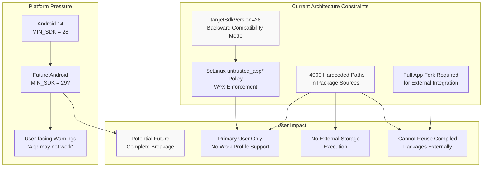
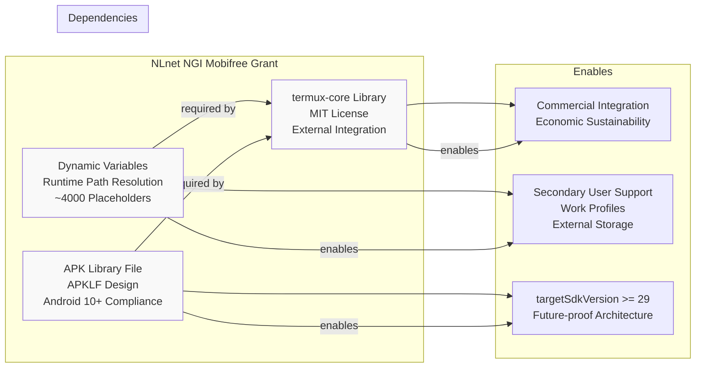
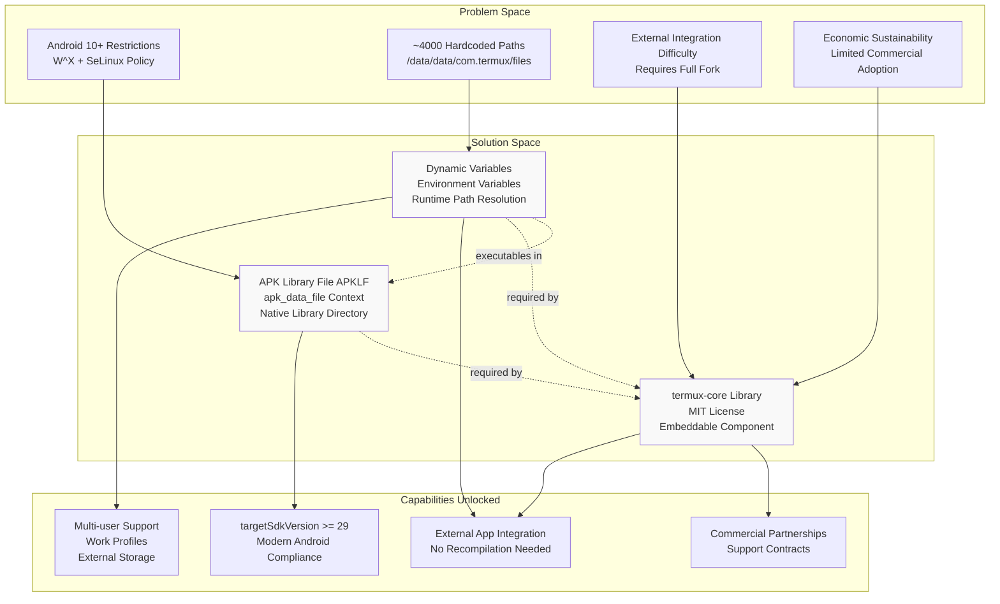
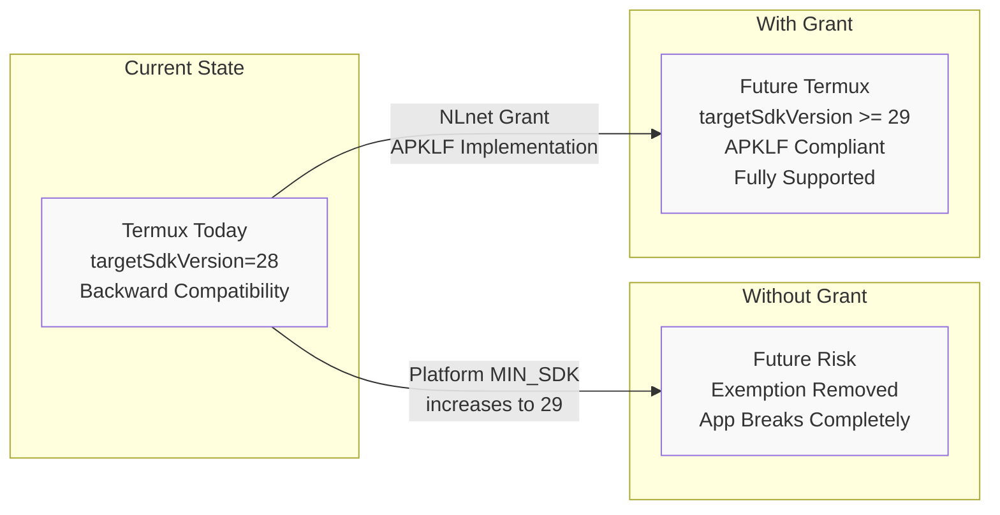

<!-- source: DeepWiki mcp.deepwiki.com · repo termux/termux.github.io · page 8.1 NLnet Grant Overview · fetched 2026-10-26 -->

# NLnet Grant Overview

Relevant source files

The following files were used as context for generating this wiki page:

- [_posts/en/apps/2022-02-25-termux-tasker-v0.6.0-release.md](_posts/en/apps/2022-02-25-termux-tasker-v0.6.0-release.md)
- [_posts/en/general/2024-11-11-termux-selected-for-nlnet-ngi-mobifree-grant.md](_posts/en/general/2024-11-11-termux-selected-for-nlnet-ngi-mobifree-grant.md)
- [_posts/en/security/2022-02-15-termux-apps-vulnerability-disclosures.md](_posts/en/security/2022-02-15-termux-apps-vulnerability-disclosures.md)
- [en/security-incident-response-checklist.md](en/security-incident-response-checklist.md)
- [en/security.md](en/security.md)

## Purpose and Scope

This document provides an overview of the NLnet Foundation NGI Mobifree grant awarded to Termux in 2024. It describes the grant program's context, the three main technical projects funded under this grant (termux-core library, APK Library File design, and Dynamic Variables system), and how these projects interconnect to address Termux's long-term architectural challenges on modern Android versions.

For detailed technical information about each project, see:
- [termux-core Library](#8.2)
- [APK Library File (APKLF) Design](#8.3)
- [Dynamic Variables System](#8.4)

For information about Termux's current security policies and practices, see [Vulnerability Disclosure Policy](#7.1).

**Sources:** [_posts/en/general/2024-11-11-termux-selected-for-nlnet-ngi-mobifree-grant.md:1-16]()

---

## Grant Program Background

### NLnet Foundation and NGI Mobifree

In November 2024, Termux was approved to receive a grant from the [NLnet Foundation](https://nlnet.nl) under its NGI Mobifree program. NGI Mobifree is a pilot initiative within the European Commission's [Next Generation Internet](https://ngi.eu) (NGI) program, focused on fostering mobile freedom and open-source alternatives to proprietary mobile ecosystems.

The official announcement by NLnet is available at https://nlnet.nl/news/2024/20241111-NGI-Mobifree-grants.html with the Termux project page at https://nlnet.nl/project/Termux.

### Grant Team

The grant work is being coordinated by two core Termux maintainers:
- [Henrik Grimler](https://github.com/Grimler91) (`grimler@termux.dev`)
- [agnostic-apollo](https://github.com/agnostic-apollo) (`agnostic-apollo@termux.dev`)

These maintainers are also listed as emergency contacts for security incidents (see [en/security-incident-response-checklist.md:233-235]()).

**Sources:** [_posts/en/general/2024-11-11-termux-selected-for-nlnet-ngi-mobifree-grant.md:6-8](), [en/security-incident-response-checklist.md:233-235]()

---

## Strategic Context and Motivation

### Current Architectural Challenges

Termux faces several critical architectural constraints that threaten its long-term viability on modern Android:

1. **SDK Target Version Lock**: Termux currently uses `targetSdkVersion=28` (Android 9) to run in backward compatibility mode, bypassing Android 10+ execution restrictions. This exemption may be removed in future Android versions.

2. **Execution Restrictions**: Android 10+ prevents apps with `targetSdkVersion >= 29` from executing files downloaded to the app data directory via SeLinux `untrusted_app*` policies and `W^X` (Write XOR Execute) enforcement.

3. **Hardcoded Paths**: Approximately 4000 hardcoded path placeholders exist across package sources, preventing Termux from running in secondary users, work profiles, or external storage locations.

4. **Integration Barriers**: Third-party projects that want to integrate Termux functionality must fork the entire app and manually integrate it, which is time-consuming and difficult to maintain.

### Platform Minimum SDK Enforcement

Android 14 bumped `PLATFORM_MIN_SUPPORTED_TARGET_SDK_VERSION` to 28, and plans exist to increase it to 29, which will display warnings when Termux launches that it may not work properly due to targeting an old SDK. This creates urgency for the APKLF solution.

**Sources:** [_posts/en/general/2024-11-11-termux-selected-for-nlnet-ngi-mobifree-grant.md:38-46](), [_posts/en/general/2024-11-11-termux-selected-for-nlnet-ngi-mobifree-grant.md:48-57]()

**Sources:** [_posts/en/general/2024-11-11-termux-selected-for-nlnet-ngi-mobifree-grant.md:38-82]()

---

## Three Core Projects

The NLnet grant funds three interconnected technical projects, each addressing specific architectural challenges while supporting the others.

### Project Relationship Overview

**Sources:** [_posts/en/general/2024-11-11-termux-selected-for-nlnet-ngi-mobifree-grant.md:10-14]()

### 1. termux-core Library

**Purpose**: A reusable library that allows external projects to integrate the Termux execution environment into their own applications without requiring a full fork of the Termux app.

**License**: MIT License (intentionally permissive to enable commercial adoption)

**Strategic Goal**: Enable commercial integration and support contracts to make Termux economically sustainable while maintaining the open-source core.

**Key Features**:
- Embeddable Termux execution environment
- Usable in third-party apps with different package names
- Compatible with Google PlayStore distribution policies
- Reduces integration effort from manual fork to library dependency

**Code References**:
- New repository planned: `termux/termux-core-package`
- Referenced in security policy: [en/security.md:100]()

See [termux-core Library](#8.2) for detailed technical design.

**Sources:** [_posts/en/general/2024-11-11-termux-selected-for-nlnet-ngi-mobifree-grant.md:24-28](), [en/security.md:100]()

### 2. APK Library File (APKLF)

**Purpose**: A new execution and packaging design that complies with Android 10+ security restrictions while allowing Termux to execute downloaded packages with `targetSdkVersion >= 29`.

**Core Innovation**: Leverages the difference between SeLinux contexts for app data (`app_data_file` - no execute) vs APK native library directories (`apk_data_file` - execute allowed).

**Architecture**:
- Executable files stored in APK native library directory (`ApplicationInfo.nativeLibraryDir`)
- Files extracted to system-controlled path `/data/app/*<package_name>/lib/<arch>`
- Symlinks created from app data directory rootfs to native library directory
- Each package distributed as separate APK

**Critical Dependencies**:
- Required for `termux-core` library (external apps need modern SDK)
- Required for long-term Termux viability
- Required for Google PlayStore distribution

**Alternative Approaches Rejected**:
- `system_linker_exec` hack - Security risk, not PlayStore compliant
- New SeLinux domain via special permission - Not approved, only helps future Android versions

See [APK Library File (APKLF) Design](#8.3) for detailed technical specifications.

**Sources:** [_posts/en/general/2024-11-11-termux-selected-for-nlnet-ngi-mobifree-grant.md:38-57]()

### 3. Dynamic Variables System

**Purpose**: Replace ~4000 hardcoded paths in Termux packages with runtime path resolution from environment variables, enabling flexible installation locations.

**Scope**: 
- Build-time patching for executable files (read env vars at runtime)
- Install-time patching for non-executable files (replace placeholders with current paths)

**Benefits**:
- Enables secondary user and work profile support
- Enables external storage execution
- Allows external projects to use pre-compiled Termux packages
- Reduces compilation requirements (saves hours and significant resources)

**Implementation Strategy**:
- Two-tier approach: executables use language-specific env var reading, non-executables use `dpkg` placeholder replacement
- Placeholders use working default paths padded to max length per path type
- Backward compatibility maintained for existing installations
- Packages marked with metadata indicating dynamic variable support
- Priority patching for bootstrap and popular packages first

**APKLF Compatibility**: Executables will be read-only in native library directory, so must use runtime environment variable resolution rather than install-time patching.

See [Dynamic Variables System](#8.4) for implementation details.

**Sources:** [_posts/en/general/2024-11-11-termux-selected-for-nlnet-ngi-mobifree-grant.md:66-82]()

---

## Project Interconnections

The three projects form an integrated solution to Termux's architectural challenges, with significant interdependencies:

**Sources:** [_posts/en/general/2024-11-11-termux-selected-for-nlnet-ngi-mobifree-grant.md:10-82]()

### Critical Path Analysis

| Project | Blocks | Blocked By | Priority |
|---------|--------|------------|----------|
| **APKLF** | `termux-core` library, Modern SDK adoption | None | **Critical** - Required for Android 10+ compliance |
| **Dynamic Variables** | `termux-core` library, Multi-user support | APKLF (for executable patching strategy) | **High** - Required for flexible deployment |
| **termux-core** | Commercial adoption | APKLF, Dynamic Variables | **Strategic** - Enables sustainability |

### Technical Dependencies

**APKLF → Dynamic Variables**:
- Executables stored in read-only native library directory
- Cannot use install-time patching
- Forces runtime environment variable approach for executables

**Dynamic Variables → termux-core**:
- External apps have different package names and rootfs paths
- Without dynamic variables, packages would need app-specific compilation
- Runtime path resolution enables package reuse across apps

**APKLF → termux-core**:
- External apps on Google PlayStore cannot use `targetSdkVersion=28` workaround
- APKLF compliance required for `termux-core` to be useful for commercial apps
- PlayStore policies enforce modern SDK versions

**Sources:** [_posts/en/general/2024-11-11-termux-selected-for-nlnet-ngi-mobifree-grant.md:46](), [_posts/en/general/2024-11-11-termux-selected-for-nlnet-ngi-mobifree-grant.md:76-80]()

---

## Implementation Timeline and Status

### Grant Announcement

- **Announcement Date**: 2024-11-11
- **Grant Call**: June 2024
- **Public Announcement**: https://nlnet.nl/news/2024/20241111-NGI-Mobifree-grants.html
- **Project Page**: https://nlnet.nl/project/Termux

### Current Status

As of the grant announcement, all three projects are in the planning and design phase. The grant post serves as the initial public specification and design document for these architectural improvements.

### Relationship to Existing Work

The grant builds upon existing research and documentation:

- **SeLinux Policy Research**: [Android-Docs: App Data File Execute Restrictions](https://github.com/agnostic-apollo/Android-Docs/blob/master/site/pages/en/projects/docs/apps/processes/app-data-file-execute-restrictions.md)
- **APKLF Design**: [Android-Docs: APK Native Library](https://github.com/agnostic-apollo/Android-Docs/blob/master/site/pages/en/projects/docs/apps/processes/app-data-file-execute-restrictions.md#apk-native-library)
- **Existing Issues**: [termux/termux-app#1072](https://github.com/termux/termux-app/issues/1072), [termux/termux-app#2155](https://github.com/termux/termux-app/issues/2155)
- **Execution Environment**: [Termux Execution Environment](https://github.com/termux/termux-packages/wiki/Termux-execution-environment)
- **Filesystem Layout**: [Termux Filesystem Layout](https://github.com/termux/termux-packages/wiki/Termux-file-system-layout)

**Sources:** [_posts/en/general/2024-11-11-termux-selected-for-nlnet-ngi-mobifree-grant.md:6](), [_posts/en/general/2024-11-11-termux-selected-for-nlnet-ngi-mobifree-grant.md:42]()

---

## Strategic Implications

### Economic Sustainability

The grant addresses long-term economic sustainability through the MIT-licensed `termux-core` library, which:

1. **Enables Commercial Integration**: Companies can integrate Termux functionality without GPL restrictions
2. **Creates Support Contract Opportunities**: Potential for paid support and customization services
3. **Funds Infrastructure**: Revenue can support Hetzner package repository hosting and other infrastructure costs
4. **Maintains Open Core**: Termux app and packages remain open-source while library enables commercial adoption

The current funding model relies heavily on donations through Open Collective and GitHub Sponsors (see [Funding and Donation System](#6.2)), which do not fully cover development costs according to [en/security.md:32](). Commercial partnerships enabled by `termux-core` aim to improve this situation.

**Sources:** [_posts/en/general/2024-11-11-termux-selected-for-nlnet-ngi-mobifree-grant.md:28](), [en/security.md:32]()

### Technical Longevity

The grant ensures Termux can function on modern and future Android versions:

**Sources:** [_posts/en/general/2024-11-11-termux-selected-for-nlnet-ngi-mobifree-grant.md:46]()

### User Experience Improvements

Beyond technical compliance, the grant projects enable new user capabilities:

| Capability | Before Grant | After Grant |
|-----------|--------------|-------------|
| **Secondary Users** | Not supported | Fully supported via Dynamic Variables |
| **Work Profiles** | Not supported | Fully supported via Dynamic Variables |
| **External Storage** | Not supported | Fully supported via Dynamic Variables |
| **Third-party Integration** | Requires full fork | Use `termux-core` library |
| **Package Reuse** | App-specific compilation required | Pre-compiled packages work everywhere |
| **Android Version** | Limited to backward compat | Full support for modern versions |

**Sources:** [_posts/en/general/2024-11-11-termux-selected-for-nlnet-ngi-mobifree-grant.md:70-80]()

---

## Related Security Considerations

While the grant projects focus on architectural improvements, they have important security implications documented in the security policy:

- **Vulnerability Disclosure**: Standard 90-day timeline, 7-day for active exploits ([en/security.md:17]())
- **Component Maintainers**: Grant team members are listed as security contacts ([en/security.md:80-100]())
- **New Repository**: `termux-core-package` will have its own security advisory process ([en/security.md:100]())

The architectural improvements also address some security concerns:

- **APKLF Compliance**: Aligns with Android's intended security model for executable code
- **Dynamic Variables**: Reduces attack surface by eliminating hardcoded privileged paths
- **External Integration**: MIT license enables security audits by commercial partners

For past security vulnerabilities that informed the grant design, see [Past Vulnerability Disclosures](#7.2).

**Sources:** [en/security.md:17](), [en/security.md:80-100]()

---

## Community and Documentation

### Public Resources

- **Project Page**: https://nlnet.nl/project/Termux
- **Grant Announcement**: https://nlnet.nl/news/2024/20241111-NGI-Mobifree-grants.html
- **Website Post**: Published 2024-11-11 at [_posts/en/general/2024-11-11-termux-selected-for-nlnet-ngi-mobifree-grant.md]()

### Additional Technical Documentation

For detailed information about specific grant components:
- **termux-core Library**: See [termux-core Library](#8.2)
- **APKLF Design**: See [APK Library File (APKLF) Design](#8.3)
- **Dynamic Variables**: See [Dynamic Variables System](#8.4)

For related architectural context:
- **Site Configuration**: See [Main Configuration File](#3.1)
- **Build System**: See [Jekyll and Dependencies](#2.1)
- **Package Distribution**: See [Package Distribution Infrastructure](#6.1)

**Sources:** [_posts/en/general/2024-11-11-termux-selected-for-nlnet-ngi-mobifree-grant.md:6]()

---

