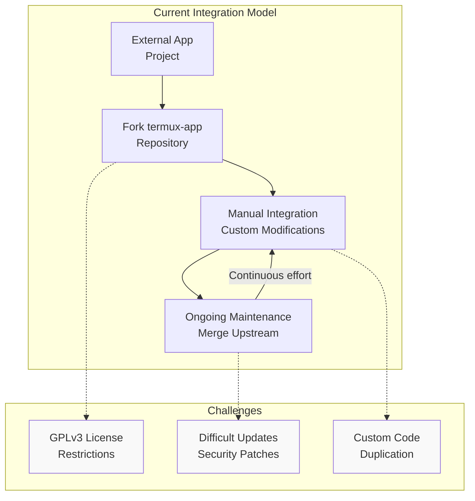
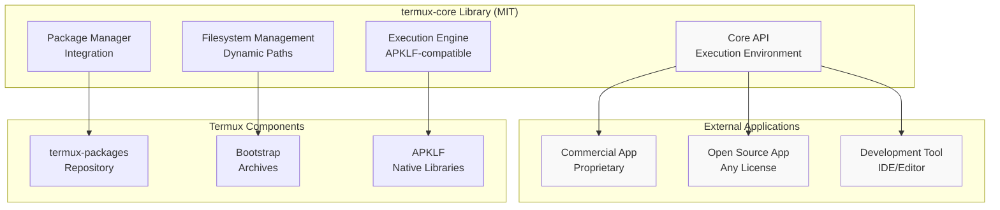
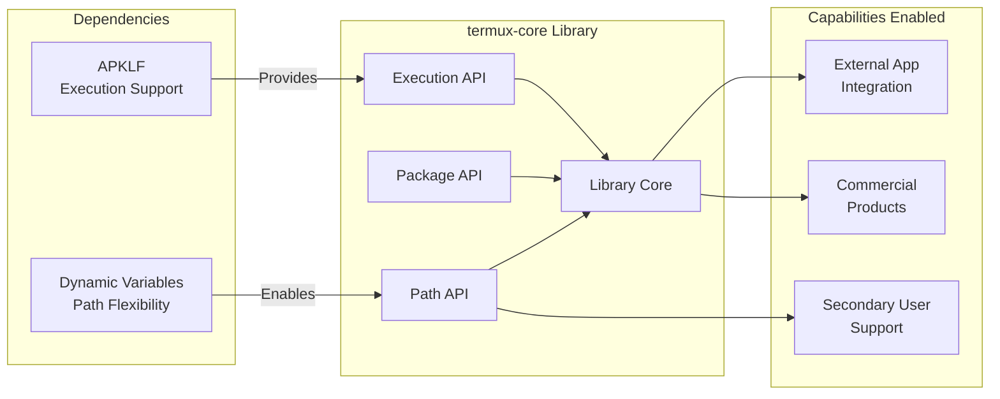
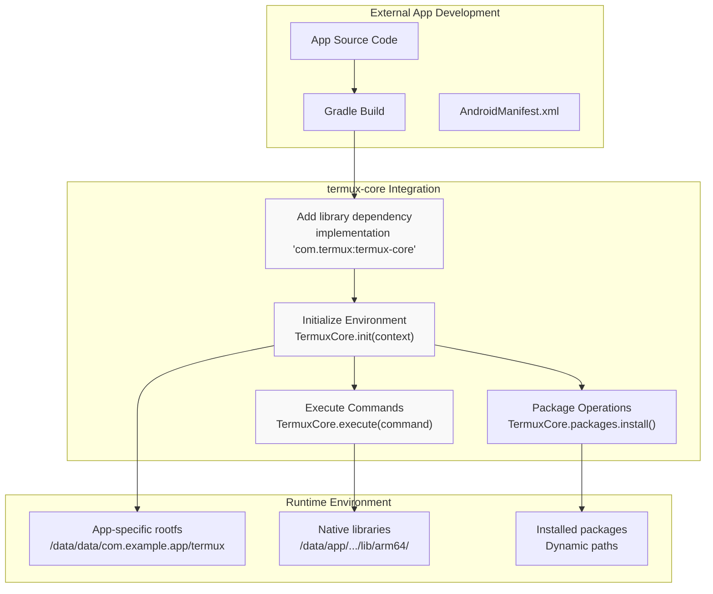
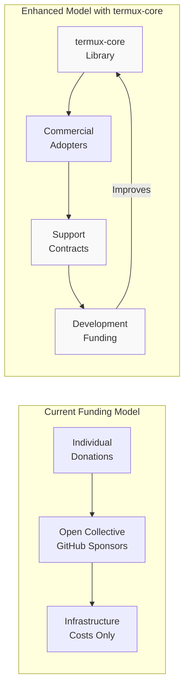
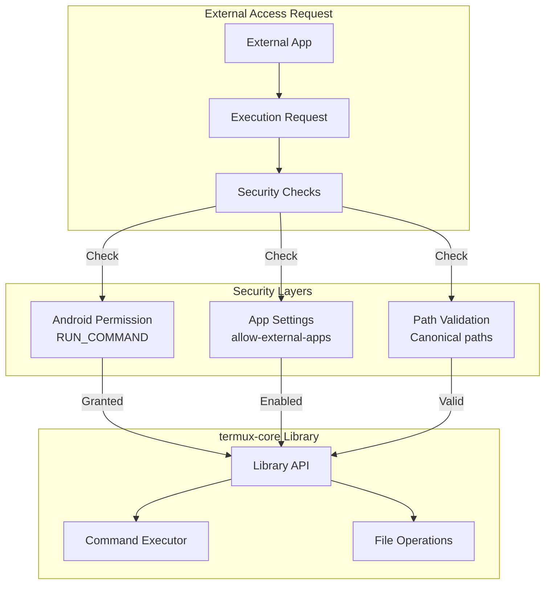
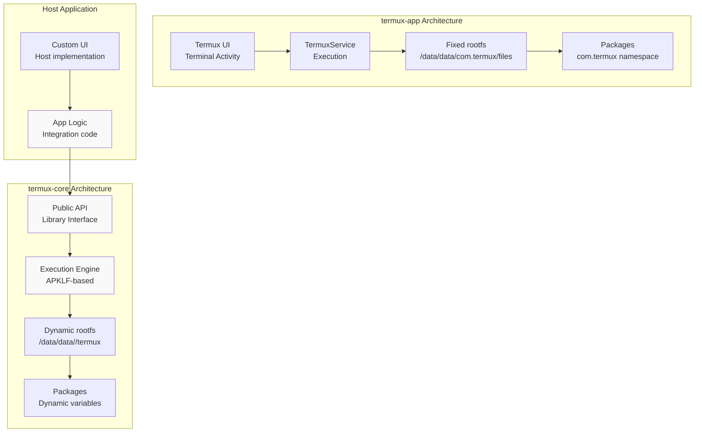
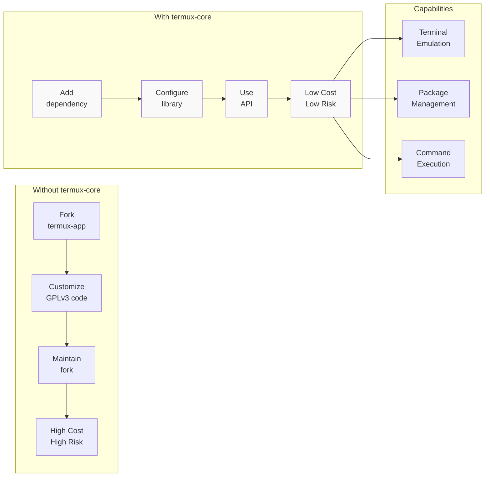

<!-- source: DeepWiki mcp.deepwiki.com · repo termux/termux.github.io · page 8.2 termux-core Library · fetched 2026-10-26 -->

# termux-core Library

<details>
<summary>Relevant source files</summary>

The following files were used as context for generating this wiki page:

- [_posts/en/apps/2022-02-25-termux-tasker-v0.6.0-release.md](_posts/en/apps/2022-02-25-termux-tasker-v0.6.0-release.md)
- [_posts/en/general/2024-11-11-termux-selected-for-nlnet-ngi-mobifree-grant.md](_posts/en/general/2024-11-11-termux-selected-for-nlnet-ngi-mobifree-grant.md)
- [_posts/en/security/2022-02-15-termux-apps-vulnerability-disclosures.md](_posts/en/security/2022-02-15-termux-apps-vulnerability-disclosures.md)
- [en/security-incident-response-checklist.md](en/security-incident-response-checklist.md)
- [en/security.md](en/security.md)

</details>


## Purpose and Scope

This document describes the `termux-core` library, a planned reusable library component that will enable external applications to integrate the Termux execution environment and package ecosystem into their own apps. The library is one of three interconnected projects funded by the NLnet NGI Mobifree grant (see [NLnet Grant Overview](#8.1)) and is designed to work in conjunction with the [APK Library File (APKLF) Design](#8.3) and [Dynamic Variables System](#8.4).

The `termux-core` library is distinct from the existing `termux-core` package listed in [en/security.md:100](), which is an internal package within the Termux ecosystem. This document focuses on the new library component designed for external integration.

**Sources:** [_posts/en/general/2024-11-11-termux-selected-for-nlnet-ngi-mobifree-grant.md:24-29]()

---

## Current Integration Challenges

### Full Fork Requirement

Currently, integrating Termux functionality into third-party applications requires developers to fork the entire `termux-app` repository and perform manual integration work. This approach creates several significant barriers:

| Challenge | Description | Impact |
|-----------|-------------|--------|
| **Code Maintenance** | Must maintain a complete fork of termux-app | High ongoing maintenance burden |
| **Manual Integration** | No standardized integration API | Time-consuming custom implementation |
| **License Complexity** | GPLv3 licensing of termux-app | Prevents some commercial use cases |
| **Update Difficulty** | Manual merge of upstream changes | Risks missing security updates |
| **Duplicate Effort** | Each integrator solves same problems | Wasted development resources |

### Integration Complexity Diagram



**Sources:** [_posts/en/general/2024-11-11-termux-selected-for-nlnet-ngi-mobifree-grant.md:26]()

---

## Library Design Overview

### MIT License Strategy

The `termux-core` library will be released under the MIT license rather than GPLv3. This licensing choice is strategic and serves multiple purposes:

**Licensing Comparison**

| Aspect | termux-app (GPLv3) | termux-core Library (MIT) |
|--------|-------------------|---------------------------|
| **Commercial Use** | Requires derivative works to be GPLv3 | Permits proprietary derivatives |
| **Distribution** | Source must be provided | No source disclosure requirement |
| **Patent Rights** | Implicit patent grant | Explicit patent grant |
| **Adoption Barrier** | High for commercial entities | Low for all users |
| **License Compatibility** | Limited | Broad compatibility |

The MIT license was specifically chosen to:

1. **Increase Adoption**: Remove licensing barriers that prevent commercial integration
2. **Prevent Conflicts**: Ensure compatibility with proprietary codebases
3. **Attract Commercial Interest**: Enable commercial entities to build on Termux
4. **Enable Sustainability**: Facilitate support contracts and commercial partnerships

**Sources:** [_posts/en/general/2024-11-11-termux-selected-for-nlnet-ngi-mobifree-grant.md:28]()

### Target Architecture



**Sources:** [_posts/en/general/2024-11-11-termux-selected-for-nlnet-ngi-mobifree-grant.md:24-29]()

---

## Planned Library Components

### Execution Environment API

The core functionality will provide a standardized interface for initializing and managing a Termux execution environment within an external application:

**Expected Component Structure:**

| Component | Responsibility | Dependencies |
|-----------|---------------|--------------|
| **Environment Initializer** | Setup rootfs, bootstrap extraction | Dynamic Variables, APKLF |
| **Process Manager** | Execute commands, manage sessions | APKLF execution model |
| **Package Interface** | Install, update, remove packages | Package manager integration |
| **Path Resolver** | Handle dynamic path variables | Dynamic Variables system |
| **Permission Handler** | Manage required Android permissions | Android SDK APIs |
| **Configuration Manager** | Handle termux.properties, settings | File I/O utilities |

### Integration with NLnet Projects

The `termux-core` library depends on successful implementation of the other two NLnet-funded projects:



**APKLF Dependency**: The library requires APKLF to function on Android 10+ with `targetSdkVersion >= 29`, as described in [APK Library File (APKLF) Design](#8.3). Without APKLF, executables cannot run on modern Android versions.

**Dynamic Variables Dependency**: The library requires Dynamic Variables to support flexible installation paths, enabling apps to use different package names and rootfs locations. See [Dynamic Variables System](#8.4) for details on the ~4000 hardcoded paths that must be eliminated.

**Sources:** [_posts/en/general/2024-11-11-termux-selected-for-nlnet-ngi-mobifree-grant.md:38-82]()

---

## Use Cases and Target Audience

### Commercial Integration Scenarios

| Use Case | Description | Example Applications |
|----------|-------------|---------------------|
| **IDE Integration** | Embedded terminal with package ecosystem | Mobile code editors with build tools |
| **Developer Tools** | Portable development environment | Git clients, SSH terminals, build systems |
| **Educational Apps** | Learn-to-code environments | Programming tutorials with real shell |
| **System Administration** | Remote server management | Network diagnostic tools, admin utilities |
| **Content Creation** | Media processing pipelines | Video editors, image processors |

### External Project Integration Model



**Sources:** [_posts/en/general/2024-11-11-termux-selected-for-nlnet-ngi-mobifree-grant.md:28](), [_posts/en/general/2024-11-11-termux-selected-for-nlnet-ngi-mobifree-grant.md:80]()

---

## Economic Sustainability Goals

### Support Contract Model

The primary economic goal of the `termux-core` library is to establish a sustainable funding model through commercial support contracts:

**Sustainability Strategy**

| Initiative | Goal | Expected Outcome |
|-----------|------|------------------|
| **MIT Licensing** | Remove adoption barriers | Increased commercial interest |
| **Proof-of-Concept Apps** | Demonstrate integration value | Attract potential clients |
| **Support Contracts** | Provide integration assistance | Revenue stream for development |
| **Documentation** | Comprehensive integration guides | Reduce support burden |
| **Commercial Examples** | Showcase real-world usage | Marketing and credibility |

### Funding Flow



The grant funding from NLnet covers the initial development of the library, APKLF, and Dynamic Variables. The hope is that once developed and demonstrated through proof-of-concept implementations, the library will generate sufficient commercial interest to fund ongoing Termux development through support contracts.

**Sources:** [_posts/en/general/2024-11-11-termux-selected-for-nlnet-ngi-mobifree-grant.md:28-29](), [en/security.md:32]()

---

## Current Implementation Status

### Development Phase

As of the NLnet grant announcement in November 2024, the `termux-core` library is in the planning and early development phase. The project is part of the NLnet NGI Mobifree grant awarded to Henrik Grimler ([@Grimler91](https://github.com/Grimler91)) and agnostic-apollo ([@agnostic-apollo](https://github.com/agnostic-apollo)).

**Project Timeline Overview:**

| Phase | Status | Description |
|-------|--------|-------------|
| **Planning** | Complete | Grant approved, design discussions |
| **APKLF Development** | In Progress | Required dependency for library |
| **Dynamic Variables** | In Progress | Required dependency for library |
| **Library Implementation** | Planned | Awaits APKLF and Dynamic Variables |
| **Proof-of-Concept** | Planned | Demo applications for commercial interest |
| **Documentation** | Planned | Integration guides and API documentation |

### Repository Structure

The existing `termux-core-package` repository referenced in [en/security.md:100]() is the internal package, not the external library. The new library repository will be separate and will be announced once initial development begins.

**Expected Repository Organization:**

```
termux-core-library/          (planned)
├── library/                  Core library module
│   ├── src/main/java/       Java/Kotlin API
│   └── src/main/cpp/        Native components
├── sample-app/              Example integration
├── docs/                    API documentation
└── LICENSE                  MIT License
```

**Sources:** [_posts/en/general/2024-11-11-termux-selected-for-nlnet-ngi-mobifree-grant.md:6-8](), [en/security.md:100]()

---

## Security Considerations

### Permission Model

External applications using `termux-core` will need to handle the same security permissions as the Termux app:

**Required Permissions:**

| Permission | Purpose | Criticality |
|-----------|---------|-------------|
| `READ_EXTERNAL_STORAGE` | Access user files | Required for file operations |
| `WRITE_EXTERNAL_STORAGE` | Write user files | Required for file operations |
| `com.termux.permission.RUN_COMMAND` | Execute termux commands | Core functionality |
| `INTERNET` | Package downloads | Required for package management |
| `WAKE_LOCK` | Background execution | Optional, for long-running tasks |

The library will enforce the same security model as the current Termux app, requiring the `com.termux.permission.RUN_COMMAND` permission for execution operations as implemented in [en/security.md:52]() and documented in the vulnerability disclosures at [_posts/en/security/2022-02-15-termux-apps-vulnerability-disclosures.md:52]().

### Plugin Security Model

Applications using `termux-core` must implement similar security protections to those added to Termux:Tasker in [_posts/en/apps/2022-02-25-termux-tasker-v0.6.0-release.md:52-58]():



**Sources:** [en/security.md:52](), [_posts/en/security/2022-02-15-termux-apps-vulnerability-disclosures.md:51-58](), [_posts/en/apps/2022-02-25-termux-tasker-v0.6.0-release.md:25-34]()

---

## Relationship to Existing Termux Architecture

### Comparison with termux-app

| Aspect | termux-app | termux-core Library |
|--------|-----------|---------------------|
| **License** | GPLv3 | MIT |
| **Form** | Standalone Android app | Reusable library component |
| **Installation** | User-installed APK | Bundled with host app |
| **Package Name** | `com.termux` | Host app's package name |
| **Rootfs Location** | `/data/data/com.termux/files` | `/data/data/<host.app>/termux` |
| **User Interface** | Complete terminal UI | Headless (host app provides UI) |
| **Integration** | Not designed for embedding | Purpose-built for integration |

### Architecture Comparison



**Sources:** [_posts/en/general/2024-11-11-termux-selected-for-nlnet-ngi-mobifree-grant.md:70-80]()

---

## Benefits and Impact

### For External Developers

| Benefit | Description | Impact |
|---------|-------------|--------|
| **Standardized Integration** | Well-defined API for Termux functionality | Reduced development time |
| **License Flexibility** | MIT allows proprietary use | Enables commercial products |
| **Maintained Codebase** | Termux team maintains library | Reduced maintenance burden |
| **Package Ecosystem** | Access to thousands of packages | Rich functionality out-of-box |
| **Community Support** | Leverage Termux community | Faster problem resolution |

### For Termux Project

| Benefit | Description | Impact |
|---------|-------------|--------|
| **Economic Sustainability** | Support contracts from commercial users | Funding for continued development |
| **Increased Adoption** | Lower barriers to Termux integration | Larger user base |
| **Ecosystem Growth** | More apps using Termux packages | Increased package maintenance |
| **Visibility** | Commercial products featuring Termux | Project awareness and credibility |
| **Code Quality** | External scrutiny and contributions | Improved reliability |

### Integration Value Proposition



**Sources:** [_posts/en/general/2024-11-11-termux-selected-for-nlnet-ngi-mobifree-grant.md:26-29]()

---

