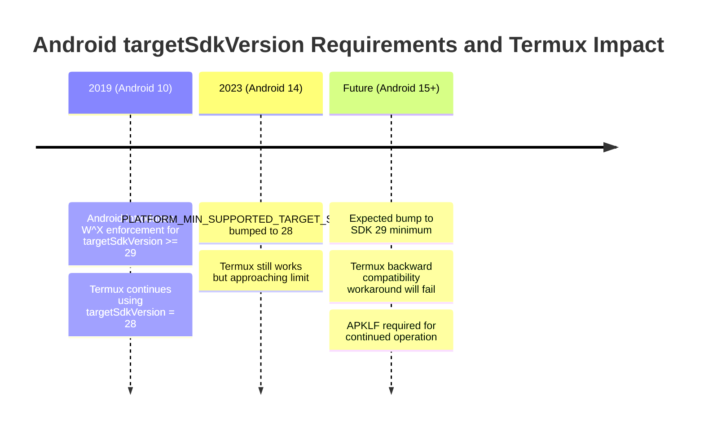
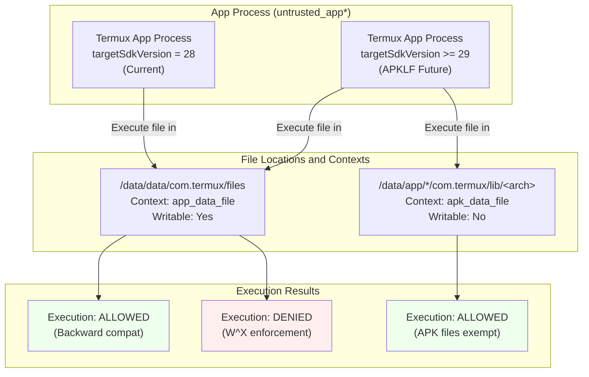
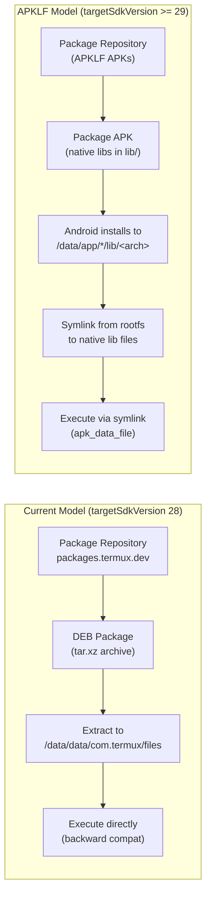
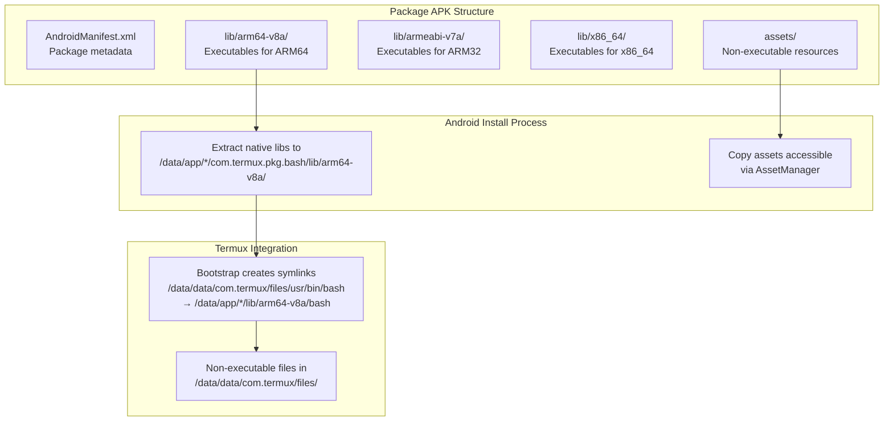
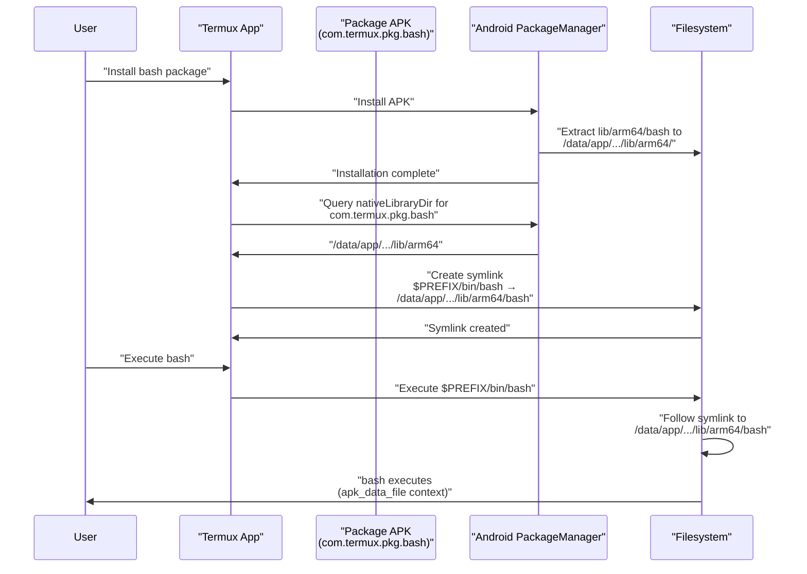
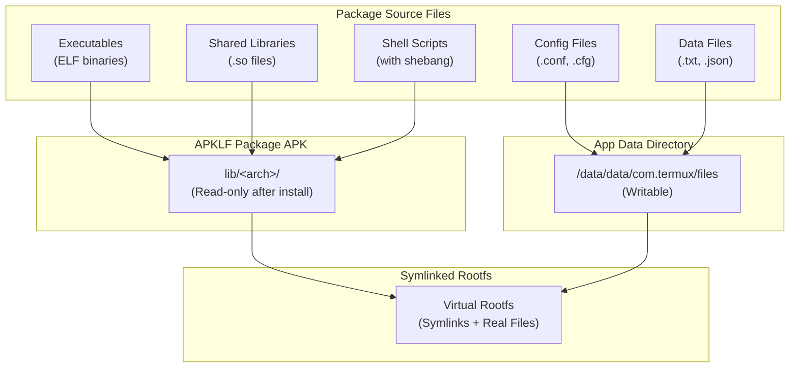
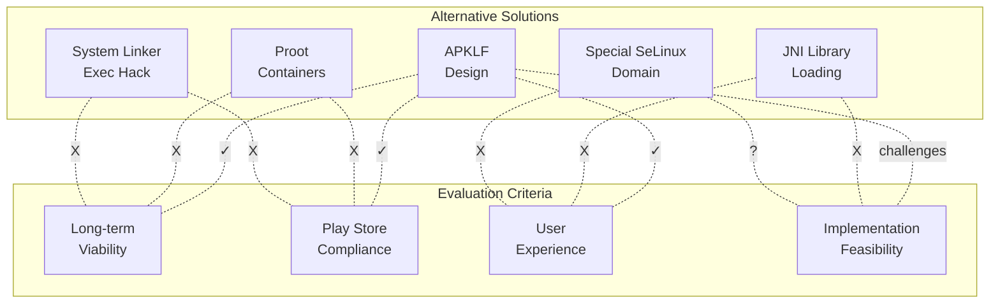
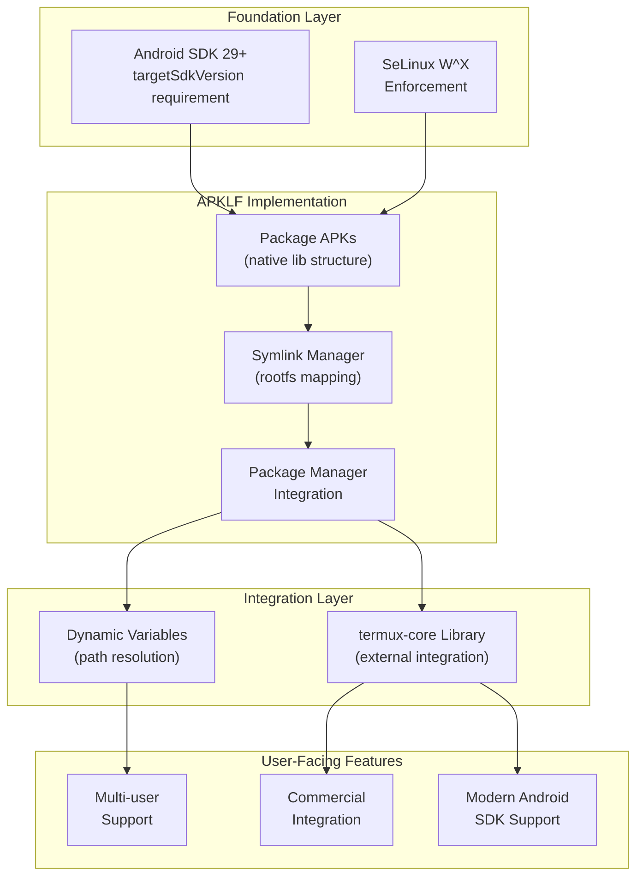

<!-- source: DeepWiki mcp.deepwiki.com · repo termux/termux.github.io · page 8.3 APK Library File (APKLF) Design · fetched 2026-10-26 -->

# APK Library File (APKLF) Design

<details>
<summary>Relevant source files</summary>

The following files were used as context for generating this wiki page:

- [_posts/en/apps/2022-02-25-termux-tasker-v0.6.0-release.md](_posts/en/apps/2022-02-25-termux-tasker-v0.6.0-release.md)
- [_posts/en/general/2024-11-11-termux-selected-for-nlnet-ngi-mobifree-grant.md](_posts/en/general/2024-11-11-termux-selected-for-nlnet-ngi-mobifree-grant.md)
- [_posts/en/security/2022-02-15-termux-apps-vulnerability-disclosures.md](_posts/en/security/2022-02-15-termux-apps-vulnerability-disclosures.md)
- [en/security-incident-response-checklist.md](en/security-incident-response-checklist.md)
- [en/security.md](en/security.md)

</details>


## Purpose and Scope

This document describes the APK Library File (APKLF) execution and packaging design that will enable Termux to comply with Android 10+ security restrictions while maintaining full package execution capabilities. APKLF is one of three projects funded by the NLnet NGI Mobifree grant (see [#8.1](#8.1) for grant overview). 

The APKLF design solves the fundamental problem that Android 10+ prevents apps from executing files downloaded at runtime when using `targetSdkVersion >= 29`. This restriction currently forces Termux to use `targetSdkVersion = 28` to run in backward compatibility mode, a workaround that will eventually be deprecated by Android.

For information about the companion projects that work alongside APKLF, see:
- [termux-core Library](#8.2) - External integration library requiring APKLF
- [Dynamic Variables System](#8.4) - Path flexibility system complementing APKLF

---

## The Android 10 Execution Restriction Problem

Android 10 introduced security restrictions that fundamentally changed how apps can execute code. These restrictions are enforced through SeLinux policies and prevent apps from executing files created at runtime in their private data directories.

### Current Workaround and Its Limitations

Termux currently uses `targetSdkVersion = 28` (Android 9) to bypass these restrictions and continue executing downloaded packages. However, this workaround has a limited lifespan:

| Android Version | PLATFORM_MIN_SUPPORTED_TARGET_SDK_VERSION | Impact on Termux |
|----------------|-------------------------------------------|------------------|
| Android 13 and earlier | 23 | Termux works normally |
| Android 14 | 28 | Warning message may be shown to users |
| Android 15+ (planned) | 29 | Termux will likely be blocked or severely limited |

When Android bumps the minimum supported SDK to 29, apps targeting SDK 28 will display warnings that the app "may not work properly" because it's targeting an outdated SDK. Eventually, execution may be blocked entirely.

### Why This Matters for Termux

Termux needs to execute thousands of packages that users download and install at runtime. Without APKLF:
- Termux cannot upgrade to modern Android SDK versions
- External projects cannot integrate Termux on Google Play Store (requires current SDK)
- The `termux-core` library cannot be adopted by commercial apps
- Termux faces eventual deprecation as Android phases out SDK 28 support

**Diagram: Android Execution Restriction Timeline**



Sources: [_posts/en/general/2024-11-11-termux-selected-for-nlnet-ngi-mobifree-grant.md:40-46]()

---

## Android Security Model: SeLinux and File Contexts

Android's execution restrictions are implemented through SELinux (Security-Enhanced Linux) policies that assign security contexts to processes and files. Understanding these contexts is essential to understanding why APKLF works.

### SeLinux Context Assignment

| Entity | SeLinux Context | Execution Rules |
|--------|----------------|-----------------|
| App process | `untrusted_app*` | Can execute files with compatible contexts |
| Files in `/data/data/<package_name>` | `app_data_file` | **Cannot execute** if `targetSdkVersion >= 29` |
| Files in `/data/app/*<package_name>/lib/<arch>` | `apk_data_file` | **Can execute** - system-controlled directory |

The key insight: Android assigns different SeLinux contexts to files based on their location. Files extracted from APKs to the native library directory receive the `apk_data_file` context, which allows execution because Google assumes these files have been scanned for malicious content.

### Write Once Execute (W^X) Enforcement

Android enforces the security principle that files should be either writable OR executable, but not both:

- **App data directory** (`/data/data/<package_name>`): Writable at runtime, but files cannot be executed with modern SDK
- **APK native library directory** (`/data/app/*<package_name>/lib/<arch>`): Read-only after installation, files can be executed

This prevents malicious apps from downloading and executing arbitrary code without going through the APK installation process, where the code can be scanned.

**Diagram: SeLinux Context and Execution Permissions**



Sources: [_posts/en/general/2024-11-11-termux-selected-for-nlnet-ngi-mobifree-grant.md:48-53]()

---

## APKLF Solution Overview

The APKLF design leverages Android's native library mechanism to provide executable files while maintaining compliance with Android 10+ security restrictions.

### Core Concept

Instead of executing files directly from the writable app data directory, APKLF:

1. **Packages executables in APKs** as native libraries in separate package APKs
2. **Android extracts them** to the system-controlled native library directory at install time
3. **Symlinks are created** from the Termux rootfs to these extracted executables
4. **Execution is allowed** because files have the `apk_data_file` SeLinux context

### Key Design Principles

| Principle | Implementation |
|-----------|---------------|
| **Separate package APKs** | Each Termux package distributed as its own APK with executables in `lib/<arch>/` |
| **Single-level directory** | Native library directory is flat; symlinks provide nested structure |
| **Read-only executables** | Files in native library directory cannot be modified after installation |
| **Writable rootfs** | Non-executable files (configs, data) remain in writable app data directory |
| **Dynamic symlinking** | Bootstrap/package manager creates symlinks to map flat structure to rootfs |

### Package Distribution Model



Sources: [_posts/en/general/2024-11-11-termux-selected-for-nlnet-ngi-mobifree-grant.md:38-53]()

---

## Technical Architecture

### APK Structure for APKLF Packages

Each package APK must be structured to place executables in the native library directory while maintaining compatibility with Android's APK requirements.

**Diagram: APKLF Package APK Structure**



### File Path Mapping

The APKLF system must maintain a complex mapping between the flat native library directory structure and the nested Termux rootfs structure.

| Termux Rootfs Path | APKLF APK Native Lib | Actual Execution Path |
|-------------------|---------------------|---------------------|
| `/data/data/com.termux/files/usr/bin/bash` | `lib/arm64-v8a/bash` | `/data/app/*/com.termux.pkg.bash/lib/arm64-v8a/bash` |
| `/data/data/com.termux/files/usr/bin/python` | `lib/arm64-v8a/python3.11` | `/data/app/*/com.termux.pkg.python/lib/arm64-v8a/python3.11` |
| `/data/data/com.termux/files/usr/lib/libc.so` | `lib/arm64-v8a/libc.so` | `/data/app/*/com.termux.pkg.libc/lib/arm64-v8a/libc.so` |

### ApplicationInfo.nativeLibraryDir

The Android `ApplicationInfo` class provides the `nativeLibraryDir` property that points to the actual native library directory for an installed APK. This path changes with each APK installation and must be queried dynamically.

```
Example nativeLibraryDir values:
/data/app/~~RaNd0mH4sH==/com.termux.pkg.bash-a1B2c3D4e5F6/lib/arm64
/data/app/com.termux.pkg.python-1/lib/arm64
```

The Dynamic Variables system (see [#8.4](#8.4)) will export these paths as environment variables so that executables and scripts can reference package files without hardcoded paths.

**Diagram: Runtime Path Resolution**



Sources: [_posts/en/general/2024-11-11-termux-selected-for-nlnet-ngi-mobifree-grant.md:48-53](), [_posts/en/general/2024-11-11-termux-selected-for-nlnet-ngi-mobifree-grant.md:76]()

---

## Implementation Challenges

The APKLF design introduces several complex challenges that must be solved for a production implementation.

### Architectural Limitations

| Challenge | Description | Mitigation Strategy |
|-----------|-------------|-------------------|
| **Flat directory structure** | Native library directory is single-level; no nested subdirectories allowed | Use symlinks to create virtual nested structure in rootfs |
| **Separate APKs per package** | Cannot bundle thousands of packages in single APK | Distribute each package as separate APK; implement package manager integration |
| **APK size and updates** | Updating single package requires reinstalling entire APK | Keep package APKs small; separate executables from data files |
| **APK count limits** | Thousands of package APKs may strain PackageManager | Test scalability; consider bundling related packages |
| **Symlink management** | Complex mapping between flat native lib dir and nested rootfs | Bootstrap and package manager must manage symlink creation/updates |

### Package Manager Integration

The existing Termux package manager (`dpkg`) must be extended or replaced to:

1. Query available package APKs from repository
2. Trigger APK installation via Android PackageManager APIs
3. Query `nativeLibraryDir` for installed package APKs
4. Create/update symlinks from rootfs to native library files
5. Handle package updates (reinstall APK, update symlinks)
6. Handle package removal (uninstall APK, remove symlinks)
7. Manage dependencies between package APKs

### Bootstrap Complexity

The Termux bootstrap process will become more complex:

**Current Bootstrap (targetSdkVersion 28)**
```
1. Download bootstrap.zip
2. Extract to /data/data/com.termux/files
3. Set permissions
4. Ready to use
```

**APKLF Bootstrap (targetSdkVersion >= 29)**
```
1. Download core package APKs (bash, coreutils, etc.)
2. Install APKs via PackageManager
3. Query nativeLibraryDir for each installed APK
4. Create bootstrap rootfs structure in /data/data/com.termux/files
5. Create symlinks from rootfs to native library directories
6. Set up PATH and environment variables
7. Ready to use
```

### File Type Separation

Not all files in a package can or should be placed in the native library directory:

| File Type | Location | Reason |
|-----------|----------|--------|
| **Executables** | Native library directory | Must be executable; SeLinux requires `apk_data_file` context |
| **Shared libraries** | Native library directory | Loaded by executables; must be in same context |
| **Configuration files** | App data directory | May need to be writable by user |
| **Data files** | App data directory | Must be writable at runtime |
| **Scripts (non-executable)** | App data directory | Interpreted files don't need execute permission |
| **Shell scripts** | Special case | May need `/bin/sh` shebang; requires executable bit |

The Dynamic Variables system (see [#8.4](#8.4)) addresses the path flexibility needed for this split file layout.

**Diagram: File Distribution Strategy**



Sources: [_posts/en/general/2024-11-11-termux-selected-for-nlnet-ngi-mobifree-grant.md:52-53](), [_posts/en/general/2024-11-11-termux-selected-for-nlnet-ngi-mobifree-grant.md:76]()

---

## Alternative Solutions Considered

Several alternative approaches were evaluated before settling on the APKLF design. Understanding why these were rejected helps clarify the constraints and requirements.

### System Linker Exec Hack

**Description**: Hook `exec()` functions and pass the executable path to `/system/bin/linker` for execution. This exploits SeLinux's trust in paths under `/system/bin/` to bypass the `app_data_file` execution restriction.

**Why It Won't Work**:
- Likely to be patched by Android as a security vulnerability
- Not compliant with Google Play Store policies
- Cannot be relied upon as a long-term solution
- May work temporarily but provides no stability guarantee

**Status**: Proof-of-concept exists but not suitable for production use.

### Special SeLinux Domain Permission

**Description**: Request that Google add a special SeLinux process domain for developer apps in a future Android version. Apps granted a special ADB permission could execute files in their data directory.

**Why It Won't Work**:
- No guarantee Google will approve this request
- Would only work in future Android versions (e.g., Android 16+)
- Does not solve the problem for Android 10-15
- Requires per-device ADB setup, not suitable for general users
- Google Play Store apps cannot request ADB permissions

**Status**: Potential future enhancement, but not a solution for the current problem.

### Proot/Chroot Containers

**Description**: Use `proot` or similar containerization to create an isolated filesystem where execution restrictions don't apply.

**Why It Won't Work**:
- `proot` still ultimately executes files, which triggers SeLinux checks
- Performance overhead from syscall interception
- Doesn't solve the root problem, just adds a layer
- Still requires executables to have proper SeLinux context

**Status**: Already used by Termux for other purposes, but doesn't solve execution restrictions.

### JNI Native Library Loading

**Description**: Load all executables as native libraries via `System.loadLibrary()` and execute them through JNI.

**Why It Won't Work**:
- Cannot execute arbitrary binaries as JNI libraries
- Would require massive refactoring of all packages
- Breaks standard Unix execution model
- Incompatible with shell scripts and interpreter chains
- Not a general solution for thousands of packages

**Status**: Not feasible for Termux's use case.

**Diagram: Alternative Solutions Evaluation**



Sources: [_posts/en/general/2024-11-11-termux-selected-for-nlnet-ngi-mobifree-grant.md:54-57]()

---

## Dependencies and Integration

The APKLF design does not operate in isolation but is part of a larger architectural transformation of Termux.

### Integration with termux-core Library

The `termux-core` library (see [#8.2](#8.2)) requires APKLF to function on modern Android versions:

- External apps integrating `termux-core` must be published on app stores
- App stores require apps to target current Android SDK versions
- Current SDK versions (29+) enforce execution restrictions
- APKLF provides the only compliant solution for execution

Without APKLF, the `termux-core` library would be limited to SDK 28, making it unsuitable for commercial adoption and defeating its purpose of enabling external integration.

### Integration with Dynamic Variables

The Dynamic Variables system (see [#8.4](#8.4)) complements APKLF by solving the path flexibility problem:

| System | Problem Solved | Integration Point |
|--------|---------------|------------------|
| **APKLF** | Execution restrictions | Provides executable files in native library directory |
| **Dynamic Variables** | Hardcoded paths | Exports environment variables pointing to native library directories |

Together, these systems enable:
1. Executables stored in read-only native library directory (APKLF)
2. Runtime path resolution via environment variables (Dynamic Variables)
3. Packages work regardless of installation path or user profile
4. Multi-user and external storage support becomes possible

### Implementation Dependencies



### Current Status and Future Work

As of the grant announcement in November 2024, APKLF is in the planning and design phase. Key milestones:

1. **Design Documentation** (Q1 2025): Detailed specification of APK structure, symlink management, and package manager integration
2. **Proof of Concept** (Q2 2025): Working prototype for a small subset of core packages
3. **Bootstrap Implementation** (Q2-Q3 2025): APKLF-compatible bootstrap with core package APKs
4. **Package Migration** (Q3-Q4 2025): Convert popular packages to APKLF format
5. **Full Repository** (2026): Complete package repository available as APKs
6. **Deprecate SDK 28** (2026+): Transition Termux to `targetSdkVersion >= 29`

The design will be iteratively refined as implementation uncovers edge cases and additional challenges.

Sources: [_posts/en/general/2024-11-11-termux-selected-for-nlnet-ngi-mobifree-grant.md:38-46](), [_posts/en/general/2024-11-11-termux-selected-for-nlnet-ngi-mobifree-grant.md:66-82]()

---

## Related Resources

**External Documentation**:
- [App Data File Execute Restrictions](https://github.com/agnostic-apollo/Android-Docs/blob/master/site/pages/en/projects/docs/apps/processes/app-data-file-execute-restrictions.md) - Detailed Android security model documentation
- [APK Native Library](https://github.com/agnostic-apollo/Android-Docs/blob/master/site/pages/en/projects/docs/apps/processes/app-data-file-execute-restrictions.md#apk-native-library) - APKLF design documentation with known issues

**Termux Documentation**:
- [Termux Execution Environment](https://github.com/termux/termux-packages/wiki/Termux-execution-environment) - How Termux currently executes files

**GitHub Issues**:
- [termux/termux-app#1072](https://github.com/termux/termux-app/issues/1072) - Original issue tracking execution restrictions
- [termux/termux-app#2155](https://github.com/termux/termux-app/issues/2155) - Revisiting the Android W^X problem and solutions

Sources: [_posts/en/general/2024-11-11-termux-selected-for-nlnet-ngi-mobifree-grant.md:42-44]()

---

