<!-- source: DeepWiki mcp.deepwiki.com · repo termux/termux.github.io · page 8.4 Dynamic Variables System · fetched 2026-10-26 -->

# Dynamic Variables System

<details>
<summary>Relevant source files</summary>

The following files were used as context for generating this wiki page:

- [_posts/en/apps/2022-02-25-termux-tasker-v0.6.0-release.md](_posts/en/apps/2022-02-25-termux-tasker-v0.6.0-release.md)
- [_posts/en/general/2024-11-11-termux-selected-for-nlnet-ngi-mobifree-grant.md](_posts/en/general/2024-11-11-termux-selected-for-nlnet-ngi-mobifree-grant.md)
- [_posts/en/security/2022-02-15-termux-apps-vulnerability-disclosures.md](_posts/en/security/2022-02-15-termux-apps-vulnerability-disclosures.md)
- [en/security-incident-response-checklist.md](en/security-incident-response-checklist.md)
- [en/security.md](en/security.md)

</details>


This document describes the Dynamic Variables project, one of three major architectural improvements funded by the NLnet NGI Mobifree grant. For information about the overall grant program, see [NLnet Grant Overview](#8.1). For details on the execution environment changes that Dynamic Variables enables, see [APK Library File (APKLF) Design](#8.3).

The Dynamic Variables system eliminates hardcoded paths from Termux packages, replacing them with runtime environment variables and install-time placeholders. This enables Termux to run in non-standard locations such as secondary Android users, work profiles, external storage, and third-party applications using the `termux-core` library.

---

## Current Architecture and Limitations

### Hardcoded Path Problem

Termux packages currently contain approximately **4,000 hardcoded paths** that are replaced at build time with absolute paths specific to the primary Android user installation location `/data/data/com.termux/files`. This design creates several critical limitations:

| Limitation | Impact |
|------------|--------|
| **Secondary User Installation** | Packages fail when Termux is installed in Android users other than user 0 (e.g., `/data/user/10/com.termux/files`) |
| **Work Profile Support** | Cannot run in Android work profiles with different data directories |
| **External Storage** | Cannot use external SD card installations with different mount points |
| **External App Integration** | Third-party apps using `termux-core` library must recompile all packages for their specific paths |
| **Multi-Instance Support** | Cannot run multiple independent Termux environments with different rootfs locations |

### Current Build-Time Path Replacement

The build system performs path substitution during package compilation:

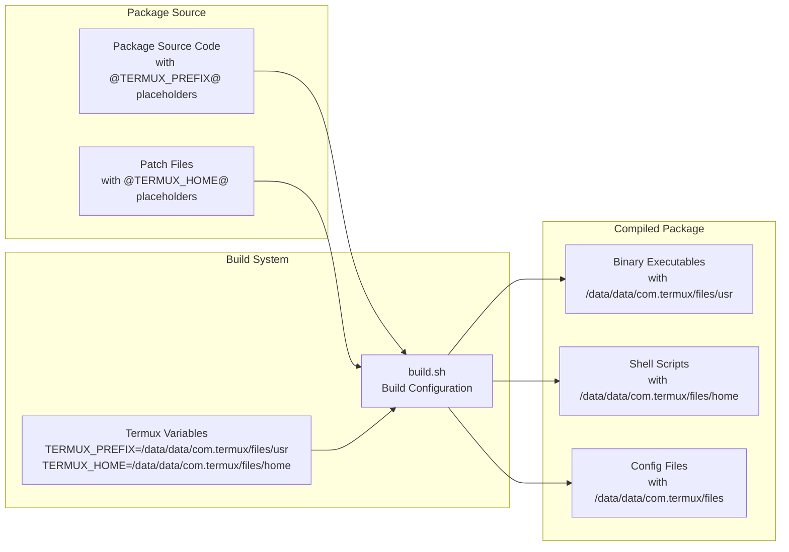

**Sources:** [_posts/en/general/2024-11-11-termux-selected-for-nlnet-ngi-mobifree-grant.md:68-82]()

---

## Two-Tier Dynamic Variables Solution

The Dynamic Variables system implements a **two-tier patching strategy** that distinguishes between executable and non-executable files based on their different constraints under the APKLF architecture:

### System Architecture Diagram

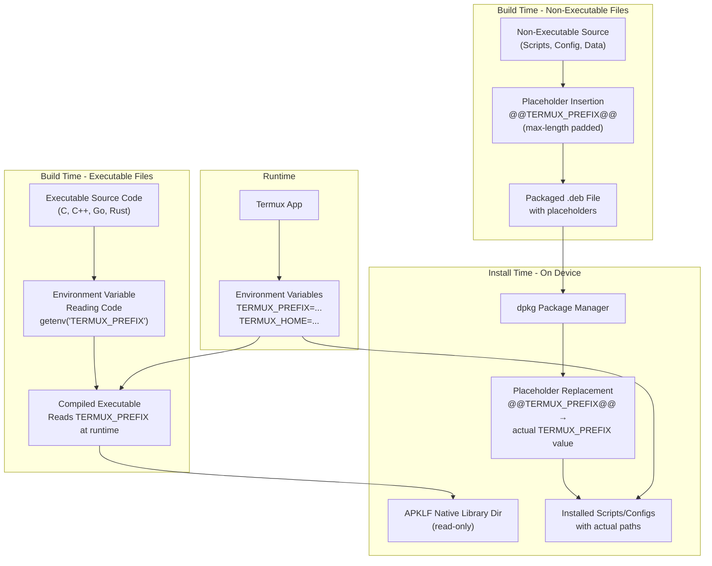

**Sources:** [_posts/en/general/2024-11-11-termux-selected-for-nlnet-ngi-mobifree-grant.md:68-82]()

---

## Build-Time Patching for Executables

Executable files (binaries) are patched at **build time** to read environment variables at runtime rather than using hardcoded paths.

### Implementation Approach

| Aspect | Details |
|--------|---------|
| **Patching Stage** | Build time (during package compilation) |
| **Target Files** | Compiled executables (ELF binaries) |
| **Method** | Inject language-specific environment variable reading code into package source |
| **Storage Location** | APKLF native library directory (read-only, system-controlled) |
| **Reason for Build-Time** | Must be read-only for APKLF design; cannot be modified at install time |

### Language-Specific Code Injection

Different programming languages require different approaches to read environment variables:

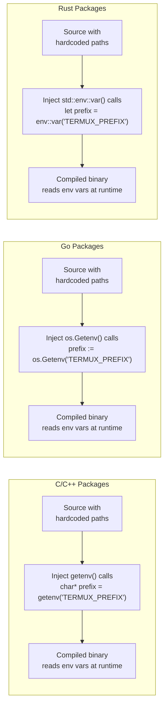

### APKLF Constraint

Executables must use build-time patching because:

1. APKLF places executables in `/data/app/*<package_name>/lib/<arch>` (read-only system directory)
2. Files in this location have `apk_data_file` SELinux context (execution allowed)
3. Install-time modification of these files is impossible due to system ownership and read-only status

**Reference:** [ApplicationInfo.nativeLibraryDir](https://developer.android.com/reference/android/content/pm/ApplicationInfo#nativeLibraryDir) is the system-controlled directory path.

**Sources:** [_posts/en/general/2024-11-11-termux-selected-for-nlnet-ngi-mobifree-grant.md:73-76]()

---

## Install-Time Patching for Non-Executables

Non-executable files (scripts, configuration files, data files) are patched at **install time** on the device when the package is installed by `dpkg`.

### Implementation Approach

| Aspect | Details |
|--------|---------|
| **Patching Stage** | Install time (during `dpkg` package installation) |
| **Target Files** | Shell scripts, Python scripts, config files, data files |
| **Method** | Replace placeholders in packaged files with actual environment variable values |
| **Storage Location** | App data directory (writable during installation) |
| **Reason for Install-Time** | These files don't need to be in APKLF native library directory |

### Placeholder System Design

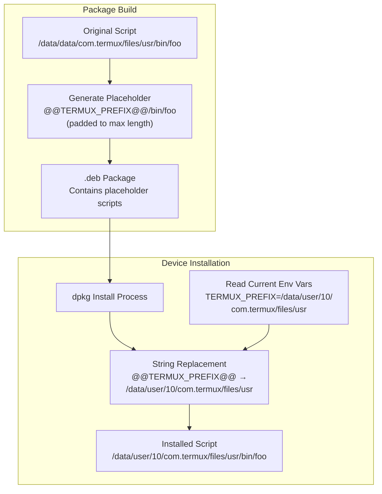

### Path Length Constraints

To ensure safe placeholder replacement without breaking files:

| Constraint | Implementation |
|-----------|----------------|
| **Maximum Length** | Placeholders are padded with extra `/` separators to fill the maximum possible path length for each path type |
| **Same-Length Replacement** | Replacement paths must have the same byte length as the placeholder |
| **Default Working Paths** | Placeholders use working default paths so existing installations don't break if `dpkg` isn't updated |
| **Path Type Specific** | Different path types (PREFIX, HOME, FILES_DIR) have different max lengths per Termux file path limits |

**Reference:** See [Termux File Path Limits](https://github.com/termux/termux-packages/wiki/Termux-file-system-layout#file-path-limits) for maximum path lengths.

### Bootstrap Installation

The Termux app bootstrap installation process also requires special handling:

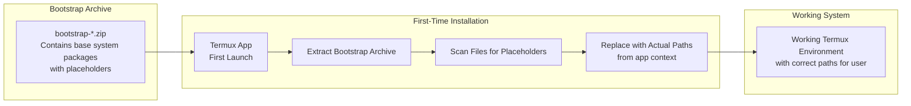

**Reference:** Bootstrap system is documented in the [termux-packages wiki](https://github.com/termux/termux-packages/wiki/For-maintainers#bootstraps).

### Compressed Files

Compressed files require special handling:

- Archives (`.tar.gz`, `.zip`, etc.) that contain files with placeholders need to be decompressed, patched, and recompressed
- This adds complexity but is necessary for packages that bundle compressed data
- Implementation requires `dpkg` to recognize common compression formats

**Sources:** [_posts/en/general/2024-11-11-termux-selected-for-nlnet-ngi-mobifree-grant.md:73-76]()

---

## Package Marking and Dependency System

### Package Metadata

Packages that have been updated to support dynamic variables must be explicitly marked in their metadata:

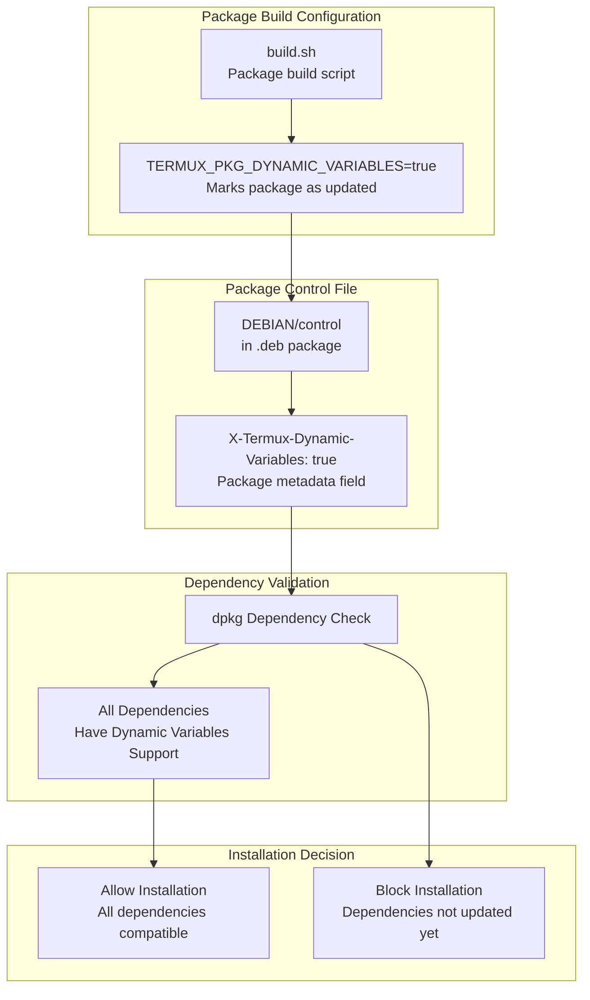

### Dependency Chain Requirements

| Requirement | Rationale |
|------------|-----------|
| **Complete Dependency Chain** | All package dependencies must be updated to dynamic variables before the package can be marked |
| **Transitive Dependencies** | Transitive dependencies (dependencies of dependencies) must also be updated |
| **Bootstrap Packages First** | Bootstrap packages must be updated first as they are foundational |
| **Popular Packages Priority** | Important and popular packages are prioritized for updating |

### Migration Strategy

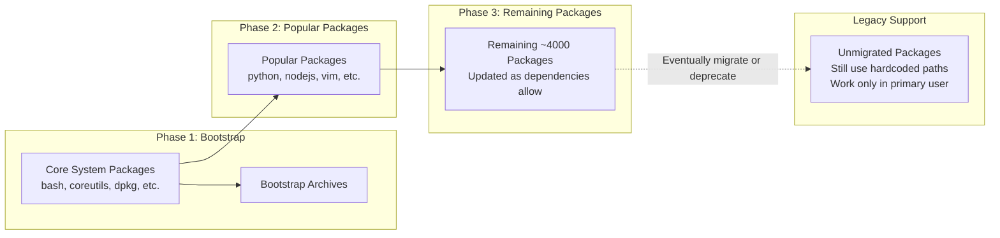

**Sources:** [_posts/en/general/2024-11-11-termux-selected-for-nlnet-ngi-mobifree-grant.md:78-79]()

---

## Integration with Grant Projects

### Relationship with APKLF

Dynamic Variables and APKLF are interconnected architectural improvements:

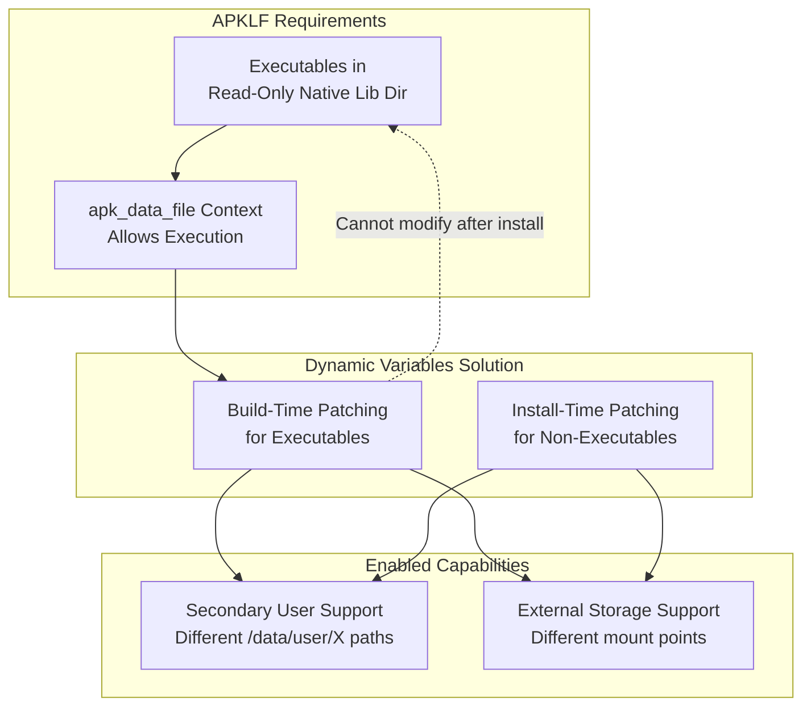

**Key Constraint:** Executables must use build-time patching (environment variables) because APKLF places them in read-only system directories where install-time modification is impossible.

### Relationship with termux-core Library

Dynamic Variables enables external applications to use Termux packages:

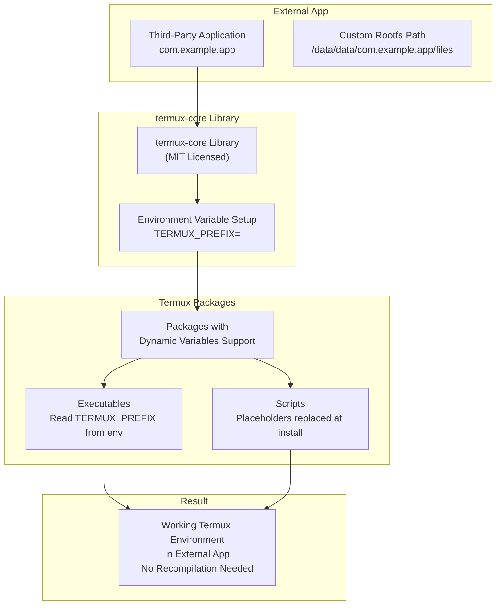

**Benefits:**

- External projects don't need to recompile all Termux packages from source (which takes many hours and significant CPU/memory)
- Packages can work in any rootfs location without modification
- Enables commercial integration of Termux functionality

**Note:** Packages may still contain references to Termux names/URLs added at build time. External projects wanting to remove these references must still recompile packages, but at least the packages will work functionally in their environment.

**Sources:** [_posts/en/general/2024-11-11-termux-selected-for-nlnet-ngi-mobifree-grant.md:80-82]()

---

## Environment Variables Reference

### Standard Termux Environment Variables

The Termux app exports the following environment variables that packages can read:

| Variable | Description | Example Value |
|----------|-------------|---------------|
| `TERMUX_PREFIX` | Main prefix directory containing `bin/`, `lib/`, `share/`, etc. | `/data/data/com.termux/files/usr` |
| `TERMUX_HOME` | User home directory | `/data/data/com.termux/files/home` |
| `TERMUX_FILES_DIR` | Base files directory | `/data/data/com.termux/files` |
| `TERMUX_ANDROID_HOME` | Android app's internal storage | `/data/data/com.termux` |
| `TERMUX_VERSION` | Termux app version | `0.118.0` |

### Path Composition

Packages use these variables to construct full paths at runtime:

```
Executable:  ${TERMUX_PREFIX}/bin/bash
Library:     ${TERMUX_PREFIX}/lib/libreadline.so
Config:      ${TERMUX_HOME}/.bashrc
Data:        ${TERMUX_PREFIX}/share/doc/bash/README
Bootstrap:   ${TERMUX_FILES_DIR}/bootstrap.zip
```

### External App Integration

External applications using `termux-core` library can set custom values:

```
TERMUX_PREFIX=/data/data/com.example.app/files/usr
TERMUX_HOME=/data/data/com.example.app/files/home
TERMUX_FILES_DIR=/data/data/com.example.app/files
```

Packages with dynamic variables support will automatically use these custom paths.

**Reference:** See [Termux Filesystem Layout](https://github.com/termux/termux-packages/wiki/Termux-file-system-layout) and [Termux rootfs](https://github.com/termux/termux-packages/wiki/Termux-file-system-layout#termux-rootfs-directory) documentation.

**Sources:** [_posts/en/general/2024-11-11-termux-selected-for-nlnet-ngi-mobifree-grant.md:82]()

---

## Benefits and Use Cases

### Enabled Scenarios

| Scenario | Current Status | After Dynamic Variables |
|----------|----------------|------------------------|
| **Secondary Android User** | ❌ Packages fail with hardcoded primary user paths | ✅ Works with correct user-specific paths |
| **Work Profile** | ❌ Cannot install in work profile | ✅ Full support in work profiles |
| **External SD Card** | ❌ Hardcoded internal storage paths | ✅ Can install and run from external storage |
| **Multiple Termux Instances** | ❌ Cannot run multiple isolated environments | ✅ Multiple independent installations |
| **Third-Party App Integration** | ❌ Must recompile all packages | ✅ Use pre-compiled packages directly |
| **Commercial Products** | ❌ Complex fork and rebuild process | ✅ Easy integration via `termux-core` library |

### Multi-User Support Example

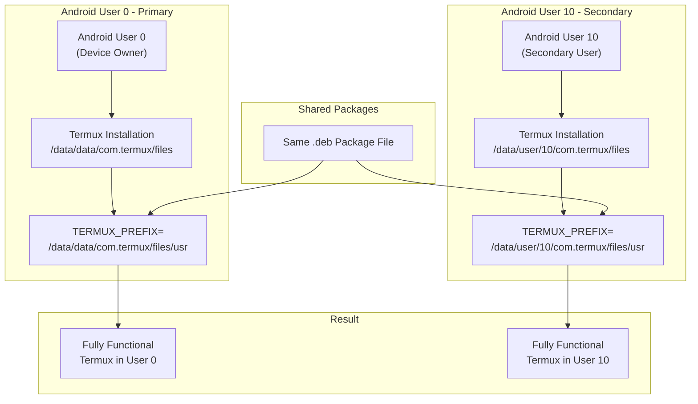

### Economic Sustainability

Dynamic Variables contributes to Termux's long-term economic sustainability:

1. **Commercial Integration:** The `termux-core` library (MIT licensed) enables companies to integrate Termux into commercial products without recompiling packages
2. **Support Contracts:** Easier integration increases likelihood of commercial support contracts
3. **Reduced Maintenance:** External projects don't need to maintain custom package builds
4. **Community Growth:** Lower barrier to entry for projects wanting to use Termux functionality

**Sources:** [_posts/en/general/2024-11-11-termux-selected-for-nlnet-ngi-mobifree-grant.md:24-28](), [_posts/en/general/2024-11-11-termux-selected-for-nlnet-ngi-mobifree-grant.md:80-82]()

---

## Implementation Status and Timeline

### Project Scope

| Metric | Value |
|--------|-------|
| **Total Placeholders** | ~4,000 in package source/patch files |
| **Affected Packages** | Majority of ~4,000 total packages in termux-packages repository |
| **Build System Changes** | `build.sh` files, `dpkg` package manager, bootstrap system |
| **Priority Packages** | Bootstrap + popular packages (~100-200 packages) |

### Implementation Phases

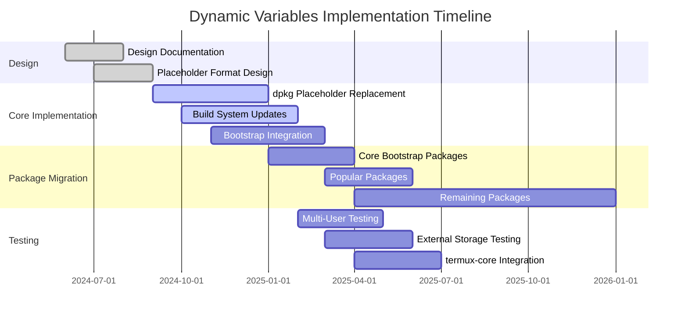

### Backward Compatibility

The implementation ensures backward compatibility:

- Existing Termux installations continue to work during migration
- Packages without dynamic variables support still function in primary user installations
- Path placeholders use working default paths to avoid breaking existing systems
- Gradual migration allows testing and refinement at each stage

**Sources:** [_posts/en/general/2024-11-11-termux-selected-for-nlnet-ngi-mobifree-grant.md:1-87]()

---

