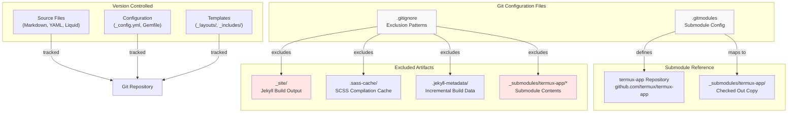
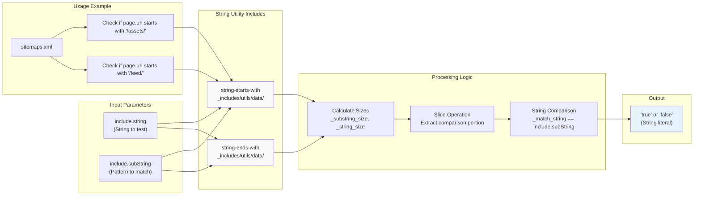
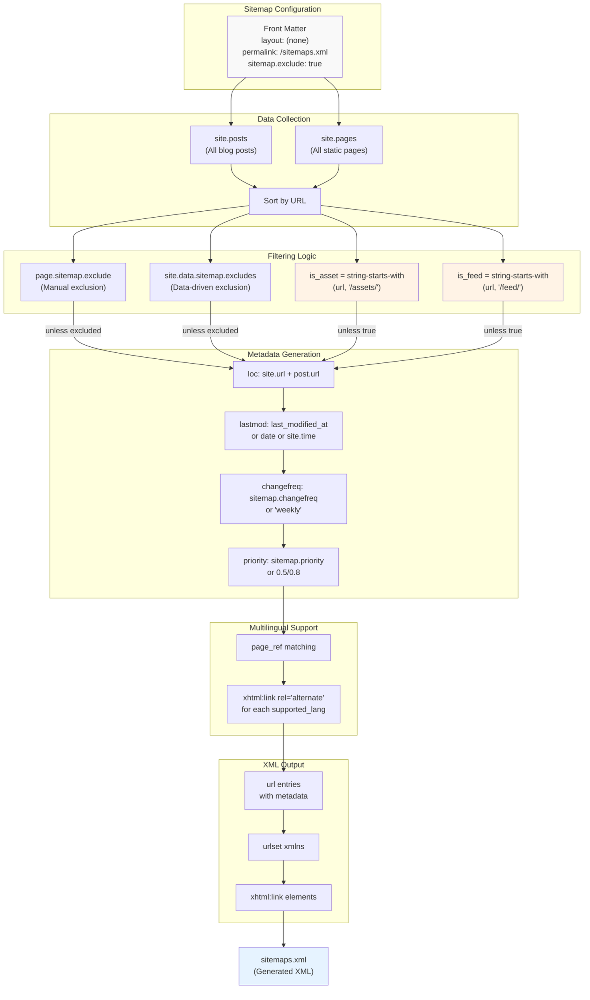

<!-- source: DeepWiki mcp.deepwiki.com · repo termux/termux.github.io · page 9 Repository Maintenance · fetched 2026-10-26 -->

# Repository Maintenance

<details>
<summary>Relevant source files</summary>

The following files were used as context for generating this wiki page:

- [.gitignore](.gitignore)
- [.gitmodules](.gitmodules)
- [404.html](404.html)
- [_includes/utils/data/string-ends-with](_includes/utils/data/string-ends-with)
- [_includes/utils/data/string-starts-with](_includes/utils/data/string-starts-with)
- [sitemaps.xml](sitemaps.xml)

</details>


## Purpose and Scope

This document covers the repository configuration, maintenance tools, and utilities that support the termux.github.io Jekyll site. It documents Git configuration patterns, error handling systems, utility includes for data manipulation, and automated workflows that maintain site quality and synchronization.

For information about Jekyll configuration and site settings, see [Main Configuration File](#3.1). For information about the build and deployment process, see [Build and Deployment System](#2). For information about GitHub Pages deployment specifically, see [GitHub Pages Deployment](#2.3).

## Overview

Repository maintenance encompasses three primary areas:

1. **Git Configuration**: Version control patterns, artifact exclusion, and submodule management for the termux-app repository
2. **Site Utilities**: Error pages, sitemap generation, and reusable string manipulation includes
3. **CI/CD Workflows**: Automated processes for synchronization and quality assurance

These systems ensure the repository remains clean, navigable, and synchronized with related infrastructure while providing essential tools for template development and SEO optimization.

Sources: [.gitignore:1-5](), [.gitmodules:1-4](), [404.html:1-11](), [sitemaps.xml:1-130]()

## Repository Structure

The repository maintenance system is organized around three key file types:

| File Type | Purpose | Examples |
|-----------|---------|----------|
| **Git Configuration** | Version control and submodule management | `.gitignore`, `.gitmodules` |
| **Error Handling** | User-facing error pages with SEO exclusion | `404.html` |
| **Utility Includes** | Reusable string manipulation logic | `_includes/utils/data/string-starts-with`, `_includes/utils/data/string-ends-with` |
| **SEO Tools** | Search engine optimization and site indexing | `sitemaps.xml` |
| **Automation** | CI/CD workflows for synchronization | `.github/workflows/trigger_termux_com_sync.yml` |

Sources: [.gitignore:1-5](), [.gitmodules:1-4](), [404.html:1-11](), [sitemaps.xml:1-130]()

## Git Artifact Management



**Figure 1: Git Configuration and Artifact Management**

The `.gitignore` file [.gitignore:1-5]() excludes Jekyll build artifacts and the submodule's checked-out contents. The `_site` directory [.gitignore:1]() contains generated HTML output, `.sass-cache` [.gitignore:2]() stores SCSS compilation results, and `.jekyll-metadata` [.gitignore:3]() contains incremental build tracking data. The pattern `_submodules/termux-app/*` [.gitignore:4]() excludes the submodule's file contents while tracking the Git reference itself.

The `.gitmodules` file [.gitmodules:1-4]() configures a submodule at `_submodules/termux-app` [.gitmodules:2]() pointing to the `termux-app` repository [.gitmodules:3](). This allows the website to reference application documentation or assets without duplicating content.

Sources: [.gitignore:1-5](), [.gitmodules:1-4]()

## Error Page System

The `404.html` page [404.html:1-11]() provides user-facing error handling for missing pages. It includes front matter that excludes it from the sitemap [404.html:2-3]() using `sitemap: exclude: true`, preventing search engines from indexing the error page itself.

The error page content is minimal:

```html
<div class="page-not-found" style="text-align: center">
  <h1 class="page-heading">Page not found</h1>
  <p><a href="https://termux.github.io">Go to termux.github.io</a></p>
</div>
```

This structure [404.html:6-11]() centers the error message and provides a single link back to the homepage. The inline styling [404.html:6]() ensures the page displays correctly even if CSS fails to load.

Sources: [404.html:1-11]()

## Utility Include System



**Figure 2: String Utility Include Architecture**

The repository provides two reusable string manipulation includes for use in Liquid templates:

### string-starts-with

Located at [_includes/utils/data/string-starts-with:1-13](), this include tests whether a string begins with a specific substring. The implementation:

1. Validates inputs [_includes/utils/data/string-starts-with:1]()
2. Calculates substring size [_includes/utils/data/string-starts-with:2]()
3. Slices the beginning of the string [_includes/utils/data/string-starts-with:3]()
4. Compares the sliced portion [_includes/utils/data/string-starts-with:5-9]()
5. Returns `"true"` or `"false"` [_includes/utils/data/string-starts-with:6,8,12]()

### string-ends-with

Located at [_includes/utils/data/string-ends-with:1-15](), this include tests whether a string ends with a specific substring. The implementation:

1. Validates inputs [_includes/utils/data/string-ends-with:1]()
2. Calculates both string and substring sizes [_includes/utils/data/string-ends-with:2-3]()
3. Computes the start index for the ending portion [_includes/utils/data/string-ends-with:4]()
4. Slices the end of the string [_includes/utils/data/string-ends-with:5]()
5. Compares the sliced portion [_includes/utils/data/string-ends-with:7-11]()
6. Returns `"true"` or `"false"` [_includes/utils/data/string-ends-with:8,10,13]()

Both utilities return string literals rather than booleans because Liquid template comparisons work more reliably with string values.

Sources: [_includes/utils/data/string-starts-with:1-13](), [_includes/utils/data/string-ends-with:1-15]()

## Sitemap Generation System



**Figure 3: Sitemap Generation Pipeline**

The `sitemaps.xml` file [sitemaps.xml:1-130]() generates an XML sitemap for search engine indexing. It uses front matter to configure itself [sitemaps.xml:1-6](), setting `layout:` to empty (no layout wrapping), `permalink: /sitemaps.xml` for the output path, and `sitemap: exclude: true` to exclude itself from the sitemap.

### Posts Processing

Posts are collected from `site.posts`, sorted by URL [sitemaps.xml:12](), and processed with the following metadata:

| Element | Value Source | Default |
|---------|--------------|---------|
| `<loc>` | `site.url + post.url` | Required |
| `<lastmod>` | `post.last_modified_at`, `post.date`, or `site.time` | `site.time` |
| `<changefreq>` | `post.sitemap.changefreq` | `"weekly"` |
| `<priority>` | `post.sitemap.priority` | `0.5` |

The location is built from `site.url` and `post.url` [sitemaps.xml:18](). The last modified date tries three sources in order: `last_modified_at` [sitemaps.xml:22-23](), `date` [sitemaps.xml:24-25](), or `site.time` [sitemaps.xml:26-27](). Change frequency [sitemaps.xml:32-38]() and priority [sitemaps.xml:40-47]() can be overridden in post front matter.

### Pages Processing

Pages are collected from `site.pages`, sorted by URL [sitemaps.xml:70](), and filtered using multiple exclusion mechanisms [sitemaps.xml:75]():

1. **Manual Exclusion**: `page.sitemap.exclude` in front matter
2. **Data-Driven Exclusion**: URLs in `site.data.sitemap.excludes`
3. **Asset Exclusion**: URLs starting with `/assets/` [sitemaps.xml:72-73]()
4. **Feed Exclusion**: URLs starting with `/feed/` [sitemaps.xml:73]()

The asset and feed checks use the `string-starts-with` utility include [sitemaps.xml:72-73]():

```liquid


```

Pages have a default priority of `0.8` [sitemaps.xml:107]() compared to posts' `0.5`, reflecting that static pages are generally more important landing pages.

### Multilingual Link Generation

Both posts and pages support multilingual alternate links through the `page_ref` system. When a post or page has both `page_ref` and `lang` set [sitemaps.xml:49,111](), the sitemap:

1. Finds all translations with matching `page_ref` [sitemaps.xml:50,112]()
2. Sorts them by language [sitemaps.xml:50,112]()
3. Iterates through `site.supported_langs` [sitemaps.xml:51,113]()
4. Generates `xhtml:link` elements with `rel="alternate"` and `hreflang` [sitemaps.xml:56,118]()

Example output structure:

```xml
<url>
    <loc>https://termux.dev/en/posts/example/2024/01/01/post.html</loc>
    <lastmod>2024-01-01T00:00:00+00:00</lastmod>
    <changefreq>weekly</changefreq>
    <priority>0.5</priority>
    <xhtml:link rel="alternate" hreflang="en" href="https://termux.dev/en/posts/example/2024/01/01/post.html"/>
    <xhtml:link rel="alternate" hreflang="cn" href="https://termux.dev/cn/posts/example/2024/01/01/post.html"/>
</url>
```

This alternate link structure tells search engines about translated versions, improving international SEO. See [Multilingual Content System](#4.3) for details on the `page_ref` linking mechanism.

Sources: [sitemaps.xml:1-130](), [_includes/utils/data/string-starts-with:1-13]()

## Maintenance Workflow Overview

Repository maintenance is supported by several systems:

### Git Operations

| Operation | Files | Purpose |
|-----------|-------|---------|
| **Clean Builds** | `.gitignore` excludes `_site`, `.sass-cache`, `.jekyll-metadata` | Prevent build artifacts from being committed |
| **Submodule Updates** | `.gitmodules` defines `termux-app` at `_submodules/termux-app` | Track application repository at specific commits |
| **Repository Cloning** | `git clone --recurse-submodules` | Initialize submodules during clone operations |

### SEO Maintenance

| Task | File | Automation |
|------|------|------------|
| **Sitemap Generation** | `sitemaps.xml` | Automatic on every Jekyll build |
| **Alternate Language Links** | `xhtml:link` in sitemap | Generated from `page_ref` matching |
| **Error Page Exclusion** | `404.html` with `sitemap.exclude: true` | Prevents indexing of error page |

### CI/CD Integration

The repository uses GitHub Actions for automated synchronization. The `trigger_termux_com_sync.yml` workflow (documented in [CI/CD Workflows](#9.3)) triggers builds on the separate `termux.com` repository when changes are pushed, ensuring both domains remain synchronized.

Sources: [.gitignore:1-5](), [.gitmodules:1-4](), [404.html:2-3](), [sitemaps.xml:1-130]()

## Usage Patterns

### String Utility Usage in Templates

To use the string utilities in Liquid templates:

```liquid

  



  <!-- Page URL starts with /assets/ -->

```

The utilities output string literals `"true"` or `"false"`, which must be compared as strings [_includes/utils/data/string-starts-with:6,8,12]().

### Excluding Pages from Sitemap

To exclude a page from the sitemap, add front matter:

```yaml
---
sitemap:
  exclude: true
---
```

This pattern is used in `404.html` [404.html:2-3]() and `sitemaps.xml` itself [sitemaps.xml:4-5]().

### Submodule Management

To update the `termux-app` submodule reference:

```bash
cd _submodules/termux-app
git fetch origin
git checkout <commit-hash>
cd ../..
git add _submodules/termux-app
git commit -m "Update termux-app submodule"
```

The `.gitignore` pattern `_submodules/termux-app/*` [.gitignore:4]() excludes the submodule's file contents while tracking the Git commit reference.

Sources: [_includes/utils/data/string-starts-with:1-13](), [404.html:2-3](), [sitemaps.xml:4-5](), [.gitignore:4]()

## Related Documentation

For more detailed information on repository maintenance subsystems:

- **Git Configuration**: See [Git Configuration](#9.1) for detailed `.gitignore` patterns and `.gitmodules` configuration
- **Error Pages and Utilities**: See [Error Pages and Utilities](#9.2) for `404.html` implementation and utility include reference
- **CI/CD Workflows**: See [CI/CD Workflows](#9.3) for GitHub Actions workflow details and synchronization logic

For related site configuration topics:

- **Site Configuration**: See [Main Configuration File](#3.1) for `_config.yml` settings referenced by sitemap generation
- **Multilingual System**: See [Multilingual Content System](#4.3) for `page_ref` and alternate language link implementation
- **Build System**: See [Jekyll and Dependencies](#2.1) for Jekyll plugin configuration and build process

---

