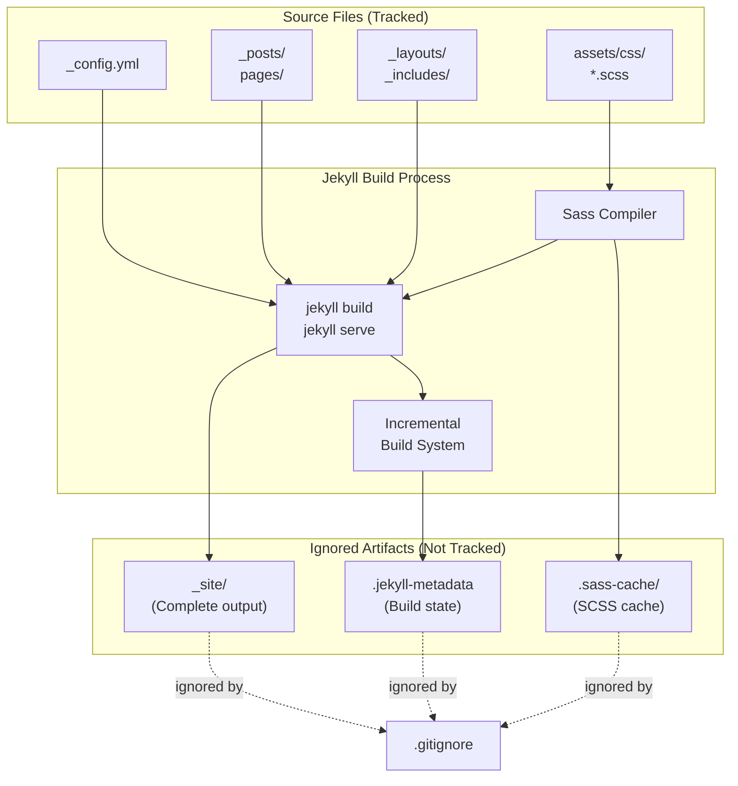
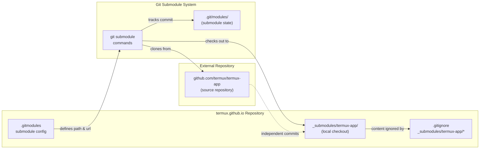

<!-- source: DeepWiki mcp.deepwiki.com · repo termux/termux.github.io · page 9.1 Git Configuration · fetched 2026-10-26 -->

# Git Configuration

<details>
<summary>Relevant source files</summary>

The following files were used as context for generating this wiki page:

- [.gitignore](.gitignore)
- [.gitmodules](.gitmodules)

</details>


## Purpose and Scope

This document explains the Git configuration files in the termux.github.io repository, specifically the `.gitignore` patterns used to exclude Jekyll build artifacts and the `.gitmodules` configuration for the termux-app submodule. This covers repository-level version control settings that ensure clean Git history and proper submodule integration.

For information about CI/CD workflows that interact with Git, see [CI/CD Workflows](#9.3). For overall repository structure, see [Introduction](#1).

---

## Overview

The repository contains two Git configuration files that manage version control behavior:

| File | Purpose | Key Function |
|------|---------|--------------|
| `.gitignore` | Exclude build artifacts and submodule content | Keeps repository clean of generated files |
| `.gitmodules` | Define submodule configuration | Links termux-app repository as a submodule |

These configurations ensure that only source files are tracked in version control, while generated artifacts and externally-managed submodule content remain excluded.

**Sources:** [.gitignore:1-5](), [.gitmodules:1-4]()

---

## .gitignore Patterns

The `.gitignore` file defines four patterns that exclude Jekyll-generated artifacts and submodule content from version control:

```
_site
.sass-cache
.jekyll-metadata
_submodules/termux-app/*
```

### Jekyll Build Artifacts

Three patterns exclude standard Jekyll build outputs:

| Pattern | Description | Generated By |
|---------|-------------|--------------|
| `_site` | Complete compiled static site | Jekyll build process |
| `.sass-cache` | Compiled SCSS cache files | Sass preprocessor |
| `.jekyll-metadata` | Jekyll incremental build metadata | Jekyll incremental regeneration |

These directories are regenerated on every build and should never be committed to version control. The `_site` directory contains the final HTML, CSS, and JavaScript files that are deployed to GitHub Pages, while `.sass-cache` and `.jekyll-metadata` are build optimization artifacts.

**Sources:** [.gitignore:1-3]()

---

### Submodule Content Exclusion

The fourth pattern excludes all content within the termux-app submodule:

```
_submodules/termux-app/*
```

This pattern prevents the termux-app repository content from being tracked in the termux.github.io repository. The submodule itself is tracked (via the `.gitmodules` file and Git's internal submodule state), but its contents are managed by the external termux-app repository.

**Why exclude submodule content?** Git automatically manages submodule content through its submodule system. The `.gitignore` pattern ensures that any untracked files within the submodule directory (such as build artifacts or local changes) don't accidentally get committed to the parent repository.

**Sources:** [.gitignore:4]()

---

## Diagram: Ignored Artifacts and Generation



This diagram shows how Jekyll processes tracked source files to generate untracked build artifacts. The `.gitignore` file ensures that `_site`, `.sass-cache`, and `.jekyll-metadata` remain excluded from version control.

**Sources:** [.gitignore:1-3]()

---

## .gitmodules Configuration

The `.gitmodules` file defines one submodule that links the termux-app repository:

```
[submodule "_apps/termux-app"]
	path = _submodules/termux-app
	url = https://github.com/termux/termux-app
```

### Submodule Components

| Component | Value | Purpose |
|-----------|-------|---------|
| Submodule name | `_apps/termux-app` | Logical identifier for the submodule |
| `path` | `_submodules/termux-app` | Local directory where submodule is checked out |
| `url` | `https://github.com/termux/termux-app` | Remote repository location |

**Note:** There is a discrepancy between the submodule name (`_apps/termux-app`) and the actual path (`_submodules/termux-app`). This appears to be a legacy configuration where the submodule was originally intended for the `_apps` directory but was moved to `_submodules` without updating the logical name.

**Sources:** [.gitmodules:1-4]()

---

### Submodule Purpose

The termux-app submodule links to the main Termux Android application repository. This allows the website repository to:

1. Reference specific versions of the termux-app codebase for documentation purposes
2. Extract version information or release data during site builds
3. Maintain a synchronized relationship between website content and app releases

The submodule is checked out under `_submodules/termux-app/`, and its content is ignored by the `.gitignore` pattern to prevent accidental commits of submodule-internal files.

**Sources:** [.gitmodules:1-4](), [.gitignore:4]()

---

## Diagram: Submodule Configuration and Relationship



This diagram illustrates the relationship between the `.gitmodules` configuration, the Git submodule system, and the termux-app repository. The `.gitignore` pattern prevents untracked submodule content from being committed to the parent repository.

**Sources:** [.gitmodules:1-4](), [.gitignore:4]()

---

## Working with Submodules

### Initializing the Submodule

When cloning the repository, the submodule must be initialized separately:

```bash
git submodule init
git submodule update
```

Or clone with the `--recurse-submodules` flag:

```bash
git clone --recurse-submodules https://github.com/termux/termux.github.io
```

### Updating the Submodule

To update the submodule to the latest commit from the termux-app repository:

```bash
cd _submodules/termux-app
git pull origin master
cd ../..
git add _submodules/termux-app
git commit -m "Update termux-app submodule"
```

The parent repository tracks the specific commit SHA of the submodule, not a branch. Updating the submodule creates a commit in the parent repository that records the new submodule commit.

**Sources:** [.gitmodules:1-4]()

---

## Configuration Summary

The Git configuration in termux.github.io serves two primary functions:

| Configuration | Files Affected | Purpose |
|---------------|---------------|---------|
| Build artifact exclusion | `_site`, `.sass-cache`, `.jekyll-metadata` | Keep repository clean of generated files |
| Submodule content exclusion | `_submodules/termux-app/*` | Prevent submodule-internal files from parent tracking |
| Submodule definition | `_submodules/termux-app/` → termux-app repo | Link to external termux-app repository |

These configurations ensure proper separation between source files (tracked), build artifacts (ignored), and external dependencies (submodule-managed).

**Sources:** [.gitignore:1-5](), [.gitmodules:1-4]()

---

