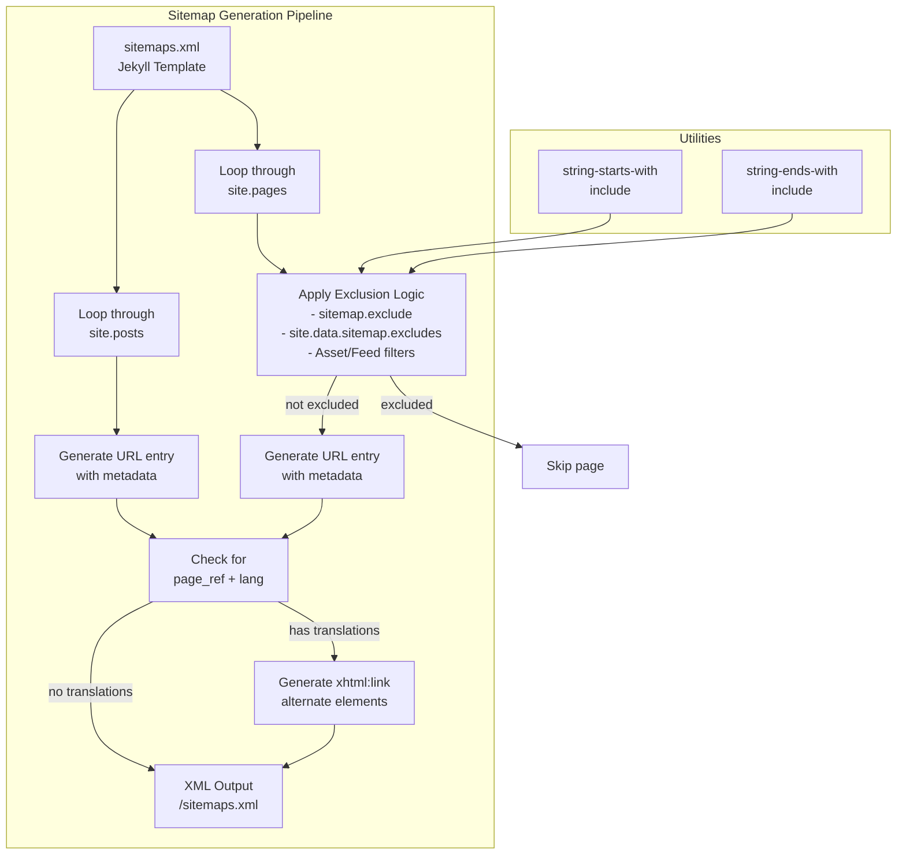
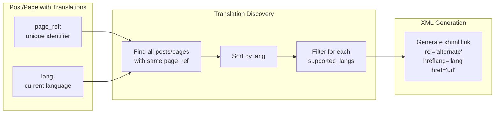
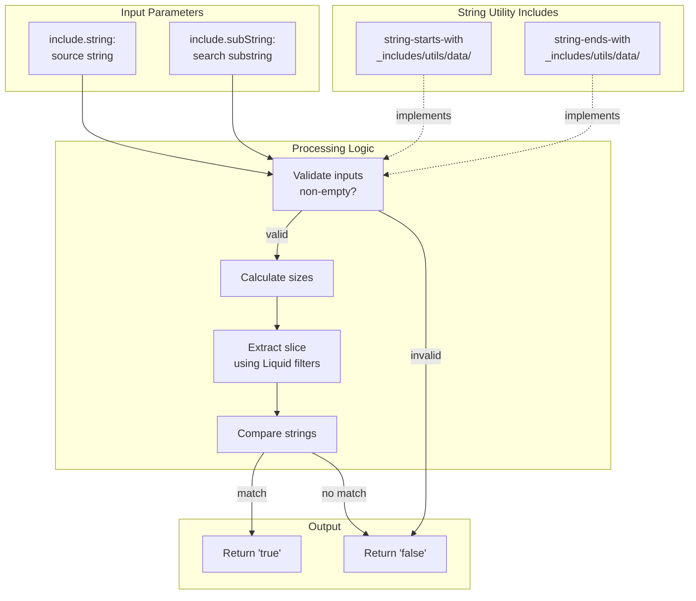

<!-- source: DeepWiki mcp.deepwiki.com · repo termux/termux.github.io · page 9.2 Error Pages and Utilities · fetched 2026-10-26 -->

# Error Pages and Utilities

<details>
<summary>Relevant source files</summary>

The following files were used as context for generating this wiki page:

- [404.html](404.html)
- [_includes/utils/data/string-ends-with](_includes/utils/data/string-ends-with)
- [_includes/utils/data/string-starts-with](_includes/utils/data/string-starts-with)
- [sitemaps.xml](sitemaps.xml)

</details>


## Purpose and Scope

This document covers the error handling and utility systems in the termux.github.io repository, specifically:

- The `404.html` error page configuration and rendering
- The `sitemaps.xml` generation system including its XML structure, content filtering logic, and multilingual SEO features
- String manipulation utility includes used throughout the codebase

For information about CI/CD workflows and repository synchronization, see [9.3](#9.3). For general Git configuration and submodule management, see [9.1](#9.1).

---

## 404 Error Page

The repository includes a custom 404 error page that displays when users navigate to non-existent URLs. The page is implemented in `404.html` with minimal styling and configuration.

### Configuration

The 404 page uses front matter to exclude itself from the sitemap, preventing search engines from indexing the error page:

```yaml
sitemap:
  exclude: true
```

This front matter configuration is respected by the sitemap generation logic (see Sitemap Exclusion Logic below).

### Content Structure

The error page displays a centered message with:
- A heading stating "Page not found"
- A link redirecting users to the homepage at `https://termux.github.io`

The page uses a simple `page-not-found` CSS class for styling, which centers the content using inline `text-align: center` styling.

**Sources:** [404.html:1-12]()

---

## Sitemap Generation

The repository generates an XML sitemap at `/sitemaps.xml` that provides search engines with structured information about all pages and posts on the site. The sitemap includes metadata, change frequency hints, and multilingual alternate links.

### Sitemap Flow



**Sitemap Generation Flow Diagram**

This diagram shows how the `sitemaps.xml` template processes posts and pages, applies exclusion logic using utility includes, and generates multilingual alternate links.

**Sources:** [sitemaps.xml:1-130]()

---

### XML Structure and Metadata

The sitemap uses the standard XML sitemap format with the namespace declaration:

```xml
<urlset xmlns="http://www.sitemaps.org/schemas/sitemap/0.9" 
        xmlns:xhtml="http://www.w3.org/1999/xhtml">
```

The `xhtml` namespace is required for including alternate language links (see Multilingual Support below).

#### Posts Processing

Posts are processed first in the sitemap. The template:
1. Sorts posts by URL using `site.posts | sort: "url"`
2. Iterates through each post
3. Generates a `<url>` entry containing:
   - `<loc>`: Full URL constructed from `site.url` and `post.url`
   - `<lastmod>`: Date in XML schema format, derived from `post.last_modified_at`, `post.date`, or `site.time`
   - `<changefreq>`: Either `post.sitemap.changefreq` or defaults to `"weekly"`
   - `<priority>`: Either `post.sitemap.priority` or defaults to `0.5`

#### Pages Processing

Pages are processed similarly but with additional exclusion logic and a higher default priority:
1. Sorts pages by URL using `site.pages | sort: "url"`
2. Applies exclusion filters (see Exclusion Logic below)
3. For non-excluded pages, generates entries with the same metadata structure as posts
4. Default priority for pages is `0.8` (compared to `0.5` for posts)

**Sources:** [sitemaps.xml:10-63](), [sitemaps.xml:69-126]()

---

### Exclusion Logic

Pages can be excluded from the sitemap through multiple mechanisms:

| Exclusion Method | Mechanism | Example |
|-----------------|-----------|---------|
| **Front Matter** | `sitemap.exclude: true` in page front matter | Used by `404.html` |
| **Central Configuration** | URL listed in `site.data.sitemap.excludes` | Configured via data files |
| **Asset Filter** | URL starts with `/assets/` | Prevents media files from appearing |
| **Feed Filter** | URL starts with `/feed/` | Prevents RSS feeds from appearing |

The exclusion check is implemented at [sitemaps.xml:75]():

```liquid

```

#### Asset and Feed Detection

The template uses string utility includes to detect asset and feed URLs:

```liquid

  



  

```

These utilities return `"true"` or `"false"` strings, which are then compared in the exclusion logic.

**Sources:** [sitemaps.xml:72-75](), [404.html:2-3]()

---

### Multilingual Support with xhtml:link

The sitemap implements SEO best practices for multilingual content by including `xhtml:link` elements that identify alternate language versions of the same content.



**Multilingual xhtml:link Generation Diagram**

This diagram shows how the sitemap discovers translations and generates alternate links for SEO.

#### Implementation Details

For both posts and pages, the template checks if translation metadata exists:

```liquid

```

If present, it:
1. Finds all posts/pages with matching `page_ref`: 
   ```liquid
   
   ```

2. Iterates through `site.supported_langs` to find available translations:
   ```liquid
   
     
   ```

3. Generates an `xhtml:link` element for each available translation:
   ```xml
   <xhtml:link rel="alternate" 
               hreflang="{{- alternate_translation.lang -}}" 
               href="{{-site.url-}}{{- alternate_translation.url -}}"/>
   ```

This mechanism enables search engines to understand the relationship between translated versions of content and serve the appropriate language to users. For more information about the multilingual content system, see [4.3](#4.3).

**Sources:** [sitemaps.xml:49-59](), [sitemaps.xml:111-121]()

---

## String Manipulation Utilities

The repository includes two Liquid template includes for string manipulation operations. These utilities are located in `_includes/utils/data/` and return boolean strings (`"true"` or `"false"`) for use in conditional logic.

### String Utility Architecture



**String Utility Processing Flow**

This diagram shows the internal processing logic shared by both string utility includes.

---

### string-starts-with

The `string-starts-with` include determines whether a string begins with a specified substring.

#### Parameters

- `include.string`: The source string to check
- `include.subString`: The substring to search for at the beginning

#### Implementation Logic

1. **Input Validation**: Checks that both parameters are provided and non-empty [_includes/utils/data/string-starts-with:1]()

2. **Size Calculation**: Determines the length of the substring to extract:
   ```liquid
   
   ```

3. **Slice Extraction**: Extracts characters from the beginning of the string:
   ```liquid
   
   ```

4. **Comparison**: Compares the extracted slice with the substring:
   ```liquid
   
     {{- "true" -}}
   
     {{- "false" -}}
   
   ```

#### Usage Example

In the sitemap generation, this utility detects asset URLs:

```liquid

  

```

**Sources:** [_includes/utils/data/string-starts-with:1-13]()

---

### string-ends-with

The `string-ends-with` include determines whether a string ends with a specified substring.

#### Parameters

- `include.string`: The source string to check
- `include.subString`: The substring to search for at the end

#### Implementation Logic

1. **Input Validation**: Same validation as `string-starts-with` [_includes/utils/data/string-ends-with:1]()

2. **Size Calculation**: Calculates both string sizes:
   ```liquid
   
   
   ```

3. **Index Calculation**: Determines where the ending substring should start:
   ```liquid
   
   ```

4. **Slice Extraction**: Extracts characters from the calculated position:
   ```liquid
   
   ```

5. **Comparison**: Compares the extracted slice with the substring using the same logic as `string-starts-with`

#### Comparison with string-starts-with

| Aspect | string-starts-with | string-ends-with |
|--------|-------------------|------------------|
| **Slice Starting Index** | Always `0` | `string_size - substring_size` |
| **Slice Length** | `substring_size` | `substring_size` |
| **Use Case** | Prefix matching (e.g., URL paths) | Suffix matching (e.g., file extensions) |

**Sources:** [_includes/utils/data/string-ends-with:1-15]()

---

## Integration with Site Architecture

These utilities and error pages integrate with the broader site architecture:

- **404 Error Page**: Uses the default layout system (see [5.1](#5.1)) and integrates with GitHub Pages' automatic 404 handling
- **Sitemap Generation**: Consumes configuration from `_config.yml` (see [3.1](#3.1)) and translation data (see [3.2](#3.2))
- **String Utilities**: Provide reusable logic used in both sitemap generation and potentially other Liquid templates throughout the site
- **Multilingual SEO**: The `xhtml:link` implementation complements the multilingual content system (see [4.3](#4.3))

The sitemap file is generated at build time by Jekyll and served statically by GitHub Pages, enabling search engines to efficiently crawl and index the site's multilingual content.

**Sources:** [404.html:1-12](), [sitemaps.xml:1-130](), [_includes/utils/data/string-starts-with:1-13](), [_includes/utils/data/string-ends-with:1-15]()

---

