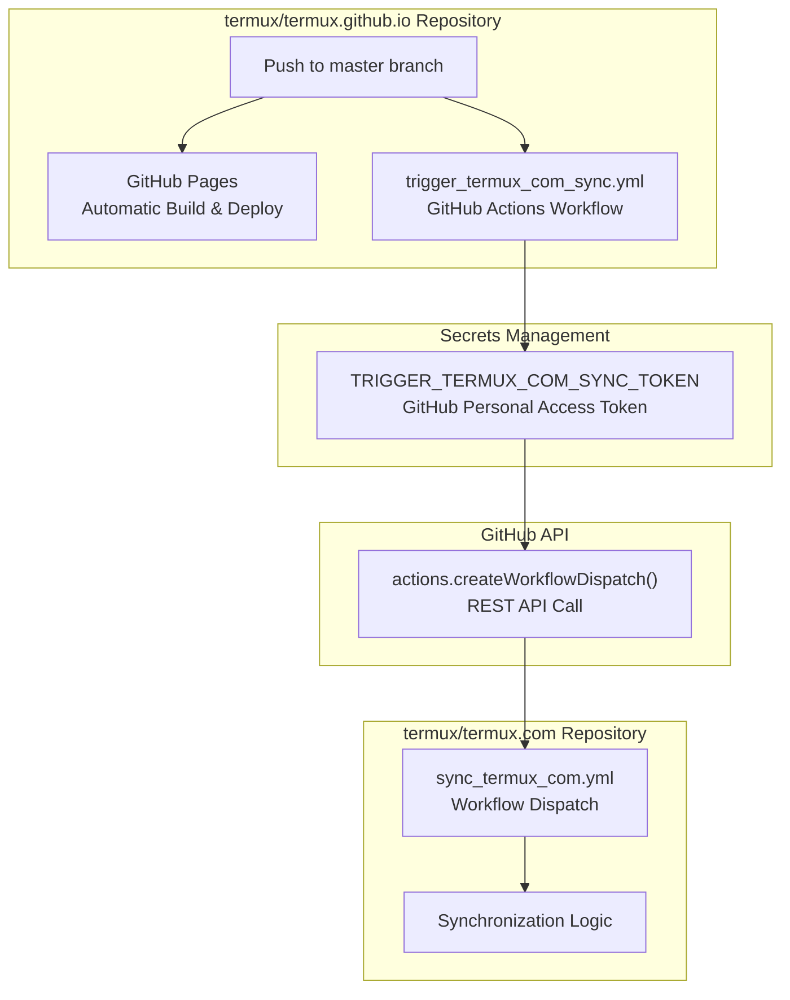
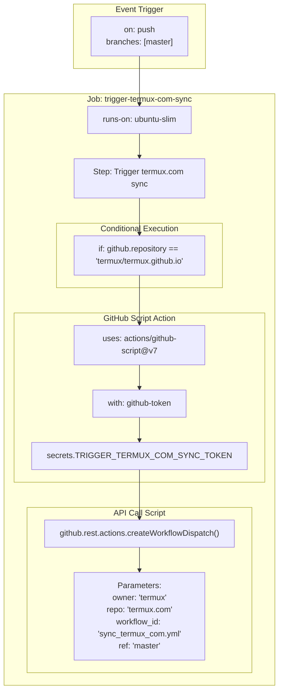
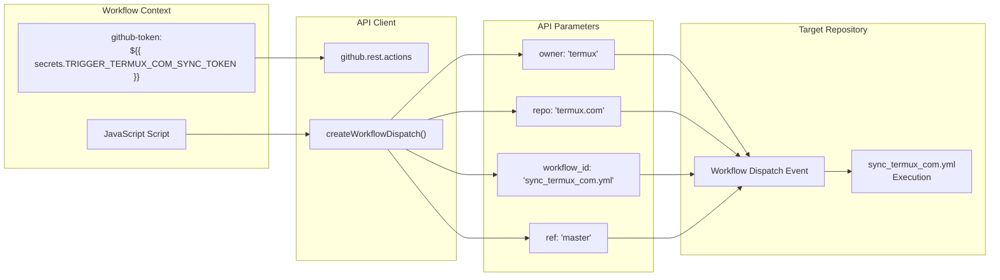

<!-- source: DeepWiki mcp.deepwiki.com · repo termux/termux.github.io · page 9.3 CI/CD Workflows · fetched 2026-10-26 -->

# CI/CD Workflows

<details>
<summary>Relevant source files</summary>

The following files were used as context for generating this wiki page:

- [.github/workflows/trigger_termux_com_sync.yml](.github/workflows/trigger_termux_com_sync.yml)

</details>


## Purpose and Scope

This document describes the Continuous Integration and Continuous Deployment (CI/CD) system for the termux.github.io repository. The primary CI/CD mechanism is a GitHub Actions workflow that triggers cross-repository synchronization with the termux.com repository. For information about the actual deployment to GitHub Pages, see [GitHub Pages Deployment](#2.3). For information about local development and testing, see [Local Development](#2.2).

**Sources:** [.github/workflows/trigger_termux_com_sync.yml:1-24]()

---

## Deployment Model Overview

The termux.github.io repository uses GitHub Pages' built-in Jekyll integration for automatic deployment. When commits are pushed to the `master` branch, GitHub Pages automatically:

1. Detects the Jekyll project structure
2. Runs `jekyll build` using the `github-pages` gem bundle
3. Deploys the generated `_site/` directory to the live site

This automatic deployment process does not require explicit GitHub Actions workflows. The CI/CD workflows in this repository serve a different purpose: cross-repository synchronization.

**Sources:** [.github/workflows/trigger_termux_com_sync.yml:4-6]()

---

## Cross-Repository Synchronization

### Purpose

The primary CI/CD workflow in this repository is `trigger_termux_com_sync.yml`, which automatically triggers a synchronization workflow in the `termux/termux.com` repository whenever changes are pushed to the `master` branch of `termux/termux.github.io`. This ensures that the two repositories remain in sync.

### Workflow File Structure

| Component | Value | Location |
|-----------|-------|----------|
| Workflow Name | `Trigger termux.com sync` | [.github/workflows/trigger_termux_com_sync.yml:1]() |
| Trigger Event | `push` to `master` branch | [.github/workflows/trigger_termux_com_sync.yml:3-6]() |
| Job Name | `trigger-termux-com-sync` | [.github/workflows/trigger_termux_com_sync.yml:9]() |
| Runner | `ubuntu-slim` | [.github/workflows/trigger_termux_com_sync.yml:10]() |
| Target Repository | `termux/termux.com` | [.github/workflows/trigger_termux_com_sync.yml:20]() |
| Target Workflow | `sync_termux_com.yml` | [.github/workflows/trigger_termux_com_sync.yml:21]() |

**Sources:** [.github/workflows/trigger_termux_com_sync.yml:1-24]()

---

## Workflow Execution Flow

### High-Level CI/CD Architecture



**Workflow Execution Sequence:**

1. Developer pushes commits to `master` branch in `termux/termux.github.io`
2. GitHub Pages automatically builds and deploys the Jekyll site (separate process)
3. The `push` event triggers `trigger_termux_com_sync.yml` workflow
4. Workflow executes on `ubuntu-slim` runner
5. Repository check verifies execution only for `termux/termux.github.io` repository
6. GitHub API call dispatches the `sync_termux_com.yml` workflow in the `termux/termux.com` repository
7. The sync workflow in `termux.com` executes its synchronization logic

**Sources:** [.github/workflows/trigger_termux_com_sync.yml:3-23]()

---

### Detailed Workflow Step Breakdown



**Step-by-Step Execution:**

| Step | Component | Description |
|------|-----------|-------------|
| 1 | Event Detection | GitHub detects push to `master` branch ([.github/workflows/trigger_termux_com_sync.yml:3-6]()) |
| 2 | Job Initialization | Job `trigger-termux-com-sync` starts on `ubuntu-slim` runner ([.github/workflows/trigger_termux_com_sync.yml:9-10]()) |
| 3 | Repository Verification | Conditional check ensures execution only in `termux/termux.github.io` ([.github/workflows/trigger_termux_com_sync.yml:13]()) |
| 4 | Action Loading | `actions/github-script@v7` action is loaded ([.github/workflows/trigger_termux_com_sync.yml:14]()) |
| 5 | Token Authentication | `TRIGGER_TERMUX_COM_SYNC_TOKEN` secret provides authentication ([.github/workflows/trigger_termux_com_sync.yml:16]()) |
| 6 | API Invocation | JavaScript script calls GitHub REST API ([.github/workflows/trigger_termux_com_sync.yml:17-23]()) |
| 7 | Workflow Dispatch | `createWorkflowDispatch()` triggers target workflow in `termux/termux.com` repository |

**Sources:** [.github/workflows/trigger_termux_com_sync.yml:8-23]()

---

## Authentication and Security

### Secret Token Configuration

The workflow uses a GitHub secret named `TRIGGER_TERMUX_COM_SYNC_TOKEN` for authentication. This token must have the following properties:

| Property | Requirement | Purpose |
|----------|-------------|---------|
| Type | Personal Access Token (PAT) or GitHub App token | Authenticates API calls to target repository |
| Scope | `repo` (full repository access) or `workflow` | Allows triggering workflow_dispatch events |
| Target | `termux/termux.com` repository | Must have permission to dispatch workflows in target repo |
| Storage | Repository secret in `termux/termux.github.io` | Accessed via `secrets.TRIGGER_TERMUX_COM_SYNC_TOKEN` |

**Security Considerations:**

1. **Repository Verification**: The conditional `if: github.repository == 'termux/termux.github.io'` prevents the workflow from running in forks ([.github/workflows/trigger_termux_com_sync.yml:13]())
2. **Scoped Permissions**: The token should have minimal required permissions (only workflow dispatch)
3. **Secret Management**: Token is stored as a GitHub secret, never exposed in logs or code
4. **Cross-Repository Access**: Token enables controlled cross-repository automation

**Sources:** [.github/workflows/trigger_termux_com_sync.yml:13-16]()

---

## GitHub Actions API Integration

### actions/github-script Action

The workflow uses the `actions/github-script@v7` action, which provides:

- Pre-authenticated GitHub API client via `github` object
- JavaScript execution environment within the workflow
- Automatic token injection from workflow secrets
- Direct access to GitHub REST API endpoints

### API Call Structure



The `github.rest.actions.createWorkflowDispatch()` method accepts the following parameters:

| Parameter | Type | Value | Purpose |
|-----------|------|-------|---------|
| `owner` | string | `'termux'` | GitHub organization/user that owns the target repository |
| `repo` | string | `'termux.com'` | Target repository name |
| `workflow_id` | string | `'sync_termux_com.yml'` | Filename of the workflow to trigger |
| `ref` | string | `'master'` | Git reference (branch/tag) to run the workflow on |

**Sources:** [.github/workflows/trigger_termux_com_sync.yml:17-23]()

---

## Workflow Configuration Details

### Runner Environment

The workflow specifies `ubuntu-slim` as the runner:

```yaml
runs-on: ubuntu-slim
```

This is a minimal Ubuntu-based runner that provides:
- Fast startup time
- Minimal dependencies
- Sufficient environment for GitHub API calls
- Cost-effective execution

**Sources:** [.github/workflows/trigger_termux_com_sync.yml:10]()

### Trigger Configuration

The workflow uses a simple push trigger:

```yaml
on:
  push:
    branches:
      - master
```

This configuration:
- Triggers on every push to the `master` branch
- Does not trigger on pull requests
- Does not trigger on tags or other branches
- Executes immediately after the push event

**Sources:** [.github/workflows/trigger_termux_com_sync.yml:3-6]()

### Repository Safety Check

The conditional execution check prevents unintended executions:

```yaml
if: github.repository == 'termux/termux.github.io'
```

This ensures:
- Workflow only runs in the official `termux/termux.github.io` repository
- Forks cannot trigger the cross-repository sync
- The `TRIGGER_TERMUX_COM_SYNC_TOKEN` secret is never exposed to forks
- Prevents accidental workflow runs in development repositories

**Sources:** [.github/workflows/trigger_termux_com_sync.yml:13]()

---

## Absence of Other CI/CD Workflows

Unlike typical software projects, this repository does not include workflows for:

- **Automated Testing**: The Jekyll site has no test suite
- **Build Verification**: GitHub Pages handles Jekyll builds automatically
- **Linting**: No automated code quality checks
- **Dependency Updates**: No Dependabot or similar automation
- **Deploy Previews**: No preview environment for pull requests

This minimal CI/CD approach is appropriate for a static documentation site where:
1. GitHub Pages provides automatic deployment
2. Content quality is verified through manual review
3. Jekyll build errors are caught by GitHub Pages build process
4. The site structure is relatively stable

The single workflow exists solely to maintain synchronization with the `termux.com` repository, which presumably mirrors or extends the content from `termux.github.io`.

**Sources:** [.github/workflows/trigger_termux_com_sync.yml:1-24]()