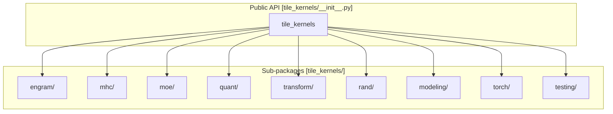
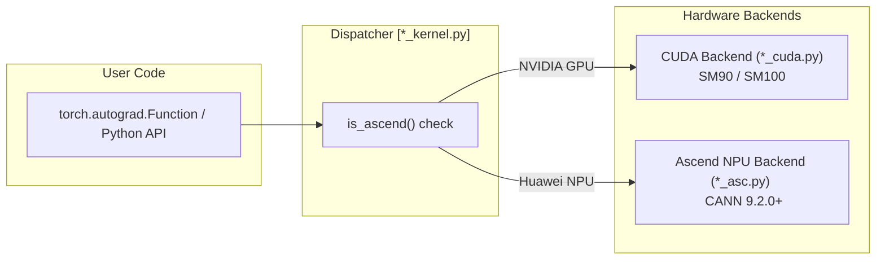

<!-- source: DeepWiki mcp.deepwiki.com · repo deepseek-ai/TileKernels · page 1 TileKernels Overview · fetched 2026-10-30 -->

# TileKernels Overview

Relevant source files

The following files were used as context for generating this wiki page:

- [LICENSE](LICENSE)
- [README.md](README.md)
- [tile_kernels/__init__.py](tile_kernels/__init__.py)

TileKernels is a high-performance kernel library implemented in [TileLang](https://github.com/tile-ai/tilelang), designed for Large Language Model (LLM) training and inference workloads [README.md:1-3](). It provides optimized operators for mixture-of-experts routing, Engram gating, quantization, manifold hyper-connections (mHC), rotary position embeddings, and random number generation [README.md:11-20](). 

A key feature of TileKernels is its dual-backend support: it runs natively on NVIDIA CUDA architectures (SM90/SM100) and Huawei Ascend NPUs, sharing a unified Python API that automatically dispatches to the correct hardware backend [README.md:3-9]().

## Requirements and Supported Backends

TileKernels targets modern hardware accelerators and requires an up-to-date software stack for JIT compilation via TileLang [README.md:21-32]().

| Requirement | Minimum Version / Specification |
| :--- | :--- |
| **Python** | 3.12 or higher [README.md:23]() |
| **PyTorch** | 2.13 or higher [README.md:24]() |
| **TileLang** | 0.1.15 or higher [README.md:25]() |
| **NVIDIA CUDA Backend** | NVIDIA SM90 or SM100 GPU, CUDA Toolkit 13.1+ [README.md:26-28]() |
| **Huawei Ascend Backend** | Ascend 950 NPU, CANN 9.2.0+ [README.md:29-31]() |

For installation steps, configuration flags, and test commands, see **[Getting Started: Installation and Configuration](#1.1)**.

Sources: [README.md:21-32]()

## Module Map and Package Architecture

The library is organized into modular sub-packages under `tile_kernels/`, exposing core operations, reference implementations, modeling wrappers, and test harnesses [README.md:73-86](). 

*   `tile_kernels/engram/`: Engram gating kernels, signed-sqrt sigmoid gating, fused RMSNorm, and weight gradient reduction [README.md:15]().
*   `tile_kernels/mhc/`: Manifold HyperConnection kernels including Sinkhorn normalization, expand, and mix pipelines [README.md:16]().
*   `tile_kernels/moe/`: Mixture of Experts routing, top-k expert selection, and scoring helpers [README.md:13]().
*   `tile_kernels/quant/`: Low-precision casting (FP8 e4m3, FP4 e2m1) across per-token, per-block, and per-channel granularities, plus fused SwiGLU and normalization [README.md:14]().
*   `tile_kernels/rand/`: Random number generation kernels and seed management [README.md:18]().
*   `tile_kernels/transform/`: Rotary Position Embedding (`rope`) kernels [README.md:17]().
*   `tile_kernels/modeling/`: High-level `torch.autograd.Function` wrappers (such as `EngramGateFn`) for differentiable integration into PyTorch models [README.md:19]().
*   `tile_kernels/torch/`: PyTorch-native reference implementations used as ground truth for numeric validation [README.md:84]().
*   `tile_kernels/testing/`: Testing utilities, benchmarking fixtures, and pytest plugins [README.md:83]().

For a complete breakdown of file hierarchies and the `_kernel.py` / `_cuda.py` / `_asc.py` file triple pattern, see **[Repository Layout and Package Structure](#1.2)**.

Sources: [README.md:11-20](), [README.md:73-86]()

## System Architecture and Code Entity Mapping

The diagram below maps high-level functional subsystems to their underlying code entities within the `tile_kernels` package structure (`tile_kernels/__init__.py`) [tile_kernels/__init__.py:1-15]().

### Module to Code Entity Mapping

Sources: [tile_kernels/__init__.py:1-15]()

### Dual-Backend Execution Flow

Sources: [README.md:3-9](), [tile_kernels/__init__.py:1-35]()

## Child Pages

*   **[Getting Started: Installation and Configuration](#1.1)** — Installation instructions, environment setup, test execution with `TK_TEST_LEVEL`, and runtime configuration APIs in `tile_kernels/config.py`.
*   **[Repository Layout and Package Structure](#1.2)** — Overview of top-level directories, the per-kernel file triple convention (`*_kernel.py`, `*_cuda.py`, `*_asc.py`), and symbol re-exporting.
*   **[Development Workflow and Tooling](#1.3)** — Contributor guidelines including pre-commit hooks, ruff formatting, style rules, and licensing.

---
**Sources:**
- [README.md:1-106]()
- [tile_kernels/__init__.py:1-39]()
- [LICENSE:1-21]()

---

