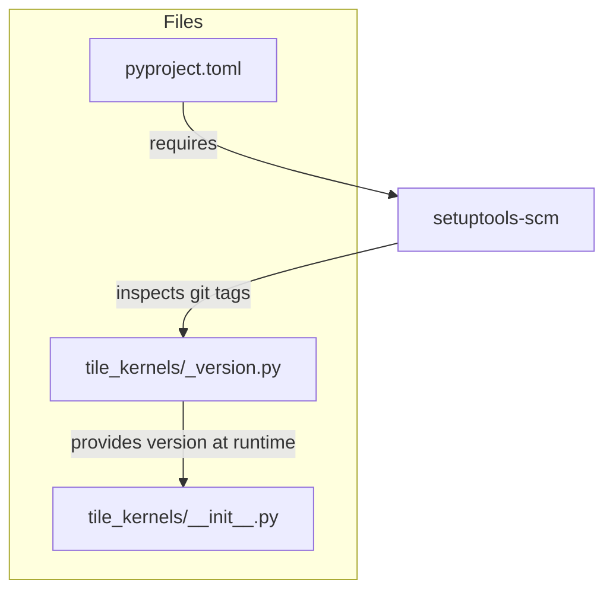
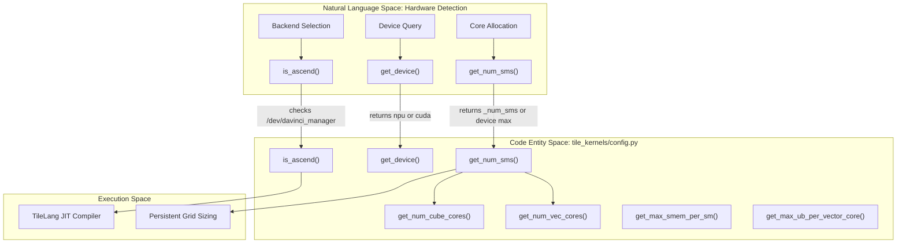

<!-- source: DeepWiki mcp.deepwiki.com · repo deepseek-ai/TileKernels · page 1.1 Getting Started: Installation and Configuration · fetched 2026-10-30 -->

# Getting Started: Installation and Configuration

<details>
<summary>Relevant source files</summary>

The following files were used as context for generating this wiki page:

- [README.md](README.md)
- [pyproject.toml](pyproject.toml)
- [tile_kernels/config.py](tile_kernels/config.py)

</details>


This page provides a comprehensive technical guide for setting up the `TileKernels` environment, managing package dependencies and versioning via `pyproject.toml`, running tests across different test levels and benchmark flags, and utilizing the global runtime configuration API (`tile_kernels/config.py`).

## Purpose and Scope

`TileKernels` is a collection of high-performance kernels implemented in **TileLang**, supporting dual hardware backends: NVIDIA CUDA (SM90/SM100 architectures) and Huawei Ascend NPUs [README.md:3-3](). The library offers optimized implementations for mixture-of-experts (MoE) routing, Engram gating, quantization, and manifold hyper-connections (mHC) [README.md:13-19](). Proper installation ensures that the TileLang JIT compiler correctly targets the local hardware backend, while the runtime configuration API allows developers to tune core allocation, memory limits, token alignment, and execution modes.

Sources:
* `README.md:1-20()`
* `pyproject.toml:1-11()`

---

## Installation and Prerequisites

The build system relies on `setuptools` with dynamic versioning handled by `setuptools-scm`, which generates `tile_kernels/_version.py` from git tags [pyproject.toml:1-7]().

### Core Prerequisites & Dependencies
*   **Python**: `>=3.12` [pyproject.toml:36-36]()
*   **PyTorch**: `>=2.13` [pyproject.toml:33-33]()
*   **TileLang**: `>=0.1.15` [pyproject.toml:34-34]()
*   **CUDA Backend**: NVIDIA SM90 or SM100 architecture GPU with CUDA Toolkit 13.1 or higher [README.md:26-28]()
*   **Ascend Backend**: Ascend 950 NPU with CANN 9.2.0 or higher [README.md:29-31]()

### Installation Commands
To install a local editable development version with test dependencies (such as `pytest`, `pytest-xdist`, and `pytest-repeat`), run [README.md:35-39](), [pyproject.toml:46-47]():
```bash
pip install -e ".[dev]"
```

To install a release version from a distribution package [README.md:41-45]():
```bash
pip install tile-kernels
```

Sources:
* `README.md:21-46()`
* `pyproject.toml:1-48()`

---

## Running Tests and Benchmarks

Testing is managed via `pytest` with support for parallel execution (`pytest-xdist`) [README.md:49-49](), [pyproject.toml:47-47](). 

### Test Execution Commands
To run a specific test file for correctness using 4 parallel workers [README.md:54-54]():
```bash
python -m pytest tests/quant/test_per_token_cast.py -n 4
```

To execute both correctness tests and performance benchmarks on a test file [README.md:55-55]():
```bash
python -m pytest tests/quant/test_per_token_cast.py --run-benchmark
```

### Test Levels via Environment Variables
The test suite respects the `TK_TEST_LEVEL` environment variable to control test granularity and thoroughness [README.md:58-63]():
```bash
# Run core smoke tests across 4 workers
TK_TEST_LEVEL=0 python -m pytest -n 4

# Run full expanded test suites with repetition
TK_TEST_LEVEL=2 python -m pytest -n 4 --count 2
```

Sources:
* `README.md:47-64()`

---

## Runtime Configuration API (`tile_kernels/config.py`)

The `tile_kernels/config.py` module exposes a centralized runtime configuration interface [tile_kernels/config.py:1-134](). It handles backend detection, core counts, memory buffer limits, and clamping configurations.

### Key Configuration Functions and State

| Function / Symbol | Description | Implementation File & Line |
| :--- | :--- | :--- |
| `is_ascend()` | Detects if running on Ascend NPU by checking existence of `/dev/davinci_manager`. | `tile_kernels/config.py:24-26` [tile_kernels/config.py:24-26]() |
| `get_device()` | Returns `'npu'` if Ascend is detected, otherwise `'cuda'`. | `tile_kernels/config.py:29-31` [tile_kernels/config.py:29-31]() |
| `get_device_num_sms()` | Queries physical hardware properties for total SM count or cube core count. | `tile_kernels/config.py:39-47` [tile_kernels/config.py:39-47]() |
| `set_num_sms(num_sms)` | Manually overrides active streaming multiprocessor / core count. | `tile_kernels/config.py:49-52` [tile_kernels/config.py:49-52]() |
| `get_num_sms()` | Returns active SM count (defaults to hardware maximum if set to 0). | `tile_kernels/config.py:55-59` [tile_kernels/config.py:55-59]() |
| `get_num_ai_cores()` / `get_num_cube_cores()` | Aliases for `get_num_sms()` targeting AIC/Cube cores. | `tile_kernels/config.py:66-67` [tile_kernels/config.py:66-67]() |
| `get_num_vec_cores()` | Returns vector core count (`get_num_sms() * 2`). | `tile_kernels/config.py:70-71` [tile_kernels/config.py:70-71]() |
| `get_max_smem_per_sm()` | Returns CUDA shared memory per multiprocessor. | `tile_kernels/config.py:74-78` [tile_kernels/config.py:74-78]() |
| `get_max_ub_per_vector_core()` | Returns Ascend Unified Buffer (UB) limit per vector core. | `tile_kernels/config.py:80-84` [tile_kernels/config.py:80-84]() |
| `set_token_alignment(val)` / `get_token_alignment()` | Manages token alignment requirements (default: 128). | `tile_kernels/config.py:86-93` [tile_kernels/config.py:86-93]() |
| `set_pdl(use_pdl)` / `get_pdl()` | Controls Program Dependent Launch (PDL) settings. | `tile_kernels/config.py:105-112` [tile_kernels/config.py:105-112]() |
| `use_deterministic_algorithms()` | Enables or disables deterministic execution algorithms. | `tile_kernels/config.py:115-122` [tile_kernels/config.py:115-122]() |
| `set_amax_clamp_for_quant()` / `get_amax_clamp_for_quant()` | Manages minimum clamping thresholds for quantization formats (`e4m3`, `e2m1`). | `tile_kernels/config.py:125-134` [tile_kernels/config.py:125-134]() |
| `reset_runtime_config()` | Resets all runtime configuration variables back to default values. | `tile_kernels/config.py:96-103` [tile_kernels/config.py:96-103]() |

Sources:
* `tile_kernels/config.py:1-135()`

---

## Architecture and Data Flow

The following diagrams bridge natural language concepts to their concrete code entities, illustrating how package metadata and runtime configuration initialize and direct kernel execution.

**Build and Versioning Data Flow**

Sources:
* `pyproject.toml:1-7()`

**Runtime Configuration and Device Dispatch Data Flow**

Sources:
* `tile_kernels/config.py:24-84()`

---

