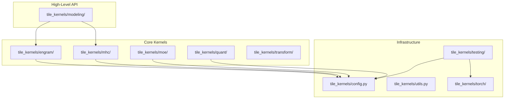
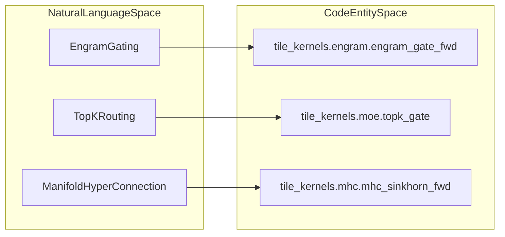
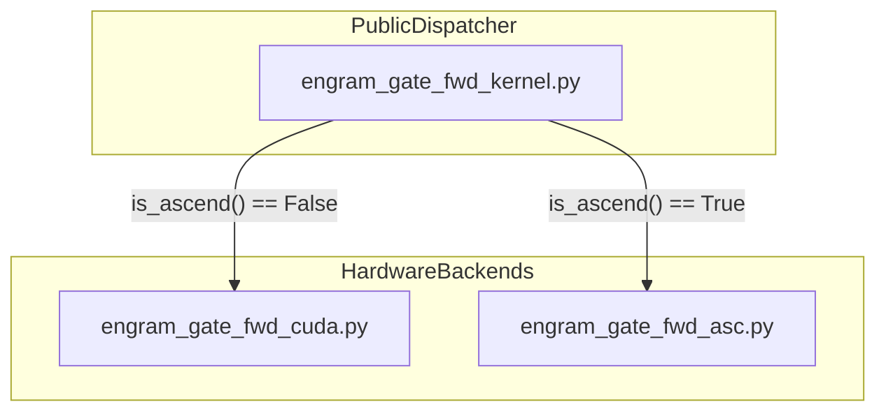

<!-- source: DeepWiki mcp.deepwiki.com · repo deepseek-ai/TileKernels · page 1.2 Repository Layout and Package Structure · fetched 2026-10-30 -->

# Repository Layout and Package Structure

<details>
<summary>Relevant source files</summary>

The following files were used as context for generating this wiki page:

- [README.md](README.md)
- [tile_kernels/__init__.py](tile_kernels/__init__.py)
- [tile_kernels/engram/__init__.py](tile_kernels/engram/__init__.py)
- [tile_kernels/mhc/__init__.py](tile_kernels/mhc/__init__.py)
- [tile_kernels/moe/__init__.py](tile_kernels/moe/__init__.py)

</details>


This page describes the physical and logical organizational structure of the `TileKernels` codebase. The architecture separates low-level kernel definitions into modular sub-packages, enforces a consistent multi-backend file convention, and uses explicit re-exports in `__init__.py` files to provide clean public APIs.

---

## Top-Level Directory Tree

The repository root houses the core library package `tile_kernels/`, the test suite `tests/`, and project metadata. The sub-packages under `tile_kernels/` partition the library by functional domain, while `tests/` mirrors this structure for unit and integration testing.

```txt
tile_kernels/
├── engram/     # Engram gating kernels
├── mhc/        # Manifold HyperConnection kernels
├── modeling/   # High-level autograd modeling layer (engram)
├── moe/        # Mixture of Experts routing kernels
├── quant/      # Quantization kernels
├── rand/       # Random number generator kernel
├── testing/    # Test and benchmark utilities
├── torch/      # PyTorch reference implementations
└── transform/  # Rotary position embedding kernel
```

**Sources:**
- [README.md:76-86]()
- [tile_kernels/__init__.py:3-15]()

---

## Package Structure and Data Flow

The internal structure of `tile_kernels/` mirrors the functional modules of the library. Sub-packages manage specific LLM primitives, relying on shared configuration in `tile_kernels/config.py` and utilities in `tile_kernels/utils.py`.

### Dependency and Import Graph

The following diagram illustrates how core sub-packages and auxiliary modules interact within the runtime environment.

**TileKernels Internal Dependency Flow**

**Sources:**
- [tile_kernels/__init__.py:3-16]()

---

## The Per-Kernel File Triple Convention

To support dual hardware backends (NVIDIA CUDA and Huawei Ascend NPU) without cluttering the dispatch logic, TileKernels employs a three-file-per-kernel convention (the "file triple"):

1. **`*_kernel.py` (Dispatcher)**: Acts as the public entry point. It performs shape validation, dtype checks, dynamic tiling selection, and uses `tile_kernels.config.is_ascend()` to delegate compilation and execution to either the CUDA or Ascend factory.
2. **`*_cuda.py` (NVIDIA Backend)**: Contains the TileLang kernel definition (`@tilelang.jit`, `T.prim_func`) targeting NVIDIA SM90/SM100 architectures.
3. **`*_asc.py` (Ascend Backend)**: Contains the corresponding TileLang kernel definition optimized for Huawei Ascend NPU vector and cube cores.

---

## Symbol Re-Exporting via `__init__.py`

Each sub-package uses its `__init__.py` file to flatten module imports and expose a curated public interface. For instance, `tile_kernels/engram/__init__.py` [tile_kernels/engram/__init__.py:1-11]() imports core symbols directly from their respective internal modules:

```python
from .engram_fused_weight_kernel import fused_weight
from .engram_gate_bwd_kernel import engram_gate_bwd
from .engram_gate_fwd_kernel import engram_gate_fwd
from .engram_grad_w_reduce_kernel import grad_w_reduce
from .engram_hash_kernel import engram_hash
from .engram_sinkhorn_kernel import (
    engram_sinkhorn_finalize,
    engram_sinkhorn_momentum_update,
    engram_sinkhorn_step,
    engram_sinkhorn_step_reduce,
)
```

Similarly, `tile_kernels/mhc/__init__.py` [tile_kernels/mhc/__init__.py:1-17]() and `tile_kernels/moe/__init__.py` [tile_kernels/moe/__init__.py:1-4]() re-export their respective mix, norm, and top-k functions:

```python
from .expand_kernel import expand_to_mhc_bwd, expand_to_mhc_fwd
from .head_compute_mix_kernel import mhc_head_compute_mix_bwd, mhc_head_compute_mix_fwd
from .multilayer_recompute_kernel import mhc_multilayer_recompute
from .norm_fn_kernel import (
    mhc_fn_normw_merge_bwd,
    mhc_fn_normw_merge_fwd,
    mhc_reduce_partials_and_rmsnorm_bwd,
    mhc_reduce_partials_and_rmsnorm_fwd,
)
from .post_kernel import mhc_post_bwd, mhc_post_fwd
from .pre_apply_mix_kernel import mhc_pre_apply_mix_bwd, mhc_pre_apply_mix_fwd
from .pre_big_fuse_kernel import mhc_pre_big_fuse_fwd
from .pre_split_mixes_kernel import (
    mhc_pre_split_mixes_bwd,
    mhc_pre_split_mixes_fwd,
)
from .sinkhorn_kernel import mhc_sinkhorn_bwd, mhc_sinkhorn_fwd
```

**Sources:**
- [tile_kernels/engram/__init__.py:1-11]()
- [tile_kernels/mhc/__init__.py:1-17]()
- [tile_kernels/moe/__init__.py:1-4]()

---

## Code Entity Mapping

The following diagrams map conceptual architectural modules and per-kernel naming spaces to their concrete code entities within the repository.

**System Concept to Code Entity Mapping**


**Kernel Triple File Architecture Mapping**


**Sources:**
- [tile_kernels/engram/__init__.py:1-4]()
- [tile_kernels/moe/__init__.py:2-4]()
- [tile_kernels/mhc/__init__.py:17]()

---

