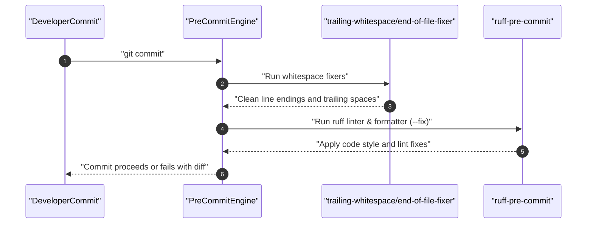
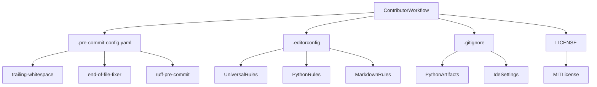

<!-- source: DeepWiki mcp.deepwiki.com · repo deepseek-ai/TileKernels · page 1.3 Development Workflow and Tooling · fetched 2026-10-30 -->

# Development Workflow and Tooling

Relevant source files

The following files were used as context for generating this wiki page:

- [.editorconfig](.editorconfig)
- [.gitignore](.gitignore)
- [.pre-commit-config.yaml](.pre-commit-config.yaml)
- [LICENSE](LICENSE)

## Purpose and Scope
This section covers the contributor tooling, style configurations, repository hygiene rules, and licensing infrastructure used within the TileKernels codebase. Maintaining consistent formatting, automated checks, and precise repository boundaries ensures stability across dual CUDA and Ascend NPU backends.

Sources: [.pre-commit-config.yaml:1-16](), [.editorconfig:1-58](), [.gitignore:1-23](), [LICENSE:1-21]()

---

## Pre-commit Infrastructure and Automation
TileKernels enforces code style, linting standards, and hygiene rules automatically using `pre-commit` hooks. The configuration is maintained in `.pre-commit-config.yaml`. 

The pipeline integrates two primary repositories:
1. `pre-commit/pre-commit-hooks`: Handles generic file hygiene such as removing trailing whitespaces and ensuring files terminate with a newline.
2. `astral-sh/ruff-pre-commit`: Executes `ruff` for ultra-fast Python linting with automatic fixing (`--fix`) and code formatting (`ruff-format`).

### Pre-commit Configuration Details
* **Trailing Whitespace Fixer**: Automatically strips trailing whitespaces from staged files (`[.pre-commit-config.yaml:5]()`).
* **End-of-File Fixer**: Ensures every file terminates with a newline character (`[.pre-commit-config.yaml:6]()`).
* **Ruff Linter**: Invokes `ruff` with the `--fix` argument to correct lint violations (`[.pre-commit-config.yaml:13-14]()`).
* **Ruff Formatter**: Invokes `ruff-format` to normalize Python syntax layout (`[.pre-commit-config.yaml:16]()`).

Title: Pre-commit Hook Pipeline Execution

Sources: [.pre-commit-config.yaml:1-16]()

---

## Editor Configuration and Style Rules
To accommodate contributors using diverse IDEs and text editors, TileKernels standardizes text encoding, indentation, and line termination rules via `.editorconfig`.

The root configuration applies universal defaults, which are overridden for specific file extensions:
* **Universal Defaults**: UTF-8 character encoding, LF line endings, 4-space indentation, trailing whitespace trimming, and mandatory final newlines (`[.editorconfig:5-11]()`).
* **Python Files (`*.{py,pyi}`)**: Enforces 4-space indentation (`[.editorconfig:13-15]()`).
* **C/C++/CUDA Headers and Sources (`*.{cpp,hpp,cxx,cc,c,h,cu,cuh}`)**: Enforces 4-space indentation (`[.editorconfig:16-18]()`).
* **YAML Files (`*.{yaml,yml}`)**: Configures 2-space indentation (`[.editorconfig:25-27]()`).
* **Markdown and reStructuredText (`*.md`, `*.rst}`)**: Uses soft-wrap text formatting with specific indentation rules (`[.editorconfig:41-47]()`).
* **Exception Rule**: Test and example text files (`**/test{,s,ing}/**/*.txt`, `**/example{,s}/**/*.txt`) disable whitespace stripping and final newline insertion to preserve test fixtures (`[.editorconfig:52-59]`).

Title: Tooling Configuration Architecture

Sources: [.editorconfig:1-58]()

---

## Repository Hygiene and Exclusions
The `.gitignore` file defines patterns for files and directories that should be excluded from version control tracking. 

Key exclusion categories include:
* **Python Packaging and Build Artifacts**: Excludes `build/`, `dist/`, `*.egg-info`, compiled bytecode `*.pyc`, `__pycache__/`, and dynamically generated package version files like `_version.py` (`[.gitignore:2-14]()`).
* **IDE Configurations**: Ignores PyCharm settings (`.idea/`, `*.iml`, `*.iws`) and VSCode metadata (`/.vscode`) (`[.gitignore:8-18]()`).
* **Workspace Environments**: Excludes local `workspace/` directories and prompt/agent scratchpads (`AGENTS.md`) (`[.gitignore:20-23]`).

Sources: [.gitignore:1-23]()

---

## Licensing Information
TileKernels is distributed under the terms of the MIT License, granting broad permissions for commercial and non-commercial use, modification, and distribution, provided that the copyright notice and permission notice are included in all copies or substantial portions of the software (`[LICENSE:1-21]()`).

Sources: [LICENSE:1-21]()

---

