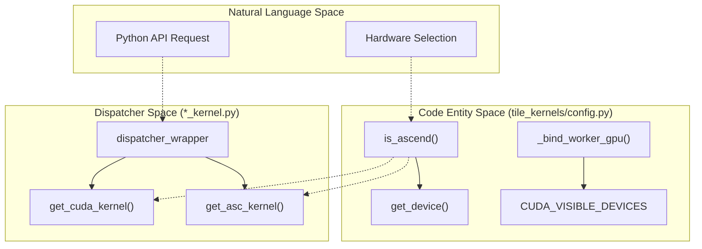

<!-- source: DeepWiki mcp.deepwiki.com · repo deepseek-ai/TileKernels · page 10 Glossary · fetched 2026-10-30 -->

# Glossary

Relevant source files

The following files were used as context for generating this wiki page:

- [README.md](README.md)
- [tests/conftest.py](tests/conftest.py)
- [tile_kernels/config.py](tile_kernels/config.py)

This page provides definitions for codebase-specific terms, abbreviations, and domain concepts used throughout the **TileKernels** repository. It serves as a technical reference for engineers to understand the mapping between mathematical concepts, hardware primitives, and their implementation in code.

---

## 1. Core Framework and Execution Conventions

### TileLang
The domain-specific language (DSL) used to author all kernels in this repository. It enables writing high-performance GPU and NPU kernels in Python that JIT-compile into optimized target machine code [README.md:1-5]().

### Dual-Backend Dispatch Convention (`_kernel` / `_cuda` / `_asc`)
A three-file-per-kernel design pattern where:
*   `*_kernel.py` acts as the public Python wrapper and dispatcher performing shape/dtype validation and caching compiled artifacts.
*   `*_cuda.py` implements the NVIDIA CUDA / Tensor Core logic.
*   `*_asc.py` implements the Huawei Ascend / NPU logic.
*   **Source:** [README.md:9-10]()

### xdist Worker Binding
A mechanism in `tests/conftest.py` that intercepts pytest-xdist execution to bind each worker process to a distinct physical GPU (`CUDA_VISIBLE_DEVICES`) or NPU (`ASCEND_RT_VISIBLE_DEVICES`) prior to driver initialization [tests/conftest.py:53-137]().

### `TK_TEST_LEVEL`
An environment variable controlling the test execution depth (e.g., `TK_TEST_LEVEL=0` for core correctness smoke tests, `TK_TEST_LEVEL=2` for comprehensive testing) [README.md:58-63]().

**Entity Mapping: Dual-Backend Dispatch and Configuration**

Sources: [README.md:9-10](), [tests/conftest.py:53-137](), [tile_kernels/config.py:24-32]()

---

## 2. Hardware and Runtime Configuration

### SM (Streaming Multiprocessor)
The fundamental execution unit on NVIDIA GPUs. `TileKernels` queries the SM count to dynamically size thread block grids and configure memory partitioning [tile_kernels/config.py:40-47]().

### AIC / AIV (AI Core / AI Vector Core)
The processing core architecture on Huawei Ascend NPUs. AIC handles matrix multiplication (Cube operations), while AIV handles vector-parallel operations [tile_kernels/config.py:62-72]().

### Cube Cores / Vector Cores
Hardware functional units on Ascend and NVIDIA architectures responsible for dense matrix contraction (Tensor Cores / Cube) and element-wise/reduction workloads (Vector Cores) [tile_kernels/config.py:62-72]().

### UB (Unified Buffer)
The high-speed on-chip scratchpad memory available per vector core on Huawei Ascend NPUs, analogous to shared memory on NVIDIA GPUs [tile_kernels/config.py:80-84]().

### PDL (Program Dependent Launch)
A runtime configuration flag (`use_pdl`) managed in `tile_kernels/config.py` that dictates specific kernel launch optimizations or stream execution policies [tile_kernels/config.py:7-18]().

Sources: [tile_kernels/config.py:40-84]()

---

## 3. Engram Subsystem

The Engram module implements a gated residual connection mechanism incorporating RMSNorm, signed-sqrt sigmoid activation, and weight reduction [README.md:15]().

| Term | Definition | Code Entity |
| :--- | :--- | :--- |
| **Engram Gate** | Fused operation combining RMSNorm, a signed-sqrt sigmoid gate, and element-wise multiplication [README.md:15]() | `engram_gate_fwd` [README.md:15]() |
| **hc_mult** | Hyper-connection multiplier defining the number of residual heads (typically 4) | `hc_mult` |
| **weight_fused** | Pre-computed product of weights used in gating calculations to minimize global memory bandwidth | `weight_fused` |

Sources: [README.md:15]()

---

## 4. Manifold HyperConnection (mHC)

A subsystem for complex multi-head residual mixing and routing.

*   **Sinkhorn Normalization:** An iterative algorithm producing doubly-stochastic matrices (where rows and columns sum to 1) used for stable feature mixing.
*   **Big Fuse (`pre_big_fuse`):** An inference-optimized kernel fusing multiple mHC steps (norm, split, mix) into a single hardware launch to eliminate intermediate global memory round-trips.

Sources: [README.md:16]()

---

## 5. Quantization and Casting

### Scaling Factor (SF)
A multiplier coefficient used to scale floating-point tensors into low-precision representations. Granularities include:
*   **Per-token:** One scaling factor per row.
*   | **Per-block:** Scaling factors applied across defined block tiles `(M, N)`.
*   **Per-channel:** One scaling factor per column.

### e4m3 / e2m1
Low-precision floating-point formats supported by the quantization subsystem:
*   `e4m3`: 8-bit floating point format with 4 exponent bits and 3 mantissa bits (`float8_e4m3fn`).
*   `e2m1`: 4-bit floating point format with 2 exponent bits and 1 mantissa bit (`float4_e2m1fn`).
*   **Source:** [tile_kernels/config.py:10-15]()

### SwiGLU
Swish-Gated Linear Unit activation function, frequently fused with quantization and normalization kernels to maximize arithmetic intensity [README.md:14]().

Sources: [README.md:14](), [tile_kernels/config.py:10-15]()

---

## 6. Auxiliary Terms

### RoPE (Rotary Position Embedding)
A transformation kernel applying rotary position embeddings to query and key tensors in attention mechanisms [README.md:17]().

Sources: [README.md:17]()