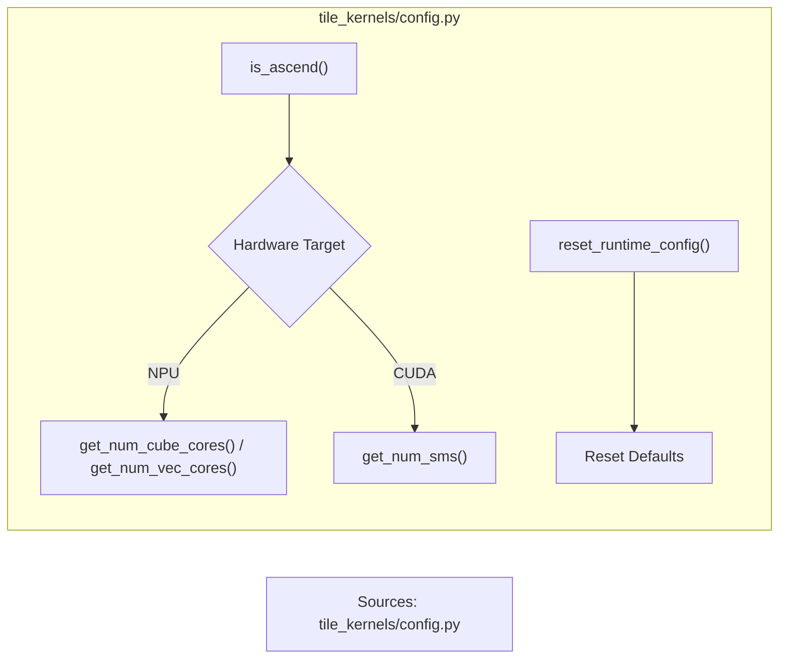

<!-- source: DeepWiki mcp.deepwiki.com · repo deepseek-ai/TileKernels · page 2 Core Architecture: TileLang Kernel Framework · fetched 2026-10-30 -->

# Core Architecture: TileLang Kernel Framework

<details>
<summary>Relevant source files</summary>

The following files were used as context for generating this wiki page:

- [tile_kernels/config.py](tile_kernels/config.py)
- [tile_kernels/engram/engram_gate_fwd_kernel.py](tile_kernels/engram/engram_gate_fwd_kernel.py)
- [tile_kernels/mhc/sinkhorn_kernel.py](tile_kernels/mhc/sinkhorn_kernel.py)

</details>


This page provides an overview of the core architecture powering the TileKernels framework. TileKernels is built around **TileLang**, a domain-specific language that enables writing high-performance GPU and NPU kernels in Python while maintaining fine-grained control over memory hierarchies, asynchronous data movement, and hardware-specific execution grids. The framework relies on a robust dual-backend dispatch system, unified runtime configuration management, and modular kernel authoring idioms.

For detailed information on specific subsystems, refer to the child pages:
- [Dual-Backend Dispatch Pattern (_kernel / _cuda / _asc)](#2.1)
- [Device Configuration and Runtime Settings](#2.2)
- [Kernel Authoring Patterns](#2.3)

---

## 2.1 Dual-Backend Dispatch Pattern (`_kernel` / `_cuda` / `_asc`)

TileKernels employs a three-file convention per kernel to support both NVIDIA CUDA (SM90/SM100) and Huawei Ascend NPU hardware targets seamlessly from a unified Python API. The public-facing entry point resides in a `*_kernel.py` module (such as `tile_kernels/engram/engram_gate_fwd_kernel.py`), which handles input tensor shape and data type validation, allocates output tensors, and inspects runtime flags like `is_ascend()` [tile_kernels/config.py:24-26] to select the appropriate backend factory.

Depending on the active hardware device, the dispatcher invokes either the CUDA compilation factory (`get_*_cuda`) or the Ascend compilation factory (`get_*_asc`), leveraging Python's `functools.lru_cache` to compile and cache JIT kernels across identical shape and tuning parameters.

**Dual-Backend Dispatch Architecture**
```mermaid
graph TD
    subgraph "Public API Layer"
        A["engram_gate_fwd(hidden_states, kv, ...)"] --> B{"is_ascend()"}
    end

    subgraph "Backend Selection"
        B -->|False (CUDA)| C["get_engram_gate_fwd_kernel_cuda()"]
        B -->|True (Ascend)| D["get_engram_gate_fwd_kernel_asc()"]
    end

    subgraph "Compilation & Execution"
        C --> E["CUDA JIT Cache & Execution"]
        D --> F["Ascend JIT Cache & Execution"]
    end

    Sources["Sources: tile_kernels/engram/engram_gate_fwd_kernel.py, tile_kernels/config.py"]
```

For a comprehensive deep dive into the dispatch pattern, tiling-parameter selection loops, and caching strategies, see [Dual-Backend Dispatch Pattern (_kernel / _cuda / _asc)](#2.1).

---

## 2.2 Device Configuration and Runtime Settings

The `tile_kernels/config.py` module centralizes global runtime configurations, hardware capability queries, and environment tuning parameters. It exposes helper functions to detect the underlying hardware target via `is_ascend()` [tile_kernels/config.py:24-26] and `get_device()` [tile_kernels/config.py:29-32], query core counts across architectures (`get_num_sms()`, `get_num_cube_cores()`, `get_num_vec_cores()`) [tile_kernels/config.py:55-71], and inspect hardware memory bounds such as shared memory per SM or Unified Buffer (UB) limits (`get_max_smem_per_sm()`, `get_max_ub_per_vector_core()`) [tile_kernels/config.py:74-83].

Additionally, the configuration module manages token alignment constraints, Program Dependent Launch (PDL) flags, deterministic execution modes, quantization clamp-min thresholds, and provides a `reset_runtime_config()` utility to restore default states [tile_kernels/config.py:86-103].

**Configuration and Hardware Query Flow**


For detailed documentation on configuration APIs, memory limits, and quantization settings, see [Device Configuration and Runtime Settings](#2.2).

---

## 2.3 Kernel Authoring Patterns

TileLang kernels across the codebase share consistent authoring idioms designed to maximize hardware utilization. Kernels are marked with the `@tilelang.jit` decorator alongside specific pass configurations, wrapping a `T.prim_func` entry point. Inside the primitive function, `T.Kernel` establishes persistent execution grids where block counts are decoupled from total workload sizes to improve cache locality and occupancy.

Memory management is handled explicitly through `T.alloc_shared` and `T.alloc_local`, paired with asynchronous copy primitives (`T.async_copy`) and pipelining structures to overlap global memory latency with computation. Furthermore, kernels utilize warp and block reductions, vectorized loops (`T.vectorized`), and Ascend-specific vector-core patterns.

For detailed code examples and explanations of TileLang idioms, asynchronous pipelines, and reduction patterns, see [Kernel Authoring Patterns](#2.3).

---

**Sources:**
- [tile_kernels/config.py:1-134]()
- [tile_kernels/engram/engram_gate_fwd_kernel.py:1-85]()
- [tile_kernels/mhc/sinkhorn_kernel.py:1-21]()

---

