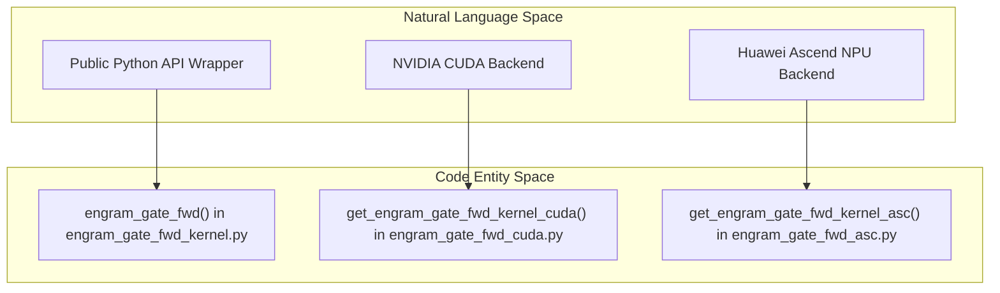
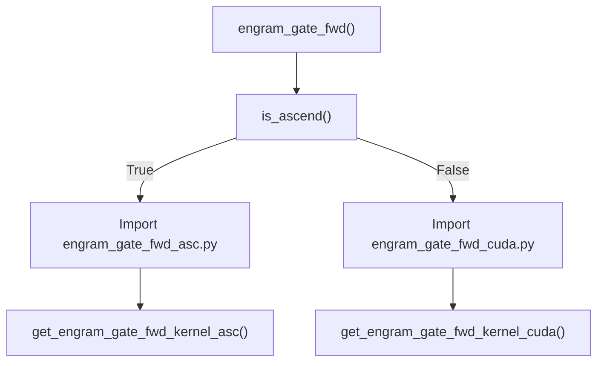
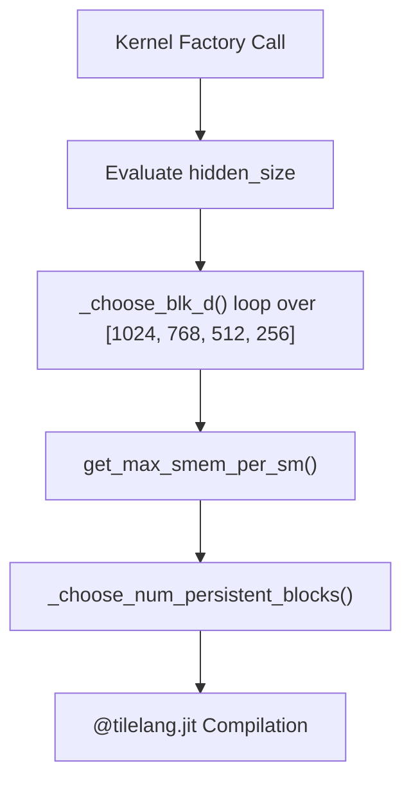

<!-- source: DeepWiki mcp.deepwiki.com · repo deepseek-ai/TileKernels · page 2.1 Dual-Backend Dispatch Pattern (_kernel / _cuda / _asc) · fetched 2026-10-30 -->

# Dual-Backend Dispatch Pattern (_kernel / _cuda / _asc)

<details>
<summary>Relevant source files</summary>

The following files were used as context for generating this wiki page:

- [tile_kernels/config.py](tile_kernels/config.py)
- [tile_kernels/engram/engram_gate_fwd_asc.py](tile_kernels/engram/engram_gate_fwd_asc.py)
- [tile_kernels/engram/engram_gate_fwd_cuda.py](tile_kernels/engram/engram_gate_fwd_cuda.py)
- [tile_kernels/engram/engram_gate_fwd_kernel.py](tile_kernels/engram/engram_gate_fwd_kernel.py)

</details>


## Purpose and Scope
This page details the core dual-backend dispatch architecture used across the TileKernels codebase. TileKernels implements a rigid three-file convention (`*_kernel.py`, `*_cuda.py`, and `*_asc.py`) for every compute kernel to cleanly separate public API validation from hardware-specific JIT compilation and execution logic for NVIDIA CUDA (SM90/SM100) and Ascend NPU architectures.

---

## 1. The Three-File Convention & Public Wrapper (`*_kernel.py`)

Every kernel subsystem adheres to a strict modular split:
- **`*_kernel.py`**: The public-facing Python module containing tensor shape/dtype validation, intermediate tensor allocations, and the high-level dispatcher function.
- **`*_cuda.py`**: The NVIDIA CUDA implementation utilizing TileLang primitives, asynchronous copies (`T.async_copy`), and thread/block bindings.
- **`*_asc.py`**: The Huawei Ascend NPU implementation targeting vector/cube core layouts with SIMD intrinsics (`T.SimdVF`, `S.vld`, etc.).

For example, in the Engram gate subsystem, `engram_gate` is exposed via `tile_kernels/engram/engram_gate_fwd_kernel.py` [tile_kernels/engram/engram_gate_fwd_kernel.py:7-16](). It validates incoming tensor shapes (`hidden_states`, `kv`, `weight_fused`), computes scalar factors, handles `inplace` vs out-of-place buffer allocation, and triggers the appropriate backend factory.



**Sources:**
- `tile_kernels/engram/engram_gate_fwd_kernel.py:1-86`
- `tile_kernels/config.py:24-32`

---

## 2. Backend Selection and Factory Delegation (`is_ascend()`)

At runtime, the dispatcher checks the hardware target via `is_ascend()` defined in `tile_kernels/config.py` [tile_kernels/config.py:24-27](). The `is_ascend()` function checks for the existence of `/dev/davinci_manager` with an `@functools.lru_cache(maxsize=1)` decorator to ensure fast, memoized hardware detection.

Depending on the result, the wrapper imports and executes either the CUDA kernel factory or the Ascend kernel factory:

```python
if is_ascend():
    from tile_kernels.engram.engram_gate_fwd_asc import get_engram_gate_fwd_kernel_asc
    kernel = get_engram_gate_fwd_kernel_asc(...)
else:
    kernel = get_engram_gate_fwd_kernel_cuda(...)
```



**Sources:**
- `tile_kernels/config.py:24-32`
- `tile_kernels/engram/engram_gate_fwd_kernel.py:35-61`

---

## 3. Tiling-Parameter Selection Loops & Dynamic Configurations

Before compiling or invoking kernels, dispatchers and factory functions execute heuristic loops to select optimal tiling parameters based on hardware properties (such as SM counts or shared memory limits).

In `get_engram_gate_fwd_kernel_cuda`, two helper functions dynamically select block sizes (`blk_d`) and persistent block counts based on `hidden_size` and device shared memory limits [tile_kernels/engram/engram_gate_fwd_cuda.py:32-46]():

- `_choose_blk_d(hidden_size)`: Iterates through candidate block dimensions `[1024, 768, 512, 256]` to find the largest factor compatible with the hidden dimension.
- `_choose_num_persistent_blocks(...)`: Computes block occupancy per SM using `get_max_smem_per_sm()` [tile_kernels/config.py:74-78]() and caps it against register pressure limits.



**Sources:**
- `tile_kernels/config.py:74-78`
- `tile_kernels/engram/engram_gate_fwd_cuda.py:32-46`

---

## 4. JIT Compilation, Caching (`@tilelang.jit`), and Execution

Compiled kernel factories are decorated with `@tilelang.jit`, which leverages Python's `functools.lru_cache` mechanism under the hood to cache generated binary artifacts for specific shape configurations and parameter sets. 

For CUDA kernels, pass configurations can be explicitly customized within the decorator (e.g., disabling warp specialization or thread storage sync) [tile_kernels/engram/engram_gate_fwd_cuda.py:7-12]():

```python
@tilelang.jit(
    pass_configs={
        tilelang.PassConfigKey.TL_DISABLE_WARP_SPECIALIZED: True,
        tilelang.PassConfigKey.TL_DISABLE_THREAD_STORAGE_SYNC: True,
    },
)
```

Once the compiled `kernel` callable is returned to the public wrapper, it is invoked with the validated PyTorch tensors [tile_kernels/engram/engram_gate_fwd_kernel.py:72-83]():

```python
if num_tokens > 0:
    kernel(
        hidden_states,
        kv,
        weight_fused,
        image_token_mask,
        None if inplace else output,
        dot,
        gate_score,
        rstd_x,
        rstd_k,
    )
```

**Sources:**
- `tile_kernels/engram/engram_gate_fwd_cuda.py:7-24`
- `tile_kernels/engram/engram_gate_fwd_kernel.py:72-85`

---

