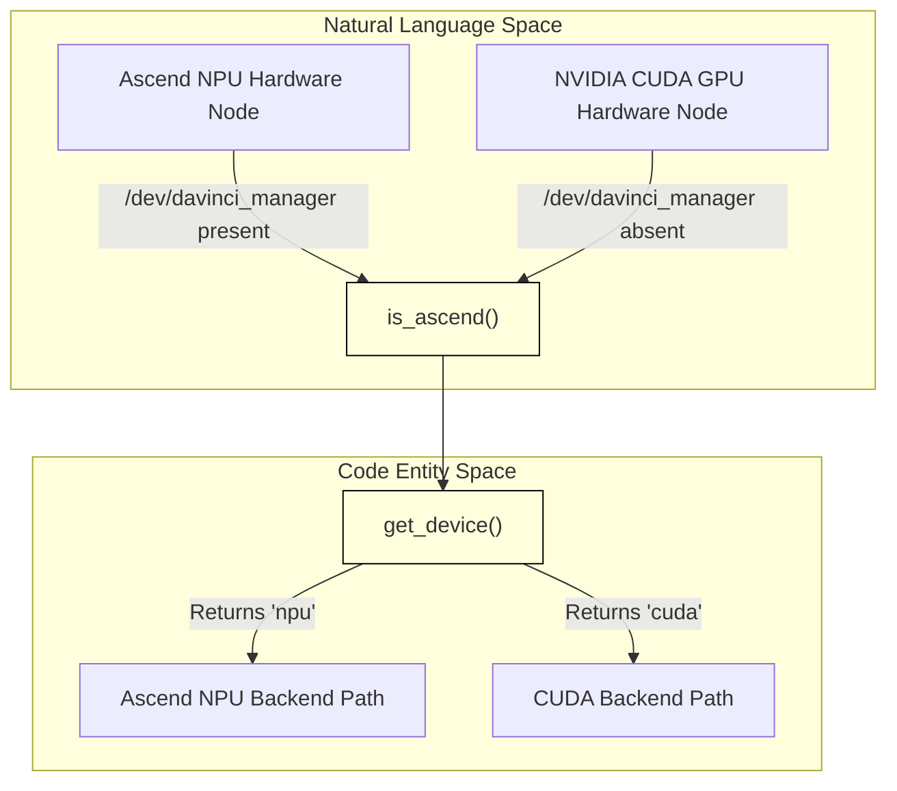
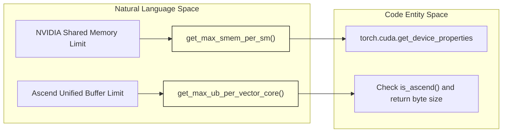

<!-- source: DeepWiki mcp.deepwiki.com · repo deepseek-ai/TileKernels · page 2.2 Device Configuration and Runtime Settings · fetched 2026-10-30 -->

# Device Configuration and Runtime Settings

Relevant source files

The following files were used as context for generating this wiki page:

- [tile_kernels/config.py](tile_kernels/config.py)

## Purpose and Scope
This page documents the global configuration and runtime settings module located at `tile_kernels/config.py`. This subsystem manages hardware abstraction across dual backends (CUDA and Ascend NPU), provides SM and core count accessors, defines shared-memory and Unified Buffer (UB) constraints, configures token alignment, persistent data loading (PDL), deterministic execution modes, quantization clamping thresholds, and supports test-time state resets via `reset_runtime_config()`.

---

## 1. Device Detection and Backend Selection

The configuration module determines whether the current execution runtime targets an NVIDIA CUDA GPU or an Ascend NPU. This detection occurs through physical device file inspection and is cached using `functools.lru_cache` to eliminate repeated filesystem or driver query overhead [tile_kernels/config.py:24-32]().

- **`is_ascend() -> bool`**: Checks for the existence of the Ascend driver device file `/dev/davinci_manager` [tile_kernels/config.py:24-27]().
- **`get_device() -> str`**: Returns `'npu'` if `is_ascend()` evaluates to `True`, otherwise returns `'cuda'` [tile_kernels/config.py:29-32]().

**Sources:** [tile_kernels/config.py:24-32]()

---

## 2. Core and SM Count Accessors

Kernel scheduling, thread block grid dimensions, and resource allocations depend heavily on hardware core counts. The module provides unified accessors that abstract backend differences between NVIDIA Multiprocessors (SMs) and Ascend NPU Core topologies [tile_kernels/config.py:39-72]().

- **`get_device_num_sms() -> int`**: Queries device properties via `torch.npu` (fetching `cube_core_num`) when running on Ascend, or `torch.cuda` (fetching `multi_processor_count`) on NVIDIA hardware [tile_kernels/config.py:39-47]().
- **`set_num_sms(num_sms: int)`**: Manually overrides the active SM or core count used by the library, validating that `0 < num_sms <= get_device_num_sms()` [tile_kernels/config.py:49-53]().
- **`get_num_sms() -> int`**: Returns the overridden `_num_sms` if explicitly configured, otherwise falls back to `get_device_num_sms()` [tile_kernels/config.py:55-60]().
- **Core Aliases**: 
  - `get_num_ai_cores = get_num_sms` [tile_kernels/config.py:66-66]()
  - `get_num_cube_cores = get_num_sms` [tile_kernels/config.py:67-67]()
- **`get_num_vec_cores() -> int`**: Returns double the active SM count (`get_num_sms() * 2`), reflecting the vector-to-cube core ratio on Ascend architectures [tile_kernels/config.py:70-71]().

**Sources:** [tile_kernels/config.py:39-72]()

---

## 3. Shared Memory and Unified Buffer Limits

Memory allocation bounds within TileLang kernels (`T.alloc_shared`, buffer sizes) are bound by hardware capacities retrieved through configuration accessors [tile_kernels/config.py:74-84]().

- **`get_max_smem_per_sm() -> int`**: Retrieves `shared_memory_per_multiprocessor` from the current CUDA device properties [tile_kernels/config.py:74-78]().
- **`get_max_ub_per_vector_core(use_simt: bool = True) -> int`**: Asserts that `is_ascend()` is active and returns the Unified Buffer (UB) limit per vector core (`216 * 1024` bytes when `use_simt=True`, otherwise `248 * 1024` bytes) [tile_kernels/config.py:80-84]().

**Sources:** [tile_kernels/config.py:74-84]()

---

## 4. Runtime Feature Flags and Quantization Settings

The module maintains global runtime variables controlling padding alignments, execution determinism, data loading optimizations, and quantization clamp-min boundaries [tile_kernels/config.py:6-21](), [tile_kernels/config.py:86-134]().

### Token Alignment and PDL
- **Token Alignment**: Managed via `set_token_alignment(token_alignment: int)` and `get_token_alignment()` (default: `128`) [tile_kernels/config.py:86-93]().
- **Persistent Data Loading (PDL)**: Controlled via `set_pdl(use_pdl: bool)` and `get_pdl()` (default: `False`) [tile_kernels/config.py:105-112]().

### Deterministic Execution
- **Deterministic Mode**: Configured via `use_deterministic_algorithms(enabled: bool)` and `get_deterministic_algorithms()` (default: `False`) [tile_kernels/config.py:115-122]().

### Quantization Clamp-Min Values
Quantization formats (`e4m3`, `e2m1`) rely on minimum clamping thresholds to prevent underflow during scaling factor computations.
- **Default Registry (`_DEFAULT_CLAMP_MIN_VALUES`)**:
  - `('e4m3', False)`: `1e-4` [tile_kernels/config.py:11-11]()
  - `('e4m3', True)`: `float(T.max_value(T.float8_e4m3fn)) * (2**-9)` [tile_kernels/config.py:12-12]()
  - `('e2m1', False)`: `float(T.max_value(T.float4_e2m1fn) * (2**-126))` [tile_kernels/config.py:13-13]()
  - `('e2m1', True)`: `float(T.max_value(T.float4_e2m1fn)) * (2**-9)` [tile_kernels/config.py:14-14]()
- **Accessors**: `set_amax_clamp_for_quant(fmt: str, use_e4m3_sf: bool, clamp_min_value: float)` and `get_amax_clamp_for_quant(fmt: str, use_e4m3_sf: bool)` [tile_kernels/config.py:125-134](). `_validate_quant_fmt(fmt)` ensures only valid formats (`e4m3`, `e2m1`) are accepted [tile_kernels/config.py:34-37]().

**Sources:** [tile_kernels/config.py:6-21](), [tile_kernels/config.py:34-37](), [tile_kernels/config.py:86-134]()

---

## 5. Runtime State Resetting

To support test isolation and clean test suite teardowns, all global configuration variables can be restored to their factory defaults via `reset_runtime_config()` [tile_kernels/config.py:96-103]().

- **`reset_runtime_config()`**: Resets `_num_sms`, `_use_pdl`, `_deterministic_algorithms`, `_token_alignment`, and a copy of `_DEFAULT_CLAMP_MIN_VALUES` back to their initial default states [tile_kernels/config.py:96-103]().

**Sources:** [tile_kernels/config.py:96-103]()

---

