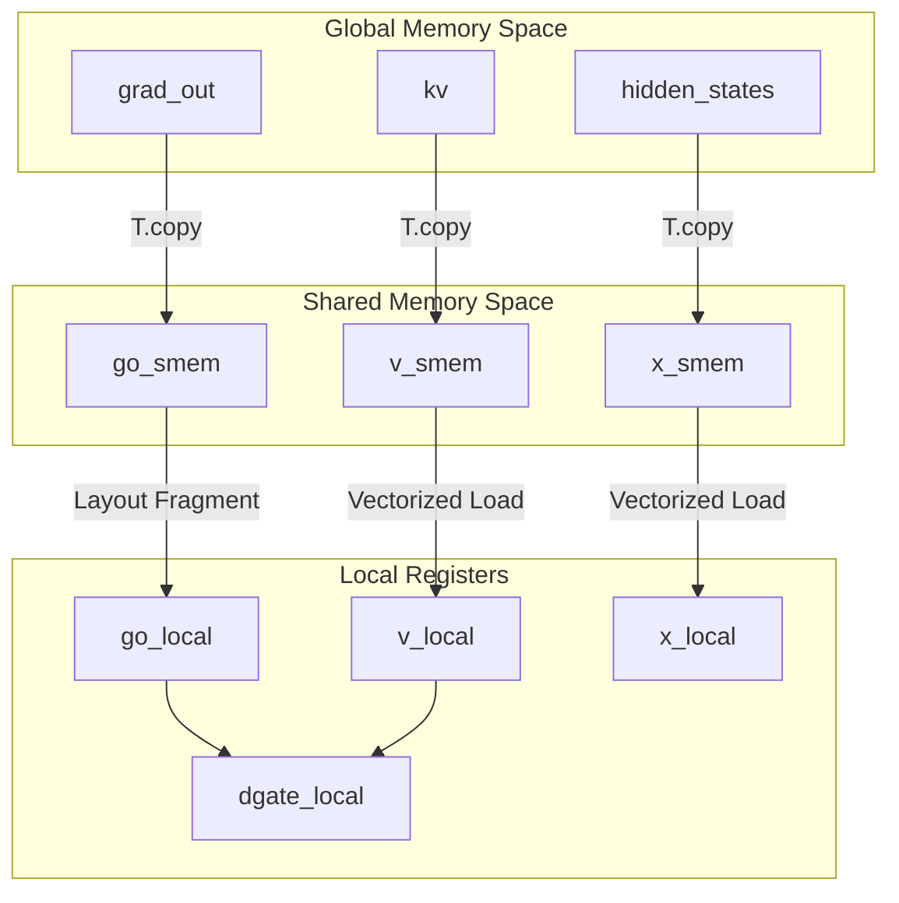
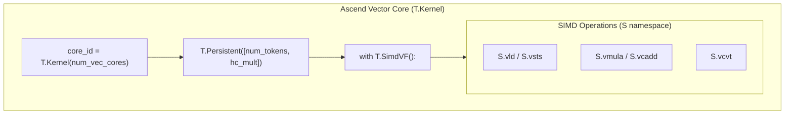

<!-- source: DeepWiki mcp.deepwiki.com · repo deepseek-ai/TileKernels · page 2.3 Kernel Authoring Patterns · fetched 2026-10-30 -->

# Kernel Authoring Patterns

Relevant source files

The following files were used as context for generating this wiki page:

- [tile_kernels/engram/engram_gate_bwd_asc.py](tile_kernels/engram/engram_gate_bwd_asc.py)
- [tile_kernels/engram/engram_gate_bwd_cuda.py](tile_kernels/engram/engram_gate_bwd_cuda.py)
- [tile_kernels/mhc/pre_big_fuse_cuda.py](tile_kernels/mhc/pre_big_fuse_cuda.py)
- [tile_kernels/mhc/sinkhorn_cuda.py](tile_kernels/mhc/sinkhorn_cuda.py)

This page provides a comprehensive deep dive into the recurring architectural patterns, compilation configurations, and memory idioms used to implement high-performance kernels across CUDA (SM90/SM100) and Ascend NPU backends within the `TileKernels` library.

---

## 1. Kernel Definition and JIT Compilation

All kernels in `TileKernels` are defined using the `@tilelang.jit` decorator combined with the `T.prim_func` abstraction. This structure enables dynamic kernel generation based on runtime parameters such as `hidden_size`, `hc_mult`, and `num_vec_cores`.

### Pass Configuration
The `@tilelang.jit` decorator accepts a `pass_configs` dictionary to fine-tune the TileLang compiler pipeline. Common optimization keys include:
*   `TL_DISABLE_WARP_SPECIALIZED`: Disables automatic warp specialization, allowing manual thread and warp management [tile_kernels/engram/engram_gate_bwd_cuda.py:11-11](), [tile_kernels/mhc/pre_big_fuse_cuda.py:5-5]().
*   `TL_DISABLE_THREAD_STORAGE_SYNC`: Prevents automatic compiler-inserted sync barriers, giving the author explicit control over memory consistency [tile_kernels/engram/engram_gate_bwd_cuda.py:12-12]().
*   `TL_PTXAS_REGISTER_USAGE_LEVEL`: Controls register allocation strictness in `ptxas` [tile_kernels/mhc/pre_big_fuse_cuda.py:6-6]().
*   `TL_DISABLE_VECTORIZE_256`: Disables 256-bit vectorization passes when custom layouts are preferred [tile_kernels/mhc/pre_big_fuse_cuda.py:7-7]().

### Launch Grids and Persistent Scheduling
Kernels frequently employ persistent grid designs via `T.Kernel`, where a fixed block count loops over the global workload (such as tokens or channels) to maximize cache reuse and amortize launch overhead [tile_kernels/engram/engram_gate_bwd_cuda.py:116-116](), [tile_kernels/mhc/sinkhorn_cuda.py:24-24](). Dynamic dimensions like token counts are declared using `T.dynamic('num_tokens')` [tile_kernels/engram/engram_gate_bwd_cuda.py:31-31](), [tile_kernels/mhc/pre_big_fuse_cuda.py:30-30]().

Sources: [tile_kernels/engram/engram_gate_bwd_cuda.py:9-24](), [tile_kernels/mhc/pre_big_fuse_cuda.py:4-29](), [tile_kernels/mhc/sinkhorn_cuda.py:9-17]()

---

## 2. Memory Hierarchy Management

`TileKernels` explicitly manages device memory hierarchies—Global Memory (GMEM), Shared Memory (SMEM), and Registers (Local)—using TileLang allocation primitives and custom layouts.

### Allocation Primitives
*   `T.alloc_shared`: Allocates shared memory buffers accessible by all threads within a CTA block [tile_kernels/engram/engram_gate_bwd_cuda.py:150-155](), [tile_kernels/mhc/sinkhorn_cuda.py:91-92]().
*   `T.alloc_local`: Allocates thread-private registers for accumulators and vector elements [tile_kernels/engram/engram_gate_bwd_cuda.py:125-136]().
*   `T.alloc_fragment`: Allocates fragment layouts optimized for tensor core math or parallel block reductions [tile_kernels/mhc/pre_big_fuse_cuda.py:51-52](), [tile_kernels/mhc/sinkhorn_cuda.py:27-29]().

### Data Flow and Memory Layouts
In CUDA implementations, custom fragments and layouts map logical tensor indices to physical thread lanes using layout functions [tile_kernels/engram/engram_gate_bwd_cuda.py:146-148]().

*Figure 1: Memory hierarchy data flow from Global Memory through Shared Memory into Local Registers during backward passes.*

Sources: [tile_kernels/engram/engram_gate_bwd_cuda.py:125-155](), [tile_kernels/mhc/pre_big_fuse_cuda.py:49-63](), [tile_kernels/mhc/sinkhorn_cuda.py:27-31]()

---

## 3. Pipelining, Async Copies, and Synchronization

To hide memory latency, kernels use pipelined loops and asynchronous transfers.

*   `T.Pipelined`: Overlaps global memory data movement with arithmetic computation by staging multiple iterations in shared memory [tile_kernels/mhc/pre_big_fuse_cuda.py:120-120]().
*   Cache Control: Transfers can specify L2 cache control flags such as `l2_cache_ctrl='NOTALLOC_KEEP'` to manage cache eviction policies [tile_kernels/engram/engram_gate_bwd_asc.py:101-102]().
*   Program Dependent Launch (PDL): Optional synchronization barriers (`T.pdl_sync()` and `T.pdl_trigger()`) coordinate dependent kernel execution phases [tile_kernels/engram/engram_gate_bwd_cuda.py:117-118](), [tile_kernels/mhc/pre_big_fuse_cuda.py:45-46]().

Sources: [tile_kernels/engram/engram_gate_bwd_asc.py:101-107](), [tile_kernels/engram/engram_gate_bwd_cuda.py:117-118](), [tile_kernels/mhc/pre_big_fuse_cuda.py:45-46](), [tile_kernels/mhc/pre_big_fuse_cuda.py:120-124]()

---

## 4. Reductions and Loop Optimizations

Efficient loop structuring and reduction primitives prevent bottlenecking in normalization and mixing layers.

*   `T.Parallel`: Distributes work across parallel threads or fragment dimensions [tile_kernels/mhc/pre_big_fuse_cuda.py:58-62](), [tile_kernels/mhc/sinkhorn_cuda.py:35-36]().
*   `T.reduce_max` / `T.reduce_sum`: Performs hardware-accelerated reductions across specified tensor dimensions during Sinkhorn normalization and softmax calculations [tile_kernels/mhc/pre_big_fuse_cuda.py:81-89](), [tile_kernels/mhc/sinkhorn_cuda.py:34-41]().
*   `T.unroll`: Forces compiler loop unrolling for small inner loops (e.g., Sinkhorn iteration steps), eliminating branch overhead [tile_kernels/mhc/sinkhorn_cuda.py:111-123]().

Sources: [tile_kernels/mhc/pre_big_fuse_cuda.py:58-92](), [tile_kernels/mhc/sinkhorn_cuda.py:34-53](), [tile_kernels/mhc/sinkhorn_cuda.py:111-123]()

---

## 5. Ascend-Specific Vector-Core Patterns

Ascend NPU kernels target vector cores using TileLang's Ascend language extension (`tilelang.ascend`), which employs SIMD instruction wrappers and specialized vector buffers.

*Figure 2: Execution and control flow structure of Ascend NPU vector-core kernels.*

### Ascend Idioms and Intrinsics
*   **Vector Core Launch**: Kernels are launched across vector cores using `with T.Kernel(num_vec_cores) as core_id:` [tile_kernels/engram/engram_gate_bwd_asc.py:47-47]().
*   **Persistent Task Scheduling**: Workloads are distributed across cores using `T.Persistent` with configurable stages [tile_kernels/engram/engram_gate_bwd_asc.py:72-78]().
*   **SIMD Blocks**: Vector instructions are encapsulated within `with T.SimdVF():` blocks [tile_kernels/engram/engram_gate_bwd_asc.py:69-70]() and operate via the `S` namespace (`S.vdup`, `S.vld`, `S.vsts`, `S.vmula`, `S.vcadd`, `S.vcvt`) [tile_kernels/engram/engram_gate_bwd_asc.py:83-121]().
*   **Buffer Versioning**: `T.annotate_buffer_versions` tracks shared memory buffer state across pipeline stages [tile_kernels/engram/engram_gate_bwd_asc.py:58-67]().

Sources: [tile_kernels/engram/engram_gate_bwd_asc.py:47-121]()

---

