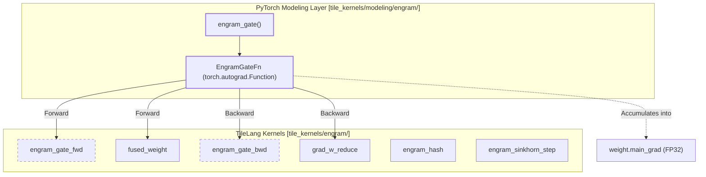
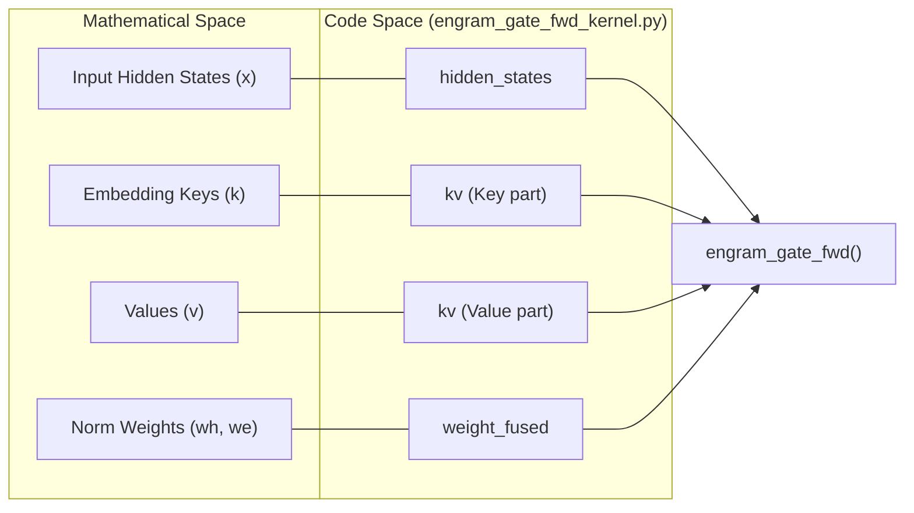

<!-- source: DeepWiki mcp.deepwiki.com · repo deepseek-ai/TileKernels · page 3 Engram Module · fetched 2026-10-30 -->

# Engram Module

Relevant source files

The following files were used as context for generating this wiki page:

- [tile_kernels/engram/__init__.py](tile_kernels/engram/__init__.py)
- [tile_kernels/engram/engram_gate_fwd_kernel.py](tile_kernels/engram/engram_gate_fwd_kernel.py)

The Engram module provides a high-performance implementation of the Engram gating mechanism. This subsystem is designed to perform a fused gating operation that combines RMSNorm, a dot-product interaction, and a non-linear activation (signed-square-root sigmoid) to modulate hidden states.

The module is split into child pages covering specific low-level kernels and PyTorch modeling integrations:
- **[Engram Gate Forward and Backward Kernels (#3.1)]** — Reference for `engram_gate_fwd` and `engram_gate_bwd`.
- **[Engram Weight, Hash and Sinkhorn Kernels (#3.2)]** — Covers `fused_weight`, `grad_w_reduce`, `engram_hash`, and Sinkhorn normalization.
- **[EngramGateFn: Autograd Integration (#3.3)]** — Documents `tile_kernels/modeling/engram/engram_gate.py` and the `EngramGateFn` wrapper.

### Mathematical Definition
The Engram Gate computes the following interaction:

$$ \text{gate} = \sigma\left(\text{signed\_sqrt}\left(\frac{\text{RMSNorm}(x, w_h) \cdot \text{RMSNorm}(k, w_e)}{\sqrt{d}}\right)\right) $$
$$ \text{output} = x + \text{gate} \cdot v $$

Where:
*   $\sigma$ is the Sigmoid function.
*   $\text{signed\_sqrt}(a) = \text{sign}(a) \cdot \sqrt{|a|}$.
*   $d$ is the hidden dimension size.
*   $w_h$ and $w_e$ are learnable RMSNorm weights.

## Module Structure

The following diagram illustrates how the modeling layer interfaces with the low-level TileLang kernels.

**Engram System Architecture**

**Sources:** [tile_kernels/modeling/engram/engram_gate.py:6-95](), [tile_kernels/engram/__init__.py:1-11]()

## Exported Subsystems and Kernels

The Engram module exports several primary kernels for gating, weights, hashing, and Sinkhorn normalization to minimize global memory round-trips by fusing normalization and element-wise logic.

| Kernel / Function Name | Purpose | File Reference |
| :--- | :--- | :--- |
| `engram_gate_fwd` | Fused RMSNorm + Dot Product + Gating + Addition. | [tile_kernels/engram/__init__.py:3]() |
| `engram_gate_bwd` | Persistent backward kernel for gradients of $x, k, v$. | [tile_kernels/engram/__init__.py:2]() |
| `fused_weight` | Element-wise product of $w_h$ and $w_e$ used in the forward pass. | [tile_kernels/engram/__init__.py:1]() |
| `grad_w_reduce` | Reduces partial weight gradients into high-precision buffers. | [tile_kernels/engram/__init__.py:4]() |
| `engram_hash` | Utility for specialized Engram hashing operations. | [tile_kernels/engram/__init__.py:5]() |
| `engram_sinkhorn_step` | Sinkhorn normalization steps for dual-stochastic attention/weights. | [tile_kernels/engram/__init__.py:6-10]() |

For details, see [Engram Gate Forward and Backward Kernels (#3.1)] and [Engram Weight, Hash and Sinkhorn Kernels (#3.2)].

## Autograd Integration

The `EngramGateFn` class bridges the optimized kernels with PyTorch's autograd engine. It handles complex tensor reshaping for multi-head configurations and implements a custom gradient accumulation pattern.

### Key Features:
*   **Shape Management**: Handles inputs of shape `[*, hc_mult, hidden_size]` and ensures the output matches the input dimensionality.
*   **Gradient Accumulation**: The backward pass checks for the existence of a `.main_grad` attribute on weight tensors, accumulating gradients in-place in FP32.
*   **Memory Efficiency**: Saves intermediate values like `rstd_x` (inverse standard deviation) and `gate_score` during the forward pass.

For details on the autograd lifecycle and the `main_grad` pattern, see **[EngramGateFn: Autograd Integration (#3.3)]**.

**Sources:** [tile_kernels/modeling/engram/engram_gate.py:6-95]()

## Data Flow Mapping

The following diagram maps the logical variables used in the mathematical definition to the specific tensor names used in the code implementation.

**Natural Language to Code Entity Mapping**

**Sources:** [tile_kernels/engram/engram_gate_fwd_kernel.py:7-32]()

---

