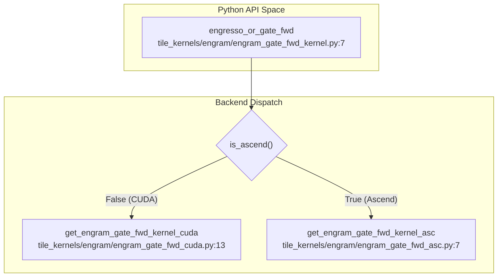
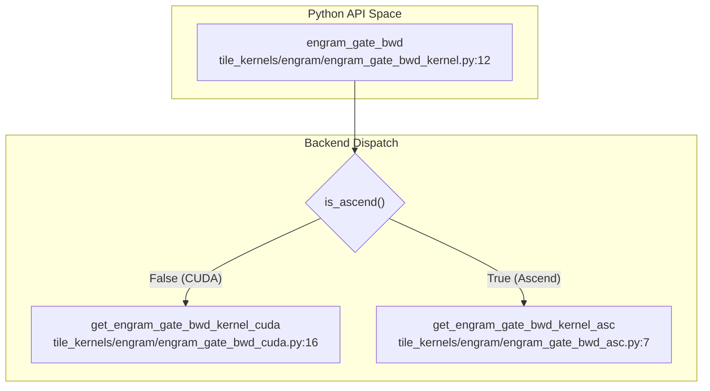

<!-- source: DeepWiki mcp.deepwiki.com · repo deepseek-ai/TileKernels · page 3.1 Engram Gate Forward and Backward Kernels · fetched 2026-10-30 -->

# Engram Gate Forward and Backward Kernels

Relevant source files

The following files were used as context for generating this wiki page:

- [tile_kernels/engram/engram_gate_bwd_asc.py](tile_kernels/engram/engram_gate_bwd_asc.py)
- [tile_kernels/engram/engram_gate_bwd_cuda.py](tile_kernels/engram/engram_gate_bwd_cuda.py)
- [tile_kernels/engram/engram_gate_bwd_kernel.py](tile_kernels/engram/engram_gate_bwd_kernel.py)
- [tile_kernels/engram/engram_gate_fwd_asc.py](tile_kernels/engram/engram_gate_fwd_asc.py)
- [tile_kernels/engram/engram_gate_fwd_cuda.py](tile_kernels/engram/engram_gate_fwd_cuda.py)
- [tile_kernels/engram/engram_gate_fwd_kernel.py](tile_kernels/engram/engram_gate_fwd_kernel.py)

## Purpose and Scope

This page details the implementation of the Engram gating forward (`engram_gate_fwd`) and backward (`engram_gate_bwd`) kernels within the `tile_kernels/engram/` module. The engram gating mechanism combines a fused RMSNorm over hidden states and keys, computes a dot-product based gating score with a signed-square-root sigmoid activation, and handles image-token masking and gradient backpropagation across both NVIDIA CUDA and Huawei Ascend NPU backends.

---

## Kernel Architecture and Dispatch

The Python-level wrappers `engram_gate_fwd` and `engram_gate_bwd` serve as entry points that inspect device capabilities via `is_ascend()` [tile_kernels/config.py]() and dispatch to either CUDA (`_cuda.py`) or Ascend (`_asc.py`) JIT-compiled TileLang kernels.

### Forward Dispatch and Entity Mapping

The diagram below maps the logical forward operations to their respective code entities across the Python wrapper and backend implementations.

Sources: [tile_kernels/engram/engram_gate_fwd_kernel.py:7-85](), [tile_kernels/engram/engram_gate_fwd_cuda.py:13-24](), [tile_kernels/engram/engram_gate_fwd_asc.py:7-17]()

### Backward Dispatch and Entity Mapping

The backward dispatch maps gradient tensors and saved intermediates to the respective CUDA and Ascend implementation functions.

Sources: [tile_kernels/engram/engram_gate_bwd_kernel.py:12-86](), [tile_kernels/engram/engram_gate_bwd_cuda.py:16-24](), [tile_kernels/engram/engram_gate_bwd_asc.py:7-14]()

---

## Engram Gate Forward (`engram_gate_fwd`)

The forward pass computes the RMSNorm of hidden states (`hidden_states`), computes similarity with keys (`kv`), applies a signed-square-root sigmoid gate, and optionally saves intermediate tensors (`dot`, `gate_score`, `rstd_x`, `rstd_k`) required for the backward pass.

### Key Features and Data Flow
- **Fused RMSNorm and Dot Product**: Combines normalization variance calculation with weight scaling and dot product against key embeddings [tile_kernels/engram/engram_gate_fwd_cuda.py:123-127](), [tile_kernels/engram/engram_gate_fwd_asc.py:148-151]().
- **Image Token Masking**: When `image_token_mask` is provided, tokens flagged as `True` bypass gating/normalization computations and copy hidden states directly to the output [tile_kernels/engram/engram_gate_fwd_cuda.py:97-104](), [tile_kernels/engram/engram_gate_fwd_asc.py:84-102]().
- **Inplace Operation**: Supports `inplace=True` where `hidden_states` are modified directly, provided `save_for_backward` is disabled [tile_kernels/engram/engram_gate_fwd_kernel.py:15-16](), [tile_kernels/engram/engram_gate_fwd_cuda.py:26]()].

### CUDA vs. Ascend Implementations
- **CUDA (`_cuda.py`)**: Uses a 32-thread persistent kernel (`get_engram_gate_fwd_kernel_cuda`) with `cp.async` pipelining over blocks (`blk_d`) and local vector registers (`vec_size = 8`) [tile_kernels/engram/engram_gate_fwd_cuda.py:28-41]().
- **Ascend (`_asc.py`)**: Leverages `num_vec_cores` with head-group parallelism (`heads_per_task = 2`), utilizing SIMD vector intrinsics (`S.vld`, `S.vmula`, `S.vcadd`) to execute reductions on the NPU vector core [tile_kernels/engram/engram_gate_fwd_asc.py:18-47]().

Sources: [tile_kernels/engram/engram_gate_fwd_kernel.py:7-85](), [tile_kernels/engram/engram_gate_fwd_cuda.py:13-199](), [tile_kernels/engram/engram_gate_fwd_asc.py:7-253]()

---

## Engram Gate Backward (`engram_gate_bwd`)

The backward pass computes gradients with respect to hidden states (`grad_hidden_states`), key/value embeddings (`grad_kv`), and partial weight gradients (`grad_w_partial`).

### Saved Intermediates Consumption
The backward kernel consumes the saved tensors produced during the forward pass:
- `dot`: Raw dot products [tile_kernels/engram/engram_gate_bwd_kernel.py:31]()
- `gate_score`: Saved gate activation scores [tile_kernels/engram/engram_gate_bwd_kernel.py:32]()
- `rstd_x`: Reciprocal standard deviation of input hidden states [tile_kernels/engram/engram_gate_bwd_kernel.py:33]()
- `rstd_k`: Reciprocal standard deviation of keys [tile_kernels/engram/engram_gate_bwd_kernel.py:34]()

### Implementation Characteristics
- **Persistent Block Scheduling**: Both backends utilize persistent scheduling across streaming multiprocessors (CUDA) or vector cores (Ascend) to optimize cache locality and reduce launch overhead [tile_kernels/engram/engram_gate_bwd_cuda.py:116](), [tile_kernels/engram/engram_gate_bwd_asc.py:47]().
- **Partial Weight Gradient Accumulation**: `grad_w_partial` outputs partial reductions across persistent blocks or vector core partitions, which are subsequently reduced in downstream operations [tile_kernels/engram/engram_gate_bwd_kernel.py:39-40](), [tile_kernels/engram/engram_gate_bwd_cuda.py:114](), [tile_kernels/engram/engram_gate_bwd_asc.py:45]().

Sources: [tile_kernels/engram/engram_gate_bwd_kernel.py:12-86](), [tile_kernels/engram/engram_gate_bwd_cuda.py:16-340](), [tile_kernels/engram/engram_gate_bwd_asc.py:7-201]()

---

