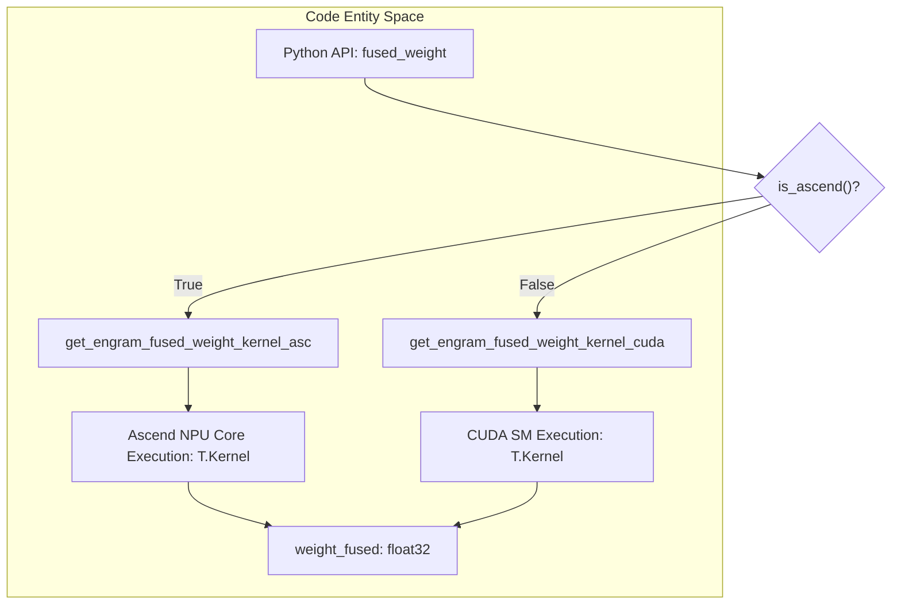
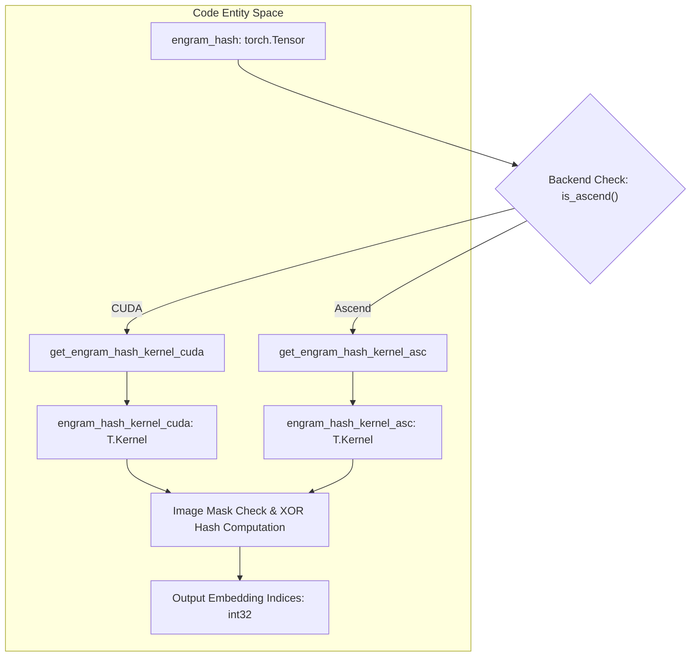

<!-- source: DeepWiki mcp.deepwiki.com · repo deepseek-ai/TileKernels · page 3.2 Engram Weight, Hash and Sinkhorn Kernels · fetched 2026-10-30 -->

# Engram Weight, Hash and Sinkhorn Kernels

Relevant source files

The following files were used as context for generating this wiki page:

- [tile_kernels/engram/engram_fused_weight_asc.py](tile_kernels/engram/engram_fused_weight_asc.py)
- [tile_kernels/engram/engram_fused_weight_cuda.py](tile_kernels/engram/engram_fused_weight_cuda.py)
- [tile_kernels/engram/engram_fused_weight_kernel.py](tile_kernels/engram/engram_fused_weight_kernel.py)
- [tile_kernels/engram/engram_grad_w_reduce_asc.py](tile_kernels/engram/engram_grad_w_reduce_asc.py)
- [tile_kernels/engram/engram_grad_w_reduce_cuda.py](tile_kernels/engram/engram_grad_w_reduce_cuda.py)
- [tile_kernels/engram/engram_grad_w_reduce_kernel.py](tile_kernels/engram/engram_grad_w_reduce_kernel.py)
- [tile_kernels/engram/engram_hash_asc.py](tile_kernels/engram/engram_hash_asc.py)
- [tile_kernels/engram/engram_hash_cuda.py](tile_kernels/engram/engram_hash_cuda.py)
- [tile_kernels/engram/engram_hash_kernel.py](tile_kernels/engram/engram_hash_kernel.py)
- [tile_kernels/engram/engram_sinkhorn_asc.py](tile_kernels/engram/engram_sinkhorn_asc.py)
- [tile_kernels/engram/engram_sinkhorn_cuda.py](tile_kernels/engram/engram_sinkhorn_cuda.py)
- [tile_kernels/engram/engram_sinkhorn_kernel.py](tile_kernels/engram/engram_sinkhorn_kernel.py)

This page covers the core helper and normalization kernels within the Engram subsystem of TileKernels: `fused_weight` (element-wise weight product), `grad_w_reduce` (partial weight-gradient reduction), `engram_hash` ($n$-gram token hash index generation), and the engram-specific Sinkhorn doubly-stochastic normalization suite (`engram_sinkhorn_momentum_update`, `engram_sinkhorn_step`, `engram_sinkhorn_step_reduce`, and `engram_sinkhorn_finalize`). Each kernel is implemented across both CUDA (SM90) and Ascend NPU backends using the dual-backend dispatch convention.

---

## 1. Fused Weight Kernel (`fused_weight`)

The `fused_weight` operation computes the element-wise product of two RMSNorm weight tensors, `weight_hidden` and `weight_embed`, promoting the `bfloat16` operands to `float32` precision [tile_kernels/engram/engram_fused_weight_kernel.py:7-37]().

### Implementation Details
* **CUDA Backend**: Defined in `[tile_kernels/engram/engram_fused_weight_cuda.py:10-42]()` via `get_engram_fused_weight_kernel_cuda()`. It uses a 1D block layout over `hc_mult` and the number of hidden blocks `num_blk`, loading `bfloat16` chunks into local fragments, converting them to float, multiplying, and storing to a `float32` output tensor.
* **Ascend Backend**: Defined in `[tile_kernels/engram/engram_fused_weight_asc.py:7-57]()` via `get_engram_fused_weight_kernel_asc()`. It processes chunks using vector instructions (`S.vcvt`, `S.vld`, `S.vmul`, `S.vsts`) inside a persistent `T.Kernel` loop over `num_vec_cores` with multi-stage software pipelining.

*Title: Natural Language to Code Entity Space: Fused Weight Dispatch & Execution*  
Sources: `[tile_kernels/engram/engram_fused_weight_kernel.py:7-37]()`, `[tile_kernels/engram/engram_fused_weight_cuda.py:10-42]()`, `[tile_kernels/engram/engram_fused_weight_asc.py:7-57]()`

---

## 2. Gradient Weight Reduction Kernel (`grad_w_reduce`)

The `grad_w_reduce` kernel aggregates partial weight gradients (`grad_w_partial`) computed across persistent blocks, fuses them with weight multiplication, and accumulates the results into `grad_weight_hidden` and `grad_weight_embed` [tile_kernels/engram/engram_grad_w_reduce_kernel.py:9-46]().

### Implementation Details
* **CUDA Backend**: Implemented in `[tile_kernels/engram/engram_grad_w_reduce_cuda.py:13-67]()`. It loops over persistent block shards using `T.Pipelined`, sums partial gradient entries into fragment registers, multiplies by the opposing weight tensor, and updates gradient buffers.
* **Ascend Backend**: Implemented in `[tile_kernels/engram/engram_grad_w_reduce_asc.py:7-76]()`. It divides dimensions into shards per head, loads partial shared-memory tiles, executes vector summation via `S.vadd`, and calculates accumulated weight gradients using `S.vmula`.

Sources: `[tile_kernels/engram/engram_grad_w_reduce_kernel.py:9-46]`, `[tile_kernels/engram/engram_grad_w_reduce_cuda.py:13-67]`, `[tile_kernels/engram/engram_grad_w_reduce_asc.py:7-76]`

---

## 3. Engram Hash Kernel (`engram_hash`)

The `engram_hash` function computes $n$-gram hash embedding indices for input token IDs, supporting multi-layer hashing, table-specific vocabulary size constraints, offsets, and optional image token masking [tile_kernels/engram/engram_hash_kernel.py:7-56]().

### Algorithm Overview
1. For each token, if `image_token_mask` is active and `True`, output indices are set to `-1` [tile_kernels/engram/engram_hash_cuda.py:45-47](), [tile_kernels/engram/engram_hash_asc.py:66-69]().
2. Otherwise, bitwise XOR combinations of token IDs and layer multipliers are computed across $n$-gram sizes [tile_kernels/engram/engram_hash_cuda.py:54-59](), [tile_kernels/engram/engram_hash_asc.py:71-77]().
3. The resulting hash is modulated by `vocab_sizes` and shifted by `offsets` to produce table lookup indices [tile_kernels/engram/engram_hash_cuda.py:60-63](), [tile_kernels/engram/engram_hash_asc.py:78-84]().

*Title: Natural Language to Code Entity Space: Engram Hash Pipeline*  
Sources: `[tile_kernels/engram/engram_hash_kernel.py:7-56]`, `[tile_kernels/engram/engram_hash_cuda.py:10-69]`, `[tile_kernels/engram/engram_hash_asc.py:6-88]`

---

## 4. Engram Sinkhorn Kernels

The Engram Sinkhorn subsystem implements doubly-stochastic normalization for gradient matrices and embedding weights through a four-phase pipeline managed in `[tile_kernels/engram/engram_sinkhorn_kernel.py:13-178]()`.

### Phase 1: Momentum Update (`engram_sinkhorn_momentum_update`)
Updates momentum buffers in-place with decay factor `beta1`, optionally incorporating Nesterov lookahead, and outputs a `float32` tensor (`sinkhorn_input`) for normalization [tile_kernels/engram/engram_sinkhorn_kernel.py:13-65]().
* **CUDA**: `[tile_kernels/engram/engram_sinkhorn_cuda.py:19-59]()` (`get_engram_sinkhorn_momentum_kernel_cuda`).
* **Ascend**: `[tile_kernels/engram/engram_sinkhorn_asc.py:7-86]()` (`get_engram_sinkhorn_momentum_kernel_asc`).

### Phase 2: Normalization Step (`engram_sinkhorn_step`)
Iteratively normalizes matrix rows using `row_scale` and `col_scale`, calculates row norms, updates row scales with numerical stability epsilon $\epsilon$, and accumulates partial column squared sums [tile_kernels/engram/engram_sinkhorn_kernel.py:68-106]().
* **CUDA**: `[tile_kernels/engram/engram_sinkhorn_cuda.py:68-141]()` (`get_engram_sinkhorn_step_kernel_cuda`).
* **Ascend**: `[tile_kernels/engram/engram_sinkhorn_asc.py:88-157]()` (`get_engram_sinkhorn_step_kernel_asc`).

### Phase 3: Step Reduction (`engram_sinkhorn_step_reduce`)
Reduces per-CTA/core partial column squared sums (`col_sumsq_partial`) into a consolidated global `col_sumsq` buffer [tile_kernels/engram/engram_sinkhorn_kernel.py:109-137]().
* **CUDA**: `[tile_kernels/engram/engram_sinkhorn_cuda.py:150-183]()` (`get_engram_sinkhorn_step_reduce_kernel_cuda`).
* **Ascend**: Found in `[tile_kernels/engram/engram_sinkhorn_asc.py]` (via NPU vector accumulators).

### Phase 4: Finalization (`engram_sinkhorn_finalize`)
Materializes the final row-normalized Sinkhorn matrix by applying scales and scaling factor `alpha` [tile_kernels/engram/engram_sinkhorn_kernel.py:139-179]().
* **CUDA**: `[tile_kernels/engram/engram_sinkhorn_cuda.py]` (`get_engram_sinkhorn_finalize_kernel_cuda`).
* **Ascend**: `[tile_kernels/engram/engram_sinkhorn_asc.py]` (`get_engram_sinkhorn_finalize_kernel_asc`).

Sources: `[tile_kernels/engram/engram_sinkhorn_kernel.py:13-178]`, `[tile_kernels/engram/engram_sinkhorn_cuda.py:19-183]`, `[tile_kernels/engram/engram_sinkhorn_asc.py:7-157]`

---

