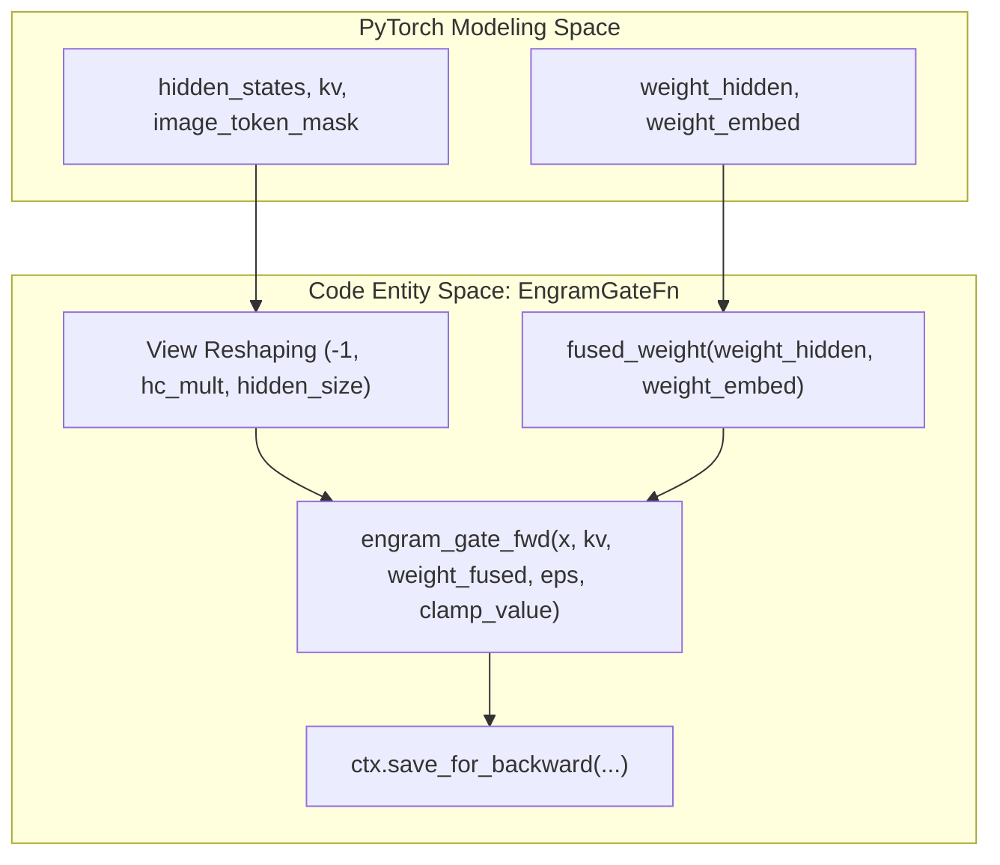
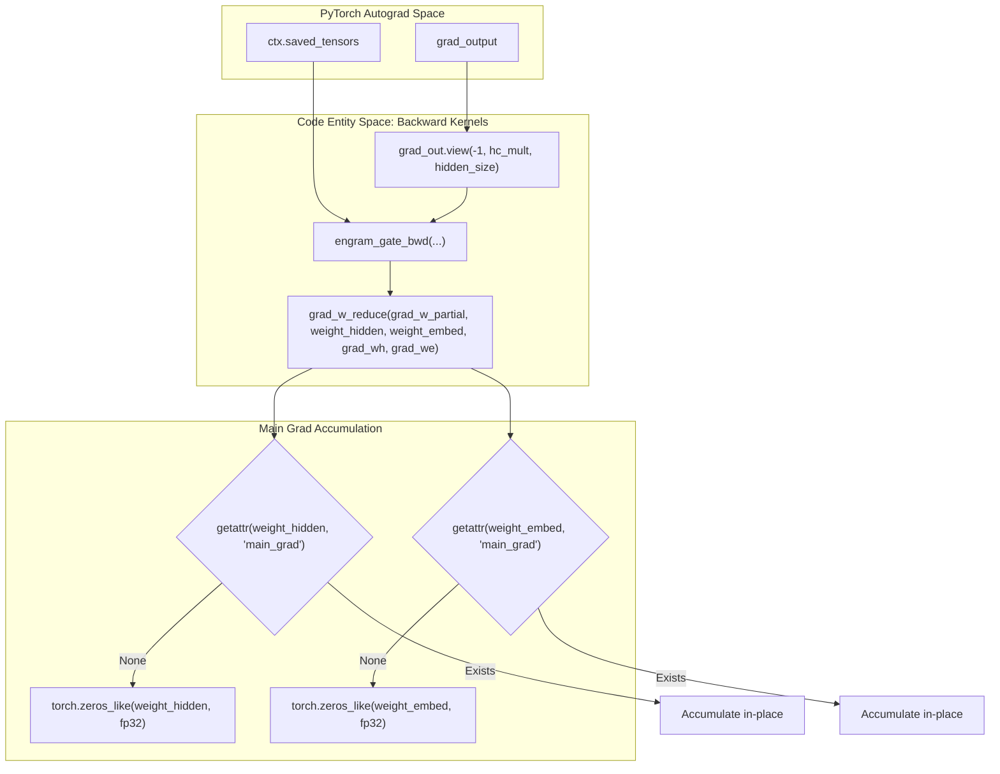

<!-- source: DeepWiki mcp.deepwiki.com · repo deepseek-ai/TileKernels · page 3.3 EngramGateFn: Autograd Integration · fetched 2026-10-30 -->

# EngramGateFn: Autograd Integration

<details>
<summary>Relevant source files</summary>

The following files were used as context for generating this wiki page:

- [tile_kernels/modeling/__init__.py](tile_kernels/modeling/__init__.py)
- [tile_kernels/modeling/engram/__init__.py](tile_kernels/modeling/engram/__init__.py)
- [tile_kernels/modeling/engram/engram_gate.py](tile_kernels/modeling/engram/engram_gate.py)

</details>


The `EngramGateFn` serves as the bridge between high-level PyTorch modeling and the optimized TileLang kernels for the Engram gating mechanism. Defined in `tile_kernels/modeling/engram/engram_gate.py`, it implements a `torch.autograd.Function` that manages the forward pass (fused RMSNorm and gating) and the backward pass (gradient computation and in-place `main_grad` accumulation).

### Purpose and Mathematical Formulation

`EngramGateFn` implements a gated residual connection with normalized inputs. Mathematically, it computes:

1.  **Normalization**: $x_{norm} = \text{RMSNorm}(x, w_h)$ and $k_{norm} = \text{RMSNorm}(k, w_e)$.
2.  **Gating**: $gate = \sigma(\text{signed\_sqrt}(\text{dot}(x_{norm}, k_{norm}) \cdot \text{scalar}))$.
3.  **Output**: $output = \text{hidden\_states} + gate \cdot v$.

Where $\text{signed\_sqrt}(z) = \text{sign}(z) \cdot \sqrt{|z|}$ and $\text{scalar} = 1 / \sqrt{\text{hidden\_size}}$. A `clamp_value` is also applied during computation.

Sources: [tile_kernels/modeling/engram/engram_gate.py:6-33]()

---

### Forward Pass Data Flow

The following diagram bridges natural language concepts to the exact code entities invoked during `EngramGateFn.forward`.

**Diagram: Forward Pass Code Entities (`EngramGateFn.forward`)**

Sources: [tile_kernels/modeling/engram/engram_gate.py:35-61]()

The `forward` method prepares input tensors by flattening batch and sequence dimensions while maintaining the `hc_mult` and `hidden_size` structure [tile_kernels/modeling/engram/engram_gate.py:37-44](). It invokes `fused_weight` to combine RMSNorm weights, passes them along with `kv` and `image_token_mask` to `engram_gate_fwd`, and saves intermediate states (`dot`, `gate_score`, `rstd_x`, `rstd_k`) for backpropagation [tile_kernels/modeling/engram/engram_gate.py:45-61]().

Sources: [tile_kernels/modeling/engram/engram_gate.py:35-61]()

---

### Backward Pass and `main_grad` Accumulation

The `backward` method coordinates gradient computation and weight gradient reduction. The following diagram illustrates the execution flow and code entities involved in the backward pass.

**Diagram: Backward Pass and Gradient Reduction (`EngramGateFn.backward`)**
Main gradient accumulation logic mapping to kernel execution:

Sources: [tile_kernels/modeling/engram/engram_gate.py:63-102]()

#### The `main_grad` Pattern
If parameter tensors (`weight_hidden` or `weight_embed`) possess a `.main_grad` attribute, `grad_w_reduce` accumulates the computed gradients directly into those high-precision (FP32) master buffers in-place [tile_kernels/modeling/engram/engram_gate.py:78-90](). When `main_grad` is utilized, the `backward` function returns `None` for those parameter gradients to prevent redundant external accumulation [tile_kernels/modeling/engram/engram_gate.py:93-102]().

Sources: [tile_kernels/modeling/engram/engram_gate.py:63-102]()

---

### Convenience API (`engram_gate`)

The module exports `engram_gate` as a functional shorthand wrapper around `EngramGateFn.apply` [tile_kernels/modeling/engram/engram_gate.py:105-105]().

```python
from tile_kernels.modeling import engram_gate

output = engram_gate(
    hidden_states, 
    kv, 
    weight_hidden, 
    weight_embed, 
    clamp_value, 
    eps, 
    image_token_mask
)
```

| Argument | Shape | Description |
| :--- | :--- | :--- |
| `hidden_states` | `[*, hc_mult, hidden_size]` | The residual input stream (`bf16`). |
| `kv` | `[*, (hc_mult + 1) * hidden_size]` | Key and value tensors combined (`bf16`). |
| `weight_hidden` | `[hc_mult, hidden_size]` | RMSNorm weights for hidden states (`bf16`). |
| `weight_embed` | `[hc_mult, hidden_size]` | RMSNorm weights for `k` (`bf16`). |
| `clamp_value` | `float` | Minimum clamp range value. |
| `eps` | `float` | RMSNorm numerical stability epsilon. |
| `image_token_mask` | `[*,]` (optional) | Boolean token mask tensor. |

Sources: [tile_kernels/modeling/engram/engram_gate.py:17-33](), [tile_kernels/modeling/engram/engram_gate.py:105-105]()

---

